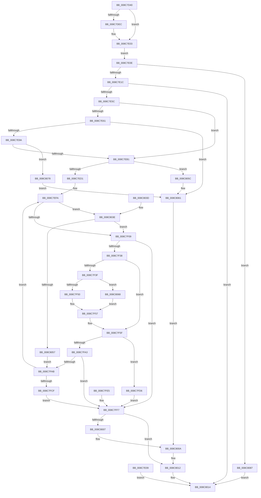

# NtGetNextThread

- RVA: `0x008C7D40`–`0x008C808E` (길이 `846` bytes)
- VA: `0x00000001408C7D40`
- 실행 섹션: `PAGE`
- PDB 이름 있음: `예`; PDB Function 태그: `아니요`
- unwind 정보 RVA: `0x00083FB4`
- 디코드: `186`개 명령, `846/846` bytes 표시
- 미해석 바이트: `0` (있으면 어셈블리에 `.byte`로 보존)

> 이 문서는 커널 이미지의 기계어와 PDB 기호를 분석해 생성했습니다. 4번과 5번은 함수 원형과 자료형을 바이너리 사용 방식에서 추정한 C 해석이며 원본 소스 복구 결과는 아닙니다.

## 1. Dependencies

- 직접 호출 지점: **15**; 고유 호출 대상: **10**
- 직접 호출자로 확인된 함수: **0**
- RIP 상대 이미지 참조: **4**

### Outgoing calls
- `0x008C7D9E` → [memset](../../text/6C/memset_function_006C6C40.md) (function, `0x006C6C40`)
- `0x008C7DB3` → [memset](../../text/6C/memset_function_006C6C40.md) (function, `0x006C6C40`)
- `0x008C7E4F` → [ObpReferenceObjectByHandleWithTag](../86/ObpReferenceObjectByHandleWithTag_function_00869650.md) (function, `0x00869650`)
- `0x008C7E8B` → [ObpReferenceObjectByHandleWithTag](../86/ObpReferenceObjectByHandleWithTag_function_00869650.md) (function, `0x00869650`)
- `0x008C7EBB` → [PsGetNextProcessThread](PsGetNextProcessThread_function_008C9CF0.md) (function, `0x008C9CF0`)
- `0x008C7EDB` → [SeSinglePrivilegeCheck](../87/SeSinglePrivilegeCheck_function_00871E20.md) (function, `0x00871E20`)
- `0x008C7F29` → [SeCreateAccessState](SeCreateAccessState_function_008C6AC0.md) (function, `0x008C6AC0`)
- `0x008C7F8B` → [ObOpenObjectByPointer](../8B/ObOpenObjectByPointer_function_008B7420.md) (function, `0x008B7420`)
- `0x008C7F9A` → [SeDeleteAccessState](SeDeleteAccessState_function_008C5F70.md) (function, `0x008C5F70`)
- `0x008C7FB1` → [PsGetNextProcessThread](PsGetNextProcessThread_function_008C9CF0.md) (function, `0x008C9CF0`)
- `0x008C7FFD` → [ObfDereferenceObjectWithTag](../../text/2F/ObfDereferenceObjectWithTag_function_002F78E0.md) (function, `0x002F78E0`)
- `0x008C800D` → [ObfDereferenceObjectWithTag](../../text/2F/ObfDereferenceObjectWithTag_function_002F78E0.md) (function, `0x002F78E0`)
- `0x008C801F` → [_security_check_cookie](../../text/6A/_security_check_cookie_function_006AC640.md) (function, `0x006AC640`)
- `0x008C8044` → [PsSynchronizeWithThreadInsertion](../A1/PsSynchronizeWithThreadInsertion_function_00A111DC.md) (function, `0x00A111DC`)
- `0x008C807B` → [ObfDereferenceObjectWithTag](../../text/2F/ObfDereferenceObjectWithTag_function_002F78E0.md) (function, `0x002F78E0`)

### Direct callers
- 이 함수 시작 RVA로 연결되는 직접 call은 확인되지 않았습니다. 간접 호출은 완전히 역산할 수 없습니다.

### Static image references
- `0x008C7D55` → RVA `0x00E0A740` (`.data`; read)
- `0x008C7E1C` → RVA `0x00FC6A98` (`ALMOSTRO`; read)
- `0x008C7E61` → RVA `0x00FC6AC8` (`ALMOSTRO`; read)
- `0x008C7ED4` → RVA `0x00FD9A80` (`PAGEDATA`; read)

## 2. Other-region calls and transfers

- 다른 실행 섹션으로 향하는 call: **6**
  - `0x008C7D9E` → [memset](../../text/6C/memset_function_006C6C40.md) (`PAGE` → `.text`)
  - `0x008C7DB3` → [memset](../../text/6C/memset_function_006C6C40.md) (`PAGE` → `.text`)
  - `0x008C7FFD` → [ObfDereferenceObjectWithTag](../../text/2F/ObfDereferenceObjectWithTag_function_002F78E0.md) (`PAGE` → `.text`)
  - `0x008C800D` → [ObfDereferenceObjectWithTag](../../text/2F/ObfDereferenceObjectWithTag_function_002F78E0.md) (`PAGE` → `.text`)
  - `0x008C801F` → [_security_check_cookie](../../text/6A/_security_check_cookie_function_006AC640.md) (`PAGE` → `.text`)
  - `0x008C807B` → [ObfDereferenceObjectWithTag](../../text/2F/ObfDereferenceObjectWithTag_function_002F78E0.md) (`PAGE` → `.text`)
- 별도 외부 분기/꼬리 이동을 확인하지 못했습니다.

## 3. Assembly (complete function range)

```asm
008C7D40  48 89 74 24 18                  mov qword ptr [rsp + 0x18], rsi
008C7D45  57                              push rdi
008C7D46  41 54                           push r12
008C7D48  41 55                           push r13
008C7D4A  41 56                           push r14
008C7D4C  41 57                           push r15
008C7D4E  48 81 EC 20 02 00 00            sub rsp, 0x220
008C7D55  48 8B 05 E4 29 54 00            mov rax, qword ptr [rip + 0x5429e4]
008C7D5C  48 33 C4                        xor rax, rsp
008C7D5F  48 89 84 24 10 02 00 00         mov qword ptr [rsp + 0x210], rax
008C7D67  45 8B F1                        mov r14d, r9d
008C7D6A  44 89 44 24 50                  mov dword ptr [rsp + 0x50], r8d
008C7D6F  48 8B F2                        mov rsi, rdx
008C7D72  4C 8B E9                        mov r13, rcx
008C7D75  48 8B BC 24 78 02 00 00         mov rdi, qword ptr [rsp + 0x278]
008C7D7D  48 89 7C 24 70                  mov qword ptr [rsp + 0x70], rdi
008C7D82  48 83 64 24 48 00               and qword ptr [rsp + 0x48], 0
008C7D88  48 83 64 24 58 00               and qword ptr [rsp + 0x58], 0
008C7D8E  33 D2                           xor edx, edx
008C7D90  41 B8 A0 00 00 00               mov r8d, 0xa0
008C7D96  48 8D 8C 24 90 00 00 00         lea rcx, [rsp + 0x90]
008C7D9E  E8 9D EE DF FF                  call 0x1406c6c40
008C7DA3  33 D2                           xor edx, edx
008C7DA5  41 B8 E0 00 00 00               mov r8d, 0xe0
008C7DAB  48 8D 8C 24 30 01 00 00         lea rcx, [rsp + 0x130]
008C7DB3  E8 88 EE DF FF                  call 0x1406c6c40
008C7DB8  48 83 64 24 60 00               and qword ptr [rsp + 0x60], 0
008C7DBE  65 48 8B 04 25 88 01 00 00      mov rax, qword ptr gs:[0x188]
008C7DC7  44 8A A0 32 02 00 00            mov r12b, byte ptr [rax + 0x232]
008C7DCE  41 8A C4                        mov al, r12b
008C7DD1  F6 D8                           neg al
008C7DD3  45 1B FF                        sbb r15d, r15d
008C7DD6  41 81 E7 00 FE FE FF            and r15d, 0xfffefe00
008C7DDD  41 81 C7 F2 1F 01 00            add r15d, 0x11ff2
008C7DE4  45 23 FE                        and r15d, r14d
008C7DE7  45 84 E4                        test r12b, r12b
008C7DEA  74 17                           je 0x1408c7e03
008C7DEC  48 B9 00 00 FF FF FF 7F 00 00   movabs rcx, 0x7fffffff0000
008C7DF6  48 3B F9                        cmp rdi, rcx
008C7DF9  48 0F 42 CF                     cmovb rcx, rdi
008C7DFD  48 8B 01                        mov rax, qword ptr [rcx]
008C7E00  48 89 01                        mov qword ptr [rcx], rax
008C7E03  48 83 27 00                     and qword ptr [rdi], 0
008C7E07  EB 05                           jmp 0x1408c7e0e
008C7E09  E9 06 02 00 00                  jmp 0x1408c8014
008C7E0E  83 BC 24 70 02 00 00 00         cmp dword ptr [rsp + 0x270], 0
008C7E16  0F 85 6B 02 00 00               jne 0x1408c8087
008C7E1C  4C 8B 05 75 EC 6F 00            mov r8, qword ptr [rip + 0x6fec75]
008C7E23  48 83 64 24 38 00               and qword ptr [rsp + 0x38], 0
008C7E29  48 83 64 24 30 00               and qword ptr [rsp + 0x30], 0
008C7E2F  48 8D 44 24 48                  lea rax, [rsp + 0x48]
008C7E34  48 89 44 24 28                  mov qword ptr [rsp + 0x28], rax
008C7E39  41 BE 50 73 45 6E               mov r14d, 0x6e457350
008C7E3F  44 89 74 24 20                  mov dword ptr [rsp + 0x20], r14d
008C7E44  45 8A CC                        mov r9b, r12b
008C7E47  BA 00 04 00 00                  mov edx, 0x400
008C7E4C  49 8B CD                        mov rcx, r13
008C7E4F  E8 FC 17 FA FF                  call 0x140869650
008C7E54  85 C0                           test eax, eax
008C7E56  0F 88 B8 01 00 00               js 0x1408c8014
008C7E5C  48 85 F6                        test rsi, rsi
008C7E5F  74 50                           je 0x1408c7eb1
008C7E61  4C 8B 05 60 EC 6F 00            mov r8, qword ptr [rip + 0x6fec60]
008C7E68  48 83 64 24 38 00               and qword ptr [rsp + 0x38], 0
008C7E6E  48 83 64 24 30 00               and qword ptr [rsp + 0x30], 0
008C7E74  48 8D 44 24 58                  lea rax, [rsp + 0x58]
008C7E79  48 89 44 24 28                  mov qword ptr [rsp + 0x28], rax
008C7E7E  44 89 74 24 20                  mov dword ptr [rsp + 0x20], r14d
008C7E83  45 8A CC                        mov r9b, r12b
008C7E86  33 D2                           xor edx, edx
008C7E88  48 8B CE                        mov rcx, rsi
008C7E8B  E8 C0 17 FA FF                  call 0x140869650
008C7E90  8B F0                           mov esi, eax
008C7E92  85 C0                           test eax, eax
008C7E94  0F 88 C7 01 00 00               js 0x1408c8061
008C7E9A  48 8B 44 24 48                  mov rax, qword ptr [rsp + 0x48]
008C7E9F  48 8B 4C 24 58                  mov rcx, qword ptr [rsp + 0x58]
008C7EA4  48 39 81 20 02 00 00            cmp qword ptr [rcx + 0x220], rax
008C7EAB  0F 85 C7 01 00 00               jne 0x1408c8078
008C7EB1  48 8B 54 24 58                  mov rdx, qword ptr [rsp + 0x58]
008C7EB6  48 8B 4C 24 48                  mov rcx, qword ptr [rsp + 0x48]
008C7EBB  E8 30 1E 00 00                  call 0x1408c9cf0
008C7EC0  48 8B F8                        mov rdi, rax
008C7EC3  48 89 44 24 68                  mov qword ptr [rsp + 0x68], rax
008C7EC8  48 85 C0                        test rax, rax
008C7ECB  0F 84 8B 01 00 00               je 0x1408c805c
008C7ED1  41 8A D4                        mov dl, r12b
008C7ED4  48 8B 0D A5 1B 71 00            mov rcx, qword ptr [rip + 0x711ba5]
008C7EDB  E8 40 9F FA FF                  call 0x140871e20
008C7EE0  88 44 24 40                     mov byte ptr [rsp + 0x40], al
008C7EE4  65 48 8B 04 25 88 01 00 00      mov rax, qword ptr gs:[0x188]
008C7EED  48 89 84 24 80 00 00 00         mov qword ptr [rsp + 0x80], rax
008C7EF5  4C 8B 6C 24 48                  mov r13, qword ptr [rsp + 0x48]
008C7EFA  8B 8F A0 05 00 00               mov ecx, dword ptr [rdi + 0x5a0]
008C7F00  F6 C1 02                        test cl, 2
008C7F03  0F 84 35 01 00 00               je 0x1408c803e
008C7F09  4C 8B 0D 88 EB 6F 00            mov r9, qword ptr [rip + 0x6feb88]
008C7F10  49 83 C1 4C                     add r9, 0x4c
008C7F14  44 8B 44 24 50                  mov r8d, dword ptr [rsp + 0x50]
008C7F19  48 8D 94 24 30 01 00 00         lea rdx, [rsp + 0x130]
008C7F21  48 8D 8C 24 90 00 00 00         lea rcx, [rsp + 0x90]
008C7F29  E8 92 EB FF FF                  call 0x1408c6ac0
008C7F2E  8B F0                           mov esi, eax
008C7F30  85 C0                           test eax, eax
008C7F32  0F 88 BF 00 00 00               js 0x1408c7ff7
008C7F38  80 7C 24 40 00                  cmp byte ptr [rsp + 0x40], 0
008C7F3D  74 20                           je 0x1408c7f5f
008C7F3F  8B 84 24 A0 00 00 00            mov eax, dword ptr [rsp + 0xa0]
008C7F46  0F BA E0 19                     bt eax, 0x19
008C7F4A  0F 82 18 01 00 00               jb 0x1408c8068
008C7F50  09 84 24 A4 00 00 00            or dword ptr [rsp + 0xa4], eax
008C7F57  83 A4 24 A0 00 00 00 00         and dword ptr [rsp + 0xa0], 0
008C7F5F  48 8D 44 24 60                  lea rax, [rsp + 0x60]
008C7F64  48 89 44 24 30                  mov qword ptr [rsp + 0x30], rax
008C7F69  44 88 64 24 28                  mov byte ptr [rsp + 0x28], r12b
008C7F6E  48 8B 05 53 EB 6F 00            mov rax, qword ptr [rip + 0x6feb53]
008C7F75  48 89 44 24 20                  mov qword ptr [rsp + 0x20], rax
008C7F7A  45 33 C9                        xor r9d, r9d
008C7F7D  4C 8D 84 24 90 00 00 00         lea r8, [rsp + 0x90]
008C7F85  41 8B D7                        mov edx, r15d
008C7F88  48 8B CF                        mov rcx, rdi
008C7F8B  E8 90 F4 FE FF                  call 0x1408b7420
008C7F90  8B F0                           mov esi, eax
008C7F92  48 8D 8C 24 90 00 00 00         lea rcx, [rsp + 0x90]
008C7F9A  E8 D1 DF FF FF                  call 0x1408c5f70
008C7F9F  85 F6                           test esi, esi
008C7FA1  79 33                           jns 0x1408c7fd6
008C7FA3  81 FE 22 00 00 C0               cmp esi, 0xc0000022
008C7FA9  75 4C                           jne 0x1408c7ff7
008C7FAB  48 8B D7                        mov rdx, rdi
008C7FAE  49 8B CD                        mov rcx, r13
008C7FB1  E8 3A 1D 00 00                  call 0x1408c9cf0
008C7FB6  48 8B F8                        mov rdi, rax
008C7FB9  48 89 44 24 68                  mov qword ptr [rsp + 0x68], rax
008C7FBE  48 85 C0                        test rax, rax
008C7FC1  48 8B 84 24 80 00 00 00         mov rax, qword ptr [rsp + 0x80]
008C7FC9  0F 85 2B FF FF FF               jne 0x1408c7efa
008C7FCF  BE 1A 00 00 80                  mov esi, 0x8000001a
008C7FD4  EB 21                           jmp 0x1408c7ff7
008C7FD6  48 8B 44 24 60                  mov rax, qword ptr [rsp + 0x60]
008C7FDB  48 8B 4C 24 70                  mov rcx, qword ptr [rsp + 0x70]
008C7FE0  48 89 01                        mov qword ptr [rcx], rax
008C7FE3  EB 12                           jmp 0x1408c7ff7
008C7FE5  8B F0                           mov esi, eax
008C7FE7  41 BE 50 73 45 6E               mov r14d, 0x6e457350
008C7FED  4C 8B 6C 24 48                  mov r13, qword ptr [rsp + 0x48]
008C7FF2  48 8B 7C 24 68                  mov rdi, qword ptr [rsp + 0x68]
008C7FF7  41 8B D6                        mov edx, r14d
008C7FFA  49 8B CD                        mov rcx, r13
008C7FFD  E8 DE F8 A2 FF                  call 0x1402f78e0
008C8002  48 85 FF                        test rdi, rdi
008C8005  74 0B                           je 0x1408c8012
008C8007  48 8B CF                        mov rcx, rdi
008C800A  41 8B D6                        mov edx, r14d
008C800D  E8 CE F8 A2 FF                  call 0x1402f78e0
008C8012  8B C6                           mov eax, esi
008C8014  48 8B 8C 24 10 02 00 00         mov rcx, qword ptr [rsp + 0x210]
008C801C  48 33 CC                        xor rcx, rsp
008C801F  E8 1C 46 DE FF                  call 0x1406ac640
008C8024  48 8B B4 24 60 02 00 00         mov rsi, qword ptr [rsp + 0x260]
008C802C  48 81 C4 20 02 00 00            add rsp, 0x220
008C8033  41 5F                           pop r15
008C8035  41 5E                           pop r14
008C8037  41 5D                           pop r13
008C8039  41 5C                           pop r12
008C803B  5F                              pop rdi
008C803C  C3                              ret
008C803D  CC                              int3
008C803E  48 8B D0                        mov rdx, rax
008C8041  48 8B CF                        mov rcx, rdi
008C8044  E8 93 91 14 00                  call 0x140a111dc
008C8049  8B 87 A0 05 00 00               mov eax, dword ptr [rdi + 0x5a0]
008C804F  A8 02                           test al, 2
008C8051  0F 85 B2 FE FF FF               jne 0x1408c7f09
008C8057  E9 4F FF FF FF                  jmp 0x1408c7fab
008C805C  BE 1A 00 00 80                  mov esi, 0x8000001a
008C8061  48 8B 4C 24 48                  mov rcx, qword ptr [rsp + 0x48]
008C8066  EB A2                           jmp 0x1408c800a
008C8068  81 8C 24 A4 00 00 00 FF FF 1F 00  or dword ptr [rsp + 0xa4], 0x1fffff
008C8073  E9 DF FE FF FF                  jmp 0x1408c7f57
008C8078  41 8B D6                        mov edx, r14d
008C807B  E8 60 F8 A2 FF                  call 0x1402f78e0
008C8080  BE 0D 00 00 C0                  mov esi, 0xc000000d
008C8085  EB DA                           jmp 0x1408c8061
008C8087  B8 0D 00 00 C0                  mov eax, 0xc000000d
008C808C  EB 86                           jmp 0x1408c8014
```

## 4. C-style interpretation (structured pseudocode)

```c
__int64 __fastcall NtGetNextThread(__int64 a1, __int64 a2, int a3, int a4, unsigned int a5, __int64 a6)
{
    __int64 result;
    __int64 v_r15;
    __int64 v_rsp;
    unsigned __int64 v_stack_m118;
    unsigned int v_stack_m1A4;
    unsigned int v_stack_m1A8;
    unsigned __int64 v_stack_m1B8;
    unsigned __int64 v_stack_m1C8;
    unsigned __int64 v_stack_m1D8;
    unsigned __int64 v_stack_m1E0;
    unsigned __int64 v_stack_m1E8;
    unsigned __int64 v_stack_m1F0;
    unsigned int v_stack_m1F8;
    unsigned __int64 v_stack_m200;
    unsigned __int8 v_stack_m208;
    unsigned __int64 v_stack_m210;
    unsigned __int64 v_stack_m218;
    unsigned __int64 v_stack_m220;
    unsigned int v_stack_m228;
    unsigned __int64 v_stack_m38;
    unsigned __int64 v_stack_p18;
    unsigned __int64 v_stack_p48;
    unsigned int v_stack_pA4;

    v_stack_p18 = v_rsi;
    v_rsp = (v_rsp) - (544);
    result = (*(unsigned __int64 *)(v_rip + 5515748)) ^ (v_rsp);
    v_stack_m38 = result;
    v_stack_m1F8 = a3;
    v_stack_m1D8 = a6;
    a2 = 0;
    result = memset(v_stack_m1B8, a2, 160, a4);
    a2 = 0;
    result = memset(v_stack_m118, a2, 224, a4);
    result = (unsigned __int8)(-((unsigned __int8)(*(unsigned __int8 *)(*(unsigned __int64 *)(gs_base + (0 + 392)) + 562))));
    v_r15 = (unsigned int)((v_r15) & (0xFFFEFE00ULL));
    v_r15 = (unsigned int)((v_r15) + (0x11FF2ULL));
    v_r15 = (unsigned int)((v_r15) & ((unsigned int)((unsigned int)(a4))));
    if ((unsigned __int8)(*(unsigned __int8 *)(*(unsigned __int64 *)(gs_base + (0 + 392)) + 562)) != 0) {
        a1 = v_stack_m118;
        if (a6 < v_stack_m118) { a1 = a6; }
        result = *(unsigned __int64 *)(a1);
        *(unsigned __int64 *)(a1) = result;
    }
    goto loc_008C7E0E;
loc_008C7E0E:
    if (a5 != 0) goto loc_008C8087;
    v_stack_m220 = v_stack_m200;
    v_stack_m228 = (unsigned int)((unsigned int)(0x6E457350ULL));
    result = ObpReferenceObjectByHandleWithTag(a1, (unsigned int)(0x400ULL), *(unsigned __int64 *)(v_rip + 7335029), (unsigned __int8)(*(unsigned __int8 *)(*(unsigned __int64 *)(gs_base + (0 + 392)) + 562)));
    if (sign_flag) goto loc_008C8014;
    if (0 == 0) goto loc_008C7EB1;
    v_stack_m220 = v_stack_m1F0;
    v_stack_m228 = (unsigned int)((unsigned int)(0x6E457350ULL));
    a2 = 0;
    result = ObpReferenceObjectByHandleWithTag(0, a2, *(unsigned __int64 *)(v_rip + 7335008), (unsigned __int8)(*(unsigned __int8 *)(*(unsigned __int64 *)(gs_base + (0 + 392)) + 562)));
    if (sign_flag) goto loc_008C8061;
    if ((*(unsigned __int64 *)(v_stack_m1F0 + 544)) != v_stack_m200) goto loc_008C8078;
loc_008C7EB1:
    result = PsGetNextProcessThread(v_stack_m200, v_stack_m1F0, *(unsigned __int64 *)(v_rip + 7335008), (unsigned __int8)(*(unsigned __int8 *)(*(unsigned __int64 *)(gs_base + (0 + 392)) + 562)));
    v_stack_m1E0 = result;
    if (result == 0) goto loc_008C805C;
    result = SeSinglePrivilegeCheck(*(unsigned __int64 *)(v_rip + 7412645), (unsigned __int8)(*(unsigned __int8 *)(*(unsigned __int64 *)(gs_base + (0 + 392)) + 562)), *(unsigned __int64 *)(v_rip + 7335008), (unsigned __int8)(*(unsigned __int8 *)(*(unsigned __int64 *)(gs_base + (0 + 392)) + 562)));
    v_stack_m208 = (unsigned __int8)(result);
    v_stack_m1C8 = *(unsigned __int64 *)(gs_base + (0 + 392));
loc_008C7EFA:
    if ((((unsigned __int8)((unsigned int)(*(unsigned int *)(result + 1440)))) & (2)) == 0) goto loc_008C803E;
loc_008C7F09:
    a4 = (*(unsigned __int64 *)(v_rip + 7334792)) + (76);
    result = SeCreateAccessState(v_stack_m1B8, v_stack_m118, (unsigned int)(v_stack_m1F8), a4);
    if (sign_flag) goto loc_008C7FF7;
    if (v_stack_m208 == 0) goto loc_008C7F5F;
    if (v_stack_m208 < 0) goto loc_008C8068;
loc_008C7F57:
loc_008C7F5F:
    v_stack_m218 = v_stack_m1E8;
    v_stack_m220 = (unsigned __int8)(*(unsigned __int8 *)(*(unsigned __int64 *)(gs_base + (0 + 392)) + 562));
    v_stack_m228 = *(unsigned __int64 *)(v_rip + 7334739);
    a4 = 0;
    result = ObOpenObjectByPointer(result, (unsigned int)((unsigned int)(v_r15)), v_stack_m1B8, a4);
    result = SeDeleteAccessState(v_stack_m1B8, (unsigned int)((unsigned int)(v_r15)), v_stack_m1B8, a4);
    if (!sign_flag) goto loc_008C7FD6;
    if (((unsigned int)((unsigned int)((unsigned int)(result)))) != 0xC0000022ULL) goto loc_008C7FF7;
loc_008C7FAB:
    result = PsGetNextProcessThread(v_stack_m200, result, v_stack_m1B8, a4);
    v_stack_m1E0 = result;
    if (result != 0) goto loc_008C7EFA;
    goto loc_008C7FF7;
loc_008C7FD6:
    *(unsigned __int64 *)(v_stack_m1D8) = v_stack_m1E8;
    goto loc_008C7FF7;
loc_008C7FF7:
    result = ObfDereferenceObjectWithTag(v_stack_m200, (unsigned int)((unsigned int)((unsigned int)(0x6E457350ULL))), v_stack_m1B8, a4);
    if (result == 0) goto loc_008C8012;
loc_008C800A:
    result = ObfDereferenceObjectWithTag(result, (unsigned int)((unsigned int)((unsigned int)(0x6E457350ULL))), v_stack_m1B8, a4);
loc_008C8012:
loc_008C8014:
    a1 = (v_stack_m38) ^ (v_rsp);
    result = _security_check_cookie(a1, (unsigned int)((unsigned int)((unsigned int)(0x6E457350ULL))), v_stack_m1B8, a4);
    v_rsp = (v_rsp) + (544);
    return result;
loc_008C803E:
    result = PsSynchronizeWithThreadInsertion(result, result, v_stack_m1B8, a4);
    if ((((unsigned __int8)((unsigned int)(*(unsigned int *)(result + 1440)))) & (2)) != 0) goto loc_008C7F09;
    goto loc_008C7FAB;
loc_008C805C:
loc_008C8061:
    goto loc_008C800A;
loc_008C8068:
    goto loc_008C7F57;
loc_008C8078:
    result = ObfDereferenceObjectWithTag(v_stack_p48, (unsigned int)((unsigned int)((unsigned int)(0x6E457350ULL))), v_stack_m1B8, a4);
    goto loc_008C8061;
loc_008C8087:
    goto loc_008C8014;
}
```

## 5. (Beta) C Style

```c
int64_t NtGetNextThread(int64_t Arg1, int64_t Arg2, int32_t Arg3, int32_t Arg4, uint32_t Arg5, int64_t Arg6)
{
    int64_t result;
    int64_t local_r15;
    int64_t local_rsp;
    uint64_t v_stack_m118;
    uint32_t v_stack_m1A4;
    uint32_t v_stack_m1A8;
    uint64_t v_stack_m1B8;
    uint64_t v_stack_m1C8;
    uint64_t v_stack_m1D8;
    uint64_t v_stack_m1E0;
    uint64_t v_stack_m1E8;
    uint64_t v_stack_m1F0;
    uint32_t v_stack_m1F8;
    uint64_t v_stack_m200;
    uint8_t v_stack_m208;
    uint64_t v_stack_m210;
    uint64_t v_stack_m218;
    uint64_t v_stack_m220;
    uint32_t v_stack_m228;
    uint64_t v_stack_m38;
    uint64_t v_stack_p18;
    uint64_t v_stack_p48;
    uint32_t v_stack_pA4;

    v_stack_p18 = local_rsi;
    local_rsp = (local_rsp) - (544);
    result = (*(uint64_t *)(v_rip + 0x5429E4)) ^ (local_rsp);
    v_stack_m38 = result;
    v_stack_m1F8 = Arg3;
    v_stack_m1D8 = Arg6;
    Arg2 = 0;
    result = memset(v_stack_m1B8, Arg2, 160, Arg4);
    Arg2 = 0;
    result = memset(v_stack_m118, Arg2, 224, Arg4);
    result = (uint8_t)(-((uint8_t)(*(uint8_t *)(*(uint64_t *)(gs_base + (0 + 0x188)) + 0x232))));
    local_r15 = (uint32_t)((local_r15) & (0xFFFEFE00ULL));
    local_r15 = (uint32_t)((local_r15) + (0x11FF2ULL));
    local_r15 = (uint32_t)((local_r15) & ((uint32_t)((uint32_t)(Arg4))));
    if ((uint8_t)(*(uint8_t *)(*(uint64_t *)(gs_base + (0 + 0x188)) + 0x232)) != 0) {
        Arg1 = v_stack_m118;
        if (Arg6 < v_stack_m118) { Arg1 = Arg6; }
        result = *(uint64_t *)(Arg1);
        *(uint64_t *)(Arg1) = result;
    }
    goto loc_008C7E0E;
loc_008C7E0E:
    if (Arg5 != 0) goto loc_008C8087;
    v_stack_m220 = v_stack_m200;
    v_stack_m228 = (uint32_t)((uint32_t)(0x6E457350ULL));
    result = ObpReferenceObjectByHandleWithTag(Arg1, (uint32_t)(0x400ULL), *(uint64_t *)(v_rip + 0x6FEC75), (uint8_t)(*(uint8_t *)(*(uint64_t *)(gs_base + (0 + 0x188)) + 0x232)));
    if (sign_flag) goto loc_008C8014;
    if (0 == 0) goto loc_008C7EB1;
    v_stack_m220 = v_stack_m1F0;
    v_stack_m228 = (uint32_t)((uint32_t)(0x6E457350ULL));
    Arg2 = 0;
    result = ObpReferenceObjectByHandleWithTag(0, Arg2, *(uint64_t *)(v_rip + 0x6FEC60), (uint8_t)(*(uint8_t *)(*(uint64_t *)(gs_base + (0 + 0x188)) + 0x232)));
    if (sign_flag) goto loc_008C8061;
    if ((*(uint64_t *)(v_stack_m1F0 + 0x220)) != v_stack_m200) goto loc_008C8078;
loc_008C7EB1:
    result = PsGetNextProcessThread(v_stack_m200, v_stack_m1F0, *(uint64_t *)(v_rip + 0x6FEC60), (uint8_t)(*(uint8_t *)(*(uint64_t *)(gs_base + (0 + 0x188)) + 0x232)));
    v_stack_m1E0 = result;
    if (result == 0) goto loc_008C805C;
    result = SeSinglePrivilegeCheck(*(uint64_t *)(v_rip + 0x711BA5), (uint8_t)(*(uint8_t *)(*(uint64_t *)(gs_base + (0 + 0x188)) + 0x232)), *(uint64_t *)(v_rip + 0x6FEC60), (uint8_t)(*(uint8_t *)(*(uint64_t *)(gs_base + (0 + 0x188)) + 0x232)));
    v_stack_m208 = (uint8_t)(result);
    v_stack_m1C8 = *(uint64_t *)(gs_base + (0 + 0x188));
loc_008C7EFA:
    if ((((uint8_t)((uint32_t)(*(uint32_t *)(result + 0x5A0)))) & (2)) == 0) goto loc_008C803E;
loc_008C7F09:
    Arg4 = (*(uint64_t *)(v_rip + 0x6FEB88)) + (76);
    result = SeCreateAccessState(v_stack_m1B8, v_stack_m118, (uint32_t)(v_stack_m1F8), Arg4);
    if (sign_flag) goto loc_008C7FF7;
    if (v_stack_m208 == 0) goto loc_008C7F5F;
    if (v_stack_m208 < 0) goto loc_008C8068;
loc_008C7F57:
loc_008C7F5F:
    v_stack_m218 = v_stack_m1E8;
    v_stack_m220 = (uint8_t)(*(uint8_t *)(*(uint64_t *)(gs_base + (0 + 0x188)) + 0x232));
    v_stack_m228 = *(uint64_t *)(v_rip + 0x6FEB53);
    Arg4 = 0;
    result = ObOpenObjectByPointer(result, (uint32_t)((uint32_t)(local_r15)), v_stack_m1B8, Arg4);
    result = SeDeleteAccessState(v_stack_m1B8, (uint32_t)((uint32_t)(local_r15)), v_stack_m1B8, Arg4);
    if (!sign_flag) goto loc_008C7FD6;
    if (((uint32_t)((uint32_t)((uint32_t)(result)))) != 0xC0000022ULL) goto loc_008C7FF7;
loc_008C7FAB:
    result = PsGetNextProcessThread(v_stack_m200, result, v_stack_m1B8, Arg4);
    v_stack_m1E0 = result;
    if (result != 0) goto loc_008C7EFA;
    goto loc_008C7FF7;
loc_008C7FD6:
    *(uint64_t *)(v_stack_m1D8) = v_stack_m1E8;
    goto loc_008C7FF7;
loc_008C7FF7:
    result = ObfDereferenceObjectWithTag(v_stack_m200, (uint32_t)((uint32_t)((uint32_t)(0x6E457350ULL))), v_stack_m1B8, Arg4);
    if (result == 0) goto loc_008C8012;
loc_008C800A:
    result = ObfDereferenceObjectWithTag(result, (uint32_t)((uint32_t)((uint32_t)(0x6E457350ULL))), v_stack_m1B8, Arg4);
loc_008C8012:
loc_008C8014:
    Arg1 = (v_stack_m38) ^ (local_rsp);
    result = _security_check_cookie(Arg1, (uint32_t)((uint32_t)((uint32_t)(0x6E457350ULL))), v_stack_m1B8, Arg4);
    local_rsp = (local_rsp) + (544);
    return result;
loc_008C803E:
    result = PsSynchronizeWithThreadInsertion(result, result, v_stack_m1B8, Arg4);
    if ((((uint8_t)((uint32_t)(*(uint32_t *)(result + 0x5A0)))) & (2)) != 0) goto loc_008C7F09;
    goto loc_008C7FAB;
loc_008C805C:
loc_008C8061:
    goto loc_008C800A;
loc_008C8068:
    goto loc_008C7F57;
loc_008C8078:
    result = ObfDereferenceObjectWithTag(v_stack_p48, (uint32_t)((uint32_t)((uint32_t)(0x6E457350ULL))), v_stack_m1B8, Arg4);
    goto loc_008C8061;
loc_008C8087:
    goto loc_008C8014;
}
```

## 6. Execution-region graph

[열기: 2D/3D 그래프와 함수 탐색 컨트롤 패널](../../../control-panel.html?section=page&rva=0x008C7D40&view=graph)

- 2D 그래프는 위에서 아래로 흐르고, 3D 그래프는 빈 공간을 드래그해 회전합니다. Shift+드래그는 이동, 휠은 확대·축소, 함수 노드 선택은 대상 보고서 이동입니다.

### Static fallback


