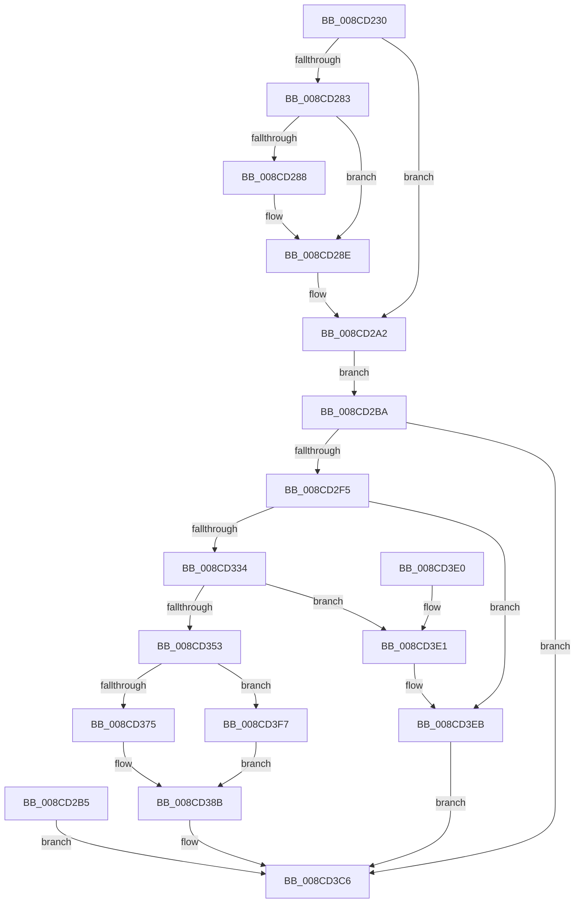

# NtImpersonateThread

- RVA: `0x008CD230`–`0x008CD3FC` (길이 `460` bytes)
- VA: `0x00000001408CD230`
- 실행 섹션: `PAGE`
- PDB 이름 있음: `예`; PDB Function 태그: `아니요`
- unwind 정보 RVA: `0x00084670`
- 디코드: `109`개 명령, `460/460` bytes 표시
- 미해석 바이트: `0` (있으면 어셈블리에 `.byte`로 보존)

> 이 문서는 커널 이미지의 기계어와 PDB 기호를 분석해 생성했습니다. 4번과 5번은 함수 원형과 자료형을 바이너리 사용 방식에서 추정한 C 해석이며 원본 소스 복구 결과는 아닙니다.

## 1. Dependencies

- 직접 호출 지점: **11**; 고유 호출 대상: **7**
- 직접 호출자로 확인된 함수: **0**
- RIP 상대 이미지 참조: **1**

### Outgoing calls
- `0x008CD269` → [memset](../../text/6C/memset_function_006C6C40.md) (function, `0x006C6C40`)
- `0x008CD288` → [ExRaiseDatatypeMisalignment](../89/ExRaiseDatatypeMisalignment_function_00899FD0.md) (function, `0x00899FD0`)
- `0x008CD2E8` → [ObReferenceObjectByHandle](../86/ObReferenceObjectByHandle_function_00868DB0.md) (function, `0x00868DB0`)
- `0x008CD31D` → [ObReferenceObjectByHandle](../86/ObReferenceObjectByHandle_function_00868DB0.md) (function, `0x00868DB0`)
- `0x008CD344` → [SeCreateClientSecurity](../89/SeCreateClientSecurity_function_008911B0.md) (function, `0x008911B0`)
- `0x008CD39E` → [PsImpersonateClient](PsImpersonateClient_function_008CBE10.md) (function, `0x008CBE10`)
- `0x008CD3AE` → [ObfDereferenceObjectWithTag](../../text/2F/ObfDereferenceObjectWithTag_function_002F78E0.md) (function, `0x002F78E0`)
- `0x008CD3B6` → [ObfDereferenceObject](../../text/2F/ObfDereferenceObject_function_002F9350.md) (function, `0x002F9350`)
- `0x008CD3BE` → [ObfDereferenceObject](../../text/2F/ObfDereferenceObject_function_002F9350.md) (function, `0x002F9350`)
- `0x008CD3E6` → [ObfDereferenceObject](../../text/2F/ObfDereferenceObject_function_002F9350.md) (function, `0x002F9350`)
- `0x008CD3EE` → [ObfDereferenceObject](../../text/2F/ObfDereferenceObject_function_002F9350.md) (function, `0x002F9350`)

### Direct callers
- 이 함수 시작 RVA로 연결되는 직접 call은 확인되지 않았습니다. 간접 호출은 완전히 역산할 수 없습니다.

### Static image references
- `0x008CD2BA` → RVA `0x00FC6AC8` (`ALMOSTRO`; read)

## 2. Other-region calls and transfers

- 다른 실행 섹션으로 향하는 call: **6**
  - `0x008CD269` → [memset](../../text/6C/memset_function_006C6C40.md) (`PAGE` → `.text`)
  - `0x008CD3AE` → [ObfDereferenceObjectWithTag](../../text/2F/ObfDereferenceObjectWithTag_function_002F78E0.md) (`PAGE` → `.text`)
  - `0x008CD3B6` → [ObfDereferenceObject](../../text/2F/ObfDereferenceObject_function_002F9350.md) (`PAGE` → `.text`)
  - `0x008CD3BE` → [ObfDereferenceObject](../../text/2F/ObfDereferenceObject_function_002F9350.md) (`PAGE` → `.text`)
  - `0x008CD3E6` → [ObfDereferenceObject](../../text/2F/ObfDereferenceObject_function_002F9350.md) (`PAGE` → `.text`)
  - `0x008CD3EE` → [ObfDereferenceObject](../../text/2F/ObfDereferenceObject_function_002F9350.md) (`PAGE` → `.text`)
- 별도 외부 분기/꼬리 이동을 확인하지 못했습니다.

## 3. Assembly (complete function range)

```asm
008CD230  4C 8B DC                        mov r11, rsp
008CD233  49 89 5B 08                     mov qword ptr [r11 + 8], rbx
008CD237  49 89 73 10                     mov qword ptr [r11 + 0x10], rsi
008CD23B  49 89 7B 18                     mov qword ptr [r11 + 0x18], rdi
008CD23F  41 56                           push r14
008CD241  48 81 EC B0 00 00 00            sub rsp, 0xb0
008CD248  49 8B D8                        mov rbx, r8
008CD24B  48 8B F2                        mov rsi, rdx
008CD24E  4C 8B F1                        mov r14, rcx
008CD251  33 C0                           xor eax, eax
008CD253  49 89 43 88                     mov qword ptr [r11 - 0x78], rax
008CD257  89 44 24 48                     mov dword ptr [rsp + 0x48], eax
008CD25B  89 44 24 6C                     mov dword ptr [rsp + 0x6c], eax
008CD25F  33 D2                           xor edx, edx
008CD261  44 8D 40 44                     lea r8d, [rax + 0x44]
008CD265  49 8D 4B A8                     lea rcx, [r11 - 0x58]
008CD269  E8 D2 99 DF FF                  call 0x1406c6c40
008CD26E  65 48 8B 04 25 88 01 00 00      mov rax, qword ptr gs:[0x188]
008CD277  40 8A B8 32 02 00 00            mov dil, byte ptr [rax + 0x232]
008CD27E  40 84 FF                        test dil, dil
008CD281  74 1F                           je 0x1408cd2a2
008CD283  F6 C3 03                        test bl, 3
008CD286  74 06                           je 0x1408cd28e
008CD288  E8 43 CD FC FF                  call 0x140899fd0
008CD28D  CC                              int3
008CD28E  48 B8 00 00 FF FF FF 7F 00 00   movabs rax, 0x7fffffff0000
008CD298  48 3B D8                        cmp rbx, rax
008CD29B  48 0F 42 C3                     cmovb rax, rbx
008CD29F  90                              nop
008CD2A0  8A 00                           mov al, byte ptr [rax]
008CD2A2  F2 0F 10 03                     movsd xmm0, qword ptr [rbx]
008CD2A6  F2 0F 11 44 24 40               movsd qword ptr [rsp + 0x40], xmm0
008CD2AC  8B 43 08                        mov eax, dword ptr [rbx + 8]
008CD2AF  89 44 24 48                     mov dword ptr [rsp + 0x48], eax
008CD2B3  EB 05                           jmp 0x1408cd2ba
008CD2B5  E9 0C 01 00 00                  jmp 0x1408cd3c6
008CD2BA  4C 8B 05 07 98 6F 00            mov r8, qword ptr [rip + 0x6f9807]
008CD2C1  48 83 A4 24 D8 00 00 00 00      and qword ptr [rsp + 0xd8], 0
008CD2CA  48 83 64 24 28 00               and qword ptr [rsp + 0x28], 0
008CD2D0  48 8D 84 24 D8 00 00 00         lea rax, [rsp + 0xd8]
008CD2D8  48 89 44 24 20                  mov qword ptr [rsp + 0x20], rax
008CD2DD  44 8A CF                        mov r9b, dil
008CD2E0  BA 00 02 00 00                  mov edx, 0x200
008CD2E5  48 8B CE                        mov rcx, rsi
008CD2E8  E8 C3 BA F9 FF                  call 0x140868db0
008CD2ED  85 C0                           test eax, eax
008CD2EF  0F 88 D1 00 00 00               js 0x1408cd3c6
008CD2F5  4C 8B 05 CC 97 6F 00            mov r8, qword ptr [rip + 0x6f97cc]
008CD2FC  48 83 64 24 38 00               and qword ptr [rsp + 0x38], 0
008CD302  48 83 64 24 28 00               and qword ptr [rsp + 0x28], 0
008CD308  48 8D 44 24 38                  lea rax, [rsp + 0x38]
008CD30D  48 89 44 24 20                  mov qword ptr [rsp + 0x20], rax
008CD312  44 8A CF                        mov r9b, dil
008CD315  BA 00 01 00 00                  mov edx, 0x100
008CD31A  49 8B CE                        mov rcx, r14
008CD31D  E8 8E BA F9 FF                  call 0x140868db0
008CD322  8B F8                           mov edi, eax
008CD324  48 8B 9C 24 D8 00 00 00         mov rbx, qword ptr [rsp + 0xd8]
008CD32C  85 C0                           test eax, eax
008CD32E  0F 88 B7 00 00 00               js 0x1408cd3eb
008CD334  4C 8D 4C 24 60                  lea r9, [rsp + 0x60]
008CD339  45 33 C0                        xor r8d, r8d
008CD33C  48 8D 54 24 40                  lea rdx, [rsp + 0x40]
008CD341  48 8B CB                        mov rcx, rbx
008CD344  E8 67 3E FC FF                  call 0x1408911b0
008CD349  8B F8                           mov edi, eax
008CD34B  85 C0                           test eax, eax
008CD34D  0F 88 8E 00 00 00               js 0x1408cd3e1
008CD353  44 0F B6 4C 24 69               movzx r9d, byte ptr [rsp + 0x69]
008CD359  0F B6 44 24 79                  movzx eax, byte ptr [rsp + 0x79]
008CD35E  80 7C 24 78 00                  cmp byte ptr [rsp + 0x78], 0
008CD363  44 0F 45 C8                     cmovne r9d, eax
008CD367  48 8B 7C 24 38                  mov rdi, qword ptr [rsp + 0x38]
008CD36C  48 85 FF                        test rdi, rdi
008CD36F  0F 85 82 00 00 00               jne 0x1408cd3f7
008CD375  65 48 8B 0C 25 88 01 00 00      mov rcx, qword ptr gs:[0x188]
008CD37E  48 8B 9C 24 D8 00 00 00         mov rbx, qword ptr [rsp + 0xd8]
008CD386  48 8B 7C 24 38                  mov rdi, qword ptr [rsp + 0x38]
008CD38B  8B 44 24 64                     mov eax, dword ptr [rsp + 0x64]
008CD38F  89 44 24 20                     mov dword ptr [rsp + 0x20], eax
008CD393  41 B0 01                        mov r8b, 1
008CD396  48 8B 74 24 70                  mov rsi, qword ptr [rsp + 0x70]
008CD39B  48 8B D6                        mov rdx, rsi
008CD39E  E8 6D EA FF FF                  call 0x1408cbe10
008CD3A3  44 8B F0                        mov r14d, eax
008CD3A6  BA 53 65 43 63                  mov edx, 0x63436553
008CD3AB  48 8B CE                        mov rcx, rsi
008CD3AE  E8 2D A5 A2 FF                  call 0x1402f78e0
008CD3B3  48 8B CF                        mov rcx, rdi
008CD3B6  E8 95 BF A2 FF                  call 0x1402f9350
008CD3BB  48 8B CB                        mov rcx, rbx
008CD3BE  E8 8D BF A2 FF                  call 0x1402f9350
008CD3C3  41 8B C6                        mov eax, r14d
008CD3C6  4C 8D 9C 24 B0 00 00 00         lea r11, [rsp + 0xb0]
008CD3CE  49 8B 5B 10                     mov rbx, qword ptr [r11 + 0x10]
008CD3D2  49 8B 73 18                     mov rsi, qword ptr [r11 + 0x18]
008CD3D6  49 8B 7B 20                     mov rdi, qword ptr [r11 + 0x20]
008CD3DA  49 8B E3                        mov rsp, r11
008CD3DD  41 5E                           pop r14
008CD3DF  C3                              ret
008CD3E0  CC                              int3
008CD3E1  48 8B 4C 24 38                  mov rcx, qword ptr [rsp + 0x38]
008CD3E6  E8 65 BF A2 FF                  call 0x1402f9350
008CD3EB  48 8B CB                        mov rcx, rbx
008CD3EE  E8 5D BF A2 FF                  call 0x1402f9350
008CD3F3  8B C7                           mov eax, edi
008CD3F5  EB CF                           jmp 0x1408cd3c6
008CD3F7  48 8B CF                        mov rcx, rdi
008CD3FA  EB 8F                           jmp 0x1408cd38b
```

## 4. C-style interpretation (structured pseudocode)

```c
__int64 __fastcall NtImpersonateThread(__int64 a1, __int64 a2, __int64 a3)
{
    __int64 result;
    __int64 v_rsp;
    unsigned __int8 v_stack_m3F;
    unsigned __int8 v_stack_m40;
    unsigned __int64 v_stack_m48;
    unsigned int v_stack_m4C;
    unsigned __int8 v_stack_m4F;
    unsigned int v_stack_m54;
    unsigned __int64 v_stack_m58;
    unsigned int v_stack_m70;
    unsigned __int64 v_stack_m78;
    unsigned __int64 v_stack_m8;
    unsigned __int64 v_stack_m80;
    unsigned __int64 v_stack_m90;
    unsigned __int64 v_stack_m98;
    unsigned __int64 v_stack_p20;

    *(unsigned __int64 *)(v_rsp + 8) = v_rbx;
    *(unsigned __int64 *)(v_rsp + 16) = v_rsi;
    *(unsigned __int64 *)(v_rsp + 24) = v_rdi;
    v_rsp = (v_rsp) - (176);
    result = 0;
    *(unsigned __int64 *)(v_rsp - 120) = 0;
    v_stack_m70 = 0;
    v_stack_m4C = 0;
    a2 = 0;
    result = memset(v_rsp - 88, a2, result + 68, a4);
    if ((unsigned __int8)(*(unsigned __int8 *)(*(unsigned __int64 *)(gs_base + (0 + 392)) + 562)) == 0) goto loc_008CD2A2;
    result = *(unsigned __int64 *)(gs_base + (0 + 392));
    if ((((unsigned __int8)(a3)) & (3)) != 0) {
        result = ExRaiseDatatypeMisalignment(v_rsp - 88, a2, result + 68, a4);
    }
    if (a3 < result) { result = a3; }
loc_008CD2A2:
    v_stack_m78 = v_xmm0;
    v_stack_m70 = (unsigned int)((unsigned int)(*(unsigned int *)(a3 + 8)));
    goto loc_008CD2BA;
loc_008CD2BA:
    v_stack_m98 = v_stack_p20;
    result = ObReferenceObjectByHandle(0, 512, *(unsigned __int64 *)(v_rip + 7313415), (unsigned __int8)(*(unsigned __int8 *)(*(unsigned __int64 *)(gs_base + (0 + 392)) + 562)));
    if (sign_flag) goto loc_008CD3C6;
    v_stack_m98 = v_stack_m80;
    result = ObReferenceObjectByHandle(a1, 256, *(unsigned __int64 *)(v_rip + 7313356), (unsigned __int8)(*(unsigned __int8 *)(*(unsigned __int64 *)(gs_base + (0 + 392)) + 562)));
    if (sign_flag) goto loc_008CD3EB;
    a3 = 0;
    result = SeCreateClientSecurity(v_stack_p20, v_stack_m78, a3, v_stack_m58);
    if (sign_flag) goto loc_008CD3E1;
    a4 = v_stack_m4F;
    if (v_stack_m40 != 0) { a4 = (unsigned int)(v_stack_m3F); }
    if (v_stack_m80 != 0) goto loc_008CD3F7;
loc_008CD38B:
    v_stack_m98 = (unsigned int)((unsigned int)(v_stack_m54));
    result = PsImpersonateClient(*(unsigned __int64 *)(gs_base + (0 + 392)), v_stack_m48, 1, a4);
    result = ObfDereferenceObjectWithTag(v_stack_m48, (unsigned int)(0x63436553ULL), 1, a4);
    result = ObfDereferenceObject(v_stack_m80, (unsigned int)(0x63436553ULL), 1, a4);
    result = ObfDereferenceObject(v_stack_p20, (unsigned int)(0x63436553ULL), 1, a4);
loc_008CD3C6:
    return (unsigned int)((unsigned int)((unsigned int)((unsigned int)(result))));
loc_008CD3E1:
    result = ObfDereferenceObject(v_stack_m78, (unsigned int)(0x63436553ULL), 1, a4);
loc_008CD3EB:
    result = ObfDereferenceObject(*(unsigned __int64 *)(v_stack_m8 + 16), (unsigned int)(0x63436553ULL), 1, a4);
    goto loc_008CD3C6;
loc_008CD3F7:
    goto loc_008CD38B;
}
```

## 5. (Beta) C Style

```c
int64_t NtImpersonateThread(int64_t Arg1, int64_t Arg2, int64_t Arg3)
{
    int64_t result;
    int64_t local_rsp;
    uint8_t v_stack_m3F;
    uint8_t v_stack_m40;
    uint64_t v_stack_m48;
    uint32_t v_stack_m4C;
    uint8_t v_stack_m4F;
    uint32_t v_stack_m54;
    uint64_t v_stack_m58;
    uint32_t v_stack_m70;
    uint64_t v_stack_m78;
    uint64_t v_stack_m8;
    uint64_t v_stack_m80;
    uint64_t v_stack_m90;
    uint64_t v_stack_m98;
    uint64_t v_stack_p20;

    *(uint64_t *)(local_rsp + 0x8) = local_rbx;
    *(uint64_t *)(local_rsp + 0x10) = local_rsi;
    *(uint64_t *)(local_rsp + 0x18) = local_rdi;
    local_rsp = (local_rsp) - (176);
    result = 0;
    *(uint64_t *)(local_rsp - 0x78) = 0;
    v_stack_m70 = 0;
    v_stack_m4C = 0;
    Arg2 = 0;
    result = memset(local_rsp - 88, Arg2, result + 68, a4);
    if ((uint8_t)(*(uint8_t *)(*(uint64_t *)(gs_base + (0 + 0x188)) + 0x232)) == 0) goto loc_008CD2A2;
    result = *(uint64_t *)(gs_base + (0 + 0x188));
    if ((((uint8_t)(Arg3)) & (3)) != 0) {
        result = ExRaiseDatatypeMisalignment(local_rsp - 88, Arg2, result + 68, a4);
    }
    if (Arg3 < result) { result = Arg3; }
loc_008CD2A2:
    v_stack_m78 = v_xmm0;
    v_stack_m70 = (uint32_t)((uint32_t)(*(uint32_t *)(Arg3 + 0x8)));
    goto loc_008CD2BA;
loc_008CD2BA:
    v_stack_m98 = v_stack_p20;
    result = ObReferenceObjectByHandle(0, 512, *(uint64_t *)(v_rip + 0x6F9807), (uint8_t)(*(uint8_t *)(*(uint64_t *)(gs_base + (0 + 0x188)) + 0x232)));
    if (sign_flag) goto loc_008CD3C6;
    v_stack_m98 = v_stack_m80;
    result = ObReferenceObjectByHandle(Arg1, 256, *(uint64_t *)(v_rip + 0x6F97CC), (uint8_t)(*(uint8_t *)(*(uint64_t *)(gs_base + (0 + 0x188)) + 0x232)));
    if (sign_flag) goto loc_008CD3EB;
    Arg3 = 0;
    result = SeCreateClientSecurity(v_stack_p20, v_stack_m78, Arg3, v_stack_m58);
    if (sign_flag) goto loc_008CD3E1;
    a4 = v_stack_m4F;
    if (v_stack_m40 != 0) { a4 = (uint32_t)(v_stack_m3F); }
    if (v_stack_m80 != 0) goto loc_008CD3F7;
loc_008CD38B:
    v_stack_m98 = (uint32_t)((uint32_t)(v_stack_m54));
    result = PsImpersonateClient(*(uint64_t *)(gs_base + (0 + 0x188)), v_stack_m48, 1, a4);
    result = ObfDereferenceObjectWithTag(v_stack_m48, (uint32_t)(0x63436553ULL), 1, a4);
    result = ObfDereferenceObject(v_stack_m80, (uint32_t)(0x63436553ULL), 1, a4);
    result = ObfDereferenceObject(v_stack_p20, (uint32_t)(0x63436553ULL), 1, a4);
loc_008CD3C6:
    return (uint32_t)((uint32_t)((uint32_t)((uint32_t)(result))));
loc_008CD3E1:
    result = ObfDereferenceObject(v_stack_m78, (uint32_t)(0x63436553ULL), 1, a4);
loc_008CD3EB:
    result = ObfDereferenceObject(*(uint64_t *)(v_stack_m8 + 0x10), (uint32_t)(0x63436553ULL), 1, a4);
    goto loc_008CD3C6;
loc_008CD3F7:
    goto loc_008CD38B;
}
```

## 6. Execution-region graph

[열기: 2D/3D 그래프와 함수 탐색 컨트롤 패널](../../../control-panel.html?section=page&rva=0x008CD230&view=graph)

- 2D 그래프는 위에서 아래로 흐르고, 3D 그래프는 빈 공간을 드래그해 회전합니다. Shift+드래그는 이동, 휠은 확대·축소, 함수 노드 선택은 대상 보고서 이동입니다.

### Static fallback


