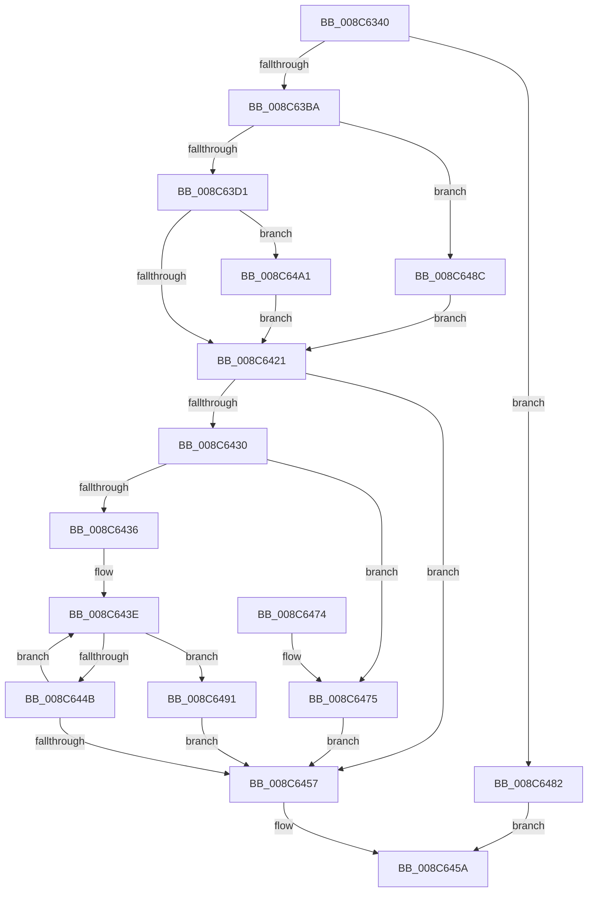

# ObCheckCreateObjectAccess

- RVA: `0x008C6340`–`0x008C64B7` (길이 `375` bytes)
- VA: `0x00000001408C6340`
- 실행 섹션: `PAGE`
- PDB 이름 있음: `예`; PDB Function 태그: `아니요`
- unwind 정보 RVA: `0x00083BB4`
- 디코드: `102`개 명령, `375/375` bytes 표시
- 미해석 바이트: `0` (있으면 어셈블리에 `.byte`로 보존)

> 이 문서는 커널 이미지의 기계어와 PDB 기호를 분석해 생성했습니다. 4번과 5번은 함수 원형과 자료형을 바이너리 사용 방식에서 추정한 C 해석이며 원본 소스 복구 결과는 아닙니다.

## 1. Dependencies

- 직접 호출 지점: **8**; 고유 호출 대상: **8**
- 직접 호출자로 확인된 함수: **1**
- RIP 상대 이미지 참조: **2**

### Outgoing calls
- `0x008C63AD` → [ObpGetObjectSecurity](../87/ObpGetObjectSecurity_function_008717E0.md) (function, `0x008717E0`)
- `0x008C63C1` → [SeLockSubjectContext](SeLockSubjectContext_function_008C64C0.md) (function, `0x008C64C0`)
- `0x008C640C` → [SeAccessCheck](../../text/3A/SeAccessCheck_function_003A6BC0.md) (function, `0x003A6BC0`)
- `0x008C6424` → [SeUnlockSubjectContext](SeUnlockSubjectContext_function_008C6520.md) (function, `0x008C6520`)
- `0x008C647B` → [ExFreePoolWithTag](../../poolcode/B8/ExFreePoolWithTag_function_00B82870.md) (function, `0x00B82870`)
- `0x008C649A` → [ObDereferenceSecurityDescriptor](../87/ObDereferenceSecurityDescriptor_function_008740A0.md) (function, `0x008740A0`)
- `0x008C64A4` → [SeAppendPrivileges](../9D/SeAppendPrivileges_function_009D7980.md) (function, `0x009D7980`)
- `0x008C64AD` → [CmSiFreeMemory](../../text/47/CmSiFreeMemory_function_00475D80.md) (function, `0x00475D80`)

### Direct callers
- [ObpLookupObjectName](../89/ObpLookupObjectName_function_0089BE90.md) at `0x0089D816`

### Static image references
- `0x008C6366` → RVA `0x00FC7800` (`ALMOSTRO`; read)
- `0x008C639B` → RVA `0x00FC6E4C` (`ALMOSTRO`; read)

## 2. Other-region calls and transfers

- 다른 실행 섹션으로 향하는 call: **3**
  - `0x008C640C` → [SeAccessCheck](../../text/3A/SeAccessCheck_function_003A6BC0.md) (`PAGE` → `.text`)
  - `0x008C647B` → [ExFreePoolWithTag](../../poolcode/B8/ExFreePoolWithTag_function_00B82870.md) (`PAGE` → `POOLCODE`)
  - `0x008C64AD` → [CmSiFreeMemory](../../text/47/CmSiFreeMemory_function_00475D80.md) (`PAGE` → `.text`)
- 별도 외부 분기/꼬리 이동을 확인하지 못했습니다.

## 3. Assembly (complete function range)

```asm
008C6340  48 89 74 24 10                  mov qword ptr [rsp + 0x10], rsi
008C6345  48 89 7C 24 18                  mov qword ptr [rsp + 0x18], rdi
008C634A  55                              push rbp
008C634B  41 54                           push r12
008C634D  41 55                           push r13
008C634F  41 56                           push r14
008C6351  41 57                           push r15
008C6353  48 8B EC                        mov rbp, rsp
008C6356  48 83 EC 70                     sub rsp, 0x70
008C635A  44 8A 75 58                     mov r14b, byte ptr [rbp + 0x58]
008C635E  48 8D 41 D0                     lea rax, [rcx - 0x30]
008C6362  83 65 E0 00                     and dword ptr [rbp - 0x20], 0
008C6366  4C 8D 2D 93 14 70 00            lea r13, [rip + 0x701493]
008C636D  48 83 65 F0 00                  and qword ptr [rbp - 0x10], 0
008C6372  4D 8B F8                        mov r15, r8
008C6375  48 83 65 E8 00                  and qword ptr [rbp - 0x18], 0
008C637A  4C 8D 45 30                     lea r8, [rbp + 0x30]
008C637E  48 C1 E8 08                     shr rax, 8
008C6382  44 8B E2                        mov r12d, edx
008C6385  44 0F B6 D0                     movzx r10d, al
008C6389  48 8D 55 E8                     lea rdx, [rbp - 0x18]
008C638D  0F B6 41 E8                     movzx eax, byte ptr [rcx - 0x18]
008C6391  45 8A CE                        mov r9b, r14b
008C6394  4C 33 D0                        xor r10, rax
008C6397  C6 45 30 00                     mov byte ptr [rbp + 0x30], 0
008C639B  0F B6 05 AA 0A 70 00            movzx eax, byte ptr [rip + 0x700aaa]
008C63A2  48 8B F9                        mov rdi, rcx
008C63A5  4C 33 D0                        xor r10, rax
008C63A8  4F 8B 6C D5 00                  mov r13, qword ptr [r13 + r10*8]
008C63AD  E8 2E B4 FA FF                  call 0x1408717e0
008C63B2  85 C0                           test eax, eax
008C63B4  0F 88 C8 00 00 00               js 0x1408c6482
008C63BA  49 8D 77 20                     lea rsi, [r15 + 0x20]
008C63BE  48 8B CE                        mov rcx, rsi
008C63C1  E8 FA 00 00 00                  call 0x1408c64c0
008C63C6  48 83 7D E8 00                  cmp qword ptr [rbp - 0x18], 0
008C63CB  0F 84 BB 00 00 00               je 0x1408c648c
008C63D1  48 8B 45 60                     mov rax, qword ptr [rbp + 0x60]
008C63D5  49 8D 4D 4C                     lea rcx, [r13 + 0x4c]
008C63D9  48 89 44 24 48                  mov qword ptr [rsp + 0x48], rax
008C63DE  45 8B CC                        mov r9d, r12d
008C63E1  48 8D 45 E0                     lea rax, [rbp - 0x20]
008C63E5  41 B0 01                        mov r8b, 1
008C63E8  48 89 44 24 40                  mov qword ptr [rsp + 0x40], rax
008C63ED  48 8B D6                        mov rdx, rsi
008C63F0  44 88 74 24 38                  mov byte ptr [rsp + 0x38], r14b
008C63F5  48 8D 45 F0                     lea rax, [rbp - 0x10]
008C63F9  48 89 4C 24 30                  mov qword ptr [rsp + 0x30], rcx
008C63FE  48 8B 4D E8                     mov rcx, qword ptr [rbp - 0x18]
008C6402  48 89 44 24 28                  mov qword ptr [rsp + 0x28], rax
008C6407  83 64 24 20 00                  and dword ptr [rsp + 0x20], 0
008C640C  E8 AF 07 AE FF                  call 0x1403a6bc0
008C6411  48 8B 55 F0                     mov rdx, qword ptr [rbp - 0x10]
008C6415  44 8A F0                        mov r14b, al
008C6418  48 85 D2                        test rdx, rdx
008C641B  0F 85 80 00 00 00               jne 0x1408c64a1
008C6421  48 8B CE                        mov rcx, rsi
008C6424  E8 F7 00 00 00                  call 0x1408c6520
008C6429  48 83 7D E8 00                  cmp qword ptr [rbp - 0x18], 0
008C642E  74 27                           je 0x1408c6457
008C6430  80 7D 30 00                     cmp byte ptr [rbp + 0x30], 0
008C6434  75 3F                           jne 0x1408c6475
008C6436  0F 0D 4F F8                     prefetchw byte ptr [rdi - 8]
008C643A  48 8B 47 F8                     mov rax, qword ptr [rdi - 8]
008C643E  48 8B C8                        mov rcx, rax
008C6441  48 33 4D E8                     xor rcx, qword ptr [rbp - 0x18]
008C6445  48 83 F9 0F                     cmp rcx, 0xf
008C6449  73 46                           jae 0x1408c6491
008C644B  48 8D 48 01                     lea rcx, [rax + 1]
008C644F  F0 48 0F B1 4F F8               lock cmpxchg qword ptr [rdi - 8], rcx
008C6455  75 E7                           jne 0x1408c643e
008C6457  41 8A C6                        mov al, r14b
008C645A  4C 8D 5C 24 70                  lea r11, [rsp + 0x70]
008C645F  49 8B 73 38                     mov rsi, qword ptr [r11 + 0x38]
008C6463  49 8B 7B 40                     mov rdi, qword ptr [r11 + 0x40]
008C6467  49 8B E3                        mov rsp, r11
008C646A  41 5F                           pop r15
008C646C  41 5E                           pop r14
008C646E  41 5D                           pop r13
008C6470  41 5C                           pop r12
008C6472  5D                              pop rbp
008C6473  C3                              ret
008C6474  CC                              int3
008C6475  48 8B 4D E8                     mov rcx, qword ptr [rbp - 0x18]
008C6479  33 D2                           xor edx, edx
008C647B  E8 F0 C3 2B 00                  call 0x140b82870
008C6480  EB D5                           jmp 0x1408c6457
008C6482  48 8B 4D 60                     mov rcx, qword ptr [rbp + 0x60]
008C6486  89 01                           mov dword ptr [rcx], eax
008C6488  32 C0                           xor al, al
008C648A  EB CE                           jmp 0x1408c645a
008C648C  41 B6 01                        mov r14b, 1
008C648F  EB 90                           jmp 0x1408c6421
008C6491  48 8B 4D E8                     mov rcx, qword ptr [rbp - 0x18]
008C6495  BA 01 00 00 00                  mov edx, 1
008C649A  E8 01 DC FA FF                  call 0x1408740a0
008C649F  EB B6                           jmp 0x1408c6457
008C64A1  49 8B CF                        mov rcx, r15
008C64A4  E8 D7 14 11 00                  call 0x1409d7980
008C64A9  48 8B 4D F0                     mov rcx, qword ptr [rbp - 0x10]
008C64AD  E8 CE F8 BA FF                  call 0x140475d80
008C64B2  E9 6A FF FF FF                  jmp 0x1408c6421
```

## 4. C-style interpretation (structured pseudocode)

```c
__int64 __fastcall ObCheckCreateObjectAccess(__int64 a1, int a2, __int64 a3, __int64 a4, __int64 a5, unsigned __int8 a6, __int64 a7)
{
    __int64 result;
    __int64 v_r10;
    __int64 v_rsp;
    unsigned __int64 v_stack_m28;
    unsigned __int64 v_stack_m38;
    unsigned __int64 v_stack_m40;
    unsigned int v_stack_m48;
    unsigned __int64 v_stack_m50;
    unsigned __int64 v_stack_m58;
    unsigned __int8 v_stack_m60;
    unsigned __int64 v_stack_m68;
    unsigned __int64 v_stack_m70;
    unsigned int v_stack_m78;
    unsigned __int64 v_stack_p10;
    unsigned __int64 v_stack_p18;
    unsigned __int64 v_stack_p8;

    v_stack_p10 = v_rsi;
    v_stack_p18 = v_rdi;
    v_rsp = (v_rsp) - (112);
    result = (a1 - 48) >> (8);
    v_r10 = ((unsigned __int8)(result)) ^ (*(unsigned __int8 *)(a1 - 24));
    v_stack_p8 = 0;
    v_r10 = (v_r10) ^ (*(unsigned __int8 *)(v_rip + 7342762));
    result = ObpGetObjectSecurity(a1, v_stack_m40, v_stack_p8, a6);
    if (sign_flag) goto loc_008C6482;
    result = SeLockSubjectContext(a3 + 32, v_stack_m40, v_stack_p8, a6);
    if (v_stack_m40 == 0) goto loc_008C648C;
    v_stack_m50 = a7;
    v_stack_m58 = v_stack_m48;
    v_stack_m60 = a6;
    v_stack_m68 = *(unsigned __int64 *)(v_rip + 7345299 + v_r10 * 8) + 76;
    v_stack_m70 = v_stack_m38;
    result = SeAccessCheck(v_stack_m40, a3 + 32, 1, (unsigned int)((unsigned int)((unsigned int)(a2))));
    if (v_stack_m38 != 0) goto loc_008C64A1;
loc_008C6421:
    result = SeUnlockSubjectContext(a3 + 32, v_stack_m38, 1, (unsigned int)((unsigned int)((unsigned int)(a2))));
    if (v_stack_m40 == 0) goto loc_008C6457;
    if (v_stack_p8 != 0) goto loc_008C6475;
loc_008C643E:
    a1 = (*(unsigned __int64 *)(a1 - 8)) ^ (v_stack_m40);
    if (a1 >= 15) goto loc_008C6491;
    if (a1 != 15) goto loc_008C643E;
loc_008C6457:
loc_008C645A:
    return (unsigned __int8)((unsigned __int8)(result));
loc_008C6475:
    a2 = 0;
    result = ExFreePoolWithTag(v_stack_m40, a2, 1, (unsigned int)((unsigned int)((unsigned int)(a2))));
    goto loc_008C6457;
loc_008C6482:
    *(unsigned int *)(a7) = (unsigned int)(result);
    result = 0;
    goto loc_008C645A;
loc_008C648C:
    goto loc_008C6421;
loc_008C6491:
    result = ObDereferenceSecurityDescriptor(v_stack_m40, 1, 1, (unsigned int)((unsigned int)((unsigned int)(a2))));
    goto loc_008C6457;
loc_008C64A1:
    result = SeAppendPrivileges(a3, 1, 1, (unsigned int)((unsigned int)((unsigned int)(a2))));
    result = CmSiFreeMemory(v_stack_m38, 1, 1, (unsigned int)((unsigned int)((unsigned int)(a2))));
    goto loc_008C6421;
}
```

## 5. (Beta) C Style

```c
int64_t ObCheckCreateObjectAccess(void *Arg1, int32_t Arg2, void *Arg3, int64_t Arg4, uint64_t Arg5, uint8_t Arg6, void *Arg7)
{
    uint8_t *arg1 = (uint8_t *)Arg1;
    uint8_t *arg3 = (uint8_t *)Arg3;
    uint8_t *arg7 = (uint8_t *)Arg7;

    int64_t result;
    int64_t local_r10;
    int64_t local_rsp;
    uint64_t v_stack_m28;
    uint64_t v_stack_m38;
    uint64_t v_stack_m40;
    uint32_t v_stack_m48;
    uint64_t v_stack_m50;
    uint64_t v_stack_m58;
    uint8_t v_stack_m60;
    uint64_t v_stack_m68;
    uint64_t v_stack_m70;
    uint32_t v_stack_m78;
    uint64_t v_stack_p10;
    uint64_t v_stack_p18;
    uint64_t v_stack_p8;

    v_stack_p10 = local_rsi;
    v_stack_p18 = local_rdi;
    local_rsp = (local_rsp) - (112);
    result = (Arg1 - 48) >> (8);
    local_r10 = ((uint8_t)(result)) ^ (*(uint8_t *)(arg1 - 0x18));
    v_stack_p8 = 0;
    local_r10 = (local_r10) ^ (*(uint8_t *)(v_rip + 0x700AAA));
    result = ObpGetObjectSecurity(Arg1, v_stack_m40, v_stack_p8, Arg6);
    if (sign_flag) goto loc_008C6482;
    result = SeLockSubjectContext(Arg3 + 32, v_stack_m40, v_stack_p8, Arg6);
    if (v_stack_m40 == 0) goto loc_008C648C;
    v_stack_m50 = Arg7;
    v_stack_m58 = v_stack_m48;
    v_stack_m60 = Arg6;
    v_stack_m68 = *(uint64_t *)(v_rip + 0x701493 + local_r10 * 8) + 76;
    v_stack_m70 = v_stack_m38;
    result = SeAccessCheck(v_stack_m40, Arg3 + 32, 1, (uint32_t)((uint32_t)((uint32_t)(Arg2))));
    if (v_stack_m38 != 0) goto loc_008C64A1;
loc_008C6421:
    result = SeUnlockSubjectContext(Arg3 + 32, v_stack_m38, 1, (uint32_t)((uint32_t)((uint32_t)(Arg2))));
    if (v_stack_m40 == 0) goto loc_008C6457;
    if (v_stack_p8 != 0) goto loc_008C6475;
loc_008C643E:
    Arg1 = (*(uint64_t *)(arg1 - 0x8)) ^ (v_stack_m40);
    if (Arg1 >= 15) goto loc_008C6491;
    if (Arg1 != 15) goto loc_008C643E;
loc_008C6457:
loc_008C645A:
    return (uint8_t)((uint8_t)(result));
loc_008C6475:
    Arg2 = 0;
    result = ExFreePoolWithTag(v_stack_m40, Arg2, 1, (uint32_t)((uint32_t)((uint32_t)(Arg2))));
    goto loc_008C6457;
loc_008C6482:
    *(uint32_t *)(arg7) = (uint32_t)(result);
    result = 0;
    goto loc_008C645A;
loc_008C648C:
    goto loc_008C6421;
loc_008C6491:
    result = ObDereferenceSecurityDescriptor(v_stack_m40, 1, 1, (uint32_t)((uint32_t)((uint32_t)(Arg2))));
    goto loc_008C6457;
loc_008C64A1:
    result = SeAppendPrivileges(Arg3, 1, 1, (uint32_t)((uint32_t)((uint32_t)(Arg2))));
    result = CmSiFreeMemory(v_stack_m38, 1, 1, (uint32_t)((uint32_t)((uint32_t)(Arg2))));
    goto loc_008C6421;
}
```

### 관측된 메모리 오프셋

구조체 형식이 확인되지 않은 접근은 인자 기준의 오프셋으로만 기록했습니다.

| 기준 인자 | 오프셋 표현 | 폭 (bit) | 접근 |
|---|---:|---:|---|
| `Arg1` | `- 0x30` | `64` | `R` |
| `Arg1` | `- 0x18` | `8` | `R` |
| `Arg1` | `- 0x8` | `8` | `R` |
| `Arg1` | `- 0x8` | `64` | `R` |
| `Arg3` | `+ 0x20` | `64` | `R` |
| `Arg7` | `+ 0x0` | `32` | `W` |

## 6. Execution-region graph

[열기: 2D/3D 그래프와 함수 탐색 컨트롤 패널](../../../control-panel.html?section=page&rva=0x008C6340&view=graph)

- 2D 그래프는 위에서 아래로 흐르고, 3D 그래프는 빈 공간을 드래그해 회전합니다. Shift+드래그는 이동, 휠은 확대·축소, 함수 노드 선택은 대상 보고서 이동입니다.

### Static fallback


