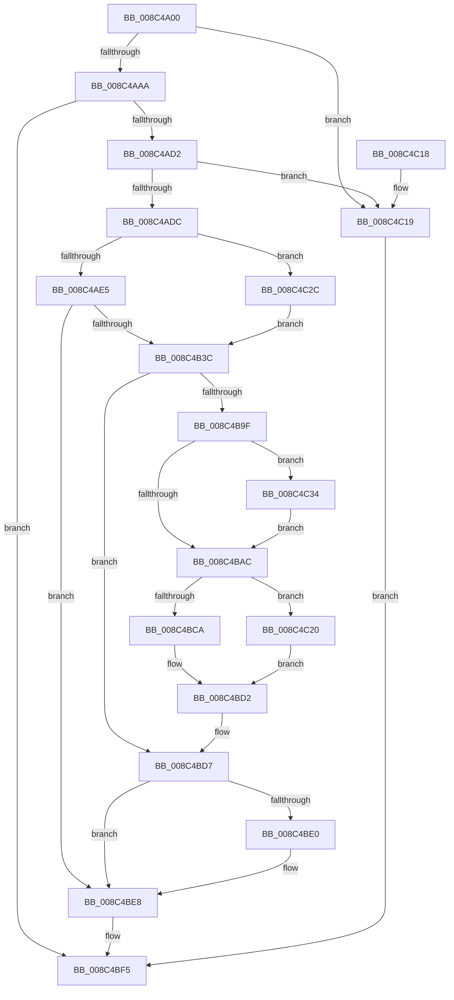

# ObReferenceObjectByName

- RVA: `0x008C4A00`–`0x008C4C82` (길이 `642` bytes)
- VA: `0x00000001408C4A00`
- 실행 섹션: `PAGE`
- PDB 이름 있음: `예`; PDB Function 태그: `아니요`
- unwind 정보 RVA: `0x00083A58`
- 디코드: `159`개 명령, `642/642` bytes 표시
- 미해석 바이트: `0` (있으면 어셈블리에 `.byte`로 보존)

> 이 문서는 커널 이미지의 기계어와 PDB 기호를 분석해 생성했습니다. 4번과 5번은 함수 원형과 자료형을 바이너리 사용 방식에서 추정한 C 해석이며 원본 소스 복구 결과는 아닙니다.

## 1. Dependencies

- 직접 호출 지점: **15**; 고유 호출 대상: **14**
- 직접 호출자로 확인된 함수: **5**
- RIP 상대 이미지 참조: **4**

### Outgoing calls
- `0x008C4A5D` → [memset](../../text/6C/memset_function_006C6C40.md) (function, `0x006C6C40`)
- `0x008C4A7C` → [memset](../../text/6C/memset_function_006C6C40.md) (function, `0x006C6C40`)
- `0x008C4ABF` → [ObpCaptureObjectName](../89/ObpCaptureObjectName_function_0089BC40.md) (function, `0x0089BC40`)
- `0x008C4B08` → [SeCaptureSubjectContextEx](SeCaptureSubjectContextEx_function_008C4C90.md) (function, `0x008C4C90`)
- `0x008C4B28` → [SepCreateAccessStateFromSubjectContext](../../text/3E/SepCreateAccessStateFromSubjectContext_function_003EBF40.md) (function, `0x003EBF40`)
- `0x008C4B3C` → [PsGetCurrentSilo](../../text/40/PsGetCurrentSilo_function_004094A0.md) (function, `0x004094A0`)
- `0x008C4B83` → [ObpLookupObjectName](../89/ObpLookupObjectName_function_0089BE90.md) (function, `0x0089BE90`)
- `0x008C4B90` → [ObpReleaseLookupContext](../../text/26/ObpReleaseLookupContext_function_00263D30.md) (function, `0x00263D30`)
- `0x008C4BC1` → [ObpCheckObjectReference](ObpCheckObjectReference_function_008C6084.md) (function, `0x008C6084`)
- `0x008C4BD2` → [SeClearLearningModeObjectInformation](../../text/40/SeClearLearningModeObjectInformation_function_0040D470.md) (function, `0x0040D470`)
- `0x008C4BE3` → [SeDeleteAccessState](SeDeleteAccessState_function_008C5F70.md) (function, `0x008C5F70`)
- `0x008C4BEC` → [ObpFreeObjectNameBuffer](ObpFreeObjectNameBuffer_function_008C4250.md) (function, `0x008C4250`)
- `0x008C4BFF` → [_security_check_cookie](../../text/6A/_security_check_cookie_function_006AC640.md) (function, `0x006AC640`)
- `0x008C4C25` → [HalPutDmaAdapter](../../text/48/HalPutDmaAdapter_function_0048E530.md) (function, `0x0048E530`)
- `0x008C4C78` → [SeSetLearningModeObjectInformation](../../text/4C/SeSetLearningModeObjectInformation_function_004C7098.md) (function, `0x004C7098`)

### Direct callers
- [IopGetDriverPathInformation](../../text/59/IopGetDriverPathInformation_function_005973A8.md) at `0x00597422`
- [ObShutdownSystem](../74/ObShutdownSystem_function_0074DBB0.md) at `0x0074DC43`
- [ObShutdownSystem](../74/ObShutdownSystem_function_0074DBB0.md) at `0x0074DC99`
- [ObShutdownSystem](../74/ObShutdownSystem_function_0074DBB0.md) at `0x0074DCEF`
- [CmLoadDifferencingKey](../87/CmLoadDifferencingKey_function_00875670.md) at `0x00875DC5`
- [IopGetLegacyVetoListDrivers](../91/IopGetLegacyVetoListDrivers_function_00911814.md) at `0x0091199D`
- [AlpcpCreateClientPort](../92/AlpcpCreateClientPort_function_009270AC.md) at `0x0092712A`

### Static image references
- `0x008C4A1C` → RVA `0x00E0A740` (`.data`; read)
- `0x008C4B9F` → RVA `0x00FD9AD8` (`PAGEDATA`; read)
- `0x008C4C53` → RVA `0x00FC6E4C` (`ALMOSTRO`; read)
- `0x008C4C5D` → RVA `0x00FC7800` (`ALMOSTRO`; read)

## 2. Other-region calls and transfers

- 다른 실행 섹션으로 향하는 call: **9**
  - `0x008C4A5D` → [memset](../../text/6C/memset_function_006C6C40.md) (`PAGE` → `.text`)
  - `0x008C4A7C` → [memset](../../text/6C/memset_function_006C6C40.md) (`PAGE` → `.text`)
  - `0x008C4B28` → [SepCreateAccessStateFromSubjectContext](../../text/3E/SepCreateAccessStateFromSubjectContext_function_003EBF40.md) (`PAGE` → `.text`)
  - `0x008C4B3C` → [PsGetCurrentSilo](../../text/40/PsGetCurrentSilo_function_004094A0.md) (`PAGE` → `.text`)
  - `0x008C4B90` → [ObpReleaseLookupContext](../../text/26/ObpReleaseLookupContext_function_00263D30.md) (`PAGE` → `.text`)
  - `0x008C4BD2` → [SeClearLearningModeObjectInformation](../../text/40/SeClearLearningModeObjectInformation_function_0040D470.md) (`PAGE` → `.text`)
  - `0x008C4BFF` → [_security_check_cookie](../../text/6A/_security_check_cookie_function_006AC640.md) (`PAGE` → `.text`)
  - `0x008C4C25` → [HalPutDmaAdapter](../../text/48/HalPutDmaAdapter_function_0048E530.md) (`PAGE` → `.text`)
  - `0x008C4C78` → [SeSetLearningModeObjectInformation](../../text/4C/SeSetLearningModeObjectInformation_function_004C7098.md) (`PAGE` → `.text`)
- 별도 외부 분기/꼬리 이동을 확인하지 못했습니다.

## 3. Assembly (complete function range)

```asm
008C4A00  40 55                           push rbp
008C4A02  53                              push rbx
008C4A03  56                              push rsi
008C4A04  57                              push rdi
008C4A05  41 54                           push r12
008C4A07  41 55                           push r13
008C4A09  41 56                           push r14
008C4A0B  41 57                           push r15
008C4A0D  48 8D AC 24 68 FE FF FF         lea rbp, [rsp - 0x198]
008C4A15  48 81 EC 98 02 00 00            sub rsp, 0x298
008C4A1C  48 8B 05 1D 5D 54 00            mov rax, qword ptr [rip + 0x545d1d]
008C4A23  48 33 C4                        xor rax, rsp
008C4A26  48 89 85 80 01 00 00            mov qword ptr [rbp + 0x180], rax
008C4A2D  4C 8B B5 00 02 00 00            mov r14, qword ptr [rbp + 0x200]
008C4A34  49 8B D8                        mov rbx, r8
008C4A37  4C 8B A5 10 02 00 00            mov r12, qword ptr [rbp + 0x210]
008C4A3E  44 8B FA                        mov r15d, edx
008C4A41  48 8B B5 18 02 00 00            mov rsi, qword ptr [rbp + 0x218]
008C4A48  48 8B F9                        mov rdi, rcx
008C4A4B  33 D2                           xor edx, edx
008C4A4D  48 8D 8D A0 00 00 00            lea rcx, [rbp + 0xa0]
008C4A54  41 B8 E0 00 00 00               mov r8d, 0xe0
008C4A5A  45 8B E9                        mov r13d, r9d
008C4A5D  E8 DE 21 E0 FF                  call 0x1406c6c40
008C4A62  0F 57 C0                        xorps xmm0, xmm0
008C4A65  48 8D 4D 00                     lea rcx, [rbp]
008C4A69  33 C0                           xor eax, eax
008C4A6B  33 D2                           xor edx, edx
008C4A6D  41 B8 A0 00 00 00               mov r8d, 0xa0
008C4A73  48 89 44 24 78                  mov qword ptr [rsp + 0x78], rax
008C4A78  0F 11 45 80                     movups xmmword ptr [rbp - 0x80], xmm0
008C4A7C  E8 BF 21 E0 FF                  call 0x1406c6c40
008C4A81  33 C0                           xor eax, eax
008C4A83  0F 57 C9                        xorps xmm1, xmm1
008C4A86  48 89 45 A0                     mov qword ptr [rbp - 0x60], rax
008C4A8A  0F 57 C0                        xorps xmm0, xmm0
008C4A8D  48 89 45 D8                     mov qword ptr [rbp - 0x28], rax
008C4A91  0F 11 45 90                     movups xmmword ptr [rbp - 0x70], xmm0
008C4A95  0F 11 4D A8                     movups xmmword ptr [rbp - 0x58], xmm1
008C4A99  0F 11 4D B8                     movups xmmword ptr [rbp - 0x48], xmm1
008C4A9D  0F 11 4D C8                     movups xmmword ptr [rbp - 0x38], xmm1
008C4AA1  48 85 FF                        test rdi, rdi
008C4AA4  0F 84 6F 01 00 00               je 0x1408c4c19
008C4AAA  48 8B D7                        mov rdx, rdi
008C4AAD  44 8D 48 01                     lea r9d, [rax + 1]
008C4AB1  40 8A BD 08 02 00 00            mov dil, byte ptr [rbp + 0x208]
008C4AB8  4C 8D 45 80                     lea r8, [rbp - 0x80]
008C4ABC  40 8A CF                        mov cl, dil
008C4ABF  E8 7C 71 FD FF                  call 0x14089bc40
008C4AC4  33 C9                           xor ecx, ecx
008C4AC6  89 44 24 70                     mov dword ptr [rsp + 0x70], eax
008C4ACA  85 C0                           test eax, eax
008C4ACC  0F 88 23 01 00 00               js 0x1408c4bf5
008C4AD2  66 39 4D 80                     cmp word ptr [rbp - 0x80], cx
008C4AD6  0F 84 3D 01 00 00               je 0x1408c4c19
008C4ADC  48 85 DB                        test rbx, rbx
008C4ADF  0F 85 47 01 00 00               jne 0x1408c4c2c
008C4AE5  65 48 8B 0C 25 88 01 00 00      mov rcx, qword ptr gs:[0x188]
008C4AEE  4C 8D 45 E0                     lea r8, [rbp - 0x20]
008C4AF2  0F 57 C0                        xorps xmm0, xmm0
008C4AF5  48 8D 5D 00                     lea rbx, [rbp]
008C4AF9  0F 11 45 E0                     movups xmmword ptr [rbp - 0x20], xmm0
008C4AFD  48 8B 91 B8 00 00 00            mov rdx, qword ptr [rcx + 0xb8]
008C4B04  0F 11 45 F0                     movups xmmword ptr [rbp - 0x10], xmm0
008C4B08  E8 83 01 00 00                  call 0x1408c4c90
008C4B0D  49 8D 46 4C                     lea rax, [r14 + 0x4c]
008C4B11  45 8B CD                        mov r9d, r13d
008C4B14  4C 8D 85 A0 00 00 00            lea r8, [rbp + 0xa0]
008C4B1B  48 89 44 24 20                  mov qword ptr [rsp + 0x20], rax
008C4B20  48 8D 55 00                     lea rdx, [rbp]
008C4B24  48 8D 4D E0                     lea rcx, [rbp - 0x20]
008C4B28  E8 13 74 B2 FF                  call 0x1403ebf40
008C4B2D  45 33 ED                        xor r13d, r13d
008C4B30  89 44 24 70                     mov dword ptr [rsp + 0x70], eax
008C4B34  85 C0                           test eax, eax
008C4B36  0F 88 AC 00 00 00               js 0x1408c4be8
008C4B3C  E8 5F 49 B4 FF                  call 0x1404094a0
008C4B41  48 8D 4C 24 78                  lea rcx, [rsp + 0x78]
008C4B46  4D 8B CE                        mov r9, r14
008C4B49  48 89 4C 24 60                  mov qword ptr [rsp + 0x60], rcx
008C4B4E  48 8D 55 80                     lea rdx, [rbp - 0x80]
008C4B52  4C 89 6C 24 58                  mov qword ptr [rsp + 0x58], r13
008C4B57  48 8D 4D 90                     lea rcx, [rbp - 0x70]
008C4B5B  48 89 4C 24 50                  mov qword ptr [rsp + 0x50], rcx
008C4B60  45 8B C7                        mov r8d, r15d
008C4B63  48 89 5C 24 48                  mov qword ptr [rsp + 0x48], rbx
008C4B68  33 C9                           xor ecx, ecx
008C4B6A  48 89 44 24 40                  mov qword ptr [rsp + 0x40], rax
008C4B6F  4C 89 6C 24 38                  mov qword ptr [rsp + 0x38], r13
008C4B74  4C 89 6C 24 30                  mov qword ptr [rsp + 0x30], r13
008C4B79  4C 89 64 24 28                  mov qword ptr [rsp + 0x28], r12
008C4B7E  40 88 7C 24 20                  mov byte ptr [rsp + 0x20], dil
008C4B83  E8 08 73 FD FF                  call 0x14089be90
008C4B88  48 8D 4D 90                     lea rcx, [rbp - 0x70]
008C4B8C  89 44 24 70                     mov dword ptr [rsp + 0x70], eax
008C4B90  E8 9B F1 99 FF                  call 0x140263d30
008C4B95  4C 89 2E                        mov qword ptr [rsi], r13
008C4B98  44 39 6C 24 70                  cmp dword ptr [rsp + 0x70], r13d
008C4B9D  7C 38                           jl 0x1408c4bd7
008C4B9F  44 39 2D 32 4F 71 00            cmp dword ptr [rip + 0x714f32], r13d
008C4BA6  0F 85 88 00 00 00               jne 0x1408c4c34
008C4BAC  48 8B 4C 24 78                  mov rcx, qword ptr [rsp + 0x78]
008C4BB1  48 8D 44 24 70                  lea rax, [rsp + 0x70]
008C4BB6  44 8A CF                        mov r9b, dil
008C4BB9  48 89 44 24 20                  mov qword ptr [rsp + 0x20], rax
008C4BBE  48 8B D3                        mov rdx, rbx
008C4BC1  E8 BE 14 00 00                  call 0x1408c6084
008C4BC6  84 C0                           test al, al
008C4BC8  74 56                           je 0x1408c4c20
008C4BCA  48 8B 44 24 78                  mov rax, qword ptr [rsp + 0x78]
008C4BCF  48 89 06                        mov qword ptr [rsi], rax
008C4BD2  E8 99 88 B4 FF                  call 0x14040d470
008C4BD7  48 8D 45 00                     lea rax, [rbp]
008C4BDB  48 3B D8                        cmp rbx, rax
008C4BDE  75 08                           jne 0x1408c4be8
008C4BE0  48 8B CB                        mov rcx, rbx
008C4BE3  E8 88 13 00 00                  call 0x1408c5f70
008C4BE8  48 8D 4D 80                     lea rcx, [rbp - 0x80]
008C4BEC  E8 5F F6 FF FF                  call 0x1408c4250
008C4BF1  8B 44 24 70                     mov eax, dword ptr [rsp + 0x70]
008C4BF5  48 8B 8D 80 01 00 00            mov rcx, qword ptr [rbp + 0x180]
008C4BFC  48 33 CC                        xor rcx, rsp
008C4BFF  E8 3C 7A DE FF                  call 0x1406ac640
008C4C04  48 81 C4 98 02 00 00            add rsp, 0x298
008C4C0B  41 5F                           pop r15
008C4C0D  41 5E                           pop r14
008C4C0F  41 5D                           pop r13
008C4C11  41 5C                           pop r12
008C4C13  5F                              pop rdi
008C4C14  5E                              pop rsi
008C4C15  5B                              pop rbx
008C4C16  5D                              pop rbp
008C4C17  C3                              ret
008C4C18  CC                              int3
008C4C19  B8 33 00 00 C0                  mov eax, 0xc0000033
008C4C1E  EB D5                           jmp 0x1408c4bf5
008C4C20  48 8B 4C 24 78                  mov rcx, qword ptr [rsp + 0x78]
008C4C25  E8 06 99 BC FF                  call 0x14048e530
008C4C2A  EB A6                           jmp 0x1408c4bd2
008C4C2C  45 33 ED                        xor r13d, r13d
008C4C2F  E9 08 FF FF FF                  jmp 0x1408c4b3c
008C4C34  48 8B 4C 24 78                  mov rcx, qword ptr [rsp + 0x78]
008C4C39  48 8D 41 D0                     lea rax, [rcx - 0x30]
008C4C3D  48 C1 E8 08                     shr rax, 8
008C4C41  0F B6 D0                        movzx edx, al
008C4C44  0F B6 41 E8                     movzx eax, byte ptr [rcx - 0x18]
008C4C48  48 8D 4D A8                     lea rcx, [rbp - 0x58]
008C4C4C  48 33 D0                        xor rdx, rax
008C4C4F  4C 89 6D C8                     mov qword ptr [rbp - 0x38], r13
008C4C53  0F B6 05 F2 21 70 00            movzx eax, byte ptr [rip + 0x7021f2]
008C4C5A  48 33 D0                        xor rdx, rax
008C4C5D  48 8D 05 9C 2B 70 00            lea rax, [rip + 0x702b9c]
008C4C64  48 8B 04 D0                     mov rax, qword ptr [rax + rdx*8]
008C4C68  48 83 C0 10                     add rax, 0x10
008C4C6C  48 89 45 B8                     mov qword ptr [rbp - 0x48], rax
008C4C70  48 8D 45 80                     lea rax, [rbp - 0x80]
008C4C74  48 89 45 C0                     mov qword ptr [rbp - 0x40], rax
008C4C78  E8 1B 24 C0 FF                  call 0x1404c7098
008C4C7D  E9 2A FF FF FF                  jmp 0x1408c4bac
```

## 4. C-style interpretation (structured pseudocode)

```c
__int64 __fastcall ObReferenceObjectByName(__int64 a1, int a2, __int64 a3, int a4, __int64 a5, unsigned __int8 a6, __int64 a7, __int64 a8)
{
    __int64 result;
    __int64 v_r13;
    __int64 v_rsp;
    unsigned __int64 v_stack_m138;
    unsigned __int64 v_stack_m1D8;
    unsigned __int64 v_stack_m1E8;
    unsigned __int64 v_stack_m1F8;
    unsigned __int64 v_stack_m200;
    unsigned __int64 v_stack_m210;
    unsigned __int64 v_stack_m218;
    unsigned __int64 v_stack_m220;
    unsigned __int64 v_stack_m230;
    unsigned __int64 v_stack_m238;
    unsigned __int64 v_stack_m248;
    unsigned __int64 v_stack_m258;
    unsigned __int64 v_stack_m260;
    unsigned int v_stack_m268;
    unsigned __int64 v_stack_m278;
    unsigned __int64 v_stack_m280;
    unsigned __int64 v_stack_m288;
    unsigned __int64 v_stack_m290;
    unsigned __int64 v_stack_m298;
    unsigned __int64 v_stack_m2A0;
    unsigned __int64 v_stack_m2A8;
    unsigned __int64 v_stack_m2B0;
    unsigned __int64 v_stack_m2B8;
    unsigned __int64 v_stack_m58;
    unsigned __int64 v_stack_p78;

    v_rsp = (v_rsp) - (664);
    result = (*(unsigned __int64 *)(v_rip + 5528861)) ^ (v_rsp);
    v_stack_m58 = result;
    a2 = 0;
    result = memset(v_stack_m138, a2, 224, a4);
    result = 0;
    a2 = 0;
    v_stack_m260 = 0;
    v_stack_m258 = v_xmm0;
    result = memset(v_stack_m1D8, a2, 160, a4);
    result = 0;
    v_stack_m238 = 0;
    v_stack_m200 = 0;
    v_stack_m248 = v_xmm0;
    v_stack_m230 = v_xmm1;
    v_stack_m220 = v_xmm1;
    v_stack_m210 = v_xmm1;
    if (a1 == 0) goto loc_008C4C19;
    result = ObpCaptureObjectName(a6, a1, v_stack_m258, result + 1);
    a1 = 0;
    v_stack_m268 = (unsigned int)(result);
    if (sign_flag) goto loc_008C4BF5;
    if (v_stack_m258 == 0) goto loc_008C4C19;
    if (a3 != 0) goto loc_008C4C2C;
    v_stack_m1F8 = v_xmm0;
    v_stack_m1E8 = v_xmm0;
    result = SeCaptureSubjectContextEx(*(unsigned __int64 *)(gs_base + (0 + 392)), *(unsigned __int64 *)(*(unsigned __int64 *)(gs_base + (0 + 392)) + 184), v_stack_m1F8, result + 1);
    v_stack_m2B8 = a5 + 76;
    result = SepCreateAccessStateFromSubjectContext(v_stack_m1F8, v_stack_m1D8, v_stack_m138, (unsigned int)((unsigned int)((unsigned int)(a4))));
    v_r13 = 0;
    v_stack_m268 = (unsigned int)(result);
    if (sign_flag) goto loc_008C4BE8;
loc_008C4B3C:
    result = PsGetCurrentSilo(v_stack_m1F8, v_stack_m1D8, v_stack_m138, (unsigned int)((unsigned int)((unsigned int)(a4))));
    v_stack_m278 = v_stack_m260;
    v_stack_m280 = 0;
    v_stack_m288 = v_stack_m248;
    v_stack_m290 = v_stack_m1D8;
    a1 = 0;
    v_stack_m298 = result;
    v_stack_m2A0 = 0;
    v_stack_m2A8 = 0;
    v_stack_m2B0 = a7;
    v_stack_m2B8 = a6;
    result = ObpLookupObjectName(a1, v_stack_m258, (unsigned int)((unsigned int)((unsigned int)(a2))), a5);
    v_stack_m268 = (unsigned int)(result);
    result = ObpReleaseLookupContext(v_stack_m248, v_stack_m258, (unsigned int)((unsigned int)((unsigned int)(a2))), a5);
    *(unsigned __int64 *)(a8) = 0;
    if (v_stack_m268 < 0) goto loc_008C4BD7;
    if ((*(unsigned int *)(v_rip + 7425842)) != 0) goto loc_008C4C34;
loc_008C4BAC:
    v_stack_m2B8 = v_stack_m268;
    result = ObpCheckObjectReference(v_stack_m260, v_stack_m1D8, (unsigned int)((unsigned int)((unsigned int)(a2))), a6);
    if ((unsigned __int8)(result) == 0) goto loc_008C4C20;
    *(unsigned __int64 *)(a8) = v_stack_m260;
loc_008C4BD2:
    result = SeClearLearningModeObjectInformation(v_stack_m260, v_stack_m1D8, (unsigned int)((unsigned int)((unsigned int)(a2))), a6);
loc_008C4BD7:
    result = v_stack_m1D8;
    if (v_stack_m1D8 == v_stack_m1D8) {
        a1 = v_stack_m1D8;
        result = SeDeleteAccessState(a1, v_stack_m1D8, (unsigned int)((unsigned int)((unsigned int)(a2))), a6);
    }
    result = ObpFreeObjectNameBuffer(v_stack_m258, v_stack_m1D8, (unsigned int)((unsigned int)((unsigned int)(a2))), a6);
loc_008C4BF5:
    a1 = (v_stack_m58) ^ (v_rsp);
    result = _security_check_cookie(a1, v_stack_m1D8, (unsigned int)((unsigned int)((unsigned int)(a2))), a6);
    v_rsp = (v_rsp) + (664);
    return result;
loc_008C4C19:
    goto loc_008C4BF5;
loc_008C4C20:
    result = HalPutDmaAdapter(v_stack_p78, v_stack_m1D8, (unsigned int)((unsigned int)((unsigned int)(a2))), a6);
    goto loc_008C4BD2;
loc_008C4C2C:
    v_r13 = 0;
    goto loc_008C4B3C;
loc_008C4C34:
    result = (v_stack_p78 - 48) >> (8);
    a2 = ((unsigned __int8)(result)) ^ (*(unsigned __int8 *)(v_stack_p78 - 24));
    v_stack_m210 = 0;
    a2 = (a2) ^ (*(unsigned __int8 *)(v_rip + 7348722));
    result = (*(unsigned __int64 *)(v_rip + 7351196 + a2 * 8)) + (16);
    v_stack_m220 = result;
    v_stack_m218 = v_stack_m258;
    result = SeSetLearningModeObjectInformation(v_stack_m230, a2, (unsigned int)((unsigned int)((unsigned int)(a2))), a6);
    goto loc_008C4BAC;
}
```

## 5. (Beta) C Style

```c
int64_t ObReferenceObjectByName(int64_t Arg1, int32_t Arg2, int64_t Arg3, int32_t Arg4, void *Arg5, uint8_t Arg6, int64_t Arg7, void *Arg8)
{
    uint8_t *arg5 = (uint8_t *)Arg5;
    uint8_t *arg8 = (uint8_t *)Arg8;

    int64_t result;
    int64_t local_r13;
    int64_t local_rsp;
    uint64_t v_stack_m138;
    uint64_t v_stack_m1D8;
    uint64_t v_stack_m1E8;
    uint64_t v_stack_m1F8;
    uint64_t v_stack_m200;
    uint64_t v_stack_m210;
    uint64_t v_stack_m218;
    uint64_t v_stack_m220;
    uint64_t v_stack_m230;
    uint64_t v_stack_m238;
    uint64_t v_stack_m248;
    uint64_t v_stack_m258;
    uint64_t v_stack_m260;
    uint32_t v_stack_m268;
    uint64_t v_stack_m278;
    uint64_t v_stack_m280;
    uint64_t v_stack_m288;
    uint64_t v_stack_m290;
    uint64_t v_stack_m298;
    uint64_t v_stack_m2A0;
    uint64_t v_stack_m2A8;
    uint64_t v_stack_m2B0;
    uint64_t v_stack_m2B8;
    uint64_t v_stack_m58;
    uint64_t v_stack_p78;

    local_rsp = (local_rsp) - (664);
    result = (*(uint64_t *)(v_rip + 0x545D1D)) ^ (local_rsp);
    v_stack_m58 = result;
    Arg2 = 0;
    result = memset(v_stack_m138, Arg2, 224, Arg4);
    result = 0;
    Arg2 = 0;
    v_stack_m260 = 0;
    v_stack_m258 = v_xmm0;
    result = memset(v_stack_m1D8, Arg2, 160, Arg4);
    result = 0;
    v_stack_m238 = 0;
    v_stack_m200 = 0;
    v_stack_m248 = v_xmm0;
    v_stack_m230 = v_xmm1;
    v_stack_m220 = v_xmm1;
    v_stack_m210 = v_xmm1;
    if (Arg1 == 0) goto loc_008C4C19;
    result = ObpCaptureObjectName(Arg6, Arg1, v_stack_m258, result + 1);
    Arg1 = 0;
    v_stack_m268 = (uint32_t)(result);
    if (sign_flag) goto loc_008C4BF5;
    if (v_stack_m258 == 0) goto loc_008C4C19;
    if (Arg3 != 0) goto loc_008C4C2C;
    v_stack_m1F8 = v_xmm0;
    v_stack_m1E8 = v_xmm0;
    result = SeCaptureSubjectContextEx(*(uint64_t *)(gs_base + (0 + 0x188)), *(uint64_t *)(*(uint64_t *)(gs_base + (0 + 0x188)) + 0xB8), v_stack_m1F8, result + 1);
    v_stack_m2B8 = Arg5 + 76;
    result = SepCreateAccessStateFromSubjectContext(v_stack_m1F8, v_stack_m1D8, v_stack_m138, (uint32_t)((uint32_t)((uint32_t)(Arg4))));
    local_r13 = 0;
    v_stack_m268 = (uint32_t)(result);
    if (sign_flag) goto loc_008C4BE8;
loc_008C4B3C:
    result = PsGetCurrentSilo(v_stack_m1F8, v_stack_m1D8, v_stack_m138, (uint32_t)((uint32_t)((uint32_t)(Arg4))));
    v_stack_m278 = v_stack_m260;
    v_stack_m280 = 0;
    v_stack_m288 = v_stack_m248;
    v_stack_m290 = v_stack_m1D8;
    Arg1 = 0;
    v_stack_m298 = result;
    v_stack_m2A0 = 0;
    v_stack_m2A8 = 0;
    v_stack_m2B0 = Arg7;
    v_stack_m2B8 = Arg6;
    result = ObpLookupObjectName(Arg1, v_stack_m258, (uint32_t)((uint32_t)((uint32_t)(Arg2))), Arg5);
    v_stack_m268 = (uint32_t)(result);
    result = ObpReleaseLookupContext(v_stack_m248, v_stack_m258, (uint32_t)((uint32_t)((uint32_t)(Arg2))), Arg5);
    *(uint64_t *)(arg8) = 0;
    if (v_stack_m268 < 0) goto loc_008C4BD7;
    if ((*(uint32_t *)(v_rip + 0x714F32)) != 0) goto loc_008C4C34;
loc_008C4BAC:
    v_stack_m2B8 = v_stack_m268;
    result = ObpCheckObjectReference(v_stack_m260, v_stack_m1D8, (uint32_t)((uint32_t)((uint32_t)(Arg2))), Arg6);
    if ((uint8_t)(result) == 0) goto loc_008C4C20;
    *(uint64_t *)(arg8) = v_stack_m260;
loc_008C4BD2:
    result = SeClearLearningModeObjectInformation(v_stack_m260, v_stack_m1D8, (uint32_t)((uint32_t)((uint32_t)(Arg2))), Arg6);
loc_008C4BD7:
    result = v_stack_m1D8;
    if (v_stack_m1D8 == v_stack_m1D8) {
        Arg1 = v_stack_m1D8;
        result = SeDeleteAccessState(Arg1, v_stack_m1D8, (uint32_t)((uint32_t)((uint32_t)(Arg2))), Arg6);
    }
    result = ObpFreeObjectNameBuffer(v_stack_m258, v_stack_m1D8, (uint32_t)((uint32_t)((uint32_t)(Arg2))), Arg6);
loc_008C4BF5:
    Arg1 = (v_stack_m58) ^ (local_rsp);
    result = _security_check_cookie(Arg1, v_stack_m1D8, (uint32_t)((uint32_t)((uint32_t)(Arg2))), Arg6);
    local_rsp = (local_rsp) + (664);
    return result;
loc_008C4C19:
    goto loc_008C4BF5;
loc_008C4C20:
    result = HalPutDmaAdapter(v_stack_p78, v_stack_m1D8, (uint32_t)((uint32_t)((uint32_t)(Arg2))), Arg6);
    goto loc_008C4BD2;
loc_008C4C2C:
    local_r13 = 0;
    goto loc_008C4B3C;
loc_008C4C34:
    result = (v_stack_p78 - 48) >> (8);
    Arg2 = ((uint8_t)(result)) ^ (*(uint8_t *)(v_stack_p78 - 0x18));
    v_stack_m210 = 0;
    Arg2 = (Arg2) ^ (*(uint8_t *)(v_rip + 0x7021F2));
    result = (*(uint64_t *)(v_rip + 0x702B9C + Arg2 * 8)) + (16);
    v_stack_m220 = result;
    v_stack_m218 = v_stack_m258;
    result = SeSetLearningModeObjectInformation(v_stack_m230, Arg2, (uint32_t)((uint32_t)((uint32_t)(Arg2))), Arg6);
    goto loc_008C4BAC;
}
```

### 관측된 메모리 오프셋

구조체 형식이 확인되지 않은 접근은 인자 기준의 오프셋으로만 기록했습니다.

| 기준 인자 | 오프셋 표현 | 폭 (bit) | 접근 |
|---|---:|---:|---|
| `Arg5` | `+ 0x4C` | `64` | `R` |
| `Arg8` | `+ 0x0` | `64` | `W` |

## 6. Execution-region graph

[열기: 2D/3D 그래프와 함수 탐색 컨트롤 패널](../../../control-panel.html?section=page&rva=0x008C4A00&view=graph)

- 2D 그래프는 위에서 아래로 흐르고, 3D 그래프는 빈 공간을 드래그해 회전합니다. Shift+드래그는 이동, 휠은 확대·축소, 함수 노드 선택은 대상 보고서 이동입니다.

### Static fallback


