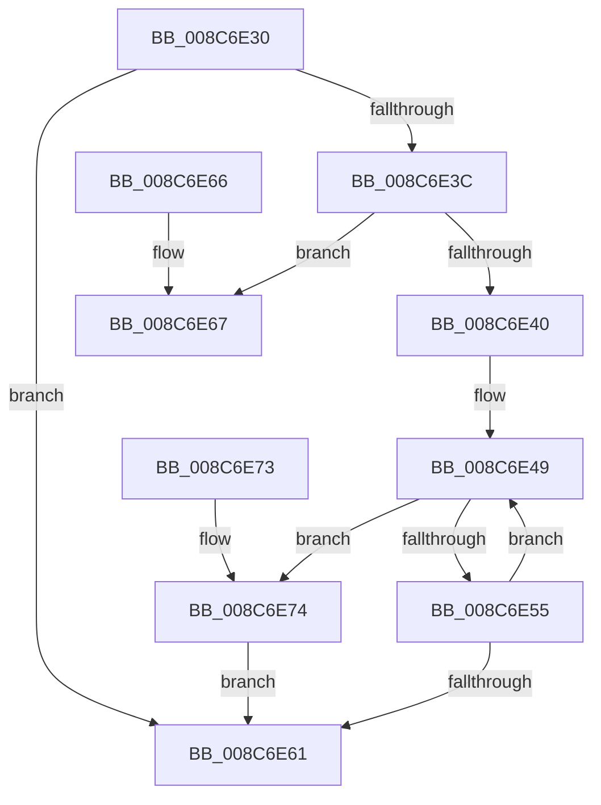

# ObReleaseObjectSecurityEx

- RVA: `0x008C6E30`–`0x008C6E83` (길이 `83` bytes)
- VA: `0x00000001408C6E30`
- 실행 섹션: `PAGE`
- PDB 이름 있음: `예`; PDB Function 태그: `아니요`
- unwind 정보 RVA: `0x00083CB8`
- 디코드: `27`개 명령, `83/83` bytes 표시
- 미해석 바이트: `0` (있으면 어셈블리에 `.byte`로 보존)

> 이 문서는 커널 이미지의 기계어와 PDB 기호를 분석해 생성했습니다. 4번과 5번은 함수 원형과 자료형을 바이너리 사용 방식에서 추정한 C 해석이며 원본 소스 복구 결과는 아닙니다.

## 1. Dependencies

- 직접 호출 지점: **2**; 고유 호출 대상: **2**
- 직접 호출자로 확인된 함수: **7**
- RIP 상대 이미지 참조: **0**

### Outgoing calls
- `0x008C6E69` → [ExFreePoolWithTag](../../poolcode/B8/ExFreePoolWithTag_function_00B82870.md) (function, `0x00B82870`)
- `0x008C6E7C` → [ObDereferenceSecurityDescriptor](../87/ObDereferenceSecurityDescriptor_function_008740A0.md) (function, `0x008740A0`)

### Direct callers
- [PspCheckJobAccessState](../78/PspCheckJobAccessState_function_00784D94.md) at `0x00784E36`
- [ObpCheckTraverseAccess](ObpCheckTraverseAccess_function_008C6CE4.md) at `0x008C6DE2`
- [MiAllowImageMap](MiAllowImageMap_function_008C8B10.md) at `0x008C8C8F`
- [PspAllocateAndQueryNotificationChannel](../91/PspAllocateAndQueryNotificationChannel_function_00917EE4.md) at `0x00918044`
- [ObpInsertOrLocateNamedObject](../99/ObpInsertOrLocateNamedObject_function_0099F2C0.md) at `0x0099F84F`
- [EtwpCheckCurrentUserProcessAccess](../9E/EtwpCheckCurrentUserProcessAccess_function_009EB530.md) at `0x009EB578`
- [PopBootStatAccessCheck](../AC/PopBootStatAccessCheck_function_00AC0814.md) at `0x00AC08FD`

### Static image references
- 디코드된 RIP-relative 메모리 참조가 없습니다.

## 2. Other-region calls and transfers

- 다른 실행 섹션으로 향하는 call: **1**
  - `0x008C6E69` → [ExFreePoolWithTag](../../poolcode/B8/ExFreePoolWithTag_function_00B82870.md) (`PAGE` → `POOLCODE`)
- 별도 외부 분기/꼬리 이동을 확인하지 못했습니다.

## 3. Assembly (complete function range)

```asm
008C6E30  48 83 EC 28                     sub rsp, 0x28
008C6E34  4C 8B C9                        mov r9, rcx
008C6E37  48 85 C9                        test rcx, rcx
008C6E3A  74 25                           je 0x1408c6e61
008C6E3C  84 D2                           test dl, dl
008C6E3E  75 27                           jne 0x1408c6e67
008C6E40  41 0F 0D 48 F8                  prefetchw byte ptr [r8 - 8]
008C6E45  49 8B 40 F8                     mov rax, qword ptr [r8 - 8]
008C6E49  48 8B C8                        mov rcx, rax
008C6E4C  49 33 C9                        xor rcx, r9
008C6E4F  48 83 F9 0F                     cmp rcx, 0xf
008C6E53  73 1F                           jae 0x1408c6e74
008C6E55  48 8D 48 01                     lea rcx, [rax + 1]
008C6E59  F0 49 0F B1 48 F8               lock cmpxchg qword ptr [r8 - 8], rcx
008C6E5F  75 E8                           jne 0x1408c6e49
008C6E61  48 83 C4 28                     add rsp, 0x28
008C6E65  C3                              ret
008C6E66  CC                              int3
008C6E67  33 D2                           xor edx, edx
008C6E69  E8 02 BA 2B 00                  call 0x140b82870
008C6E6E  48 83 C4 28                     add rsp, 0x28
008C6E72  C3                              ret
008C6E73  CC                              int3
008C6E74  BA 01 00 00 00                  mov edx, 1
008C6E79  49 8B C9                        mov rcx, r9
008C6E7C  E8 1F D2 FA FF                  call 0x1408740a0
008C6E81  EB DE                           jmp 0x1408c6e61
```

## 4. C-style interpretation (structured pseudocode)

```c
__int64 __fastcall ObReleaseObjectSecurityEx(__int64 a1, int a2, __int64 a3)
{
    __int64 result;
    __int64 v_rsp;

    v_rsp = (v_rsp) - (40);
    if (a1 == 0) goto loc_008C6E61;
    if ((unsigned __int8)(a2) != 0) goto loc_008C6E67;
loc_008C6E49:
    a1 = (*(unsigned __int64 *)(a3 - 8)) ^ (a1);
    if (a1 >= 15) goto loc_008C6E74;
    if (a1 != 15) goto loc_008C6E49;
loc_008C6E61:
    v_rsp = (v_rsp) + (40);
    return *(unsigned __int64 *)(a3 - 8);
loc_008C6E67:
    a2 = 0;
    result = ExFreePoolWithTag(*(unsigned __int64 *)(a3 - 8) + 1, a2, a3, a1);
    v_rsp = (v_rsp) + (40);
    return result;
loc_008C6E74:
    result = ObDereferenceSecurityDescriptor(a1, 1, a3, a1);
    goto loc_008C6E61;
}
```

## 5. (Beta) C Style

```c
int64_t ObReleaseObjectSecurityEx(int64_t Arg1, int32_t Arg2, void *Arg3)
{
    uint8_t *arg3 = (uint8_t *)Arg3;

    int64_t result;
    int64_t local_rsp;

    local_rsp = (local_rsp) - (40);
    if (Arg1 == 0) goto loc_008C6E61;
    if ((uint8_t)(Arg2) != 0) goto loc_008C6E67;
loc_008C6E49:
    Arg1 = (*(uint64_t *)(arg3 - 0x8)) ^ (Arg1);
    if (Arg1 >= 15) goto loc_008C6E74;
    if (Arg1 != 15) goto loc_008C6E49;
loc_008C6E61:
    local_rsp = (local_rsp) + (40);
    return *(uint64_t *)(arg3 - 0x8);
loc_008C6E67:
    Arg2 = 0;
    result = ExFreePoolWithTag(*(uint64_t *)(arg3 - 0x8) + 1, Arg2, Arg3, Arg1);
    local_rsp = (local_rsp) + (40);
    return result;
loc_008C6E74:
    result = ObDereferenceSecurityDescriptor(Arg1, 1, Arg3, Arg1);
    goto loc_008C6E61;
}
```

### 관측된 메모리 오프셋

구조체 형식이 확인되지 않은 접근은 인자 기준의 오프셋으로만 기록했습니다.

| 기준 인자 | 오프셋 표현 | 폭 (bit) | 접근 |
|---|---:|---:|---|
| `Arg3` | `- 0x8` | `8` | `R` |
| `Arg3` | `- 0x8` | `64` | `R` |

## 6. Execution-region graph

[열기: 2D/3D 그래프와 함수 탐색 컨트롤 패널](../../../control-panel.html?section=page&rva=0x008C6E30&view=graph)

- 2D 그래프는 위에서 아래로 흐르고, 3D 그래프는 빈 공간을 드래그해 회전합니다. Shift+드래그는 이동, 휠은 확대·축소, 함수 노드 선택은 대상 보고서 이동입니다.

### Static fallback


