# ObpCallPreOperationCallbacks

- RVA: `0x008C6570`–`0x008C6976` (길이 `1,030` bytes)
- VA: `0x00000001408C6570`
- 실행 섹션: `PAGE`
- PDB 이름 있음: `예`; PDB Function 태그: `아니요`
- unwind 정보 RVA: `0x00083BD0`
- 디코드: `255`개 명령, `1,030/1,030` bytes 표시
- 미해석 바이트: `0` (있으면 어셈블리에 `.byte`로 보존)

> 이 문서는 커널 이미지의 기계어와 PDB 기호를 분석해 생성했습니다. 4번과 5번은 함수 원형과 자료형을 바이너리 사용 방식에서 추정한 C 해석이며 원본 소스 복구 결과는 아닙니다.

## 1. Dependencies

- 직접 호출 지점: **22**; 고유 호출 대상: **14**
- 직접 호출자로 확인된 함수: **2**
- RIP 상대 이미지 참조: **0**

### Outgoing calls
- `0x008C65D2` → [ObfReferenceObjectWithTag](../../text/21/ObfReferenceObjectWithTag_function_00210710.md) (function, `0x00210710`)
- `0x008C65F7` → [KeAbPreAcquire](../../text/21/KeAbPreAcquire_function_00210230.md) (function, `0x00210230`)
- `0x008C6618` → [ExfAcquirePushLockSharedEx](../../text/21/ExfAcquirePushLockSharedEx_function_0021044C.md) (function, `0x0021044C`)
- `0x008C669A` → [KeAbPostRelease](../../text/2E/KeAbPostRelease_function_002E1600.md) (function, `0x002E1600`)
- `0x008C66BF` → [KiCheckForKernelApcDelivery](../../text/2E/KiCheckForKernelApcDelivery_function_002E2C80.md) (function, `0x002E2C80`)
- `0x008C6709` → [guard_dispatch_icall](../../text/6B/guard_dispatch_icall_function_006BAAD0.md) (function, `0x006BAAD0`)
- `0x008C673E` → [KeAbPreAcquire](../../text/21/KeAbPreAcquire_function_00210230.md) (function, `0x00210230`)
- `0x008C675F` → [ExfAcquirePushLockSharedEx](../../text/21/ExfAcquirePushLockSharedEx_function_0021044C.md) (function, `0x0021044C`)
- `0x008C67AC` → [KeAbPostRelease](../../text/2E/KeAbPostRelease_function_002E1600.md) (function, `0x002E1600`)
- `0x008C67D1` → [KiCheckForKernelApcDelivery](../../text/2E/KiCheckForKernelApcDelivery_function_002E2C80.md) (function, `0x002E2C80`)
- `0x008C6804` → [ObfDereferenceObjectWithTag](../../text/2F/ObfDereferenceObjectWithTag_function_002F78E0.md) (function, `0x002F78E0`)
- `0x008C6812` → [KeLeaveCriticalRegionThread](../../text/25/KeLeaveCriticalRegionThread_function_0025EFF0.md) (function, `0x0025EFF0`)
- `0x008C6842` → [ExAllocatePool2](../../poolcode/B8/ExAllocatePool2_function_00B820F0.md) (function, `0x00B820F0`)
- `0x008C6886` → [ExfReleasePushLock](../../text/26/ExfReleasePushLock_function_002638D0.md) (function, `0x002638D0`)
- `0x008C689B` → [ExfReleasePushLock](../../text/26/ExfReleasePushLock_function_002638D0.md) (function, `0x002638D0`)
- `0x008C68A9` → [ExfAcquireRundownProtection](../../text/34/ExfAcquireRundownProtection_function_0034C050.md) (function, `0x0034C050`)
- `0x008C68C1` → [ExfReleaseRundownProtection](../../text/34/ExfReleaseRundownProtection_function_00349EB0.md) (function, `0x00349EB0`)
- `0x008C68CE` → [ExfReleaseRundownProtection](../../text/34/ExfReleaseRundownProtection_function_00349EB0.md) (function, `0x00349EB0`)
- `0x008C68F0` → [ExReleaseRundownProtection](../../text/34/ExReleaseRundownProtection_function_00349E80.md) (function, `0x00349E80`)
- `0x008C6940` → [ObpCallPostOperationCallbacks](../9A/ObpCallPostOperationCallbacks_function_009A7BC0.md) (function, `0x009A7BC0`)
- `0x008C6958` → [KeLeaveCriticalRegionThread](../../text/25/KeLeaveCriticalRegionThread_function_0025EFF0.md) (function, `0x0025EFF0`)
- `0x008C6967` → [ObfDereferenceObjectWithTag](../../text/2F/ObfDereferenceObjectWithTag_function_002F78E0.md) (function, `0x002F78E0`)

### Direct callers
- [ObDuplicateObject](ObDuplicateObject_function_008C4FA0.md) at `0x008C5999`
- [ObpPreInterceptHandleDuplicate](ObpPreInterceptHandleDuplicate_function_008C69E4.md) at `0x008C6A82`

### Static image references
- 디코드된 RIP-relative 메모리 참조가 없습니다.

## 2. Other-region calls and transfers

- 다른 실행 섹션으로 향하는 call: **21**
  - `0x008C65D2` → [ObfReferenceObjectWithTag](../../text/21/ObfReferenceObjectWithTag_function_00210710.md) (`PAGE` → `.text`)
  - `0x008C65F7` → [KeAbPreAcquire](../../text/21/KeAbPreAcquire_function_00210230.md) (`PAGE` → `.text`)
  - `0x008C6618` → [ExfAcquirePushLockSharedEx](../../text/21/ExfAcquirePushLockSharedEx_function_0021044C.md) (`PAGE` → `.text`)
  - `0x008C669A` → [KeAbPostRelease](../../text/2E/KeAbPostRelease_function_002E1600.md) (`PAGE` → `.text`)
  - `0x008C66BF` → [KiCheckForKernelApcDelivery](../../text/2E/KiCheckForKernelApcDelivery_function_002E2C80.md) (`PAGE` → `.text`)
  - `0x008C6709` → [guard_dispatch_icall](../../text/6B/guard_dispatch_icall_function_006BAAD0.md) (`PAGE` → `.text`)
  - `0x008C673E` → [KeAbPreAcquire](../../text/21/KeAbPreAcquire_function_00210230.md) (`PAGE` → `.text`)
  - `0x008C675F` → [ExfAcquirePushLockSharedEx](../../text/21/ExfAcquirePushLockSharedEx_function_0021044C.md) (`PAGE` → `.text`)
  - `0x008C67AC` → [KeAbPostRelease](../../text/2E/KeAbPostRelease_function_002E1600.md) (`PAGE` → `.text`)
  - `0x008C67D1` → [KiCheckForKernelApcDelivery](../../text/2E/KiCheckForKernelApcDelivery_function_002E2C80.md) (`PAGE` → `.text`)
  - `0x008C6804` → [ObfDereferenceObjectWithTag](../../text/2F/ObfDereferenceObjectWithTag_function_002F78E0.md) (`PAGE` → `.text`)
  - `0x008C6812` → [KeLeaveCriticalRegionThread](../../text/25/KeLeaveCriticalRegionThread_function_0025EFF0.md) (`PAGE` → `.text`)
  - `0x008C6842` → [ExAllocatePool2](../../poolcode/B8/ExAllocatePool2_function_00B820F0.md) (`PAGE` → `POOLCODE`)
  - `0x008C6886` → [ExfReleasePushLock](../../text/26/ExfReleasePushLock_function_002638D0.md) (`PAGE` → `.text`)
  - `0x008C689B` → [ExfReleasePushLock](../../text/26/ExfReleasePushLock_function_002638D0.md) (`PAGE` → `.text`)
  - `0x008C68A9` → [ExfAcquireRundownProtection](../../text/34/ExfAcquireRundownProtection_function_0034C050.md) (`PAGE` → `.text`)
  - `0x008C68C1` → [ExfReleaseRundownProtection](../../text/34/ExfReleaseRundownProtection_function_00349EB0.md) (`PAGE` → `.text`)
  - `0x008C68CE` → [ExfReleaseRundownProtection](../../text/34/ExfReleaseRundownProtection_function_00349EB0.md) (`PAGE` → `.text`)
  - `0x008C68F0` → [ExReleaseRundownProtection](../../text/34/ExReleaseRundownProtection_function_00349E80.md) (`PAGE` → `.text`)
  - `0x008C6958` → [KeLeaveCriticalRegionThread](../../text/25/KeLeaveCriticalRegionThread_function_0025EFF0.md) (`PAGE` → `.text`)
  - `0x008C6967` → [ObfDereferenceObjectWithTag](../../text/2F/ObfDereferenceObjectWithTag_function_002F78E0.md) (`PAGE` → `.text`)
- 별도 외부 분기/꼬리 이동을 확인하지 못했습니다.

## 3. Assembly (complete function range)

```asm
008C6570  48 89 5C 24 18                  mov qword ptr [rsp + 0x18], rbx
008C6575  55                              push rbp
008C6576  56                              push rsi
008C6577  57                              push rdi
008C6578  41 54                           push r12
008C657A  41 55                           push r13
008C657C  41 56                           push r14
008C657E  41 57                           push r15
008C6580  48 83 EC 50                     sub rsp, 0x50
008C6584  0F 57 C0                        xorps xmm0, xmm0
008C6587  4C 8D B1 C8 00 00 00            lea r14, [rcx + 0xc8]
008C658E  0F 11 44 24 20                  movups xmmword ptr [rsp + 0x20], xmm0
008C6593  4C 8B E2                        mov r12, rdx
008C6596  45 33 FF                        xor r15d, r15d
008C6599  0F 11 44 24 30                  movups xmmword ptr [rsp + 0x30], xmm0
008C659E  48 8B D9                        mov rbx, rcx
008C65A1  BA 4F 62 43 62                  mov edx, 0x6243624f
008C65A6  0F 11 44 24 40                  movups xmmword ptr [rsp + 0x40], xmm0
008C65AB  65 48 8B 04 25 88 01 00 00      mov rax, qword ptr gs:[0x188]
008C65B4  4D 8B E8                        mov r13, r8
008C65B7  41 8B EF                        mov ebp, r15d
008C65BA  4C 89 BC 24 90 00 00 00         mov qword ptr [rsp + 0x90], r15
008C65C2  41 8B F7                        mov esi, r15d
008C65C5  66 FF 88 E4 01 00 00            dec word ptr [rax + 0x1e4]
008C65CC  90                              nop
008C65CD  49 8B 4C 24 08                  mov rcx, qword ptr [r12 + 8]
008C65D2  E8 39 A1 94 FF                  call 0x140210710
008C65D7  65 48 8B 04 25 88 01 00 00      mov rax, qword ptr gs:[0x188]
008C65E0  48 81 C3 B8 00 00 00            add rbx, 0xb8
008C65E7  45 33 C0                        xor r8d, r8d
008C65EA  33 D2                           xor edx, edx
008C65EC  48 8B CB                        mov rcx, rbx
008C65EF  66 FF 88 E6 01 00 00            dec word ptr [rax + 0x1e6]
008C65F6  90                              nop
008C65F7  E8 34 9C 94 FF                  call 0x140210230
008C65FC  48 8B F8                        mov rdi, rax
008C65FF  B9 11 00 00 00                  mov ecx, 0x11
008C6604  33 C0                           xor eax, eax
008C6606  F0 48 0F B1 0B                  lock cmpxchg qword ptr [rbx], rcx
008C660B  74 10                           je 0x1408c661d
008C660D  4C 8B CB                        mov r9, rbx
008C6610  4C 8B C7                        mov r8, rdi
008C6613  33 D2                           xor edx, edx
008C6615  48 8B CB                        mov rcx, rbx
008C6618  E8 2F 9E 94 FF                  call 0x14021044c
008C661D  48 85 FF                        test rdi, rdi
008C6620  74 04                           je 0x1408c6626
008C6622  C6 47 0A 01                     mov byte ptr [rdi + 0xa], 1
008C6626  49 8B 3E                        mov rdi, qword ptr [r14]
008C6629  49 3B FE                        cmp rdi, r14
008C662C  0F 84 4B 01 00 00               je 0x1408c677d
008C6632  8B 47 14                        mov eax, dword ptr [rdi + 0x14]
008C6635  A8 01                           test al, 1
008C6637  0F 84 38 01 00 00               je 0x1408c6775
008C663D  8B 47 10                        mov eax, dword ptr [rdi + 0x10]
008C6640  41 85 04 24                     test dword ptr [r12], eax
008C6644  0F 84 2B 01 00 00               je 0x1408c6775
008C664A  0F 0D 4F 38                     prefetchw byte ptr [rdi + 0x38]
008C664E  48 8B 47 38                     mov rax, qword ptr [rdi + 0x38]
008C6652  48 83 E0 FE                     and rax, 0xfffffffffffffffe
008C6656  48 8D 48 02                     lea rcx, [rax + 2]
008C665A  F0 48 0F B1 4F 38               lock cmpxchg qword ptr [rdi + 0x38], rcx
008C6660  0F 85 3F 02 00 00               jne 0x1408c68a5
008C6666  0F 0D 0B                        prefetchw byte ptr [rbx]
008C6669  48 8B 03                        mov rax, qword ptr [rbx]
008C666C  48 8B C8                        mov rcx, rax
008C666F  48 83 E1 F0                     and rcx, 0xfffffffffffffff0
008C6673  48 83 F9 10                     cmp rcx, 0x10
008C6677  B9 00 00 00 00                  mov ecx, 0
008C667C  48 8D 50 F0                     lea rdx, [rax - 0x10]
008C6680  48 0F 46 D1                     cmovbe rdx, rcx
008C6684  A8 02                           test al, 2
008C6686  0F 85 F7 01 00 00               jne 0x1408c6883
008C668C  F0 48 0F B1 13                  lock cmpxchg qword ptr [rbx], rdx
008C6691  0F 85 EC 01 00 00               jne 0x1408c6883
008C6697  48 8B CB                        mov rcx, rbx
008C669A  E8 61 AF A1 FF                  call 0x1402e1600
008C669F  65 48 8B 04 25 88 01 00 00      mov rax, qword ptr gs:[0x188]
008C66A8  90                              nop
008C66A9  66 83 80 E6 01 00 00 01         add word ptr [rax + 0x1e6], 1
008C66B1  75 11                           jne 0x1408c66c4
008C66B3  48 05 98 00 00 00               add rax, 0x98
008C66B9  90                              nop
008C66BA  48 39 00                        cmp qword ptr [rax], rax
008C66BD  74 05                           je 0x1408c66c4
008C66BF  E8 BC C5 A1 FF                  call 0x1402e2c80
008C66C4  48 85 F6                        test rsi, rsi
008C66C7  74 1D                           je 0x1408c66e6
008C66C9  0F 0D 0E                        prefetchw byte ptr [rsi]
008C66CC  48 8B 06                        mov rax, qword ptr [rsi]
008C66CF  48 83 E0 FE                     and rax, 0xfffffffffffffffe
008C66D3  48 8D 50 FE                     lea rdx, [rax - 2]
008C66D7  F0 48 0F B1 16                  lock cmpxchg qword ptr [rsi], rdx
008C66DC  0F 85 DC 01 00 00               jne 0x1408c68be
008C66E2  33 C0                           xor eax, eax
008C66E4  8B F0                           mov esi, eax
008C66E6  48 83 7F 30 00                  cmp qword ptr [rdi + 0x30], 0
008C66EB  0F 85 41 01 00 00               jne 0x1408c6832
008C66F1  48 8B 47 28                     mov rax, qword ptr [rdi + 0x28]
008C66F5  48 85 C0                        test rax, rax
008C66F8  0F 84 92 01 00 00               je 0x1408c6890
008C66FE  48 8B 4F 18                     mov rcx, qword ptr [rdi + 0x18]
008C6702  49 8B D4                        mov rdx, r12
008C6705  48 8B 49 08                     mov rcx, qword ptr [rcx + 8]
008C6709  E8 C2 43 DF FF                  call 0x1406baad0
008C670E  48 83 7F 30 00                  cmp qword ptr [rdi + 0x30], 0
008C6713  0F 85 5C 01 00 00               jne 0x1408c6875
008C6719  48 8D 77 38                     lea rsi, [rdi + 0x38]
008C671D  45 33 FF                        xor r15d, r15d
008C6720  4D 89 7C 24 18                  mov qword ptr [r12 + 0x18], r15
008C6725  65 48 8B 04 25 88 01 00 00      mov rax, qword ptr gs:[0x188]
008C672E  45 33 C0                        xor r8d, r8d
008C6731  33 D2                           xor edx, edx
008C6733  48 8B CB                        mov rcx, rbx
008C6736  66 FF 88 E6 01 00 00            dec word ptr [rax + 0x1e6]
008C673D  90                              nop
008C673E  E8 ED 9A 94 FF                  call 0x140210230
008C6743  48 8B E8                        mov rbp, rax
008C6746  B9 11 00 00 00                  mov ecx, 0x11
008C674B  33 C0                           xor eax, eax
008C674D  F0 48 0F B1 0B                  lock cmpxchg qword ptr [rbx], rcx
008C6752  74 10                           je 0x1408c6764
008C6754  4C 8B CB                        mov r9, rbx
008C6757  4C 8B C5                        mov r8, rbp
008C675A  33 D2                           xor edx, edx
008C675C  48 8B CB                        mov rcx, rbx
008C675F  E8 E8 9C 94 FF                  call 0x14021044c
008C6764  48 85 ED                        test rbp, rbp
008C6767  74 04                           je 0x1408c676d
008C6769  C6 45 0A 01                     mov byte ptr [rbp + 0xa], 1
008C676D  48 8B AC 24 90 00 00 00         mov rbp, qword ptr [rsp + 0x90]
008C6775  48 8B 3F                        mov rdi, qword ptr [rdi]
008C6778  E9 AC FE FF FF                  jmp 0x1408c6629
008C677D  0F 0D 0B                        prefetchw byte ptr [rbx]
008C6780  48 8B 03                        mov rax, qword ptr [rbx]
008C6783  48 8B C8                        mov rcx, rax
008C6786  48 83 E1 F0                     and rcx, 0xfffffffffffffff0
008C678A  48 83 F9 10                     cmp rcx, 0x10
008C678E  48 8D 50 F0                     lea rdx, [rax - 0x10]
008C6792  49 0F 46 D7                     cmovbe rdx, r15
008C6796  A8 02                           test al, 2
008C6798  0F 85 FA 00 00 00               jne 0x1408c6898
008C679E  F0 48 0F B1 13                  lock cmpxchg qword ptr [rbx], rdx
008C67A3  0F 85 EF 00 00 00               jne 0x1408c6898
008C67A9  48 8B CB                        mov rcx, rbx
008C67AC  E8 4F AE A1 FF                  call 0x1402e1600
008C67B1  65 48 8B 04 25 88 01 00 00      mov rax, qword ptr gs:[0x188]
008C67BA  90                              nop
008C67BB  66 83 80 E6 01 00 00 01         add word ptr [rax + 0x1e6], 1
008C67C3  75 11                           jne 0x1408c67d6
008C67C5  48 05 98 00 00 00               add rax, 0x98
008C67CB  90                              nop
008C67CC  48 39 00                        cmp qword ptr [rax], rax
008C67CF  74 05                           je 0x1408c67d6
008C67D1  E8 AA C4 A1 FF                  call 0x1402e2c80
008C67D6  48 85 F6                        test rsi, rsi
008C67D9  74 19                           je 0x1408c67f4
008C67DB  0F 0D 0E                        prefetchw byte ptr [rsi]
008C67DE  48 8B 06                        mov rax, qword ptr [rsi]
008C67E1  48 83 E0 FE                     and rax, 0xfffffffffffffffe
008C67E5  48 8D 48 FE                     lea rcx, [rax - 2]
008C67E9  F0 48 0F B1 0E                  lock cmpxchg qword ptr [rsi], rcx
008C67EE  0F 85 D7 00 00 00               jne 0x1408c68cb
008C67F4  4D 39 6D 00                     cmp qword ptr [r13], r13
008C67F8  75 1D                           jne 0x1408c6817
008C67FA  49 8B 4C 24 08                  mov rcx, qword ptr [r12 + 8]
008C67FF  BA 4F 62 43 62                  mov edx, 0x6243624f
008C6804  E8 D7 10 A3 FF                  call 0x1402f78e0
008C6809  65 48 8B 0C 25 88 01 00 00      mov rcx, qword ptr gs:[0x188]
008C6812  E8 D9 87 99 FF                  call 0x14025eff0
008C6817  33 C0                           xor eax, eax
008C6819  48 8B 9C 24 A0 00 00 00         mov rbx, qword ptr [rsp + 0xa0]
008C6821  48 83 C4 50                     add rsp, 0x50
008C6825  41 5F                           pop r15
008C6827  41 5E                           pop r14
008C6829  41 5D                           pop r13
008C682B  41 5C                           pop r12
008C682D  5F                              pop rdi
008C682E  5E                              pop rsi
008C682F  5D                              pop rbp
008C6830  C3                              ret
008C6831  CC                              int3
008C6832  BA 20 00 00 00                  mov edx, 0x20
008C6837  B9 00 01 00 00                  mov ecx, 0x100
008C683C  41 B8 4F 62 46 6C               mov r8d, 0x6c46624f
008C6842  E8 A9 B8 2B 00                  call 0x140b820f0
008C6847  48 89 84 24 90 00 00 00         mov qword ptr [rsp + 0x90], rax
008C684F  48 8B E8                        mov rbp, rax
008C6852  48 85 C0                        test rax, rax
008C6855  0F 84 91 00 00 00               je 0x1408c68ec
008C685B  48 89 78 10                     mov qword ptr [rax + 0x10], rdi
008C685F  33 C0                           xor eax, eax
008C6861  48 89 45 18                     mov qword ptr [rbp + 0x18], rax
008C6865  49 8B 4D 08                     mov rcx, qword ptr [r13 + 8]
008C6869  4C 39 29                        cmp qword ptr [rcx], r13
008C686C  74 6A                           je 0x1408c68d8
008C686E  B9 03 00 00 00                  mov ecx, 3
008C6873  CD 29                           int 0x29
008C6875  49 8B 44 24 18                  mov rax, qword ptr [r12 + 0x18]
008C687A  48 89 45 18                     mov qword ptr [rbp + 0x18], rax
008C687E  E9 9A FE FF FF                  jmp 0x1408c671d
008C6883  48 8B CB                        mov rcx, rbx
008C6886  E8 45 D0 99 FF                  call 0x1402638d0
008C688B  E9 07 FE FF FF                  jmp 0x1408c6697
008C6890  45 33 FF                        xor r15d, r15d
008C6893  E9 8D FE FF FF                  jmp 0x1408c6725
008C6898  48 8B CB                        mov rcx, rbx
008C689B  E8 30 D0 99 FF                  call 0x1402638d0
008C68A0  E9 04 FF FF FF                  jmp 0x1408c67a9
008C68A5  48 8D 4F 38                     lea rcx, [rdi + 0x38]
008C68A9  E8 A2 57 A8 FF                  call 0x14034c050
008C68AE  84 C0                           test al, al
008C68B0  0F 85 B0 FD FF FF               jne 0x1408c6666
008C68B6  45 33 FF                        xor r15d, r15d
008C68B9  E9 B7 FE FF FF                  jmp 0x1408c6775
008C68BE  48 8B CE                        mov rcx, rsi
008C68C1  E8 EA 35 A8 FF                  call 0x140349eb0
008C68C6  E9 17 FE FF FF                  jmp 0x1408c66e2
008C68CB  48 8B CE                        mov rcx, rsi
008C68CE  E8 DD 35 A8 FF                  call 0x140349eb0
008C68D3  E9 1C FF FF FF                  jmp 0x1408c67f4
008C68D8  4C 89 6D 00                     mov qword ptr [rbp], r13
008C68DC  48 89 4D 08                     mov qword ptr [rbp + 8], rcx
008C68E0  48 89 29                        mov qword ptr [rcx], rbp
008C68E3  49 89 6D 08                     mov qword ptr [r13 + 8], rbp
008C68E7  E9 05 FE FF FF                  jmp 0x1408c66f1
008C68EC  48 8D 4F 38                     lea rcx, [rdi + 0x38]
008C68F0  E8 8B 35 A8 FF                  call 0x140349e80
008C68F5  4D 39 6D 00                     cmp qword ptr [r13], r13
008C68F9  74 54                           je 0x1408c694f
008C68FB  41 8B 0C 24                     mov ecx, dword ptr [r12]
008C68FF  33 C0                           xor eax, eax
008C6901  89 4C 24 20                     mov dword ptr [rsp + 0x20], ecx
008C6905  49 8B D5                        mov rdx, r13
008C6908  41 8B 4C 24 04                  mov ecx, dword ptr [r12 + 4]
008C690D  89 4C 24 24                     mov dword ptr [rsp + 0x24], ecx
008C6911  49 8B 4C 24 10                  mov rcx, qword ptr [r12 + 0x10]
008C6916  48 89 4C 24 30                  mov qword ptr [rsp + 0x30], rcx
008C691B  49 8B 4C 24 08                  mov rcx, qword ptr [r12 + 8]
008C6920  48 89 4C 24 28                  mov qword ptr [rsp + 0x28], rcx
008C6925  48 8D 4C 24 20                  lea rcx, [rsp + 0x20]
008C692A  48 89 44 24 38                  mov qword ptr [rsp + 0x38], rax
008C692F  48 89 44 24 44                  mov qword ptr [rsp + 0x44], rax
008C6934  89 44 24 4C                     mov dword ptr [rsp + 0x4c], eax
008C6938  C7 44 24 40 9A 00 00 C0         mov dword ptr [rsp + 0x40], 0xc000009a
008C6940  E8 7B 12 0E 00                  call 0x1409a7bc0
008C6945  B8 9A 00 00 C0                  mov eax, 0xc000009a
008C694A  E9 CA FE FF FF                  jmp 0x1408c6819
008C694F  65 48 8B 0C 25 88 01 00 00      mov rcx, qword ptr gs:[0x188]
008C6958  E8 93 86 99 FF                  call 0x14025eff0
008C695D  49 8B 4C 24 08                  mov rcx, qword ptr [r12 + 8]
008C6962  BA 4F 62 43 62                  mov edx, 0x6243624f
008C6967  E8 74 0F A3 FF                  call 0x1402f78e0
008C696C  B8 9A 00 00 C0                  mov eax, 0xc000009a
008C6971  E9 A3 FE FF FF                  jmp 0x1408c6819
```

## 4. C-style interpretation (structured pseudocode)

```c
__int64 __fastcall ObpCallPreOperationCallbacks(__int64 a1, __int64 a2, __int64 a3)
{
    __int64 result;
    __int64 v_r15;
    __int64 v_rbx;
    __int64 v_rsp;
    unsigned __int64 v_stack_m48;
    unsigned __int64 v_stack_m58;
    unsigned __int64 v_stack_m68;
    unsigned __int64 v_stack_p18;
    unsigned int v_stack_p20;
    unsigned int v_stack_p24;
    unsigned __int64 v_stack_p28;
    unsigned __int64 v_stack_p30;
    unsigned __int64 v_stack_p38;
    unsigned int v_stack_p40;
    unsigned __int64 v_stack_p44;
    unsigned int v_stack_p4C;
    unsigned __int64 v_stack_p8;
    unsigned __int64 v_stack_p90;

    v_stack_p18 = v_rbx;
    v_rsp = (v_rsp) - (80);
    v_stack_m68 = v_xmm0;
    v_r15 = 0;
    v_stack_m58 = v_xmm0;
    v_stack_m48 = v_xmm0;
    v_stack_p8 = 0;
    result = ObfReferenceObjectWithTag(*(unsigned __int64 *)(a2 + 8), (unsigned int)(0x6243624FULL), a3, a4);
    v_rbx = (a1) + (184);
    a3 = 0;
    a2 = 0;
    result = KeAbPreAcquire(v_rbx, a2, a3, a4);
    result = 0;
    if (!(condition_is_equal)) {
        a4 = v_rbx;
        a3 = 0;
        a2 = 0;
        a1 = v_rbx;
        result = ExfAcquirePushLockSharedEx(a1, a2, a3, a4);
    }
    if (result != 0) {
        *(unsigned __int8 *)(result + 10) = 1;
    }
loc_008C6629:
    if ((*(unsigned __int64 *)(a1 + 200)) == (a1 + 200)) goto loc_008C677D;
    if ((((unsigned __int8)((unsigned int)(*(unsigned int *)(*(unsigned __int64 *)(a1 + 200) + 20)))) & (1)) == 0) goto loc_008C6775;
    if (((*(unsigned int *)(a2)) & ((unsigned int)((unsigned int)(*(unsigned int *)(*(unsigned __int64 *)(a1 + 200) + 16))))) == 0) goto loc_008C6775;
    result = (*(unsigned __int64 *)(*(unsigned __int64 *)(a1 + 200) + 56)) & (-2);
    if (condition_is_not_equal) goto loc_008C68A5;
loc_008C6666:
    a1 = (*(unsigned __int64 *)(v_rbx)) & (-16);
    a2 = *(unsigned __int64 *)(v_rbx) - 16;
    if (a1 <= 16) { a2 = 0; }
    if ((((unsigned __int8)(*(unsigned __int64 *)(v_rbx))) & (2)) != 0) goto loc_008C6883;
    if ((((unsigned __int8)(*(unsigned __int64 *)(v_rbx))) & (2)) != 0) goto loc_008C6883;
loc_008C6697:
    result = KeAbPostRelease(v_rbx, a2, a3, a4);
    if ((((unsigned __int8)(*(unsigned __int64 *)(v_rbx))) & (2)) != 0) goto loc_008C66C4;
    result = (*(unsigned __int64 *)(gs_base + (0 + 392))) + (152);
    if ((*(unsigned __int64 *)(result)) != result) {
        result = KiCheckForKernelApcDelivery(v_rbx, a2, a3, a4);
    }
    if (0 == 0) goto loc_008C66E6;
    result = (*(unsigned __int64 *)(0)) & (-2);
    if (condition_is_not_equal) goto loc_008C68BE;
loc_008C66E2:
    result = 0;
loc_008C66E6:
    if ((*(unsigned __int64 *)(*(unsigned __int64 *)(a1 + 200) + 48)) != 0) goto loc_008C6832;
loc_008C66F1:
    if (*(unsigned __int64 *)(*(unsigned __int64 *)(a1 + 200) + 40) == 0) goto loc_008C6890;
    result = guard_dispatch_icall(*(unsigned __int64 *)(*(unsigned __int64 *)(*(unsigned __int64 *)(a1 + 200) + 24) + 8), a2, a3, a4);
    if ((*(unsigned __int64 *)(*(unsigned __int64 *)(a1 + 200) + 48)) != 0) goto loc_008C6875;
loc_008C671D:
    v_r15 = 0;
    *(unsigned __int64 *)(a2 + 24) = 0;
loc_008C6725:
    a3 = 0;
    a2 = 0;
    result = KeAbPreAcquire(v_rbx, a2, a3, a4);
    result = 0;
    if (!(condition_is_equal)) {
        a4 = v_rbx;
        a3 = 0;
        a2 = 0;
        a1 = v_rbx;
        result = ExfAcquirePushLockSharedEx(a1, a2, a3, a4);
    }
    if (result != 0) {
        *(unsigned __int8 *)(result + 10) = 1;
    }
loc_008C6775:
    goto loc_008C6629;
loc_008C677D:
    a1 = (*(unsigned __int64 *)(v_rbx)) & (-16);
    a2 = *(unsigned __int64 *)(v_rbx) - 16;
    if (a1 <= 16) { a2 = 0; }
    if ((((unsigned __int8)(*(unsigned __int64 *)(v_rbx))) & (2)) != 0) goto loc_008C6898;
    if ((((unsigned __int8)(*(unsigned __int64 *)(v_rbx))) & (2)) != 0) goto loc_008C6898;
loc_008C67A9:
    result = KeAbPostRelease(v_rbx, a2, a3, a4);
    if ((((unsigned __int8)(*(unsigned __int64 *)(v_rbx))) & (2)) != 0) goto loc_008C67D6;
    result = (*(unsigned __int64 *)(gs_base + (0 + 392))) + (152);
    if ((*(unsigned __int64 *)(result)) != result) {
        result = KiCheckForKernelApcDelivery(v_rbx, a2, a3, a4);
    }
    if (*(unsigned __int64 *)(a1 + 200) + 56 == 0) goto loc_008C67F4;
    result = (*(unsigned __int64 *)(*(unsigned __int64 *)(a1 + 200) + 56)) & (-2);
    if (condition_is_not_equal) goto loc_008C68CB;
loc_008C67F4:
    if ((*(unsigned __int64 *)(a3)) == a3) {
        a1 = *(unsigned __int64 *)(a2 + 8);
        a2 = 0x6243624FULL;
        result = ObfDereferenceObjectWithTag(a1, a2, a3, a4);
        a1 = *(unsigned __int64 *)(gs_base + (0 + 392));
        result = KeLeaveCriticalRegionThread(a1, a2, a3, a4);
    }
    result = 0;
loc_008C6819:
    v_rsp = (v_rsp) + (80);
    return result;
loc_008C6832:
    result = ExAllocatePool2(256, 32, (unsigned int)(0x6C46624FULL), a4);
    v_stack_p90 = result;
    if (result == 0) goto loc_008C68EC;
    *(unsigned __int64 *)(result + 16) = *(unsigned __int64 *)(*(unsigned __int64 *)(a1 + 200));
    result = 0;
    *(unsigned __int64 *)(result + 24) = 0;
    if ((*(unsigned __int64 *)(*(unsigned __int64 *)(a3 + 8))) == a3) goto loc_008C68D8;
loc_008C6875:
    *(unsigned __int64 *)(result + 24) = *(unsigned __int64 *)(a2 + 24);
    goto loc_008C671D;
loc_008C6883:
    result = ExfReleasePushLock(v_stack_p18, 32, (unsigned int)(0x6C46624FULL), a4);
    goto loc_008C6697;
loc_008C6890:
    v_r15 = 0;
    goto loc_008C6725;
loc_008C6898:
    result = ExfReleasePushLock(v_stack_p18, 32, (unsigned int)(0x6C46624FULL), a4);
    goto loc_008C67A9;
loc_008C68A5:
    result = ExfAcquireRundownProtection(*(unsigned __int64 *)(*(unsigned __int64 *)(a1 + 200)) + 56, 32, (unsigned int)(0x6C46624FULL), a4);
    if ((unsigned __int8)(result) != 0) goto loc_008C6666;
    v_r15 = 0;
    goto loc_008C6775;
loc_008C68BE:
    result = ExfReleaseRundownProtection(*(unsigned __int64 *)(a1 + 200) + 56, 32, (unsigned int)(0x6C46624FULL), a4);
    goto loc_008C66E2;
loc_008C68CB:
    result = ExfReleaseRundownProtection(*(unsigned __int64 *)(a1 + 200) + 56, 32, (unsigned int)(0x6C46624FULL), a4);
    goto loc_008C67F4;
loc_008C68D8:
    *(unsigned __int64 *)(result) = a3;
    *(unsigned __int64 *)(result + 8) = *(unsigned __int64 *)(a1 + 200) + 56;
    *(unsigned __int64 *)(*(unsigned __int64 *)(a1 + 200) + 56) = result;
    *(unsigned __int64 *)(a3 + 8) = result;
    goto loc_008C66F1;
loc_008C68EC:
    result = ExReleaseRundownProtection(*(unsigned __int64 *)(*(unsigned __int64 *)(a1 + 200)) + 56, 32, (unsigned int)(0x6C46624FULL), a4);
    if ((*(unsigned __int64 *)(a3)) == a3) goto loc_008C694F;
    result = 0;
    v_stack_p20 = (unsigned int)((unsigned int)(*(unsigned int *)(a2)));
    v_stack_p24 = (unsigned int)((unsigned int)(*(unsigned int *)(a2 + 4)));
    v_stack_p30 = *(unsigned __int64 *)(a2 + 16);
    v_stack_p28 = *(unsigned __int64 *)(a2 + 8);
    v_stack_p38 = 0;
    v_stack_p44 = 0;
    v_stack_p4C = 0;
    v_stack_p40 = 0xC000009AULL;
    result = ObpCallPostOperationCallbacks(v_stack_p20, a3, (unsigned int)(0x6C46624FULL), a4);
    goto loc_008C6819;
loc_008C694F:
    result = KeLeaveCriticalRegionThread(*(unsigned __int64 *)(gs_base + (0 + 392)), a3, (unsigned int)(0x6C46624FULL), a4);
    result = ObfDereferenceObjectWithTag(*(unsigned __int64 *)(a2 + 8), (unsigned int)(0x6243624FULL), (unsigned int)(0x6C46624FULL), a4);
    goto loc_008C6819;
}
```

## 5. (Beta) C Style

```c
int64_t ObpCallPreOperationCallbacks(void *Arg1, void *Arg2, void *Arg3)
{
    uint8_t *arg1 = (uint8_t *)Arg1;
    uint8_t *arg2 = (uint8_t *)Arg2;
    uint8_t *arg3 = (uint8_t *)Arg3;

    int64_t result;
    int64_t local_r15;
    int64_t local_rbx;
    int64_t local_rsp;
    uint64_t v_stack_m48;
    uint64_t v_stack_m58;
    uint64_t v_stack_m68;
    uint64_t v_stack_p18;
    uint32_t v_stack_p20;
    uint32_t v_stack_p24;
    uint64_t v_stack_p28;
    uint64_t v_stack_p30;
    uint64_t v_stack_p38;
    uint32_t v_stack_p40;
    uint64_t v_stack_p44;
    uint32_t v_stack_p4C;
    uint64_t v_stack_p8;
    uint64_t v_stack_p90;

    v_stack_p18 = local_rbx;
    local_rsp = (local_rsp) - (80);
    v_stack_m68 = v_xmm0;
    local_r15 = 0;
    v_stack_m58 = v_xmm0;
    v_stack_m48 = v_xmm0;
    v_stack_p8 = 0;
    result = ObfReferenceObjectWithTag(*(uint64_t *)(arg2 + 0x8), (uint32_t)(0x6243624FULL), Arg3, a4);
    local_rbx = (Arg1) + (184);
    Arg3 = 0;
    Arg2 = 0;
    result = KeAbPreAcquire(local_rbx, Arg2, Arg3, a4);
    result = 0;
    if (!(condition_is_equal)) {
        a4 = local_rbx;
        Arg3 = 0;
        Arg2 = 0;
        Arg1 = local_rbx;
        result = ExfAcquirePushLockSharedEx(Arg1, Arg2, Arg3, a4);
    }
    if (result != 0) {
        *(uint8_t *)(result + 0xA) = 1;
    }
loc_008C6629:
    if ((*(uint64_t *)(arg1 + 0xC8)) == (Arg1 + 200)) goto loc_008C677D;
    if ((((uint8_t)((uint32_t)(*(uint32_t *)(*(uint64_t *)(arg1 + 0xC8) + 0x14)))) & (1)) == 0) goto loc_008C6775;
    if (((*(uint32_t *)(arg2)) & ((uint32_t)((uint32_t)(*(uint32_t *)(*(uint64_t *)(arg1 + 0xC8) + 0x10))))) == 0) goto loc_008C6775;
    result = (*(uint64_t *)(*(uint64_t *)(arg1 + 0xC8) + 0x38)) & (-2);
    if (condition_is_not_equal) goto loc_008C68A5;
loc_008C6666:
    Arg1 = (*(uint64_t *)(local_rbx)) & (-16);
    Arg2 = *(uint64_t *)(local_rbx) - 16;
    if (Arg1 <= 16) { Arg2 = 0; }
    if ((((uint8_t)(*(uint64_t *)(local_rbx))) & (2)) != 0) goto loc_008C6883;
    if ((((uint8_t)(*(uint64_t *)(local_rbx))) & (2)) != 0) goto loc_008C6883;
loc_008C6697:
    result = KeAbPostRelease(local_rbx, Arg2, Arg3, a4);
    if ((((uint8_t)(*(uint64_t *)(local_rbx))) & (2)) != 0) goto loc_008C66C4;
    result = (*(uint64_t *)(gs_base + (0 + 0x188))) + (152);
    if ((*(uint64_t *)(result)) != result) {
        result = KiCheckForKernelApcDelivery(local_rbx, Arg2, Arg3, a4);
    }
    if (0 == 0) goto loc_008C66E6;
    result = (*(uint64_t *)(0)) & (-2);
    if (condition_is_not_equal) goto loc_008C68BE;
loc_008C66E2:
    result = 0;
loc_008C66E6:
    if ((*(uint64_t *)(*(uint64_t *)(arg1 + 0xC8) + 0x30)) != 0) goto loc_008C6832;
loc_008C66F1:
    if (*(uint64_t *)(*(uint64_t *)(arg1 + 0xC8) + 0x28) == 0) goto loc_008C6890;
    result = guard_dispatch_icall(*(uint64_t *)(*(uint64_t *)(*(uint64_t *)(arg1 + 0xC8) + 0x18) + 0x8), Arg2, Arg3, a4);
    if ((*(uint64_t *)(*(uint64_t *)(arg1 + 0xC8) + 0x30)) != 0) goto loc_008C6875;
loc_008C671D:
    local_r15 = 0;
    *(uint64_t *)(arg2 + 0x18) = 0;
loc_008C6725:
    Arg3 = 0;
    Arg2 = 0;
    result = KeAbPreAcquire(local_rbx, Arg2, Arg3, a4);
    result = 0;
    if (!(condition_is_equal)) {
        a4 = local_rbx;
        Arg3 = 0;
        Arg2 = 0;
        Arg1 = local_rbx;
        result = ExfAcquirePushLockSharedEx(Arg1, Arg2, Arg3, a4);
    }
    if (result != 0) {
        *(uint8_t *)(result + 0xA) = 1;
    }
loc_008C6775:
    goto loc_008C6629;
loc_008C677D:
    Arg1 = (*(uint64_t *)(local_rbx)) & (-16);
    Arg2 = *(uint64_t *)(local_rbx) - 16;
    if (Arg1 <= 16) { Arg2 = 0; }
    if ((((uint8_t)(*(uint64_t *)(local_rbx))) & (2)) != 0) goto loc_008C6898;
    if ((((uint8_t)(*(uint64_t *)(local_rbx))) & (2)) != 0) goto loc_008C6898;
loc_008C67A9:
    result = KeAbPostRelease(local_rbx, Arg2, Arg3, a4);
    if ((((uint8_t)(*(uint64_t *)(local_rbx))) & (2)) != 0) goto loc_008C67D6;
    result = (*(uint64_t *)(gs_base + (0 + 0x188))) + (152);
    if ((*(uint64_t *)(result)) != result) {
        result = KiCheckForKernelApcDelivery(local_rbx, Arg2, Arg3, a4);
    }
    if (*(uint64_t *)(arg1 + 0xC8) + 56 == 0) goto loc_008C67F4;
    result = (*(uint64_t *)(*(uint64_t *)(arg1 + 0xC8) + 0x38)) & (-2);
    if (condition_is_not_equal) goto loc_008C68CB;
loc_008C67F4:
    if ((*(uint64_t *)(arg3)) == Arg3) {
        Arg1 = *(uint64_t *)(arg2 + 0x8);
        Arg2 = 0x6243624FULL;
        result = ObfDereferenceObjectWithTag(Arg1, Arg2, Arg3, a4);
        Arg1 = *(uint64_t *)(gs_base + (0 + 0x188));
        result = KeLeaveCriticalRegionThread(Arg1, Arg2, Arg3, a4);
    }
    result = 0;
loc_008C6819:
    local_rsp = (local_rsp) + (80);
    return result;
loc_008C6832:
    result = ExAllocatePool2(256, 32, (uint32_t)(0x6C46624FULL), a4);
    v_stack_p90 = result;
    if (result == 0) goto loc_008C68EC;
    *(uint64_t *)(result + 0x10) = *(uint64_t *)(*(uint64_t *)(arg1 + 0xC8));
    result = 0;
    *(uint64_t *)(result + 0x18) = 0;
    if ((*(uint64_t *)(*(uint64_t *)(arg3 + 0x8))) == Arg3) goto loc_008C68D8;
loc_008C6875:
    *(uint64_t *)(result + 0x18) = *(uint64_t *)(arg2 + 0x18);
    goto loc_008C671D;
loc_008C6883:
    result = ExfReleasePushLock(v_stack_p18, 32, (uint32_t)(0x6C46624FULL), a4);
    goto loc_008C6697;
loc_008C6890:
    local_r15 = 0;
    goto loc_008C6725;
loc_008C6898:
    result = ExfReleasePushLock(v_stack_p18, 32, (uint32_t)(0x6C46624FULL), a4);
    goto loc_008C67A9;
loc_008C68A5:
    result = ExfAcquireRundownProtection(*(uint64_t *)(*(uint64_t *)(arg1 + 0xC8)) + 56, 32, (uint32_t)(0x6C46624FULL), a4);
    if ((uint8_t)(result) != 0) goto loc_008C6666;
    local_r15 = 0;
    goto loc_008C6775;
loc_008C68BE:
    result = ExfReleaseRundownProtection(*(uint64_t *)(arg1 + 0xC8) + 56, 32, (uint32_t)(0x6C46624FULL), a4);
    goto loc_008C66E2;
loc_008C68CB:
    result = ExfReleaseRundownProtection(*(uint64_t *)(arg1 + 0xC8) + 56, 32, (uint32_t)(0x6C46624FULL), a4);
    goto loc_008C67F4;
loc_008C68D8:
    *(void **)(result) = Arg3;
    *(uint64_t *)(result + 0x8) = *(uint64_t *)(arg1 + 0xC8) + 56;
    *(uint64_t *)(*(uint64_t *)(arg1 + 0xC8) + 0x38) = result;
    *(uint64_t *)(arg3 + 0x8) = result;
    goto loc_008C66F1;
loc_008C68EC:
    result = ExReleaseRundownProtection(*(uint64_t *)(*(uint64_t *)(arg1 + 0xC8)) + 56, 32, (uint32_t)(0x6C46624FULL), a4);
    if ((*(uint64_t *)(arg3)) == Arg3) goto loc_008C694F;
    result = 0;
    v_stack_p20 = (uint32_t)((uint32_t)(*(uint32_t *)(arg2)));
    v_stack_p24 = (uint32_t)((uint32_t)(*(uint32_t *)(arg2 + 0x4)));
    v_stack_p30 = *(uint64_t *)(arg2 + 0x10);
    v_stack_p28 = *(uint64_t *)(arg2 + 0x8);
    v_stack_p38 = 0;
    v_stack_p44 = 0;
    v_stack_p4C = 0;
    v_stack_p40 = 0xC000009AULL;
    result = ObpCallPostOperationCallbacks(v_stack_p20, Arg3, (uint32_t)(0x6C46624FULL), a4);
    goto loc_008C6819;
loc_008C694F:
    result = KeLeaveCriticalRegionThread(*(uint64_t *)(gs_base + (0 + 0x188)), Arg3, (uint32_t)(0x6C46624FULL), a4);
    result = ObfDereferenceObjectWithTag(*(uint64_t *)(arg2 + 0x8), (uint32_t)(0x6243624FULL), (uint32_t)(0x6C46624FULL), a4);
    goto loc_008C6819;
}
```

### 관측된 메모리 오프셋

구조체 형식이 확인되지 않은 접근은 인자 기준의 오프셋으로만 기록했습니다.

| 기준 인자 | 오프셋 표현 | 폭 (bit) | 접근 |
|---|---:|---:|---|
| `Arg1` | `+ 0x0` | `8` | `R` |
| `Arg1` | `+ 0x0` | `64` | `R` |
| `Arg1` | `+ 0xC8` | `64` | `R` |
| `Arg2` | `+ 0x0` | `32` | `R` |
| `Arg2` | `+ 0x4` | `32` | `R` |
| `Arg2` | `+ 0x8` | `64` | `R` |
| `Arg2` | `+ 0x10` | `64` | `R` |
| `Arg2` | `+ 0x18` | `64` | `R` |
| `Arg2` | `+ 0x18` | `64` | `W` |
| `Arg3` | `+ 0x0` | `64` | `R` |
| `Arg3` | `+ 0x8` | `64` | `R` |
| `Arg3` | `+ 0x8` | `64` | `W` |

## 6. Execution-region graph

[열기: 2D/3D 그래프와 함수 탐색 컨트롤 패널](../../../control-panel.html?section=page&rva=0x008C6570&view=graph)

- 2D 그래프는 위에서 아래로 흐르고, 3D 그래프는 빈 공간을 드래그해 회전합니다. Shift+드래그는 이동, 휠은 확대·축소, 함수 노드 선택은 대상 보고서 이동입니다.

### Static fallback

```mermaid
flowchart TD
  bb_008C6570[BB_008C6570]
  bb_008C660D[BB_008C660D]
  bb_008C661D[BB_008C661D]
  bb_008C6622[BB_008C6622]
  bb_008C6626[BB_008C6626]
  bb_008C6629[BB_008C6629]
  bb_008C6632[BB_008C6632]
  bb_008C663D[BB_008C663D]
  bb_008C664A[BB_008C664A]
  bb_008C6666[BB_008C6666]
  bb_008C668C[BB_008C668C]
  bb_008C6697[BB_008C6697]
  bb_008C66B3[BB_008C66B3]
  bb_008C66BF[BB_008C66BF]
  bb_008C66C4[BB_008C66C4]
  bb_008C66C9[BB_008C66C9]
  bb_008C66E2[BB_008C66E2]
  bb_008C66E6[BB_008C66E6]
  bb_008C66F1[BB_008C66F1]
  bb_008C66FE[BB_008C66FE]
  bb_008C6719[BB_008C6719]
  bb_008C671D[BB_008C671D]
  bb_008C6725[BB_008C6725]
  bb_008C6754[BB_008C6754]
  bb_008C6764[BB_008C6764]
  bb_008C6769[BB_008C6769]
  bb_008C676D[BB_008C676D]
  bb_008C6775[BB_008C6775]
  bb_008C677D[BB_008C677D]
  bb_008C679E[BB_008C679E]
  bb_008C67A9[BB_008C67A9]
  bb_008C67C5[BB_008C67C5]
  bb_008C67D1[BB_008C67D1]
  bb_008C67D6[BB_008C67D6]
  bb_008C67DB[BB_008C67DB]
  bb_008C67F4[BB_008C67F4]
  bb_008C67FA[BB_008C67FA]
  bb_008C6817[BB_008C6817]
  bb_008C6819[BB_008C6819]
  bb_008C6831[BB_008C6831]
  bb_008C6832[BB_008C6832]
  bb_008C685B[BB_008C685B]
  bb_008C686E[BB_008C686E]
  bb_008C6875[BB_008C6875]
  bb_008C6883[BB_008C6883]
  bb_008C6890[BB_008C6890]
  bb_008C6898[BB_008C6898]
  bb_008C68A5[BB_008C68A5]
  bb_008C68B6[BB_008C68B6]
  bb_008C68BE[BB_008C68BE]
  bb_008C68CB[BB_008C68CB]
  bb_008C68D8[BB_008C68D8]
  bb_008C68EC[BB_008C68EC]
  bb_008C68FB[BB_008C68FB]
  bb_008C694F[BB_008C694F]
  bb_008C6570 -->|branch| bb_008C661D
  bb_008C6570 -->|fallthrough| bb_008C660D
  bb_008C660D -->|flow| bb_008C661D
  bb_008C661D -->|branch| bb_008C6626
  bb_008C661D -->|fallthrough| bb_008C6622
  bb_008C6622 -->|flow| bb_008C6626
  bb_008C6626 -->|flow| bb_008C6629
  bb_008C6629 -->|branch| bb_008C677D
  bb_008C6629 -->|fallthrough| bb_008C6632
  bb_008C6632 -->|branch| bb_008C6775
  bb_008C6632 -->|fallthrough| bb_008C663D
  bb_008C663D -->|branch| bb_008C6775
  bb_008C663D -->|fallthrough| bb_008C664A
  bb_008C664A -->|branch| bb_008C68A5
  bb_008C664A -->|fallthrough| bb_008C6666
  bb_008C6666 -->|branch| bb_008C6883
  bb_008C6666 -->|fallthrough| bb_008C668C
  bb_008C668C -->|branch| bb_008C6883
  bb_008C668C -->|fallthrough| bb_008C6697
  bb_008C6697 -->|branch| bb_008C66C4
  bb_008C6697 -->|fallthrough| bb_008C66B3
  bb_008C66B3 -->|branch| bb_008C66C4
  bb_008C66B3 -->|fallthrough| bb_008C66BF
  bb_008C66BF -->|flow| bb_008C66C4
  bb_008C66C4 -->|branch| bb_008C66E6
  bb_008C66C4 -->|fallthrough| bb_008C66C9
  bb_008C66C9 -->|branch| bb_008C68BE
  bb_008C66C9 -->|fallthrough| bb_008C66E2
  bb_008C66E2 -->|flow| bb_008C66E6
  bb_008C66E6 -->|branch| bb_008C6832
  bb_008C66E6 -->|fallthrough| bb_008C66F1
  bb_008C66F1 -->|branch| bb_008C6890
  bb_008C66F1 -->|fallthrough| bb_008C66FE
  bb_008C66FE -->|branch| bb_008C6875
  bb_008C66FE -->|fallthrough| bb_008C6719
  bb_008C6719 -->|flow| bb_008C671D
  bb_008C671D -->|flow| bb_008C6725
  bb_008C6725 -->|branch| bb_008C6764
  bb_008C6725 -->|fallthrough| bb_008C6754
  bb_008C6754 -->|flow| bb_008C6764
  bb_008C6764 -->|branch| bb_008C676D
  bb_008C6764 -->|fallthrough| bb_008C6769
  bb_008C6769 -->|flow| bb_008C676D
  bb_008C676D -->|flow| bb_008C6775
  bb_008C6775 -->|branch| bb_008C6629
  bb_008C677D -->|branch| bb_008C6898
  bb_008C677D -->|fallthrough| bb_008C679E
  bb_008C679E -->|branch| bb_008C6898
  bb_008C679E -->|fallthrough| bb_008C67A9
  bb_008C67A9 -->|branch| bb_008C67D6
  bb_008C67A9 -->|fallthrough| bb_008C67C5
  bb_008C67C5 -->|branch| bb_008C67D6
  bb_008C67C5 -->|fallthrough| bb_008C67D1
  bb_008C67D1 -->|flow| bb_008C67D6
  bb_008C67D6 -->|branch| bb_008C67F4
  bb_008C67D6 -->|fallthrough| bb_008C67DB
  bb_008C67DB -->|branch| bb_008C68CB
  bb_008C67DB -->|fallthrough| bb_008C67F4
  bb_008C67F4 -->|branch| bb_008C6817
  bb_008C67F4 -->|fallthrough| bb_008C67FA
  bb_008C67FA -->|flow| bb_008C6817
  bb_008C6817 -->|flow| bb_008C6819
  bb_008C6831 -->|flow| bb_008C6832
  bb_008C6832 -->|branch| bb_008C68EC
  bb_008C6832 -->|fallthrough| bb_008C685B
  bb_008C685B -->|branch| bb_008C68D8
  bb_008C685B -->|fallthrough| bb_008C686E
  bb_008C686E -->|flow| bb_008C6875
  bb_008C6875 -->|branch| bb_008C671D
  bb_008C6883 -->|branch| bb_008C6697
  bb_008C6890 -->|branch| bb_008C6725
  bb_008C6898 -->|branch| bb_008C67A9
  bb_008C68A5 -->|branch| bb_008C6666
  bb_008C68A5 -->|fallthrough| bb_008C68B6
  bb_008C68B6 -->|branch| bb_008C6775
  bb_008C68BE -->|branch| bb_008C66E2
  bb_008C68CB -->|branch| bb_008C67F4
  bb_008C68D8 -->|branch| bb_008C66F1
  bb_008C68EC -->|branch| bb_008C694F
  bb_008C68EC -->|fallthrough| bb_008C68FB
  bb_008C68FB -->|branch| bb_008C6819
  bb_008C694F -->|branch| bb_008C6819
```


