# ObpCheckObjectReference

- RVA: `0x008C6084`–`0x008C633A` (길이 `694` bytes)
- VA: `0x00000001408C6084`
- 실행 섹션: `PAGE`
- PDB 이름 있음: `예`; PDB Function 태그: `아니요`
- unwind 정보 RVA: `0x00083B98`
- 디코드: `193`개 명령, `694/694` bytes 표시
- 미해석 바이트: `0` (있으면 어셈블리에 `.byte`로 보존)

> 이 문서는 커널 이미지의 기계어와 PDB 기호를 분석해 생성했습니다. 4번과 5번은 함수 원형과 자료형을 바이너리 사용 방식에서 추정한 C 해석이며 원본 소스 복구 결과는 아닙니다.

## 1. Dependencies

- 직접 호출 지점: **10**; 고유 호출 대상: **10**
- 직접 호출자로 확인된 함수: **2**
- RIP 상대 이미지 참조: **2**

### Outgoing calls
- `0x008C60E8` → [ObpGetObjectSecurity](../87/ObpGetObjectSecurity_function_008717E0.md) (function, `0x008717E0`)
- `0x008C60FC` → [SeLockSubjectContext](SeLockSubjectContext_function_008C64C0.md) (function, `0x008C64C0`)
- `0x008C613E` → [SeAccessCheck](../../text/3A/SeAccessCheck_function_003A6BC0.md) (function, `0x003A6BC0`)
- `0x008C6176` → [SeUnlockSubjectContext](SeUnlockSubjectContext_function_008C6520.md) (function, `0x008C6520`)
- `0x008C61D8` → [SepAdtAuditThisEventWithContext](../87/SepAdtAuditThisEventWithContext_function_00870AC0.md) (function, `0x00870AC0`)
- `0x008C621C` → [SeExamineSacl](../97/SeExamineSacl_function_00973A30.md) (function, `0x00973A30`)
- `0x008C6291` → [SeExamineGlobalSacl](../97/SeExamineGlobalSacl_function_00973C98.md) (function, `0x00973C98`)
- `0x008C62B2` → [SepAdtObjectReferenceAuditAlarm](../79/SepAdtObjectReferenceAuditAlarm_function_0079F27C.md) (function, `0x0079F27C`)
- `0x008C62C1` → [ExFreePoolWithTag](../../poolcode/B8/ExFreePoolWithTag_function_00B82870.md) (function, `0x00B82870`)
- `0x008C6309` → [ObDereferenceSecurityDescriptor](../87/ObDereferenceSecurityDescriptor_function_008740A0.md) (function, `0x008740A0`)

### Direct callers
- [ObReferenceObjectByNameEx](../8B/ObReferenceObjectByNameEx_function_008BD524.md) at `0x008BD722`
- [ObReferenceObjectByName](ObReferenceObjectByName_function_008C4A00.md) at `0x008C4BC1`

### Static image references
- `0x008C60C5` → RVA `0x00FC6E4C` (`ALMOSTRO`; read)
- `0x008C60D6` → RVA `0x00FC7800` (`ALMOSTRO`; read)

## 2. Other-region calls and transfers

- 다른 실행 섹션으로 향하는 call: **2**
  - `0x008C613E` → [SeAccessCheck](../../text/3A/SeAccessCheck_function_003A6BC0.md) (`PAGE` → `.text`)
  - `0x008C62C1` → [ExFreePoolWithTag](../../poolcode/B8/ExFreePoolWithTag_function_00B82870.md) (`PAGE` → `POOLCODE`)
- 별도 외부 분기/꼬리 이동을 확인하지 못했습니다.

## 3. Assembly (complete function range)

```asm
008C6084  48 89 5C 24 10                  mov qword ptr [rsp + 0x10], rbx
008C6089  44 88 44 24 18                  mov byte ptr [rsp + 0x18], r8b
008C608E  55                              push rbp
008C608F  56                              push rsi
008C6090  57                              push rdi
008C6091  41 54                           push r12
008C6093  41 55                           push r13
008C6095  41 56                           push r14
008C6097  41 57                           push r15
008C6099  48 8B EC                        mov rbp, rsp
008C609C  48 83 EC 60                     sub rsp, 0x60
008C60A0  45 33 E4                        xor r12d, r12d
008C60A3  48 8D 41 D0                     lea rax, [rcx - 0x30]
008C60A7  48 C1 E8 08                     shr rax, 8
008C60AB  4C 8D 45 F0                     lea r8, [rbp - 0x10]
008C60AF  44 0F B6 D0                     movzx r10d, al
008C60B3  48 8B FA                        mov rdi, rdx
008C60B6  0F B6 41 E8                     movzx eax, byte ptr [rcx - 0x18]
008C60BA  48 8D 55 F8                     lea rdx, [rbp - 8]
008C60BE  4C 33 D0                        xor r10, rax
008C60C1  44 89 65 F4                     mov dword ptr [rbp - 0xc], r12d
008C60C5  0F B6 05 80 0D 70 00            movzx eax, byte ptr [rip + 0x700d80]
008C60CC  45 8A E9                        mov r13b, r9b
008C60CF  4C 33 D0                        xor r10, rax
008C60D2  44 88 65 F0                     mov byte ptr [rbp - 0x10], r12b
008C60D6  48 8D 05 23 17 70 00            lea rax, [rip + 0x701723]
008C60DD  4C 89 65 F8                     mov qword ptr [rbp - 8], r12
008C60E1  48 8B F1                        mov rsi, rcx
008C60E4  4A 8B 1C D0                     mov rbx, qword ptr [rax + r10*8]
008C60E8  E8 F3 B6 FA FF                  call 0x1408717e0
008C60ED  85 C0                           test eax, eax
008C60EF  0F 88 D6 01 00 00               js 0x1408c62cb
008C60F5  4C 8D 77 20                     lea r14, [rdi + 0x20]
008C60F9  49 8B CE                        mov rcx, r14
008C60FC  E8 BF 03 00 00                  call 0x1408c64c0
008C6101  48 8B 45 60                     mov rax, qword ptr [rbp + 0x60]
008C6105  48 8D 4B 4C                     lea rcx, [rbx + 0x4c]
008C6109  48 8B 5D F8                     mov rbx, qword ptr [rbp - 8]
008C610D  41 B0 01                        mov r8b, 1
008C6110  44 8B 4F 10                     mov r9d, dword ptr [rdi + 0x10]
008C6114  49 8B D6                        mov rdx, r14
008C6117  48 89 44 24 48                  mov qword ptr [rsp + 0x48], rax
008C611C  48 8D 45 F4                     lea rax, [rbp - 0xc]
008C6120  48 89 44 24 40                  mov qword ptr [rsp + 0x40], rax
008C6125  8B 47 14                        mov eax, dword ptr [rdi + 0x14]
008C6128  44 88 6C 24 38                  mov byte ptr [rsp + 0x38], r13b
008C612D  48 89 4C 24 30                  mov qword ptr [rsp + 0x30], rcx
008C6132  48 8B CB                        mov rcx, rbx
008C6135  4C 89 64 24 28                  mov qword ptr [rsp + 0x28], r12
008C613A  89 44 24 20                     mov dword ptr [rsp + 0x20], eax
008C613E  E8 7D 0A AE FF                  call 0x1403a6bc0
008C6143  44 8A F8                        mov r15b, al
008C6146  84 C0                           test al, al
008C6148  74 0B                           je 0x1408c6155
008C614A  8B 4D F4                        mov ecx, dword ptr [rbp - 0xc]
008C614D  09 4F 14                        or dword ptr [rdi + 0x14], ecx
008C6150  F7 D1                           not ecx
008C6152  21 4F 10                        and dword ptr [rdi + 0x10], ecx
008C6155  48 85 DB                        test rbx, rbx
008C6158  74 15                           je 0x1408c616f
008C615A  44 8B 67 14                     mov r12d, dword ptr [rdi + 0x14]
008C615E  44 0B 67 10                     or r12d, dword ptr [rdi + 0x10]
008C6162  C6 45 50 00                     mov byte ptr [rbp + 0x50], 0
008C6166  C6 45 40 00                     mov byte ptr [rbp + 0x40], 0
008C616A  45 84 ED                        test r13b, r13b
008C616D  75 5C                           jne 0x1408c61cb
008C616F  45 33 ED                        xor r13d, r13d
008C6172  48 8D 4F 20                     lea rcx, [rdi + 0x20]
008C6176  E8 A5 03 00 00                  call 0x1408c6520
008C617B  48 85 DB                        test rbx, rbx
008C617E  74 2F                           je 0x1408c61af
008C6180  44 38 6D F0                     cmp byte ptr [rbp - 0x10], r13b
008C6184  0F 85 32 01 00 00               jne 0x1408c62bc
008C618A  0F 0D 4E F8                     prefetchw byte ptr [rsi - 8]
008C618E  48 8B 46 F8                     mov rax, qword ptr [rsi - 8]
008C6192  48 8B C8                        mov rcx, rax
008C6195  48 33 4D F8                     xor rcx, qword ptr [rbp - 8]
008C6199  48 83 F9 0F                     cmp rcx, 0xf
008C619D  0F 83 5D 01 00 00               jae 0x1408c6300
008C61A3  48 8D 48 01                     lea rcx, [rax + 1]
008C61A7  F0 48 0F B1 4E F8               lock cmpxchg qword ptr [rsi - 8], rcx
008C61AD  75 E3                           jne 0x1408c6192
008C61AF  41 8A C7                        mov al, r15b
008C61B2  48 8B 9C 24 A8 00 00 00         mov rbx, qword ptr [rsp + 0xa8]
008C61BA  48 83 C4 60                     add rsp, 0x60
008C61BE  41 5F                           pop r15
008C61C0  41 5E                           pop r14
008C61C2  41 5D                           pop r13
008C61C4  41 5C                           pop r12
008C61C6  5F                              pop rdi
008C61C7  5E                              pop rsi
008C61C8  5D                              pop rbp
008C61C9  C3                              ret
008C61CA  CC                              int3
008C61CB  45 33 C0                        xor r8d, r8d
008C61CE  4D 8B CE                        mov r9, r14
008C61D1  41 8A D7                        mov dl, r15b
008C61D4  41 8D 48 79                     lea ecx, [r8 + 0x79]
008C61D8  E8 E3 A8 FA FF                  call 0x140870ac0
008C61DD  45 33 ED                        xor r13d, r13d
008C61E0  84 C0                           test al, al
008C61E2  74 8E                           je 0x1408c6172
008C61E4  4D 8B 06                        mov r8, qword ptr [r14]
008C61E7  4D 85 C0                        test r8, r8
008C61EA  75 04                           jne 0x1408c61f0
008C61EC  4D 8B 46 10                     mov r8, qword ptr [r14 + 0x10]
008C61F0  0F B7 43 02                     movzx eax, word ptr [rbx + 2]
008C61F4  A8 10                           test al, 0x10
008C61F6  0F 85 DC 00 00 00               jne 0x1408c62d8
008C61FC  49 8B D5                        mov rdx, r13
008C61FF  49 8B CD                        mov rcx, r13
008C6202  48 8D 45 40                     lea rax, [rbp + 0x40]
008C6206  45 8B CC                        mov r9d, r12d
008C6209  48 89 44 24 30                  mov qword ptr [rsp + 0x30], rax
008C620E  48 8D 45 50                     lea rax, [rbp + 0x50]
008C6212  48 89 44 24 28                  mov qword ptr [rsp + 0x28], rax
008C6217  44 88 7C 24 20                  mov byte ptr [rsp + 0x20], r15b
008C621C  E8 0F D8 0A 00                  call 0x140973a30
008C6221  4D 8B 06                        mov r8, qword ptr [r14]
008C6224  48 8D 46 D0                     lea rax, [rsi - 0x30]
008C6228  48 C1 E8 08                     shr rax, 8
008C622C  48 8D 0D CD 15 70 00            lea rcx, [rip + 0x7015cd]
008C6233  0F B6 D0                        movzx edx, al
008C6236  0F B6 46 E8                     movzx eax, byte ptr [rsi - 0x18]
008C623A  48 33 D0                        xor rdx, rax
008C623D  0F B6 05 08 0C 70 00            movzx eax, byte ptr [rip + 0x700c08]
008C6244  48 33 D0                        xor rdx, rax
008C6247  48 8B 0C D1                     mov rcx, qword ptr [rcx + rdx*8]
008C624B  4D 85 C0                        test r8, r8
008C624E  75 04                           jne 0x1408c6254
008C6250  4D 8B 46 10                     mov r8, qword ptr [r14 + 0x10]
008C6254  0F B7 43 02                     movzx eax, word ptr [rbx + 2]
008C6258  A8 10                           test al, 0x10
008C625A  74 14                           je 0x1408c6270
008C625C  66 85 C0                        test ax, ax
008C625F  0F 89 CC 00 00 00               jns 0x1408c6331
008C6265  8B 43 0C                        mov eax, dword ptr [rbx + 0xc]
008C6268  85 C0                           test eax, eax
008C626A  0F 85 A9 00 00 00               jne 0x1408c6319
008C6270  49 8B D5                        mov rdx, r13
008C6273  48 8D 45 40                     lea rax, [rbp + 0x40]
008C6277  48 83 C1 10                     add rcx, 0x10
008C627B  48 89 44 24 30                  mov qword ptr [rsp + 0x30], rax
008C6280  45 8B CC                        mov r9d, r12d
008C6283  48 8D 45 50                     lea rax, [rbp + 0x50]
008C6287  48 89 44 24 28                  mov qword ptr [rsp + 0x28], rax
008C628C  44 88 7C 24 20                  mov byte ptr [rsp + 0x20], r15b
008C6291  E8 02 DA 0A 00                  call 0x140973c98
008C6296  44 38 6D 50                     cmp byte ptr [rbp + 0x50], r13b
008C629A  75 0A                           jne 0x1408c62a6
008C629C  44 38 6D 40                     cmp byte ptr [rbp + 0x40], r13b
008C62A0  0F 84 CC FE FF FF               je 0x1408c6172
008C62A6  45 8A CF                        mov r9b, r15b
008C62A9  45 8B C4                        mov r8d, r12d
008C62AC  49 8B D6                        mov rdx, r14
008C62AF  48 8B CE                        mov rcx, rsi
008C62B2  E8 C5 8F ED FF                  call 0x14079f27c
008C62B7  E9 B6 FE FF FF                  jmp 0x1408c6172
008C62BC  33 D2                           xor edx, edx
008C62BE  48 8B CB                        mov rcx, rbx
008C62C1  E8 AA C5 2B 00                  call 0x140b82870
008C62C6  E9 E4 FE FF FF                  jmp 0x1408c61af
008C62CB  48 8B 4D 60                     mov rcx, qword ptr [rbp + 0x60]
008C62CF  89 01                           mov dword ptr [rcx], eax
008C62D1  32 C0                           xor al, al
008C62D3  E9 DA FE FF FF                  jmp 0x1408c61b2
008C62D8  66 85 C0                        test ax, ax
008C62DB  79 4E                           jns 0x1408c632b
008C62DD  8B 4B 0C                        mov ecx, dword ptr [rbx + 0xc]
008C62E0  85 C9                           test ecx, ecx
008C62E2  75 2F                           jne 0x1408c6313
008C62E4  49 8B D5                        mov rdx, r13
008C62E7  66 85 C0                        test ax, ax
008C62EA  79 36                           jns 0x1408c6322
008C62EC  8B 43 0C                        mov eax, dword ptr [rbx + 0xc]
008C62EF  85 C0                           test eax, eax
008C62F1  0F 84 08 FF FF FF               je 0x1408c61ff
008C62F7  48 8D 0C 03                     lea rcx, [rbx + rax]
008C62FB  E9 02 FF FF FF                  jmp 0x1408c6202
008C6300  48 8B 4D F8                     mov rcx, qword ptr [rbp - 8]
008C6304  BA 01 00 00 00                  mov edx, 1
008C6309  E8 92 DD FA FF                  call 0x1408740a0
008C630E  E9 9C FE FF FF                  jmp 0x1408c61af
008C6313  48 8D 14 0B                     lea rdx, [rbx + rcx]
008C6317  EB CE                           jmp 0x1408c62e7
008C6319  48 8D 14 03                     lea rdx, [rbx + rax]
008C631D  E9 51 FF FF FF                  jmp 0x1408c6273
008C6322  48 8B 4B 18                     mov rcx, qword ptr [rbx + 0x18]
008C6326  E9 D7 FE FF FF                  jmp 0x1408c6202
008C632B  48 8B 53 18                     mov rdx, qword ptr [rbx + 0x18]
008C632F  EB B6                           jmp 0x1408c62e7
008C6331  48 8B 53 18                     mov rdx, qword ptr [rbx + 0x18]
008C6335  E9 39 FF FF FF                  jmp 0x1408c6273
```

## 4. C-style interpretation (structured pseudocode)

```c
__int64 __fastcall ObpCheckObjectReference(__int64 a1, __int64 a2, unsigned __int8 a3, unsigned __int8 a4, __int64 a5)
{
    __int64 result;
    __int64 v_r10;
    __int64 v_r12;
    __int64 v_r13;
    __int64 v_rsp;
    unsigned __int64 v_stack_m40;
    unsigned int v_stack_m44;
    unsigned __int64 v_stack_m48;
    unsigned __int64 v_stack_m50;
    unsigned __int64 v_stack_m58;
    unsigned __int8 v_stack_m60;
    unsigned __int64 v_stack_m68;
    unsigned __int64 v_stack_m70;
    unsigned int v_stack_m78;
    unsigned __int64 v_stack_p10;
    unsigned __int8 v_stack_p18;
    unsigned __int8 v_stack_p20;
    unsigned __int64 v_stack_p28;
    unsigned __int64 v_stack_p30;
    unsigned __int8 v_stack_p8;

    v_stack_p10 = v_rbx;
    v_stack_p18 = a3;
    v_rsp = (v_rsp) - (96);
    v_r12 = 0;
    result = (a1 - 48) >> (8);
    v_r10 = ((unsigned __int8)(result)) ^ (*(unsigned __int8 *)(a1 - 24));
    v_stack_m44 = 0;
    v_r10 = (v_r10) ^ (*(unsigned __int8 *)(v_rip + 7343488));
    v_stack_m48 = 0;
    v_stack_m40 = 0;
    result = ObpGetObjectSecurity(a1, v_stack_m40, v_stack_m48, a4);
    if (sign_flag) goto loc_008C62CB;
    result = SeLockSubjectContext(a2 + 32, v_stack_m40, v_stack_m48, a4);
    v_stack_m50 = a5;
    v_stack_m58 = v_stack_m44;
    v_stack_m60 = a4;
    v_stack_m68 = *(unsigned __int64 *)(v_rip + 7345955 + v_r10 * 8) + 76;
    v_stack_m70 = 0;
    v_stack_m78 = (unsigned int)((unsigned int)(*(unsigned int *)(a2 + 20)));
    result = SeAccessCheck(v_stack_m40, a2 + 32, 1, (unsigned int)(*(unsigned int *)(a2 + 16)));
    if ((unsigned __int8)(result) != 0) {
        a1 = v_stack_m44;
        a1 = (unsigned int)(~(a1));
    }
    if (v_stack_m40 == 0) goto loc_008C616F;
    v_r12 = (unsigned int)(((unsigned int)(*(unsigned int *)(a2 + 20))) | (*(unsigned int *)(a2 + 16)));
    v_stack_p18 = 0;
    v_stack_p8 = 0;
    if (a4 != 0) goto loc_008C61CB;
loc_008C616F:
    v_r13 = 0;
loc_008C6172:
    result = SeUnlockSubjectContext(a2 + 32, a2 + 32, 1, (unsigned int)(*(unsigned int *)(a2 + 16)));
    if (v_stack_m40 == 0) goto loc_008C61AF;
    if (v_stack_m48 != 0) goto loc_008C62BC;
loc_008C6192:
    a1 = (*(unsigned __int64 *)(a1 - 8)) ^ (v_stack_m40);
    if (a1 >= 15) goto loc_008C6300;
    if (a1 != 15) goto loc_008C6192;
loc_008C61AF:
loc_008C61B2:
    v_rsp = (v_rsp) + (96);
    return (unsigned __int8)((unsigned __int8)(result));
loc_008C61CB:
    a3 = 0;
    result = SepAdtAuditThisEventWithContext(a3 + 121, (unsigned __int8)((unsigned __int8)(result)), a3, a2 + 32);
    v_r13 = 0;
    if ((unsigned __int8)(result) == 0) goto loc_008C6172;
    if (*(unsigned __int64 *)(a2 + 32) == 0) {
        a3 = *(unsigned __int64 *)(a2 + 32 + 16);
    }
    if ((((unsigned __int8)(*(unsigned __int16 *)(v_stack_p10 + 2))) & (16)) != 0) goto loc_008C62D8;
loc_008C61FF:
loc_008C6202:
    v_stack_p30 = v_stack_p8;
    v_stack_p28 = v_stack_p18;
    v_stack_p20 = (unsigned __int8)((unsigned __int8)(result));
    result = SeExamineSacl(0, 0, a3, (unsigned int)((unsigned int)(v_r12)));
    result = (a1 - 48) >> (8);
    a2 = ((unsigned __int8)(result)) ^ (*(unsigned __int8 *)(a1 - 24));
    a2 = (a2) ^ (*(unsigned __int8 *)(v_rip + 7343112));
    if (*(unsigned __int64 *)(a2 + 32) == 0) {
        a3 = *(unsigned __int64 *)(a2 + 32 + 16);
    }
    if ((((unsigned __int8)(*(unsigned __int16 *)(v_stack_p10 + 2))) & (16)) == 0) goto loc_008C6270;
    if (!sign_flag) goto loc_008C6331;
    if ((unsigned int)((unsigned int)(*(unsigned int *)(v_stack_p10 + 12))) != 0) goto loc_008C6319;
loc_008C6270:
loc_008C6273:
    a1 = (*(unsigned __int64 *)(v_rip + 7345613 + a2 * 8)) + (16);
    v_stack_p30 = v_stack_p8;
    v_stack_p28 = v_stack_p18;
    v_stack_p20 = (unsigned __int8)((unsigned __int8)(result));
    result = SeExamineGlobalSacl(a1, 0, a3, (unsigned int)((unsigned int)(v_r12)));
    if (v_stack_p18 != 0) goto loc_008C62A6;
    if (v_stack_p8 == 0) goto loc_008C6172;
loc_008C62A6:
    result = SepAdtObjectReferenceAuditAlarm(a1, a2 + 32, (unsigned int)((unsigned int)(v_r12)), (unsigned __int8)((unsigned __int8)(result)));
    goto loc_008C6172;
loc_008C62BC:
    a2 = 0;
    result = ExFreePoolWithTag(v_stack_p10, a2, (unsigned int)((unsigned int)(v_r12)), (unsigned __int8)((unsigned __int8)(result)));
    goto loc_008C61AF;
loc_008C62CB:
    *(unsigned int *)(a5) = (unsigned int)(result);
    result = 0;
    goto loc_008C61B2;
loc_008C62D8:
    if (!sign_flag) goto loc_008C632B;
    if ((unsigned int)((unsigned int)(*(unsigned int *)(v_stack_p10 + 12))) != 0) goto loc_008C6313;
loc_008C62E7:
    if (!sign_flag) goto loc_008C6322;
    if ((unsigned int)((unsigned int)(*(unsigned int *)(v_stack_p10 + 12))) == 0) goto loc_008C61FF;
    goto loc_008C6202;
loc_008C6300:
    result = ObDereferenceSecurityDescriptor(v_stack_m40, 1, (unsigned int)((unsigned int)(v_r12)), (unsigned __int8)((unsigned __int8)(result)));
    goto loc_008C61AF;
loc_008C6313:
    goto loc_008C62E7;
loc_008C6319:
    goto loc_008C6273;
loc_008C6322:
    goto loc_008C6202;
loc_008C632B:
    goto loc_008C62E7;
loc_008C6331:
    goto loc_008C6273;
}
```

## 5. (Beta) C Style

```c
int64_t ObpCheckObjectReference(void *Arg1, void *Arg2, uint8_t Arg3, uint8_t Arg4, void *Arg5)
{
    uint8_t *arg1 = (uint8_t *)Arg1;
    uint8_t *arg2 = (uint8_t *)Arg2;
    uint8_t *arg5 = (uint8_t *)Arg5;

    int64_t result;
    int64_t local_r10;
    int64_t local_r12;
    int64_t local_r13;
    int64_t local_rsp;
    uint64_t v_stack_m40;
    uint32_t v_stack_m44;
    uint64_t v_stack_m48;
    uint64_t v_stack_m50;
    uint64_t v_stack_m58;
    uint8_t v_stack_m60;
    uint64_t v_stack_m68;
    uint64_t v_stack_m70;
    uint32_t v_stack_m78;
    uint64_t v_stack_p10;
    uint8_t v_stack_p18;
    uint8_t v_stack_p20;
    uint64_t v_stack_p28;
    uint64_t v_stack_p30;
    uint8_t v_stack_p8;

    v_stack_p10 = local_rbx;
    v_stack_p18 = Arg3;
    local_rsp = (local_rsp) - (96);
    local_r12 = 0;
    result = (Arg1 - 48) >> (8);
    local_r10 = ((uint8_t)(result)) ^ (*(uint8_t *)(arg1 - 0x18));
    v_stack_m44 = 0;
    local_r10 = (local_r10) ^ (*(uint8_t *)(v_rip + 0x700D80));
    v_stack_m48 = 0;
    v_stack_m40 = 0;
    result = ObpGetObjectSecurity(Arg1, v_stack_m40, v_stack_m48, Arg4);
    if (sign_flag) goto loc_008C62CB;
    result = SeLockSubjectContext(Arg2 + 32, v_stack_m40, v_stack_m48, Arg4);
    v_stack_m50 = Arg5;
    v_stack_m58 = v_stack_m44;
    v_stack_m60 = Arg4;
    v_stack_m68 = *(uint64_t *)(v_rip + 0x701723 + local_r10 * 8) + 76;
    v_stack_m70 = 0;
    v_stack_m78 = (uint32_t)((uint32_t)(*(uint32_t *)(arg2 + 0x14)));
    result = SeAccessCheck(v_stack_m40, Arg2 + 32, 1, (uint32_t)(*(uint32_t *)(arg2 + 0x10)));
    if ((uint8_t)(result) != 0) {
        Arg1 = v_stack_m44;
        Arg1 = (uint32_t)(~(Arg1));
    }
    if (v_stack_m40 == 0) goto loc_008C616F;
    local_r12 = (uint32_t)(((uint32_t)(*(uint32_t *)(arg2 + 0x14))) | (*(uint32_t *)(arg2 + 0x10)));
    v_stack_p18 = 0;
    v_stack_p8 = 0;
    if (Arg4 != 0) goto loc_008C61CB;
loc_008C616F:
    local_r13 = 0;
loc_008C6172:
    result = SeUnlockSubjectContext(Arg2 + 32, Arg2 + 32, 1, (uint32_t)(*(uint32_t *)(arg2 + 0x10)));
    if (v_stack_m40 == 0) goto loc_008C61AF;
    if (v_stack_m48 != 0) goto loc_008C62BC;
loc_008C6192:
    Arg1 = (*(uint64_t *)(arg1 - 0x8)) ^ (v_stack_m40);
    if (Arg1 >= 15) goto loc_008C6300;
    if (Arg1 != 15) goto loc_008C6192;
loc_008C61AF:
loc_008C61B2:
    local_rsp = (local_rsp) + (96);
    return (uint8_t)((uint8_t)(result));
loc_008C61CB:
    Arg3 = 0;
    result = SepAdtAuditThisEventWithContext(Arg3 + 121, (uint8_t)((uint8_t)(result)), Arg3, Arg2 + 32);
    local_r13 = 0;
    if ((uint8_t)(result) == 0) goto loc_008C6172;
    if (*(uint64_t *)(arg2 + 0x20) == 0) {
        Arg3 = *(uint64_t *)(arg2 + 0x20 + 0x10);
    }
    if ((((uint8_t)(*(uint16_t *)(v_stack_p10 + 0x2))) & (16)) != 0) goto loc_008C62D8;
loc_008C61FF:
loc_008C6202:
    v_stack_p30 = v_stack_p8;
    v_stack_p28 = v_stack_p18;
    v_stack_p20 = (uint8_t)((uint8_t)(result));
    result = SeExamineSacl(0, 0, Arg3, (uint32_t)((uint32_t)(local_r12)));
    result = (Arg1 - 48) >> (8);
    Arg2 = ((uint8_t)(result)) ^ (*(uint8_t *)(arg1 - 0x18));
    Arg2 = (Arg2) ^ (*(uint8_t *)(v_rip + 0x700C08));
    if (*(uint64_t *)(arg2 + 0x20) == 0) {
        Arg3 = *(uint64_t *)(arg2 + 0x20 + 0x10);
    }
    if ((((uint8_t)(*(uint16_t *)(v_stack_p10 + 0x2))) & (16)) == 0) goto loc_008C6270;
    if (!sign_flag) goto loc_008C6331;
    if ((uint32_t)((uint32_t)(*(uint32_t *)(v_stack_p10 + 0xC))) != 0) goto loc_008C6319;
loc_008C6270:
loc_008C6273:
    Arg1 = (*(uint64_t *)(v_rip + 0x7015CD + arg2 * 8)) + (16);
    v_stack_p30 = v_stack_p8;
    v_stack_p28 = v_stack_p18;
    v_stack_p20 = (uint8_t)((uint8_t)(result));
    result = SeExamineGlobalSacl(Arg1, 0, Arg3, (uint32_t)((uint32_t)(local_r12)));
    if (v_stack_p18 != 0) goto loc_008C62A6;
    if (v_stack_p8 == 0) goto loc_008C6172;
loc_008C62A6:
    result = SepAdtObjectReferenceAuditAlarm(Arg1, Arg2 + 32, (uint32_t)((uint32_t)(local_r12)), (uint8_t)((uint8_t)(result)));
    goto loc_008C6172;
loc_008C62BC:
    Arg2 = 0;
    result = ExFreePoolWithTag(v_stack_p10, Arg2, (uint32_t)((uint32_t)(local_r12)), (uint8_t)((uint8_t)(result)));
    goto loc_008C61AF;
loc_008C62CB:
    *(uint32_t *)(arg5) = (uint32_t)(result);
    result = 0;
    goto loc_008C61B2;
loc_008C62D8:
    if (!sign_flag) goto loc_008C632B;
    if ((uint32_t)((uint32_t)(*(uint32_t *)(v_stack_p10 + 0xC))) != 0) goto loc_008C6313;
loc_008C62E7:
    if (!sign_flag) goto loc_008C6322;
    if ((uint32_t)((uint32_t)(*(uint32_t *)(v_stack_p10 + 0xC))) == 0) goto loc_008C61FF;
    goto loc_008C6202;
loc_008C6300:
    result = ObDereferenceSecurityDescriptor(v_stack_m40, 1, (uint32_t)((uint32_t)(local_r12)), (uint8_t)((uint8_t)(result)));
    goto loc_008C61AF;
loc_008C6313:
    goto loc_008C62E7;
loc_008C6319:
    goto loc_008C6273;
loc_008C6322:
    goto loc_008C6202;
loc_008C632B:
    goto loc_008C62E7;
loc_008C6331:
    goto loc_008C6273;
}
```

### 관측된 메모리 오프셋

구조체 형식이 확인되지 않은 접근은 인자 기준의 오프셋으로만 기록했습니다.

| 기준 인자 | 오프셋 표현 | 폭 (bit) | 접근 |
|---|---:|---:|---|
| `Arg1` | `- 0x30` | `64` | `R` |
| `Arg1` | `- 0x18` | `8` | `R` |
| `Arg1` | `- 0x8` | `8` | `R` |
| `Arg1` | `- 0x8` | `64` | `R` |
| `Arg2` | `+ 0x0` | `64` | `R` |
| `Arg2` | `+ 0x10` | `32` | `R` |
| `Arg2` | `+ 0x10` | `32` | `R/W` |
| `Arg2` | `+ 0x10` | `64` | `R` |
| `Arg2` | `+ 0x14` | `32` | `R` |
| `Arg2` | `+ 0x14` | `32` | `R/W` |
| `Arg2` | `+ 0x20` | `64` | `R` |
| `Arg5` | `+ 0x0` | `32` | `W` |

## 6. Execution-region graph

[열기: 2D/3D 그래프와 함수 탐색 컨트롤 패널](../../../control-panel.html?section=page&rva=0x008C6084&view=graph)

- 2D 그래프는 위에서 아래로 흐르고, 3D 그래프는 빈 공간을 드래그해 회전합니다. Shift+드래그는 이동, 휠은 확대·축소, 함수 노드 선택은 대상 보고서 이동입니다.

### Static fallback

```mermaid
flowchart TD
  bb_008C6084[BB_008C6084]
  bb_008C60F5[BB_008C60F5]
  bb_008C614A[BB_008C614A]
  bb_008C6155[BB_008C6155]
  bb_008C615A[BB_008C615A]
  bb_008C616F[BB_008C616F]
  bb_008C6172[BB_008C6172]
  bb_008C6180[BB_008C6180]
  bb_008C618A[BB_008C618A]
  bb_008C6192[BB_008C6192]
  bb_008C61A3[BB_008C61A3]
  bb_008C61AF[BB_008C61AF]
  bb_008C61B2[BB_008C61B2]
  bb_008C61CA[BB_008C61CA]
  bb_008C61CB[BB_008C61CB]
  bb_008C61E4[BB_008C61E4]
  bb_008C61EC[BB_008C61EC]
  bb_008C61F0[BB_008C61F0]
  bb_008C61FC[BB_008C61FC]
  bb_008C61FF[BB_008C61FF]
  bb_008C6202[BB_008C6202]
  bb_008C6250[BB_008C6250]
  bb_008C6254[BB_008C6254]
  bb_008C625C[BB_008C625C]
  bb_008C6265[BB_008C6265]
  bb_008C6270[BB_008C6270]
  bb_008C6273[BB_008C6273]
  bb_008C629C[BB_008C629C]
  bb_008C62A6[BB_008C62A6]
  bb_008C62BC[BB_008C62BC]
  bb_008C62CB[BB_008C62CB]
  bb_008C62D8[BB_008C62D8]
  bb_008C62DD[BB_008C62DD]
  bb_008C62E4[BB_008C62E4]
  bb_008C62E7[BB_008C62E7]
  bb_008C62EC[BB_008C62EC]
  bb_008C62F7[BB_008C62F7]
  bb_008C6300[BB_008C6300]
  bb_008C6313[BB_008C6313]
  bb_008C6319[BB_008C6319]
  bb_008C6322[BB_008C6322]
  bb_008C632B[BB_008C632B]
  bb_008C6331[BB_008C6331]
  bb_008C6084 -->|branch| bb_008C62CB
  bb_008C6084 -->|fallthrough| bb_008C60F5
  bb_008C60F5 -->|branch| bb_008C6155
  bb_008C60F5 -->|fallthrough| bb_008C614A
  bb_008C614A -->|flow| bb_008C6155
  bb_008C6155 -->|branch| bb_008C616F
  bb_008C6155 -->|fallthrough| bb_008C615A
  bb_008C615A -->|branch| bb_008C61CB
  bb_008C615A -->|fallthrough| bb_008C616F
  bb_008C616F -->|flow| bb_008C6172
  bb_008C6172 -->|branch| bb_008C61AF
  bb_008C6172 -->|fallthrough| bb_008C6180
  bb_008C6180 -->|branch| bb_008C62BC
  bb_008C6180 -->|fallthrough| bb_008C618A
  bb_008C618A -->|flow| bb_008C6192
  bb_008C6192 -->|branch| bb_008C6300
  bb_008C6192 -->|fallthrough| bb_008C61A3
  bb_008C61A3 -->|branch| bb_008C6192
  bb_008C61A3 -->|fallthrough| bb_008C61AF
  bb_008C61AF -->|flow| bb_008C61B2
  bb_008C61CA -->|flow| bb_008C61CB
  bb_008C61CB -->|branch| bb_008C6172
  bb_008C61CB -->|fallthrough| bb_008C61E4
  bb_008C61E4 -->|branch| bb_008C61F0
  bb_008C61E4 -->|fallthrough| bb_008C61EC
  bb_008C61EC -->|flow| bb_008C61F0
  bb_008C61F0 -->|branch| bb_008C62D8
  bb_008C61F0 -->|fallthrough| bb_008C61FC
  bb_008C61FC -->|flow| bb_008C61FF
  bb_008C61FF -->|flow| bb_008C6202
  bb_008C6202 -->|branch| bb_008C6254
  bb_008C6202 -->|fallthrough| bb_008C6250
  bb_008C6250 -->|flow| bb_008C6254
  bb_008C6254 -->|branch| bb_008C6270
  bb_008C6254 -->|fallthrough| bb_008C625C
  bb_008C625C -->|branch| bb_008C6331
  bb_008C625C -->|fallthrough| bb_008C6265
  bb_008C6265 -->|branch| bb_008C6319
  bb_008C6265 -->|fallthrough| bb_008C6270
  bb_008C6270 -->|flow| bb_008C6273
  bb_008C6273 -->|branch| bb_008C62A6
  bb_008C6273 -->|fallthrough| bb_008C629C
  bb_008C629C -->|branch| bb_008C6172
  bb_008C629C -->|fallthrough| bb_008C62A6
  bb_008C62A6 -->|branch| bb_008C6172
  bb_008C62BC -->|branch| bb_008C61AF
  bb_008C62CB -->|branch| bb_008C61B2
  bb_008C62D8 -->|branch| bb_008C632B
  bb_008C62D8 -->|fallthrough| bb_008C62DD
  bb_008C62DD -->|branch| bb_008C6313
  bb_008C62DD -->|fallthrough| bb_008C62E4
  bb_008C62E4 -->|flow| bb_008C62E7
  bb_008C62E7 -->|branch| bb_008C6322
  bb_008C62E7 -->|fallthrough| bb_008C62EC
  bb_008C62EC -->|branch| bb_008C61FF
  bb_008C62EC -->|fallthrough| bb_008C62F7
  bb_008C62F7 -->|branch| bb_008C6202
  bb_008C6300 -->|branch| bb_008C61AF
  bb_008C6313 -->|branch| bb_008C62E7
  bb_008C6319 -->|branch| bb_008C6273
  bb_008C6322 -->|branch| bb_008C6202
  bb_008C632B -->|branch| bb_008C62E7
  bb_008C6331 -->|branch| bb_008C6273
```


