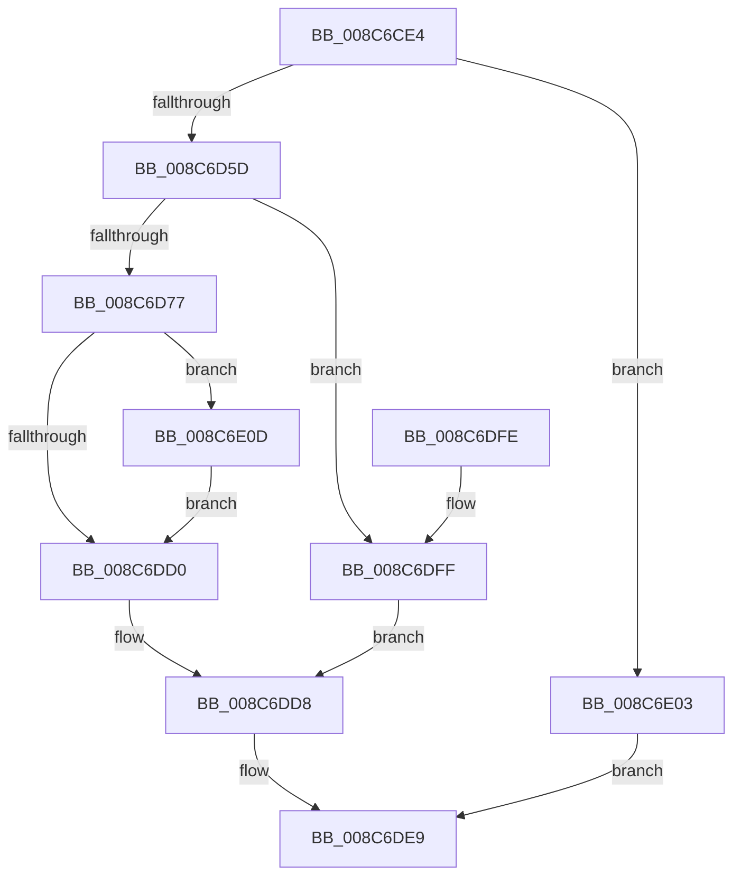

# ObpCheckTraverseAccess

- RVA: `0x008C6CE4`–`0x008C6E20` (길이 `316` bytes)
- VA: `0x00000001408C6CE4`
- 실행 섹션: `PAGE`
- PDB 이름 있음: `예`; PDB Function 태그: `아니요`
- unwind 정보 RVA: `0x00083CA0`
- 디코드: `87`개 명령, `316/316` bytes 표시
- 미해석 바이트: `0` (있으면 어셈블리에 `.byte`로 보존)

> 이 문서는 커널 이미지의 기계어와 PDB 기호를 분석해 생성했습니다. 4번과 5번은 함수 원형과 자료형을 바이너리 사용 방식에서 추정한 C 해석이며 원본 소스 복구 결과는 아닙니다.

## 1. Dependencies

- 직접 호출 지점: **8**; 고유 호출 대상: **8**
- 직접 호출자로 확인된 함수: **1**
- RIP 상대 이미지 참조: **2**

### Outgoing calls
- `0x008C6D50` → [ObpGetObjectSecurity](../87/ObpGetObjectSecurity_function_008717E0.md) (function, `0x008717E0`)
- `0x008C6D6A` → [SeFastTraverseCheck](../../text/40/SeFastTraverseCheck_function_00400234.md) (function, `0x00400234`)
- `0x008C6D7E` → [SeLockSubjectContext](SeLockSubjectContext_function_008C64C0.md) (function, `0x008C64C0`)
- `0x008C6DC0` → [SeAccessCheck](../../text/3A/SeAccessCheck_function_003A6BC0.md) (function, `0x003A6BC0`)
- `0x008C6DD3` → [SeUnlockSubjectContext](SeUnlockSubjectContext_function_008C6520.md) (function, `0x008C6520`)
- `0x008C6DE2` → [ObReleaseObjectSecurityEx](ObReleaseObjectSecurityEx_function_008C6E30.md) (function, `0x008C6E30`)
- `0x008C6E10` → [SeAppendPrivileges](../9D/SeAppendPrivileges_function_009D7980.md) (function, `0x009D7980`)
- `0x008C6E19` → [CmSiFreeMemory](../../text/47/CmSiFreeMemory_function_00475D80.md) (function, `0x00475D80`)

### Direct callers
- [ObpLookupObjectName](../89/ObpLookupObjectName_function_0089BE90.md) at `0x0089D229`

### Static image references
- `0x008C6D0C` → RVA `0x00FC7800` (`ALMOSTRO`; read)
- `0x008C6D3E` → RVA `0x00FC6E4C` (`ALMOSTRO`; read)

## 2. Other-region calls and transfers

- 다른 실행 섹션으로 향하는 call: **3**
  - `0x008C6D6A` → [SeFastTraverseCheck](../../text/40/SeFastTraverseCheck_function_00400234.md) (`PAGE` → `.text`)
  - `0x008C6DC0` → [SeAccessCheck](../../text/3A/SeAccessCheck_function_003A6BC0.md) (`PAGE` → `.text`)
  - `0x008C6E19` → [CmSiFreeMemory](../../text/47/CmSiFreeMemory_function_00475D80.md) (`PAGE` → `.text`)
- 별도 외부 분기/꼬리 이동을 확인하지 못했습니다.

## 3. Assembly (complete function range)

```asm
008C6CE4  48 89 5C 24 18                  mov qword ptr [rsp + 0x18], rbx
008C6CE9  44 88 4C 24 20                  mov byte ptr [rsp + 0x20], r9b
008C6CEE  89 54 24 10                     mov dword ptr [rsp + 0x10], edx
008C6CF2  55                              push rbp
008C6CF3  56                              push rsi
008C6CF4  41 55                           push r13
008C6CF6  41 56                           push r14
008C6CF8  41 57                           push r15
008C6CFA  48 8B EC                        mov rbp, rsp
008C6CFD  48 83 EC 60                     sub rsp, 0x60
008C6D01  8A 5D 50                        mov bl, byte ptr [rbp + 0x50]
008C6D04  48 8D 41 D0                     lea rax, [rcx - 0x30]
008C6D08  83 65 38 00                     and dword ptr [rbp + 0x38], 0
008C6D0C  4C 8D 2D ED 0A 70 00            lea r13, [rip + 0x700aed]
008C6D13  48 83 65 F0 00                  and qword ptr [rbp - 0x10], 0
008C6D18  48 8D 55 30                     lea rdx, [rbp + 0x30]
008C6D1C  48 83 65 30 00                  and qword ptr [rbp + 0x30], 0
008C6D21  49 8B F0                        mov rsi, r8
008C6D24  48 C1 E8 08                     shr rax, 8
008C6D28  4C 8D 45 48                     lea r8, [rbp + 0x48]
008C6D2C  44 0F B6 C8                     movzx r9d, al
008C6D30  4C 8B F9                        mov r15, rcx
008C6D33  0F B6 41 E8                     movzx eax, byte ptr [rcx - 0x18]
008C6D37  4C 33 C8                        xor r9, rax
008C6D3A  C6 45 48 00                     mov byte ptr [rbp + 0x48], 0
008C6D3E  0F B6 05 07 01 70 00            movzx eax, byte ptr [rip + 0x700107]
008C6D45  4C 33 C8                        xor r9, rax
008C6D48  4F 8B 6C CD 00                  mov r13, qword ptr [r13 + r9*8]
008C6D4D  44 8A CB                        mov r9b, bl
008C6D50  E8 8B AA FA FF                  call 0x1408717e0
008C6D55  85 C0                           test eax, eax
008C6D57  0F 88 A6 00 00 00               js 0x1408c6e03
008C6D5D  48 8B 4D 30                     mov rcx, qword ptr [rbp + 0x30]
008C6D61  41 B8 02 00 00 00               mov r8d, 2
008C6D67  48 8B D6                        mov rdx, rsi
008C6D6A  E8 C5 94 B3 FF                  call 0x140400234
008C6D6F  84 C0                           test al, al
008C6D71  0F 85 88 00 00 00               jne 0x1408c6dff
008C6D77  4C 8D 76 20                     lea r14, [rsi + 0x20]
008C6D7B  49 8B CE                        mov rcx, r14
008C6D7E  E8 3D F7 FF FF                  call 0x1408c64c0
008C6D83  48 8B 45 58                     mov rax, qword ptr [rbp + 0x58]
008C6D87  49 8D 4D 4C                     lea rcx, [r13 + 0x4c]
008C6D8B  48 89 44 24 48                  mov qword ptr [rsp + 0x48], rax
008C6D90  41 B9 02 00 00 00               mov r9d, 2
008C6D96  48 8D 45 38                     lea rax, [rbp + 0x38]
008C6D9A  41 B0 01                        mov r8b, 1
008C6D9D  48 89 44 24 40                  mov qword ptr [rsp + 0x40], rax
008C6DA2  49 8B D6                        mov rdx, r14
008C6DA5  88 5C 24 38                     mov byte ptr [rsp + 0x38], bl
008C6DA9  48 8D 45 F0                     lea rax, [rbp - 0x10]
008C6DAD  48 89 4C 24 30                  mov qword ptr [rsp + 0x30], rcx
008C6DB2  48 8B 4D 30                     mov rcx, qword ptr [rbp + 0x30]
008C6DB6  48 89 44 24 28                  mov qword ptr [rsp + 0x28], rax
008C6DBB  83 64 24 20 00                  and dword ptr [rsp + 0x20], 0
008C6DC0  E8 FB FD AD FF                  call 0x1403a6bc0
008C6DC5  48 8B 55 F0                     mov rdx, qword ptr [rbp - 0x10]
008C6DC9  8A D8                           mov bl, al
008C6DCB  48 85 D2                        test rdx, rdx
008C6DCE  75 3D                           jne 0x1408c6e0d
008C6DD0  49 8B CE                        mov rcx, r14
008C6DD3  E8 48 F7 FF FF                  call 0x1408c6520
008C6DD8  8A 55 48                        mov dl, byte ptr [rbp + 0x48]
008C6DDB  4D 8B C7                        mov r8, r15
008C6DDE  48 8B 4D 30                     mov rcx, qword ptr [rbp + 0x30]
008C6DE2  E8 49 00 00 00                  call 0x1408c6e30
008C6DE7  8A C3                           mov al, bl
008C6DE9  48 8B 9C 24 A0 00 00 00         mov rbx, qword ptr [rsp + 0xa0]
008C6DF1  48 83 C4 60                     add rsp, 0x60
008C6DF5  41 5F                           pop r15
008C6DF7  41 5E                           pop r14
008C6DF9  41 5D                           pop r13
008C6DFB  5E                              pop rsi
008C6DFC  5D                              pop rbp
008C6DFD  C3                              ret
008C6DFE  CC                              int3
008C6DFF  B3 01                           mov bl, 1
008C6E01  EB D5                           jmp 0x1408c6dd8
008C6E03  48 8B 4D 58                     mov rcx, qword ptr [rbp + 0x58]
008C6E07  89 01                           mov dword ptr [rcx], eax
008C6E09  32 C0                           xor al, al
008C6E0B  EB DC                           jmp 0x1408c6de9
008C6E0D  48 8B CE                        mov rcx, rsi
008C6E10  E8 6B 0B 11 00                  call 0x1409d7980
008C6E15  48 8B 4D F0                     mov rcx, qword ptr [rbp - 0x10]
008C6E19  E8 62 EF BA FF                  call 0x140475d80
008C6E1E  EB B0                           jmp 0x1408c6dd0
```

## 4. C-style interpretation (structured pseudocode)

```c
__int64 __fastcall ObpCheckTraverseAccess(__int64 a1, int a2, __int64 a3, unsigned __int8 a4, unsigned __int8 a5, __int64 a6)
{
    __int64 result;
    __int64 v_rsp;
    unsigned __int64 v_stack_m38;
    unsigned __int64 v_stack_m40;
    unsigned __int64 v_stack_m48;
    unsigned __int8 v_stack_m50;
    unsigned __int64 v_stack_m58;
    unsigned __int64 v_stack_m60;
    unsigned int v_stack_m68;
    unsigned int v_stack_p10;
    unsigned __int64 v_stack_p18;
    unsigned __int8 v_stack_p20;
    unsigned __int64 v_stack_p8;

    v_stack_p18 = v_rbx;
    v_stack_p20 = a4;
    v_stack_p10 = a2;
    v_rsp = (v_rsp) - (96);
    result = (a1 - 48) >> (8);
    a4 = ((unsigned __int8)(result)) ^ (*(unsigned __int8 *)(a1 - 24));
    v_stack_p20 = 0;
    a4 = (a4) ^ (*(unsigned __int8 *)(v_rip + 7340295));
    result = ObpGetObjectSecurity(a1, v_stack_p8, v_stack_p20, a5);
    if (sign_flag) goto loc_008C6E03;
    result = SeFastTraverseCheck(v_stack_p8, a3, 2, a5);
    if ((unsigned __int8)(result) != 0) goto loc_008C6DFF;
    result = SeLockSubjectContext(a3 + 32, a3, 2, a5);
    v_stack_m40 = a6;
    v_stack_m48 = v_stack_p10;
    v_stack_m50 = a5;
    v_stack_m58 = *(unsigned __int64 *)(v_rip + 7342829 + a4 * 8) + 76;
    v_stack_m60 = v_stack_m38;
    result = SeAccessCheck(v_stack_p8, a3 + 32, 1, 2);
    if (v_stack_m38 != 0) goto loc_008C6E0D;
loc_008C6DD0:
    result = SeUnlockSubjectContext(a3 + 32, v_stack_m38, 1, 2);
loc_008C6DD8:
    result = ObReleaseObjectSecurityEx(v_stack_p8, v_stack_p20, a1, 2);
loc_008C6DE9:
    v_rsp = (v_rsp) + (96);
    return (unsigned __int8)((unsigned __int8)(result));
loc_008C6DFF:
    goto loc_008C6DD8;
loc_008C6E03:
    *(unsigned int *)(a6) = (unsigned int)((unsigned __int8)((unsigned __int8)(result)));
    result = 0;
    goto loc_008C6DE9;
loc_008C6E0D:
    result = SeAppendPrivileges(a3, v_stack_p20, a1, 2);
    result = CmSiFreeMemory(v_stack_m38, v_stack_p20, a1, 2);
    goto loc_008C6DD0;
}
```

## 5. (Beta) C Style

```c
int64_t ObpCheckTraverseAccess(void *Arg1, int32_t Arg2, void *Arg3, uint8_t Arg4, uint8_t Arg5, void *Arg6)
{
    uint8_t *arg1 = (uint8_t *)Arg1;
    uint8_t *arg3 = (uint8_t *)Arg3;
    uint8_t *arg6 = (uint8_t *)Arg6;

    int64_t result;
    int64_t local_rsp;
    uint64_t v_stack_m38;
    uint64_t v_stack_m40;
    uint64_t v_stack_m48;
    uint8_t v_stack_m50;
    uint64_t v_stack_m58;
    uint64_t v_stack_m60;
    uint32_t v_stack_m68;
    uint32_t v_stack_p10;
    uint64_t v_stack_p18;
    uint8_t v_stack_p20;
    uint64_t v_stack_p8;

    v_stack_p18 = local_rbx;
    v_stack_p20 = Arg4;
    v_stack_p10 = Arg2;
    local_rsp = (local_rsp) - (96);
    result = (Arg1 - 48) >> (8);
    Arg4 = ((uint8_t)(result)) ^ (*(uint8_t *)(arg1 - 0x18));
    v_stack_p20 = 0;
    Arg4 = (Arg4) ^ (*(uint8_t *)(v_rip + 0x700107));
    result = ObpGetObjectSecurity(Arg1, v_stack_p8, v_stack_p20, Arg5);
    if (sign_flag) goto loc_008C6E03;
    result = SeFastTraverseCheck(v_stack_p8, Arg3, 2, Arg5);
    if ((uint8_t)(result) != 0) goto loc_008C6DFF;
    result = SeLockSubjectContext(Arg3 + 32, Arg3, 2, Arg5);
    v_stack_m40 = Arg6;
    v_stack_m48 = v_stack_p10;
    v_stack_m50 = Arg5;
    v_stack_m58 = *(uint64_t *)(v_rip + 0x700AED + Arg4 * 8) + 76;
    v_stack_m60 = v_stack_m38;
    result = SeAccessCheck(v_stack_p8, Arg3 + 32, 1, 2);
    if (v_stack_m38 != 0) goto loc_008C6E0D;
loc_008C6DD0:
    result = SeUnlockSubjectContext(Arg3 + 32, v_stack_m38, 1, 2);
loc_008C6DD8:
    result = ObReleaseObjectSecurityEx(v_stack_p8, v_stack_p20, Arg1, 2);
loc_008C6DE9:
    local_rsp = (local_rsp) + (96);
    return (uint8_t)((uint8_t)(result));
loc_008C6DFF:
    goto loc_008C6DD8;
loc_008C6E03:
    *(uint32_t *)(arg6) = (uint32_t)((uint8_t)((uint8_t)(result)));
    result = 0;
    goto loc_008C6DE9;
loc_008C6E0D:
    result = SeAppendPrivileges(Arg3, v_stack_p20, Arg1, 2);
    result = CmSiFreeMemory(v_stack_m38, v_stack_p20, Arg1, 2);
    goto loc_008C6DD0;
}
```

### 관측된 메모리 오프셋

구조체 형식이 확인되지 않은 접근은 인자 기준의 오프셋으로만 기록했습니다.

| 기준 인자 | 오프셋 표현 | 폭 (bit) | 접근 |
|---|---:|---:|---|
| `Arg1` | `- 0x30` | `64` | `R` |
| `Arg1` | `- 0x18` | `8` | `R` |
| `Arg3` | `+ 0x20` | `64` | `R` |
| `Arg6` | `+ 0x0` | `32` | `W` |

## 6. Execution-region graph

[열기: 2D/3D 그래프와 함수 탐색 컨트롤 패널](../../../control-panel.html?section=page&rva=0x008C6CE4&view=graph)

- 2D 그래프는 위에서 아래로 흐르고, 3D 그래프는 빈 공간을 드래그해 회전합니다. Shift+드래그는 이동, 휠은 확대·축소, 함수 노드 선택은 대상 보고서 이동입니다.

### Static fallback


