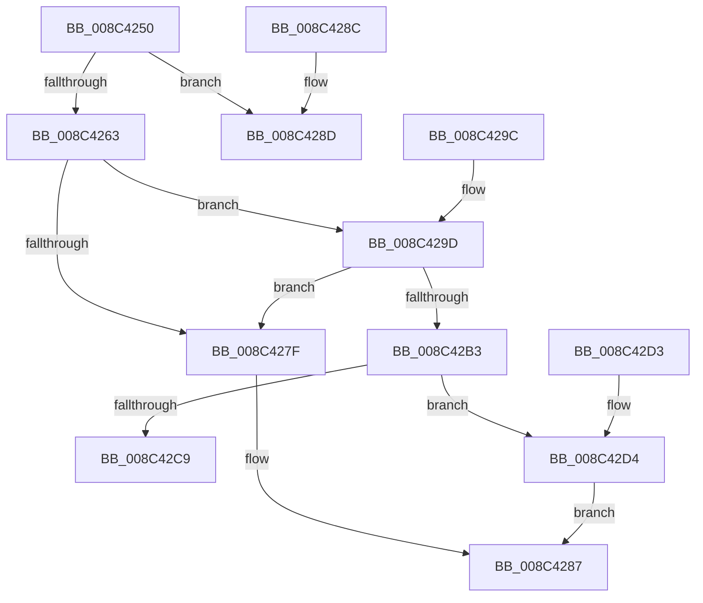

# ObpFreeObjectNameBuffer

- RVA: `0x008C4250`–`0x008C42DB` (길이 `139` bytes)
- VA: `0x00000001408C4250`
- 실행 섹션: `PAGE`
- PDB 이름 있음: `예`; PDB Function 태그: `아니요`
- unwind 정보 RVA: `0x00083980`
- 디코드: `40`개 명령, `139/139` bytes 표시
- 미해석 바이트: `0` (있으면 어셈블리에 `.byte`로 보존)

> 이 문서는 커널 이미지의 기계어와 PDB 기호를 분석해 생성했습니다. 4번과 5번은 함수 원형과 자료형을 바이너리 사용 방식에서 추정한 C 해석이며 원본 소스 복구 결과는 아닙니다.

## 1. Dependencies

- 직접 호출 지점: **4**; 고유 호출 대상: **4**
- 직접 호출자로 확인된 함수: **7**
- RIP 상대 이미지 참조: **1**

### Outgoing calls
- `0x008C4282` → [ExpInterlockedPushEntrySList](../../text/6B/ExpInterlockedPushEntrySList_function_006BA5B0.md) (function, `0x006BA5B0`)
- `0x008C4292` → [ExFreePoolWithTag](../../poolcode/B8/ExFreePoolWithTag_function_00B82870.md) (function, `0x00B82870`)
- `0x008C42C9` → [ExFreePool](../../poolcode/B8/ExFreePool_function_00B82850.md) (function, `0x00B82850`)
- `0x008C42D4` → [guard_dispatch_icall](../../text/6B/guard_dispatch_icall_function_006BAAD0.md) (function, `0x006BAAD0`)

### Direct callers
- [ObReferenceObjectByNameEx](../8B/ObReferenceObjectByNameEx_function_008BD524.md) at `0x008BD766`
- [sub_008C2328](Unknown_function_008C2328.md) at `0x008C2689`
- [NtCreateSemaphore](NtCreateSemaphore_function_008C38D0.md) at `0x008C3A67`
- [sub_008C3C89](Unknown_function_008C3C89.md) at `0x008C3DBF`
- [NtCreateMutant](NtCreateMutant_function_008C43D0.md) at `0x008C4539`
- [NtCreateWaitCompletionPacket](NtCreateWaitCompletionPacket_function_008C4700.md) at `0x008C486B`
- [ObReferenceObjectByName](ObReferenceObjectByName_function_008C4A00.md) at `0x008C4BEC`

### Static image references
- `0x008C42BA` → RVA `0x00B82850` (`ExFreePool`; read)

## 2. Other-region calls and transfers

- 다른 실행 섹션으로 향하는 call: **4**
  - `0x008C4282` → [ExpInterlockedPushEntrySList](../../text/6B/ExpInterlockedPushEntrySList_function_006BA5B0.md) (`PAGE` → `.text`)
  - `0x008C4292` → [ExFreePoolWithTag](../../poolcode/B8/ExFreePoolWithTag_function_00B82870.md) (`PAGE` → `POOLCODE`)
  - `0x008C42C9` → [ExFreePool](../../poolcode/B8/ExFreePool_function_00B82850.md) (`PAGE` → `POOLCODE`)
  - `0x008C42D4` → [guard_dispatch_icall](../../text/6B/guard_dispatch_icall_function_006BAAD0.md) (`PAGE` → `.text`)
- 별도 외부 분기/꼬리 이동을 확인하지 못했습니다.

## 3. Assembly (complete function range)

```asm
008C4250  48 83 EC 28                     sub rsp, 0x28
008C4254  4C 8B 41 08                     mov r8, qword ptr [rcx + 8]
008C4258  B8 F8 00 00 00                  mov eax, 0xf8
008C425D  66 39 41 02                     cmp word ptr [rcx + 2], ax
008C4261  75 2A                           jne 0x1408c428d
008C4263  65 48 8B 14 25 20 00 00 00      mov rdx, qword ptr gs:[0x20]
008C426C  48 8B 8A 50 08 00 00            mov rcx, qword ptr [rdx + 0x850]
008C4273  FF 41 1C                        inc dword ptr [rcx + 0x1c]
008C4276  0F B7 41 10                     movzx eax, word ptr [rcx + 0x10]
008C427A  66 39 01                        cmp word ptr [rcx], ax
008C427D  73 1E                           jae 0x1408c429d
008C427F  49 8B D0                        mov rdx, r8
008C4282  E8 29 63 DF FF                  call 0x1406ba5b0
008C4287  48 83 C4 28                     add rsp, 0x28
008C428B  C3                              ret
008C428C  CC                              int3
008C428D  33 D2                           xor edx, edx
008C428F  49 8B C8                        mov rcx, r8
008C4292  E8 D9 E5 2B 00                  call 0x140b82870
008C4297  48 83 C4 28                     add rsp, 0x28
008C429B  C3                              ret
008C429C  CC                              int3
008C429D  FF 41 20                        inc dword ptr [rcx + 0x20]
008C42A0  48 8B 8A 58 08 00 00            mov rcx, qword ptr [rdx + 0x858]
008C42A7  FF 41 1C                        inc dword ptr [rcx + 0x1c]
008C42AA  0F B7 41 10                     movzx eax, word ptr [rcx + 0x10]
008C42AE  66 39 01                        cmp word ptr [rcx], ax
008C42B1  72 CC                           jb 0x1408c427f
008C42B3  FF 41 20                        inc dword ptr [rcx + 0x20]
008C42B6  48 8B 41 38                     mov rax, qword ptr [rcx + 0x38]
008C42BA  48 8D 0D 8F E5 2B 00            lea rcx, [rip + 0x2be58f]
008C42C1  48 3B C1                        cmp rax, rcx
008C42C4  49 8B C8                        mov rcx, r8
008C42C7  75 0B                           jne 0x1408c42d4
008C42C9  E8 82 E5 2B 00                  call 0x140b82850
008C42CE  48 83 C4 28                     add rsp, 0x28
008C42D2  C3                              ret
008C42D3  CC                              int3
008C42D4  E8 F7 67 DF FF                  call 0x1406baad0
008C42D9  EB AC                           jmp 0x1408c4287
```

## 4. C-style interpretation (structured pseudocode)

```c
__int64 __fastcall ObpFreeObjectNameBuffer(__int64 a1)
{
    __int64 result;
    __int64 v_rsp;

    v_rsp = (v_rsp) - (40);
    if ((*(unsigned __int16 *)(a1 + 2)) != 248) goto loc_008C428D;
    if ((*(unsigned __int16 *)(*(unsigned __int64 *)(*(unsigned __int64 *)(gs_base + (0 + 32)) + 2128))) >= ((unsigned __int16)(*(unsigned __int16 *)(*(unsigned __int64 *)(*(unsigned __int64 *)(gs_base + (0 + 32)) + 2128) + 16)))) goto loc_008C429D;
loc_008C427F:
    result = ExpInterlockedPushEntrySList(*(unsigned __int64 *)(*(unsigned __int64 *)(gs_base + (0 + 32)) + 2128), *(unsigned __int64 *)(a1 + 8), *(unsigned __int64 *)(a1 + 8), a4);
loc_008C4287:
    v_rsp = (v_rsp) + (40);
    return result;
loc_008C428D:
    a2 = 0;
    result = ExFreePoolWithTag(*(unsigned __int64 *)(a1 + 8), a2, *(unsigned __int64 *)(a1 + 8), a4);
    v_rsp = (v_rsp) + (40);
    return result;
loc_008C429D:
    if ((*(unsigned __int16 *)(*(unsigned __int64 *)(a2 + 2136))) < ((unsigned __int16)(*(unsigned __int16 *)(*(unsigned __int64 *)(a2 + 2136) + 16)))) goto loc_008C427F;
    if ((*(unsigned __int64 *)(*(unsigned __int64 *)(a2 + 2136) + 56)) != (v_rip + 2876815)) goto loc_008C42D4;
    result = ExFreePool(*(unsigned __int64 *)(a1 + 8), a2, *(unsigned __int64 *)(a1 + 8), a4);
    v_rsp = (v_rsp) + (40);
    return result;
loc_008C42D4:
    result = guard_dispatch_icall(*(unsigned __int64 *)(a1 + 8), a2, *(unsigned __int64 *)(a1 + 8), a4);
    goto loc_008C4287;
}
```

## 5. (Beta) C Style

```c
int64_t ObpFreeObjectNameBuffer(void *Arg1)
{
    uint8_t *arg1 = (uint8_t *)Arg1;

    int64_t result;
    int64_t local_rsp;

    local_rsp = (local_rsp) - (40);
    if ((*(uint16_t *)(arg1 + 0x2)) != 248) goto loc_008C428D;
    if ((*(uint16_t *)(*(uint64_t *)(*(uint64_t *)(gs_base + (0 + 0x20)) + 0x850))) >= ((uint16_t)(*(uint16_t *)(*(uint64_t *)(*(uint64_t *)(gs_base + (0 + 0x20)) + 0x850) + 0x10)))) goto loc_008C429D;
loc_008C427F:
    result = ExpInterlockedPushEntrySList(*(uint64_t *)(*(uint64_t *)(gs_base + (0 + 0x20)) + 0x850), *(uint64_t *)(arg1 + 0x8), *(uint64_t *)(arg1 + 0x8), a4);
loc_008C4287:
    local_rsp = (local_rsp) + (40);
    return result;
loc_008C428D:
    a2 = 0;
    result = ExFreePoolWithTag(*(uint64_t *)(arg1 + 0x8), a2, *(uint64_t *)(arg1 + 0x8), a4);
    local_rsp = (local_rsp) + (40);
    return result;
loc_008C429D:
    if ((*(uint16_t *)(*(uint64_t *)(a2 + 0x858))) < ((uint16_t)(*(uint16_t *)(*(uint64_t *)(a2 + 0x858) + 0x10)))) goto loc_008C427F;
    if ((*(uint64_t *)(*(uint64_t *)(a2 + 0x858) + 0x38)) != (v_rip + 2876815)) goto loc_008C42D4;
    result = ExFreePool(*(uint64_t *)(arg1 + 0x8), a2, *(uint64_t *)(arg1 + 0x8), a4);
    local_rsp = (local_rsp) + (40);
    return result;
loc_008C42D4:
    result = guard_dispatch_icall(*(uint64_t *)(arg1 + 0x8), a2, *(uint64_t *)(arg1 + 0x8), a4);
    goto loc_008C4287;
}
```

### 관측된 메모리 오프셋

구조체 형식이 확인되지 않은 접근은 인자 기준의 오프셋으로만 기록했습니다.

| 기준 인자 | 오프셋 표현 | 폭 (bit) | 접근 |
|---|---:|---:|---|
| `Arg1` | `+ 0x2` | `16` | `R` |
| `Arg1` | `+ 0x8` | `64` | `R` |

## 6. Execution-region graph

[열기: 2D/3D 그래프와 함수 탐색 컨트롤 패널](../../../control-panel.html?section=page&rva=0x008C4250&view=graph)

- 2D 그래프는 위에서 아래로 흐르고, 3D 그래프는 빈 공간을 드래그해 회전합니다. Shift+드래그는 이동, 휠은 확대·축소, 함수 노드 선택은 대상 보고서 이동입니다.

### Static fallback


