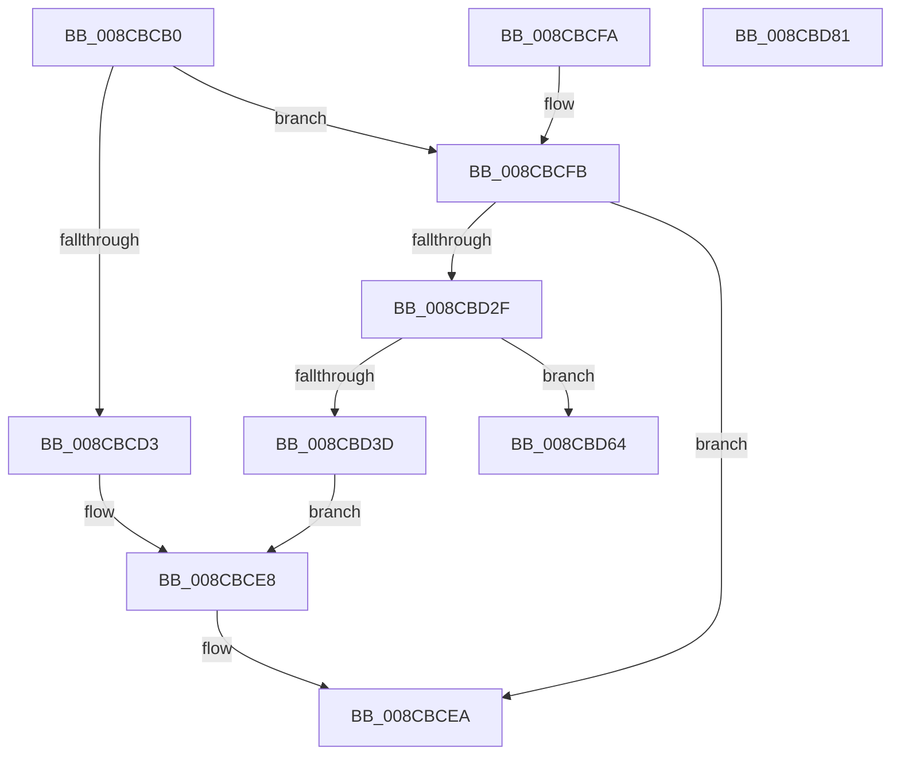

# PsAssignImpersonationToken

- RVA: `0x008CBCB0`–`0x008CBD82` (길이 `210` bytes)
- VA: `0x00000001408CBCB0`
- 실행 섹션: `PAGE`
- PDB 이름 있음: `예`; PDB Function 태그: `아니요`
- unwind 정보 RVA: `0x00084538`
- 디코드: `56`개 명령, `210/210` bytes 표시
- 미해석 바이트: `0` (있으면 어셈블리에 `.byte`로 보존)

> 이 문서는 커널 이미지의 기계어와 PDB 기호를 분석해 생성했습니다. 4번과 5번은 함수 원형과 자료형을 바이너리 사용 방식에서 추정한 C 해석이며 원본 소스 복구 결과는 아닙니다.

## 1. Dependencies

- 직접 호출 지점: **5**; 고유 호출 대상: **3**
- 직접 호출자로 확인된 함수: **0**
- RIP 상대 이미지 참조: **1**

### Outgoing calls
- `0x008CBCE1` → [PsImpersonateClient](PsImpersonateClient_function_008CBE10.md) (function, `0x008CBE10`)
- `0x008CBD26` → [ObReferenceObjectByHandle](../86/ObReferenceObjectByHandle_function_00868DB0.md) (function, `0x00868DB0`)
- `0x008CBD53` → [PsImpersonateClient](PsImpersonateClient_function_008CBE10.md) (function, `0x008CBE10`)
- `0x008CBD5D` → [ObfDereferenceObject](../../text/2F/ObfDereferenceObject_function_002F9350.md) (function, `0x002F9350`)
- `0x008CBD67` → [ObfDereferenceObject](../../text/2F/ObfDereferenceObject_function_002F9350.md) (function, `0x002F9350`)

### Direct callers
- 이 함수 시작 RVA로 연결되는 직접 call은 확인되지 않았습니다. 간접 호출은 완전히 역산할 수 없습니다.

### Static image references
- `0x008CBD08` → RVA `0x00FD8020` (`PAGEDATA`; read)

## 2. Other-region calls and transfers

- 다른 실행 섹션으로 향하는 call: **2**
  - `0x008CBD5D` → [ObfDereferenceObject](../../text/2F/ObfDereferenceObject_function_002F9350.md) (`PAGE` → `.text`)
  - `0x008CBD67` → [ObfDereferenceObject](../../text/2F/ObfDereferenceObject_function_002F9350.md) (`PAGE` → `.text`)
- 별도 외부 분기/꼬리 이동을 확인하지 못했습니다.

## 3. Assembly (complete function range)

```asm
008CBCB0  48 89 5C 24 08                  mov qword ptr [rsp + 8], rbx
008CBCB5  48 89 74 24 18                  mov qword ptr [rsp + 0x18], rsi
008CBCBA  57                              push rdi
008CBCBB  48 83 EC 30                     sub rsp, 0x30
008CBCBF  65 4C 8B 0C 25 88 01 00 00      mov r9, qword ptr gs:[0x188]
008CBCC8  48 8B C2                        mov rax, rdx
008CBCCB  48 8B F9                        mov rdi, rcx
008CBCCE  48 85 D2                        test rdx, rdx
008CBCD1  75 28                           jne 0x1408cbcfb
008CBCD3  45 33 C9                        xor r9d, r9d
008CBCD6  C7 44 24 20 02 00 00 00         mov dword ptr [rsp + 0x20], 2
008CBCDE  45 33 C0                        xor r8d, r8d
008CBCE1  E8 2A 01 00 00                  call 0x1408cbe10
008CBCE6  33 DB                           xor ebx, ebx
008CBCE8  8B C3                           mov eax, ebx
008CBCEA  48 8B 5C 24 40                  mov rbx, qword ptr [rsp + 0x40]
008CBCEF  48 8B 74 24 50                  mov rsi, qword ptr [rsp + 0x50]
008CBCF4  48 83 C4 30                     add rsp, 0x30
008CBCF8  5F                              pop rdi
008CBCF9  C3                              ret
008CBCFA  CC                              int3
008CBCFB  45 0F B6 89 32 02 00 00         movzx r9d, byte ptr [r9 + 0x232]
008CBD03  48 8D 4C 24 48                  lea rcx, [rsp + 0x48]
008CBD08  4C 8B 05 11 C3 70 00            mov r8, qword ptr [rip + 0x70c311]
008CBD0F  33 DB                           xor ebx, ebx
008CBD11  48 89 5C 24 28                  mov qword ptr [rsp + 0x28], rbx
008CBD16  48 89 4C 24 20                  mov qword ptr [rsp + 0x20], rcx
008CBD1B  48 8B C8                        mov rcx, rax
008CBD1E  48 89 5C 24 48                  mov qword ptr [rsp + 0x48], rbx
008CBD23  8D 53 04                        lea edx, [rbx + 4]
008CBD26  E8 85 D0 F9 FF                  call 0x140868db0
008CBD2B  85 C0                           test eax, eax
008CBD2D  78 BB                           js 0x1408cbcea
008CBD2F  48 8B 74 24 48                  mov rsi, qword ptr [rsp + 0x48]
008CBD34  83 BE C0 00 00 00 02            cmp dword ptr [rsi + 0xc0], 2
008CBD3B  75 27                           jne 0x1408cbd64
008CBD3D  8B 86 C4 00 00 00               mov eax, dword ptr [rsi + 0xc4]
008CBD43  45 33 C9                        xor r9d, r9d
008CBD46  45 33 C0                        xor r8d, r8d
008CBD49  89 44 24 20                     mov dword ptr [rsp + 0x20], eax
008CBD4D  48 8B D6                        mov rdx, rsi
008CBD50  48 8B CF                        mov rcx, rdi
008CBD53  E8 B8 00 00 00                  call 0x1408cbe10
008CBD58  48 8B CE                        mov rcx, rsi
008CBD5B  8B D8                           mov ebx, eax
008CBD5D  E8 EE D5 A2 FF                  call 0x1402f9350
008CBD62  EB 84                           jmp 0x1408cbce8
008CBD64  48 8B CE                        mov rcx, rsi
008CBD67  E8 E4 D5 A2 FF                  call 0x1402f9350
008CBD6C  48 8B 5C 24 40                  mov rbx, qword ptr [rsp + 0x40]
008CBD71  B8 A8 00 00 C0                  mov eax, 0xc00000a8
008CBD76  48 8B 74 24 50                  mov rsi, qword ptr [rsp + 0x50]
008CBD7B  48 83 C4 30                     add rsp, 0x30
008CBD7F  5F                              pop rdi
008CBD80  C3                              ret
008CBD81  CC                              int3
```

## 4. C-style interpretation (structured pseudocode)

```c
__int64 __fastcall PsAssignImpersonationToken(__int64 a1, __int64 a2, int a3)
{
    __int64 result;
    __int64 v_rbx;
    __int64 v_rsp;
    unsigned int v_stack_m18;
    unsigned __int64 v_stack_p18;
    unsigned __int64 v_stack_p20;
    unsigned __int64 v_stack_p28;
    unsigned __int64 v_stack_p40;
    unsigned __int64 v_stack_p48;
    unsigned __int64 v_stack_p50;
    unsigned __int64 v_stack_p8;

    v_stack_p8 = v_rbx;
    v_stack_p18 = v_rsi;
    v_rsp = (v_rsp) - (48);
    if (a2 != 0) goto loc_008CBCFB;
    a4 = 0;
    v_stack_m18 = 2;
    a3 = 0;
    result = PsImpersonateClient(a1, a2, a3, a4);
    v_rbx = 0;
loc_008CBCE8:
loc_008CBCEA:
    v_rsp = (v_rsp) + (48);
    return 0;
loc_008CBCFB:
    v_rbx = 0;
    v_stack_p28 = 0;
    v_stack_p20 = v_stack_p48;
    v_stack_p48 = 0;
    result = ObReferenceObjectByHandle(0, v_rbx + 4, *(unsigned __int64 *)(v_rip + 7389969), *(unsigned __int8 *)(a4 + 562));
    if (sign_flag) goto loc_008CBCEA;
    if ((*(unsigned int *)(v_stack_p48 + 192)) != 2) goto loc_008CBD64;
    a4 = 0;
    a3 = 0;
    v_stack_p20 = (unsigned int)((unsigned int)(*(unsigned int *)(v_stack_p48 + 196)));
    result = PsImpersonateClient(a1, v_stack_p48, a3, a4);
    result = ObfDereferenceObject(v_stack_p48, v_stack_p48, a3, a4);
    goto loc_008CBCE8;
loc_008CBD64:
    result = ObfDereferenceObject(v_stack_p48, v_stack_p48, a3, a4);
    v_rsp = (v_rsp) + (48);
    return (unsigned int)(0xC00000A8ULL);
}
```

## 5. (Beta) C Style

```c
int64_t PsAssignImpersonationToken(int64_t Arg1, int64_t Arg2, int32_t Arg3)
{
    int64_t result;
    int64_t local_rbx;
    int64_t local_rsp;
    uint32_t v_stack_m18;
    uint64_t v_stack_p18;
    uint64_t v_stack_p20;
    uint64_t v_stack_p28;
    uint64_t v_stack_p40;
    uint64_t v_stack_p48;
    uint64_t v_stack_p50;
    uint64_t v_stack_p8;

    v_stack_p8 = local_rbx;
    v_stack_p18 = local_rsi;
    local_rsp = (local_rsp) - (48);
    if (Arg2 != 0) goto loc_008CBCFB;
    a4 = 0;
    v_stack_m18 = 2;
    Arg3 = 0;
    result = PsImpersonateClient(Arg1, Arg2, Arg3, a4);
    local_rbx = 0;
loc_008CBCE8:
loc_008CBCEA:
    local_rsp = (local_rsp) + (48);
    return 0;
loc_008CBCFB:
    local_rbx = 0;
    v_stack_p28 = 0;
    v_stack_p20 = v_stack_p48;
    v_stack_p48 = 0;
    result = ObReferenceObjectByHandle(0, local_rbx + 4, *(uint64_t *)(v_rip + 0x70C311), *(uint8_t *)(a4 + 0x232));
    if (sign_flag) goto loc_008CBCEA;
    if ((*(uint32_t *)(v_stack_p48 + 0xC0)) != 2) goto loc_008CBD64;
    a4 = 0;
    Arg3 = 0;
    v_stack_p20 = (uint32_t)((uint32_t)(*(uint32_t *)(v_stack_p48 + 0xC4)));
    result = PsImpersonateClient(Arg1, v_stack_p48, Arg3, a4);
    result = ObfDereferenceObject(v_stack_p48, v_stack_p48, Arg3, a4);
    goto loc_008CBCE8;
loc_008CBD64:
    result = ObfDereferenceObject(v_stack_p48, v_stack_p48, Arg3, a4);
    local_rsp = (local_rsp) + (48);
    return (uint32_t)(0xC00000A8ULL);
}
```

## 6. Execution-region graph

[열기: 2D/3D 그래프와 함수 탐색 컨트롤 패널](../../../control-panel.html?section=page&rva=0x008CBCB0&view=graph)

- 2D 그래프는 위에서 아래로 흐르고, 3D 그래프는 빈 공간을 드래그해 회전합니다. Shift+드래그는 이동, 휠은 확대·축소, 함수 노드 선택은 대상 보고서 이동입니다.

### Static fallback


