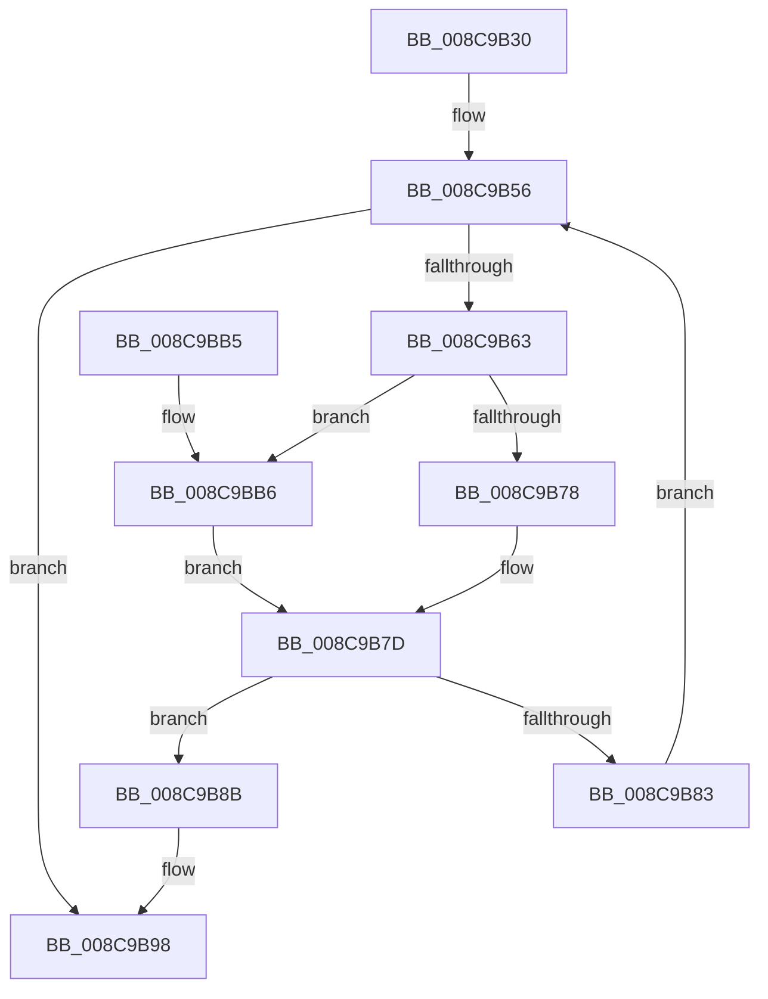

# PsEnumProcessThreads

- RVA: `0x008C9B30`–`0x008C9BC0` (길이 `144` bytes)
- VA: `0x00000001408C9B30`
- 실행 섹션: `PAGE`
- PDB 이름 있음: `예`; PDB Function 태그: `아니요`
- unwind 정보 RVA: `0x000841B4`
- 디코드: `44`개 명령, `144/144` bytes 표시
- 미해석 바이트: `0` (있으면 어셈블리에 `.byte`로 보존)

> 이 문서는 커널 이미지의 기계어와 PDB 기호를 분석해 생성했습니다. 4번과 5번은 함수 원형과 자료형을 바이너리 사용 방식에서 추정한 C 해석이며 원본 소스 복구 결과는 아닙니다.

## 1. Dependencies

- 직접 호출 지점: **4**; 고유 호출 대상: **4**
- 직접 호출자로 확인된 함수: **2**
- RIP 상대 이미지 참조: **1**

### Outgoing calls
- `0x008C9B56` → [PsGetNextProcessThread](PsGetNextProcessThread_function_008C9CF0.md) (function, `0x008C9CF0`)
- `0x008C9B78` → [EtwpThreadEnumCallback](EtwpThreadEnumCallback_function_008C9BD0.md) (function, `0x008C9BD0`)
- `0x008C9B93` → [ObfDereferenceObjectWithTag](../../text/2F/ObfDereferenceObjectWithTag_function_002F78E0.md) (function, `0x002F78E0`)
- `0x008C9BB9` → [guard_dispatch_icall](../../text/6B/guard_dispatch_icall_function_006BAAD0.md) (function, `0x006BAAD0`)

### Direct callers
- [EtwpProcessEnumCallback](../8A/EtwpProcessEnumCallback_function_008A5F40.md) at `0x008A6056`
- [EtwpProcessEnumCallback](../8A/EtwpProcessEnumCallback_function_008A5F40.md) at `0x008A620B`
- [sub_00BF16D0](../../init/BF/Unknown_function_00BF16D0.md) at `0x00BF76B4`

### Static image references
- `0x008C9B63` → RVA `0x008C9BD0` (`EtwpThreadEnumCallback`; read)

## 2. Other-region calls and transfers

- 다른 실행 섹션으로 향하는 call: **2**
  - `0x008C9B93` → [ObfDereferenceObjectWithTag](../../text/2F/ObfDereferenceObjectWithTag_function_002F78E0.md) (`PAGE` → `.text`)
  - `0x008C9BB9` → [guard_dispatch_icall](../../text/6B/guard_dispatch_icall_function_006BAAD0.md) (`PAGE` → `.text`)
- 별도 외부 분기/꼬리 이동을 확인하지 못했습니다.

## 3. Assembly (complete function range)

```asm
008C9B30  48 8B C4                        mov rax, rsp
008C9B33  48 89 58 08                     mov qword ptr [rax + 8], rbx
008C9B37  48 89 68 10                     mov qword ptr [rax + 0x10], rbp
008C9B3B  48 89 70 18                     mov qword ptr [rax + 0x18], rsi
008C9B3F  48 89 78 20                     mov qword ptr [rax + 0x20], rdi
008C9B43  41 56                           push r14
008C9B45  48 83 EC 20                     sub rsp, 0x20
008C9B49  33 FF                           xor edi, edi
008C9B4B  48 8B EA                        mov rbp, rdx
008C9B4E  33 D2                           xor edx, edx
008C9B50  4D 8B F0                        mov r14, r8
008C9B53  48 8B F1                        mov rsi, rcx
008C9B56  E8 95 01 00 00                  call 0x1408c9cf0
008C9B5B  48 8B D8                        mov rbx, rax
008C9B5E  48 85 C0                        test rax, rax
008C9B61  74 35                           je 0x1408c9b98
008C9B63  48 8D 05 66 00 00 00            lea rax, [rip + 0x66]
008C9B6A  4D 8B C6                        mov r8, r14
008C9B6D  48 8B D3                        mov rdx, rbx
008C9B70  48 8B CE                        mov rcx, rsi
008C9B73  48 3B E8                        cmp rbp, rax
008C9B76  75 3E                           jne 0x1408c9bb6
008C9B78  E8 53 00 00 00                  call 0x1408c9bd0
008C9B7D  8B F8                           mov edi, eax
008C9B7F  85 C0                           test eax, eax
008C9B81  78 08                           js 0x1408c9b8b
008C9B83  48 8B D3                        mov rdx, rbx
008C9B86  48 8B CE                        mov rcx, rsi
008C9B89  EB CB                           jmp 0x1408c9b56
008C9B8B  BA 50 73 45 6E                  mov edx, 0x6e457350
008C9B90  48 8B CB                        mov rcx, rbx
008C9B93  E8 48 DD A2 FF                  call 0x1402f78e0
008C9B98  48 8B 5C 24 30                  mov rbx, qword ptr [rsp + 0x30]
008C9B9D  8B C7                           mov eax, edi
008C9B9F  48 8B 7C 24 48                  mov rdi, qword ptr [rsp + 0x48]
008C9BA4  48 8B 6C 24 38                  mov rbp, qword ptr [rsp + 0x38]
008C9BA9  48 8B 74 24 40                  mov rsi, qword ptr [rsp + 0x40]
008C9BAE  48 83 C4 20                     add rsp, 0x20
008C9BB2  41 5E                           pop r14
008C9BB4  C3                              ret
008C9BB5  CC                              int3
008C9BB6  48 8B C5                        mov rax, rbp
008C9BB9  E8 12 0F DF FF                  call 0x1406baad0
008C9BBE  EB BD                           jmp 0x1408c9b7d
```

## 4. C-style interpretation (structured pseudocode)

```c
__int64 __fastcall PsEnumProcessThreads(__int64 a1, __int64 a2, __int64 a3)
{
    __int64 result;
    __int64 v_rdi;
    __int64 v_rsp;
    unsigned __int64 v_stack_p10;
    unsigned __int64 v_stack_p18;
    unsigned __int64 v_stack_p20;
    unsigned __int64 v_stack_p8;

    *(unsigned __int64 *)(v_rsp + 8) = v_rbx;
    *(unsigned __int64 *)(v_rsp + 16) = v_rbp;
    *(unsigned __int64 *)(v_rsp + 24) = v_rsi;
    *(unsigned __int64 *)(v_rsp + 32) = v_rdi;
    v_rsp = (v_rsp) - (32);
    v_rdi = 0;
    a2 = 0;
loc_008C9B56:
    result = PsGetNextProcessThread(a1, a2, a3, a4);
    if (result == 0) goto loc_008C9B98;
    if (0 != (v_rip + 102)) goto loc_008C9BB6;
    result = EtwpThreadEnumCallback(a1, result, a3, a4);
loc_008C9B7D:
    if (sign_flag) goto loc_008C9B8B;
    goto loc_008C9B56;
loc_008C9B8B:
    result = ObfDereferenceObjectWithTag(result, (unsigned int)(0x6E457350ULL), a3, a4);
loc_008C9B98:
    v_rsp = (v_rsp) + (32);
    return (unsigned int)((unsigned int)((unsigned int)((unsigned int)(result))));
loc_008C9BB6:
    result = guard_dispatch_icall(result, (unsigned int)(0x6E457350ULL), a3, a4);
    goto loc_008C9B7D;
}
```

## 5. (Beta) C Style

```c
int64_t PsEnumProcessThreads(int64_t Arg1, int64_t Arg2, int64_t Arg3)
{
    int64_t result;
    int64_t local_rdi;
    int64_t local_rsp;
    uint64_t v_stack_p10;
    uint64_t v_stack_p18;
    uint64_t v_stack_p20;
    uint64_t v_stack_p8;

    *(uint64_t *)(local_rsp + 0x8) = local_rbx;
    *(uint64_t *)(local_rsp + 0x10) = local_rbp;
    *(uint64_t *)(local_rsp + 0x18) = local_rsi;
    *(uint64_t *)(local_rsp + 0x20) = local_rdi;
    local_rsp = (local_rsp) - (32);
    local_rdi = 0;
    Arg2 = 0;
loc_008C9B56:
    result = PsGetNextProcessThread(Arg1, Arg2, Arg3, a4);
    if (result == 0) goto loc_008C9B98;
    if (0 != (v_rip + 102)) goto loc_008C9BB6;
    result = EtwpThreadEnumCallback(Arg1, result, Arg3, a4);
loc_008C9B7D:
    if (sign_flag) goto loc_008C9B8B;
    goto loc_008C9B56;
loc_008C9B8B:
    result = ObfDereferenceObjectWithTag(result, (uint32_t)(0x6E457350ULL), Arg3, a4);
loc_008C9B98:
    local_rsp = (local_rsp) + (32);
    return (uint32_t)((uint32_t)((uint32_t)((uint32_t)(result))));
loc_008C9BB6:
    result = guard_dispatch_icall(result, (uint32_t)(0x6E457350ULL), Arg3, a4);
    goto loc_008C9B7D;
}
```

## 6. Execution-region graph

[열기: 2D/3D 그래프와 함수 탐색 컨트롤 패널](../../../control-panel.html?section=page&rva=0x008C9B30&view=graph)

- 2D 그래프는 위에서 아래로 흐르고, 3D 그래프는 빈 공간을 드래그해 회전합니다. Shift+드래그는 이동, 휠은 확대·축소, 함수 노드 선택은 대상 보고서 이동입니다.

### Static fallback


