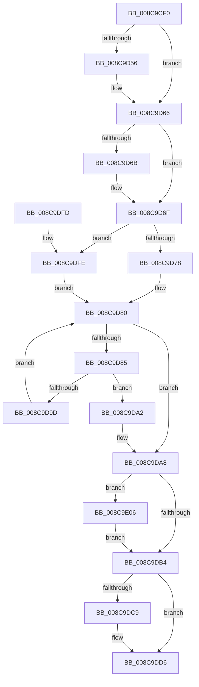

# PsGetNextProcessThread

- RVA: `0x008C9CF0`–`0x008C9E10` (길이 `288` bytes)
- VA: `0x00000001408C9CF0`
- 실행 섹션: `PAGE`
- PDB 이름 있음: `예`; PDB Function 태그: `아니요`
- unwind 정보 RVA: `0x000841DC`
- 디코드: `81`개 명령, `288/288` bytes 표시
- 미해석 바이트: `0` (있으면 어셈블리에 `.byte`로 보존)

> 이 문서는 커널 이미지의 기계어와 PDB 기호를 분석해 생성했습니다. 4번과 5번은 함수 원형과 자료형을 바이너리 사용 방식에서 추정한 C 해석이며 원본 소스 복구 결과는 아닙니다.

## 1. Dependencies

- 직접 호출 지점: **7**; 고유 호출 대상: **7**
- 직접 호출자로 확인된 함수: **17**
- RIP 상대 이미지 참조: **0**

### Outgoing calls
- `0x008C9D40` → [KeAbPreAcquire](../../text/21/KeAbPreAcquire_function_00210230.md) (function, `0x00210230`)
- `0x008C9D61` → [ExfAcquirePushLockSharedEx](../../text/21/ExfAcquirePushLockSharedEx_function_0021044C.md) (function, `0x0021044C`)
- `0x008C9D94` → [ObReferenceObjectSafeWithTag](../../text/21/ObReferenceObjectSafeWithTag_function_00210EE0.md) (function, `0x00210EE0`)
- `0x008C9DB7` → [KeAbPostRelease](../../text/2E/KeAbPostRelease_function_002E1600.md) (function, `0x002E1600`)
- `0x008C9DBF` → [KeLeaveCriticalRegionThread](../../text/25/KeLeaveCriticalRegionThread_function_0025EFF0.md) (function, `0x0025EFF0`)
- `0x008C9DD1` → [ObfDereferenceObjectWithTag](../../text/2F/ObfDereferenceObjectWithTag_function_002F78E0.md) (function, `0x002F78E0`)
- `0x008C9E09` → [ExfReleasePushLockShared](../../text/26/ExfReleasePushLockShared_function_00263440.md) (function, `0x00263440`)

### Direct callers
- [PspSynchronizeThreadIsolationDomains](../../text/3C/PspSynchronizeThreadIsolationDomains_function_003C479C.md) at `0x003C47AB`
- [PsMultiResumeProcess](../../text/4A/PsMultiResumeProcess_function_004A2B3C.md) at `0x004A2BB8`
- [PsMultiResumeProcess](../../text/4A/PsMultiResumeProcess_function_004A2B3C.md) at `0x004A2BE3`
- [KeTraceHgsPlusRundown](../../text/5C/KeTraceHgsPlusRundown_function_005C3728.md) at `0x005C376D`
- [KeTraceThreadAffinityRundown](../../text/5C/KeTraceThreadAffinityRundown_function_005C379C.md) at `0x005C37E9`
- [KeTraceSchedulingGroupRundown](../../text/5C/KeTraceSchedulingGroupRundown_function_005C8D20.md) at `0x005C8DCF`
- [PspWaitForUsermodeExit](../78/PspWaitForUsermodeExit_function_0078661C.md) at `0x0078662E`
- [NtGetNextThread](NtGetNextThread_function_008C7D40.md) at `0x008C7EBB`
- [NtGetNextThread](NtGetNextThread_function_008C7D40.md) at `0x008C7FB1`
- [PspTerminateAllThreads](PspTerminateAllThreads_function_008C97D0.md) at `0x008C98D2`
- [PspTerminateAllThreads](PspTerminateAllThreads_function_008C97D0.md) at `0x008C990F`
- [PsEnumProcessThreads](PsEnumProcessThreads_function_008C9B30.md) at `0x008C9B56`
- [IopCancelIrpsInThreadListForCurrentProcess](IopCancelIrpsInThreadListForCurrentProcess_function_008C9C18.md) at `0x008C9C8A`
- [NtSetInformationThread](NtSetInformationThread_function_008C9F60.md) at `0x008CAF2C`
- [NtSetInformationThread](NtSetInformationThread_function_008C9F60.md) at `0x008CB0B6`
- [DbgkpPostFakeThreadMessages](../A1/DbgkpPostFakeThreadMessages_function_00A108CC.md) at `0x00A10AC6`
- [DbgkpPostFakeThreadMessages](../A1/DbgkpPostFakeThreadMessages_function_00A108CC.md) at `0x00A10B4C`
- [PsSuspendProcess](../A1/PsSuspendProcess_function_00A10F30.md) at `0x00A10FAC`
- [PsSuspendProcess](../A1/PsSuspendProcess_function_00A10F30.md) at `0x00A10FD4`
- [ExSwapinWorkerThreads](../A6/ExSwapinWorkerThreads_function_00A68C40.md) at `0x00A68CF7`
- [PspFindFirstThreadByTebValue](../AD/PspFindFirstThreadByTebValue_function_00AD8E2C.md) at `0x00AD8F08`
- [NtSetInformationProcess](../AE/NtSetInformationProcess_function_00AE5370.md) at `0x00AE5DE2`
- [NtSetInformationProcess](../AE/NtSetInformationProcess_function_00AE5370.md) at `0x00AE5E02`
- [NtSetInformationProcess](../AE/NtSetInformationProcess_function_00AE5370.md) at `0x00AE6E7C`
- [sub_00B36A42](../B3/Unknown_function_00B36A42.md) at `0x00B36A7D`

### Static image references
- 디코드된 RIP-relative 메모리 참조가 없습니다.

## 2. Other-region calls and transfers

- 다른 실행 섹션으로 향하는 call: **7**
  - `0x008C9D40` → [KeAbPreAcquire](../../text/21/KeAbPreAcquire_function_00210230.md) (`PAGE` → `.text`)
  - `0x008C9D61` → [ExfAcquirePushLockSharedEx](../../text/21/ExfAcquirePushLockSharedEx_function_0021044C.md) (`PAGE` → `.text`)
  - `0x008C9D94` → [ObReferenceObjectSafeWithTag](../../text/21/ObReferenceObjectSafeWithTag_function_00210EE0.md) (`PAGE` → `.text`)
  - `0x008C9DB7` → [KeAbPostRelease](../../text/2E/KeAbPostRelease_function_002E1600.md) (`PAGE` → `.text`)
  - `0x008C9DBF` → [KeLeaveCriticalRegionThread](../../text/25/KeLeaveCriticalRegionThread_function_0025EFF0.md) (`PAGE` → `.text`)
  - `0x008C9DD1` → [ObfDereferenceObjectWithTag](../../text/2F/ObfDereferenceObjectWithTag_function_002F78E0.md) (`PAGE` → `.text`)
  - `0x008C9E09` → [ExfReleasePushLockShared](../../text/26/ExfReleasePushLockShared_function_00263440.md) (`PAGE` → `.text`)
- 별도 외부 분기/꼬리 이동을 확인하지 못했습니다.

## 3. Assembly (complete function range)

```asm
008C9CF0  48 89 5C 24 10                  mov qword ptr [rsp + 0x10], rbx
008C9CF5  48 89 6C 24 18                  mov qword ptr [rsp + 0x18], rbp
008C9CFA  48 89 74 24 20                  mov qword ptr [rsp + 0x20], rsi
008C9CFF  57                              push rdi
008C9D00  41 54                           push r12
008C9D02  41 55                           push r13
008C9D04  41 56                           push r14
008C9D06  41 57                           push r15
008C9D08  48 83 EC 20                     sub rsp, 0x20
008C9D0C  65 4C 8B 2C 25 88 01 00 00      mov r13, qword ptr gs:[0x188]
008C9D15  4C 8D B9 C8 01 00 00            lea r15, [rcx + 0x1c8]
008C9D1C  48 8B EA                        mov rbp, rdx
008C9D1F  48 8D B1 70 03 00 00            lea rsi, [rcx + 0x370]
008C9D26  45 33 F6                        xor r14d, r14d
008C9D29  45 33 C0                        xor r8d, r8d
008C9D2C  33 D2                           xor edx, edx
008C9D2E  49 8B CF                        mov rcx, r15
008C9D31  66 41 FF 8D E4 01 00 00         dec word ptr [r13 + 0x1e4]
008C9D39  41 8B FE                        mov edi, r14d
008C9D3C  90                              nop
008C9D3D  45 8B E6                        mov r12d, r14d
008C9D40  E8 EB 64 94 FF                  call 0x140210230
008C9D45  48 8B D8                        mov rbx, rax
008C9D48  B9 11 00 00 00                  mov ecx, 0x11
008C9D4D  33 C0                           xor eax, eax
008C9D4F  F0 49 0F B1 0F                  lock cmpxchg qword ptr [r15], rcx
008C9D54  74 10                           je 0x1408c9d66
008C9D56  4D 8B CF                        mov r9, r15
008C9D59  4C 8B C3                        mov r8, rbx
008C9D5C  33 D2                           xor edx, edx
008C9D5E  49 8B CF                        mov rcx, r15
008C9D61  E8 E6 66 94 FF                  call 0x14021044c
008C9D66  48 85 DB                        test rbx, rbx
008C9D69  74 04                           je 0x1408c9d6f
008C9D6B  C6 43 0A 01                     mov byte ptr [rbx + 0xa], 1
008C9D6F  48 85 ED                        test rbp, rbp
008C9D72  0F 84 86 00 00 00               je 0x1408c9dfe
008C9D78  48 8B 9D 78 05 00 00            mov rbx, qword ptr [rbp + 0x578]
008C9D7F  90                              nop
008C9D80  48 3B DE                        cmp rbx, rsi
008C9D83  74 23                           je 0x1408c9da8
008C9D85  48 8D BB 88 FA FF FF            lea rdi, [rbx - 0x578]
008C9D8C  BA 50 73 45 6E                  mov edx, 0x6e457350
008C9D91  48 8B CF                        mov rcx, rdi
008C9D94  E8 47 71 94 FF                  call 0x140210ee0
008C9D99  84 C0                           test al, al
008C9D9B  75 05                           jne 0x1408c9da2
008C9D9D  48 8B 1B                        mov rbx, qword ptr [rbx]
008C9DA0  EB DE                           jmp 0x1408c9d80
008C9DA2  41 BC 01 00 00 00               mov r12d, 1
008C9DA8  B8 11 00 00 00                  mov eax, 0x11
008C9DAD  F0 4D 0F B1 37                  lock cmpxchg qword ptr [r15], r14
008C9DB2  75 52                           jne 0x1408c9e06
008C9DB4  49 8B CF                        mov rcx, r15
008C9DB7  E8 44 78 A1 FF                  call 0x1402e1600
008C9DBC  49 8B CD                        mov rcx, r13
008C9DBF  E8 2C 52 99 FF                  call 0x14025eff0
008C9DC4  48 85 ED                        test rbp, rbp
008C9DC7  74 0D                           je 0x1408c9dd6
008C9DC9  BA 50 73 45 6E                  mov edx, 0x6e457350
008C9DCE  48 8B CD                        mov rcx, rbp
008C9DD1  E8 0A DB A2 FF                  call 0x1402f78e0
008C9DD6  48 8B 5C 24 58                  mov rbx, qword ptr [rsp + 0x58]
008C9DDB  45 85 E4                        test r12d, r12d
008C9DDE  48 8B 6C 24 60                  mov rbp, qword ptr [rsp + 0x60]
008C9DE3  48 8B 74 24 68                  mov rsi, qword ptr [rsp + 0x68]
008C9DE8  4C 0F 45 F7                     cmovne r14, rdi
008C9DEC  49 8B C6                        mov rax, r14
008C9DEF  48 83 C4 20                     add rsp, 0x20
008C9DF3  41 5F                           pop r15
008C9DF5  41 5E                           pop r14
008C9DF7  41 5D                           pop r13
008C9DF9  41 5C                           pop r12
008C9DFB  5F                              pop rdi
008C9DFC  C3                              ret
008C9DFD  CC                              int3
008C9DFE  48 8B 1E                        mov rbx, qword ptr [rsi]
008C9E01  E9 7A FF FF FF                  jmp 0x1408c9d80
008C9E06  49 8B CF                        mov rcx, r15
008C9E09  E8 32 96 99 FF                  call 0x140263440
008C9E0E  EB A4                           jmp 0x1408c9db4
```

## 4. C-style interpretation (structured pseudocode)

```c
__int64 __fastcall PsGetNextProcessThread(__int64 a1, __int64 a2, int a3)
{
    __int64 result;
    __int64 v_r14;
    __int64 v_rsp;
    unsigned __int64 v_stack_p10;
    unsigned __int64 v_stack_p18;
    unsigned __int64 v_stack_p20;

    v_stack_p10 = v_rbx;
    v_stack_p18 = v_rbp;
    v_stack_p20 = v_rsi;
    v_rsp = (v_rsp) - (32);
    v_r14 = 0;
    a3 = 0;
    a2 = 0;
    result = KeAbPreAcquire(a1 + 456, a2, a3, a4);
    result = 0;
    if (!(condition_is_equal)) {
        a4 = a1 + 456;
        a3 = 0;
        a2 = 0;
        a1 = a1 + 456;
        result = ExfAcquirePushLockSharedEx(a1, a2, a3, a4);
    }
    if (result != 0) {
        *(unsigned __int8 *)(result + 10) = 1;
    }
    if (0 == 0) goto loc_008C9DFE;
loc_008C9D80:
    if ((*(unsigned __int64 *)(a2 + 1400)) == (a1 + 880)) goto loc_008C9DA8;
    result = ObReferenceObjectSafeWithTag(*(unsigned __int64 *)(a2 + 1400) - 1400, (unsigned int)(0x6E457350ULL), a3, a4);
    if ((unsigned __int8)(result) != 0) goto loc_008C9DA2;
    goto loc_008C9D80;
loc_008C9DA2:
loc_008C9DA8:
    if ((unsigned __int8)(result) != 0) goto loc_008C9E06;
loc_008C9DB4:
    result = KeAbPostRelease(a1 + 456, (unsigned int)(0x6E457350ULL), a3, a4);
    result = KeLeaveCriticalRegionThread(*(unsigned __int64 *)(gs_base + (0 + 392)), (unsigned int)(0x6E457350ULL), a3, a4);
    if (0 != 0) {
        a2 = 0x6E457350ULL;
        a1 = a2;
        result = ObfDereferenceObjectWithTag(a1, a2, a3, a4);
    }
    if (1 != 0) { v_r14 = *(unsigned __int64 *)(a2 + 1400) - 1400; }
    v_rsp = (v_rsp) + (32);
    return v_r14;
loc_008C9DFE:
    goto loc_008C9D80;
loc_008C9E06:
    result = ExfReleasePushLockShared(a1 + 456, a2, a3, a4);
    goto loc_008C9DB4;
}
```

## 5. (Beta) C Style

```c
int64_t PsGetNextProcessThread(void *Arg1, int64_t Arg2, int32_t Arg3)
{
    uint8_t *arg1 = (uint8_t *)Arg1;

    int64_t result;
    int64_t local_r14;
    int64_t local_rsp;
    uint64_t v_stack_p10;
    uint64_t v_stack_p18;
    uint64_t v_stack_p20;

    v_stack_p10 = local_rbx;
    v_stack_p18 = local_rbp;
    v_stack_p20 = local_rsi;
    local_rsp = (local_rsp) - (32);
    local_r14 = 0;
    Arg3 = 0;
    Arg2 = 0;
    result = KeAbPreAcquire(Arg1 + 456, Arg2, Arg3, a4);
    result = 0;
    if (!(condition_is_equal)) {
        a4 = Arg1 + 456;
        Arg3 = 0;
        Arg2 = 0;
        Arg1 = Arg1 + 456;
        result = ExfAcquirePushLockSharedEx(Arg1, Arg2, Arg3, a4);
    }
    if (result != 0) {
        *(uint8_t *)(result + 0xA) = 1;
    }
    if (0 == 0) goto loc_008C9DFE;
loc_008C9D80:
    if ((*(uint64_t *)(Arg2 + 0x578)) == (Arg1 + 880)) goto loc_008C9DA8;
    result = ObReferenceObjectSafeWithTag(*(uint64_t *)(Arg2 + 0x578) - 1400, (uint32_t)(0x6E457350ULL), Arg3, a4);
    if ((uint8_t)(result) != 0) goto loc_008C9DA2;
    goto loc_008C9D80;
loc_008C9DA2:
loc_008C9DA8:
    if ((uint8_t)(result) != 0) goto loc_008C9E06;
loc_008C9DB4:
    result = KeAbPostRelease(Arg1 + 456, (uint32_t)(0x6E457350ULL), Arg3, a4);
    result = KeLeaveCriticalRegionThread(*(uint64_t *)(gs_base + (0 + 0x188)), (uint32_t)(0x6E457350ULL), Arg3, a4);
    if (0 != 0) {
        Arg2 = 0x6E457350ULL;
        Arg1 = Arg2;
        result = ObfDereferenceObjectWithTag(Arg1, Arg2, Arg3, a4);
    }
    if (1 != 0) { local_r14 = *(uint64_t *)(Arg2 + 0x578) - 1400; }
    local_rsp = (local_rsp) + (32);
    return local_r14;
loc_008C9DFE:
    goto loc_008C9D80;
loc_008C9E06:
    result = ExfReleasePushLockShared(Arg1 + 456, Arg2, Arg3, a4);
    goto loc_008C9DB4;
}
```

### 관측된 메모리 오프셋

구조체 형식이 확인되지 않은 접근은 인자 기준의 오프셋으로만 기록했습니다.

| 기준 인자 | 오프셋 표현 | 폭 (bit) | 접근 |
|---|---:|---:|---|
| `Arg1` | `+ 0x0` | `64` | `R` |
| `Arg1` | `+ 0x1C8` | `64` | `R` |
| `Arg1` | `+ 0x370` | `64` | `R` |

## 6. Execution-region graph

[열기: 2D/3D 그래프와 함수 탐색 컨트롤 패널](../../../control-panel.html?section=page&rva=0x008C9CF0&view=graph)

- 2D 그래프는 위에서 아래로 흐르고, 3D 그래프는 빈 공간을 드래그해 회전합니다. Shift+드래그는 이동, 휠은 확대·축소, 함수 노드 선택은 대상 보고서 이동입니다.

### Static fallback


