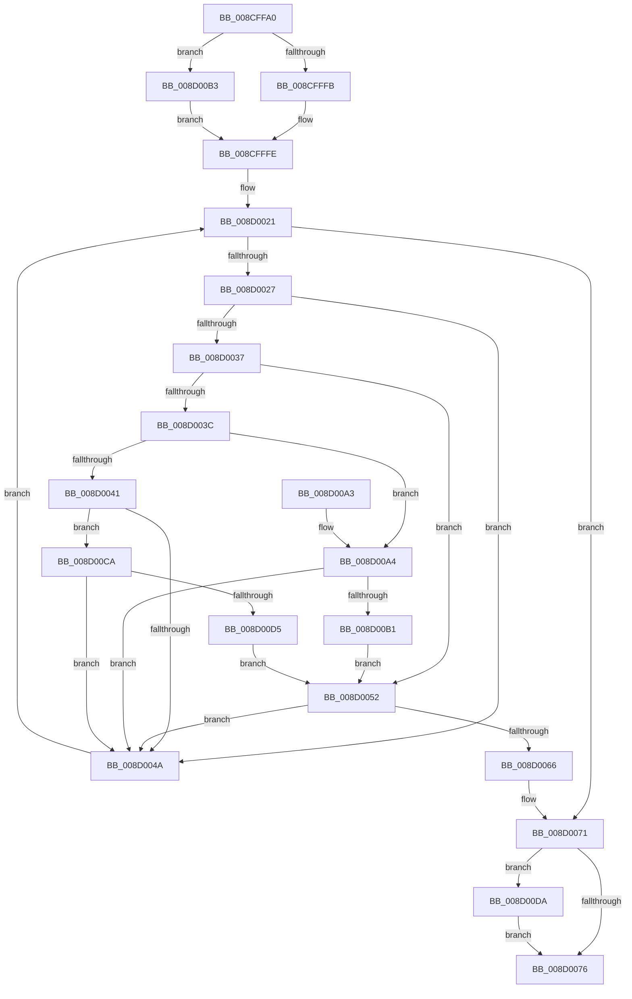

# PsMapSystemDlls

- RVA: `0x008CFFA0`–`0x008D00E8` (길이 `328` bytes)
- VA: `0x00000001408CFFA0`
- 실행 섹션: `PAGE`
- PDB 이름 있음: `예`; PDB Function 태그: `아니요`
- unwind 정보 RVA: `0x00084A1C`
- 디코드: `92`개 명령, `328/328` bytes 표시
- 미해석 바이트: `0` (있으면 어셈블리에 `.byte`로 보존)

> 이 문서는 커널 이미지의 기계어와 PDB 기호를 분석해 생성했습니다. 4번과 5번은 함수 원형과 자료형을 바이너리 사용 방식에서 추정한 C 해석이며 원본 소스 복구 결과는 아닙니다.

## 1. Dependencies

- 직접 호출 지점: **5**; 고유 호출 대상: **5**
- 직접 호출자로 확인된 함수: **1**
- RIP 상대 이미지 참조: **2**

### Outgoing calls
- `0x008D005B` → [PspMapSystemDll](../8D/PspMapSystemDll_function_008D6908.md) (function, `0x008D6908`)
- `0x008D0080` → [_security_check_cookie](../../text/6A/_security_check_cookie_function_006AC640.md) (function, `0x006AC640`)
- `0x008D00A7` → [PsWow64GetProcessNtdllType](PsWow64GetProcessNtdllType_function_008CE464.md) (function, `0x008CE464`)
- `0x008D00C0` → [KiStackAttachProcess](../../text/21/KiStackAttachProcess_function_00216820.md) (function, `0x00216820`)
- `0x008D00E1` → [KiUnstackDetachProcess](../../text/21/KiUnstackDetachProcess_function_00217D30.md) (function, `0x00217D30`)

### Direct callers
- [MiMapProcessExecutable](MiMapProcessExecutable_function_008CFDB4.md) at `0x008CFE8B`

### Static image references
- `0x008CFFBC` → RVA `0x00E0A740` (`.data`; read)
- `0x008D0027` → RVA `0x00FD8130` (`PAGEDATA`; read)

## 2. Other-region calls and transfers

- 다른 실행 섹션으로 향하는 call: **3**
  - `0x008D0080` → [_security_check_cookie](../../text/6A/_security_check_cookie_function_006AC640.md) (`PAGE` → `.text`)
  - `0x008D00C0` → [KiStackAttachProcess](../../text/21/KiStackAttachProcess_function_00216820.md) (`PAGE` → `.text`)
  - `0x008D00E1` → [KiUnstackDetachProcess](../../text/21/KiUnstackDetachProcess_function_00217D30.md) (`PAGE` → `.text`)
- 별도 외부 분기/꼬리 이동을 확인하지 못했습니다.

## 3. Assembly (complete function range)

```asm
008CFFA0  48 89 5C 24 10                  mov qword ptr [rsp + 0x10], rbx
008CFFA5  48 89 6C 24 18                  mov qword ptr [rsp + 0x18], rbp
008CFFAA  48 89 74 24 20                  mov qword ptr [rsp + 0x20], rsi
008CFFAF  57                              push rdi
008CFFB0  41 54                           push r12
008CFFB2  41 55                           push r13
008CFFB4  41 56                           push r14
008CFFB6  41 57                           push r15
008CFFB8  48 83 EC 60                     sub rsp, 0x60
008CFFBC  48 8B 05 7D A7 53 00            mov rax, qword ptr [rip + 0x53a77d]
008CFFC3  48 33 C4                        xor rax, rsp
008CFFC6  48 89 44 24 50                  mov qword ptr [rsp + 0x50], rax
008CFFCB  0F 57 C0                        xorps xmm0, xmm0
008CFFCE  33 DB                           xor ebx, ebx
008CFFD0  0F 11 44 24 20                  movups xmmword ptr [rsp + 0x20], xmm0
008CFFD5  44 8B E2                        mov r12d, edx
008CFFD8  48 8B F9                        mov rdi, rcx
008CFFDB  0F 11 44 24 30                  movups xmmword ptr [rsp + 0x30], xmm0
008CFFE0  0F 11 44 24 40                  movups xmmword ptr [rsp + 0x40], xmm0
008CFFE5  65 48 8B 04 25 88 01 00 00      mov rax, qword ptr gs:[0x188]
008CFFEE  48 3B 88 B8 00 00 00            cmp rcx, qword ptr [rax + 0xb8]
008CFFF5  0F 85 B8 00 00 00               jne 0x1408d00b3
008CFFFB  45 33 F6                        xor r14d, r14d
008CFFFE  33 ED                           xor ebp, ebp
008D0000  41 BD 02 00 00 00               mov r13d, 2
008D0006  48 39 9F 10 03 00 00            cmp qword ptr [rdi + 0x310], rbx
008D000D  40 0F 95 C5                     setne bpl
008D0011  F6 87 70 01 00 00 01            test byte ptr [rdi + 0x170], 1
008D0018  41 0F 45 ED                     cmovne ebp, r13d
008D001C  45 33 FF                        xor r15d, r15d
008D001F  33 F6                           xor esi, esi
008D0021  48 83 FE 06                     cmp rsi, 6
008D0025  7D 4A                           jge 0x1408d0071
008D0027  48 8D 15 02 81 70 00            lea rdx, [rip + 0x708102]
008D002E  48 8B 14 F2                     mov rdx, qword ptr [rdx + rsi*8]
008D0032  48 85 D2                        test rdx, rdx
008D0035  74 13                           je 0x1408d004a
008D0037  48 85 F6                        test rsi, rsi
008D003A  74 16                           je 0x1408d0052
008D003C  83 FD 01                        cmp ebp, 1
008D003F  74 63                           je 0x1408d00a4
008D0041  41 3B ED                        cmp ebp, r13d
008D0044  0F 84 80 00 00 00               je 0x1408d00ca
008D004A  41 FF C7                        inc r15d
008D004D  48 FF C6                        inc rsi
008D0050  EB CF                           jmp 0x1408d0021
008D0052  45 33 C9                        xor r9d, r9d
008D0055  45 8B C4                        mov r8d, r12d
008D0058  48 8B CF                        mov rcx, rdi
008D005B  E8 A8 68 00 00                  call 0x1408d6908
008D0060  8B D8                           mov ebx, eax
008D0062  85 C0                           test eax, eax
008D0064  79 E4                           jns 0x1408d004a
008D0066  83 FD 01                        cmp ebp, 1
008D0069  B8 A3 01 00 C0                  mov eax, 0xc00001a3
008D006E  0F 44 D8                        cmove ebx, eax
008D0071  45 85 F6                        test r14d, r14d
008D0074  75 64                           jne 0x1408d00da
008D0076  8B C3                           mov eax, ebx
008D0078  48 8B 4C 24 50                  mov rcx, qword ptr [rsp + 0x50]
008D007D  48 33 CC                        xor rcx, rsp
008D0080  E8 BB C5 DD FF                  call 0x1406ac640
008D0085  4C 8D 5C 24 60                  lea r11, [rsp + 0x60]
008D008A  49 8B 5B 38                     mov rbx, qword ptr [r11 + 0x38]
008D008E  49 8B 6B 40                     mov rbp, qword ptr [r11 + 0x40]
008D0092  49 8B 73 48                     mov rsi, qword ptr [r11 + 0x48]
008D0096  49 8B E3                        mov rsp, r11
008D0099  41 5F                           pop r15
008D009B  41 5E                           pop r14
008D009D  41 5D                           pop r13
008D009F  41 5C                           pop r12
008D00A1  5F                              pop rdi
008D00A2  C3                              ret
008D00A3  CC                              int3
008D00A4  48 8B CF                        mov rcx, rdi
008D00A7  E8 B8 E3 FF FF                  call 0x1408ce464
008D00AC  44 3B F8                        cmp r15d, eax
008D00AF  75 99                           jne 0x1408d004a
008D00B1  EB 9F                           jmp 0x1408d0052
008D00B3  4C 8D 44 24 20                  lea r8, [rsp + 0x20]
008D00B8  33 D2                           xor edx, edx
008D00BA  41 BE 01 00 00 00               mov r14d, 1
008D00C0  E8 5B 67 94 FF                  call 0x140216820
008D00C5  E9 34 FF FF FF                  jmp 0x1408cfffe
008D00CA  8B 42 08                        mov eax, dword ptr [rdx + 8]
008D00CD  A8 40                           test al, 0x40
008D00CF  0F 84 75 FF FF FF               je 0x1408d004a
008D00D5  E9 78 FF FF FF                  jmp 0x1408d0052
008D00DA  33 D2                           xor edx, edx
008D00DC  48 8D 4C 24 20                  lea rcx, [rsp + 0x20]
008D00E1  E8 4A 7C 94 FF                  call 0x140217d30
008D00E6  EB 8E                           jmp 0x1408d0076
```

## 4. C-style interpretation (structured pseudocode)

```c
__int64 __fastcall PsMapSystemDlls(__int64 a1, int a2, __int64 a3, int a4)
{
    __int64 result;
    __int64 v_r14;
    __int64 v_r15;
    __int64 v_rbp;
    __int64 v_rbx;
    __int64 v_rsi;
    __int64 v_rsp;
    unsigned __int64 v_stack_m28;
    unsigned __int64 v_stack_m38;
    unsigned __int64 v_stack_m40;
    unsigned __int64 v_stack_m48;
    unsigned __int64 v_stack_m58;
    unsigned __int64 v_stack_m68;
    unsigned __int64 v_stack_p10;
    unsigned __int64 v_stack_p18;
    unsigned __int64 v_stack_p20;

    v_stack_p10 = v_rbx;
    v_stack_p18 = v_rbp;
    v_stack_p20 = v_rsi;
    v_rsp = (v_rsp) - (96);
    result = (*(unsigned __int64 *)(v_rip + 5482365)) ^ (v_rsp);
    v_stack_m38 = result;
    v_rbx = 0;
    v_stack_m68 = v_xmm0;
    v_stack_m58 = v_xmm0;
    v_stack_m48 = v_xmm0;
    if (a1 != (*(unsigned __int64 *)(*(unsigned __int64 *)(gs_base + (0 + 392)) + 184))) goto loc_008D00B3;
    v_r14 = 0;
loc_008CFFFE:
    v_rbp = 0;
    v_rbp = ((*(unsigned __int64 *)(a1 + 784)) != 0) ? 1 : 0;
    if (((*(unsigned __int8 *)(a1 + 368)) & (1)) != 0) { v_rbp = 2; }
    v_r15 = 0;
    v_rsi = 0;
loc_008D0021:
    if (0 >= 6) goto loc_008D0071;
    if (*(unsigned __int64 *)(v_rip + 7373058 + v_rsi * 8) == 0) goto loc_008D004A;
    if (0 == 0) goto loc_008D0052;
    if (((unsigned int)(v_rbp)) == 1) goto loc_008D00A4;
    if (((unsigned int)(v_rbp)) == 2) goto loc_008D00CA;
loc_008D004A:
    v_r15 = (unsigned int)((v_r15) + 1);
    v_rsi = (v_rsi) + 1;
    goto loc_008D0021;
loc_008D0052:
    a4 = 0;
    result = PspMapSystemDll(a1, *(unsigned __int64 *)(v_rip + 7373058 + v_rsi * 8), (unsigned int)((unsigned int)((unsigned int)(a2))), a4);
    if (!sign_flag) goto loc_008D004A;
    v_rbx = (unsigned int)((unsigned int)(result));
    if (((unsigned int)(v_rbp)) == 1) { v_rbx = (unsigned int)((unsigned int)(0xC00001A3ULL)); }
loc_008D0071:
    if (0 != 0) goto loc_008D00DA;
loc_008D0076:
    a1 = (v_stack_m38) ^ (v_rsp);
    result = _security_check_cookie(a1, *(unsigned __int64 *)(v_rip + 7373058 + v_rsi * 8), (unsigned int)((unsigned int)((unsigned int)(a2))), a4);
    return result;
loc_008D00A4:
    result = PsWow64GetProcessNtdllType(a1, *(unsigned __int64 *)(v_rip + 7373058 + v_rsi * 8), (unsigned int)((unsigned int)((unsigned int)(a2))), a4);
    if (((unsigned int)(v_r15)) != ((unsigned int)(result))) goto loc_008D004A;
    goto loc_008D0052;
loc_008D00B3:
    a2 = 0;
    result = KiStackAttachProcess(a1, a2, v_stack_m40, a4);
    goto loc_008CFFFE;
loc_008D00CA:
    if ((((unsigned __int8)((unsigned int)(*(unsigned int *)(a2 + 8)))) & (64)) == 0) goto loc_008D004A;
    goto loc_008D0052;
loc_008D00DA:
    a2 = 0;
    result = KiUnstackDetachProcess(v_stack_m40, a2, v_stack_m40, a4);
    goto loc_008D0076;
}
```

## 5. (Beta) C Style

```c
int64_t PsMapSystemDlls(void *Arg1, int32_t Arg2, int64_t Arg3, int32_t Arg4)
{
    uint8_t *arg1 = (uint8_t *)Arg1;

    int64_t result;
    int64_t local_r14;
    int64_t local_r15;
    int64_t local_rbp;
    int64_t local_rbx;
    int64_t local_rsi;
    int64_t local_rsp;
    uint64_t v_stack_m28;
    uint64_t v_stack_m38;
    uint64_t v_stack_m40;
    uint64_t v_stack_m48;
    uint64_t v_stack_m58;
    uint64_t v_stack_m68;
    uint64_t v_stack_p10;
    uint64_t v_stack_p18;
    uint64_t v_stack_p20;

    v_stack_p10 = local_rbx;
    v_stack_p18 = local_rbp;
    v_stack_p20 = local_rsi;
    local_rsp = (local_rsp) - (96);
    result = (*(uint64_t *)(v_rip + 0x53A77D)) ^ (local_rsp);
    v_stack_m38 = result;
    local_rbx = 0;
    v_stack_m68 = v_xmm0;
    v_stack_m58 = v_xmm0;
    v_stack_m48 = v_xmm0;
    if (Arg1 != (*(uint64_t *)(*(uint64_t *)(gs_base + (0 + 0x188)) + 0xB8))) goto loc_008D00B3;
    local_r14 = 0;
loc_008CFFFE:
    local_rbp = 0;
    local_rbp = ((*(uint64_t *)(arg1 + 0x310)) != 0) ? 1 : 0;
    if (((*(uint8_t *)(arg1 + 0x170)) & (1)) != 0) { local_rbp = 2; }
    local_r15 = 0;
    local_rsi = 0;
loc_008D0021:
    if (0 >= 6) goto loc_008D0071;
    if (*(uint64_t *)(v_rip + 0x708102 + local_rsi * 8) == 0) goto loc_008D004A;
    if (0 == 0) goto loc_008D0052;
    if (((uint32_t)(local_rbp)) == 1) goto loc_008D00A4;
    if (((uint32_t)(local_rbp)) == 2) goto loc_008D00CA;
loc_008D004A:
    local_r15 = (uint32_t)((local_r15) + 1);
    local_rsi = (local_rsi) + 1;
    goto loc_008D0021;
loc_008D0052:
    Arg4 = 0;
    result = PspMapSystemDll(Arg1, *(uint64_t *)(v_rip + 0x708102 + local_rsi * 8), (uint32_t)((uint32_t)((uint32_t)(Arg2))), Arg4);
    if (!sign_flag) goto loc_008D004A;
    local_rbx = (uint32_t)((uint32_t)(result));
    if (((uint32_t)(local_rbp)) == 1) { local_rbx = (uint32_t)((uint32_t)(0xC00001A3ULL)); }
loc_008D0071:
    if (0 != 0) goto loc_008D00DA;
loc_008D0076:
    Arg1 = (v_stack_m38) ^ (local_rsp);
    result = _security_check_cookie(Arg1, *(uint64_t *)(v_rip + 0x708102 + local_rsi * 8), (uint32_t)((uint32_t)((uint32_t)(Arg2))), Arg4);
    return result;
loc_008D00A4:
    result = PsWow64GetProcessNtdllType(Arg1, *(uint64_t *)(v_rip + 0x708102 + local_rsi * 8), (uint32_t)((uint32_t)((uint32_t)(Arg2))), Arg4);
    if (((uint32_t)(local_r15)) != ((uint32_t)(result))) goto loc_008D004A;
    goto loc_008D0052;
loc_008D00B3:
    Arg2 = 0;
    result = KiStackAttachProcess(Arg1, Arg2, v_stack_m40, Arg4);
    goto loc_008CFFFE;
loc_008D00CA:
    if ((((uint8_t)((uint32_t)(*(uint32_t *)(Arg2 + 0x8)))) & (64)) == 0) goto loc_008D004A;
    goto loc_008D0052;
loc_008D00DA:
    Arg2 = 0;
    result = KiUnstackDetachProcess(v_stack_m40, Arg2, v_stack_m40, Arg4);
    goto loc_008D0076;
}
```

### 관측된 메모리 오프셋

구조체 형식이 확인되지 않은 접근은 인자 기준의 오프셋으로만 기록했습니다.

| 기준 인자 | 오프셋 표현 | 폭 (bit) | 접근 |
|---|---:|---:|---|
| `Arg1` | `+ 0x170` | `8` | `R` |
| `Arg1` | `+ 0x310` | `64` | `R` |

## 6. Execution-region graph

[열기: 2D/3D 그래프와 함수 탐색 컨트롤 패널](../../../control-panel.html?section=page&rva=0x008CFFA0&view=graph)

- 2D 그래프는 위에서 아래로 흐르고, 3D 그래프는 빈 공간을 드래그해 회전합니다. Shift+드래그는 이동, 휠은 확대·축소, 함수 노드 선택은 대상 보고서 이동입니다.

### Static fallback


