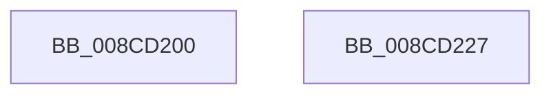

# PsRevertToSelf

- RVA: `0x008CD200`–`0x008CD228` (길이 `40` bytes)
- VA: `0x00000001408CD200`
- 실행 섹션: `PAGE`
- PDB 이름 있음: `예`; PDB Function 태그: `아니요`
- unwind 정보 RVA: `0x0005D2F4`
- 디코드: `10`개 명령, `40/40` bytes 표시
- 미해석 바이트: `0` (있으면 어셈블리에 `.byte`로 보존)

> 이 문서는 커널 이미지의 기계어와 PDB 기호를 분석해 생성했습니다. 4번과 5번은 함수 원형과 자료형을 바이너리 사용 방식에서 추정한 C 해석이며 원본 소스 복구 결과는 아닙니다.

## 1. Dependencies

- 직접 호출 지점: **1**; 고유 호출 대상: **1**
- 직접 호출자로 확인된 함수: **2**
- RIP 상대 이미지 참조: **0**

### Outgoing calls
- `0x008CD21D` → [PsImpersonateClient](PsImpersonateClient_function_008CBE10.md) (function, `0x008CBE10`)

### Direct callers
- [CmpOpenHiveFile](../87/CmpOpenHiveFile_function_0087A71C.md) at `0x0087AD3A`
- [EtwpDelayCreate](../9C/EtwpDelayCreate_function_009C1188.md) at `0x009C1318`

### Static image references
- 디코드된 RIP-relative 메모리 참조가 없습니다.

## 2. Other-region calls and transfers

- 다른 실행 섹션으로 향하는 call: **0**
- 별도 외부 분기/꼬리 이동을 확인하지 못했습니다.

## 3. Assembly (complete function range)

```asm
008CD200  48 83 EC 38                     sub rsp, 0x38
008CD204  65 48 8B 0C 25 88 01 00 00      mov rcx, qword ptr gs:[0x188]
008CD20D  45 33 C9                        xor r9d, r9d
008CD210  45 33 C0                        xor r8d, r8d
008CD213  C7 44 24 20 02 00 00 00         mov dword ptr [rsp + 0x20], 2
008CD21B  33 D2                           xor edx, edx
008CD21D  E8 EE EB FF FF                  call 0x1408cbe10
008CD222  48 83 C4 38                     add rsp, 0x38
008CD226  C3                              ret
008CD227  CC                              int3
```

## 4. C-style interpretation (structured pseudocode)

```c
__int64 __fastcall PsRevertToSelf(__int64 a1, int a2, int a3, int a4)
{
    __int64 result;
    __int64 v_rsp;
    unsigned int v_stack_m18;

    v_rsp = (v_rsp) - (56);
    a4 = 0;
    a3 = 0;
    v_stack_m18 = 2;
    a2 = 0;
    result = PsImpersonateClient(*(unsigned __int64 *)(gs_base + (0 + 392)), a2, a3, a4);
    v_rsp = (v_rsp) + (56);
    return result;
}
```

## 5. (Beta) C Style

```c
int64_t PsRevertToSelf(int64_t Arg1, int32_t Arg2, int32_t Arg3, int32_t Arg4)
{
    int64_t result;
    int64_t local_rsp;
    uint32_t v_stack_m18;

    local_rsp = (local_rsp) - (56);
    Arg4 = 0;
    Arg3 = 0;
    v_stack_m18 = 2;
    Arg2 = 0;
    result = PsImpersonateClient(*(uint64_t *)(gs_base + (0 + 0x188)), Arg2, Arg3, Arg4);
    local_rsp = (local_rsp) + (56);
    return result;
}
```

## 6. Execution-region graph

[열기: 2D/3D 그래프와 함수 탐색 컨트롤 패널](../../../control-panel.html?section=page&rva=0x008CD200&view=graph)

- 2D 그래프는 위에서 아래로 흐르고, 3D 그래프는 빈 공간을 드래그해 회전합니다. Shift+드래그는 이동, 휠은 확대·축소, 함수 노드 선택은 대상 보고서 이동입니다.

### Static fallback


