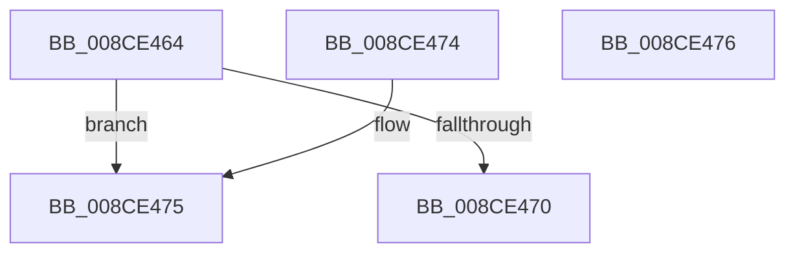

# PsWow64GetProcessNtdllType

- RVA: `0x008CE464`–`0x008CE477` (길이 `19` bytes)
- VA: `0x00000001408CE464`
- 실행 섹션: `PAGE`
- PDB 이름 있음: `예`; PDB Function 태그: `아니요`
- unwind 정보 RVA: `0x000DB714`
- 디코드: `8`개 명령, `19/19` bytes 표시
- 미해석 바이트: `0` (있으면 어셈블리에 `.byte`로 보존)

> 이 문서는 커널 이미지의 기계어와 PDB 기호를 분석해 생성했습니다. 4번과 5번은 함수 원형과 자료형을 바이너리 사용 방식에서 추정한 C 해석이며 원본 소스 복구 결과는 아닙니다.

## 1. Dependencies

- 직접 호출 지점: **0**; 고유 호출 대상: **0**
- 직접 호출자로 확인된 함수: **9**
- RIP 상대 이미지 참조: **0**

### Outgoing calls
- 직접 디코드된 call 명령이 없습니다.

### Direct callers
- [PsThawMultiProcess](../../text/45/PsThawMultiProcess_function_0045FFE0.md) at `0x00460050`
- [MiApplyImageHotPatchRequest](../80/MiApplyImageHotPatchRequest_function_008025AC.md) at `0x008026D7`
- [PspWow64InitThread](PspWow64InitThread_function_008CDC98.md) at `0x008CDDE8`
- [PspPrepareSystemDllInitBlock](PspPrepareSystemDllInitBlock_function_008CE128.md) at `0x008CE1DF`
- [PsMapSystemDlls](PsMapSystemDlls_function_008CFFA0.md) at `0x008D00A7`
- [DbgkCreateThread](../8D/DbgkCreateThread_function_008D5E34.md) at `0x008D6024`
- [DbgkSendSystemDllMessages](../A1/DbgkSendSystemDllMessages_function_00A10C04.md) at `0x00A10EB4`
- [PspAllocateProcess](../A1/PspAllocateProcess_function_00A13B3C.md) at `0x00A16135`
- [PspSetupUserProcessAddressSpace](../AE/PspSetupUserProcessAddressSpace_function_00AEBDC8.md) at `0x00AEBFD2`

### Static image references
- 디코드된 RIP-relative 메모리 참조가 없습니다.

## 2. Other-region calls and transfers

- 다른 실행 섹션으로 향하는 call: **0**
- 별도 외부 분기/꼬리 이동을 확인하지 못했습니다.

## 3. Assembly (complete function range)

```asm
008CE464  48 8B 81 10 03 00 00            mov rax, qword ptr [rcx + 0x310]
008CE46B  48 85 C0                        test rax, rax
008CE46E  74 05                           je 0x1408ce475
008CE470  8B 40 08                        mov eax, dword ptr [rax + 8]
008CE473  C3                              ret
008CE474  CC                              int3
008CE475  C3                              ret
008CE476  CC                              int3
```

## 4. C-style interpretation (structured pseudocode)

```c
__int64 __fastcall PsWow64GetProcessNtdllType(__int64 a1)
{
    if (*(unsigned __int64 *)(a1 + 784) == 0) goto loc_008CE475;
    return (unsigned int)(*(unsigned int *)(*(unsigned __int64 *)(a1 + 784) + 8));
loc_008CE475:
    return (unsigned int)(*(unsigned int *)(*(unsigned __int64 *)(a1 + 784) + 8));
}
```

## 5. (Beta) C Style

```c
int64_t PsWow64GetProcessNtdllType(void *Arg1)
{
    uint8_t *arg1 = (uint8_t *)Arg1;

    if (*(uint64_t *)(arg1 + 0x310) == 0) goto loc_008CE475;
    return (uint32_t)(*(uint32_t *)(*(uint64_t *)(arg1 + 0x310) + 0x8));
loc_008CE475:
    return (uint32_t)(*(uint32_t *)(*(uint64_t *)(arg1 + 0x310) + 0x8));
}
```

### 관측된 메모리 오프셋

구조체 형식이 확인되지 않은 접근은 인자 기준의 오프셋으로만 기록했습니다.

| 기준 인자 | 오프셋 표현 | 폭 (bit) | 접근 |
|---|---:|---:|---|
| `Arg1` | `+ 0x310` | `64` | `R` |

## 6. Execution-region graph

[열기: 2D/3D 그래프와 함수 탐색 컨트롤 패널](../../../control-panel.html?section=page&rva=0x008CE464&view=graph)

- 2D 그래프는 위에서 아래로 흐르고, 3D 그래프는 빈 공간을 드래그해 회전합니다. Shift+드래그는 이동, 휠은 확대·축소, 함수 노드 선택은 대상 보고서 이동입니다.

### Static fallback


