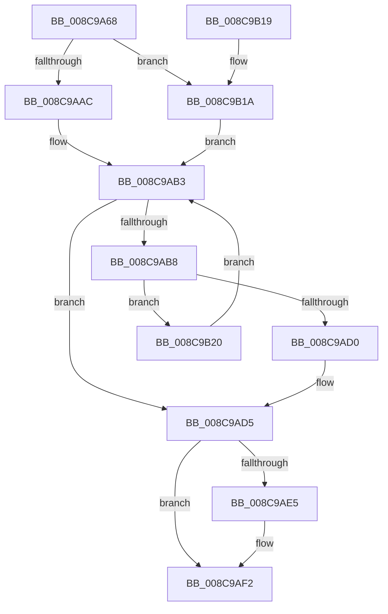

# PspGetPreviousProcessThread

- RVA: `0x008C9A68`–`0x008C9B26` (길이 `190` bytes)
- VA: `0x00000001408C9A68`
- 실행 섹션: `PAGE`
- PDB 이름 있음: `예`; PDB Function 태그: `아니요`
- unwind 정보 RVA: `0x00084194`
- 디코드: `54`개 명령, `190/190` bytes 표시
- 미해석 바이트: `0` (있으면 어셈블리에 `.byte`로 보존)

> 이 문서는 커널 이미지의 기계어와 PDB 기호를 분석해 생성했습니다. 4번과 5번은 함수 원형과 자료형을 바이너리 사용 방식에서 추정한 C 해석이며 원본 소스 복구 결과는 아닙니다.

## 1. Dependencies

- 직접 호출 지점: **4**; 고유 호출 대상: **4**
- 직접 호출자로 확인된 함수: **1**
- RIP 상대 이미지 참조: **0**

### Outgoing calls
- `0x008C9AA2` → [PspLockProcessShared](../../text/40/PspLockProcessShared_function_004016D0.md) (function, `0x004016D0`)
- `0x008C9AC7` → [ObReferenceObjectSafeWithTag](../../text/21/ObReferenceObjectSafeWithTag_function_00210EE0.md) (function, `0x00210EE0`)
- `0x008C9ADB` → [PspUnlockProcessShared](../../text/26/PspUnlockProcessShared_function_00263950.md) (function, `0x00263950`)
- `0x008C9AED` → [ObfDereferenceObjectWithTag](../../text/2F/ObfDereferenceObjectWithTag_function_002F78E0.md) (function, `0x002F78E0`)

### Direct callers
- [PspTerminateAllThreads](PspTerminateAllThreads_function_008C97D0.md) at `0x008C9814`
- [PspTerminateAllThreads](PspTerminateAllThreads_function_008C97D0.md) at `0x008C98AF`

### Static image references
- 디코드된 RIP-relative 메모리 참조가 없습니다.

## 2. Other-region calls and transfers

- 다른 실행 섹션으로 향하는 call: **4**
  - `0x008C9AA2` → [PspLockProcessShared](../../text/40/PspLockProcessShared_function_004016D0.md) (`PAGE` → `.text`)
  - `0x008C9AC7` → [ObReferenceObjectSafeWithTag](../../text/21/ObReferenceObjectSafeWithTag_function_00210EE0.md) (`PAGE` → `.text`)
  - `0x008C9ADB` → [PspUnlockProcessShared](../../text/26/PspUnlockProcessShared_function_00263950.md) (`PAGE` → `.text`)
  - `0x008C9AED` → [ObfDereferenceObjectWithTag](../../text/2F/ObfDereferenceObjectWithTag_function_002F78E0.md) (`PAGE` → `.text`)
- 별도 외부 분기/꼬리 이동을 확인하지 못했습니다.

## 3. Assembly (complete function range)

```asm
008C9A68  48 8B C4                        mov rax, rsp
008C9A6B  48 89 58 08                     mov qword ptr [rax + 8], rbx
008C9A6F  48 89 68 10                     mov qword ptr [rax + 0x10], rbp
008C9A73  48 89 70 18                     mov qword ptr [rax + 0x18], rsi
008C9A77  48 89 78 20                     mov qword ptr [rax + 0x20], rdi
008C9A7B  41 54                           push r12
008C9A7D  41 56                           push r14
008C9A7F  41 57                           push r15
008C9A81  48 83 EC 20                     sub rsp, 0x20
008C9A85  65 4C 8B 24 25 88 01 00 00      mov r12, qword ptr gs:[0x188]
008C9A8E  4C 8D B1 70 03 00 00            lea r14, [rcx + 0x370]
008C9A95  48 8B F2                        mov rsi, rdx
008C9A98  4C 8B F9                        mov r15, rcx
008C9A9B  49 8B D4                        mov rdx, r12
008C9A9E  33 ED                           xor ebp, ebp
008C9AA0  33 FF                           xor edi, edi
008C9AA2  E8 29 7C B3 FF                  call 0x1404016d0
008C9AA7  48 85 F6                        test rsi, rsi
008C9AAA  74 6E                           je 0x1408c9b1a
008C9AAC  48 8B 9E 80 05 00 00            mov rbx, qword ptr [rsi + 0x580]
008C9AB3  49 3B DE                        cmp rbx, r14
008C9AB6  74 1D                           je 0x1408c9ad5
008C9AB8  48 8D AB 88 FA FF FF            lea rbp, [rbx - 0x578]
008C9ABF  BA 50 73 45 6E                  mov edx, 0x6e457350
008C9AC4  48 8B CD                        mov rcx, rbp
008C9AC7  E8 14 74 94 FF                  call 0x140210ee0
008C9ACC  84 C0                           test al, al
008C9ACE  74 50                           je 0x1408c9b20
008C9AD0  BF 01 00 00 00                  mov edi, 1
008C9AD5  49 8B D4                        mov rdx, r12
008C9AD8  49 8B CF                        mov rcx, r15
008C9ADB  E8 70 9E 99 FF                  call 0x140263950
008C9AE0  48 85 F6                        test rsi, rsi
008C9AE3  74 0D                           je 0x1408c9af2
008C9AE5  BA 50 73 45 6E                  mov edx, 0x6e457350
008C9AEA  48 8B CE                        mov rcx, rsi
008C9AED  E8 EE DD A2 FF                  call 0x1402f78e0
008C9AF2  48 8B 5C 24 40                  mov rbx, qword ptr [rsp + 0x40]
008C9AF7  F7 DF                           neg edi
008C9AF9  48 8B 74 24 50                  mov rsi, qword ptr [rsp + 0x50]
008C9AFE  48 8B 7C 24 58                  mov rdi, qword ptr [rsp + 0x58]
008C9B03  48 1B C0                        sbb rax, rax
008C9B06  48 23 C5                        and rax, rbp
008C9B09  48 8B 6C 24 48                  mov rbp, qword ptr [rsp + 0x48]
008C9B0E  48 83 C4 20                     add rsp, 0x20
008C9B12  41 5F                           pop r15
008C9B14  41 5E                           pop r14
008C9B16  41 5C                           pop r12
008C9B18  C3                              ret
008C9B19  CC                              int3
008C9B1A  49 8B 5E 08                     mov rbx, qword ptr [r14 + 8]
008C9B1E  EB 93                           jmp 0x1408c9ab3
008C9B20  48 8B 5B 08                     mov rbx, qword ptr [rbx + 8]
008C9B24  EB 8D                           jmp 0x1408c9ab3
```

## 4. C-style interpretation (structured pseudocode)

```c
__int64 __fastcall PspGetPreviousProcessThread(__int64 a1, __int64 a2)
{
    __int64 result;
    __int64 v_rbp;
    __int64 v_rdi;
    __int64 v_rsp;
    unsigned __int64 v_stack_p10;
    unsigned __int64 v_stack_p18;
    unsigned __int64 v_stack_p20;
    unsigned __int64 v_stack_p8;

    *(unsigned __int64 *)(v_rsp + 8) = v_rbx;
    *(unsigned __int64 *)(v_rsp + 16) = v_rbp;
    *(unsigned __int64 *)(v_rsp + 24) = v_rsi;
    *(unsigned __int64 *)(v_rsp + 32) = v_rdi;
    v_rsp = (v_rsp) - (32);
    v_rbp = 0;
    v_rdi = 0;
    result = PspLockProcessShared(a1, *(unsigned __int64 *)(gs_base + (0 + 392)), a3, a4);
    if (a2 == 0) goto loc_008C9B1A;
loc_008C9AB3:
    if ((*(unsigned __int64 *)(a2 + 1408)) == (a1 + 880)) goto loc_008C9AD5;
    result = ObReferenceObjectSafeWithTag(*(unsigned __int64 *)(a2 + 1408) - 1400, (unsigned int)(0x6E457350ULL), a3, a4);
    if ((unsigned __int8)(result) == 0) goto loc_008C9B20;
loc_008C9AD5:
    result = PspUnlockProcessShared(a1, *(unsigned __int64 *)(gs_base + (0 + 392)), a3, a4);
    if (a2 != 0) {
        a2 = 0x6E457350ULL;
        a1 = a2;
        result = ObfDereferenceObjectWithTag(a1, a2, a3, a4);
    }
    v_rdi = (unsigned int)(-(1));
    result = (result) & (*(unsigned __int64 *)(a2 + 1408) - 1400);
    v_rsp = (v_rsp) + (32);
    return result;
loc_008C9B1A:
    goto loc_008C9AB3;
loc_008C9B20:
    goto loc_008C9AB3;
}
```

## 5. (Beta) C Style

```c
int64_t PspGetPreviousProcessThread(void *Arg1, int64_t Arg2)
{
    uint8_t *arg1 = (uint8_t *)Arg1;

    int64_t result;
    int64_t local_rbp;
    int64_t local_rdi;
    int64_t local_rsp;
    uint64_t v_stack_p10;
    uint64_t v_stack_p18;
    uint64_t v_stack_p20;
    uint64_t v_stack_p8;

    *(uint64_t *)(local_rsp + 0x8) = local_rbx;
    *(uint64_t *)(local_rsp + 0x10) = local_rbp;
    *(uint64_t *)(local_rsp + 0x18) = local_rsi;
    *(uint64_t *)(local_rsp + 0x20) = local_rdi;
    local_rsp = (local_rsp) - (32);
    local_rbp = 0;
    local_rdi = 0;
    result = PspLockProcessShared(Arg1, *(uint64_t *)(gs_base + (0 + 0x188)), a3, a4);
    if (Arg2 == 0) goto loc_008C9B1A;
loc_008C9AB3:
    if ((*(uint64_t *)(Arg2 + 0x580)) == (Arg1 + 880)) goto loc_008C9AD5;
    result = ObReferenceObjectSafeWithTag(*(uint64_t *)(Arg2 + 0x580) - 1400, (uint32_t)(0x6E457350ULL), a3, a4);
    if ((uint8_t)(result) == 0) goto loc_008C9B20;
loc_008C9AD5:
    result = PspUnlockProcessShared(Arg1, *(uint64_t *)(gs_base + (0 + 0x188)), a3, a4);
    if (Arg2 != 0) {
        Arg2 = 0x6E457350ULL;
        Arg1 = Arg2;
        result = ObfDereferenceObjectWithTag(Arg1, Arg2, a3, a4);
    }
    local_rdi = (uint32_t)(-(1));
    result = (result) & (*(uint64_t *)(Arg2 + 0x580) - 1400);
    local_rsp = (local_rsp) + (32);
    return result;
loc_008C9B1A:
    goto loc_008C9AB3;
loc_008C9B20:
    goto loc_008C9AB3;
}
```

### 관측된 메모리 오프셋

구조체 형식이 확인되지 않은 접근은 인자 기준의 오프셋으로만 기록했습니다.

| 기준 인자 | 오프셋 표현 | 폭 (bit) | 접근 |
|---|---:|---:|---|
| `Arg1` | `+ 0x8` | `64` | `R` |
| `Arg1` | `+ 0x370` | `64` | `R` |

## 6. Execution-region graph

[열기: 2D/3D 그래프와 함수 탐색 컨트롤 패널](../../../control-panel.html?section=page&rva=0x008C9A68&view=graph)

- 2D 그래프는 위에서 아래로 흐르고, 3D 그래프는 빈 공간을 드래그해 회전합니다. Shift+드래그는 이동, 휠은 확대·축소, 함수 노드 선택은 대상 보고서 이동입니다.

### Static fallback


