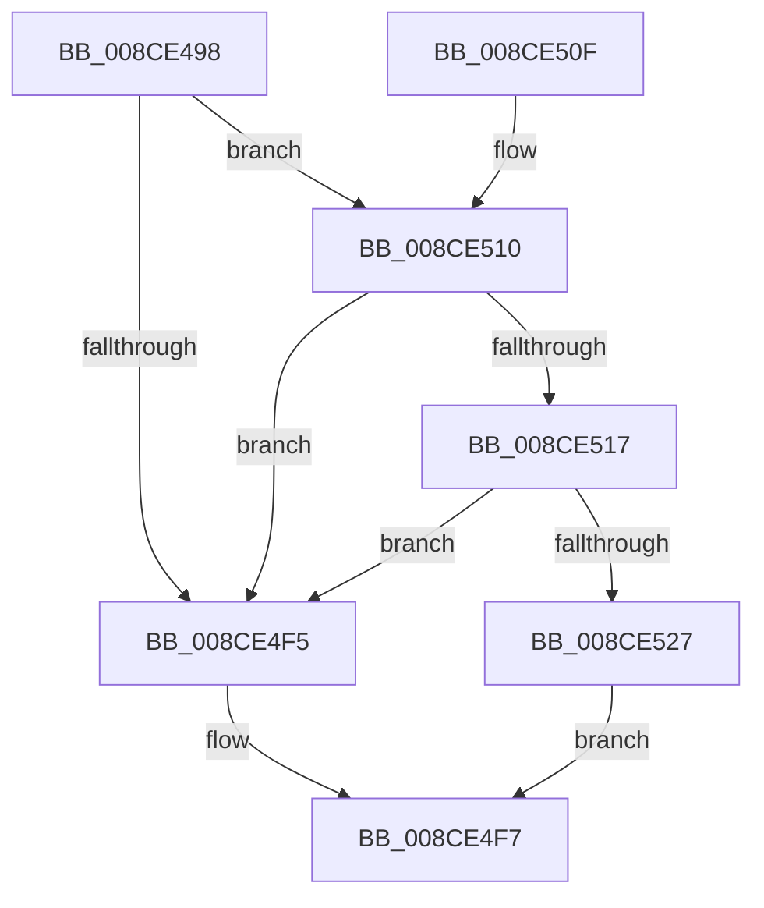

# PspGetScpCfgFunctions

- RVA: `0x008CE498`–`0x008CE53A` (길이 `162` bytes)
- VA: `0x00000001408CE498`
- 실행 섹션: `PAGE`
- PDB 이름 있음: `예`; PDB Function 태그: `아니요`
- unwind 정보 RVA: `0x000847D4`
- 디코드: `44`개 명령, `162/162` bytes 표시
- 미해석 바이트: `0` (있으면 어셈블리에 `.byte`로 보존)

> 이 문서는 커널 이미지의 기계어와 PDB 기호를 분석해 생성했습니다. 4번과 5번은 함수 원형과 자료형을 바이너리 사용 방식에서 추정한 C 해석이며 원본 소스 복구 결과는 아닙니다.

## 1. Dependencies

- 직접 호출 지점: **3**; 고유 호출 대상: **3**
- 직접 호출자로 확인된 함수: **1**
- RIP 상대 이미지 참조: **3**

### Outgoing calls
- `0x008CE4E9` → [ZwQueryVirtualMemory](../../text/6A/ZwQueryVirtualMemory_function_006AD530.md) (function, `0x006AD530`)
- `0x008CE4FF` → [_security_check_cookie](../../text/6A/_security_check_cookie_function_006AC640.md) (function, `0x006AC640`)
- `0x008CE51D` → [PsGetScpCfgPageTypeForProcess](../A4/PsGetScpCfgPageTypeForProcess_function_00A42258.md) (function, `0x00A42258`)

### Direct callers
- [PspPrepareSystemDllInitBlock](PspPrepareSystemDllInitBlock_function_008CE128.md) at `0x008CE2BE`

### Static image references
- `0x008CE4A4` → RVA `0x00E0A740` (`.data`; read)
- `0x008CE4B3` → RVA `0x00FD8130` (`PAGEDATA`; read)
- `0x008CE52A` → RVA `0x00FC7600` (`ALMOSTRO`; read)

## 2. Other-region calls and transfers

- 다른 실행 섹션으로 향하는 call: **2**
  - `0x008CE4E9` → [ZwQueryVirtualMemory](../../text/6A/ZwQueryVirtualMemory_function_006AD530.md) (`PAGE` → `.text`)
  - `0x008CE4FF` → [_security_check_cookie](../../text/6A/_security_check_cookie_function_006AC640.md) (`PAGE` → `.text`)
- 별도 외부 분기/꼬리 이동을 확인하지 못했습니다.

## 3. Assembly (complete function range)

```asm
008CE498  4C 8B DC                        mov r11, rsp
008CE49B  49 89 5B 10                     mov qword ptr [r11 + 0x10], rbx
008CE49F  57                              push rdi
008CE4A0  48 83 EC 50                     sub rsp, 0x50
008CE4A4  48 8B 05 95 C2 53 00            mov rax, qword ptr [rip + 0x53c295]
008CE4AB  48 33 C4                        xor rax, rsp
008CE4AE  48 89 44 24 48                  mov qword ptr [rsp + 0x48], rax
008CE4B3  48 8B 05 76 9C 70 00            mov rax, qword ptr [rip + 0x709c76]
008CE4BA  4D 8D 4B D8                     lea r9, [r11 - 0x28]
008CE4BE  0F 57 C0                        xorps xmm0, xmm0
008CE4C1  48 8B F9                        mov rdi, rcx
008CE4C4  33 DB                           xor ebx, ebx
008CE4C6  48 83 C9 FF                     or rcx, 0xffffffffffffffff
008CE4CA  49 89 5B D0                     mov qword ptr [r11 - 0x30], rbx
008CE4CE  48 8B 50 20                     mov rdx, qword ptr [rax + 0x20]
008CE4D2  33 C0                           xor eax, eax
008CE4D4  0F 11 44 24 30                  movups xmmword ptr [rsp + 0x30], xmm0
008CE4D9  49 89 43 E8                     mov qword ptr [r11 - 0x18], rax
008CE4DD  49 C7 43 C8 18 00 00 00         mov qword ptr [r11 - 0x38], 0x18
008CE4E5  44 8D 40 0E                     lea r8d, [rax + 0xe]
008CE4E9  E8 42 F0 DD FF                  call 0x1406ad530
008CE4EE  3D BB 00 00 C0                  cmp eax, 0xc00000bb
008CE4F3  75 1B                           jne 0x1408ce510
008CE4F5  33 C0                           xor eax, eax
008CE4F7  48 8B 4C 24 48                  mov rcx, qword ptr [rsp + 0x48]
008CE4FC  48 33 CC                        xor rcx, rsp
008CE4FF  E8 3C E1 DD FF                  call 0x1406ac640
008CE504  48 8B 5C 24 68                  mov rbx, qword ptr [rsp + 0x68]
008CE509  48 83 C4 50                     add rsp, 0x50
008CE50D  5F                              pop rdi
008CE50E  C3                              ret
008CE50F  CC                              int3
008CE510  48 39 5C 24 40                  cmp qword ptr [rsp + 0x40], rbx
008CE515  74 DE                           je 0x1408ce4f5
008CE517  41 B0 01                        mov r8b, 1
008CE51A  48 8B CF                        mov rcx, rdi
008CE51D  E8 36 3D 17 00                  call 0x140a42258
008CE522  83 F8 03                        cmp eax, 3
008CE525  74 CE                           je 0x1408ce4f5
008CE527  83 F8 04                        cmp eax, 4
008CE52A  48 8D 0D CF 90 6F 00            lea rcx, [rip + 0x6f90cf]
008CE531  48 0F 45 D9                     cmovne rbx, rcx
008CE535  48 8B C3                        mov rax, rbx
008CE538  EB BD                           jmp 0x1408ce4f7
```

## 4. C-style interpretation (structured pseudocode)

```c
__int64 __fastcall PspGetScpCfgFunctions(__int64 a1)
{
    __int64 result;
    __int64 v_rbx;
    __int64 v_rsp;
    unsigned __int64 v_stack_m10;
    unsigned __int64 v_stack_m28;
    unsigned __int64 v_stack_p10;
    unsigned __int64 v_stack_p40;

    *(unsigned __int64 *)(v_rsp + 16) = v_rbx;
    v_rsp = (v_rsp) - (80);
    result = (*(unsigned __int64 *)(v_rip + 5489301)) ^ (v_rsp);
    v_stack_m10 = result;
    v_rbx = 0;
    a1 = (a1) | (-1);
    *(unsigned __int64 *)(v_rsp - 48) = 0;
    result = 0;
    v_stack_m28 = v_xmm0;
    *(unsigned __int64 *)(v_rsp - 24) = 0;
    *(unsigned __int64 *)(v_rsp - 56) = 24;
    result = ZwQueryVirtualMemory(a1, *(unsigned __int64 *)(*(unsigned __int64 *)(v_rip + 7380086) + 32), result + 14, v_rsp - 40);
    if (((unsigned int)(result)) != 0xC00000BBULL) goto loc_008CE510;
loc_008CE4F5:
    result = 0;
loc_008CE4F7:
    a1 = (v_stack_m10) ^ (v_rsp);
    result = _security_check_cookie(a1, *(unsigned __int64 *)(*(unsigned __int64 *)(v_rip + 7380086) + 32), result + 14, v_rsp - 40);
    v_rsp = (v_rsp) + (80);
    return result;
loc_008CE510:
    if (v_stack_p40 == v_stack_p10) goto loc_008CE4F5;
    result = PsGetScpCfgPageTypeForProcess(a1, *(unsigned __int64 *)(*(unsigned __int64 *)(v_rip + 7380086) + 32), 1, v_rsp - 40);
    if (((unsigned int)(result)) == 3) goto loc_008CE4F5;
    v_rbx = v_stack_p10;
    if (((unsigned int)(result)) != 4) { v_rbx = v_rip + 7311567; }
    goto loc_008CE4F7;
}
```

## 5. (Beta) C Style

```c
int64_t PspGetScpCfgFunctions(int64_t Arg1)
{
    int64_t result;
    int64_t local_rbx;
    int64_t local_rsp;
    uint64_t v_stack_m10;
    uint64_t v_stack_m28;
    uint64_t v_stack_p10;
    uint64_t v_stack_p40;

    *(uint64_t *)(local_rsp + 0x10) = local_rbx;
    local_rsp = (local_rsp) - (80);
    result = (*(uint64_t *)(v_rip + 0x53C295)) ^ (local_rsp);
    v_stack_m10 = result;
    local_rbx = 0;
    Arg1 = (Arg1) | (-1);
    *(uint64_t *)(local_rsp - 0x30) = 0;
    result = 0;
    v_stack_m28 = v_xmm0;
    *(uint64_t *)(local_rsp - 0x18) = 0;
    *(uint64_t *)(local_rsp - 0x38) = 24;
    result = ZwQueryVirtualMemory(Arg1, *(uint64_t *)(*(uint64_t *)(v_rip + 0x709C76) + 0x20), result + 14, local_rsp - 40);
    if (((uint32_t)(result)) != 0xC00000BBULL) goto loc_008CE510;
loc_008CE4F5:
    result = 0;
loc_008CE4F7:
    Arg1 = (v_stack_m10) ^ (local_rsp);
    result = _security_check_cookie(Arg1, *(uint64_t *)(*(uint64_t *)(v_rip + 0x709C76) + 0x20), result + 14, local_rsp - 40);
    local_rsp = (local_rsp) + (80);
    return result;
loc_008CE510:
    if (v_stack_p40 == v_stack_p10) goto loc_008CE4F5;
    result = PsGetScpCfgPageTypeForProcess(Arg1, *(uint64_t *)(*(uint64_t *)(v_rip + 0x709C76) + 0x20), 1, local_rsp - 40);
    if (((uint32_t)(result)) == 3) goto loc_008CE4F5;
    local_rbx = v_stack_p10;
    if (((uint32_t)(result)) != 4) { local_rbx = v_rip + 7311567; }
    goto loc_008CE4F7;
}
```

## 6. Execution-region graph

[열기: 2D/3D 그래프와 함수 탐색 컨트롤 패널](../../../control-panel.html?section=page&rva=0x008CE498&view=graph)

- 2D 그래프는 위에서 아래로 흐르고, 3D 그래프는 빈 공간을 드래그해 회전합니다. Shift+드래그는 이동, 휠은 확대·축소, 함수 노드 선택은 대상 보고서 이동입니다.

### Static fallback


