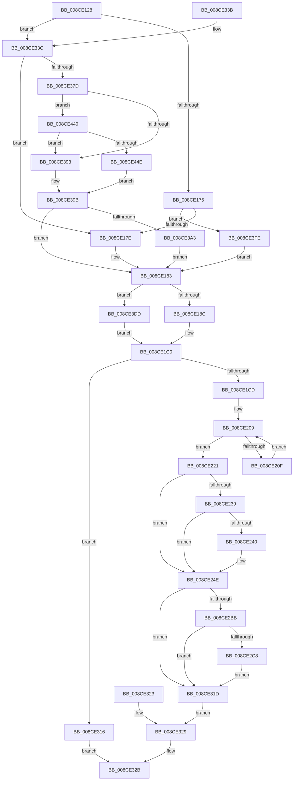

# PspPrepareSystemDllInitBlock

- RVA: `0x008CE128`–`0x008CE45B` (길이 `819` bytes)
- VA: `0x00000001408CE128`
- 실행 섹션: `PAGE`
- PDB 이름 있음: `예`; PDB Function 태그: `아니요`
- unwind 정보 RVA: `0x000847A4`
- 디코드: `172`개 명령, `819/819` bytes 표시
- 미해석 바이트: `0` (있으면 어셈블리에 `.byte`로 보존)

> 이 문서는 커널 이미지의 기계어와 PDB 기호를 분석해 생성했습니다. 4번과 5번은 함수 원형과 자료형을 바이너리 사용 방식에서 추정한 C 해석이며 원본 소스 복구 결과는 아닙니다.

## 1. Dependencies

- 직접 호출 지점: **5**; 고유 호출 대상: **4**
- 직접 호출자로 확인된 함수: **2**
- RIP 상대 이미지 참조: **2**

### Outgoing calls
- `0x008CE1DF` → [PsWow64GetProcessNtdllType](PsWow64GetProcessNtdllType_function_008CE464.md) (function, `0x008CE464`)
- `0x008CE1EB` → [PspWow64GetSharedInformation](PspWow64GetSharedInformation_function_008CE480.md) (function, `0x008CE480`)
- `0x008CE223` → [ExGenRandom](../../text/41/ExGenRandom_function_0041B010.md) (function, `0x0041B010`)
- `0x008CE2BE` → [PspGetScpCfgFunctions](PspGetScpCfgFunctions_function_008CE498.md) (function, `0x008CE498`)
- `0x008CE405` → [PspWow64GetSharedInformation](PspWow64GetSharedInformation_function_008CE480.md) (function, `0x008CE480`)

### Direct callers
- [PspAllocateProcess](../A1/PspAllocateProcess_function_00A13B3C.md) at `0x00A1611E`
- [PspAllocateProcess](../A1/PspAllocateProcess_function_00A13B3C.md) at `0x00A1613E`
- [PspSetupUserProcessAddressSpace](../AE/PspSetupUserProcessAddressSpace_function_00AEBDC8.md) at `0x00AEBFA9`
- [PspSetupUserProcessAddressSpace](../AE/PspSetupUserProcessAddressSpace_function_00AEBDC8.md) at `0x00AEBFDC`

### Static image references
- `0x008CE1CD` → RVA `0x00FD8130` (`PAGEDATA`; read)
- `0x008CE33C` → RVA `0x00FC7470` (`ALMOSTRO`; read)

## 2. Other-region calls and transfers

- 다른 실행 섹션으로 향하는 call: **1**
  - `0x008CE223` → [ExGenRandom](../../text/41/ExGenRandom_function_0041B010.md) (`PAGE` → `.text`)
- 별도 외부 분기/꼬리 이동을 확인하지 못했습니다.

## 3. Assembly (complete function range)

```asm
008CE128  40 53                           push rbx
008CE12A  56                              push rsi
008CE12B  57                              push rdi
008CE12C  41 54                           push r12
008CE12E  41 55                           push r13
008CE130  41 56                           push r14
008CE132  41 57                           push r15
008CE134  48 83 EC 60                     sub rsp, 0x60
008CE138  4C 8B F2                        mov r14, rdx
008CE13B  44 8B E1                        mov r12d, ecx
008CE13E  33 FF                           xor edi, edi
008CE140  8B DF                           mov ebx, edi
008CE142  44 8B EF                        mov r13d, edi
008CE145  48 89 BC 24 A8 00 00 00         mov qword ptr [rsp + 0xa8], rdi
008CE14D  48 89 BC 24 B0 00 00 00         mov qword ptr [rsp + 0xb0], rdi
008CE155  48 89 BC 24 B8 00 00 00         mov qword ptr [rsp + 0xb8], rdi
008CE15D  65 48 8B 04 25 88 01 00 00      mov rax, qword ptr gs:[0x188]
008CE166  4C 8B B8 B8 00 00 00            mov r15, qword ptr [rax + 0xb8]
008CE16D  85 C9                           test ecx, ecx
008CE16F  0F 84 C7 01 00 00               je 0x1408ce33c
008CE175  83 F9 01                        cmp ecx, 1
008CE178  0F 84 80 02 00 00               je 0x1408ce3fe
008CE17E  BE 01 00 00 00                  mov esi, 1
008CE183  4D 85 F6                        test r14, r14
008CE186  0F 84 51 02 00 00               je 0x1408ce3dd
008CE18C  0F 10 82 50 01 00 00            movups xmm0, xmmword ptr [rdx + 0x150]
008CE193  0F 11 44 24 28                  movups xmmword ptr [rsp + 0x28], xmm0
008CE198  F2 0F 10 8A 60 01 00 00         movsd xmm1, qword ptr [rdx + 0x160]
008CE1A0  F2 0F 11 4C 24 38               movsd qword ptr [rsp + 0x38], xmm1
008CE1A6  0F 10 82 C0 01 00 00            movups xmm0, xmmword ptr [rdx + 0x1c0]
008CE1AD  0F 11 44 24 40                  movups xmmword ptr [rsp + 0x40], xmm0
008CE1B2  F2 0F 10 8A D0 01 00 00         movsd xmm1, qword ptr [rdx + 0x1d0]
008CE1BA  F2 0F 11 4C 24 50               movsd qword ptr [rsp + 0x50], xmm1
008CE1C0  8B 03                           mov eax, dword ptr [rbx]
008CE1C2  3D 28 01 00 00                  cmp eax, 0x128
008CE1C7  0F 85 49 01 00 00               jne 0x1408ce316
008CE1CD  48 8B 05 5C 9F 70 00            mov rax, qword ptr [rip + 0x709f5c]
008CE1D4  48 8B 48 38                     mov rcx, qword ptr [rax + 0x38]
008CE1D8  48 89 4B 10                     mov qword ptr [rbx + 0x10], rcx
008CE1DC  49 8B CF                        mov rcx, r15
008CE1DF  E8 80 02 00 00                  call 0x1408ce464
008CE1E4  8B C8                           mov ecx, eax
008CE1E6  85 C0                           test eax, eax
008CE1E8  0F 44 CE                        cmove ecx, esi
008CE1EB  E8 90 02 00 00                  call 0x1408ce480
008CE1F0  48 63 C9                        movsxd rcx, ecx
008CE1F3  48 8D 15 36 9F 70 00            lea rdx, [rip + 0x709f36]
008CE1FA  48 8B 0C CA                     mov rcx, qword ptr [rdx + rcx*8]
008CE1FE  48 8B 51 38                     mov rdx, qword ptr [rcx + 0x38]
008CE202  48 89 53 08                     mov qword ptr [rbx + 8], rdx
008CE206  44 8A C7                        mov r8b, dil
008CE209  41 80 F8 10                     cmp r8b, 0x10
008CE20D  73 12                           jae 0x1408ce221
008CE20F  41 0F B6 D0                     movzx edx, r8b
008CE213  48 8B 0C D0                     mov rcx, qword ptr [rax + rdx*8]
008CE217  48 89 4C D3 18                  mov qword ptr [rbx + rdx*8 + 0x18], rcx
008CE21C  44 02 C6                        add r8b, sil
008CE21F  EB E8                           jmp 0x1408ce209
008CE221  8B CE                           mov ecx, esi
008CE223  E8 E8 CD B4 FF                  call 0x14041b010
008CE228  89 83 98 00 00 00               mov dword ptr [rbx + 0x98], eax
008CE22E  89 BB 9C 00 00 00               mov dword ptr [rbx + 0x9c], edi
008CE234  4D 85 F6                        test r14, r14
008CE237  74 15                           je 0x1408ce24e
008CE239  41 F6 46 11 02                  test byte ptr [r14 + 0x11], 2
008CE23E  74 0E                           je 0x1408ce24e
008CE240  8B 83 9C 00 00 00               mov eax, dword ptr [rbx + 0x9c]
008CE246  0B C6                           or eax, esi
008CE248  89 83 9C 00 00 00               mov dword ptr [rbx + 0x9c], eax
008CE24E  0F 10 44 24 28                  movups xmm0, xmmword ptr [rsp + 0x28]
008CE253  0F 11 83 A0 00 00 00            movups xmmword ptr [rbx + 0xa0], xmm0
008CE25A  F2 0F 10 44 24 38               movsd xmm0, qword ptr [rsp + 0x38]
008CE260  F2 0F 11 83 B0 00 00 00         movsd qword ptr [rbx + 0xb0], xmm0
008CE268  0F 10 4C 24 40                  movups xmm1, xmmword ptr [rsp + 0x40]
008CE26D  0F 11 8B D8 00 00 00            movups xmmword ptr [rbx + 0xd8], xmm1
008CE274  F2 0F 10 44 24 50               movsd xmm0, qword ptr [rsp + 0x50]
008CE27A  F2 0F 11 83 E8 00 00 00         movsd qword ptr [rbx + 0xe8], xmm0
008CE282  4C 89 AB B8 00 00 00            mov qword ptr [rbx + 0xb8], r13
008CE289  48 8B 84 24 A8 00 00 00         mov rax, qword ptr [rsp + 0xa8]
008CE291  48 89 83 C0 00 00 00            mov qword ptr [rbx + 0xc0], rax
008CE298  48 8B 84 24 B0 00 00 00         mov rax, qword ptr [rsp + 0xb0]
008CE2A0  48 89 83 C8 00 00 00            mov qword ptr [rbx + 0xc8], rax
008CE2A7  48 8B 84 24 B8 00 00 00         mov rax, qword ptr [rsp + 0xb8]
008CE2AF  48 89 83 D0 00 00 00            mov qword ptr [rbx + 0xd0], rax
008CE2B6  45 85 E4                        test r12d, r12d
008CE2B9  75 62                           jne 0x1408ce31d
008CE2BB  49 8B CF                        mov rcx, r15
008CE2BE  E8 D5 01 00 00                  call 0x1408ce498
008CE2C3  48 85 C0                        test rax, rax
008CE2C6  74 55                           je 0x1408ce31d
008CE2C8  48 8B 08                        mov rcx, qword ptr [rax]
008CE2CB  48 89 8B F0 00 00 00            mov qword ptr [rbx + 0xf0], rcx
008CE2D2  48 8B 48 08                     mov rcx, qword ptr [rax + 8]
008CE2D6  48 89 8B F8 00 00 00            mov qword ptr [rbx + 0xf8], rcx
008CE2DD  48 8B 48 10                     mov rcx, qword ptr [rax + 0x10]
008CE2E1  48 89 8B 00 01 00 00            mov qword ptr [rbx + 0x100], rcx
008CE2E8  48 8B 48 18                     mov rcx, qword ptr [rax + 0x18]
008CE2EC  48 89 8B 08 01 00 00            mov qword ptr [rbx + 0x108], rcx
008CE2F3  48 8B 48 30                     mov rcx, qword ptr [rax + 0x30]
008CE2F7  48 89 8B 10 01 00 00            mov qword ptr [rbx + 0x110], rcx
008CE2FE  48 8B 48 20                     mov rcx, qword ptr [rax + 0x20]
008CE302  48 89 8B 18 01 00 00            mov qword ptr [rbx + 0x118], rcx
008CE309  48 8B 40 28                     mov rax, qword ptr [rax + 0x28]
008CE30D  48 89 83 20 01 00 00            mov qword ptr [rbx + 0x120], rax
008CE314  EB 07                           jmp 0x1408ce31d
008CE316  B8 59 00 00 C0                  mov eax, 0xc0000059
008CE31B  EB 0E                           jmp 0x1408ce32b
008CE31D  89 7C 24 20                     mov dword ptr [rsp + 0x20], edi
008CE321  EB 06                           jmp 0x1408ce329
008CE323  8B F8                           mov edi, eax
008CE325  89 44 24 20                     mov dword ptr [rsp + 0x20], eax
008CE329  8B C7                           mov eax, edi
008CE32B  48 83 C4 60                     add rsp, 0x60
008CE32F  41 5F                           pop r15
008CE331  41 5E                           pop r14
008CE333  41 5D                           pop r13
008CE335  41 5C                           pop r12
008CE337  5F                              pop rdi
008CE338  5E                              pop rsi
008CE339  5B                              pop rbx
008CE33A  C3                              ret
008CE33B  CC                              int3
008CE33C  48 8B 1D 2D 91 6F 00            mov rbx, qword ptr [rip + 0x6f912d]
008CE343  65 48 8B 04 25 88 01 00 00      mov rax, qword ptr gs:[0x188]
008CE34C  48 8B 88 B8 00 00 00            mov rcx, qword ptr [rax + 0xb8]
008CE353  48 8B 81 10 04 00 00            mov rax, qword ptr [rcx + 0x410]
008CE35A  4C 8B A8 A0 04 00 00            mov r13, qword ptr [rax + 0x4a0]
008CE361  48 8B 80 A8 04 00 00            mov rax, qword ptr [rax + 0x4a8]
008CE368  48 89 84 24 A8 00 00 00         mov qword ptr [rsp + 0xa8], rax
008CE370  49 39 BF 10 03 00 00            cmp qword ptr [r15 + 0x310], rdi
008CE377  0F 84 01 FE FF FF               je 0x1408ce17e
008CE37D  41 0F B7 87 EC 06 00 00         movzx eax, word ptr [r15 + 0x6ec]
008CE385  B9 4C 01 00 00                  mov ecx, 0x14c
008CE38A  66 3B C1                        cmp ax, cx
008CE38D  0F 85 AD 00 00 00               jne 0x1408ce440
008CE393  BE 01 00 00 00                  mov esi, 1
008CE398  40 8A C6                        mov al, sil
008CE39B  84 C0                           test al, al
008CE39D  0F 84 E0 FD FF FF               je 0x1408ce183
008CE3A3  65 48 8B 04 25 88 01 00 00      mov rax, qword ptr gs:[0x188]
008CE3AC  48 8B 88 B8 00 00 00            mov rcx, qword ptr [rax + 0xb8]
008CE3B3  48 8B 81 10 04 00 00            mov rax, qword ptr [rcx + 0x410]
008CE3BA  48 8B 88 C0 04 00 00            mov rcx, qword ptr [rax + 0x4c0]
008CE3C1  48 89 8C 24 B0 00 00 00         mov qword ptr [rsp + 0xb0], rcx
008CE3C9  48 8B 80 C8 04 00 00            mov rax, qword ptr [rax + 0x4c8]
008CE3D0  48 89 84 24 B8 00 00 00         mov qword ptr [rsp + 0xb8], rax
008CE3D8  E9 A6 FD FF FF                  jmp 0x1408ce183
008CE3DD  0F 57 C0                        xorps xmm0, xmm0
008CE3E0  33 C0                           xor eax, eax
008CE3E2  0F 11 44 24 28                  movups xmmword ptr [rsp + 0x28], xmm0
008CE3E7  48 89 44 24 38                  mov qword ptr [rsp + 0x38], rax
008CE3EC  0F 57 C9                        xorps xmm1, xmm1
008CE3EF  0F 11 4C 24 40                  movups xmmword ptr [rsp + 0x40], xmm1
008CE3F4  48 89 44 24 50                  mov qword ptr [rsp + 0x50], rax
008CE3F9  E9 C2 FD FF FF                  jmp 0x1408ce1c0
008CE3FE  BE 01 00 00 00                  mov esi, 1
008CE403  8B CE                           mov ecx, esi
008CE405  E8 76 00 00 00                  call 0x1408ce480
008CE40A  48 8B 58 38                     mov rbx, qword ptr [rax + 0x38]
008CE40E  65 48 8B 04 25 88 01 00 00      mov rax, qword ptr gs:[0x188]
008CE417  48 8B 88 B8 00 00 00            mov rcx, qword ptr [rax + 0xb8]
008CE41E  48 8B 81 10 04 00 00            mov rax, qword ptr [rcx + 0x410]
008CE425  4C 8B A8 C0 04 00 00            mov r13, qword ptr [rax + 0x4c0]
008CE42C  48 8B 80 C8 04 00 00            mov rax, qword ptr [rax + 0x4c8]
008CE433  48 89 84 24 A8 00 00 00         mov qword ptr [rsp + 0xa8], rax
008CE43B  E9 43 FD FF FF                  jmp 0x1408ce183
008CE440  B9 C4 01 00 00                  mov ecx, 0x1c4
008CE445  66 3B C1                        cmp ax, cx
008CE448  0F 84 45 FF FF FF               je 0x1408ce393
008CE44E  40 8A C7                        mov al, dil
008CE451  BE 01 00 00 00                  mov esi, 1
008CE456  E9 40 FF FF FF                  jmp 0x1408ce39b
```

## 4. C-style interpretation (structured pseudocode)

```c
__int64 __fastcall PspPrepareSystemDllInitBlock(int a1, __int64 a2)
{
    __int64 result;
    __int64 v_rdi;
    __int64 v_rsp;
    unsigned __int64 v_stack_m48;
    unsigned __int64 v_stack_m58;
    unsigned __int64 v_stack_m60;
    unsigned __int64 v_stack_m70;
    unsigned int v_stack_m78;
    unsigned __int64 v_stack_p10;
    unsigned __int64 v_stack_p18;
    unsigned __int64 v_stack_p20;
    unsigned __int64 v_stack_p28;
    unsigned __int64 v_stack_p38;
    unsigned __int64 v_stack_p40;
    unsigned __int64 v_stack_p50;
    unsigned __int64 v_stack_pA8;
    unsigned __int64 v_stack_pB0;
    unsigned __int64 v_stack_pB8;

    v_rsp = (v_rsp) - (96);
    v_rdi = 0;
    v_stack_p10 = 0;
    v_stack_p18 = 0;
    v_stack_p20 = 0;
    if (a1 == 0) goto loc_008CE33C;
    if (a1 == 1) goto loc_008CE3FE;
loc_008CE17E:
loc_008CE183:
    if (a2 == 0) goto loc_008CE3DD;
    v_stack_m70 = v_xmm0;
    v_stack_m60 = v_xmm1;
    v_stack_m58 = v_xmm0;
    v_stack_m48 = v_xmm1;
loc_008CE1C0:
    if (((unsigned int)((unsigned int)(*(unsigned int *)(0)))) != 296) goto loc_008CE316;
    *(unsigned __int64 *)(0 + 16) = *(unsigned __int64 *)(*(unsigned __int64 *)(v_rip + 7380828) + 56);
    result = PsWow64GetProcessNtdllType(*(unsigned __int64 *)(*(unsigned __int64 *)(gs_base + (0 + 392)) + 184), a2, a3, a4);
    a1 = (unsigned int)((unsigned int)(result));
    if ((unsigned int)(result) == 0) { a1 = 1; }
    result = PspWow64GetSharedInformation(a1, a2, a3, a4);
    *(unsigned __int64 *)(0 + 8) = *(unsigned __int64 *)(*(unsigned __int64 *)(v_rip + 7380790 + (int)(a1) * 8) + 56);
loc_008CE209:
    if (0 >= 16) goto loc_008CE221;
    *(unsigned __int64 *)(0 + 0 * 8 + 24) = *(unsigned __int64 *)(result + 0 * 8);
    a3 = (unsigned __int8)((0) + (1));
    goto loc_008CE209;
loc_008CE221:
    result = ExGenRandom(1, 0, a3, a4);
    *(unsigned int *)(0 + 152) = (unsigned int)(result);
    *(unsigned int *)(0 + 156) = 0;
    if (a2 == 0) goto loc_008CE24E;
    if (((*(unsigned __int8 *)(a2 + 17)) & (2)) != 0) {
        result = *(unsigned int *)(0 + 156);
        result = (unsigned int)((result) | (1));
        *(unsigned int *)(0 + 156) = (unsigned int)(result);
    }
    *(unsigned __int64 *)(0 + 160) = v_xmm0;
    *(unsigned __int64 *)(0 + 176) = v_xmm0;
    *(unsigned __int64 *)(0 + 216) = v_xmm1;
    *(unsigned __int64 *)(0 + 232) = v_xmm0;
    *(unsigned __int64 *)(0 + 184) = 0;
    *(unsigned __int64 *)(0 + 192) = v_stack_p10;
    *(unsigned __int64 *)(0 + 200) = v_stack_p18;
    *(unsigned __int64 *)(0 + 208) = v_stack_p20;
    if ((unsigned int)((unsigned int)(a1)) != 0) goto loc_008CE31D;
    result = PspGetScpCfgFunctions(*(unsigned __int64 *)(*(unsigned __int64 *)(gs_base + (0 + 392)) + 184), 0, a3, a4);
    if (result == 0) goto loc_008CE31D;
    *(unsigned __int64 *)(0 + 240) = *(unsigned __int64 *)(result);
    *(unsigned __int64 *)(0 + 248) = *(unsigned __int64 *)(result + 8);
    *(unsigned __int64 *)(0 + 256) = *(unsigned __int64 *)(result + 16);
    *(unsigned __int64 *)(0 + 264) = *(unsigned __int64 *)(result + 24);
    *(unsigned __int64 *)(0 + 272) = *(unsigned __int64 *)(result + 48);
    *(unsigned __int64 *)(0 + 280) = *(unsigned __int64 *)(result + 32);
    *(unsigned __int64 *)(0 + 288) = *(unsigned __int64 *)(result + 40);
    goto loc_008CE31D;
loc_008CE316:
    goto loc_008CE32B;
loc_008CE31D:
    v_stack_m78 = 0;
    goto loc_008CE329;
loc_008CE329:
loc_008CE32B:
    v_rsp = (v_rsp) + (96);
    return 0;
loc_008CE33C:
    v_stack_pA8 = *(unsigned __int64 *)(*(unsigned __int64 *)(*(unsigned __int64 *)(*(unsigned __int64 *)(gs_base + (0 + 392)) + 184) + 1040) + 1192);
    if ((*(unsigned __int64 *)(*(unsigned __int64 *)(*(unsigned __int64 *)(gs_base + (0 + 392)) + 184) + 784)) == 0) goto loc_008CE17E;
    if (((unsigned __int16)(*(unsigned __int16 *)(*(unsigned __int64 *)(*(unsigned __int64 *)(gs_base + (0 + 392)) + 184) + 1772))) != 332) goto loc_008CE440;
loc_008CE393:
loc_008CE39B:
    if (1 == 0) goto loc_008CE183;
    v_stack_pB0 = *(unsigned __int64 *)(*(unsigned __int64 *)(*(unsigned __int64 *)(*(unsigned __int64 *)(gs_base + (0 + 392)) + 184) + 1040) + 1216);
    v_stack_pB8 = *(unsigned __int64 *)(*(unsigned __int64 *)(*(unsigned __int64 *)(*(unsigned __int64 *)(gs_base + (0 + 392)) + 184) + 1040) + 1224);
    goto loc_008CE183;
loc_008CE3DD:
    result = 0;
    v_stack_p28 = v_xmm0;
    v_stack_p38 = 0;
    v_stack_p40 = v_xmm1;
    v_stack_p50 = 0;
    goto loc_008CE1C0;
loc_008CE3FE:
    result = PspWow64GetSharedInformation(1, 0, a3, a4);
    v_stack_pA8 = *(unsigned __int64 *)(*(unsigned __int64 *)(*(unsigned __int64 *)(*(unsigned __int64 *)(gs_base + (0 + 392)) + 184) + 1040) + 1224);
    goto loc_008CE183;
loc_008CE440:
    if (((unsigned __int16)(*(unsigned __int64 *)(*(unsigned __int64 *)(*(unsigned __int64 *)(*(unsigned __int64 *)(gs_base + (0 + 392)) + 184) + 1040) + 1224))) == 452) goto loc_008CE393;
    goto loc_008CE39B;
}
```

## 5. (Beta) C Style

```c
int64_t PspPrepareSystemDllInitBlock(int32_t Arg1, int64_t Arg2)
{
    int64_t result;
    int64_t local_rdi;
    int64_t local_rsp;
    uint64_t v_stack_m48;
    uint64_t v_stack_m58;
    uint64_t v_stack_m60;
    uint64_t v_stack_m70;
    uint32_t v_stack_m78;
    uint64_t v_stack_p10;
    uint64_t v_stack_p18;
    uint64_t v_stack_p20;
    uint64_t v_stack_p28;
    uint64_t v_stack_p38;
    uint64_t v_stack_p40;
    uint64_t v_stack_p50;
    uint64_t v_stack_pA8;
    uint64_t v_stack_pB0;
    uint64_t v_stack_pB8;

    local_rsp = (local_rsp) - (96);
    local_rdi = 0;
    v_stack_p10 = 0;
    v_stack_p18 = 0;
    v_stack_p20 = 0;
    if (Arg1 == 0) goto loc_008CE33C;
    if (Arg1 == 1) goto loc_008CE3FE;
loc_008CE17E:
loc_008CE183:
    if (Arg2 == 0) goto loc_008CE3DD;
    v_stack_m70 = v_xmm0;
    v_stack_m60 = v_xmm1;
    v_stack_m58 = v_xmm0;
    v_stack_m48 = v_xmm1;
loc_008CE1C0:
    if (((uint32_t)((uint32_t)(*(uint32_t *)(0)))) != 296) goto loc_008CE316;
    *(uint64_t *)(0 + 0x10) = *(uint64_t *)(*(uint64_t *)(v_rip + 0x709F5C) + 0x38);
    result = PsWow64GetProcessNtdllType(*(uint64_t *)(*(uint64_t *)(gs_base + (0 + 0x188)) + 0xB8), Arg2, a3, a4);
    Arg1 = (uint32_t)((uint32_t)(result));
    if ((uint32_t)(result) == 0) { Arg1 = 1; }
    result = PspWow64GetSharedInformation(Arg1, Arg2, a3, a4);
    *(uint64_t *)(0 + 0x8) = *(uint64_t *)(*(uint64_t *)(v_rip + 0x709F36 + (int32_t)(Arg1) * 8) + 0x38);
loc_008CE209:
    if (0 >= 16) goto loc_008CE221;
    *(uint64_t *)(0 + 0x0 * 8 + 0x18) = *(uint64_t *)(result + 0x0 * 8);
    a3 = (uint8_t)((0) + (1));
    goto loc_008CE209;
loc_008CE221:
    result = ExGenRandom(1, 0, a3, a4);
    *(uint32_t *)(0 + 0x98) = (uint32_t)(result);
    *(uint32_t *)(0 + 0x9C) = 0;
    if (Arg2 == 0) goto loc_008CE24E;
    if (((*(uint8_t *)(Arg2 + 0x11)) & (2)) != 0) {
        result = *(uint32_t *)(0 + 0x9C);
        result = (uint32_t)((result) | (1));
        *(uint32_t *)(0 + 0x9C) = (uint32_t)(result);
    }
    *(uint64_t *)(0 + 0xA0) = v_xmm0;
    *(uint64_t *)(0 + 0xB0) = v_xmm0;
    *(uint64_t *)(0 + 0xD8) = v_xmm1;
    *(uint64_t *)(0 + 0xE8) = v_xmm0;
    *(uint64_t *)(0 + 0xB8) = 0;
    *(uint64_t *)(0 + 0xC0) = v_stack_p10;
    *(uint64_t *)(0 + 0xC8) = v_stack_p18;
    *(uint64_t *)(0 + 0xD0) = v_stack_p20;
    if ((uint32_t)((uint32_t)(Arg1)) != 0) goto loc_008CE31D;
    result = PspGetScpCfgFunctions(*(uint64_t *)(*(uint64_t *)(gs_base + (0 + 0x188)) + 0xB8), 0, a3, a4);
    if (result == 0) goto loc_008CE31D;
    *(uint64_t *)(0 + 0xF0) = *(uint64_t *)(result);
    *(uint64_t *)(0 + 0xF8) = *(uint64_t *)(result + 0x8);
    *(uint64_t *)(0 + 0x100) = *(uint64_t *)(result + 0x10);
    *(uint64_t *)(0 + 0x108) = *(uint64_t *)(result + 0x18);
    *(uint64_t *)(0 + 0x110) = *(uint64_t *)(result + 0x30);
    *(uint64_t *)(0 + 0x118) = *(uint64_t *)(result + 0x20);
    *(uint64_t *)(0 + 0x120) = *(uint64_t *)(result + 0x28);
    goto loc_008CE31D;
loc_008CE316:
    goto loc_008CE32B;
loc_008CE31D:
    v_stack_m78 = 0;
    goto loc_008CE329;
loc_008CE329:
loc_008CE32B:
    local_rsp = (local_rsp) + (96);
    return 0;
loc_008CE33C:
    v_stack_pA8 = *(uint64_t *)(*(uint64_t *)(*(uint64_t *)(*(uint64_t *)(gs_base + (0 + 0x188)) + 0xB8) + 0x410) + 0x4A8);
    if ((*(uint64_t *)(*(uint64_t *)(*(uint64_t *)(gs_base + (0 + 0x188)) + 0xB8) + 0x310)) == 0) goto loc_008CE17E;
    if (((uint16_t)(*(uint16_t *)(*(uint64_t *)(*(uint64_t *)(gs_base + (0 + 0x188)) + 0xB8) + 0x6EC))) != 332) goto loc_008CE440;
loc_008CE393:
loc_008CE39B:
    if (1 == 0) goto loc_008CE183;
    v_stack_pB0 = *(uint64_t *)(*(uint64_t *)(*(uint64_t *)(*(uint64_t *)(gs_base + (0 + 0x188)) + 0xB8) + 0x410) + 0x4C0);
    v_stack_pB8 = *(uint64_t *)(*(uint64_t *)(*(uint64_t *)(*(uint64_t *)(gs_base + (0 + 0x188)) + 0xB8) + 0x410) + 0x4C8);
    goto loc_008CE183;
loc_008CE3DD:
    result = 0;
    v_stack_p28 = v_xmm0;
    v_stack_p38 = 0;
    v_stack_p40 = v_xmm1;
    v_stack_p50 = 0;
    goto loc_008CE1C0;
loc_008CE3FE:
    result = PspWow64GetSharedInformation(1, 0, a3, a4);
    v_stack_pA8 = *(uint64_t *)(*(uint64_t *)(*(uint64_t *)(*(uint64_t *)(gs_base + (0 + 0x188)) + 0xB8) + 0x410) + 0x4C8);
    goto loc_008CE183;
loc_008CE440:
    if (((uint16_t)(*(uint64_t *)(*(uint64_t *)(*(uint64_t *)(*(uint64_t *)(gs_base + (0 + 0x188)) + 0xB8) + 0x410) + 0x4C8))) == 452) goto loc_008CE393;
    goto loc_008CE39B;
}
```

## 6. Execution-region graph

[열기: 2D/3D 그래프와 함수 탐색 컨트롤 패널](../../../control-panel.html?section=page&rva=0x008CE128&view=graph)

- 2D 그래프는 위에서 아래로 흐르고, 3D 그래프는 빈 공간을 드래그해 회전합니다. Shift+드래그는 이동, 휠은 확대·축소, 함수 노드 선택은 대상 보고서 이동입니다.

### Static fallback


