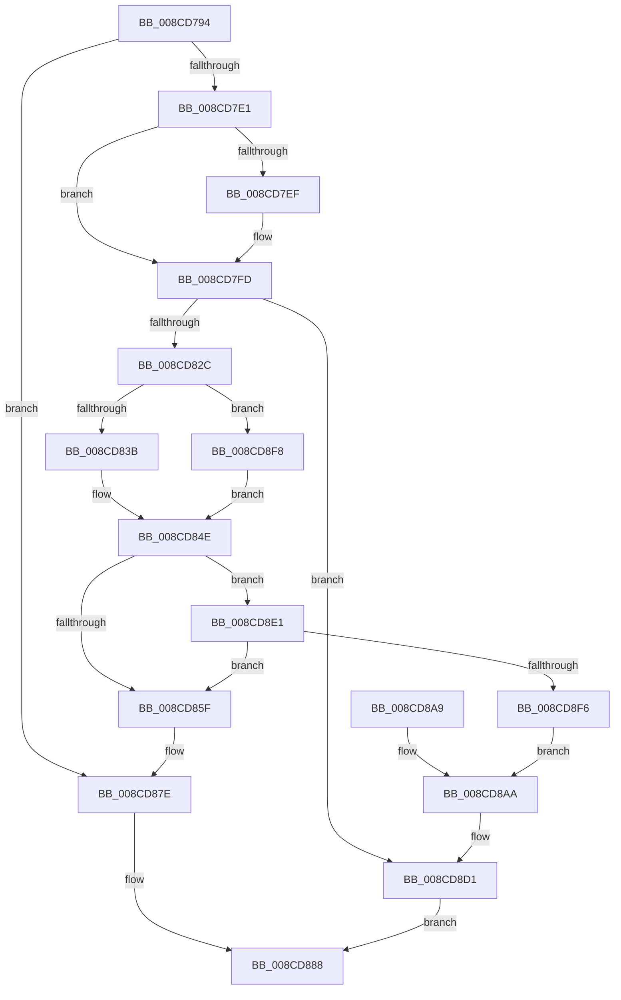

# PspSetupUserStack

- RVA: `0x008CD794`–`0x008CD900` (길이 `364` bytes)
- VA: `0x00000001408CD794`
- 실행 섹션: `PAGE`
- PDB 이름 있음: `예`; PDB Function 태그: `아니요`
- unwind 정보 RVA: `0x000846E8`
- 디코드: `101`개 명령, `364/364` bytes 표시
- 미해석 바이트: `0` (있으면 어셈블리에 `.byte`로 보존)

> 이 문서는 커널 이미지의 기계어와 PDB 기호를 분석해 생성했습니다. 4번과 5번은 함수 원형과 자료형을 바이너리 사용 방식에서 추정한 C 해석이며 원본 소스 복구 결과는 아닙니다.

## 1. Dependencies

- 직접 호출 지점: **8**; 고유 호출 대상: **7**
- 직접 호출자로 확인된 함수: **1**
- RIP 상대 이미지 참조: **1**

### Outgoing calls
- `0x008CD804` → [KiStackAttachProcess](../../text/21/KiStackAttachProcess_function_00216820.md) (function, `0x00216820`)
- `0x008CD81D` → [RtlCreateUserStack](RtlCreateUserStack_function_008CD908.md) (function, `0x008CD908`)
- `0x008CD840` → [ExGenRandom](../../text/41/ExGenRandom_function_0041B010.md) (function, `0x0041B010`)
- `0x008CD877` → [KiUnstackDetachProcess](../../text/21/KiUnstackDetachProcess_function_00217D30.md) (function, `0x00217D30`)
- `0x008CD890` → [_security_check_cookie](../../text/6A/_security_check_cookie_function_006AC640.md) (function, `0x006AC640`)
- `0x008CD8CC` → [ZwFreeVirtualMemory](../../text/6A/ZwFreeVirtualMemory_function_006AD490.md) (function, `0x006AD490`)
- `0x008CD8D8` → [KiUnstackDetachProcess](../../text/21/KiUnstackDetachProcess_function_00217D30.md) (function, `0x00217D30`)
- `0x008CD8E7` → [PspWow64SetupCpuArea](PspWow64SetupCpuArea_function_008CDBFC.md) (function, `0x008CDBFC`)

### Direct callers
- [PspAllocateThread](../9E/PspAllocateThread_function_009EF72C.md) at `0x009EFD16`
- [PspAllocateThread](../9E/PspAllocateThread_function_009EF72C.md) at `0x009F00D5`

### Static image references
- `0x008CD7A8` → RVA `0x00E0A740` (`.data`; read)

## 2. Other-region calls and transfers

- 다른 실행 섹션으로 향하는 call: **6**
  - `0x008CD804` → [KiStackAttachProcess](../../text/21/KiStackAttachProcess_function_00216820.md) (`PAGE` → `.text`)
  - `0x008CD840` → [ExGenRandom](../../text/41/ExGenRandom_function_0041B010.md) (`PAGE` → `.text`)
  - `0x008CD877` → [KiUnstackDetachProcess](../../text/21/KiUnstackDetachProcess_function_00217D30.md) (`PAGE` → `.text`)
  - `0x008CD890` → [_security_check_cookie](../../text/6A/_security_check_cookie_function_006AC640.md) (`PAGE` → `.text`)
  - `0x008CD8CC` → [ZwFreeVirtualMemory](../../text/6A/ZwFreeVirtualMemory_function_006AD490.md) (`PAGE` → `.text`)
  - `0x008CD8D8` → [KiUnstackDetachProcess](../../text/21/KiUnstackDetachProcess_function_00217D30.md) (`PAGE` → `.text`)
- 별도 외부 분기/꼬리 이동을 확인하지 못했습니다.

## 3. Assembly (complete function range)

```asm
008CD794  40 53                           push rbx
008CD796  55                              push rbp
008CD797  56                              push rsi
008CD798  57                              push rdi
008CD799  41 54                           push r12
008CD79B  41 55                           push r13
008CD79D  41 56                           push r14
008CD79F  41 57                           push r15
008CD7A1  48 81 EC 88 00 00 00            sub rsp, 0x88
008CD7A8  48 8B 05 91 CF 53 00            mov rax, qword ptr [rip + 0x53cf91]
008CD7AF  48 33 C4                        xor rax, rsp
008CD7B2  48 89 44 24 70                  mov qword ptr [rsp + 0x70], rax
008CD7B7  0F 57 C0                        xorps xmm0, xmm0
008CD7BA  33 DB                           xor ebx, ebx
008CD7BC  41 F6 01 01                     test byte ptr [r9], 1
008CD7C0  49 8B F1                        mov rsi, r9
008CD7C3  4D 8B F0                        mov r14, r8
008CD7C6  4C 8B EA                        mov r13, rdx
008CD7C9  4C 8B F9                        mov r15, rcx
008CD7CC  0F 11 44 24 40                  movups xmmword ptr [rsp + 0x40], xmm0
008CD7D1  0F 11 44 24 50                  movups xmmword ptr [rsp + 0x50], xmm0
008CD7D6  0F 11 44 24 60                  movups xmmword ptr [rsp + 0x60], xmm0
008CD7DB  0F 85 9D 00 00 00               jne 0x1408cd87e
008CD7E1  BF 00 10 00 00                  mov edi, 0x1000
008CD7E6  39 9C 24 F0 00 00 00            cmp dword ptr [rsp + 0xf0], ebx
008CD7ED  74 0E                           je 0x1408cd7fd
008CD7EF  8B 84 24 F0 00 00 00            mov eax, dword ptr [rsp + 0xf0]
008CD7F6  48 C1 E0 38                     shl rax, 0x38
008CD7FA  48 0B F8                        or rdi, rax
008CD7FD  4C 8D 44 24 40                  lea r8, [rsp + 0x40]
008CD802  33 D2                           xor edx, edx
008CD804  E8 17 90 94 FF                  call 0x140216820
008CD809  4C 8B 46 08                     mov r8, qword ptr [rsi + 8]
008CD80D  4C 8B CF                        mov r9, rdi
008CD810  48 8B 56 18                     mov rdx, qword ptr [rsi + 0x18]
008CD814  48 8B 4E 10                     mov rcx, qword ptr [rsi + 0x10]
008CD818  4C 89 74 24 28                  mov qword ptr [rsp + 0x28], r14
008CD81D  E8 E6 00 00 00                  call 0x1408cd908
008CD822  8B E8                           mov ebp, eax
008CD824  85 C0                           test eax, eax
008CD826  0F 88 A5 00 00 00               js 0x1408cd8d1
008CD82C  41 8B 87 50 07 00 00            mov eax, dword ptr [r15 + 0x750]
008CD833  A8 40                           test al, 0x40
008CD835  0F 85 BD 00 00 00               jne 0x1408cd8f8
008CD83B  B9 01 00 00 00                  mov ecx, 1
008CD840  E8 CB D7 B4 FF                  call 0x14041b010
008CD845  83 E0 7F                        and eax, 0x7f
008CD848  C1 E0 04                        shl eax, 4
008CD84B  44 8B E0                        mov r12d, eax
008CD84E  49 8D 7E 10                     lea rdi, [r14 + 0x10]
008CD852  49 39 9F 10 03 00 00            cmp qword ptr [r15 + 0x310], rbx
008CD859  0F 85 82 00 00 00               jne 0x1408cd8e1
008CD85F  48 8B 07                        mov rax, qword ptr [rdi]
008CD862  48 8D 4C 24 40                  lea rcx, [rsp + 0x40]
008CD867  49 2B C4                        sub rax, r12
008CD86A  33 D2                           xor edx, edx
008CD86C  48 83 E8 28                     sub rax, 0x28
008CD870  49 89 85 98 00 00 00            mov qword ptr [r13 + 0x98], rax
008CD877  E8 B4 A4 94 FF                  call 0x140217d30
008CD87C  B3 02                           mov bl, 2
008CD87E  8A 06                           mov al, byte ptr [rsi]
008CD880  24 FD                           and al, 0xfd
008CD882  0A C3                           or al, bl
008CD884  88 06                           mov byte ptr [rsi], al
008CD886  33 C0                           xor eax, eax
008CD888  48 8B 4C 24 70                  mov rcx, qword ptr [rsp + 0x70]
008CD88D  48 33 CC                        xor rcx, rsp
008CD890  E8 AB ED DD FF                  call 0x1406ac640
008CD895  48 81 C4 88 00 00 00            add rsp, 0x88
008CD89C  41 5F                           pop r15
008CD89E  41 5E                           pop r14
008CD8A0  41 5D                           pop r13
008CD8A2  41 5C                           pop r12
008CD8A4  5F                              pop rdi
008CD8A5  5E                              pop rsi
008CD8A6  5D                              pop rbp
008CD8A7  5B                              pop rbx
008CD8A8  C3                              ret
008CD8A9  CC                              int3
008CD8AA  49 8B 46 20                     mov rax, qword ptr [r14 + 0x20]
008CD8AE  4C 8D 44 24 30                  lea r8, [rsp + 0x30]
008CD8B3  41 B9 00 80 00 00               mov r9d, 0x8000
008CD8B9  48 89 44 24 38                  mov qword ptr [rsp + 0x38], rax
008CD8BE  48 8D 54 24 38                  lea rdx, [rsp + 0x38]
008CD8C3  48 89 5C 24 30                  mov qword ptr [rsp + 0x30], rbx
008CD8C8  48 83 C9 FF                     or rcx, 0xffffffffffffffff
008CD8CC  E8 BF FB DD FF                  call 0x1406ad490
008CD8D1  33 D2                           xor edx, edx
008CD8D3  48 8D 4C 24 40                  lea rcx, [rsp + 0x40]
008CD8D8  E8 53 A4 94 FF                  call 0x140217d30
008CD8DD  8B C5                           mov eax, ebp
008CD8DF  EB A7                           jmp 0x1408cd888
008CD8E1  49 8B D7                        mov rdx, r15
008CD8E4  48 8B CF                        mov rcx, rdi
008CD8E7  E8 10 03 00 00                  call 0x1408cdbfc
008CD8EC  8B E8                           mov ebp, eax
008CD8EE  85 C0                           test eax, eax
008CD8F0  0F 89 69 FF FF FF               jns 0x1408cd85f
008CD8F6  EB B2                           jmp 0x1408cd8aa
008CD8F8  4C 8B E3                        mov r12, rbx
008CD8FB  E9 4E FF FF FF                  jmp 0x1408cd84e
```

## 4. C-style interpretation (structured pseudocode)

```c
__int64 __fastcall PspSetupUserStack(__int64 a1, __int64 a2, __int64 a3, __int64 a4, unsigned int a5)
{
    __int64 result;
    __int64 v_rbx;
    __int64 v_rdi;
    __int64 v_rsp;
    unsigned __int64 v_stack_m58;
    unsigned __int64 v_stack_m68;
    unsigned __int64 v_stack_m78;
    unsigned __int64 v_stack_m88;
    unsigned __int64 v_stack_mA0;
    unsigned __int64 v_stack_p30;
    unsigned __int64 v_stack_p38;
    unsigned __int64 v_stack_p40;

    v_rsp = (v_rsp) - (136);
    result = (*(unsigned __int64 *)(v_rip + 5492625)) ^ (v_rsp);
    v_stack_m58 = result;
    v_rbx = 0;
    v_stack_m88 = v_xmm0;
    v_stack_m78 = v_xmm0;
    v_stack_m68 = v_xmm0;
    if (((*(unsigned __int8 *)(a4)) & (1)) != 0) goto loc_008CD87E;
    v_rdi = (unsigned int)(0x1000ULL);
    if (a5 != 0) {
        result = a5;
        result = (result) << (56);
        v_rdi = ((unsigned int)(0x1000ULL)) | (result);
    }
    a2 = 0;
    result = KiStackAttachProcess(a1, a2, v_stack_m88, a4);
    v_stack_mA0 = a3;
    result = RtlCreateUserStack(*(unsigned __int64 *)(a4 + 16), *(unsigned __int64 *)(a4 + 24), *(unsigned __int64 *)(a4 + 8), v_rdi);
    if (sign_flag) goto loc_008CD8D1;
    if ((((unsigned __int8)((unsigned int)(*(unsigned int *)(a1 + 1872)))) & (64)) != 0) goto loc_008CD8F8;
    result = ExGenRandom(1, *(unsigned __int64 *)(a4 + 24), *(unsigned __int64 *)(a4 + 8), v_rdi);
    result = (unsigned int)((result) & (127));
    result = (unsigned int)((result) << (4));
loc_008CD84E:
    if ((*(unsigned __int64 *)(a1 + 784)) != 0) goto loc_008CD8E1;
loc_008CD85F:
    result = (*(unsigned __int64 *)(a3 + 16)) - ((unsigned int)((unsigned int)(result)));
    a2 = 0;
    result = (result) - (40);
    *(unsigned __int64 *)(a2 + 152) = result;
    result = KiUnstackDetachProcess(v_stack_m88, a2, *(unsigned __int64 *)(a4 + 8), v_rdi);
loc_008CD87E:
    result = (unsigned __int8)((*(unsigned __int8 *)(a4)) & (253));
    result = (unsigned __int8)((result) | (2));
    *(unsigned __int8 *)(a4) = (unsigned __int8)(result);
    result = 0;
loc_008CD888:
    a1 = (v_stack_m58) ^ (v_rsp);
    result = _security_check_cookie(a1, a2, *(unsigned __int64 *)(a4 + 8), v_rdi);
    v_rsp = (v_rsp) + (136);
    return result;
loc_008CD8AA:
    v_stack_p38 = *(unsigned __int64 *)(a3 + 32);
    v_stack_p30 = 2;
    a1 = (a1) | (-1);
    result = ZwFreeVirtualMemory(a1, v_stack_p38, v_stack_p30, (unsigned int)(0x8000ULL));
loc_008CD8D1:
    a2 = 0;
    result = KiUnstackDetachProcess(v_stack_p40, a2, v_stack_p30, (unsigned int)(0x8000ULL));
    goto loc_008CD888;
loc_008CD8E1:
    result = PspWow64SetupCpuArea(a3 + 16, a1, v_stack_p30, (unsigned int)(0x8000ULL));
    if (!sign_flag) goto loc_008CD85F;
    goto loc_008CD8AA;
loc_008CD8F8:
    goto loc_008CD84E;
}
```

## 5. (Beta) C Style

```c
int64_t PspSetupUserStack(void *Arg1, void *Arg2, void *Arg3, void *Arg4, uint32_t Arg5)
{
    uint8_t *arg1 = (uint8_t *)Arg1;
    uint8_t *arg2 = (uint8_t *)Arg2;
    uint8_t *arg3 = (uint8_t *)Arg3;
    uint8_t *arg4 = (uint8_t *)Arg4;

    int64_t result;
    int64_t local_rbx;
    int64_t local_rdi;
    int64_t local_rsp;
    uint64_t v_stack_m58;
    uint64_t v_stack_m68;
    uint64_t v_stack_m78;
    uint64_t v_stack_m88;
    uint64_t v_stack_mA0;
    uint64_t v_stack_p30;
    uint64_t v_stack_p38;
    uint64_t v_stack_p40;

    local_rsp = (local_rsp) - (136);
    result = (*(uint64_t *)(v_rip + 0x53CF91)) ^ (local_rsp);
    v_stack_m58 = result;
    local_rbx = 0;
    v_stack_m88 = v_xmm0;
    v_stack_m78 = v_xmm0;
    v_stack_m68 = v_xmm0;
    if (((*(uint8_t *)(arg4)) & (1)) != 0) goto loc_008CD87E;
    local_rdi = (uint32_t)(0x1000ULL);
    if (Arg5 != 0) {
        result = Arg5;
        result = (result) << (56);
        local_rdi = ((uint32_t)(0x1000ULL)) | (result);
    }
    Arg2 = 0;
    result = KiStackAttachProcess(Arg1, Arg2, v_stack_m88, Arg4);
    v_stack_mA0 = Arg3;
    result = RtlCreateUserStack(*(uint64_t *)(arg4 + 0x10), *(uint64_t *)(arg4 + 0x18), *(uint64_t *)(arg4 + 0x8), local_rdi);
    if (sign_flag) goto loc_008CD8D1;
    if ((((uint8_t)((uint32_t)(*(uint32_t *)(arg1 + 0x750)))) & (64)) != 0) goto loc_008CD8F8;
    result = ExGenRandom(1, *(uint64_t *)(arg4 + 0x18), *(uint64_t *)(arg4 + 0x8), local_rdi);
    result = (uint32_t)((result) & (127));
    result = (uint32_t)((result) << (4));
loc_008CD84E:
    if ((*(uint64_t *)(arg1 + 0x310)) != 0) goto loc_008CD8E1;
loc_008CD85F:
    result = (*(uint64_t *)(arg3 + 0x10)) - ((uint32_t)((uint32_t)(result)));
    Arg2 = 0;
    result = (result) - (40);
    *(uint64_t *)(arg2 + 0x98) = result;
    result = KiUnstackDetachProcess(v_stack_m88, Arg2, *(uint64_t *)(arg4 + 0x8), local_rdi);
loc_008CD87E:
    result = (uint8_t)((*(uint8_t *)(arg4)) & (253));
    result = (uint8_t)((result) | (2));
    *(uint8_t *)(arg4) = (uint8_t)(result);
    result = 0;
loc_008CD888:
    Arg1 = (v_stack_m58) ^ (local_rsp);
    result = _security_check_cookie(Arg1, Arg2, *(uint64_t *)(arg4 + 0x8), local_rdi);
    local_rsp = (local_rsp) + (136);
    return result;
loc_008CD8AA:
    v_stack_p38 = *(uint64_t *)(arg3 + 0x20);
    v_stack_p30 = 2;
    Arg1 = (Arg1) | (-1);
    result = ZwFreeVirtualMemory(Arg1, v_stack_p38, v_stack_p30, (uint32_t)(0x8000ULL));
loc_008CD8D1:
    Arg2 = 0;
    result = KiUnstackDetachProcess(v_stack_p40, Arg2, v_stack_p30, (uint32_t)(0x8000ULL));
    goto loc_008CD888;
loc_008CD8E1:
    result = PspWow64SetupCpuArea(Arg3 + 16, Arg1, v_stack_p30, (uint32_t)(0x8000ULL));
    if (!sign_flag) goto loc_008CD85F;
    goto loc_008CD8AA;
loc_008CD8F8:
    goto loc_008CD84E;
}
```

### 관측된 메모리 오프셋

구조체 형식이 확인되지 않은 접근은 인자 기준의 오프셋으로만 기록했습니다.

| 기준 인자 | 오프셋 표현 | 폭 (bit) | 접근 |
|---|---:|---:|---|
| `Arg1` | `+ 0x310` | `64` | `R` |
| `Arg1` | `+ 0x750` | `32` | `R` |
| `Arg2` | `+ 0x98` | `64` | `W` |
| `Arg3` | `+ 0x0` | `64` | `R` |
| `Arg3` | `+ 0x10` | `64` | `R` |
| `Arg3` | `+ 0x20` | `64` | `R` |
| `Arg4` | `+ 0x0` | `8` | `R` |
| `Arg4` | `+ 0x0` | `8` | `W` |
| `Arg4` | `+ 0x8` | `64` | `R` |
| `Arg4` | `+ 0x10` | `64` | `R` |
| `Arg4` | `+ 0x18` | `64` | `R` |

## 6. Execution-region graph

[열기: 2D/3D 그래프와 함수 탐색 컨트롤 패널](../../../control-panel.html?section=page&rva=0x008CD794&view=graph)

- 2D 그래프는 위에서 아래로 흐르고, 3D 그래프는 빈 공간을 드래그해 회전합니다. Shift+드래그는 이동, 휠은 확대·축소, 함수 노드 선택은 대상 보고서 이동입니다.

### Static fallback


