# PspTerminateAllThreads

- RVA: `0x008C97D0`–`0x008C9A5F` (길이 `655` bytes)
- VA: `0x00000001408C97D0`
- 실행 섹션: `PAGE`
- PDB 이름 있음: `예`; PDB Function 태그: `아니요`
- unwind 정보 RVA: `0x00084178`
- 디코드: `172`개 명령, `655/655` bytes 표시
- 미해석 바이트: `0` (있으면 어셈블리에 `.byte`로 보존)

> 이 문서는 커널 이미지의 기계어와 PDB 기호를 분석해 생성했습니다. 4번과 5번은 함수 원형과 자료형을 바이너리 사용 방식에서 추정한 C 해석이며 원본 소스 복구 결과는 아닙니다.

## 1. Dependencies

- 직접 호출 지점: **16**; 고유 호출 대상: **12**
- 직접 호출자로 확인된 함수: **2**
- RIP 상대 이미지 참조: **1**

### Outgoing calls
- `0x008C9814` → [PspGetPreviousProcessThread](PspGetPreviousProcessThread_function_008C9A68.md) (function, `0x008C9A68`)
- `0x008C9863` → [ObfReferenceObjectWithTag](../../text/21/ObfReferenceObjectWithTag_function_00210710.md) (function, `0x00210710`)
- `0x008C9883` → [ExAcquireRundownProtection](../../text/21/ExAcquireRundownProtection_function_00216620.md) (function, `0x00216620`)
- `0x008C98A4` → [PspTerminateThreadByPointer](../90/PspTerminateThreadByPointer_function_00905E80.md) (function, `0x00905E80`)
- `0x008C98AF` → [PspGetPreviousProcessThread](PspGetPreviousProcessThread_function_008C9A68.md) (function, `0x008C9A68`)
- `0x008C98D2` → [PsGetNextProcessThread](PsGetNextProcessThread_function_008C9CF0.md) (function, `0x008C9CF0`)
- `0x008C98FF` → [ExReleaseRundownProtection](../../text/34/ExReleaseRundownProtection_function_00349E80.md) (function, `0x00349E80`)
- `0x008C990F` → [PsGetNextProcessThread](PsGetNextProcessThread_function_008C9CF0.md) (function, `0x008C9CF0`)
- `0x008C991E` → [ObfDereferenceObjectWithTag](../../text/2F/ObfDereferenceObjectWithTag_function_002F78E0.md) (function, `0x002F78E0`)
- `0x008C9934` → [ObfDereferenceObjectWithTag](../../text/2F/ObfDereferenceObjectWithTag_function_002F78E0.md) (function, `0x002F78E0`)
- `0x008C999E` → [DbgkClearProcessDebugObject](../A1/DbgkClearProcessDebugObject_function_00A10110.md) (function, `0x00A10110`)
- `0x008C99B0` → [KeFlushProcessWriteBuffers](../../text/2C/KeFlushProcessWriteBuffers_function_002CE4FC.md) (function, `0x002CE4FC`)
- `0x008C99F1` → [PspTerminateThreadByPointer](../90/PspTerminateThreadByPointer_function_00905E80.md) (function, `0x00905E80`)
- `0x008C9A0F` → [PspRundownSingleProcess](../90/PspRundownSingleProcess_function_00906D50.md) (function, `0x00906D50`)
- `0x008C9A2C` → [PsGetProcessServerSilo](../../text/44/PsGetProcessServerSilo_function_0044BEE0.md) (function, `0x0044BEE0`)
- `0x008C9A4A` → [PspCatchCriticalBreak](../78/PspCatchCriticalBreak_function_00786408.md) (function, `0x00786408`)

### Direct callers
- [PspTerminateProcess](../90/PspTerminateProcess_function_00903FFC.md) at `0x009040EE`
- [NtTerminateProcess](../AE/NtTerminateProcess_function_00AEC320.md) at `0x00AEC543`

### Static image references
- `0x008C9A43` → RVA `0x00B05000` (` ?? ::NNGAKEGL::`string'`; read)

## 2. Other-region calls and transfers

- 다른 실행 섹션으로 향하는 call: **7**
  - `0x008C9863` → [ObfReferenceObjectWithTag](../../text/21/ObfReferenceObjectWithTag_function_00210710.md) (`PAGE` → `.text`)
  - `0x008C9883` → [ExAcquireRundownProtection](../../text/21/ExAcquireRundownProtection_function_00216620.md) (`PAGE` → `.text`)
  - `0x008C98FF` → [ExReleaseRundownProtection](../../text/34/ExReleaseRundownProtection_function_00349E80.md) (`PAGE` → `.text`)
  - `0x008C991E` → [ObfDereferenceObjectWithTag](../../text/2F/ObfDereferenceObjectWithTag_function_002F78E0.md) (`PAGE` → `.text`)
  - `0x008C9934` → [ObfDereferenceObjectWithTag](../../text/2F/ObfDereferenceObjectWithTag_function_002F78E0.md) (`PAGE` → `.text`)
  - `0x008C99B0` → [KeFlushProcessWriteBuffers](../../text/2C/KeFlushProcessWriteBuffers_function_002CE4FC.md) (`PAGE` → `.text`)
  - `0x008C9A2C` → [PsGetProcessServerSilo](../../text/44/PsGetProcessServerSilo_function_0044BEE0.md) (`PAGE` → `.text`)
- 별도 외부 분기/꼬리 이동을 확인하지 못했습니다.

## 3. Assembly (complete function range)

```asm
008C97D0  48 89 5C 24 18                  mov qword ptr [rsp + 0x18], rbx
008C97D5  55                              push rbp
008C97D6  56                              push rsi
008C97D7  57                              push rdi
008C97D8  41 54                           push r12
008C97DA  41 55                           push r13
008C97DC  41 56                           push r14
008C97DE  41 57                           push r15
008C97E0  48 83 EC 40                     sub rsp, 0x40
008C97E4  F7 81 F4 01 00 00 00 20 00 00   test dword ptr [rcx + 0x1f4], 0x2000
008C97EE  41 8B F1                        mov esi, r9d
008C97F1  45 8B E0                        mov r12d, r8d
008C97F4  4C 8B F2                        mov r14, rdx
008C97F7  48 8B F9                        mov rdi, rcx
008C97FA  0F 85 2C 02 00 00               jne 0x1408c9a2c
008C9800  4D 8B BE B8 00 00 00            mov r15, qword ptr [r14 + 0xb8]
008C9807  33 D2                           xor edx, edx
008C9809  48 8B CF                        mov rcx, rdi
008C980C  4C 89 BC 24 80 00 00 00         mov qword ptr [rsp + 0x80], r15
008C9814  E8 4F 02 00 00                  call 0x1408c9a68
008C9819  8B CE                           mov ecx, esi
008C981B  8B DE                           mov ebx, esi
008C981D  D1 EB                           shr ebx, 1
008C981F  83 E6 04                        and esi, 4
008C9822  83 E3 01                        and ebx, 1
008C9825  83 E1 01                        and ecx, 1
008C9828  03 C9                           add ecx, ecx
008C982A  48 8B E8                        mov rbp, rax
008C982D  0B D9                           or ebx, ecx
008C982F  41 BD 22 01 00 00               mov r13d, 0x122
008C9835  0B DE                           or ebx, esi
008C9837  B8 0A 01 00 C0                  mov eax, 0xc000010a
008C983C  41 8B F5                        mov esi, r13d
008C983F  48 85 ED                        test rbp, rbp
008C9842  0F 84 FA 00 00 00               je 0x1408c9942
008C9848  F6 C3 01                        test bl, 1
008C984B  0F 85 AA 01 00 00               jne 0x1408c99fb
008C9851  BA 50 73 54 65                  mov edx, 0x65547350
008C9856  48 89 AC 24 88 00 00 00         mov qword ptr [rsp + 0x88], rbp
008C985E  48 8B CD                        mov rcx, rbp
008C9861  33 F6                           xor esi, esi
008C9863  E8 A8 6E 94 FF                  call 0x140210710
008C9868  45 33 ED                        xor r13d, r13d
008C986B  44 8B FB                        mov r15d, ebx
008C986E  49 3B EE                        cmp rbp, r14
008C9871  74 36                           je 0x1408c98a9
008C9873  F6 C3 04                        test bl, 4
008C9876  0F 85 FD 00 00 00               jne 0x1408c9979
008C987C  48 8D 8D 88 05 00 00            lea rcx, [rbp + 0x588]
008C9883  E8 98 CD 94 FF                  call 0x140216620
008C9888  84 C0                           test al, al
008C988A  0F 84 2A 01 00 00               je 0x1408c99ba
008C9890  83 CB 08                        or ebx, 8
008C9893  F6 C3 08                        test bl, 8
008C9896  74 11                           je 0x1408c98a9
008C9898  41 FF C5                        inc r13d
008C989B  45 33 C0                        xor r8d, r8d
008C989E  41 8B D4                        mov edx, r12d
008C98A1  48 8B CD                        mov rcx, rbp
008C98A4  E8 D7 C5 03 00                  call 0x140905e80
008C98A9  48 8B D5                        mov rdx, rbp
008C98AC  48 8B CF                        mov rcx, rdi
008C98AF  E8 B4 01 00 00                  call 0x1408c9a68
008C98B4  48 8B E8                        mov rbp, rax
008C98B7  48 85 C0                        test rax, rax
008C98BA  75 AF                           jne 0x1408c986b
008C98BC  4C 8B BC 24 80 00 00 00         mov r15, qword ptr [rsp + 0x80]
008C98C4  45 85 ED                        test r13d, r13d
008C98C7  0F 85 D8 00 00 00               jne 0x1408c99a5
008C98CD  33 D2                           xor edx, edx
008C98CF  48 8B CF                        mov rcx, rdi
008C98D2  E8 19 04 00 00                  call 0x1408c9cf0
008C98D7  4C 8B AC 24 88 00 00 00         mov r13, qword ptr [rsp + 0x88]
008C98DF  48 8B E8                        mov rbp, rax
008C98E2  49 3B C6                        cmp rax, r14
008C98E5  74 1D                           je 0x1408c9904
008C98E7  F6 C3 04                        test bl, 4
008C98EA  75 18                           jne 0x1408c9904
008C98EC  F7 80 A0 05 00 00 00 80 00 00   test dword ptr [rax + 0x5a0], 0x8000
008C98F6  75 0C                           jne 0x1408c9904
008C98F8  48 8D 88 88 05 00 00            lea rcx, [rax + 0x588]
008C98FF  E8 7C 05 A8 FF                  call 0x140349e80
008C9904  49 3B ED                        cmp rbp, r13
008C9907  74 0D                           je 0x1408c9916
008C9909  48 8B D5                        mov rdx, rbp
008C990C  48 8B CF                        mov rcx, rdi
008C990F  E8 DC 03 00 00                  call 0x1408c9cf0
008C9914  EB C9                           jmp 0x1408c98df
008C9916  BA 50 73 45 6E                  mov edx, 0x6e457350
008C991B  48 8B CD                        mov rcx, rbp
008C991E  E8 BD DF A2 FF                  call 0x1402f78e0
008C9923  49 8B C5                        mov rax, r13
008C9926  BA 50 73 54 65                  mov edx, 0x65547350
008C992B  41 BD 22 01 00 00               mov r13d, 0x122
008C9931  48 8B C8                        mov rcx, rax
008C9934  E8 A7 DF A2 FF                  call 0x1402f78e0
008C9939  F6 C3 02                        test bl, 2
008C993C  0F 85 99 00 00 00               jne 0x1408c99db
008C9942  49 3B FF                        cmp rdi, r15
008C9945  75 49                           jne 0x1408c9990
008C9947  41 3B F5                        cmp esi, r13d
008C994A  0F 84 BA 00 00 00               je 0x1408c9a0a
008C9950  48 83 BF 08 03 00 00 00         cmp qword ptr [rdi + 0x308], 0
008C9958  0F 85 F6 00 00 00               jne 0x1408c9a54
008C995E  48 8B 9C 24 90 00 00 00         mov rbx, qword ptr [rsp + 0x90]
008C9966  8B C6                           mov eax, esi
008C9968  48 83 C4 40                     add rsp, 0x40
008C996C  41 5F                           pop r15
008C996E  41 5E                           pop r14
008C9970  41 5D                           pop r13
008C9972  41 5C                           pop r12
008C9974  5F                              pop rdi
008C9975  5E                              pop rsi
008C9976  5D                              pop rbp
008C9977  C3                              ret
008C9978  CC                              int3
008C9979  8B 9D A4 05 00 00               mov ebx, dword ptr [rbp + 0x5a4]
008C997F  C1 EB 03                        shr ebx, 3
008C9982  41 33 DF                        xor ebx, r15d
008C9985  83 E3 08                        and ebx, 8
008C9988  41 33 DF                        xor ebx, r15d
008C998B  E9 03 FF FF FF                  jmp 0x1408c9893
008C9990  41 81 FC 04 00 01 40            cmp r12d, 0x40010004
008C9997  75 AE                           jne 0x1408c9947
008C9999  33 D2                           xor edx, edx
008C999B  48 8B CF                        mov rcx, rdi
008C999E  E8 6D 67 14 00                  call 0x140a10110
008C99A3  EB A2                           jmp 0x1408c9947
008C99A5  49 3B FF                        cmp rdi, r15
008C99A8  0F 85 1F FF FF FF               jne 0x1408c98cd
008C99AE  33 C9                           xor ecx, ecx
008C99B0  E8 47 4B A0 FF                  call 0x1402ce4fc
008C99B5  E9 13 FF FF FF                  jmp 0x1408c98cd
008C99BA  F0 0F BA AD A0 05 00 00 0F      lock bts dword ptr [rbp + 0x5a0], 0xf
008C99C3  0F 92 C3                        setb bl
008C99C6  41 83 E7 EF                     and r15d, 0xffffffef
008C99CA  83 E3 01                        and ebx, 1
008C99CD  C1 E3 04                        shl ebx, 4
008C99D0  41 33 DF                        xor ebx, r15d
008C99D3  83 E3 F7                        and ebx, 0xfffffff7
008C99D6  E9 B8 FE FF FF                  jmp 0x1408c9893
008C99DB  49 39 BE 20 02 00 00            cmp qword ptr [r14 + 0x220], rdi
008C99E2  0F 85 5A FF FF FF               jne 0x1408c9942
008C99E8  45 33 C0                        xor r8d, r8d
008C99EB  41 8B D4                        mov edx, r12d
008C99EE  49 8B CE                        mov rcx, r14
008C99F1  E8 8A C4 03 00                  call 0x140905e80
008C99F6  E9 47 FF FF FF                  jmp 0x1408c9942
008C99FB  8B F0                           mov esi, eax
008C99FD  BA 50 73 45 6E                  mov edx, 0x6e457350
008C9A02  48 8B C5                        mov rax, rbp
008C9A05  E9 27 FF FF FF                  jmp 0x1408c9931
008C9A0A  33 D2                           xor edx, edx
008C9A0C  48 8B CF                        mov rcx, rdi
008C9A0F  E8 3C D3 03 00                  call 0x140906d50
008C9A14  84 C0                           test al, al
008C9A16  0F 85 42 FF FF FF               jne 0x1408c995e
008C9A1C  41 3B F5                        cmp esi, r13d
008C9A1F  B8 0A 01 00 C0                  mov eax, 0xc000010a
008C9A24  0F 44 F0                        cmove esi, eax
008C9A27  E9 32 FF FF FF                  jmp 0x1408c995e
008C9A2C  E8 AF 24 B8 FF                  call 0x14044bee0
008C9A31  4C 8B C8                        mov r9, rax
008C9A34  44 89 64 24 20                  mov dword ptr [rsp + 0x20], r12d
008C9A39  4C 8D 87 38 03 00 00            lea r8, [rdi + 0x338]
008C9A40  48 8B D7                        mov rdx, rdi
008C9A43  48 8D 0D B6 B5 23 00            lea rcx, [rip + 0x23b5b6]
008C9A4A  E8 B9 C9 EB FF                  call 0x140786408
008C9A4F  E9 AC FD FF FF                  jmp 0x1408c9800
008C9A54  49 3B FF                        cmp rdi, r15
008C9A57  0F 84 01 FF FF FF               je 0x1408c995e
008C9A5D  EB AB                           jmp 0x1408c9a0a
```

## 4. C-style interpretation (structured pseudocode)

```c
__int64 __fastcall PspTerminateAllThreads(__int64 a1, __int64 a2, int a3, int a4)
{
    __int64 result;
    __int64 v_r13;
    __int64 v_r15;
    __int64 v_rbx;
    __int64 v_rsi;
    __int64 v_rsp;
    unsigned __int64 v_stack_p10;
    unsigned __int64 v_stack_p18;
    unsigned int v_stack_p20;
    unsigned __int64 v_stack_p8;

    v_stack_p18 = v_rbx;
    v_rsp = (v_rsp) - (64);
    if (((*(unsigned int *)(a1 + 500)) & (0x2000ULL)) != 0) goto loc_008C9A2C;
loc_008C9800:
    a2 = 0;
    v_stack_p8 = *(unsigned __int64 *)(a2 + 184);
    result = PspGetPreviousProcessThread(a1, a2, a3, a4);
    v_rbx = (unsigned int)(((unsigned int)((unsigned int)((unsigned int)(a4)))) >> (1));
    v_rsi = (unsigned int)(((unsigned int)(a4)) & (4));
    v_rbx = (unsigned int)((v_rbx) & (1));
    a1 = (unsigned int)(((unsigned int)((unsigned int)((unsigned int)(a4)))) & (1));
    a1 = (unsigned int)((a1) + ((unsigned int)(a1)));
    v_rbx = (unsigned int)((v_rbx) | ((unsigned int)(a1)));
    v_rbx = (unsigned int)((v_rbx) | ((unsigned int)(v_rsi)));
    if (result == 0) goto loc_008C9942;
    if ((((unsigned __int8)(v_rbx)) & (1)) != 0) goto loc_008C99FB;
    v_stack_p10 = result;
    v_rsi = 0;
    result = ObfReferenceObjectWithTag(result, (unsigned int)(0x65547350ULL), a3, a4);
    v_r13 = 0;
loc_008C986B:
    if (result == 0) goto loc_008C98A9;
    if ((((unsigned __int8)(v_rbx)) & (4)) != 0) goto loc_008C9979;
    result = ExAcquireRundownProtection(result + 1416, (unsigned int)(0x65547350ULL), a3, a4);
    if ((unsigned __int8)(result) == 0) goto loc_008C99BA;
    v_rbx = (unsigned int)((v_rbx) | (8));
loc_008C9893:
    if ((((unsigned __int8)(v_rbx)) & (8)) != 0) {
        v_r13 = (unsigned int)((v_r13) + 1);
        a3 = 0;
        a2 = (unsigned int)((unsigned int)(a3));
        a1 = result;
        result = PspTerminateThreadByPointer(a1, a2, a3, a4);
    }
    result = PspGetPreviousProcessThread(a1, result, a3, a4);
    if (result != 0) goto loc_008C986B;
    if ((unsigned int)(v_r13) != 0) goto loc_008C99A5;
loc_008C98CD:
    a2 = 0;
    result = PsGetNextProcessThread(a1, a2, a3, a4);
loc_008C98DF:
    if (result == 0) goto loc_008C9904;
    if ((((unsigned __int8)(v_rbx)) & (4)) != 0) goto loc_008C9904;
    if (((*(unsigned int *)(result + 1440)) & (0x8000ULL)) == 0) {
        a1 = result + 1416;
        result = ExReleaseRundownProtection(a1, a2, a3, a4);
    }
    if (result == v_stack_p10) goto loc_008C9916;
    result = PsGetNextProcessThread(a1, result, a3, a4);
    goto loc_008C98DF;
loc_008C9916:
    result = ObfDereferenceObjectWithTag(result, (unsigned int)(0x6E457350ULL), a3, a4);
loc_008C9931:
    result = ObfDereferenceObjectWithTag(v_stack_p10, (unsigned int)(0x65547350ULL), a3, a4);
    if ((((unsigned __int8)(v_rbx)) & (2)) != 0) goto loc_008C99DB;
loc_008C9942:
    if (a1 != v_stack_p8) goto loc_008C9990;
loc_008C9947:
    if (0 == 290) goto loc_008C9A0A;
    if ((*(unsigned __int64 *)(a1 + 776)) != 0) goto loc_008C9A54;
loc_008C995E:
    v_rsp = (v_rsp) + (64);
    return 0;
loc_008C9979:
    v_rbx = (unsigned int)(((unsigned int)(*(unsigned int *)(result + 1444))) >> (3));
    v_rbx = (unsigned int)((v_rbx) ^ ((unsigned int)(v_stack_p8)));
    v_rbx = (unsigned int)((v_rbx) & (8));
    v_rbx = (unsigned int)((v_rbx) ^ ((unsigned int)(v_stack_p8)));
    goto loc_008C9893;
loc_008C9990:
    if (((unsigned int)((unsigned int)(a3))) != 0x40010004ULL) goto loc_008C9947;
    a2 = 0;
    result = DbgkClearProcessDebugObject(a1, a2, a3, a4);
    goto loc_008C9947;
loc_008C99A5:
    if (a1 != v_stack_p8) goto loc_008C98CD;
    a1 = 0;
    result = KeFlushProcessWriteBuffers(a1, a2, a3, a4);
    goto loc_008C98CD;
loc_008C99BA:
    v_rbx = (condition_is_below) ? 1 : 0;
    v_r15 = (unsigned int)((v_stack_p8) & (0xFFFFFFEFULL));
    v_rbx = (unsigned int)((v_rbx) & (1));
    v_rbx = (unsigned int)((v_rbx) << (4));
    v_rbx = (unsigned int)((v_rbx) ^ ((unsigned int)(v_r15)));
    v_rbx = (unsigned int)((v_rbx) & (0xFFFFFFF7ULL));
    goto loc_008C9893;
loc_008C99DB:
    if ((*(unsigned __int64 *)(a2 + 544)) != 0) goto loc_008C9942;
    a3 = 0;
    result = PspTerminateThreadByPointer(0, (unsigned int)((unsigned int)((unsigned int)(a3))), a3, a4);
    goto loc_008C9942;
loc_008C99FB:
    goto loc_008C9931;
loc_008C9A0A:
    a2 = 0;
    result = PspRundownSingleProcess(0, a2, a3, a4);
    if ((unsigned __int8)(result) != 0) goto loc_008C995E;
    v_rsi = (unsigned int)((unsigned int)(result));
    if (((unsigned int)((unsigned int)((unsigned int)(result)))) == 290) { v_rsi = (unsigned int)((unsigned int)(0xC000010AULL)); }
    goto loc_008C995E;
loc_008C9A2C:
    result = PsGetProcessServerSilo(0, a2, a3, a4);
    v_stack_p20 = (unsigned int)((unsigned int)(a3));
    result = PspCatchCriticalBreak(v_rip + 2340278, 0, a1 + 824, result);
    goto loc_008C9800;
loc_008C9A54:
    if (0 == v_r15) goto loc_008C995E;
    goto loc_008C9A0A;
}
```

## 5. (Beta) C Style

```c
int64_t PspTerminateAllThreads(void *Arg1, void *Arg2, int32_t Arg3, int32_t Arg4)
{
    uint8_t *arg1 = (uint8_t *)Arg1;
    uint8_t *arg2 = (uint8_t *)Arg2;

    int64_t result;
    int64_t local_r13;
    int64_t local_r15;
    int64_t local_rbx;
    int64_t local_rsi;
    int64_t local_rsp;
    uint64_t v_stack_p10;
    uint64_t v_stack_p18;
    uint32_t v_stack_p20;
    uint64_t v_stack_p8;

    v_stack_p18 = local_rbx;
    local_rsp = (local_rsp) - (64);
    if (((*(uint32_t *)(arg1 + 0x1F4)) & (0x2000ULL)) != 0) goto loc_008C9A2C;
loc_008C9800:
    Arg2 = 0;
    v_stack_p8 = *(uint64_t *)(arg2 + 0xB8);
    result = PspGetPreviousProcessThread(Arg1, Arg2, Arg3, Arg4);
    local_rbx = (uint32_t)(((uint32_t)((uint32_t)((uint32_t)(Arg4)))) >> (1));
    local_rsi = (uint32_t)(((uint32_t)(Arg4)) & (4));
    local_rbx = (uint32_t)((local_rbx) & (1));
    Arg1 = (uint32_t)(((uint32_t)((uint32_t)((uint32_t)(Arg4)))) & (1));
    Arg1 = (uint32_t)((Arg1) + ((uint32_t)(Arg1)));
    local_rbx = (uint32_t)((local_rbx) | ((uint32_t)(Arg1)));
    local_rbx = (uint32_t)((local_rbx) | ((uint32_t)(local_rsi)));
    if (result == 0) goto loc_008C9942;
    if ((((uint8_t)(local_rbx)) & (1)) != 0) goto loc_008C99FB;
    v_stack_p10 = result;
    local_rsi = 0;
    result = ObfReferenceObjectWithTag(result, (uint32_t)(0x65547350ULL), Arg3, Arg4);
    local_r13 = 0;
loc_008C986B:
    if (result == 0) goto loc_008C98A9;
    if ((((uint8_t)(local_rbx)) & (4)) != 0) goto loc_008C9979;
    result = ExAcquireRundownProtection(result + 1416, (uint32_t)(0x65547350ULL), Arg3, Arg4);
    if ((uint8_t)(result) == 0) goto loc_008C99BA;
    local_rbx = (uint32_t)((local_rbx) | (8));
loc_008C9893:
    if ((((uint8_t)(local_rbx)) & (8)) != 0) {
        local_r13 = (uint32_t)((local_r13) + 1);
        Arg3 = 0;
        Arg2 = (uint32_t)((uint32_t)(Arg3));
        Arg1 = result;
        result = PspTerminateThreadByPointer(Arg1, Arg2, Arg3, Arg4);
    }
    result = PspGetPreviousProcessThread(Arg1, result, Arg3, Arg4);
    if (result != 0) goto loc_008C986B;
    if ((uint32_t)(local_r13) != 0) goto loc_008C99A5;
loc_008C98CD:
    Arg2 = 0;
    result = PsGetNextProcessThread(Arg1, Arg2, Arg3, Arg4);
loc_008C98DF:
    if (result == 0) goto loc_008C9904;
    if ((((uint8_t)(local_rbx)) & (4)) != 0) goto loc_008C9904;
    if (((*(uint32_t *)(result + 0x5A0)) & (0x8000ULL)) == 0) {
        Arg1 = result + 1416;
        result = ExReleaseRundownProtection(Arg1, Arg2, Arg3, Arg4);
    }
    if (result == v_stack_p10) goto loc_008C9916;
    result = PsGetNextProcessThread(Arg1, result, Arg3, Arg4);
    goto loc_008C98DF;
loc_008C9916:
    result = ObfDereferenceObjectWithTag(result, (uint32_t)(0x6E457350ULL), Arg3, Arg4);
loc_008C9931:
    result = ObfDereferenceObjectWithTag(v_stack_p10, (uint32_t)(0x65547350ULL), Arg3, Arg4);
    if ((((uint8_t)(local_rbx)) & (2)) != 0) goto loc_008C99DB;
loc_008C9942:
    if (Arg1 != v_stack_p8) goto loc_008C9990;
loc_008C9947:
    if (0 == 290) goto loc_008C9A0A;
    if ((*(uint64_t *)(arg1 + 0x308)) != 0) goto loc_008C9A54;
loc_008C995E:
    local_rsp = (local_rsp) + (64);
    return 0;
loc_008C9979:
    local_rbx = (uint32_t)(((uint32_t)(*(uint32_t *)(result + 0x5A4))) >> (3));
    local_rbx = (uint32_t)((local_rbx) ^ ((uint32_t)(v_stack_p8)));
    local_rbx = (uint32_t)((local_rbx) & (8));
    local_rbx = (uint32_t)((local_rbx) ^ ((uint32_t)(v_stack_p8)));
    goto loc_008C9893;
loc_008C9990:
    if (((uint32_t)((uint32_t)(Arg3))) != 0x40010004ULL) goto loc_008C9947;
    Arg2 = 0;
    result = DbgkClearProcessDebugObject(Arg1, Arg2, Arg3, Arg4);
    goto loc_008C9947;
loc_008C99A5:
    if (Arg1 != v_stack_p8) goto loc_008C98CD;
    Arg1 = 0;
    result = KeFlushProcessWriteBuffers(Arg1, Arg2, Arg3, Arg4);
    goto loc_008C98CD;
loc_008C99BA:
    local_rbx = (condition_is_below) ? 1 : 0;
    local_r15 = (uint32_t)((v_stack_p8) & (0xFFFFFFEFULL));
    local_rbx = (uint32_t)((local_rbx) & (1));
    local_rbx = (uint32_t)((local_rbx) << (4));
    local_rbx = (uint32_t)((local_rbx) ^ ((uint32_t)(local_r15)));
    local_rbx = (uint32_t)((local_rbx) & (0xFFFFFFF7ULL));
    goto loc_008C9893;
loc_008C99DB:
    if ((*(uint64_t *)(arg2 + 0x220)) != 0) goto loc_008C9942;
    Arg3 = 0;
    result = PspTerminateThreadByPointer(0, (uint32_t)((uint32_t)((uint32_t)(Arg3))), Arg3, Arg4);
    goto loc_008C9942;
loc_008C99FB:
    goto loc_008C9931;
loc_008C9A0A:
    Arg2 = 0;
    result = PspRundownSingleProcess(0, Arg2, Arg3, Arg4);
    if ((uint8_t)(result) != 0) goto loc_008C995E;
    local_rsi = (uint32_t)((uint32_t)(result));
    if (((uint32_t)((uint32_t)((uint32_t)(result)))) == 290) { local_rsi = (uint32_t)((uint32_t)(0xC000010AULL)); }
    goto loc_008C995E;
loc_008C9A2C:
    result = PsGetProcessServerSilo(0, Arg2, Arg3, Arg4);
    v_stack_p20 = (uint32_t)((uint32_t)(Arg3));
    result = PspCatchCriticalBreak(v_rip + 2340278, 0, Arg1 + 824, result);
    goto loc_008C9800;
loc_008C9A54:
    if (0 == local_r15) goto loc_008C995E;
    goto loc_008C9A0A;
}
```

### 관측된 메모리 오프셋

구조체 형식이 확인되지 않은 접근은 인자 기준의 오프셋으로만 기록했습니다.

| 기준 인자 | 오프셋 표현 | 폭 (bit) | 접근 |
|---|---:|---:|---|
| `Arg1` | `+ 0x1F4` | `32` | `R` |
| `Arg1` | `+ 0x338` | `64` | `R` |
| `Arg2` | `+ 0xB8` | `64` | `R` |
| `Arg2` | `+ 0x220` | `64` | `R` |

## 6. Execution-region graph

[열기: 2D/3D 그래프와 함수 탐색 컨트롤 패널](../../../control-panel.html?section=page&rva=0x008C97D0&view=graph)

- 2D 그래프는 위에서 아래로 흐르고, 3D 그래프는 빈 공간을 드래그해 회전합니다. Shift+드래그는 이동, 휠은 확대·축소, 함수 노드 선택은 대상 보고서 이동입니다.

### Static fallback

```mermaid
flowchart TD
  bb_008C97D0[BB_008C97D0]
  bb_008C9800[BB_008C9800]
  bb_008C9848[BB_008C9848]
  bb_008C9851[BB_008C9851]
  bb_008C986B[BB_008C986B]
  bb_008C9873[BB_008C9873]
  bb_008C987C[BB_008C987C]
  bb_008C9890[BB_008C9890]
  bb_008C9893[BB_008C9893]
  bb_008C9898[BB_008C9898]
  bb_008C98A9[BB_008C98A9]
  bb_008C98BC[BB_008C98BC]
  bb_008C98CD[BB_008C98CD]
  bb_008C98DF[BB_008C98DF]
  bb_008C98E7[BB_008C98E7]
  bb_008C98EC[BB_008C98EC]
  bb_008C98F8[BB_008C98F8]
  bb_008C9904[BB_008C9904]
  bb_008C9909[BB_008C9909]
  bb_008C9916[BB_008C9916]
  bb_008C9931[BB_008C9931]
  bb_008C9942[BB_008C9942]
  bb_008C9947[BB_008C9947]
  bb_008C9950[BB_008C9950]
  bb_008C995E[BB_008C995E]
  bb_008C9978[BB_008C9978]
  bb_008C9979[BB_008C9979]
  bb_008C9990[BB_008C9990]
  bb_008C9999[BB_008C9999]
  bb_008C99A5[BB_008C99A5]
  bb_008C99AE[BB_008C99AE]
  bb_008C99BA[BB_008C99BA]
  bb_008C99DB[BB_008C99DB]
  bb_008C99E8[BB_008C99E8]
  bb_008C99FB[BB_008C99FB]
  bb_008C9A0A[BB_008C9A0A]
  bb_008C9A1C[BB_008C9A1C]
  bb_008C9A2C[BB_008C9A2C]
  bb_008C9A54[BB_008C9A54]
  bb_008C9A5D[BB_008C9A5D]
  bb_008C97D0 -->|branch| bb_008C9A2C
  bb_008C97D0 -->|fallthrough| bb_008C9800
  bb_008C9800 -->|branch| bb_008C9942
  bb_008C9800 -->|fallthrough| bb_008C9848
  bb_008C9848 -->|branch| bb_008C99FB
  bb_008C9848 -->|fallthrough| bb_008C9851
  bb_008C9851 -->|flow| bb_008C986B
  bb_008C986B -->|branch| bb_008C98A9
  bb_008C986B -->|fallthrough| bb_008C9873
  bb_008C9873 -->|branch| bb_008C9979
  bb_008C9873 -->|fallthrough| bb_008C987C
  bb_008C987C -->|branch| bb_008C99BA
  bb_008C987C -->|fallthrough| bb_008C9890
  bb_008C9890 -->|flow| bb_008C9893
  bb_008C9893 -->|branch| bb_008C98A9
  bb_008C9893 -->|fallthrough| bb_008C9898
  bb_008C9898 -->|flow| bb_008C98A9
  bb_008C98A9 -->|branch| bb_008C986B
  bb_008C98A9 -->|fallthrough| bb_008C98BC
  bb_008C98BC -->|branch| bb_008C99A5
  bb_008C98BC -->|fallthrough| bb_008C98CD
  bb_008C98CD -->|flow| bb_008C98DF
  bb_008C98DF -->|branch| bb_008C9904
  bb_008C98DF -->|fallthrough| bb_008C98E7
  bb_008C98E7 -->|branch| bb_008C9904
  bb_008C98E7 -->|fallthrough| bb_008C98EC
  bb_008C98EC -->|branch| bb_008C9904
  bb_008C98EC -->|fallthrough| bb_008C98F8
  bb_008C98F8 -->|flow| bb_008C9904
  bb_008C9904 -->|branch| bb_008C9916
  bb_008C9904 -->|fallthrough| bb_008C9909
  bb_008C9909 -->|branch| bb_008C98DF
  bb_008C9916 -->|flow| bb_008C9931
  bb_008C9931 -->|branch| bb_008C99DB
  bb_008C9931 -->|fallthrough| bb_008C9942
  bb_008C9942 -->|branch| bb_008C9990
  bb_008C9942 -->|fallthrough| bb_008C9947
  bb_008C9947 -->|branch| bb_008C9A0A
  bb_008C9947 -->|fallthrough| bb_008C9950
  bb_008C9950 -->|branch| bb_008C9A54
  bb_008C9950 -->|fallthrough| bb_008C995E
  bb_008C9978 -->|flow| bb_008C9979
  bb_008C9979 -->|branch| bb_008C9893
  bb_008C9990 -->|branch| bb_008C9947
  bb_008C9990 -->|fallthrough| bb_008C9999
  bb_008C9999 -->|branch| bb_008C9947
  bb_008C99A5 -->|branch| bb_008C98CD
  bb_008C99A5 -->|fallthrough| bb_008C99AE
  bb_008C99AE -->|branch| bb_008C98CD
  bb_008C99BA -->|branch| bb_008C9893
  bb_008C99DB -->|branch| bb_008C9942
  bb_008C99DB -->|fallthrough| bb_008C99E8
  bb_008C99E8 -->|branch| bb_008C9942
  bb_008C99FB -->|branch| bb_008C9931
  bb_008C9A0A -->|branch| bb_008C995E
  bb_008C9A0A -->|fallthrough| bb_008C9A1C
  bb_008C9A1C -->|branch| bb_008C995E
  bb_008C9A2C -->|branch| bb_008C9800
  bb_008C9A54 -->|branch| bb_008C995E
  bb_008C9A54 -->|fallthrough| bb_008C9A5D
  bb_008C9A5D -->|branch| bb_008C9A0A
```


