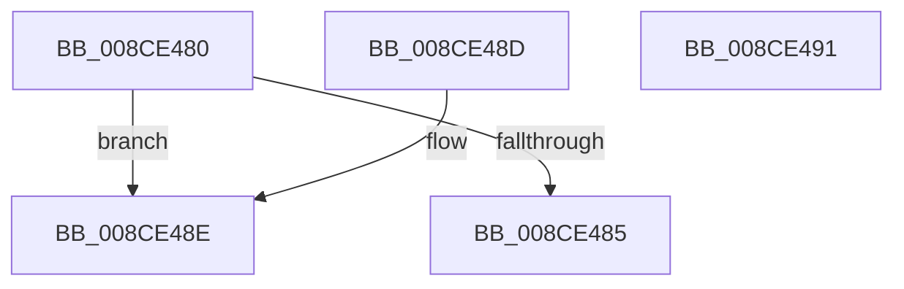

# PspWow64GetSharedInformation

- RVA: `0x008CE480`–`0x008CE492` (길이 `18` bytes)
- VA: `0x00000001408CE480`
- 실행 섹션: `PAGE`
- PDB 이름 있음: `예`; PDB Function 태그: `아니요`
- unwind 정보 RVA: `0x000DB714`
- 디코드: `8`개 명령, `18/18` bytes 표시
- 미해석 바이트: `0` (있으면 어셈블리에 `.byte`로 보존)

> 이 문서는 커널 이미지의 기계어와 PDB 기호를 분석해 생성했습니다. 4번과 5번은 함수 원형과 자료형을 바이너리 사용 방식에서 추정한 C 해석이며 원본 소스 복구 결과는 아닙니다.

## 1. Dependencies

- 직접 호출 지점: **0**; 고유 호출 대상: **0**
- 직접 호출자로 확인된 함수: **4**
- RIP 상대 이미지 참조: **1**

### Outgoing calls
- 직접 디코드된 call 명령이 없습니다.

### Direct callers
- [PsThawMultiProcess](../../text/45/PsThawMultiProcess_function_0045FFE0.md) at `0x0046005B`
- [PspWow64InitThread](PspWow64InitThread_function_008CDC98.md) at `0x008CDDF0`
- [PspPrepareSystemDllInitBlock](PspPrepareSystemDllInitBlock_function_008CE128.md) at `0x008CE1EB`
- [PspPrepareSystemDllInitBlock](PspPrepareSystemDllInitBlock_function_008CE128.md) at `0x008CE405`
- [PspInitializeSystemDlls](../../init/C4/PspInitializeSystemDlls_function_00C45DC4.md) at `0x00C45E3B`

### Static image references
- `0x008CE485` → RVA `0x00FDA930` (`PAGEDATA`; read)

## 2. Other-region calls and transfers

- 다른 실행 섹션으로 향하는 call: **0**
- 별도 외부 분기/꼬리 이동을 확인하지 못했습니다.

## 3. Assembly (complete function range)

```asm
008CE480  83 F9 01                        cmp ecx, 1
008CE483  75 09                           jne 0x1408ce48e
008CE485  48 8D 05 A4 C4 70 00            lea rax, [rip + 0x70c4a4]
008CE48C  C3                              ret
008CE48D  CC                              int3
008CE48E  33 C0                           xor eax, eax
008CE490  C3                              ret
008CE491  CC                              int3
```

## 4. C-style interpretation (structured pseudocode)

```c
__int64 __fastcall PspWow64GetSharedInformation(int a1)
{
    __int64 result;

    if (a1 != 1) goto loc_008CE48E;
    return v_rip + 7390372;
loc_008CE48E:
    result = 0;
    return result;
}
```

## 5. (Beta) C Style

```c
int64_t PspWow64GetSharedInformation(int32_t Arg1)
{
    int64_t result;

    if (Arg1 != 1) goto loc_008CE48E;
    return v_rip + 7390372;
loc_008CE48E:
    result = 0;
    return result;
}
```

## 6. Execution-region graph

[열기: 2D/3D 그래프와 함수 탐색 컨트롤 패널](../../../control-panel.html?section=page&rva=0x008CE480&view=graph)

- 2D 그래프는 위에서 아래로 흐르고, 3D 그래프는 빈 공간을 드래그해 회전합니다. Shift+드래그는 이동, 휠은 확대·축소, 함수 노드 선택은 대상 보고서 이동입니다.

### Static fallback


