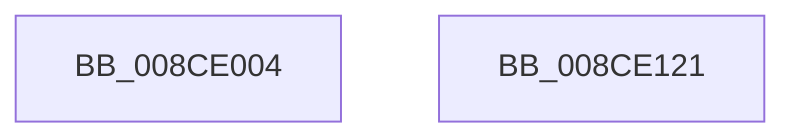

# PspWow64InitThreadGuestx86

- RVA: `0x008CE004`–`0x008CE122` (길이 `286` bytes)
- VA: `0x00000001408CE004`
- 실행 섹션: `PAGE`
- PDB 이름 있음: `예`; PDB Function 태그: `아니요`
- unwind 정보 RVA: `0x0005C954`
- 디코드: `63`개 명령, `286/286` bytes 표시
- 미해석 바이트: `0` (있으면 어셈블리에 `.byte`로 보존)

> 이 문서는 커널 이미지의 기계어와 PDB 기호를 분석해 생성했습니다. 4번과 5번은 함수 원형과 자료형을 바이너리 사용 방식에서 추정한 C 해석이며 원본 소스 복구 결과는 아닙니다.

## 1. Dependencies

- 직접 호출 지점: **3**; 고유 호출 대상: **2**
- 직접 호출자로 확인된 함수: **1**
- RIP 상대 이미지 참조: **0**

### Outgoing calls
- `0x008CE02D` → [ExGenRandom](../../text/41/ExGenRandom_function_0041B010.md) (function, `0x0041B010`)
- `0x008CE0A6` → [memset](../../text/6C/memset_function_006C6C40.md) (function, `0x006C6C40`)
- `0x008CE0CB` → [memset](../../text/6C/memset_function_006C6C40.md) (function, `0x006C6C40`)

### Direct callers
- [PspWow64InitThread](PspWow64InitThread_function_008CDC98.md) at `0x008CDD9B`

### Static image references
- 디코드된 RIP-relative 메모리 참조가 없습니다.

## 2. Other-region calls and transfers

- 다른 실행 섹션으로 향하는 call: **3**
  - `0x008CE02D` → [ExGenRandom](../../text/41/ExGenRandom_function_0041B010.md) (`PAGE` → `.text`)
  - `0x008CE0A6` → [memset](../../text/6C/memset_function_006C6C40.md) (`PAGE` → `.text`)
  - `0x008CE0CB` → [memset](../../text/6C/memset_function_006C6C40.md) (`PAGE` → `.text`)
- 별도 외부 분기/꼬리 이동을 확인하지 못했습니다.

## 3. Assembly (complete function range)

```asm
008CE004  48 89 5C 24 08                  mov qword ptr [rsp + 8], rbx
008CE009  48 89 6C 24 10                  mov qword ptr [rsp + 0x10], rbp
008CE00E  48 89 74 24 18                  mov qword ptr [rsp + 0x18], rsi
008CE013  57                              push rdi
008CE014  48 83 EC 20                     sub rsp, 0x20
008CE018  48 63 6A 08                     movsxd rbp, dword ptr [rdx + 8]
008CE01C  48 8B D9                        mov rbx, rcx
008CE01F  B9 01 00 00 00                  mov ecx, 1
008CE024  48 03 EA                        add rbp, rdx
008CE027  49 8B F9                        mov rdi, r9
008CE02A  49 8B F0                        mov rsi, r8
008CE02D  E8 DE CF B4 FF                  call 0x14041b010
008CE032  25 FF 01 00 00                  and eax, 0x1ff
008CE037  48 8D 4D 1C                     lea rcx, [rbp + 0x1c]
008CE03B  C1 E0 02                        shl eax, 2
008CE03E  8B D7                           mov edx, edi
008CE040  2B D0                           sub edx, eax
008CE042  8B 44 24 50                     mov eax, dword ptr [rsp + 0x50]
008CE046  F6 83 50 07 00 00 40            test byte ptr [rbx + 0x750], 0x40
008CE04D  89 85 B0 00 00 00               mov dword ptr [rbp + 0xb0], eax
008CE053  8B 44 24 58                     mov eax, dword ptr [rsp + 0x58]
008CE057  0F 45 D7                        cmovne edx, edi
008CE05A  83 EA 10                        sub edx, 0x10
008CE05D  89 85 A4 00 00 00               mov dword ptr [rbp + 0xa4], eax
008CE063  B8 2B 00 00 00                  mov eax, 0x2b
008CE068  89 95 C4 00 00 00               mov dword ptr [rbp + 0xc4], edx
008CE06E  33 D2                           xor edx, edx
008CE070  89 B5 B8 00 00 00               mov dword ptr [rbp + 0xb8], esi
008CE076  89 85 8C 00 00 00               mov dword ptr [rbp + 0x8c], eax
008CE07C  89 85 94 00 00 00               mov dword ptr [rbp + 0x94], eax
008CE082  44 8D 40 45                     lea r8d, [rax + 0x45]
008CE086  89 85 98 00 00 00               mov dword ptr [rbp + 0x98], eax
008CE08C  89 85 C8 00 00 00               mov dword ptr [rbp + 0xc8], eax
008CE092  C7 85 90 00 00 00 53 00 00 00   mov dword ptr [rbp + 0x90], 0x53
008CE09C  C7 85 BC 00 00 00 23 00 00 00   mov dword ptr [rbp + 0xbc], 0x23
008CE0A6  E8 95 8B DF FF                  call 0x1406c6c40
008CE0AB  BE 7F 02 00 00                  mov esi, 0x27f
008CE0B0  48 8D 9D CC 00 00 00            lea rbx, [rbp + 0xcc]
008CE0B7  BF FF FF 00 00                  mov edi, 0xffff
008CE0BC  89 75 1C                        mov dword ptr [rbp + 0x1c], esi
008CE0BF  33 D2                           xor edx, edx
008CE0C1  89 7D 24                        mov dword ptr [rbp + 0x24], edi
008CE0C4  48 8B CB                        mov rcx, rbx
008CE0C7  44 8D 46 81                     lea r8d, [rsi - 0x7f]
008CE0CB  E8 70 8B DF FF                  call 0x1406c6c40
008CE0D0  83 65 04 00                     and dword ptr [rbp + 4], 0
008CE0D4  83 65 08 00                     and dword ptr [rbp + 8], 0
008CE0D8  83 65 0C 00                     and dword ptr [rbp + 0xc], 0
008CE0DC  83 65 10 00                     and dword ptr [rbp + 0x10], 0
008CE0E0  83 65 14 00                     and dword ptr [rbp + 0x14], 0
008CE0E4  83 65 18 00                     and dword ptr [rbp + 0x18], 0
008CE0E8  81 4D 00 3F 00 01 00            or dword ptr [rbp], 0x1003f
008CE0EF  66 89 33                        mov word ptr [rbx], si
008CE0F2  48 8B 5C 24 30                  mov rbx, qword ptr [rsp + 0x30]
008CE0F7  48 8B 74 24 40                  mov rsi, qword ptr [rsp + 0x40]
008CE0FC  C7 85 E4 00 00 00 80 1F 00 00   mov dword ptr [rbp + 0xe4], 0x1f80
008CE106  89 BD E8 00 00 00               mov dword ptr [rbp + 0xe8], edi
008CE10C  C7 85 C0 00 00 00 02 02 00 00   mov dword ptr [rbp + 0xc0], 0x202
008CE116  48 8B 6C 24 38                  mov rbp, qword ptr [rsp + 0x38]
008CE11B  48 83 C4 20                     add rsp, 0x20
008CE11F  5F                              pop rdi
008CE120  C3                              ret
008CE121  CC                              int3
```

## 4. C-style interpretation (structured pseudocode)

```c
__int64 __fastcall PspWow64InitThreadGuestx86(__int64 a1, __int64 a2, __int64 a3, __int64 a4, unsigned int a5, unsigned int a6)
{
    __int64 result;
    __int64 v_rbp;
    __int64 v_rsp;
    unsigned __int64 v_stack_p10;
    unsigned __int64 v_stack_p18;
    unsigned __int64 v_stack_p8;

    v_stack_p8 = v_rbx;
    v_stack_p10 = v_rbp;
    v_stack_p18 = v_rsi;
    v_rsp = (v_rsp) - (32);
    v_rbp = ((int)(*(unsigned int *)(a2 + 8))) + (a2);
    result = ExGenRandom(1, a2, a3, a4);
    result = (unsigned int)((result) & (511));
    result = (unsigned int)((result) << (2));
    a2 = (unsigned int)(((unsigned int)((unsigned int)(a4))) - ((unsigned int)(result)));
    *(unsigned int *)(v_rbp + 176) = (unsigned int)((unsigned int)(a5));
    if (((*(unsigned __int8 *)(a1 + 1872)) & (64)) != 0) { a2 = (unsigned int)(a4); }
    a2 = (unsigned int)((a2) - (16));
    *(unsigned int *)(v_rbp + 164) = (unsigned int)((unsigned int)(a6));
    *(unsigned int *)(v_rbp + 196) = (unsigned int)(a2);
    a2 = 0;
    *(unsigned int *)(v_rbp + 184) = (unsigned int)(a3);
    *(unsigned int *)(v_rbp + 140) = 43;
    *(unsigned int *)(v_rbp + 148) = 43;
    *(unsigned int *)(v_rbp + 152) = 43;
    *(unsigned int *)(v_rbp + 200) = 43;
    *(unsigned int *)(v_rbp + 144) = 83;
    *(unsigned int *)(v_rbp + 188) = 35;
    result = memset(v_rbp + 28, a2, 43 + 69, a4);
    *(unsigned int *)(v_rbp + 28) = 639;
    a2 = 0;
    *(unsigned int *)(v_rbp + 36) = (unsigned int)((unsigned int)(0xFFFFULL));
    result = memset(v_rbp + 204, a2, 639 - 127, a4);
    *(unsigned __int16 *)(v_rbp + 204) = 639;
    *(unsigned int *)(v_rbp + 228) = 0x1F80ULL;
    *(unsigned int *)(v_rbp + 232) = (unsigned int)((unsigned int)(0xFFFFULL));
    *(unsigned int *)(v_rbp + 192) = 514;
    v_rsp = (v_rsp) + (32);
    return result;
}
```

## 5. (Beta) C Style

```c
int64_t PspWow64InitThreadGuestx86(void *Arg1, void *Arg2, int64_t Arg3, int64_t Arg4, uint32_t Arg5, uint32_t Arg6)
{
    uint8_t *arg1 = (uint8_t *)Arg1;
    uint8_t *arg2 = (uint8_t *)Arg2;

    int64_t result;
    int64_t local_rbp;
    int64_t local_rsp;
    uint64_t v_stack_p10;
    uint64_t v_stack_p18;
    uint64_t v_stack_p8;

    v_stack_p8 = local_rbx;
    v_stack_p10 = local_rbp;
    v_stack_p18 = local_rsi;
    local_rsp = (local_rsp) - (32);
    local_rbp = ((int32_t)(*(uint32_t *)(arg2 + 0x8))) + (Arg2);
    result = ExGenRandom(1, Arg2, Arg3, Arg4);
    result = (uint32_t)((result) & (511));
    result = (uint32_t)((result) << (2));
    Arg2 = (uint32_t)(((uint32_t)((uint32_t)(Arg4))) - ((uint32_t)(result)));
    *(uint32_t *)(local_rbp + 0xB0) = (uint32_t)((uint32_t)(Arg5));
    if (((*(uint8_t *)(arg1 + 0x750)) & (64)) != 0) { Arg2 = (uint32_t)(Arg4); }
    Arg2 = (uint32_t)((Arg2) - (16));
    *(uint32_t *)(local_rbp + 0xA4) = (uint32_t)((uint32_t)(Arg6));
    *(uint32_t *)(local_rbp + 0xC4) = (uint32_t)(Arg2);
    Arg2 = 0;
    *(uint32_t *)(local_rbp + 0xB8) = (uint32_t)(Arg3);
    *(uint32_t *)(local_rbp + 0x8C) = 43;
    *(uint32_t *)(local_rbp + 0x94) = 43;
    *(uint32_t *)(local_rbp + 0x98) = 43;
    *(uint32_t *)(local_rbp + 0xC8) = 43;
    *(uint32_t *)(local_rbp + 0x90) = 83;
    *(uint32_t *)(local_rbp + 0xBC) = 35;
    result = memset(local_rbp + 28, Arg2, 43 + 69, Arg4);
    *(uint32_t *)(local_rbp + 0x1C) = 639;
    Arg2 = 0;
    *(uint32_t *)(local_rbp + 0x24) = (uint32_t)((uint32_t)(0xFFFFULL));
    result = memset(local_rbp + 204, Arg2, 639 - 127, Arg4);
    *(uint16_t *)(local_rbp + 0xCC) = 639;
    *(uint32_t *)(local_rbp + 0xE4) = 0x1F80ULL;
    *(uint32_t *)(local_rbp + 0xE8) = (uint32_t)((uint32_t)(0xFFFFULL));
    *(uint32_t *)(local_rbp + 0xC0) = 514;
    local_rsp = (local_rsp) + (32);
    return result;
}
```

### 관측된 메모리 오프셋

구조체 형식이 확인되지 않은 접근은 인자 기준의 오프셋으로만 기록했습니다.

| 기준 인자 | 오프셋 표현 | 폭 (bit) | 접근 |
|---|---:|---:|---|
| `Arg1` | `+ 0x750` | `8` | `R` |
| `Arg2` | `+ 0x8` | `32` | `R` |

## 6. Execution-region graph

[열기: 2D/3D 그래프와 함수 탐색 컨트롤 패널](../../../control-panel.html?section=page&rva=0x008CE004&view=graph)

- 2D 그래프는 위에서 아래로 흐르고, 3D 그래프는 빈 공간을 드래그해 회전합니다. Shift+드래그는 이동, 휠은 확대·축소, 함수 노드 선택은 대상 보고서 이동입니다.

### Static fallback


