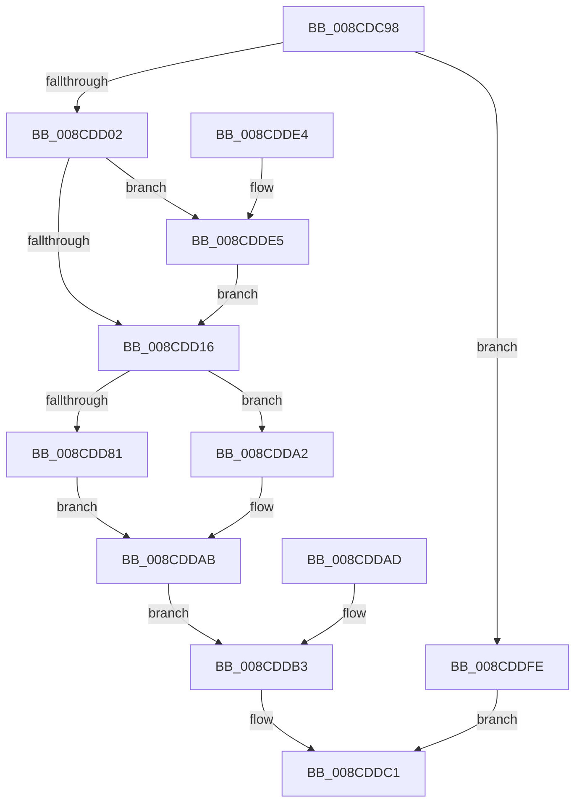

# PspWow64InitThread

- RVA: `0x008CDC98`–`0x008CDE05` (길이 `365` bytes)
- VA: `0x00000001408CDC98`
- 실행 섹션: `PAGE`
- PDB 이름 있음: `예`; PDB Function 태그: `아니요`
- unwind 정보 RVA: `0x00084758`
- 디코드: `94`개 명령, `365/365` bytes 표시
- 미해석 바이트: `0` (있으면 어셈블리에 `.byte`로 보존)

> 이 문서는 커널 이미지의 기계어와 PDB 기호를 분석해 생성했습니다. 4번과 5번은 함수 원형과 자료형을 바이너리 사용 방식에서 추정한 C 해석이며 원본 소스 복구 결과는 아닙니다.

## 1. Dependencies

- 직접 호출 지점: **10**; 고유 호출 대상: **10**
- 직접 호출자로 확인된 함수: **1**
- RIP 상대 이미지 참조: **2**

### Outgoing calls
- `0x008CDCE4` → [PsWow64GetProcessMachine](../8D/PsWow64GetProcessMachine_function_008D2130.md) (function, `0x008D2130`)
- `0x008CDCF1` → [RtlpArchContextFlagFromMachine](RtlpArchContextFlagFromMachine_function_008CDF68.md) (function, `0x008CDF68`)
- `0x008CDD3B` → [KiStackAttachProcess](../../text/21/KiStackAttachProcess_function_00216820.md) (function, `0x00216820`)
- `0x008CDD5F` → [RtlWow64GetCpuAreaEnabledFeatures](RtlWow64GetCpuAreaEnabledFeatures_function_008CDFB4.md) (function, `0x008CDFB4`)
- `0x008CDD74` → [RtlInitializeExtendedContext2](../../text/2F/RtlInitializeExtendedContext2_function_002F5D40.md) (function, `0x002F5D40`)
- `0x008CDD9B` → [PspWow64InitThreadGuestx86](PspWow64InitThreadGuestx86_function_008CE004.md) (function, `0x008CE004`)
- `0x008CDDBA` → [KiUnstackDetachProcess](../../text/21/KiUnstackDetachProcess_function_00217D30.md) (function, `0x00217D30`)
- `0x008CDDCC` → [_security_check_cookie](../../text/6A/_security_check_cookie_function_006AC640.md) (function, `0x006AC640`)
- `0x008CDDE8` → [PsWow64GetProcessNtdllType](PsWow64GetProcessNtdllType_function_008CE464.md) (function, `0x008CE464`)
- `0x008CDDF0` → [PspWow64GetSharedInformation](PspWow64GetSharedInformation_function_008CE480.md) (function, `0x008CE480`)

### Direct callers
- [PspAllocateThread](../9E/PspAllocateThread_function_009EF72C.md) at `0x009F02A4`

### Static image references
- `0x008CDCAB` → RVA `0x00E0A740` (`.data`; read)
- `0x008CDD09` → RVA `0x00FC7480` (`ALMOSTRO`; read)

## 2. Other-region calls and transfers

- 다른 실행 섹션으로 향하는 call: **4**
  - `0x008CDD3B` → [KiStackAttachProcess](../../text/21/KiStackAttachProcess_function_00216820.md) (`PAGE` → `.text`)
  - `0x008CDD74` → [RtlInitializeExtendedContext2](../../text/2F/RtlInitializeExtendedContext2_function_002F5D40.md) (`PAGE` → `.text`)
  - `0x008CDDBA` → [KiUnstackDetachProcess](../../text/21/KiUnstackDetachProcess_function_00217D30.md) (`PAGE` → `.text`)
  - `0x008CDDCC` → [_security_check_cookie](../../text/6A/_security_check_cookie_function_006AC640.md) (`PAGE` → `.text`)
- 별도 외부 분기/꼬리 이동을 확인하지 못했습니다.

## 3. Assembly (complete function range)

```asm
008CDC98  40 53                           push rbx
008CDC9A  56                              push rsi
008CDC9B  57                              push rdi
008CDC9C  41 54                           push r12
008CDC9E  41 55                           push r13
008CDCA0  41 56                           push r14
008CDCA2  41 57                           push r15
008CDCA4  48 81 EC 90 00 00 00            sub rsp, 0x90
008CDCAB  48 8B 05 8E CA 53 00            mov rax, qword ptr [rip + 0x53ca8e]
008CDCB2  48 33 C4                        xor rax, rsp
008CDCB5  48 89 84 24 88 00 00 00         mov qword ptr [rsp + 0x88], rax
008CDCBD  4C 89 4C 24 48                  mov qword ptr [rsp + 0x48], r9
008CDCC2  49 8B D8                        mov rbx, r8
008CDCC5  4C 8B FA                        mov r15, rdx
008CDCC8  4C 8B F1                        mov r14, rcx
008CDCCB  0F 57 C0                        xorps xmm0, xmm0
008CDCCE  0F 11 44 24 58                  movups xmmword ptr [rsp + 0x58], xmm0
008CDCD3  0F 11 44 24 68                  movups xmmword ptr [rsp + 0x68], xmm0
008CDCD8  0F 11 44 24 78                  movups xmmword ptr [rsp + 0x78], xmm0
008CDCDD  33 FF                           xor edi, edi
008CDCDF  48 89 7C 24 40                  mov qword ptr [rsp + 0x40], rdi
008CDCE4  E8 47 44 00 00                  call 0x1408d2130
008CDCE9  66 89 44 24 30                  mov word ptr [rsp + 0x30], ax
008CDCEE  0F B7 C8                        movzx ecx, ax
008CDCF1  E8 72 02 00 00                  call 0x1408cdf68
008CDCF6  89 44 24 34                     mov dword ptr [rsp + 0x34], eax
008CDCFA  85 C0                           test eax, eax
008CDCFC  0F 84 FC 00 00 00               je 0x1408cddfe
008CDD02  48 8B B3 F8 00 00 00            mov rsi, qword ptr [rbx + 0xf8]
008CDD09  48 3B 35 70 97 6F 00            cmp rsi, qword ptr [rip + 0x6f9770]
008CDD10  0F 84 CF 00 00 00               je 0x1408cdde5
008CDD16  4C 8B A3 80 00 00 00            mov r12, qword ptr [rbx + 0x80]
008CDD1D  4C 8B AB 88 00 00 00            mov r13, qword ptr [rbx + 0x88]
008CDD24  49 8B 47 28                     mov rax, qword ptr [r15 + 0x28]
008CDD28  48 89 44 24 50                  mov qword ptr [rsp + 0x50], rax
008CDD2D  4D 8B 7F 10                     mov r15, qword ptr [r15 + 0x10]
008CDD31  4C 8D 44 24 58                  lea r8, [rsp + 0x58]
008CDD36  33 D2                           xor edx, edx
008CDD38  49 8B CE                        mov rcx, r14
008CDD3B  E8 E0 8A 94 FF                  call 0x140216820
008CDD40  90                              nop
008CDD41  48 8B 44 24 48                  mov rax, qword ptr [rsp + 0x48]
008CDD46  4C 89 B8 88 14 00 00            mov qword ptr [rax + 0x1488], r15
008CDD4D  0F B7 5C 24 30                  movzx ebx, word ptr [rsp + 0x30]
008CDD52  8B C3                           mov eax, ebx
008CDD54  C1 E0 10                        shl eax, 0x10
008CDD57  41 89 07                        mov dword ptr [r15], eax
008CDD5A  48 8D 4C 24 34                  lea rcx, [rsp + 0x34]
008CDD5F  E8 50 02 00 00                  call 0x1408cdfb4
008CDD64  4C 8B C8                        mov r9, rax
008CDD67  49 8D 4F 04                     lea rcx, [r15 + 4]
008CDD6B  4C 8D 44 24 40                  lea r8, [rsp + 0x40]
008CDD70  8B 54 24 34                     mov edx, dword ptr [rsp + 0x34]
008CDD74  E8 C7 7F A2 FF                  call 0x1402f5d40
008CDD79  81 FB 4C 01 00 00               cmp ebx, 0x14c
008CDD7F  75 21                           jne 0x1408cdda2
008CDD81  4C 89 6C 24 28                  mov qword ptr [rsp + 0x28], r13
008CDD86  4C 89 64 24 20                  mov qword ptr [rsp + 0x20], r12
008CDD8B  4C 8B 4C 24 50                  mov r9, qword ptr [rsp + 0x50]
008CDD90  4C 8B C6                        mov r8, rsi
008CDD93  48 8B 54 24 40                  mov rdx, qword ptr [rsp + 0x40]
008CDD98  49 8B CE                        mov rcx, r14
008CDD9B  E8 64 02 00 00                  call 0x1408ce004
008CDDA0  EB 09                           jmp 0x1408cddab
008CDDA2  BF 0D 00 00 C0                  mov edi, 0xc000000d
008CDDA7  89 7C 24 38                     mov dword ptr [rsp + 0x38], edi
008CDDAB  EB 06                           jmp 0x1408cddb3
008CDDAD  8B F8                           mov edi, eax
008CDDAF  89 44 24 38                     mov dword ptr [rsp + 0x38], eax
008CDDB3  33 D2                           xor edx, edx
008CDDB5  48 8D 4C 24 58                  lea rcx, [rsp + 0x58]
008CDDBA  E8 71 9F 94 FF                  call 0x140217d30
008CDDBF  8B C7                           mov eax, edi
008CDDC1  48 8B 8C 24 88 00 00 00         mov rcx, qword ptr [rsp + 0x88]
008CDDC9  48 33 CC                        xor rcx, rsp
008CDDCC  E8 6F E8 DD FF                  call 0x1406ac640
008CDDD1  48 81 C4 90 00 00 00            add rsp, 0x90
008CDDD8  41 5F                           pop r15
008CDDDA  41 5E                           pop r14
008CDDDC  41 5D                           pop r13
008CDDDE  41 5C                           pop r12
008CDDE0  5F                              pop rdi
008CDDE1  5E                              pop rsi
008CDDE2  5B                              pop rbx
008CDDE3  C3                              ret
008CDDE4  CC                              int3
008CDDE5  49 8B CE                        mov rcx, r14
008CDDE8  E8 77 06 00 00                  call 0x1408ce464
008CDDED  0F B7 C8                        movzx ecx, ax
008CDDF0  E8 8B 06 00 00                  call 0x1408ce480
008CDDF5  48 8B 70 20                     mov rsi, qword ptr [rax + 0x20]
008CDDF9  E9 18 FF FF FF                  jmp 0x1408cdd16
008CDDFE  B8 0D 00 00 C0                  mov eax, 0xc000000d
008CDE03  EB BC                           jmp 0x1408cddc1
```

## 4. C-style interpretation (structured pseudocode)

```c
__int64 __fastcall PspWow64InitThread(__int64 a1, __int64 a2, __int64 a3, __int64 a4)
{
    __int64 result;
    __int64 v_rdi;
    __int64 v_rsp;
    unsigned __int64 v_stack_m40;
    unsigned __int64 v_stack_m50;
    unsigned __int64 v_stack_m60;
    unsigned __int64 v_stack_m70;
    unsigned __int64 v_stack_m78;
    unsigned __int64 v_stack_m80;
    unsigned __int64 v_stack_m88;
    unsigned int v_stack_m90;
    unsigned int v_stack_m94;
    unsigned __int16 v_stack_m98;
    unsigned __int64 v_stack_mA0;
    unsigned __int64 v_stack_mA8;

    v_rsp = (v_rsp) - (144);
    result = (*(unsigned __int64 *)(v_rip + 5491342)) ^ (v_rsp);
    v_stack_m40 = result;
    v_stack_m80 = a4;
    v_stack_m70 = v_xmm0;
    v_stack_m60 = v_xmm0;
    v_stack_m50 = v_xmm0;
    v_rdi = 0;
    v_stack_m88 = 0;
    result = PsWow64GetProcessMachine(a1, a2, a3, a4);
    v_stack_m98 = (unsigned __int16)(result);
    result = RtlpArchContextFlagFromMachine((unsigned __int16)(result), a2, a3, a4);
    v_stack_m94 = (unsigned int)(result);
    if ((unsigned int)(result) == 0) goto loc_008CDDFE;
    if ((*(unsigned __int64 *)(a3 + 248)) == (*(unsigned __int64 *)(v_rip + 7313264))) goto loc_008CDDE5;
loc_008CDD16:
    v_stack_m78 = *(unsigned __int64 *)(a2 + 40);
    a2 = 0;
    result = KiStackAttachProcess(a1, a2, v_stack_m70, a4);
    *(unsigned __int64 *)(v_stack_m80 + 5256) = *(unsigned __int64 *)(a2 + 16);
    result = (unsigned int)(((unsigned int)((unsigned int)(v_stack_m98))) << (16));
    *(unsigned int *)(*(unsigned __int64 *)(a2 + 16)) = (unsigned int)(result);
    result = RtlWow64GetCpuAreaEnabledFeatures(v_stack_m94, a2, v_stack_m70, a4);
    result = RtlInitializeExtendedContext2(*(unsigned __int64 *)(a2 + 16) + 4, (unsigned int)(v_stack_m94), v_stack_m88, result);
    if (((unsigned int)(v_stack_m98)) != 332) goto loc_008CDDA2;
    v_stack_mA0 = *(unsigned __int64 *)(a3 + 136);
    v_stack_mA8 = *(unsigned __int64 *)(a3 + 128);
    result = PspWow64InitThreadGuestx86(a1, v_stack_m88, *(unsigned __int64 *)(a3 + 248), v_stack_m78);
    goto loc_008CDDAB;
loc_008CDDA2:
    v_stack_m90 = (unsigned int)((unsigned int)(0xC000000DULL));
loc_008CDDAB:
    goto loc_008CDDB3;
loc_008CDDB3:
    a2 = 0;
    result = KiUnstackDetachProcess(v_stack_m70, a2, *(unsigned __int64 *)(a3 + 248), v_stack_m78);
loc_008CDDC1:
    a1 = (v_stack_m40) ^ (v_rsp);
    result = _security_check_cookie(a1, a2, *(unsigned __int64 *)(a3 + 248), v_stack_m78);
    v_rsp = (v_rsp) + (144);
    return result;
loc_008CDDE5:
    result = PsWow64GetProcessNtdllType(a1, a2, *(unsigned __int64 *)(a3 + 248), v_stack_m78);
    result = PspWow64GetSharedInformation((unsigned __int16)(result), a2, *(unsigned __int64 *)(a3 + 248), v_stack_m78);
    goto loc_008CDD16;
loc_008CDDFE:
    goto loc_008CDDC1;
}
```

## 5. (Beta) C Style

```c
int64_t PspWow64InitThread(int64_t Arg1, void *Arg2, void *Arg3, int64_t Arg4)
{
    uint8_t *arg2 = (uint8_t *)Arg2;
    uint8_t *arg3 = (uint8_t *)Arg3;

    int64_t result;
    int64_t local_rdi;
    int64_t local_rsp;
    uint64_t v_stack_m40;
    uint64_t v_stack_m50;
    uint64_t v_stack_m60;
    uint64_t v_stack_m70;
    uint64_t v_stack_m78;
    uint64_t v_stack_m80;
    uint64_t v_stack_m88;
    uint32_t v_stack_m90;
    uint32_t v_stack_m94;
    uint16_t v_stack_m98;
    uint64_t v_stack_mA0;
    uint64_t v_stack_mA8;

    local_rsp = (local_rsp) - (144);
    result = (*(uint64_t *)(v_rip + 0x53CA8E)) ^ (local_rsp);
    v_stack_m40 = result;
    v_stack_m80 = Arg4;
    v_stack_m70 = v_xmm0;
    v_stack_m60 = v_xmm0;
    v_stack_m50 = v_xmm0;
    local_rdi = 0;
    v_stack_m88 = 0;
    result = PsWow64GetProcessMachine(Arg1, Arg2, Arg3, Arg4);
    v_stack_m98 = (uint16_t)(result);
    result = RtlpArchContextFlagFromMachine((uint16_t)(result), Arg2, Arg3, Arg4);
    v_stack_m94 = (uint32_t)(result);
    if ((uint32_t)(result) == 0) goto loc_008CDDFE;
    if ((*(uint64_t *)(arg3 + 0xF8)) == (*(uint64_t *)(v_rip + 0x6F9770))) goto loc_008CDDE5;
loc_008CDD16:
    v_stack_m78 = *(uint64_t *)(arg2 + 0x28);
    Arg2 = 0;
    result = KiStackAttachProcess(Arg1, Arg2, v_stack_m70, Arg4);
    *(uint64_t *)(v_stack_m80 + 0x1488) = *(uint64_t *)(arg2 + 0x10);
    result = (uint32_t)(((uint32_t)((uint32_t)(v_stack_m98))) << (16));
    *(uint32_t *)(*(uint64_t *)(arg2 + 0x10)) = (uint32_t)(result);
    result = RtlWow64GetCpuAreaEnabledFeatures(v_stack_m94, Arg2, v_stack_m70, Arg4);
    result = RtlInitializeExtendedContext2(*(uint64_t *)(arg2 + 0x10) + 4, (uint32_t)(v_stack_m94), v_stack_m88, result);
    if (((uint32_t)(v_stack_m98)) != 332) goto loc_008CDDA2;
    v_stack_mA0 = *(uint64_t *)(arg3 + 0x88);
    v_stack_mA8 = *(uint64_t *)(arg3 + 0x80);
    result = PspWow64InitThreadGuestx86(Arg1, v_stack_m88, *(uint64_t *)(arg3 + 0xF8), v_stack_m78);
    goto loc_008CDDAB;
loc_008CDDA2:
    v_stack_m90 = (uint32_t)((uint32_t)(0xC000000DULL));
loc_008CDDAB:
    goto loc_008CDDB3;
loc_008CDDB3:
    Arg2 = 0;
    result = KiUnstackDetachProcess(v_stack_m70, Arg2, *(uint64_t *)(arg3 + 0xF8), v_stack_m78);
loc_008CDDC1:
    Arg1 = (v_stack_m40) ^ (local_rsp);
    result = _security_check_cookie(Arg1, Arg2, *(uint64_t *)(arg3 + 0xF8), v_stack_m78);
    local_rsp = (local_rsp) + (144);
    return result;
loc_008CDDE5:
    result = PsWow64GetProcessNtdllType(Arg1, Arg2, *(uint64_t *)(arg3 + 0xF8), v_stack_m78);
    result = PspWow64GetSharedInformation((uint16_t)(result), Arg2, *(uint64_t *)(arg3 + 0xF8), v_stack_m78);
    goto loc_008CDD16;
loc_008CDDFE:
    goto loc_008CDDC1;
}
```

### 관측된 메모리 오프셋

구조체 형식이 확인되지 않은 접근은 인자 기준의 오프셋으로만 기록했습니다.

| 기준 인자 | 오프셋 표현 | 폭 (bit) | 접근 |
|---|---:|---:|---|
| `Arg2` | `+ 0x10` | `64` | `R` |
| `Arg2` | `+ 0x28` | `64` | `R` |
| `Arg3` | `+ 0x80` | `64` | `R` |
| `Arg3` | `+ 0x88` | `64` | `R` |
| `Arg3` | `+ 0xF8` | `64` | `R` |

## 6. Execution-region graph

[열기: 2D/3D 그래프와 함수 탐색 컨트롤 패널](../../../control-panel.html?section=page&rva=0x008CDC98&view=graph)

- 2D 그래프는 위에서 아래로 흐르고, 3D 그래프는 빈 공간을 드래그해 회전합니다. Shift+드래그는 이동, 휠은 확대·축소, 함수 노드 선택은 대상 보고서 이동입니다.

### Static fallback


