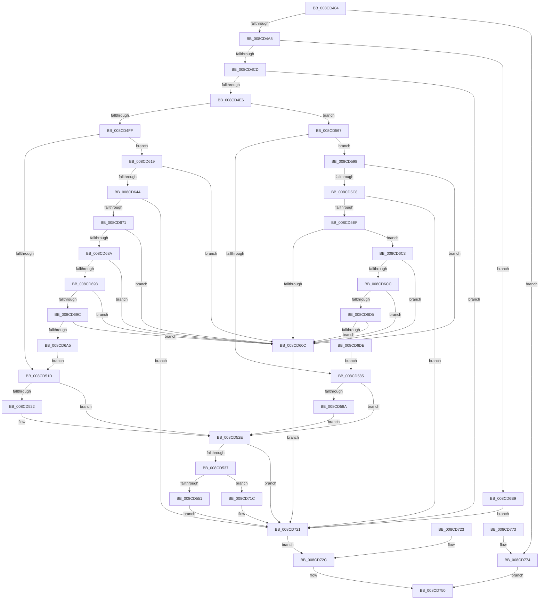

# PspWow64ReadOrWriteThreadCpuArea

- RVA: `0x008CD404`–`0x008CD78C` (길이 `904` bytes)
- VA: `0x00000001408CD404`
- 실행 섹션: `PAGE`
- PDB 이름 있음: `예`; PDB Function 태그: `아니요`
- unwind 정보 RVA: `0x000846B0`
- 디코드: `215`개 명령, `904/904` bytes 표시
- 미해석 바이트: `0` (있으면 어셈블리에 `.byte`로 보존)

> 이 문서는 커널 이미지의 기계어와 PDB 기호를 분석해 생성했습니다. 4번과 5번은 함수 원형과 자료형을 바이너리 사용 방식에서 추정한 C 해석이며 원본 소스 복구 결과는 아닙니다.

## 1. Dependencies

- 직접 호출 지점: **20**; 고유 호출 대상: **13**
- 직접 호출자로 확인된 함수: **2**
- RIP 상대 이미지 참조: **1**

### Outgoing calls
- `0x008CD487` → [PspLockThreadSecurityShared](../../text/3C/PspLockThreadSecurityShared_function_003C4720.md) (function, `0x003C4720`)
- `0x008CD48F` → [PsGetThreadTeb](../../text/45/PsGetThreadTeb_function_0045F300.md) (function, `0x0045F300`)
- `0x008CD4B2` → [KiStackAttachProcess](../../text/21/KiStackAttachProcess_function_00216820.md) (function, `0x00216820`)
- `0x008CD4BF` → [RtlReadULong64FromUser](../70/RtlReadULong64FromUser_function_00705DCC.md) (function, `0x00705DCC`)
- `0x008CD4D5` → [RtlWow64GetCpuAreaInfo](RtlWow64GetCpuAreaInfo_function_008CDE0C.md) (function, `0x008CDE0C`)
- `0x008CD505` → [RtlCopyToUser](../70/RtlCopyToUser_function_00705D68.md) (function, `0x00705D68`)
- `0x008CD529` → [RtlWriteULongToUser](../70/RtlWriteULongToUser_function_00705E8C.md) (function, `0x00705E8C`)
- `0x008CD543` → [RtlReadULong64FromUser](../70/RtlReadULong64FromUser_function_00705DCC.md) (function, `0x00705DCC`)
- `0x008CD555` → [RtlReadULongFromUser](../70/RtlReadULongFromUser_function_00705E08.md) (function, `0x00705E08`)
- `0x008CD56D` → [RtlCopyFromUser](../../text/4F/RtlCopyFromUser_function_004FDAE8.md) (function, `0x004FDAE8`)
- `0x008CD58F` → [RtlReadULongFromUser](../70/RtlReadULongFromUser_function_00705E08.md) (function, `0x00705E08`)
- `0x008CD5B6` → [RtlCopyFromUser](../../text/4F/RtlCopyFromUser_function_004FDAE8.md) (function, `0x004FDAE8`)
- `0x008CD637` → [RtlCopyFromUser](../../text/4F/RtlCopyFromUser_function_004FDAE8.md) (function, `0x004FDAE8`)
- `0x008CD6AF` → [RtlCopyToUser](../70/RtlCopyToUser_function_00705D68.md) (function, `0x00705D68`)
- `0x008CD6F2` → [RtlCopyFromUser](../../text/4F/RtlCopyFromUser_function_004FDAE8.md) (function, `0x004FDAE8`)
- `0x008CD6FC` → [RtlWow64GetCpuAreaEnabledFeatures](RtlWow64GetCpuAreaEnabledFeatures_function_008CDFB4.md) (function, `0x008CDFB4`)
- `0x008CD736` → [KiUnstackDetachProcess](../../text/21/KiUnstackDetachProcess_function_00217D30.md) (function, `0x00217D30`)
- `0x008CD747` → [PspUnlockThreadSecurityShared](../../text/3C/PspUnlockThreadSecurityShared_function_003C2E40.md) (function, `0x003C2E40`)
- `0x008CD75B` → [_security_check_cookie](../../text/6A/_security_check_cookie_function_006AC640.md) (function, `0x006AC640`)
- `0x008CD780` → [PspUnlockThreadSecurityShared](../../text/3C/PspUnlockThreadSecurityShared_function_003C2E40.md) (function, `0x003C2E40`)

### Direct callers
- [PspWow64SetContextThread](PspWow64SetContextThread_function_008CCC88.md) at `0x008CCEF6`
- [PspWow64SetContextThread](PspWow64SetContextThread_function_008CCC88.md) at `0x008CCF84`
- [PspWow64GetContextThread](../A1/PspWow64GetContextThread_function_00A11E90.md) at `0x00A120D8`
- [PspWow64GetContextThread](../A1/PspWow64GetContextThread_function_00A11E90.md) at `0x00A122A7`

### Static image references
- `0x008CD419` → RVA `0x00E0A740` (`.data`; read)

## 2. Other-region calls and transfers

- 다른 실행 섹션으로 향하는 call: **11**
  - `0x008CD487` → [PspLockThreadSecurityShared](../../text/3C/PspLockThreadSecurityShared_function_003C4720.md) (`PAGE` → `.text`)
  - `0x008CD48F` → [PsGetThreadTeb](../../text/45/PsGetThreadTeb_function_0045F300.md) (`PAGE` → `.text`)
  - `0x008CD4B2` → [KiStackAttachProcess](../../text/21/KiStackAttachProcess_function_00216820.md) (`PAGE` → `.text`)
  - `0x008CD56D` → [RtlCopyFromUser](../../text/4F/RtlCopyFromUser_function_004FDAE8.md) (`PAGE` → `.text`)
  - `0x008CD5B6` → [RtlCopyFromUser](../../text/4F/RtlCopyFromUser_function_004FDAE8.md) (`PAGE` → `.text`)
  - `0x008CD637` → [RtlCopyFromUser](../../text/4F/RtlCopyFromUser_function_004FDAE8.md) (`PAGE` → `.text`)
  - `0x008CD6F2` → [RtlCopyFromUser](../../text/4F/RtlCopyFromUser_function_004FDAE8.md) (`PAGE` → `.text`)
  - `0x008CD736` → [KiUnstackDetachProcess](../../text/21/KiUnstackDetachProcess_function_00217D30.md) (`PAGE` → `.text`)
  - `0x008CD747` → [PspUnlockThreadSecurityShared](../../text/3C/PspUnlockThreadSecurityShared_function_003C2E40.md) (`PAGE` → `.text`)
  - `0x008CD75B` → [_security_check_cookie](../../text/6A/_security_check_cookie_function_006AC640.md) (`PAGE` → `.text`)
  - `0x008CD780` → [PspUnlockThreadSecurityShared](../../text/3C/PspUnlockThreadSecurityShared_function_003C2E40.md) (`PAGE` → `.text`)
- 별도 외부 분기/꼬리 이동을 확인하지 못했습니다.

## 3. Assembly (complete function range)

```asm
008CD404  4C 8B DC                        mov r11, rsp
008CD407  53                              push rbx
008CD408  56                              push rsi
008CD409  57                              push rdi
008CD40A  41 54                           push r12
008CD40C  41 55                           push r13
008CD40E  41 56                           push r14
008CD410  41 57                           push r15
008CD412  48 81 EC D0 00 00 00            sub rsp, 0xd0
008CD419  48 8B 05 20 D3 53 00            mov rax, qword ptr [rip + 0x53d320]
008CD420  48 33 C4                        xor rax, rsp
008CD423  48 89 84 24 C0 00 00 00         mov qword ptr [rsp + 0xc0], rax
008CD42B  4D 8B E1                        mov r12, r9
008CD42E  44 88 44 24 24                  mov byte ptr [rsp + 0x24], r8b
008CD433  4C 8B F2                        mov r14, rdx
008CD436  48 8B D9                        mov rbx, rcx
008CD439  48 89 54 24 38                  mov qword ptr [rsp + 0x38], rdx
008CD43E  48 8B B4 24 40 01 00 00         mov rsi, qword ptr [rsp + 0x140]
008CD446  4C 8B AC 24 48 01 00 00         mov r13, qword ptr [rsp + 0x148]
008CD44E  0F 57 C0                        xorps xmm0, xmm0
008CD451  41 0F 11 43 88                  movups xmmword ptr [r11 - 0x78], xmm0
008CD456  41 0F 11 43 98                  movups xmmword ptr [r11 - 0x68], xmm0
008CD45B  41 0F 11 43 A8                  movups xmmword ptr [r11 - 0x58], xmm0
008CD460  0F 57 C9                        xorps xmm1, xmm1
008CD463  0F 11 4C 24 40                  movups xmmword ptr [rsp + 0x40], xmm1
008CD468  0F 11 4C 24 50                  movups xmmword ptr [rsp + 0x50], xmm1
008CD46D  4D 8D B9 CC 02 00 00            lea r15, [r9 + 0x2cc]
008CD474  41 8B 01                        mov eax, dword ptr [r9]
008CD477  89 44 24 28                     mov dword ptr [rsp + 0x28], eax
008CD47B  65 48 8B 14 25 88 01 00 00      mov rdx, qword ptr gs:[0x188]
008CD484  49 8B CE                        mov rcx, r14
008CD487  E8 94 72 AF FF                  call 0x1403c4720
008CD48C  49 8B CE                        mov rcx, r14
008CD48F  E8 6C 1E B9 FF                  call 0x14045f300
008CD494  48 8B F8                        mov rdi, rax
008CD497  48 89 44 24 30                  mov qword ptr [rsp + 0x30], rax
008CD49C  48 85 C0                        test rax, rax
008CD49F  0F 84 CF 02 00 00               je 0x1408cd774
008CD4A5  4C 8D 84 24 90 00 00 00         lea r8, [rsp + 0x90]
008CD4AD  33 D2                           xor edx, edx
008CD4AF  48 8B CB                        mov rcx, rbx
008CD4B2  E8 69 93 94 FF                  call 0x140216820
008CD4B7  90                              nop
008CD4B8  48 8D 8F 88 14 00 00            lea rcx, [rdi + 0x1488]
008CD4BF  E8 08 89 E3 FF                  call 0x140705dcc
008CD4C4  48 85 C0                        test rax, rax
008CD4C7  0F 84 EC 01 00 00               je 0x1408cd6b9
008CD4CD  4C 8D 44 24 40                  lea r8, [rsp + 0x40]
008CD4D2  48 8B C8                        mov rcx, rax
008CD4D5  E8 32 09 00 00                  call 0x1408cde0c
008CD4DA  89 44 24 20                     mov dword ptr [rsp + 0x20], eax
008CD4DE  85 C0                           test eax, eax
008CD4E0  0F 88 3B 02 00 00               js 0x1408cd721
008CD4E6  48 8B 5C 24 40                  mov rbx, qword ptr [rsp + 0x40]
008CD4EB  48 8D BB CC 02 00 00            lea rdi, [rbx + 0x2cc]
008CD4F2  41 B8 CC 02 00 00               mov r8d, 0x2cc
008CD4F8  80 7C 24 24 00                  cmp byte ptr [rsp + 0x24], 0
008CD4FD  75 68                           jne 0x1408cd567
008CD4FF  49 8B D4                        mov rdx, r12
008CD502  48 8B CB                        mov rcx, rbx
008CD505  E8 5E 88 E3 FF                  call 0x140705d68
008CD50A  8B 44 24 28                     mov eax, dword ptr [rsp + 0x28]
008CD50E  B9 40 00 01 00                  mov ecx, 0x10040
008CD513  23 C1                           and eax, ecx
008CD515  3B C1                           cmp eax, ecx
008CD517  0F 84 FC 00 00 00               je 0x1408cd619
008CD51D  48 85 F6                        test rsi, rsi
008CD520  74 0C                           je 0x1408cd52e
008CD522  8B 16                           mov edx, dword ptr [rsi]
008CD524  48 8B 4C 24 58                  mov rcx, qword ptr [rsp + 0x58]
008CD529  E8 5E 89 E3 FF                  call 0x140705e8c
008CD52E  4D 85 ED                        test r13, r13
008CD531  0F 84 EA 01 00 00               je 0x1408cd721
008CD537  48 8B 4C 24 30                  mov rcx, qword ptr [rsp + 0x30]
008CD53C  48 81 C1 D0 14 00 00            add rcx, 0x14d0
008CD543  E8 84 88 E3 FF                  call 0x140705dcc
008CD548  48 85 C0                        test rax, rax
008CD54B  0F 84 CB 01 00 00               je 0x1408cd71c
008CD551  48 8D 48 04                     lea rcx, [rax + 4]
008CD555  E8 AE 88 E3 FF                  call 0x140705e08
008CD55A  D1 E8                           shr eax, 1
008CD55C  24 01                           and al, 1
008CD55E  41 88 45 00                     mov byte ptr [r13], al
008CD562  E9 BA 01 00 00                  jmp 0x1408cd721
008CD567  48 8B D3                        mov rdx, rbx
008CD56A  49 8B CC                        mov rcx, r12
008CD56D  E8 76 05 C3 FF                  call 0x1404fdae8
008CD572  8B 44 24 28                     mov eax, dword ptr [rsp + 0x28]
008CD576  41 89 04 24                     mov dword ptr [r12], eax
008CD57A  B9 40 00 01 00                  mov ecx, 0x10040
008CD57F  23 C1                           and eax, ecx
008CD581  3B C1                           cmp eax, ecx
008CD583  74 13                           je 0x1408cd598
008CD585  48 85 F6                        test rsi, rsi
008CD588  74 A4                           je 0x1408cd52e
008CD58A  48 8B 4C 24 58                  mov rcx, qword ptr [rsp + 0x58]
008CD58F  E8 74 88 E3 FF                  call 0x140705e08
008CD594  89 06                           mov dword ptr [rsi], eax
008CD596  EB 96                           jmp 0x1408cd52e
008CD598  0F 57 C0                        xorps xmm0, xmm0
008CD59B  0F 11 44 24 70                  movups xmmword ptr [rsp + 0x70], xmm0
008CD5A0  0F 11 84 24 80 00 00 00         movups xmmword ptr [rsp + 0x80], xmm0
008CD5A8  41 B8 20 00 00 00               mov r8d, 0x20
008CD5AE  48 8B D7                        mov rdx, rdi
008CD5B1  48 8D 4C 24 70                  lea rcx, [rsp + 0x70]
008CD5B6  E8 2D 05 C3 FF                  call 0x1404fdae8
008CD5BB  41 8B 57 14                     mov edx, dword ptr [r15 + 0x14]
008CD5BF  3B 94 24 84 00 00 00            cmp edx, dword ptr [rsp + 0x84]
008CD5C6  75 44                           jne 0x1408cd60c
008CD5C8  48 63 8C 24 80 00 00 00         movsxd rcx, dword ptr [rsp + 0x80]
008CD5D0  48 03 CF                        add rcx, rdi
008CD5D3  49 83 C9 FF                     or r9, 0xffffffffffffffff
008CD5D7  48 3B CF                        cmp rcx, rdi
008CD5DA  4C 0F 43 C9                     cmovae r9, rcx
008CD5DE  1B C0                           sbb eax, eax
008CD5E0  25 95 00 00 C0                  and eax, 0xc0000095
008CD5E5  89 44 24 20                     mov dword ptr [rsp + 0x20], eax
008CD5E9  0F 8C 32 01 00 00               jl 0x1408cd721
008CD5EF  8B 8C 24 30 01 00 00            mov ecx, dword ptr [rsp + 0x130]
008CD5F6  48 03 CB                        add rcx, rbx
008CD5F9  8B 84 24 84 00 00 00            mov eax, dword ptr [rsp + 0x84]
008CD600  49 03 C1                        add rax, r9
008CD603  48 3B C1                        cmp rax, rcx
008CD606  0F 86 B7 00 00 00               jbe 0x1408cd6c3
008CD60C  C7 44 24 20 05 00 00 C0         mov dword ptr [rsp + 0x20], 0xc0000005
008CD614  E9 08 01 00 00                  jmp 0x1408cd721
008CD619  0F 57 C0                        xorps xmm0, xmm0
008CD61C  0F 11 44 24 70                  movups xmmword ptr [rsp + 0x70], xmm0
008CD621  0F 11 84 24 80 00 00 00         movups xmmword ptr [rsp + 0x80], xmm0
008CD629  41 B8 20 00 00 00               mov r8d, 0x20
008CD62F  48 8B D7                        mov rdx, rdi
008CD632  48 8D 4C 24 70                  lea rcx, [rsp + 0x70]
008CD637  E8 AC 04 C3 FF                  call 0x1404fdae8
008CD63C  45 8B 47 14                     mov r8d, dword ptr [r15 + 0x14]
008CD640  44 3B 84 24 84 00 00 00         cmp r8d, dword ptr [rsp + 0x84]
008CD648  75 C2                           jne 0x1408cd60c
008CD64A  48 63 8C 24 80 00 00 00         movsxd rcx, dword ptr [rsp + 0x80]
008CD652  48 03 CF                        add rcx, rdi
008CD655  49 83 C9 FF                     or r9, 0xffffffffffffffff
008CD659  48 3B CF                        cmp rcx, rdi
008CD65C  4C 0F 43 C9                     cmovae r9, rcx
008CD660  1B C0                           sbb eax, eax
008CD662  25 95 00 00 C0                  and eax, 0xc0000095
008CD667  89 44 24 20                     mov dword ptr [rsp + 0x20], eax
008CD66B  0F 8C B0 00 00 00               jl 0x1408cd721
008CD671  8B 8C 24 30 01 00 00            mov ecx, dword ptr [rsp + 0x130]
008CD678  48 03 CB                        add rcx, rbx
008CD67B  8B 84 24 84 00 00 00            mov eax, dword ptr [rsp + 0x84]
008CD682  49 03 C1                        add rax, r9
008CD685  48 3B C1                        cmp rax, rcx
008CD688  77 82                           ja 0x1408cd60c
008CD68A  48 3B CB                        cmp rcx, rbx
008CD68D  0F 86 79 FF FF FF               jbe 0x1408cd60c
008CD693  49 3B C1                        cmp rax, r9
008CD696  0F 86 70 FF FF FF               jbe 0x1408cd60c
008CD69C  4C 3B CB                        cmp r9, rbx
008CD69F  0F 82 67 FF FF FF               jb 0x1408cd60c
008CD6A5  49 63 57 10                     movsxd rdx, dword ptr [r15 + 0x10]
008CD6A9  49 03 D7                        add rdx, r15
008CD6AC  49 8B C9                        mov rcx, r9
008CD6AF  E8 B4 86 E3 FF                  call 0x140705d68
008CD6B4  E9 64 FE FF FF                  jmp 0x1408cd51d
008CD6B9  C7 44 24 20 0D 00 00 C0         mov dword ptr [rsp + 0x20], 0xc000000d
008CD6C1  EB 5E                           jmp 0x1408cd721
008CD6C3  48 3B CB                        cmp rcx, rbx
008CD6C6  0F 86 40 FF FF FF               jbe 0x1408cd60c
008CD6CC  49 3B C1                        cmp rax, r9
008CD6CF  0F 86 37 FF FF FF               jbe 0x1408cd60c
008CD6D5  4C 3B CB                        cmp r9, rbx
008CD6D8  0F 82 2E FF FF FF               jb 0x1408cd60c
008CD6DE  49 63 7F 10                     movsxd rdi, dword ptr [r15 + 0x10]
008CD6E2  49 03 FF                        add rdi, r15
008CD6E5  48 8B 5F 08                     mov rbx, qword ptr [rdi + 8]
008CD6E9  4C 8B C2                        mov r8, rdx
008CD6EC  49 8B D1                        mov rdx, r9
008CD6EF  48 8B CF                        mov rcx, rdi
008CD6F2  E8 F1 03 C3 FF                  call 0x1404fdae8
008CD6F7  48 8D 4C 24 28                  lea rcx, [rsp + 0x28]
008CD6FC  E8 B3 08 00 00                  call 0x1408cdfb4
008CD701  48 21 07                        and qword ptr [rdi], rax
008CD704  48 89 5F 08                     mov qword ptr [rdi + 8], rbx
008CD708  0F 57 C0                        xorps xmm0, xmm0
008CD70B  0F 11 47 10                     movups xmmword ptr [rdi + 0x10], xmm0
008CD70F  0F 11 47 20                     movups xmmword ptr [rdi + 0x20], xmm0
008CD713  0F 11 47 30                     movups xmmword ptr [rdi + 0x30], xmm0
008CD717  E9 69 FE FF FF                  jmp 0x1408cd585
008CD71C  41 C6 45 00 00                  mov byte ptr [r13], 0
008CD721  EB 09                           jmp 0x1408cd72c
008CD723  89 44 24 20                     mov dword ptr [rsp + 0x20], eax
008CD727  4C 8B 74 24 38                  mov r14, qword ptr [rsp + 0x38]
008CD72C  33 D2                           xor edx, edx
008CD72E  48 8D 8C 24 90 00 00 00         lea rcx, [rsp + 0x90]
008CD736  E8 F5 A5 94 FF                  call 0x140217d30
008CD73B  65 48 8B 14 25 88 01 00 00      mov rdx, qword ptr gs:[0x188]
008CD744  49 8B CE                        mov rcx, r14
008CD747  E8 F4 56 AF FF                  call 0x1403c2e40
008CD74C  8B 44 24 20                     mov eax, dword ptr [rsp + 0x20]
008CD750  48 8B 8C 24 C0 00 00 00         mov rcx, qword ptr [rsp + 0xc0]
008CD758  48 33 CC                        xor rcx, rsp
008CD75B  E8 E0 EE DD FF                  call 0x1406ac640
008CD760  48 81 C4 D0 00 00 00            add rsp, 0xd0
008CD767  41 5F                           pop r15
008CD769  41 5E                           pop r14
008CD76B  41 5D                           pop r13
008CD76D  41 5C                           pop r12
008CD76F  5F                              pop rdi
008CD770  5E                              pop rsi
008CD771  5B                              pop rbx
008CD772  C3                              ret
008CD773  CC                              int3
008CD774  65 48 8B 14 25 88 01 00 00      mov rdx, qword ptr gs:[0x188]
008CD77D  49 8B CE                        mov rcx, r14
008CD780  E8 BB 56 AF FF                  call 0x1403c2e40
008CD785  B8 4B 00 00 C0                  mov eax, 0xc000004b
008CD78A  EB C4                           jmp 0x1408cd750
```

## 4. C-style interpretation (structured pseudocode)

```c
__int64 __fastcall PspWow64ReadOrWriteThreadCpuArea(__int64 a1, __int64 a2, unsigned __int8 a3, __int64 a4, unsigned int a5, __int64 a6, __int64 a7, __int64 a8)
{
    __int64 result;
    __int64 v_rdi;
    __int64 v_rsp;
    unsigned __int64 v_stack_m48;
    unsigned __int64 v_stack_m78;
    unsigned int v_stack_m84;
    unsigned __int64 v_stack_m88;
    unsigned __int64 v_stack_m98;
    unsigned __int64 v_stack_mB0;
    unsigned __int64 v_stack_mB8;
    unsigned __int64 v_stack_mC8;
    unsigned __int64 v_stack_mD0;
    unsigned __int64 v_stack_mD8;
    unsigned int v_stack_mE0;
    unsigned __int8 v_stack_mE4;
    unsigned int v_stack_mE8;

    v_rsp = (v_rsp) - (208);
    result = (*(unsigned __int64 *)(v_rip + 5493536)) ^ (v_rsp);
    v_stack_m48 = result;
    v_stack_mE4 = a3;
    v_stack_mD0 = a2;
    *(unsigned __int64 *)(v_rsp - 120) = v_xmm0;
    *(unsigned __int64 *)(v_rsp - 104) = v_xmm0;
    *(unsigned __int64 *)(v_rsp - 88) = v_xmm0;
    v_stack_mC8 = v_xmm1;
    v_stack_mB8 = v_xmm1;
    v_stack_mE0 = (unsigned int)((unsigned int)(*(unsigned int *)(a4)));
    result = PspLockThreadSecurityShared(a2, *(unsigned __int64 *)(gs_base + (0 + 392)), a3, a4);
    result = PsGetThreadTeb(a2, *(unsigned __int64 *)(gs_base + (0 + 392)), a3, a4);
    v_stack_mD8 = result;
    if (result == 0) goto loc_008CD774;
    a2 = 0;
    result = KiStackAttachProcess(a1, a2, v_stack_m78, a4);
    result = RtlReadULong64FromUser(result + 5256, a2, v_stack_m78, a4);
    if (result == 0) goto loc_008CD6B9;
    result = RtlWow64GetCpuAreaInfo(result, a2, v_stack_mC8, a4);
    v_stack_mE8 = (unsigned int)(result);
    if (sign_flag) goto loc_008CD721;
    if (v_stack_mE4 != 0) goto loc_008CD567;
    result = RtlCopyToUser(v_stack_mC8, a4, 716, a4);
    result = (unsigned int)(((unsigned int)(v_stack_mE0)) & ((unsigned int)((unsigned int)(0x10040ULL))));
    if (((unsigned int)(result)) == ((unsigned int)((unsigned int)(0x10040ULL)))) goto loc_008CD619;
loc_008CD51D:
    if (a7 != 0) {
        a2 = *(unsigned int *)(a7);
        a1 = v_stack_mB0;
        result = RtlWriteULongToUser(a1, a2, 716, a4);
    }
    if (a8 == 0) goto loc_008CD721;
    a1 = (v_stack_mD8) + (0x14D0ULL);
    result = RtlReadULong64FromUser(a1, a2, 716, a4);
    if (result == 0) goto loc_008CD71C;
    result = RtlReadULongFromUser(result + 4, a2, 716, a4);
    result = (unsigned int)((result) >> (1));
    result = (unsigned __int8)((result) & (1));
    *(unsigned __int8 *)(a8) = (unsigned __int8)(result);
    goto loc_008CD721;
loc_008CD567:
    result = RtlCopyFromUser(a4, v_stack_mC8, 716, a4);
    *(unsigned int *)(a4) = (unsigned int)((unsigned int)(v_stack_mE0));
    result = (unsigned int)(((unsigned int)(v_stack_mE0)) & ((unsigned int)((unsigned int)(0x10040ULL))));
    if (((unsigned int)(result)) == ((unsigned int)((unsigned int)(0x10040ULL)))) goto loc_008CD598;
loc_008CD585:
    if (a7 == 0) goto loc_008CD52E;
    result = RtlReadULongFromUser(v_stack_mB0, v_stack_mC8, 716, a4);
    *(unsigned int *)(a7) = (unsigned int)(result);
    goto loc_008CD52E;
loc_008CD598:
    v_stack_m98 = v_xmm0;
    v_stack_m88 = v_xmm0;
    result = RtlCopyFromUser(v_stack_m98, v_stack_mC8 + 716, 32, a4);
    if (((unsigned int)((unsigned int)(*(unsigned int *)(a4 + 716 + 20)))) != v_stack_m84) goto loc_008CD60C;
    a1 = ((int)(v_stack_m88)) + (v_stack_mC8 + 716);
    a4 = (a4) | (-1);
    if (a1 >= (v_stack_mC8 + 716)) { a4 = a1; }
    result = (unsigned int)((result) & (0xC0000095ULL));
    v_stack_mE8 = (unsigned int)(result);
    if (condition_is_less) goto loc_008CD721;
    a1 = ((unsigned int)(a5)) + (v_stack_mC8);
    result = ((unsigned int)(v_stack_m84)) + (a4);
    if (result <= a1) goto loc_008CD6C3;
loc_008CD60C:
    v_stack_mE8 = 0xC0000005ULL;
    goto loc_008CD721;
loc_008CD619:
    v_stack_m98 = v_xmm0;
    v_stack_m88 = v_xmm0;
    result = RtlCopyFromUser(v_stack_m98, v_stack_mC8 + 716, 32, a4);
    if (((unsigned int)((unsigned int)(*(unsigned int *)(a4 + 716 + 20)))) != v_stack_m84) goto loc_008CD60C;
    a1 = ((int)(v_stack_m88)) + (v_stack_mC8 + 716);
    a4 = (a4) | (-1);
    if (a1 >= (v_stack_mC8 + 716)) { a4 = a1; }
    result = (unsigned int)((result) & (0xC0000095ULL));
    v_stack_mE8 = (unsigned int)(result);
    if (condition_is_less) goto loc_008CD721;
    a1 = ((unsigned int)(a5)) + (v_stack_mC8);
    result = ((unsigned int)(v_stack_m84)) + (a4);
    if (result > a1) goto loc_008CD60C;
    if (a1 <= v_stack_mC8) goto loc_008CD60C;
    if (result <= a4) goto loc_008CD60C;
    if (a4 < v_stack_mC8) goto loc_008CD60C;
    a2 = ((int)(*(unsigned int *)(a4 + 716 + 16))) + (a4 + 716);
    result = RtlCopyToUser(a4, a2, (unsigned int)(*(unsigned int *)(a4 + 716 + 20)), a4);
    goto loc_008CD51D;
loc_008CD6B9:
    v_stack_mE8 = 0xC000000DULL;
    goto loc_008CD721;
loc_008CD6C3:
    if (a4 <= v_stack_mC8) goto loc_008CD60C;
    if (result <= a4) goto loc_008CD60C;
    if (a4 < v_stack_mC8) goto loc_008CD60C;
    v_rdi = ((int)(*(unsigned int *)(a4 + 716 + 16))) + (a4 + 716);
    result = RtlCopyFromUser(v_rdi, a4, a2, a4);
    result = RtlWow64GetCpuAreaEnabledFeatures(v_stack_mE0, a4, a2, a4);
    *(unsigned __int64 *)(v_rdi + 8) = *(unsigned __int64 *)(v_rdi + 8);
    *(unsigned __int64 *)(v_rdi + 16) = v_xmm0;
    *(unsigned __int64 *)(v_rdi + 32) = v_xmm0;
    *(unsigned __int64 *)(v_rdi + 48) = v_xmm0;
    goto loc_008CD585;
loc_008CD71C:
    *(unsigned __int8 *)(a8) = 0;
loc_008CD721:
    goto loc_008CD72C;
loc_008CD72C:
    a2 = 0;
    result = KiUnstackDetachProcess(v_stack_m78, a2, a2, a4);
    result = PspUnlockThreadSecurityShared(0, *(unsigned __int64 *)(gs_base + (0 + 392)), a2, a4);
loc_008CD750:
    a1 = (v_stack_m48) ^ (v_rsp);
    result = _security_check_cookie(a1, *(unsigned __int64 *)(gs_base + (0 + 392)), a2, a4);
    v_rsp = (v_rsp) + (208);
    return result;
loc_008CD774:
    result = PspUnlockThreadSecurityShared(0, *(unsigned __int64 *)(gs_base + (0 + 392)), a2, a4);
    goto loc_008CD750;
}
```

## 5. (Beta) C Style

```c
int64_t PspWow64ReadOrWriteThreadCpuArea(int64_t Arg1, int64_t Arg2, uint8_t Arg3, void *Arg4, uint32_t Arg5, uint64_t Arg6, int64_t Arg7, int64_t Arg8)
{
    uint8_t *arg4 = (uint8_t *)Arg4;

    int64_t result;
    int64_t local_rdi;
    int64_t local_rsp;
    uint64_t v_stack_m48;
    uint64_t v_stack_m78;
    uint32_t v_stack_m84;
    uint64_t v_stack_m88;
    uint64_t v_stack_m98;
    uint64_t v_stack_mB0;
    uint64_t v_stack_mB8;
    uint64_t v_stack_mC8;
    uint64_t v_stack_mD0;
    uint64_t v_stack_mD8;
    uint32_t v_stack_mE0;
    uint8_t v_stack_mE4;
    uint32_t v_stack_mE8;

    local_rsp = (local_rsp) - (208);
    result = (*(uint64_t *)(v_rip + 0x53D320)) ^ (local_rsp);
    v_stack_m48 = result;
    v_stack_mE4 = Arg3;
    v_stack_mD0 = Arg2;
    *(uint64_t *)(local_rsp - 0x78) = v_xmm0;
    *(uint64_t *)(local_rsp - 0x68) = v_xmm0;
    *(uint64_t *)(local_rsp - 0x58) = v_xmm0;
    v_stack_mC8 = v_xmm1;
    v_stack_mB8 = v_xmm1;
    v_stack_mE0 = (uint32_t)((uint32_t)(*(uint32_t *)(arg4)));
    result = PspLockThreadSecurityShared(Arg2, *(uint64_t *)(gs_base + (0 + 0x188)), Arg3, Arg4);
    result = PsGetThreadTeb(Arg2, *(uint64_t *)(gs_base + (0 + 0x188)), Arg3, Arg4);
    v_stack_mD8 = result;
    if (result == 0) goto loc_008CD774;
    Arg2 = 0;
    result = KiStackAttachProcess(Arg1, Arg2, v_stack_m78, Arg4);
    result = RtlReadULong64FromUser(result + 5256, Arg2, v_stack_m78, Arg4);
    if (result == 0) goto loc_008CD6B9;
    result = RtlWow64GetCpuAreaInfo(result, Arg2, v_stack_mC8, Arg4);
    v_stack_mE8 = (uint32_t)(result);
    if (sign_flag) goto loc_008CD721;
    if (v_stack_mE4 != 0) goto loc_008CD567;
    result = RtlCopyToUser(v_stack_mC8, Arg4, 716, Arg4);
    result = (uint32_t)(((uint32_t)(v_stack_mE0)) & ((uint32_t)((uint32_t)(0x10040ULL))));
    if (((uint32_t)(result)) == ((uint32_t)((uint32_t)(0x10040ULL)))) goto loc_008CD619;
loc_008CD51D:
    if (Arg7 != 0) {
        Arg2 = *(uint32_t *)(Arg7);
        Arg1 = v_stack_mB0;
        result = RtlWriteULongToUser(Arg1, Arg2, 716, Arg4);
    }
    if (Arg8 == 0) goto loc_008CD721;
    Arg1 = (v_stack_mD8) + (0x14D0ULL);
    result = RtlReadULong64FromUser(Arg1, Arg2, 716, Arg4);
    if (result == 0) goto loc_008CD71C;
    result = RtlReadULongFromUser(result + 4, Arg2, 716, Arg4);
    result = (uint32_t)((result) >> (1));
    result = (uint8_t)((result) & (1));
    *(uint8_t *)(Arg8) = (uint8_t)(result);
    goto loc_008CD721;
loc_008CD567:
    result = RtlCopyFromUser(Arg4, v_stack_mC8, 716, Arg4);
    *(uint32_t *)(arg4) = (uint32_t)((uint32_t)(v_stack_mE0));
    result = (uint32_t)(((uint32_t)(v_stack_mE0)) & ((uint32_t)((uint32_t)(0x10040ULL))));
    if (((uint32_t)(result)) == ((uint32_t)((uint32_t)(0x10040ULL)))) goto loc_008CD598;
loc_008CD585:
    if (Arg7 == 0) goto loc_008CD52E;
    result = RtlReadULongFromUser(v_stack_mB0, v_stack_mC8, 716, Arg4);
    *(uint32_t *)(Arg7) = (uint32_t)(result);
    goto loc_008CD52E;
loc_008CD598:
    v_stack_m98 = v_xmm0;
    v_stack_m88 = v_xmm0;
    result = RtlCopyFromUser(v_stack_m98, v_stack_mC8 + 716, 32, Arg4);
    if (((uint32_t)((uint32_t)(*(uint32_t *)(arg4 + 0x2CC + 0x14)))) != v_stack_m84) goto loc_008CD60C;
    Arg1 = ((int32_t)(v_stack_m88)) + (v_stack_mC8 + 716);
    Arg4 = (Arg4) | (-1);
    if (Arg1 >= (v_stack_mC8 + 716)) { Arg4 = Arg1; }
    result = (uint32_t)((result) & (0xC0000095ULL));
    v_stack_mE8 = (uint32_t)(result);
    if (condition_is_less) goto loc_008CD721;
    Arg1 = ((uint32_t)(Arg5)) + (v_stack_mC8);
    result = ((uint32_t)(v_stack_m84)) + (Arg4);
    if (result <= Arg1) goto loc_008CD6C3;
loc_008CD60C:
    v_stack_mE8 = 0xC0000005ULL;
    goto loc_008CD721;
loc_008CD619:
    v_stack_m98 = v_xmm0;
    v_stack_m88 = v_xmm0;
    result = RtlCopyFromUser(v_stack_m98, v_stack_mC8 + 716, 32, Arg4);
    if (((uint32_t)((uint32_t)(*(uint32_t *)(arg4 + 0x2CC + 0x14)))) != v_stack_m84) goto loc_008CD60C;
    Arg1 = ((int32_t)(v_stack_m88)) + (v_stack_mC8 + 716);
    Arg4 = (Arg4) | (-1);
    if (Arg1 >= (v_stack_mC8 + 716)) { Arg4 = Arg1; }
    result = (uint32_t)((result) & (0xC0000095ULL));
    v_stack_mE8 = (uint32_t)(result);
    if (condition_is_less) goto loc_008CD721;
    Arg1 = ((uint32_t)(Arg5)) + (v_stack_mC8);
    result = ((uint32_t)(v_stack_m84)) + (Arg4);
    if (result > Arg1) goto loc_008CD60C;
    if (Arg1 <= v_stack_mC8) goto loc_008CD60C;
    if (result <= Arg4) goto loc_008CD60C;
    if (Arg4 < v_stack_mC8) goto loc_008CD60C;
    Arg2 = ((int32_t)(*(uint32_t *)(arg4 + 0x2CC + 0x10))) + (Arg4 + 716);
    result = RtlCopyToUser(Arg4, Arg2, (uint32_t)(*(uint32_t *)(arg4 + 0x2CC + 0x14)), Arg4);
    goto loc_008CD51D;
loc_008CD6B9:
    v_stack_mE8 = 0xC000000DULL;
    goto loc_008CD721;
loc_008CD6C3:
    if (Arg4 <= v_stack_mC8) goto loc_008CD60C;
    if (result <= Arg4) goto loc_008CD60C;
    if (Arg4 < v_stack_mC8) goto loc_008CD60C;
    local_rdi = ((int32_t)(*(uint32_t *)(arg4 + 0x2CC + 0x10))) + (Arg4 + 716);
    result = RtlCopyFromUser(local_rdi, Arg4, Arg2, Arg4);
    result = RtlWow64GetCpuAreaEnabledFeatures(v_stack_mE0, Arg4, Arg2, Arg4);
    *(uint64_t *)(local_rdi + 0x8) = *(uint64_t *)(local_rdi + 0x8);
    *(uint64_t *)(local_rdi + 0x10) = v_xmm0;
    *(uint64_t *)(local_rdi + 0x20) = v_xmm0;
    *(uint64_t *)(local_rdi + 0x30) = v_xmm0;
    goto loc_008CD585;
loc_008CD71C:
    *(uint8_t *)(Arg8) = 0;
loc_008CD721:
    goto loc_008CD72C;
loc_008CD72C:
    Arg2 = 0;
    result = KiUnstackDetachProcess(v_stack_m78, Arg2, Arg2, Arg4);
    result = PspUnlockThreadSecurityShared(0, *(uint64_t *)(gs_base + (0 + 0x188)), Arg2, Arg4);
loc_008CD750:
    Arg1 = (v_stack_m48) ^ (local_rsp);
    result = _security_check_cookie(Arg1, *(uint64_t *)(gs_base + (0 + 0x188)), Arg2, Arg4);
    local_rsp = (local_rsp) + (208);
    return result;
loc_008CD774:
    result = PspUnlockThreadSecurityShared(0, *(uint64_t *)(gs_base + (0 + 0x188)), Arg2, Arg4);
    goto loc_008CD750;
}
```

### 관측된 메모리 오프셋

구조체 형식이 확인되지 않은 접근은 인자 기준의 오프셋으로만 기록했습니다.

| 기준 인자 | 오프셋 표현 | 폭 (bit) | 접근 |
|---|---:|---:|---|
| `Arg4` | `+ 0x0` | `32` | `R` |
| `Arg4` | `+ 0x0` | `32` | `W` |
| `Arg4` | `+ 0x10` | `32` | `R` |
| `Arg4` | `+ 0x14` | `32` | `R` |
| `Arg4` | `+ 0x2CC` | `64` | `R` |

## 6. Execution-region graph

[열기: 2D/3D 그래프와 함수 탐색 컨트롤 패널](../../../control-panel.html?section=page&rva=0x008CD404&view=graph)

- 2D 그래프는 위에서 아래로 흐르고, 3D 그래프는 빈 공간을 드래그해 회전합니다. Shift+드래그는 이동, 휠은 확대·축소, 함수 노드 선택은 대상 보고서 이동입니다.

### Static fallback


