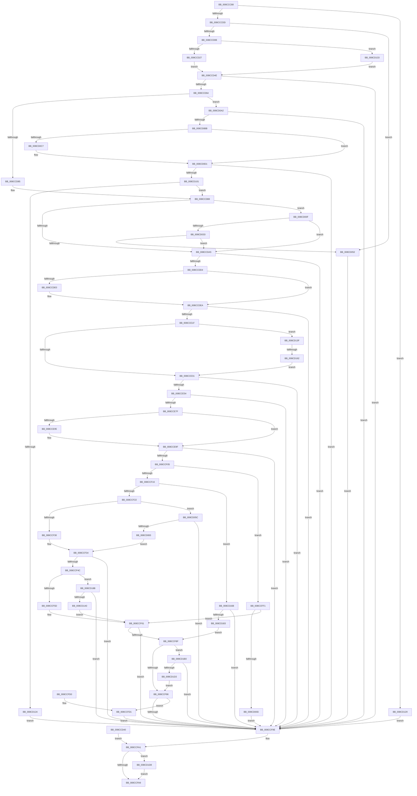

# PspWow64SetContextThread

- RVA: `0x008CCC88`–`0x008CD1F0` (길이 `1,384` bytes)
- VA: `0x00000001408CCC88`
- 실행 섹션: `PAGE`
- PDB 이름 있음: `예`; PDB Function 태그: `예`
- unwind 정보 RVA: `0x00084624`
- 디코드: `349`개 명령, `1,384/1,384` bytes 표시
- 미해석 바이트: `0` (있으면 어셈블리에 `.byte`로 보존)

> 이 문서는 커널 이미지의 기계어와 PDB 기호를 분석해 생성했습니다. 4번과 5번은 함수 원형과 자료형을 바이너리 사용 방식에서 추정한 C 해석이며 원본 소스 복구 결과는 아닙니다.

## 1. Dependencies

- 직접 호출 지점: **33**; 고유 호출 대상: **22**
- 직접 호출자로 확인된 함수: **2**
- RIP 상대 이미지 참조: **1**

### Outgoing calls
- `0x008CCCF8` → [PsWow64GetProcessMachine](../8D/PsWow64GetProcessMachine_function_008D2130.md) (function, `0x008D2130`)
- `0x008CCD16` → [RtlWow64GetCpuAreaEnabledFeatures](RtlWow64GetCpuAreaEnabledFeatures_function_008CDFB4.md) (function, `0x008CDFB4`)
- `0x008CCD55` → [RtlpWow64SanitizeContextFlags](RtlpWow64SanitizeContextFlags_function_008CDF00.md) (function, `0x008CDF00`)
- `0x008CCD8C` → [IoThreadToProcess](../../text/44/IoThreadToProcess_function_00448540.md) (function, `0x00448540`)
- `0x008CCD97` → [IoThreadToProcess](../../text/44/IoThreadToProcess_function_00448540.md) (function, `0x00448540`)
- `0x008CCDC5` → [RtlGetExtendedContextLength2](../../text/49/RtlGetExtendedContextLength2_function_00493FE0.md) (function, `0x00493FE0`)
- `0x008CCDF1` → [_chkstk](../../text/6B/_chkstk_function_006BA960.md) (function, `0x006BA960`)
- `0x008CCE10` → [RtlInitializeExtendedContext2](../../text/2F/RtlInitializeExtendedContext2_function_002F5D40.md) (function, `0x002F5D40`)
- `0x008CCE45` → [PspGetContextThreadInternal](../8D/PspGetContextThreadInternal_function_008D4770.md) (function, `0x008D4770`)
- `0x008CCE70` → [RtlGetExtendedContextLength2](../../text/49/RtlGetExtendedContextLength2_function_00493FE0.md) (function, `0x00493FE0`)
- `0x008CCEA6` → [_chkstk](../../text/6B/_chkstk_function_006BA960.md) (function, `0x006BA960`)
- `0x008CCEBB` → [RtlWow64GetCpuAreaEnabledFeatures](RtlWow64GetCpuAreaEnabledFeatures_function_008CDFB4.md) (function, `0x008CDFB4`)
- `0x008CCECD` → [RtlInitializeExtendedContext2](../../text/2F/RtlInitializeExtendedContext2_function_002F5D40.md) (function, `0x002F5D40`)
- `0x008CCEF6` → [PspWow64ReadOrWriteThreadCpuArea](PspWow64ReadOrWriteThreadCpuArea_function_008CD404.md) (function, `0x008CD404`)
- `0x008CCF41` → [RtlCopyContext](../8D/RtlCopyContext_function_008D5940.md) (function, `0x008D5940`)
- `0x008CCF84` → [PspWow64ReadOrWriteThreadCpuArea](PspWow64ReadOrWriteThreadCpuArea_function_008CD404.md) (function, `0x008CD404`)
- `0x008CCFB2` → [_security_check_cookie](../../text/6A/_security_check_cookie_function_006AC640.md) (function, `0x006AC640`)
- `0x008CCFEA` → [EtwTiLogSetContextThread](../A2/EtwTiLogSetContextThread_function_00A2FC70.md) (function, `0x00A2FC70`)
- `0x008CCFFE` → [RtlCopyContext](../8D/RtlCopyContext_function_008D5940.md) (function, `0x008D5940`)
- `0x008CD036` → [PsGetThreadTeb](../../text/45/PsGetThreadTeb_function_0045F300.md) (function, `0x0045F300`)
- `0x008CD045` → [RtlGuardIsValidWow64StackPointer](../A5/RtlGuardIsValidWow64StackPointer_function_00A57124.md) (function, `0x00A57124`)
- `0x008CD074` → [RtlpWow64CtxFromAmd64](../A1/RtlpWow64CtxFromAmd64_function_00A12394.md) (function, `0x00A12394`)
- `0x008CD090` → [memset](../../text/6C/memset_function_006C6C40.md) (function, `0x006C6C40`)
- `0x008CD0AC` → [RtlGetExtendedContextLength2](../../text/49/RtlGetExtendedContextLength2_function_00493FE0.md) (function, `0x00493FE0`)
- `0x008CD0D8` → [_chkstk](../../text/6B/_chkstk_function_006BA960.md) (function, `0x006BA960`)
- `0x008CD0F2` → [RtlInitializeExtendedContext2](../../text/2F/RtlInitializeExtendedContext2_function_002F5D40.md) (function, `0x002F5D40`)
- `0x008CD115` → [RtlpReadExtendedContext](../8D/RtlpReadExtendedContext_function_008D61D0.md) (function, `0x008D61D0`)
- `0x008CD155` → [PsSuspendThread](../A1/PsSuspendThread_function_00A110D0.md) (function, `0x00A110D0`)
- `0x008CD174` → [RtlpWow64CtxToAmd64](../A6/RtlpWow64CtxToAmd64_function_00A67188.md) (function, `0x00A67188`)
- `0x008CD191` → [RtlpWow64CtxToAmd64](../A6/RtlpWow64CtxToAmd64_function_00A67188.md) (function, `0x00A67188`)
- `0x008CD1C4` → [PspSetContextThreadInternal](../8D/PspSetContextThreadInternal_function_008D4420.md) (function, `0x008D4420`)
- `0x008CD1E1` → [PsMultiResumeThread](../../text/20/PsMultiResumeThread_function_002027C4.md) (function, `0x002027C4`)
- `0x008CD1E6` → [KeLeaveCriticalRegion](../../text/25/KeLeaveCriticalRegion_function_0025D8B0.md) (function, `0x0025D8B0`)

### Direct callers
- [NtSetInformationThread](NtSetInformationThread_function_008C9F60.md) at `0x008CA60B`
- [WbSetWowTrapFrame](../8D/WbSetWowTrapFrame_function_008D57EC.md) at `0x008D58F2`

### Static image references
- `0x008CCCAD` → RVA `0x00E0A740` (`.data`; read)

## 2. Other-region calls and transfers

- 다른 실행 섹션으로 향하는 call: **16**
  - `0x008CCD8C` → [IoThreadToProcess](../../text/44/IoThreadToProcess_function_00448540.md) (`PAGE` → `.text`)
  - `0x008CCD97` → [IoThreadToProcess](../../text/44/IoThreadToProcess_function_00448540.md) (`PAGE` → `.text`)
  - `0x008CCDC5` → [RtlGetExtendedContextLength2](../../text/49/RtlGetExtendedContextLength2_function_00493FE0.md) (`PAGE` → `.text`)
  - `0x008CCDF1` → [_chkstk](../../text/6B/_chkstk_function_006BA960.md) (`PAGE` → `.text`)
  - `0x008CCE10` → [RtlInitializeExtendedContext2](../../text/2F/RtlInitializeExtendedContext2_function_002F5D40.md) (`PAGE` → `.text`)
  - `0x008CCE70` → [RtlGetExtendedContextLength2](../../text/49/RtlGetExtendedContextLength2_function_00493FE0.md) (`PAGE` → `.text`)
  - `0x008CCEA6` → [_chkstk](../../text/6B/_chkstk_function_006BA960.md) (`PAGE` → `.text`)
  - `0x008CCECD` → [RtlInitializeExtendedContext2](../../text/2F/RtlInitializeExtendedContext2_function_002F5D40.md) (`PAGE` → `.text`)
  - `0x008CCFB2` → [_security_check_cookie](../../text/6A/_security_check_cookie_function_006AC640.md) (`PAGE` → `.text`)
  - `0x008CD036` → [PsGetThreadTeb](../../text/45/PsGetThreadTeb_function_0045F300.md) (`PAGE` → `.text`)
  - `0x008CD090` → [memset](../../text/6C/memset_function_006C6C40.md) (`PAGE` → `.text`)
  - `0x008CD0AC` → [RtlGetExtendedContextLength2](../../text/49/RtlGetExtendedContextLength2_function_00493FE0.md) (`PAGE` → `.text`)
  - `0x008CD0D8` → [_chkstk](../../text/6B/_chkstk_function_006BA960.md) (`PAGE` → `.text`)
  - `0x008CD0F2` → [RtlInitializeExtendedContext2](../../text/2F/RtlInitializeExtendedContext2_function_002F5D40.md) (`PAGE` → `.text`)
  - `0x008CD1E1` → [PsMultiResumeThread](../../text/20/PsMultiResumeThread_function_002027C4.md) (`PAGE` → `.text`)
  - `0x008CD1E6` → [KeLeaveCriticalRegion](../../text/25/KeLeaveCriticalRegion_function_0025D8B0.md) (`PAGE` → `.text`)
- call이 아닌 외부 분기/꼬리 이동: **1**
  - `0x008CD15C` → [sub_00B1B832](../B1/Unknown_function_00B1B832.md) (`tail-transfer`)

## 3. Assembly (complete function range)

```asm
008CCC88  48 89 4C 24 08                  mov qword ptr [rsp + 8], rcx
008CCC8D  55                              push rbp
008CCC8E  41 54                           push r12
008CCC90  41 55                           push r13
008CCC92  41 56                           push r14
008CCC94  41 57                           push r15
008CCC96  48 81 EC 90 00 00 00            sub rsp, 0x90
008CCC9D  48 8D 6C 24 50                  lea rbp, [rsp + 0x50]
008CCCA2  48 89 5D 78                     mov qword ptr [rbp + 0x78], rbx
008CCCA6  48 89 B5 80 00 00 00            mov qword ptr [rbp + 0x80], rsi
008CCCAD  48 8B 05 8C DA 53 00            mov rax, qword ptr [rip + 0x53da8c]
008CCCB4  48 33 C5                        xor rax, rbp
008CCCB7  48 89 45 38                     mov qword ptr [rbp + 0x38], rax
008CCCBB  45 8A F9                        mov r15b, r9b
008CCCBE  44 88 4D 0D                     mov byte ptr [rbp + 0xd], r9b
008CCCC2  4C 8B E2                        mov r12, rdx
008CCCC5  48 8B F1                        mov rsi, rcx
008CCCC8  32 DB                           xor bl, bl
008CCCCA  88 5D 00                        mov byte ptr [rbp], bl
008CCCCD  88 5D 01                        mov byte ptr [rbp + 1], bl
008CCCD0  41 81 F8 CC 02 00 00            cmp r8d, 0x2cc
008CCCD7  0F 85 4C 04 00 00               jne 0x1408cd129
008CCCDD  65 48 8B 04 25 88 01 00 00      mov rax, qword ptr gs:[0x188]
008CCCE6  48 89 45 20                     mov qword ptr [rbp + 0x20], rax
008CCCEA  48 8B 81 20 02 00 00            mov rax, qword ptr [rcx + 0x220]
008CCCF1  48 89 45 28                     mov qword ptr [rbp + 0x28], rax
008CCCF5  48 8B C8                        mov rcx, rax
008CCCF8  E8 33 54 00 00                  call 0x1408d2130
008CCCFD  B9 4C 01 00 00                  mov ecx, 0x14c
008CCD02  66 3B C1                        cmp ax, cx
008CCD05  0F 85 47 03 00 00               jne 0x1408cd052
008CCD0B  C7 45 04 00 00 01 00            mov dword ptr [rbp + 4], 0x10000
008CCD12  48 8D 4D 04                     lea rcx, [rbp + 4]
008CCD16  E8 99 12 00 00                  call 0x1408cdfb4
008CCD1B  4C 8B E8                        mov r13, rax
008CCD1E  45 84 FF                        test r15b, r15b
008CCD21  0F 84 0C 04 00 00               je 0x1408cd133
008CCD27  48 B8 00 00 FF FF FF 7F 00 00   movabs rax, 0x7fffffff0000
008CCD31  4C 3B E0                        cmp r12, rax
008CCD34  49 0F 42 C4                     cmovb rax, r12
008CCD38  90                              nop
008CCD39  8B 00                           mov eax, dword ptr [rax]
008CCD3B  89 45 04                        mov dword ptr [rbp + 4], eax
008CCD3E  EB 0E                           jmp 0x1408ccd4e
008CCD40  8B D8                           mov ebx, eax
008CCD42  48 8B 75 70                     mov rsi, qword ptr [rbp + 0x70]
008CCD46  8A 45 01                        mov al, byte ptr [rbp + 1]
008CCD49  E9 53 02 00 00                  jmp 0x1408ccfa1
008CCD4E  41 8A D7                        mov dl, r15b
008CCD51  48 8D 4D 04                     lea rcx, [rbp + 4]
008CCD55  E8 A6 11 00 00                  call 0x1408cdf00
008CCD5A  8B D8                           mov ebx, eax
008CCD5C  85 C0                           test eax, eax
008CCD5E  0F 88 3A 02 00 00               js 0x1408ccf9e
008CCD64  44 8B 75 04                     mov r14d, dword ptr [rbp + 4]
008CCD68  41 81 E6 FF FF FF 37            and r14d, 0x37ffffff
008CCD6F  44 89 75 04                     mov dword ptr [rbp + 4], r14d
008CCD73  83 65 08 00                     and dword ptr [rbp + 8], 0
008CCD77  48 83 65 18 00                  and qword ptr [rbp + 0x18], 0
008CCD7C  45 84 FF                        test r15b, r15b
008CCD7F  0F 85 1D 03 00 00               jne 0x1408cd0a2
008CCD85  4D 8B FC                        mov r15, r12
008CCD88  48 8B 4D 20                     mov rcx, qword ptr [rbp + 0x20]
008CCD8C  E8 AF B7 B7 FF                  call 0x140448540
008CCD91  48 8B D8                        mov rbx, rax
008CCD94  48 8B CE                        mov rcx, rsi
008CCD97  E8 A4 B7 B7 FF                  call 0x140448540
008CCD9C  48 3B C3                        cmp rax, rbx
008CCD9F  0F 84 6A 02 00 00               je 0x1408cd00f
008CCDA5  49 8B C5                        mov rax, r13
008CCDA8  48 F7 D8                        neg rax
008CCDAB  45 1B E4                        sbb r12d, r12d
008CCDAE  41 83 E4 40                     and r12d, 0x40
008CCDB2  83 65 08 00                     and dword ptr [rbp + 8], 0
008CCDB6  4D 8B C5                        mov r8, r13
008CCDB9  48 8D 55 08                     lea rdx, [rbp + 8]
008CCDBD  41 8D 8C 24 1F 00 10 00         lea ecx, [r12 + 0x10001f]
008CCDC5  E8 16 72 BC FF                  call 0x140493fe0
008CCDCA  8B D8                           mov ebx, eax
008CCDCC  85 C0                           test eax, eax
008CCDCE  0F 88 CA 01 00 00               js 0x1408ccf9e
008CCDD4  8B 45 08                        mov eax, dword ptr [rbp + 8]
008CCDD7  48 8D 48 0F                     lea rcx, [rax + 0xf]
008CCDDB  48 3B C8                        cmp rcx, rax
008CCDDE  77 0A                           ja 0x1408ccdea
008CCDE0  48 B9 F0 FF FF FF FF FF FF 0F   movabs rcx, 0xffffffffffffff0
008CCDEA  48 83 E1 F0                     and rcx, 0xfffffffffffffff0
008CCDEE  48 8B C1                        mov rax, rcx
008CCDF1  E8 6A DB DE FF                  call 0x1406ba960
008CCDF6  48 2B E1                        sub rsp, rcx
008CCDF9  4C 8D 74 24 50                  lea r14, [rsp + 0x50]
008CCDFE  4D 8B CD                        mov r9, r13
008CCE01  4C 8D 45 18                     lea r8, [rbp + 0x18]
008CCE05  41 8D 94 24 1F 00 10 00         lea edx, [r12 + 0x10001f]
008CCE0D  49 8B CE                        mov rcx, r14
008CCE10  E8 2B 8F A2 FF                  call 0x1402f5d40
008CCE15  8B D8                           mov ebx, eax
008CCE17  85 C0                           test eax, eax
008CCE19  0F 88 7F 01 00 00               js 0x1408ccf9e
008CCE1F  65 48 8B 04 25 88 01 00 00      mov rax, qword ptr gs:[0x188]
008CCE28  48 3B F0                        cmp rsi, rax
008CCE2B  0F 85 0E 03 00 00               jne 0x1408cd13f
008CCE31  C7 44 24 20 01 00 00 00         mov dword ptr [rsp + 0x20], 1
008CCE39  41 B1 01                        mov r9b, 1
008CCE3C  45 33 C0                        xor r8d, r8d
008CCE3F  49 8B D6                        mov rdx, r14
008CCE42  48 8B CE                        mov rcx, rsi
008CCE45  E8 26 79 00 00                  call 0x1408d4770
008CCE4A  8B D8                           mov ebx, eax
008CCE4C  85 C0                           test eax, eax
008CCE4E  0F 88 4A 01 00 00               js 0x1408ccf9e
008CCE54  B9 3F 00 01 00                  mov ecx, 0x1003f
008CCE59  8D 41 40                        lea eax, [rcx + 0x40]
008CCE5C  4D 85 ED                        test r13, r13
008CCE5F  0F 45 C8                        cmovne ecx, eax
008CCE62  89 4D 20                        mov dword ptr [rbp + 0x20], ecx
008CCE65  83 65 08 00                     and dword ptr [rbp + 8], 0
008CCE69  4D 8B C5                        mov r8, r13
008CCE6C  48 8D 55 08                     lea rdx, [rbp + 8]
008CCE70  E8 6B 71 BC FF                  call 0x140493fe0
008CCE75  8B D8                           mov ebx, eax
008CCE77  85 C0                           test eax, eax
008CCE79  0F 88 1F 01 00 00               js 0x1408ccf9e
008CCE7F  C6 45 01 00                     mov byte ptr [rbp + 1], 0
008CCE83  83 65 10 00                     and dword ptr [rbp + 0x10], 0
008CCE87  44 8B 65 08                     mov r12d, dword ptr [rbp + 8]
008CCE8B  49 8D 4C 24 0F                  lea rcx, [r12 + 0xf]
008CCE90  49 3B CC                        cmp rcx, r12
008CCE93  77 0A                           ja 0x1408cce9f
008CCE95  48 B9 F0 FF FF FF FF FF FF 0F   movabs rcx, 0xffffffffffffff0
008CCE9F  48 83 E1 F0                     and rcx, 0xfffffffffffffff0
008CCEA3  48 8B C1                        mov rax, rcx
008CCEA6  E8 B5 DA DE FF                  call 0x1406ba960
008CCEAB  48 2B E1                        sub rsp, rcx
008CCEAE  48 8D 5C 24 50                  lea rbx, [rsp + 0x50]
008CCEB3  48 89 5D 18                     mov qword ptr [rbp + 0x18], rbx
008CCEB7  48 8D 4D 20                     lea rcx, [rbp + 0x20]
008CCEBB  E8 F4 10 00 00                  call 0x1408cdfb4
008CCEC0  4C 8B C8                        mov r9, rax
008CCEC3  4C 8D 45 30                     lea r8, [rbp + 0x30]
008CCEC7  8B 55 20                        mov edx, dword ptr [rbp + 0x20]
008CCECA  48 8B CB                        mov rcx, rbx
008CCECD  E8 6E 8E A2 FF                  call 0x1402f5d40
008CCED2  48 8D 45 01                     lea rax, [rbp + 1]
008CCED6  48 89 44 24 38                  mov qword ptr [rsp + 0x38], rax
008CCEDB  48 8D 45 10                     lea rax, [rbp + 0x10]
008CCEDF  48 89 44 24 30                  mov qword ptr [rsp + 0x30], rax
008CCEE4  44 89 64 24 20                  mov dword ptr [rsp + 0x20], r12d
008CCEE9  4C 8B CB                        mov r9, rbx
008CCEEC  41 B0 01                        mov r8b, 1
008CCEEF  48 8B D6                        mov rdx, rsi
008CCEF2  48 8B 4D 28                     mov rcx, qword ptr [rbp + 0x28]
008CCEF6  E8 09 05 00 00                  call 0x1408cd404
008CCEFB  8B D8                           mov ebx, eax
008CCEFD  85 C0                           test eax, eax
008CCEFF  0F 88 99 00 00 00               js 0x1408ccf9e
008CCF05  45 32 E4                        xor r12b, r12b
008CCF08  44 88 65 0C                     mov byte ptr [rbp + 0xc], r12b
008CCF0C  44 38 65 01                     cmp byte ptr [rbp + 1], r12b
008CCF10  0F 85 DB 00 00 00               jne 0x1408ccff1
008CCF16  66 41 83 7E 38 23               cmp word ptr [r14 + 0x38], 0x23
008CCF1C  0F 84 49 02 00 00               je 0x1408cd16b
008CCF22  44 8B 65 10                     mov r12d, dword ptr [rbp + 0x10]
008CCF26  41 F6 C4 01                     test r12b, 1
008CCF2A  0F 84 2C 01 00 00               je 0x1408cd05c
008CCF30  4C 8B 6D 18                     mov r13, qword ptr [rbp + 0x18]
008CCF34  4D 8B C7                        mov r8, r15
008CCF37  44 8B 65 04                     mov r12d, dword ptr [rbp + 4]
008CCF3B  41 8B D4                        mov edx, r12d
008CCF3E  49 8B CD                        mov rcx, r13
008CCF41  E8 FA 89 00 00                  call 0x1408d5940
008CCF46  8B D8                           mov ebx, eax
008CCF48  85 C0                           test eax, eax
008CCF4A  78 52                           js 0x1408ccf9e
008CCF4C  B9 10 00 01 00                  mov ecx, 0x10010
008CCF51  44 23 E1                        and r12d, ecx
008CCF54  44 3B E1                        cmp r12d, ecx
008CCF57  0F 84 2E 02 00 00               je 0x1408cd18b
008CCF5D  44 8A 65 0C                     mov r12b, byte ptr [rbp + 0xc]
008CCF61  48 83 64 24 38 00               and qword ptr [rsp + 0x38], 0
008CCF67  48 8D 45 10                     lea rax, [rbp + 0x10]
008CCF6B  48 89 44 24 30                  mov qword ptr [rsp + 0x30], rax
008CCF70  8B 45 08                        mov eax, dword ptr [rbp + 8]
008CCF73  89 44 24 20                     mov dword ptr [rsp + 0x20], eax
008CCF77  4D 8B CD                        mov r9, r13
008CCF7A  45 33 C0                        xor r8d, r8d
008CCF7D  48 8B D6                        mov rdx, rsi
008CCF80  48 8B 4D 28                     mov rcx, qword ptr [rbp + 0x28]
008CCF84  E8 7B 04 00 00                  call 0x1408cd404
008CCF89  8B D8                           mov ebx, eax
008CCF8B  85 C0                           test eax, eax
008CCF8D  78 0F                           js 0x1408ccf9e
008CCF8F  45 84 E4                        test r12b, r12b
008CCF92  0F 85 18 02 00 00               jne 0x1408cd1b0
008CCF98  80 7D 0D 00                     cmp byte ptr [rbp + 0xd], 0
008CCF9C  75 33                           jne 0x1408ccfd1
008CCF9E  8A 45 00                        mov al, byte ptr [rbp]
008CCFA1  84 C0                           test al, al
008CCFA3  0F 85 2F 02 00 00               jne 0x1408cd1d8
008CCFA9  8B C3                           mov eax, ebx
008CCFAB  48 8B 4D 38                     mov rcx, qword ptr [rbp + 0x38]
008CCFAF  48 33 CD                        xor rcx, rbp
008CCFB2  E8 89 F6 DD FF                  call 0x1406ac640
008CCFB7  48 8B 5D 78                     mov rbx, qword ptr [rbp + 0x78]
008CCFBB  48 8B B5 80 00 00 00            mov rsi, qword ptr [rbp + 0x80]
008CCFC2  48 8D 65 40                     lea rsp, [rbp + 0x40]
008CCFC6  41 5F                           pop r15
008CCFC8  41 5E                           pop r14
008CCFCA  41 5D                           pop r13
008CCFCC  41 5C                           pop r12
008CCFCE  5D                              pop rbp
008CCFCF  C3                              ret
008CCFD0  CC                              int3
008CCFD1  65 48 8B 0C 25 88 01 00 00      mov rcx, qword ptr gs:[0x188]
008CCFDA  44 8B 4D 04                     mov r9d, dword ptr [rbp + 4]
008CCFDE  4D 8B C7                        mov r8, r15
008CCFE1  48 8B D6                        mov rdx, rsi
008CCFE4  8A 89 32 02 00 00               mov cl, byte ptr [rcx + 0x232]
008CCFEA  E8 81 2C 16 00                  call 0x140a2fc70
008CCFEF  EB AD                           jmp 0x1408ccf9e
008CCFF1  4D 8B C7                        mov r8, r15
008CCFF4  8B 55 04                        mov edx, dword ptr [rbp + 4]
008CCFF7  4C 8B 6D 18                     mov r13, qword ptr [rbp + 0x18]
008CCFFB  49 8B CD                        mov rcx, r13
008CCFFE  E8 3D 89 00 00                  call 0x1408d5940
008CD003  8B D8                           mov ebx, eax
008CD005  85 C0                           test eax, eax
008CD007  0F 89 54 FF FF FF               jns 0x1408ccf61
008CD00D  EB 8F                           jmp 0x1408ccf9e
008CD00F  B8 01 00 01 00                  mov eax, 0x10001
008CD014  44 23 F0                        and r14d, eax
008CD017  44 3B F0                        cmp r14d, eax
008CD01A  0F 94 C1                        sete cl
008CD01D  48 8B 45 28                     mov rax, qword ptr [rbp + 0x28]
008CD021  F6 80 88 00 00 00 20            test byte ptr [rax + 0x88], 0x20
008CD028  0F 95 C0                        setne al
008CD02B  84 C8                           test al, cl
008CD02D  0F 84 72 FD FF FF               je 0x1408ccda5
008CD033  48 8B CE                        mov rcx, rsi
008CD036  E8 C5 22 B9 FF                  call 0x14045f300
008CD03B  48 8B D0                        mov rdx, rax
008CD03E  41 8B 8F C4 00 00 00            mov ecx, dword ptr [r15 + 0xc4]
008CD045  E8 DA A0 18 00                  call 0x140a57124
008CD04A  85 C0                           test eax, eax
008CD04C  0F 85 53 FD FF FF               jne 0x1408ccda5
008CD052  BB 0D 00 00 C0                  mov ebx, 0xc000000d
008CD057  E9 42 FF FF FF                  jmp 0x1408ccf9e
008CD05C  49 F7 DD                        neg r13
008CD05F  1B C9                           sbb ecx, ecx
008CD061  83 E1 40                        and ecx, 0x40
008CD064  81 C1 38 00 01 00               add ecx, 0x10038
008CD06A  4C 8B 6D 18                     mov r13, qword ptr [rbp + 0x18]
008CD06E  4D 8B C5                        mov r8, r13
008CD071  49 8B D6                        mov rdx, r14
008CD074  E8 1B 53 14 00                  call 0x140a12394
008CD079  8B D8                           mov ebx, eax
008CD07B  85 C0                           test eax, eax
008CD07D  0F 88 1B FF FF FF               js 0x1408ccf9e
008CD083  49 8D 8D 6C 01 00 00            lea rcx, [r13 + 0x16c]
008CD08A  33 D2                           xor edx, edx
008CD08C  44 8D 42 60                     lea r8d, [rdx + 0x60]
008CD090  E8 AB 9B DF FF                  call 0x1406c6c40
008CD095  41 83 CC 01                     or r12d, 1
008CD099  44 89 65 10                     mov dword ptr [rbp + 0x10], r12d
008CD09D  E9 92 FE FF FF                  jmp 0x1408ccf34
008CD0A2  4D 8B C5                        mov r8, r13
008CD0A5  48 8D 55 08                     lea rdx, [rbp + 8]
008CD0A9  41 8B CE                        mov ecx, r14d
008CD0AC  E8 2F 6F BC FF                  call 0x140493fe0
008CD0B1  8B D8                           mov ebx, eax
008CD0B3  85 C0                           test eax, eax
008CD0B5  0F 88 E3 FE FF FF               js 0x1408ccf9e
008CD0BB  8B 45 08                        mov eax, dword ptr [rbp + 8]
008CD0BE  48 8D 48 0F                     lea rcx, [rax + 0xf]
008CD0C2  48 3B C8                        cmp rcx, rax
008CD0C5  77 0A                           ja 0x1408cd0d1
008CD0C7  48 B9 F0 FF FF FF FF FF FF 0F   movabs rcx, 0xffffffffffffff0
008CD0D1  48 83 E1 F0                     and rcx, 0xfffffffffffffff0
008CD0D5  48 8B C1                        mov rax, rcx
008CD0D8  E8 83 D8 DE FF                  call 0x1406ba960
008CD0DD  48 2B E1                        sub rsp, rcx
008CD0E0  4C 8D 7C 24 50                  lea r15, [rsp + 0x50]
008CD0E5  4D 8B CD                        mov r9, r13
008CD0E8  4C 8D 45 18                     lea r8, [rbp + 0x18]
008CD0EC  41 8B D6                        mov edx, r14d
008CD0EF  49 8B CF                        mov rcx, r15
008CD0F2  E8 49 8C A2 FF                  call 0x1402f5d40
008CD0F7  8B D8                           mov ebx, eax
008CD0F9  85 C0                           test eax, eax
008CD0FB  0F 88 9D FE FF FF               js 0x1408ccf9e
008CD101  48 83 64 24 28 00               and qword ptr [rsp + 0x28], 0
008CD107  4C 89 64 24 20                  mov qword ptr [rsp + 0x20], r12
008CD10C  45 8B CE                        mov r9d, r14d
008CD10F  4C 8B 45 18                     mov r8, qword ptr [rbp + 0x18]
008CD113  B2 01                           mov dl, 1
008CD115  E8 B6 90 00 00                  call 0x1408d61d0
008CD11A  8B D8                           mov ebx, eax
008CD11C  85 C0                           test eax, eax
008CD11E  0F 89 64 FC FF FF               jns 0x1408ccd88
008CD124  E9 75 FE FF FF                  jmp 0x1408ccf9e
008CD129  BB 04 00 00 C0                  mov ebx, 0xc0000004
008CD12E  E9 6B FE FF FF                  jmp 0x1408ccf9e
008CD133  41 8B 04 24                     mov eax, dword ptr [r12]
008CD137  89 45 04                        mov dword ptr [rbp + 4], eax
008CD13A  E9 0F FC FF FF                  jmp 0x1408ccd4e
008CD13F  65 48 8B 04 25 88 01 00 00      mov rax, qword ptr gs:[0x188]
008CD148  66 FF 88 E4 01 00 00            dec word ptr [rax + 0x1e4]
008CD14F  90                              nop
008CD150  33 D2                           xor edx, edx
008CD152  48 8B CE                        mov rcx, rsi
008CD155  E8 76 3F 14 00                  call 0x140a110d0
008CD15A  85 C0                           test eax, eax
008CD15C  0F 88 D0 E6 24 00               js 0x140b1b832
008CD162  C6 45 00 01                     mov byte ptr [rbp], 1
008CD166  E9 C6 FC FF FF                  jmp 0x1408cce31
008CD16B  4D 8B C6                        mov r8, r14
008CD16E  49 8B D7                        mov rdx, r15
008CD171  8B 4D 04                        mov ecx, dword ptr [rbp + 4]
008CD174  E8 0F A0 19 00                  call 0x140a67188
008CD179  8B D8                           mov ebx, eax
008CD17B  85 C0                           test eax, eax
008CD17D  0F 88 1B FE FF FF               js 0x1408ccf9e
008CD183  41 B4 01                        mov r12b, 1
008CD186  E9 04 FE FF FF                  jmp 0x1408ccf8f
008CD18B  4D 8B C6                        mov r8, r14
008CD18E  49 8B D7                        mov rdx, r15
008CD191  E8 F2 9F 19 00                  call 0x140a67188
008CD196  8B D8                           mov ebx, eax
008CD198  85 C0                           test eax, eax
008CD19A  0F 88 FE FD FF FF               js 0x1408ccf9e
008CD1A0  41 B4 01                        mov r12b, 1
008CD1A3  41 C7 46 30 10 00 10 00         mov dword ptr [r14 + 0x30], 0x100010
008CD1AB  E9 B1 FD FF FF                  jmp 0x1408ccf61
008CD1B0  C7 44 24 20 01 00 00 00         mov dword ptr [rsp + 0x20], 1
008CD1B8  41 B1 01                        mov r9b, 1
008CD1BB  45 33 C0                        xor r8d, r8d
008CD1BE  49 8B D6                        mov rdx, r14
008CD1C1  48 8B CE                        mov rcx, rsi
008CD1C4  E8 57 72 00 00                  call 0x1408d4420
008CD1C9  8B D8                           mov ebx, eax
008CD1CB  85 C0                           test eax, eax
008CD1CD  0F 88 CB FD FF FF               js 0x1408ccf9e
008CD1D3  E9 C0 FD FF FF                  jmp 0x1408ccf98
008CD1D8  33 D2                           xor edx, edx
008CD1DA  44 8D 42 01                     lea r8d, [rdx + 1]
008CD1DE  48 8B CE                        mov rcx, rsi
008CD1E1  E8 DE 55 93 FF                  call 0x1402027c4
008CD1E6  E8 C5 06 99 FF                  call 0x14025d8b0
008CD1EB  E9 B9 FD FF FF                  jmp 0x1408ccfa9
```

## 4. C-style interpretation (structured pseudocode)

```c
__int64 __fastcall PspWow64SetContextThread(__int64 a1, __int64 a2, int a3, unsigned __int8 a4)
{
    __int64 result;
    __int64 v_r12;
    __int64 v_r13;
    __int64 v_r14;
    __int64 v_rbx;
    __int64 v_rsp;
    unsigned __int64 v_stack_m28;
    unsigned __int64 v_stack_m30;
    unsigned __int64 v_stack_m38;
    unsigned __int64 v_stack_m40;
    unsigned __int64 v_stack_m48;
    unsigned __int64 v_stack_m50;
    unsigned int v_stack_m58;
    unsigned __int8 v_stack_m5B;
    unsigned __int8 v_stack_m5C;
    unsigned int v_stack_m60;
    unsigned int v_stack_m64;
    unsigned __int8 v_stack_m67;
    unsigned __int64 v_stack_m68;
    unsigned __int64 v_stack_m80;
    unsigned __int64 v_stack_m88;
    unsigned int v_stack_m98;
    unsigned __int64 v_stack_p10;
    unsigned __int64 v_stack_p18;
    unsigned __int64 v_stack_p20;
    unsigned __int64 v_stack_p28;
    unsigned __int64 v_stack_p50;
    unsigned __int64 v_stack_p8;

    v_stack_p8 = a1;
    v_rsp = (v_rsp) - (144);
    v_stack_p10 = v_rbx;
    v_stack_p18 = v_rsi;
    result = (*(unsigned __int64 *)(v_rip + 5495436)) ^ (v_stack_m68);
    v_stack_m30 = result;
    v_stack_m5B = a4;
    v_rbx = 0;
    v_stack_m68 = 0;
    v_stack_m67 = 0;
    if (a3 != 716) goto loc_008CD129;
    v_stack_m48 = *(unsigned __int64 *)(gs_base + (0 + 392));
    v_stack_m40 = *(unsigned __int64 *)(a1 + 544);
    result = PsWow64GetProcessMachine(*(unsigned __int64 *)(a1 + 544), a2, a3, a4);
    if (((unsigned __int16)(result)) != 332) goto loc_008CD052;
    v_stack_m64 = 0x10000ULL;
    result = RtlWow64GetCpuAreaEnabledFeatures(v_stack_m64, a2, a3, a4);
    if (a4 == 0) goto loc_008CD133;
    if (a2 < result) { result = a2; }
    v_stack_m64 = (unsigned int)((unsigned int)(*(unsigned int *)(result)));
    goto loc_008CCD4E;
loc_008CCD4E:
    result = RtlpWow64SanitizeContextFlags(v_stack_m64, a4, a3, a4);
    if (sign_flag) goto loc_008CCF9E;
    v_r14 = (unsigned int)(((unsigned int)(v_stack_m64)) & (0x37FFFFFFULL));
    v_stack_m64 = (unsigned int)(v_r14);
    if (a4 != 0) goto loc_008CD0A2;
loc_008CCD88:
    result = IoThreadToProcess(v_stack_m48, a4, a3, a4);
    result = IoThreadToProcess(a1, a4, a3, a4);
    if (result == result) goto loc_008CD00F;
loc_008CCDA5:
    result = -(result);
    v_r12 = (unsigned int)((a2) & (64));
    result = RtlGetExtendedContextLength2(v_r12 + 1048607, v_stack_m60, result, a4);
    if (sign_flag) goto loc_008CCF9E;
    if (((unsigned int)(v_stack_m60) + 15) <= ((unsigned int)(v_stack_m60))) {
    }
    a1 = ((unsigned int)(v_stack_m60) + 15) & (-16);
    result = _chkstk(a1, v_stack_m60, result, a4);
    v_rsp = (v_rsp) - (a1);
    result = RtlInitializeExtendedContext2(v_stack_m68, v_r12 + 1048607, v_stack_m50, result);
    if (sign_flag) goto loc_008CCF9E;
    if (a1 != (*(unsigned __int64 *)(gs_base + (0 + 392)))) goto loc_008CD13F;
loc_008CCE31:
    v_stack_m98 = 1;
    a3 = 0;
    result = PspGetContextThreadInternal(a1, v_stack_m68, a3, 1);
    if (sign_flag) goto loc_008CCF9E;
    a1 = (unsigned int)(0x1003FULL);
    if (result != 0) { a1 = (unsigned int)((unsigned int)(0x1003FULL) + 64); }
    v_stack_m48 = (unsigned int)(a1);
    result = RtlGetExtendedContextLength2(a1, v_stack_m60, result, 1);
    if (sign_flag) goto loc_008CCF9E;
    v_stack_m67 = 0;
    if (((unsigned int)(v_stack_m60) + 15) <= ((unsigned int)(v_stack_m60))) {
    }
    a1 = ((unsigned int)(v_stack_m60) + 15) & (-16);
    result = _chkstk(a1, v_stack_m60, result, 1);
    v_rsp = (v_rsp) - (a1);
    v_stack_m50 = v_stack_m68;
    result = RtlWow64GetCpuAreaEnabledFeatures(v_stack_m48, v_stack_m60, result, 1);
    result = RtlInitializeExtendedContext2(v_stack_m68, (unsigned int)(v_stack_m48), v_stack_m38, result);
    v_stack_m80 = v_stack_m67;
    v_stack_m88 = v_stack_m58;
    v_stack_m98 = (unsigned int)((unsigned int)(v_stack_m60));
    result = PspWow64ReadOrWriteThreadCpuArea(v_stack_m40, a1, 1, v_stack_m68);
    if (sign_flag) goto loc_008CCF9E;
    v_r12 = 0;
    v_stack_m5C = 0;
    if (v_stack_m67 != 0) goto loc_008CCFF1;
    if ((*(unsigned __int16 *)(v_stack_m68 + 56)) == 35) goto loc_008CD16B;
    if ((((unsigned __int8)((unsigned int)(v_stack_m58))) & (1)) == 0) goto loc_008CD05C;
loc_008CCF34:
    result = RtlCopyContext(v_stack_m50, (unsigned int)((unsigned int)((unsigned int)(v_stack_m64))), a2, v_stack_m68);
    if (sign_flag) goto loc_008CCF9E;
    v_r12 = (unsigned int)(((unsigned int)(v_stack_m64)) & ((unsigned int)((unsigned int)(0x10010ULL))));
    if (((unsigned int)(v_r12)) == ((unsigned int)((unsigned int)(0x10010ULL)))) goto loc_008CD18B;
loc_008CCF61:
    v_stack_m88 = v_stack_m58;
    v_stack_m98 = (unsigned int)((unsigned int)(v_stack_m60));
    a3 = 0;
    result = PspWow64ReadOrWriteThreadCpuArea(v_stack_m40, a1, a3, v_stack_m50);
    if (sign_flag) goto loc_008CCF9E;
loc_008CCF8F:
    if ((unsigned __int8)(v_stack_m5C) != 0) goto loc_008CD1B0;
loc_008CCF98:
    if (v_stack_m5B != 0) goto loc_008CCFD1;
loc_008CCF9E:
loc_008CCFA1:
    if ((unsigned __int8)(v_stack_m68) != 0) goto loc_008CD1D8;
loc_008CCFA9:
    a1 = (v_stack_m30) ^ (v_stack_m68);
    result = _security_check_cookie(a1, a1, a3, v_stack_m50);
    return result;
loc_008CCFD1:
    result = EtwTiLogSetContextThread(*(unsigned __int8 *)(*(unsigned __int64 *)(gs_base + (0 + 392)) + 562), v_stack_p18, a2, (unsigned int)(v_stack_m64));
    goto loc_008CCF9E;
loc_008CCFF1:
    result = RtlCopyContext(v_stack_m50, (unsigned int)(v_stack_m64), a2, (unsigned int)(v_stack_m64));
    if (!sign_flag) goto loc_008CCF61;
    goto loc_008CCF9E;
loc_008CD00F:
    v_r14 = (unsigned int)((v_stack_m68) & ((unsigned int)((unsigned int)(0x10001ULL))));
    a1 = (((unsigned int)(v_r14)) == ((unsigned int)((unsigned int)(0x10001ULL)))) ? 1 : 0;
    result = (((*(unsigned __int8 *)(v_stack_m40 + 136)) & (32)) != 0) ? 1 : 0;
    if ((((unsigned __int8)(result)) & ((unsigned __int8)(a1))) == 0) goto loc_008CCDA5;
    result = PsGetThreadTeb(v_stack_p18, (unsigned int)(v_stack_m64), a2, (unsigned int)(v_stack_m64));
    result = RtlGuardIsValidWow64StackPointer((unsigned int)(*(unsigned int *)(a2 + 196)), result, a2, (unsigned int)(v_stack_m64));
    if ((unsigned int)(result) != 0) goto loc_008CCDA5;
loc_008CD052:
    goto loc_008CCF9E;
loc_008CD05C:
    v_r13 = -(v_stack_m50);
    a1 = (unsigned int)(((unsigned int)(*(unsigned int *)(a2 + 196))) & (64));
    a1 = (unsigned int)((a1) + (0x10038ULL));
    result = RtlpWow64CtxFromAmd64(a1, v_r14, v_stack_m50, (unsigned int)(v_stack_m64));
    if (sign_flag) goto loc_008CCF9E;
    a2 = 0;
    result = memset(v_stack_m50 + 364, a2, a2 + 96, (unsigned int)(v_stack_m64));
    v_r12 = (unsigned int)((v_stack_m5C) | (1));
    v_stack_m58 = (unsigned int)(v_r12);
    goto loc_008CCF34;
loc_008CD0A2:
    result = RtlGetExtendedContextLength2((unsigned int)((unsigned int)(v_r14)), v_stack_m60, v_stack_m50, (unsigned int)(v_stack_m64));
    if (sign_flag) goto loc_008CCF9E;
    if (((unsigned int)(v_stack_m60) + 15) <= ((unsigned int)(v_stack_m60))) {
    }
    a1 = ((unsigned int)(v_stack_m60) + 15) & (-16);
    result = _chkstk(a1, v_stack_m60, v_stack_m50, (unsigned int)(v_stack_m64));
    v_rsp = (v_stack_m28) - (a1);
    result = RtlInitializeExtendedContext2(v_stack_p50, (unsigned int)((unsigned int)(v_r14)), v_stack_m50, v_stack_m50);
    if (sign_flag) goto loc_008CCF9E;
    v_stack_p20 = v_r12;
    result = RtlpReadExtendedContext(v_stack_p50, 1, v_stack_m50, (unsigned int)((unsigned int)(v_r14)));
    if (!sign_flag) goto loc_008CCD88;
    goto loc_008CCF9E;
loc_008CD129:
    goto loc_008CCF9E;
loc_008CD133:
    v_stack_m64 = (unsigned int)((unsigned int)(*(unsigned int *)(v_r12)));
    goto loc_008CCD4E;
loc_008CD13F:
    a2 = 0;
    result = PsSuspendThread(v_stack_p18, a2, v_stack_m50, (unsigned int)((unsigned int)(v_r14)));
    v_stack_m68 = 1;
    goto loc_008CCE31;
loc_008CD16B:
    result = RtlpWow64CtxToAmd64((unsigned int)(v_stack_m64), v_stack_p50, v_r14, (unsigned int)((unsigned int)(v_r14)));
    if (sign_flag) goto loc_008CCF9E;
    goto loc_008CCF8F;
loc_008CD18B:
    result = RtlpWow64CtxToAmd64((unsigned int)(v_stack_m64), v_stack_p50, v_r14, (unsigned int)((unsigned int)(v_r14)));
    if (sign_flag) goto loc_008CCF9E;
    *(unsigned int *)(v_r14 + 48) = 0x100010ULL;
    goto loc_008CCF61;
loc_008CD1B0:
    v_stack_p20 = 1;
    a3 = 0;
    result = PspSetContextThreadInternal(v_stack_p18, v_r14, a3, 1);
    if (sign_flag) goto loc_008CCF9E;
    goto loc_008CCF98;
loc_008CD1D8:
    a2 = 0;
    result = PsMultiResumeThread(v_stack_p18, a2, a2 + 1, 1);
    result = KeLeaveCriticalRegion(v_stack_p18, a2, a2 + 1, 1);
    goto loc_008CCFA9;
}
```

## 5. (Beta) C Style

```c
int64_t PspWow64SetContextThread(void *Arg1, void *Arg2, int32_t Arg3, uint8_t Arg4)
{
    uint8_t *arg1 = (uint8_t *)Arg1;
    uint8_t *arg2 = (uint8_t *)Arg2;

    int64_t result;
    int64_t local_r12;
    int64_t local_r13;
    int64_t local_r14;
    int64_t local_rbx;
    int64_t local_rsp;
    uint64_t v_stack_m28;
    uint64_t v_stack_m30;
    uint64_t v_stack_m38;
    uint64_t v_stack_m40;
    uint64_t v_stack_m48;
    uint64_t v_stack_m50;
    uint32_t v_stack_m58;
    uint8_t v_stack_m5B;
    uint8_t v_stack_m5C;
    uint32_t v_stack_m60;
    uint32_t v_stack_m64;
    uint8_t v_stack_m67;
    uint64_t v_stack_m68;
    uint64_t v_stack_m80;
    uint64_t v_stack_m88;
    uint32_t v_stack_m98;
    uint64_t v_stack_p10;
    uint64_t v_stack_p18;
    uint64_t v_stack_p20;
    uint64_t v_stack_p28;
    uint64_t v_stack_p50;
    uint64_t v_stack_p8;

    v_stack_p8 = Arg1;
    local_rsp = (local_rsp) - (144);
    v_stack_p10 = local_rbx;
    v_stack_p18 = local_rsi;
    result = (*(uint64_t *)(v_rip + 0x53DA8C)) ^ (v_stack_m68);
    v_stack_m30 = result;
    v_stack_m5B = Arg4;
    local_rbx = 0;
    v_stack_m68 = 0;
    v_stack_m67 = 0;
    if (Arg3 != 716) goto loc_008CD129;
    v_stack_m48 = *(uint64_t *)(gs_base + (0 + 0x188));
    v_stack_m40 = *(uint64_t *)(arg1 + 0x220);
    result = PsWow64GetProcessMachine(*(uint64_t *)(arg1 + 0x220), Arg2, Arg3, Arg4);
    if (((uint16_t)(result)) != 332) goto loc_008CD052;
    v_stack_m64 = 0x10000ULL;
    result = RtlWow64GetCpuAreaEnabledFeatures(v_stack_m64, Arg2, Arg3, Arg4);
    if (Arg4 == 0) goto loc_008CD133;
    if (Arg2 < result) { result = Arg2; }
    v_stack_m64 = (uint32_t)((uint32_t)(*(uint32_t *)(result)));
    goto loc_008CCD4E;
loc_008CCD4E:
    result = RtlpWow64SanitizeContextFlags(v_stack_m64, Arg4, Arg3, Arg4);
    if (sign_flag) goto loc_008CCF9E;
    local_r14 = (uint32_t)(((uint32_t)(v_stack_m64)) & (0x37FFFFFFULL));
    v_stack_m64 = (uint32_t)(local_r14);
    if (Arg4 != 0) goto loc_008CD0A2;
loc_008CCD88:
    result = IoThreadToProcess(v_stack_m48, Arg4, Arg3, Arg4);
    result = IoThreadToProcess(Arg1, Arg4, Arg3, Arg4);
    if (result == result) goto loc_008CD00F;
loc_008CCDA5:
    result = -(result);
    local_r12 = (uint32_t)((Arg2) & (64));
    result = RtlGetExtendedContextLength2(local_r12 + 1048607, v_stack_m60, result, Arg4);
    if (sign_flag) goto loc_008CCF9E;
    if (((uint32_t)(v_stack_m60) + 15) <= ((uint32_t)(v_stack_m60))) {
    }
    Arg1 = ((uint32_t)(v_stack_m60) + 15) & (-16);
    result = _chkstk(Arg1, v_stack_m60, result, Arg4);
    local_rsp = (local_rsp) - (Arg1);
    result = RtlInitializeExtendedContext2(v_stack_m68, local_r12 + 1048607, v_stack_m50, result);
    if (sign_flag) goto loc_008CCF9E;
    if (Arg1 != (*(uint64_t *)(gs_base + (0 + 0x188)))) goto loc_008CD13F;
loc_008CCE31:
    v_stack_m98 = 1;
    Arg3 = 0;
    result = PspGetContextThreadInternal(Arg1, v_stack_m68, Arg3, 1);
    if (sign_flag) goto loc_008CCF9E;
    Arg1 = (uint32_t)(0x1003FULL);
    if (result != 0) { Arg1 = (uint32_t)((uint32_t)(0x1003FULL) + 64); }
    v_stack_m48 = (uint32_t)(Arg1);
    result = RtlGetExtendedContextLength2(Arg1, v_stack_m60, result, 1);
    if (sign_flag) goto loc_008CCF9E;
    v_stack_m67 = 0;
    if (((uint32_t)(v_stack_m60) + 15) <= ((uint32_t)(v_stack_m60))) {
    }
    Arg1 = ((uint32_t)(v_stack_m60) + 15) & (-16);
    result = _chkstk(Arg1, v_stack_m60, result, 1);
    local_rsp = (local_rsp) - (Arg1);
    v_stack_m50 = v_stack_m68;
    result = RtlWow64GetCpuAreaEnabledFeatures(v_stack_m48, v_stack_m60, result, 1);
    result = RtlInitializeExtendedContext2(v_stack_m68, (uint32_t)(v_stack_m48), v_stack_m38, result);
    v_stack_m80 = v_stack_m67;
    v_stack_m88 = v_stack_m58;
    v_stack_m98 = (uint32_t)((uint32_t)(v_stack_m60));
    result = PspWow64ReadOrWriteThreadCpuArea(v_stack_m40, Arg1, 1, v_stack_m68);
    if (sign_flag) goto loc_008CCF9E;
    local_r12 = 0;
    v_stack_m5C = 0;
    if (v_stack_m67 != 0) goto loc_008CCFF1;
    if ((*(uint16_t *)(v_stack_m68 + 0x38)) == 35) goto loc_008CD16B;
    if ((((uint8_t)((uint32_t)(v_stack_m58))) & (1)) == 0) goto loc_008CD05C;
loc_008CCF34:
    result = RtlCopyContext(v_stack_m50, (uint32_t)((uint32_t)((uint32_t)(v_stack_m64))), Arg2, v_stack_m68);
    if (sign_flag) goto loc_008CCF9E;
    local_r12 = (uint32_t)(((uint32_t)(v_stack_m64)) & ((uint32_t)((uint32_t)(0x10010ULL))));
    if (((uint32_t)(local_r12)) == ((uint32_t)((uint32_t)(0x10010ULL)))) goto loc_008CD18B;
loc_008CCF61:
    v_stack_m88 = v_stack_m58;
    v_stack_m98 = (uint32_t)((uint32_t)(v_stack_m60));
    Arg3 = 0;
    result = PspWow64ReadOrWriteThreadCpuArea(v_stack_m40, Arg1, Arg3, v_stack_m50);
    if (sign_flag) goto loc_008CCF9E;
loc_008CCF8F:
    if ((uint8_t)(v_stack_m5C) != 0) goto loc_008CD1B0;
loc_008CCF98:
    if (v_stack_m5B != 0) goto loc_008CCFD1;
loc_008CCF9E:
loc_008CCFA1:
    if ((uint8_t)(v_stack_m68) != 0) goto loc_008CD1D8;
loc_008CCFA9:
    Arg1 = (v_stack_m30) ^ (v_stack_m68);
    result = _security_check_cookie(Arg1, Arg1, Arg3, v_stack_m50);
    return result;
loc_008CCFD1:
    result = EtwTiLogSetContextThread(*(uint8_t *)(*(uint64_t *)(gs_base + (0 + 0x188)) + 0x232), v_stack_p18, Arg2, (uint32_t)(v_stack_m64));
    goto loc_008CCF9E;
loc_008CCFF1:
    result = RtlCopyContext(v_stack_m50, (uint32_t)(v_stack_m64), Arg2, (uint32_t)(v_stack_m64));
    if (!sign_flag) goto loc_008CCF61;
    goto loc_008CCF9E;
loc_008CD00F:
    local_r14 = (uint32_t)((v_stack_m68) & ((uint32_t)((uint32_t)(0x10001ULL))));
    Arg1 = (((uint32_t)(local_r14)) == ((uint32_t)((uint32_t)(0x10001ULL)))) ? 1 : 0;
    result = (((*(uint8_t *)(v_stack_m40 + 0x88)) & (32)) != 0) ? 1 : 0;
    if ((((uint8_t)(result)) & ((uint8_t)(Arg1))) == 0) goto loc_008CCDA5;
    result = PsGetThreadTeb(v_stack_p18, (uint32_t)(v_stack_m64), Arg2, (uint32_t)(v_stack_m64));
    result = RtlGuardIsValidWow64StackPointer((uint32_t)(*(uint32_t *)(arg2 + 0xC4)), result, Arg2, (uint32_t)(v_stack_m64));
    if ((uint32_t)(result) != 0) goto loc_008CCDA5;
loc_008CD052:
    goto loc_008CCF9E;
loc_008CD05C:
    local_r13 = -(v_stack_m50);
    Arg1 = (uint32_t)(((uint32_t)(*(uint32_t *)(arg2 + 0xC4))) & (64));
    Arg1 = (uint32_t)((Arg1) + (0x10038ULL));
    result = RtlpWow64CtxFromAmd64(Arg1, local_r14, v_stack_m50, (uint32_t)(v_stack_m64));
    if (sign_flag) goto loc_008CCF9E;
    Arg2 = 0;
    result = memset(v_stack_m50 + 364, Arg2, Arg2 + 96, (uint32_t)(v_stack_m64));
    local_r12 = (uint32_t)((v_stack_m5C) | (1));
    v_stack_m58 = (uint32_t)(local_r12);
    goto loc_008CCF34;
loc_008CD0A2:
    result = RtlGetExtendedContextLength2((uint32_t)((uint32_t)(local_r14)), v_stack_m60, v_stack_m50, (uint32_t)(v_stack_m64));
    if (sign_flag) goto loc_008CCF9E;
    if (((uint32_t)(v_stack_m60) + 15) <= ((uint32_t)(v_stack_m60))) {
    }
    Arg1 = ((uint32_t)(v_stack_m60) + 15) & (-16);
    result = _chkstk(Arg1, v_stack_m60, v_stack_m50, (uint32_t)(v_stack_m64));
    local_rsp = (v_stack_m28) - (Arg1);
    result = RtlInitializeExtendedContext2(v_stack_p50, (uint32_t)((uint32_t)(local_r14)), v_stack_m50, v_stack_m50);
    if (sign_flag) goto loc_008CCF9E;
    v_stack_p20 = local_r12;
    result = RtlpReadExtendedContext(v_stack_p50, 1, v_stack_m50, (uint32_t)((uint32_t)(local_r14)));
    if (!sign_flag) goto loc_008CCD88;
    goto loc_008CCF9E;
loc_008CD129:
    goto loc_008CCF9E;
loc_008CD133:
    v_stack_m64 = (uint32_t)((uint32_t)(*(uint32_t *)(local_r12)));
    goto loc_008CCD4E;
loc_008CD13F:
    Arg2 = 0;
    result = PsSuspendThread(v_stack_p18, Arg2, v_stack_m50, (uint32_t)((uint32_t)(local_r14)));
    v_stack_m68 = 1;
    goto loc_008CCE31;
loc_008CD16B:
    result = RtlpWow64CtxToAmd64((uint32_t)(v_stack_m64), v_stack_p50, local_r14, (uint32_t)((uint32_t)(local_r14)));
    if (sign_flag) goto loc_008CCF9E;
    goto loc_008CCF8F;
loc_008CD18B:
    result = RtlpWow64CtxToAmd64((uint32_t)(v_stack_m64), v_stack_p50, local_r14, (uint32_t)((uint32_t)(local_r14)));
    if (sign_flag) goto loc_008CCF9E;
    *(uint32_t *)(local_r14 + 0x30) = 0x100010ULL;
    goto loc_008CCF61;
loc_008CD1B0:
    v_stack_p20 = 1;
    Arg3 = 0;
    result = PspSetContextThreadInternal(v_stack_p18, local_r14, Arg3, 1);
    if (sign_flag) goto loc_008CCF9E;
    goto loc_008CCF98;
loc_008CD1D8:
    Arg2 = 0;
    result = PsMultiResumeThread(v_stack_p18, Arg2, Arg2 + 1, 1);
    result = KeLeaveCriticalRegion(v_stack_p18, Arg2, Arg2 + 1, 1);
    goto loc_008CCFA9;
}
```

### 관측된 메모리 오프셋

구조체 형식이 확인되지 않은 접근은 인자 기준의 오프셋으로만 기록했습니다.

| 기준 인자 | 오프셋 표현 | 폭 (bit) | 접근 |
|---|---:|---:|---|
| `Arg1` | `+ 0x220` | `64` | `R` |
| `Arg2` | `+ 0x0` | `32` | `R` |

## 6. Execution-region graph

[열기: 2D/3D 그래프와 함수 탐색 컨트롤 패널](../../../control-panel.html?section=page&rva=0x008CCC88&view=graph)

- 2D 그래프는 위에서 아래로 흐르고, 3D 그래프는 빈 공간을 드래그해 회전합니다. Shift+드래그는 이동, 휠은 확대·축소, 함수 노드 선택은 대상 보고서 이동입니다.

### Static fallback


