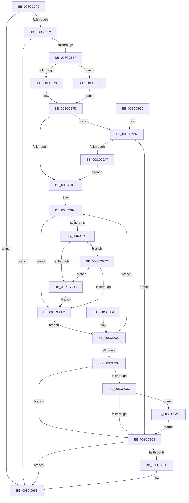

# PspWriteTebImpersonationInfo

- RVA: `0x008CC7F0`–`0x008CC9CA` (길이 `474` bytes)
- VA: `0x00000001408CC7F0`
- 실행 섹션: `PAGE`
- PDB 이름 있음: `예`; PDB Function 태그: `아니요`
- unwind 정보 RVA: `0x000845C8`
- 디코드: `109`개 명령, `474/474` bytes 표시
- 미해석 바이트: `0` (있으면 어셈블리에 `.byte`로 보존)

> 이 문서는 커널 이미지의 기계어와 PDB 기호를 분석해 생성했습니다. 4번과 5번은 함수 원형과 자료형을 바이너리 사용 방식에서 추정한 C 해석이며 원본 소스 복구 결과는 아닙니다.

## 1. Dependencies

- 직접 호출 지점: **5**; 고유 호출 대상: **5**
- 직접 호출자로 확인된 함수: **3**
- RIP 상대 이미지 참조: **1**

### Outgoing calls
- `0x008CC966` → [KiUnstackDetachProcess](../../text/21/KiUnstackDetachProcess_function_00217D30.md) (function, `0x00217D30`)
- `0x008CC978` → [_security_check_cookie](../../text/6A/_security_check_cookie_function_006AC640.md) (function, `0x006AC640`)
- `0x008CC99E` → [ExAcquireRundownProtection](../../text/21/ExAcquireRundownProtection_function_00216620.md) (function, `0x00216620`)
- `0x008CC9AC` → [ExfReleaseRundownProtection](../../text/34/ExfReleaseRundownProtection_function_00349EB0.md) (function, `0x00349EB0`)
- `0x008CC9BB` → [KeStackAttachProcess](../../text/21/KeStackAttachProcess_function_00216800.md) (function, `0x00216800`)

### Direct callers
- [PsImpersonateClient](PsImpersonateClient_function_008CBE10.md) at `0x008CBFAB`
- [sub_00B1A8E2](../B1/Unknown_function_00B1A8E2.md) at `0x00B1A8F0`
- [sub_00B30710](../B3/Unknown_function_00B30710.md) at `0x00B3071F`

### Static image references
- `0x008CC80B` → RVA `0x00E0A740` (`.data`; read)

## 2. Other-region calls and transfers

- 다른 실행 섹션으로 향하는 call: **5**
  - `0x008CC966` → [KiUnstackDetachProcess](../../text/21/KiUnstackDetachProcess_function_00217D30.md) (`PAGE` → `.text`)
  - `0x008CC978` → [_security_check_cookie](../../text/6A/_security_check_cookie_function_006AC640.md) (`PAGE` → `.text`)
  - `0x008CC99E` → [ExAcquireRundownProtection](../../text/21/ExAcquireRundownProtection_function_00216620.md) (`PAGE` → `.text`)
  - `0x008CC9AC` → [ExfReleaseRundownProtection](../../text/34/ExfReleaseRundownProtection_function_00349EB0.md) (`PAGE` → `.text`)
  - `0x008CC9BB` → [KeStackAttachProcess](../../text/21/KeStackAttachProcess_function_00216800.md) (`PAGE` → `.text`)
- 별도 외부 분기/꼬리 이동을 확인하지 못했습니다.

## 3. Assembly (complete function range)

```asm
008CC7F0  48 89 5C 24 18                  mov qword ptr [rsp + 0x18], rbx
008CC7F5  48 89 74 24 20                  mov qword ptr [rsp + 0x20], rsi
008CC7FA  48 89 54 24 10                  mov qword ptr [rsp + 0x10], rdx
008CC7FF  57                              push rdi
008CC800  41 56                           push r14
008CC802  41 57                           push r15
008CC804  48 81 EC 90 00 00 00            sub rsp, 0x90
008CC80B  48 8B 05 2E DF 53 00            mov rax, qword ptr [rip + 0x53df2e]
008CC812  48 33 C4                        xor rax, rsp
008CC815  48 89 84 24 80 00 00 00         mov qword ptr [rsp + 0x80], rax
008CC81D  48 8B F2                        mov rsi, rdx
008CC820  48 8B D9                        mov rbx, rcx
008CC823  48 89 4C 24 40                  mov qword ptr [rsp + 0x40], rcx
008CC828  0F 57 C0                        xorps xmm0, xmm0
008CC82B  0F 11 44 24 50                  movups xmmword ptr [rsp + 0x50], xmm0
008CC830  0F 11 44 24 60                  movups xmmword ptr [rsp + 0x60], xmm0
008CC835  0F 11 44 24 70                  movups xmmword ptr [rsp + 0x70], xmm0
008CC83A  48 8B B9 F0 00 00 00            mov rdi, qword ptr [rcx + 0xf0]
008CC841  48 89 7C 24 30                  mov qword ptr [rsp + 0x30], rdi
008CC846  4C 8B F7                        mov r14, rdi
008CC849  48 85 FF                        test rdi, rdi
008CC84C  0F 84 19 01 00 00               je 0x1408cc96b
008CC852  F7 41 74 00 04 00 00            test dword ptr [rcx + 0x74], 0x400
008CC859  0F 85 0C 01 00 00               jne 0x1408cc96b
008CC85F  4C 8B B9 20 02 00 00            mov r15, qword ptr [rcx + 0x220]
008CC866  4C 89 7C 24 38                  mov qword ptr [rsp + 0x38], r15
008CC86B  4C 39 BA B8 00 00 00            cmp qword ptr [rdx + 0xb8], r15
008CC872  0F 85 3B 01 00 00               jne 0x1408cc9b3
008CC878  C6 44 24 20 00                  mov byte ptr [rsp + 0x20], 0
008CC87D  48 3B DE                        cmp rbx, rsi
008CC880  0F 85 11 01 00 00               jne 0x1408cc997
008CC886  41 B9 4C 01 00 00               mov r9d, 0x14c
008CC88C  45 8D 51 78                     lea r10d, [r9 + 0x78]
008CC890  4C 8D 83 A0 05 00 00            lea r8, [rbx + 0x5a0]
008CC897  4C 89 44 24 28                  mov qword ptr [rsp + 0x28], r8
008CC89C  41 8B 00                        mov eax, dword ptr [r8]
008CC89F  83 E0 08                        and eax, 8
008CC8A2  0F 95 C2                        setne dl
008CC8A5  88 54 24 21                     mov byte ptr [rsp + 0x21], dl
008CC8A9  33 C9                           xor ecx, ecx
008CC8AB  85 C0                           test eax, eax
008CC8AD  0F 95 C1                        setne cl
008CC8B0  89 8F 9C 17 00 00               mov dword ptr [rdi + 0x179c], ecx
008CC8B6  C7 87 E8 17 00 00 00 00 00 00   mov dword ptr [rdi + 0x17e8], 0
008CC8C0  49 83 BF 10 03 00 00 00         cmp qword ptr [r15 + 0x310], 0
008CC8C8  74 28                           je 0x1408cc8f2
008CC8CA  41 0F B7 87 EC 06 00 00         movzx eax, word ptr [r15 + 0x6ec]
008CC8D2  66 41 3B C1                     cmp ax, r9w
008CC8D6  75 14                           jne 0x1408cc8ec
008CC8D8  41 89 8E 9C 2F 00 00            mov dword ptr [r14 + 0x2f9c], ecx
008CC8DF  41 C7 86 C4 2F 00 00 00 00 00 00  mov dword ptr [r14 + 0x2fc4], 0
008CC8EA  EB 06                           jmp 0x1408cc8f2
008CC8EC  66 41 3B C2                     cmp ax, r10w
008CC8F0  74 E6                           je 0x1408cc8d8
008CC8F2  EB 2E                           jmp 0x1408cc922
008CC8F4  41 B9 4C 01 00 00               mov r9d, 0x14c
008CC8FA  45 8D 51 78                     lea r10d, [r9 + 0x78]
008CC8FE  48 8B B4 24 B8 00 00 00         mov rsi, qword ptr [rsp + 0xb8]
008CC906  48 8B 7C 24 30                  mov rdi, qword ptr [rsp + 0x30]
008CC90B  4C 8B 7C 24 38                  mov r15, qword ptr [rsp + 0x38]
008CC910  48 8B 5C 24 40                  mov rbx, qword ptr [rsp + 0x40]
008CC915  4C 8B F7                        mov r14, rdi
008CC918  0F B6 54 24 21                  movzx edx, byte ptr [rsp + 0x21]
008CC91D  4C 8B 44 24 28                  mov r8, qword ptr [rsp + 0x28]
008CC922  F0 83 0C 24 00                  lock or dword ptr [rsp], 0
008CC927  41 8B 00                        mov eax, dword ptr [r8]
008CC92A  C1 E8 03                        shr eax, 3
008CC92D  24 01                           and al, 1
008CC92F  3A D0                           cmp dl, al
008CC931  0F 85 59 FF FF FF               jne 0x1408cc890
008CC937  48 3B DE                        cmp rbx, rsi
008CC93A  74 1C                           je 0x1408cc958
008CC93C  48 8D 8B 88 05 00 00            lea rcx, [rbx + 0x588]
008CC943  0F 0D 09                        prefetchw byte ptr [rcx]
008CC946  48 8B 01                        mov rax, qword ptr [rcx]
008CC949  48 83 E0 FE                     and rax, 0xfffffffffffffffe
008CC94D  48 8D 50 FE                     lea rdx, [rax - 2]
008CC951  F0 48 0F B1 11                  lock cmpxchg qword ptr [rcx], rdx
008CC956  75 54                           jne 0x1408cc9ac
008CC958  80 7C 24 20 00                  cmp byte ptr [rsp + 0x20], 0
008CC95D  74 0C                           je 0x1408cc96b
008CC95F  33 D2                           xor edx, edx
008CC961  48 8D 4C 24 50                  lea rcx, [rsp + 0x50]
008CC966  E8 C5 B3 94 FF                  call 0x140217d30
008CC96B  33 C0                           xor eax, eax
008CC96D  48 8B 8C 24 80 00 00 00         mov rcx, qword ptr [rsp + 0x80]
008CC975  48 33 CC                        xor rcx, rsp
008CC978  E8 C3 FC DD FF                  call 0x1406ac640
008CC97D  4C 8D 9C 24 90 00 00 00         lea r11, [rsp + 0x90]
008CC985  49 8B 5B 30                     mov rbx, qword ptr [r11 + 0x30]
008CC989  49 8B 73 38                     mov rsi, qword ptr [r11 + 0x38]
008CC98D  49 8B E3                        mov rsp, r11
008CC990  41 5F                           pop r15
008CC992  41 5E                           pop r14
008CC994  5F                              pop rdi
008CC995  C3                              ret
008CC996  CC                              int3
008CC997  48 8D 8B 88 05 00 00            lea rcx, [rbx + 0x588]
008CC99E  E8 7D 9C 94 FF                  call 0x140216620
008CC9A3  84 C0                           test al, al
008CC9A5  74 B1                           je 0x1408cc958
008CC9A7  E9 DA FE FF FF                  jmp 0x1408cc886
008CC9AC  E8 FF D4 A7 FF                  call 0x140349eb0
008CC9B1  EB A5                           jmp 0x1408cc958
008CC9B3  48 8D 54 24 50                  lea rdx, [rsp + 0x50]
008CC9B8  49 8B CF                        mov rcx, r15
008CC9BB  E8 40 9E 94 FF                  call 0x140216800
008CC9C0  C6 44 24 20 01                  mov byte ptr [rsp + 0x20], 1
008CC9C5  E9 B3 FE FF FF                  jmp 0x1408cc87d
```

## 4. C-style interpretation (structured pseudocode)

```c
__int64 __fastcall PspWriteTebImpersonationInfo(__int64 a1, __int64 a2)
{
    __int64 result;
    __int64 v_rsp;
    unsigned __int64 v_stack_m18;
    unsigned __int64 v_stack_m28;
    unsigned __int64 v_stack_m38;
    unsigned __int64 v_stack_m40;
    unsigned __int64 v_stack_m48;
    unsigned __int64 v_stack_m58;
    unsigned __int64 v_stack_m68;
    unsigned __int64 v_stack_m70;
    unsigned __int64 v_stack_m78;
    unsigned __int64 v_stack_m80;
    unsigned __int8 v_stack_m87;
    unsigned __int8 v_stack_m88;
    unsigned int v_stack_mA8;
    unsigned __int64 v_stack_p10;
    unsigned __int64 v_stack_p18;
    unsigned __int64 v_stack_p20;

    v_stack_p18 = v_rbx;
    v_stack_p20 = v_rsi;
    v_stack_p10 = a2;
    v_rsp = (v_rsp) - (144);
    result = (*(unsigned __int64 *)(v_rip + 5496622)) ^ (v_rsp);
    v_stack_m28 = result;
    v_stack_m68 = a1;
    v_stack_m58 = v_xmm0;
    v_stack_m48 = v_xmm0;
    v_stack_m38 = v_xmm0;
    v_stack_m78 = *(unsigned __int64 *)(a1 + 240);
    if (*(unsigned __int64 *)(a1 + 240) == 0) goto loc_008CC96B;
    if (((*(unsigned int *)(a1 + 116)) & (0x400ULL)) != 0) goto loc_008CC96B;
    v_stack_m70 = *(unsigned __int64 *)(a1 + 544);
    if ((*(unsigned __int64 *)(a2 + 184)) != (*(unsigned __int64 *)(a1 + 544))) goto loc_008CC9B3;
    v_stack_m88 = 0;
loc_008CC87D:
    if (a1 != a2) goto loc_008CC997;
loc_008CC886:
loc_008CC890:
    v_stack_m80 = a1 + 1440;
    result = (unsigned int)(((unsigned int)(*(unsigned int *)(a1 + 1440))) & (8));
    a2 = (condition_is_not_equal) ? 1 : 0;
    v_stack_m87 = (unsigned __int8)(a2);
    a1 = 0;
    a1 = ((unsigned int)(result) != 0) ? 1 : 0;
    *(unsigned int *)(*(unsigned __int64 *)(a1 + 240) + 6044) = (unsigned int)(a1);
    *(unsigned int *)(*(unsigned __int64 *)(a1 + 240) + 6120) = 0;
    if ((*(unsigned __int64 *)(*(unsigned __int64 *)(a1 + 544) + 784)) == 0) goto loc_008CC8F2;
    if (((unsigned __int16)(*(unsigned __int16 *)(*(unsigned __int64 *)(a1 + 544) + 1772))) != 332) goto loc_008CC8EC;
loc_008CC8D8:
    *(unsigned int *)(*(unsigned __int64 *)(a1 + 240) + 12188) = (unsigned int)(a1);
    *(unsigned int *)(*(unsigned __int64 *)(a1 + 240) + 12228) = 0;
    goto loc_008CC8F2;
loc_008CC8EC:
    if (((unsigned __int16)(*(unsigned __int16 *)(*(unsigned __int64 *)(a1 + 544) + 1772))) == ((unsigned __int16)(332 + 120))) goto loc_008CC8D8;
loc_008CC8F2:
    goto loc_008CC922;
loc_008CC922:
    result = (unsigned int)(((unsigned int)(*(unsigned int *)(a1 + 1440))) >> (3));
    result = (unsigned __int8)((result) & (1));
    if (((unsigned __int8)(a2)) != ((unsigned __int8)(result))) goto loc_008CC890;
    if (a1 == a2) goto loc_008CC958;
    result = (*(unsigned __int64 *)(a1 + 1416)) & (-2);
    if (condition_is_not_equal) goto loc_008CC9AC;
loc_008CC958:
    if (v_stack_m88 != 0) {
        a2 = 0;
        a1 = v_stack_m58;
        result = KiUnstackDetachProcess(a1, a2, a1 + 1440, 332);
    }
    result = 0;
    a1 = (v_stack_m28) ^ (v_rsp);
    result = _security_check_cookie(a1, a2, a1 + 1440, 332);
    return result;
loc_008CC997:
    result = ExAcquireRundownProtection(*(unsigned __int64 *)(v_stack_m18 + 48) + 1416, a2, a1 + 1440, 332);
    if ((unsigned __int8)(result) == 0) goto loc_008CC958;
    goto loc_008CC886;
loc_008CC9AC:
    result = ExfReleaseRundownProtection(*(unsigned __int64 *)(v_stack_m18 + 48) + 1416, a2, a1 + 1440, 332);
    goto loc_008CC958;
loc_008CC9B3:
    result = KeStackAttachProcess(*(unsigned __int64 *)(a1 + 544), v_stack_m40, a1 + 1440, 332);
    v_stack_m70 = 1;
    goto loc_008CC87D;
}
```

## 5. (Beta) C Style

```c
int64_t PspWriteTebImpersonationInfo(void *Arg1, void *Arg2)
{
    uint8_t *arg1 = (uint8_t *)Arg1;
    uint8_t *arg2 = (uint8_t *)Arg2;

    int64_t result;
    int64_t local_rsp;
    uint64_t v_stack_m18;
    uint64_t v_stack_m28;
    uint64_t v_stack_m38;
    uint64_t v_stack_m40;
    uint64_t v_stack_m48;
    uint64_t v_stack_m58;
    uint64_t v_stack_m68;
    uint64_t v_stack_m70;
    uint64_t v_stack_m78;
    uint64_t v_stack_m80;
    uint8_t v_stack_m87;
    uint8_t v_stack_m88;
    uint32_t v_stack_mA8;
    uint64_t v_stack_p10;
    uint64_t v_stack_p18;
    uint64_t v_stack_p20;

    v_stack_p18 = local_rbx;
    v_stack_p20 = local_rsi;
    v_stack_p10 = Arg2;
    local_rsp = (local_rsp) - (144);
    result = (*(uint64_t *)(v_rip + 0x53DF2E)) ^ (local_rsp);
    v_stack_m28 = result;
    v_stack_m68 = Arg1;
    v_stack_m58 = v_xmm0;
    v_stack_m48 = v_xmm0;
    v_stack_m38 = v_xmm0;
    v_stack_m78 = *(uint64_t *)(arg1 + 0xF0);
    if (*(uint64_t *)(arg1 + 0xF0) == 0) goto loc_008CC96B;
    if (((*(uint32_t *)(arg1 + 0x74)) & (0x400ULL)) != 0) goto loc_008CC96B;
    v_stack_m70 = *(uint64_t *)(arg1 + 0x220);
    if ((*(uint64_t *)(arg2 + 0xB8)) != (*(uint64_t *)(arg1 + 0x220))) goto loc_008CC9B3;
    v_stack_m88 = 0;
loc_008CC87D:
    if (Arg1 != Arg2) goto loc_008CC997;
loc_008CC886:
loc_008CC890:
    v_stack_m80 = Arg1 + 1440;
    result = (uint32_t)(((uint32_t)(*(uint32_t *)(arg1 + 0x5A0))) & (8));
    Arg2 = (condition_is_not_equal) ? 1 : 0;
    v_stack_m87 = (uint8_t)(Arg2);
    Arg1 = 0;
    Arg1 = ((uint32_t)(result) != 0) ? 1 : 0;
    *(uint32_t *)(*(uint64_t *)(arg1 + 0xF0) + 0x179C) = (uint32_t)(Arg1);
    *(uint32_t *)(*(uint64_t *)(arg1 + 0xF0) + 0x17E8) = 0;
    if ((*(uint64_t *)(*(uint64_t *)(arg1 + 0x220) + 0x310)) == 0) goto loc_008CC8F2;
    if (((uint16_t)(*(uint16_t *)(*(uint64_t *)(arg1 + 0x220) + 0x6EC))) != 332) goto loc_008CC8EC;
loc_008CC8D8:
    *(uint32_t *)(*(uint64_t *)(arg1 + 0xF0) + 0x2F9C) = (uint32_t)(Arg1);
    *(uint32_t *)(*(uint64_t *)(arg1 + 0xF0) + 0x2FC4) = 0;
    goto loc_008CC8F2;
loc_008CC8EC:
    if (((uint16_t)(*(uint16_t *)(*(uint64_t *)(arg1 + 0x220) + 0x6EC))) == ((uint16_t)(332 + 120))) goto loc_008CC8D8;
loc_008CC8F2:
    goto loc_008CC922;
loc_008CC922:
    result = (uint32_t)(((uint32_t)(*(uint32_t *)(arg1 + 0x5A0))) >> (3));
    result = (uint8_t)((result) & (1));
    if (((uint8_t)(Arg2)) != ((uint8_t)(result))) goto loc_008CC890;
    if (Arg1 == Arg2) goto loc_008CC958;
    result = (*(uint64_t *)(arg1 + 0x588)) & (-2);
    if (condition_is_not_equal) goto loc_008CC9AC;
loc_008CC958:
    if (v_stack_m88 != 0) {
        Arg2 = 0;
        Arg1 = v_stack_m58;
        result = KiUnstackDetachProcess(Arg1, Arg2, Arg1 + 1440, 332);
    }
    result = 0;
    Arg1 = (v_stack_m28) ^ (local_rsp);
    result = _security_check_cookie(Arg1, Arg2, Arg1 + 1440, 332);
    return result;
loc_008CC997:
    result = ExAcquireRundownProtection(*(uint64_t *)(v_stack_m18 + 0x30) + 1416, Arg2, Arg1 + 1440, 332);
    if ((uint8_t)(result) == 0) goto loc_008CC958;
    goto loc_008CC886;
loc_008CC9AC:
    result = ExfReleaseRundownProtection(*(uint64_t *)(v_stack_m18 + 0x30) + 1416, Arg2, Arg1 + 1440, 332);
    goto loc_008CC958;
loc_008CC9B3:
    result = KeStackAttachProcess(*(uint64_t *)(arg1 + 0x220), v_stack_m40, Arg1 + 1440, 332);
    v_stack_m70 = 1;
    goto loc_008CC87D;
}
```

### 관측된 메모리 오프셋

구조체 형식이 확인되지 않은 접근은 인자 기준의 오프셋으로만 기록했습니다.

| 기준 인자 | 오프셋 표현 | 폭 (bit) | 접근 |
|---|---:|---:|---|
| `Arg1` | `+ 0x74` | `32` | `R` |
| `Arg1` | `+ 0xF0` | `64` | `R` |
| `Arg1` | `+ 0x220` | `64` | `R` |
| `Arg2` | `+ 0xB8` | `64` | `R` |

## 6. Execution-region graph

[열기: 2D/3D 그래프와 함수 탐색 컨트롤 패널](../../../control-panel.html?section=page&rva=0x008CC7F0&view=graph)

- 2D 그래프는 위에서 아래로 흐르고, 3D 그래프는 빈 공간을 드래그해 회전합니다. Shift+드래그는 이동, 휠은 확대·축소, 함수 노드 선택은 대상 보고서 이동입니다.

### Static fallback


