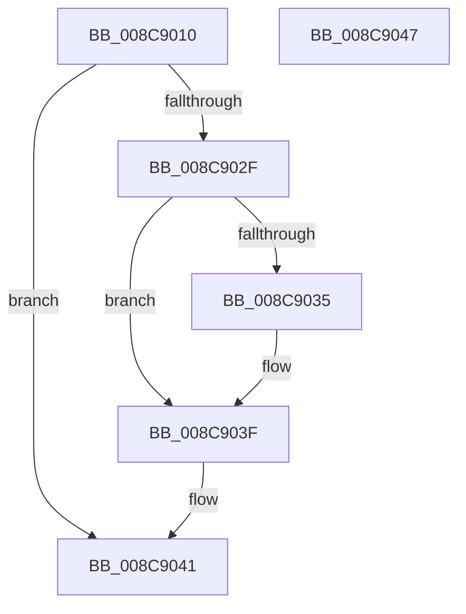

# RtlCheckRegistryKey

- RVA: `0x008C9010`–`0x008C9048` (길이 `56` bytes)
- VA: `0x00000001408C9010`
- 실행 섹션: `PAGE`
- PDB 이름 있음: `예`; PDB Function 태그: `아니요`
- unwind 정보 RVA: `0x0005CF00`
- 디코드: `18`개 명령, `56/56` bytes 표시
- 미해석 바이트: `0` (있으면 어셈블리에 `.byte`로 보존)

> 이 문서는 커널 이미지의 기계어와 PDB 기호를 분석해 생성했습니다. 4번과 5번은 함수 원형과 자료형을 바이너리 사용 방식에서 추정한 C 해석이며 원본 소스 복구 결과는 아닙니다.

## 1. Dependencies

- 직접 호출 지점: **2**; 고유 호출 대상: **2**
- 직접 호출자로 확인된 함수: **3**
- RIP 상대 이미지 참조: **0**

### Outgoing calls
- `0x008C9026` → [RtlpGetRegistryHandle](RtlpGetRegistryHandle_function_008C955C.md) (function, `0x008C955C`)
- `0x008C903A` → [ZwClose](../../text/6A/ZwClose_function_006AD2B0.md) (function, `0x006AD2B0`)

### Direct callers
- [RtlCheckPortableOperatingSystem](../../text/4A/RtlCheckPortableOperatingSystem_function_004A0FD0.md) at `0x004A0FF1`
- [DifRtlCheckRegistryKeyWrapper](../../text/63/DifRtlCheckRegistryKeyWrapper_function_0063B380.md) at `0x0063B457`
- [WheapOpenPolicyRegistryKey](../../init/C5/WheapOpenPolicyRegistryKey_function_00C55840.md) at `0x00C5588E`

### Static image references
- 디코드된 RIP-relative 메모리 참조가 없습니다.

## 2. Other-region calls and transfers

- 다른 실행 섹션으로 향하는 call: **1**
  - `0x008C903A` → [ZwClose](../../text/6A/ZwClose_function_006AD2B0.md) (`PAGE` → `.text`)
- 별도 외부 분기/꼬리 이동을 확인하지 못했습니다.

## 3. Assembly (complete function range)

```asm
008C9010  40 53                           push rbx
008C9012  48 83 EC 20                     sub rsp, 0x20
008C9016  48 83 64 24 40 00               and qword ptr [rsp + 0x40], 0
008C901C  4C 8D 4C 24 40                  lea r9, [rsp + 0x40]
008C9021  45 33 C0                        xor r8d, r8d
008C9024  8B D9                           mov ebx, ecx
008C9026  E8 31 05 00 00                  call 0x1408c955c
008C902B  85 C0                           test eax, eax
008C902D  78 12                           js 0x1408c9041
008C902F  0F BA E3 1E                     bt ebx, 0x1e
008C9033  72 0A                           jb 0x1408c903f
008C9035  48 8B 4C 24 40                  mov rcx, qword ptr [rsp + 0x40]
008C903A  E8 71 42 DE FF                  call 0x1406ad2b0
008C903F  33 C0                           xor eax, eax
008C9041  48 83 C4 20                     add rsp, 0x20
008C9045  5B                              pop rbx
008C9046  C3                              ret
008C9047  CC                              int3
```

## 4. C-style interpretation (structured pseudocode)

```c
__int64 __fastcall RtlCheckRegistryKey(int a1, __int64 a2, int a3)
{
    __int64 result;
    __int64 v_rsp;
    unsigned __int64 v_stack_p18;

    v_rsp = (v_rsp) - (32);
    a3 = 0;
    result = RtlpGetRegistryHandle(a1, a2, a3, v_stack_p18);
    if (sign_flag) goto loc_008C9041;
    if (!(condition_is_below)) {
        a1 = v_stack_p18;
        result = ZwClose(a1, a2, a3, v_stack_p18);
    }
    result = 0;
loc_008C9041:
    v_rsp = (v_rsp) + (32);
    return result;
}
```

## 5. (Beta) C Style

```c
int64_t RtlCheckRegistryKey(int32_t Arg1, int64_t Arg2, int32_t Arg3)
{
    int64_t result;
    int64_t local_rsp;
    uint64_t v_stack_p18;

    local_rsp = (local_rsp) - (32);
    Arg3 = 0;
    result = RtlpGetRegistryHandle(Arg1, Arg2, Arg3, v_stack_p18);
    if (sign_flag) goto loc_008C9041;
    if (!(condition_is_below)) {
        Arg1 = v_stack_p18;
        result = ZwClose(Arg1, Arg2, Arg3, v_stack_p18);
    }
    result = 0;
loc_008C9041:
    local_rsp = (local_rsp) + (32);
    return result;
}
```

## 6. Execution-region graph

[열기: 2D/3D 그래프와 함수 탐색 컨트롤 패널](../../../control-panel.html?section=page&rva=0x008C9010&view=graph)

- 2D 그래프는 위에서 아래로 흐르고, 3D 그래프는 빈 공간을 드래그해 회전합니다. Shift+드래그는 이동, 휠은 확대·축소, 함수 노드 선택은 대상 보고서 이동입니다.

### Static fallback


