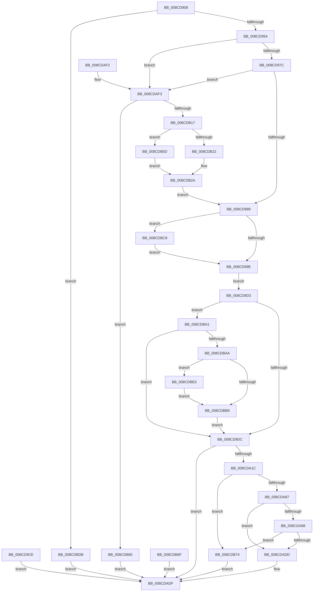

# RtlCreateUserStack

- RVA: `0x008CD908`–`0x008CDBF5` (길이 `749` bytes)
- VA: `0x00000001408CD908`
- 실행 섹션: `PAGE`
- PDB 이름 있음: `예`; PDB Function 태그: `아니요`
- unwind 정보 RVA: `0x0008470C`
- 디코드: `171`개 명령, `749/749` bytes 표시
- 미해석 바이트: `0` (있으면 어셈블리에 `.byte`로 보존)

> 이 문서는 커널 이미지의 기계어와 PDB 기호를 분석해 생성했습니다. 4번과 5번은 함수 원형과 자료형을 바이너리 사용 방식에서 추정한 C 해석이며 원본 소스 복구 결과는 아닙니다.

## 1. Dependencies

- 직접 호출 지점: **5**; 고유 호출 대상: **4**
- 직접 호출자로 확인된 함수: **1**
- RIP 상대 이미지 참조: **0**

### Outgoing calls
- `0x008CDA0C` → [ZwSetInformationProcess](../../text/6A/ZwSetInformationProcess_function_006AD450.md) (function, `0x006AD450`)
- `0x008CDA78` → [ZwAllocateVirtualMemory](../../text/6A/ZwAllocateVirtualMemory_function_006AD3D0.md) (function, `0x006AD3D0`)
- `0x008CDACE` → [ZwAllocateVirtualMemory](../../text/6A/ZwAllocateVirtualMemory_function_006AD3D0.md) (function, `0x006AD3D0`)
- `0x008CDB0A` → [RtlImageNtHeader](../../text/44/RtlImageNtHeader_function_00443B60.md) (function, `0x00443B60`)
- `0x008CDB95` → [ZwFreeVirtualMemory](../../text/6A/ZwFreeVirtualMemory_function_006AD490.md) (function, `0x006AD490`)

### Direct callers
- [PspSetupUserStack](PspSetupUserStack_function_008CD794.md) at `0x008CD81D`

### Static image references
- 디코드된 RIP-relative 메모리 참조가 없습니다.

## 2. Other-region calls and transfers

- 다른 실행 섹션으로 향하는 call: **5**
  - `0x008CDA0C` → [ZwSetInformationProcess](../../text/6A/ZwSetInformationProcess_function_006AD450.md) (`PAGE` → `.text`)
  - `0x008CDA78` → [ZwAllocateVirtualMemory](../../text/6A/ZwAllocateVirtualMemory_function_006AD3D0.md) (`PAGE` → `.text`)
  - `0x008CDACE` → [ZwAllocateVirtualMemory](../../text/6A/ZwAllocateVirtualMemory_function_006AD3D0.md) (`PAGE` → `.text`)
  - `0x008CDB0A` → [RtlImageNtHeader](../../text/44/RtlImageNtHeader_function_00443B60.md) (`PAGE` → `.text`)
  - `0x008CDB95` → [ZwFreeVirtualMemory](../../text/6A/ZwFreeVirtualMemory_function_006AD490.md) (`PAGE` → `.text`)
- 별도 외부 분기/꼬리 이동을 확인하지 못했습니다.

## 3. Assembly (complete function range)

```asm
008CD908  4C 8B DC                        mov r11, rsp
008CD90B  49 89 53 10                     mov qword ptr [r11 + 0x10], rdx
008CD90F  49 89 4B 08                     mov qword ptr [r11 + 8], rcx
008CD913  53                              push rbx
008CD914  56                              push rsi
008CD915  57                              push rdi
008CD916  41 54                           push r12
008CD918  41 55                           push r13
008CD91A  41 56                           push r14
008CD91C  41 57                           push r15
008CD91E  48 81 EC 80 00 00 00            sub rsp, 0x80
008CD925  49 8B F1                        mov rsi, r9
008CD928  4D 8B E0                        mov r12, r8
008CD92B  45 33 C0                        xor r8d, r8d
008CD92E  4D 89 43 28                     mov qword ptr [r11 + 0x28], r8
008CD932  4D 89 43 B8                     mov qword ptr [r11 - 0x48], r8
008CD936  4D 8B F1                        mov r14, r9
008CD939  49 C1 EE 38                     shr r14, 0x38
008CD93D  48 B8 FF FF FF FF FF FF FF 00   movabs rax, 0xffffffffffffff
008CD947  48 23 F0                        and rsi, rax
008CD94A  41 80 FE 40                     cmp r14b, 0x40
008CD94E  0F 87 87 02 00 00               ja 0x1408cdbdb
008CD954  4C 8D 3C 76                     lea r15, [rsi + rsi*2]
008CD958  65 48 8B 04 25 88 01 00 00      mov rax, qword ptr gs:[0x188]
008CD961  48 8B 88 B8 00 00 00            mov rcx, qword ptr [rax + 0xb8]
008CD968  4C 8B A9 E0 02 00 00            mov r13, qword ptr [rcx + 0x2e0]
008CD96F  49 8B 43 08                     mov rax, qword ptr [r11 + 8]
008CD973  48 85 C0                        test rax, rax
008CD976  0F 84 77 01 00 00               je 0x1408cdaf3
008CD97C  49 8B 5B 10                     mov rbx, qword ptr [r11 + 0x10]
008CD980  48 85 DB                        test rbx, rbx
008CD983  0F 84 6A 01 00 00               je 0x1408cdaf3
008CD989  B9 00 40 00 00                  mov ecx, 0x4000
008CD98E  48 85 C0                        test rax, rax
008CD991  48 0F 44 C1                     cmove rax, rcx
008CD995  48 3B C3                        cmp rax, rbx
008CD998  0F 83 2A 02 00 00               jae 0x1408cdbc8
008CD99E  48 8D 4E FF                     lea rcx, [rsi - 1]
008CD9A2  48 F7 D1                        not rcx
008CD9A5  48 8D 7E FF                     lea rdi, [rsi - 1]
008CD9A9  48 03 F8                        add rdi, rax
008CD9AC  48 23 F9                        and rdi, rcx
008CD9AF  48 81 C3 FF FF 00 00            add rbx, 0xffff
008CD9B6  48 C7 C2 00 00 FF FF            mov rdx, 0xffffffffffff0000
008CD9BD  48 23 DA                        and rbx, rdx
008CD9C0  49 8B 85 18 03 00 00            mov rax, qword ptr [r13 + 0x318]
008CD9C7  48 89 44 24 48                  mov qword ptr [rsp + 0x48], rax
008CD9CC  EB 05                           jmp 0x1408cd9d3
008CD9CE  E9 0C 01 00 00                  jmp 0x1408cdadf
008CD9D3  48 85 C0                        test rax, rax
008CD9D6  0F 85 C5 01 00 00               jne 0x1408cdba1
008CD9DC  44 89 74 24 50                  mov dword ptr [rsp + 0x50], r14d
008CD9E1  48 83 64 24 54 00               and qword ptr [rsp + 0x54], 0
008CD9E7  44 89 44 24 5C                  mov dword ptr [rsp + 0x5c], r8d
008CD9EC  48 89 5C 24 60                  mov qword ptr [rsp + 0x60], rbx
008CD9F1  4C 89 64 24 68                  mov qword ptr [rsp + 0x68], r12
008CD9F6  41 B9 28 00 00 00               mov r9d, 0x28
008CD9FC  4C 8D 44 24 50                  lea r8, [rsp + 0x50]
008CDA01  41 8D 51 01                     lea edx, [r9 + 1]
008CDA05  49 83 CC FF                     or r12, 0xffffffffffffffff
008CDA09  49 8B CC                        mov rcx, r12
008CDA0C  E8 3F FA DD FF                  call 0x1406ad450
008CDA11  45 33 F6                        xor r14d, r14d
008CDA14  85 C0                           test eax, eax
008CDA16  0F 88 C3 00 00 00               js 0x1408cdadf
008CDA1C  48 8B B4 24 E8 00 00 00         mov rsi, qword ptr [rsp + 0xe8]
008CDA24  4C 89 36                        mov qword ptr [rsi], r14
008CDA27  4C 89 76 08                     mov qword ptr [rsi + 8], r14
008CDA2B  48 8B 4C 24 70                  mov rcx, qword ptr [rsp + 0x70]
008CDA30  48 89 4E 20                     mov qword ptr [rsi + 0x20], rcx
008CDA34  48 8D 04 19                     lea rax, [rcx + rbx]
008CDA38  48 89 46 10                     mov qword ptr [rsi + 0x10], rax
008CDA3C  48 2B CF                        sub rcx, rdi
008CDA3F  48 03 CB                        add rcx, rbx
008CDA42  48 89 8C 24 D8 00 00 00         mov qword ptr [rsp + 0xd8], rcx
008CDA4A  48 2B DF                        sub rbx, rdi
008CDA4D  48 89 7C 24 30                  mov qword ptr [rsp + 0x30], rdi
008CDA52  C7 44 24 28 04 00 00 00         mov dword ptr [rsp + 0x28], 4
008CDA5A  41 BD 00 10 00 00               mov r13d, 0x1000
008CDA60  44 89 6C 24 20                  mov dword ptr [rsp + 0x20], r13d
008CDA65  4C 8D 4C 24 30                  lea r9, [rsp + 0x30]
008CDA6A  45 33 C0                        xor r8d, r8d
008CDA6D  48 8D 94 24 D8 00 00 00         lea rdx, [rsp + 0xd8]
008CDA75  49 8B CC                        mov rcx, r12
008CDA78  E8 53 F9 DD FF                  call 0x1406ad3d0
008CDA7D  8B F8                           mov edi, eax
008CDA7F  85 C0                           test eax, eax
008CDA81  0F 88 ED 00 00 00               js 0x1408cdb74
008CDA87  48 8B 84 24 D8 00 00 00         mov rax, qword ptr [rsp + 0xd8]
008CDA8F  48 89 46 18                     mov qword ptr [rsi + 0x18], rax
008CDA93  49 3B DF                        cmp rbx, r15
008CDA96  72 45                           jb 0x1408cdadd
008CDA98  49 2B C7                        sub rax, r15
008CDA9B  48 89 84 24 D8 00 00 00         mov qword ptr [rsp + 0xd8], rax
008CDAA3  4C 89 BC 24 E0 00 00 00         mov qword ptr [rsp + 0xe0], r15
008CDAAB  C7 44 24 28 04 01 00 00         mov dword ptr [rsp + 0x28], 0x104
008CDAB3  44 89 6C 24 20                  mov dword ptr [rsp + 0x20], r13d
008CDAB8  4C 8D 8C 24 E0 00 00 00         lea r9, [rsp + 0xe0]
008CDAC0  45 33 C0                        xor r8d, r8d
008CDAC3  48 8D 94 24 D8 00 00 00         lea rdx, [rsp + 0xd8]
008CDACB  49 8B CC                        mov rcx, r12
008CDACE  E8 FD F8 DD FF                  call 0x1406ad3d0
008CDAD3  8B F8                           mov edi, eax
008CDAD5  85 C0                           test eax, eax
008CDAD7  0F 88 97 00 00 00               js 0x1408cdb74
008CDADD  33 C0                           xor eax, eax
008CDADF  48 81 C4 80 00 00 00            add rsp, 0x80
008CDAE6  41 5F                           pop r15
008CDAE8  41 5E                           pop r14
008CDAEA  41 5D                           pop r13
008CDAEC  41 5C                           pop r12
008CDAEE  5F                              pop rdi
008CDAEF  5E                              pop rsi
008CDAF0  5B                              pop rbx
008CDAF1  C3                              ret
008CDAF2  CC                              int3
008CDAF3  65 48 8B 04 25 88 01 00 00      mov rax, qword ptr gs:[0x188]
008CDAFC  48 8B 88 B8 00 00 00            mov rcx, qword ptr [rax + 0xb8]
008CDB03  48 8B 89 B0 02 00 00            mov rcx, qword ptr [rcx + 0x2b0]
008CDB0A  E8 51 60 B7 FF                  call 0x140443b60
008CDB0F  45 33 C0                        xor r8d, r8d
008CDB12  48 85 C0                        test rax, rax
008CDB15  74 4E                           je 0x1408cdb65
008CDB17  B9 0B 02 00 00                  mov ecx, 0x20b
008CDB1C  66 39 48 18                     cmp word ptr [rax + 0x18], cx
008CDB20  75 3B                           jne 0x1408cdb5d
008CDB22  48 8B 48 68                     mov rcx, qword ptr [rax + 0x68]
008CDB26  48 8B 50 60                     mov rdx, qword ptr [rax + 0x60]
008CDB2A  48 8B 84 24 C0 00 00 00         mov rax, qword ptr [rsp + 0xc0]
008CDB32  48 85 C0                        test rax, rax
008CDB35  48 0F 44 C1                     cmove rax, rcx
008CDB39  48 89 84 24 C0 00 00 00         mov qword ptr [rsp + 0xc0], rax
008CDB41  48 8B 9C 24 C8 00 00 00         mov rbx, qword ptr [rsp + 0xc8]
008CDB49  48 85 DB                        test rbx, rbx
008CDB4C  48 0F 44 DA                     cmove rbx, rdx
008CDB50  48 89 9C 24 C8 00 00 00         mov qword ptr [rsp + 0xc8], rbx
008CDB58  E9 2C FE FF FF                  jmp 0x1408cd989
008CDB5D  8B 48 64                        mov ecx, dword ptr [rax + 0x64]
008CDB60  8B 50 60                        mov edx, dword ptr [rax + 0x60]
008CDB63  EB C5                           jmp 0x1408cdb2a
008CDB65  B8 7B 00 00 C0                  mov eax, 0xc000007b
008CDB6A  E9 70 FF FF FF                  jmp 0x1408cdadf
008CDB6F  E9 6B FF FF FF                  jmp 0x1408cdadf
008CDB74  48 8B 46 20                     mov rax, qword ptr [rsi + 0x20]
008CDB78  48 89 44 24 40                  mov qword ptr [rsp + 0x40], rax
008CDB7D  4C 89 74 24 38                  mov qword ptr [rsp + 0x38], r14
008CDB82  41 B9 00 80 00 00               mov r9d, 0x8000
008CDB88  4C 8D 44 24 38                  lea r8, [rsp + 0x38]
008CDB8D  48 8D 54 24 40                  lea rdx, [rsp + 0x40]
008CDB92  49 8B CC                        mov rcx, r12
008CDB95  E8 F6 F8 DD FF                  call 0x1406ad490
008CDB9A  8B C7                           mov eax, edi
008CDB9C  E9 3E FF FF FF                  jmp 0x1408cdadf
008CDBA1  48 3B F8                        cmp rdi, rax
008CDBA4  0F 83 32 FE FF FF               jae 0x1408cd9dc
008CDBAA  48 8D 7E FF                     lea rdi, [rsi - 1]
008CDBAE  48 03 F8                        add rdi, rax
008CDBB1  48 23 F9                        and rdi, rcx
008CDBB4  48 3B FB                        cmp rdi, rbx
008CDBB7  73 2C                           jae 0x1408cdbe5
008CDBB9  48 81 C3 FF FF 00 00            add rbx, 0xffff
008CDBC0  48 23 DA                        and rbx, rdx
008CDBC3  E9 14 FE FF FF                  jmp 0x1408cd9dc
008CDBC8  48 8D 98 FF FF 0F 00            lea rbx, [rax + 0xfffff]
008CDBCF  48 81 E3 00 00 F0 FF            and rbx, 0xfffffffffff00000
008CDBD6  E9 C3 FD FF FF                  jmp 0x1408cd99e
008CDBDB  B8 0D 00 00 C0                  mov eax, 0xc000000d
008CDBE0  E9 FA FE FF FF                  jmp 0x1408cdadf
008CDBE5  48 8D 9F FF FF 0F 00            lea rbx, [rdi + 0xfffff]
008CDBEC  48 81 E3 00 00 F0 FF            and rbx, 0xfffffffffff00000
008CDBF3  EB C4                           jmp 0x1408cdbb9
```

## 4. C-style interpretation (structured pseudocode)

```c
__int64 __fastcall RtlCreateUserStack(__int64 a1, __int64 a2, __int64 a3, __int64 a4, __int64 a5, __int64 a6)
{
    __int64 result;
    __int64 v_r12;
    __int64 v_r14;
    __int64 v_rbx;
    __int64 v_rdi;
    __int64 v_rsi;
    __int64 v_rsp;
    unsigned __int64 v_stack_m48;
    unsigned __int64 v_stack_m50;
    unsigned __int64 v_stack_m58;
    unsigned int v_stack_m5C;
    unsigned __int64 v_stack_m64;
    unsigned int v_stack_m68;
    unsigned __int64 v_stack_m70;
    unsigned __int64 v_stack_m88;
    unsigned int v_stack_m90;
    unsigned int v_stack_m98;
    unsigned __int64 v_stack_p20;
    unsigned __int64 v_stack_p28;
    unsigned __int64 v_stack_p38;
    unsigned __int64 v_stack_p40;
    unsigned __int64 v_stack_pC0;
    unsigned __int64 v_stack_pC8;

    *(unsigned __int64 *)(v_rsp + 16) = a2;
    *(unsigned __int64 *)(v_rsp + 8) = a1;
    v_rsp = (v_rsp) - (128);
    a3 = 0;
    *(unsigned __int64 *)(v_rsp + 40) = 0;
    *(unsigned __int64 *)(v_rsp - 72) = 0;
    v_r14 = (a4) >> (56);
    v_rsi = (a4) & (result);
    if (((unsigned __int8)(v_r14)) > 64) goto loc_008CDBDB;
    if (*(unsigned __int64 *)(v_rsp + 8) == 0) goto loc_008CDAF3;
    if (*(unsigned __int64 *)(v_rsp + 16) == 0) goto loc_008CDAF3;
loc_008CD989:
    result = *(unsigned __int64 *)(v_rsp + 8);
    if (*(unsigned __int64 *)(v_rsp + 8) == 0) { result = (unsigned int)(0x4000ULL); }
    if (result >= (*(unsigned __int64 *)(v_rsp + 16))) goto loc_008CDBC8;
loc_008CD99E:
    a1 = ~(v_rsi - 1);
    v_rdi = (v_rsi - 1) + (result);
    v_rdi = (v_rdi) & (a1);
    v_rbx = (*(unsigned __int64 *)(v_rsp + 16)) + (0xFFFFULL);
    v_rbx = (v_rbx) & (0xFFFFFFFFFFFF0000ULL);
    v_stack_m70 = *(unsigned __int64 *)(*(unsigned __int64 *)(*(unsigned __int64 *)(*(unsigned __int64 *)(gs_base + (0 + 392)) + 184) + 736) + 792);
    goto loc_008CD9D3;
loc_008CD9D3:
    if (*(unsigned __int64 *)(*(unsigned __int64 *)(*(unsigned __int64 *)(*(unsigned __int64 *)(gs_base + (0 + 392)) + 184) + 736) + 792) != 0) goto loc_008CDBA1;
loc_008CD9DC:
    v_stack_m68 = (unsigned int)(v_r14);
    v_stack_m5C = 0;
    v_stack_m58 = v_rbx;
    v_stack_m50 = 0;
    v_r12 = (a3) | (-1);
    result = ZwSetInformationProcess(v_r12, 40 + 1, v_stack_m68, 40);
    v_r14 = 0;
    if (sign_flag) goto loc_008CDADF;
    *(unsigned __int64 *)(a6) = 0;
    *(unsigned __int64 *)(a6 + 8) = 0;
    *(unsigned __int64 *)(a6 + 32) = v_stack_m48;
    *(unsigned __int64 *)(a6 + 16) = v_stack_m48 + v_rbx * 1;
    a1 = (v_stack_m48) - (v_rdi);
    a1 = (a1) + (v_rbx);
    v_stack_p20 = a1;
    v_rbx = (v_rbx) - (v_rdi);
    v_stack_m88 = v_rdi;
    v_stack_m90 = 4;
    v_stack_m98 = (unsigned int)((unsigned int)(0x1000ULL));
    a3 = 0;
    result = ZwAllocateVirtualMemory(v_r12, v_stack_p20, a3, v_stack_m88);
    if (sign_flag) goto loc_008CDB74;
    *(unsigned __int64 *)(a6 + 24) = v_stack_p20;
    if (v_rbx < (v_rsi + v_rsi * 2)) goto loc_008CDADD;
    result = (v_stack_p20) - (v_rsi + v_rsi * 2);
    v_stack_p20 = result;
    v_stack_p28 = v_rsi + v_rsi * 2;
    v_stack_m90 = 260;
    v_stack_m98 = (unsigned int)((unsigned int)(0x1000ULL));
    a3 = 0;
    result = ZwAllocateVirtualMemory(v_r12, v_stack_p20, a3, a5);
    if (sign_flag) goto loc_008CDB74;
loc_008CDADD:
    result = 0;
loc_008CDADF:
    v_rsp = (v_rsp) + (128);
    return result;
loc_008CDAF3:
    result = RtlImageNtHeader(*(unsigned __int64 *)(*(unsigned __int64 *)(*(unsigned __int64 *)(gs_base + (0 + 392)) + 184) + 688), v_stack_p20, a3, a5);
    a3 = 0;
    if (result == 0) goto loc_008CDB65;
    if ((*(unsigned __int16 *)(result + 24)) != 523) goto loc_008CDB5D;
loc_008CDB2A:
    result = v_stack_pC0;
    if (v_stack_pC0 == 0) { result = *(unsigned __int64 *)(result + 104); }
    v_stack_pC0 = result;
    v_rbx = v_stack_pC8;
    if (v_stack_pC8 == 0) { v_rbx = *(unsigned __int64 *)(result + 96); }
    v_stack_pC8 = v_rbx;
    goto loc_008CD989;
loc_008CDB5D:
    goto loc_008CDB2A;
loc_008CDB65:
    goto loc_008CDADF;
loc_008CDB74:
    v_stack_p40 = *(unsigned __int64 *)(a6 + 32);
    v_stack_p38 = 0;
    result = ZwFreeVirtualMemory(v_r12, v_stack_p40, v_stack_p38, (unsigned int)(0x8000ULL));
    goto loc_008CDADF;
loc_008CDBA1:
    if (((unsigned int)((unsigned int)(result))) >= ((unsigned int)((unsigned int)((unsigned int)((unsigned int)(result)))))) goto loc_008CD9DC;
    v_rdi = (a6 - 1) + ((unsigned int)((unsigned int)((unsigned int)((unsigned int)(result)))));
    v_rdi = (v_rdi) & (v_r12);
    if (v_rdi >= v_rbx) goto loc_008CDBE5;
loc_008CDBB9:
    v_rbx = (v_rbx) + (0xFFFFULL);
    v_rbx = (v_rbx) & (v_stack_p40);
    goto loc_008CD9DC;
loc_008CDBC8:
    v_rbx = ((unsigned int)((unsigned int)((unsigned int)((unsigned int)(result)))) + 1048575) & (0xFFFFFFFFFFF00000ULL);
    goto loc_008CD99E;
loc_008CDBDB:
    goto loc_008CDADF;
loc_008CDBE5:
    v_rbx = (v_rdi + 1048575) & (0xFFFFFFFFFFF00000ULL);
    goto loc_008CDBB9;
}
```

## 5. (Beta) C Style

```c
int64_t RtlCreateUserStack(int64_t Arg1, int64_t Arg2, int64_t Arg3, void *Arg4, int64_t Arg5, void *Arg6)
{
    uint8_t *arg4 = (uint8_t *)Arg4;
    uint8_t *arg6 = (uint8_t *)Arg6;

    int64_t result;
    int64_t local_r12;
    int64_t local_r14;
    int64_t local_rbx;
    int64_t local_rdi;
    int64_t local_rsi;
    int64_t local_rsp;
    uint64_t v_stack_m48;
    uint64_t v_stack_m50;
    uint64_t v_stack_m58;
    uint32_t v_stack_m5C;
    uint64_t v_stack_m64;
    uint32_t v_stack_m68;
    uint64_t v_stack_m70;
    uint64_t v_stack_m88;
    uint32_t v_stack_m90;
    uint32_t v_stack_m98;
    uint64_t v_stack_p20;
    uint64_t v_stack_p28;
    uint64_t v_stack_p38;
    uint64_t v_stack_p40;
    uint64_t v_stack_pC0;
    uint64_t v_stack_pC8;

    *(uint64_t *)(local_rsp + 0x10) = Arg2;
    *(uint64_t *)(local_rsp + 0x8) = Arg1;
    local_rsp = (local_rsp) - (128);
    Arg3 = 0;
    *(uint64_t *)(local_rsp + 0x28) = 0;
    *(uint64_t *)(local_rsp - 0x48) = 0;
    local_r14 = (Arg4) >> (56);
    local_rsi = (Arg4) & (result);
    if (((uint8_t)(local_r14)) > 64) goto loc_008CDBDB;
    if (*(uint64_t *)(local_rsp + 0x8) == 0) goto loc_008CDAF3;
    if (*(uint64_t *)(local_rsp + 0x10) == 0) goto loc_008CDAF3;
loc_008CD989:
    result = *(uint64_t *)(local_rsp + 0x8);
    if (*(uint64_t *)(local_rsp + 0x8) == 0) { result = (uint32_t)(0x4000ULL); }
    if (result >= (*(uint64_t *)(local_rsp + 0x10))) goto loc_008CDBC8;
loc_008CD99E:
    Arg1 = ~(local_rsi - 1);
    local_rdi = (local_rsi - 1) + (result);
    local_rdi = (local_rdi) & (Arg1);
    local_rbx = (*(uint64_t *)(local_rsp + 0x10)) + (0xFFFFULL);
    local_rbx = (local_rbx) & (0xFFFFFFFFFFFF0000ULL);
    v_stack_m70 = *(uint64_t *)(*(uint64_t *)(*(uint64_t *)(*(uint64_t *)(gs_base + (0 + 0x188)) + 0xB8) + 0x2E0) + 0x318);
    goto loc_008CD9D3;
loc_008CD9D3:
    if (*(uint64_t *)(*(uint64_t *)(*(uint64_t *)(*(uint64_t *)(gs_base + (0 + 0x188)) + 0xB8) + 0x2E0) + 0x318) != 0) goto loc_008CDBA1;
loc_008CD9DC:
    v_stack_m68 = (uint32_t)(local_r14);
    v_stack_m5C = 0;
    v_stack_m58 = local_rbx;
    v_stack_m50 = 0;
    local_r12 = (Arg3) | (-1);
    result = ZwSetInformationProcess(local_r12, 40 + 1, v_stack_m68, 40);
    local_r14 = 0;
    if (sign_flag) goto loc_008CDADF;
    *(uint64_t *)(arg6) = 0;
    *(uint64_t *)(arg6 + 0x8) = 0;
    *(uint64_t *)(arg6 + 0x20) = v_stack_m48;
    *(uint64_t *)(arg6 + 0x10) = v_stack_m48 + local_rbx * 1;
    Arg1 = (v_stack_m48) - (local_rdi);
    Arg1 = (Arg1) + (local_rbx);
    v_stack_p20 = Arg1;
    local_rbx = (local_rbx) - (local_rdi);
    v_stack_m88 = local_rdi;
    v_stack_m90 = 4;
    v_stack_m98 = (uint32_t)((uint32_t)(0x1000ULL));
    Arg3 = 0;
    result = ZwAllocateVirtualMemory(local_r12, v_stack_p20, Arg3, v_stack_m88);
    if (sign_flag) goto loc_008CDB74;
    *(uint64_t *)(arg6 + 0x18) = v_stack_p20;
    if (local_rbx < (local_rsi + local_rsi * 2)) goto loc_008CDADD;
    result = (v_stack_p20) - (local_rsi + local_rsi * 2);
    v_stack_p20 = result;
    v_stack_p28 = local_rsi + local_rsi * 2;
    v_stack_m90 = 260;
    v_stack_m98 = (uint32_t)((uint32_t)(0x1000ULL));
    Arg3 = 0;
    result = ZwAllocateVirtualMemory(local_r12, v_stack_p20, Arg3, Arg5);
    if (sign_flag) goto loc_008CDB74;
loc_008CDADD:
    result = 0;
loc_008CDADF:
    local_rsp = (local_rsp) + (128);
    return result;
loc_008CDAF3:
    result = RtlImageNtHeader(*(uint64_t *)(*(uint64_t *)(*(uint64_t *)(gs_base + (0 + 0x188)) + 0xB8) + 0x2B0), v_stack_p20, Arg3, Arg5);
    Arg3 = 0;
    if (result == 0) goto loc_008CDB65;
    if ((*(uint16_t *)(result + 0x18)) != 523) goto loc_008CDB5D;
loc_008CDB2A:
    result = v_stack_pC0;
    if (v_stack_pC0 == 0) { result = *(uint64_t *)(result + 0x68); }
    v_stack_pC0 = result;
    local_rbx = v_stack_pC8;
    if (v_stack_pC8 == 0) { local_rbx = *(uint64_t *)(result + 0x60); }
    v_stack_pC8 = local_rbx;
    goto loc_008CD989;
loc_008CDB5D:
    goto loc_008CDB2A;
loc_008CDB65:
    goto loc_008CDADF;
loc_008CDB74:
    v_stack_p40 = *(uint64_t *)(arg6 + 0x20);
    v_stack_p38 = 0;
    result = ZwFreeVirtualMemory(local_r12, v_stack_p40, v_stack_p38, (uint32_t)(0x8000ULL));
    goto loc_008CDADF;
loc_008CDBA1:
    if (((uint32_t)((uint32_t)(result))) >= ((uint32_t)((uint32_t)((uint32_t)((uint32_t)(result)))))) goto loc_008CD9DC;
    local_rdi = (Arg6 - 1) + ((uint32_t)((uint32_t)((uint32_t)((uint32_t)(result)))));
    local_rdi = (local_rdi) & (local_r12);
    if (local_rdi >= local_rbx) goto loc_008CDBE5;
loc_008CDBB9:
    local_rbx = (local_rbx) + (0xFFFFULL);
    local_rbx = (local_rbx) & (v_stack_p40);
    goto loc_008CD9DC;
loc_008CDBC8:
    local_rbx = ((uint32_t)((uint32_t)((uint32_t)((uint32_t)(result)))) + 1048575) & (0xFFFFFFFFFFF00000ULL);
    goto loc_008CD99E;
loc_008CDBDB:
    goto loc_008CDADF;
loc_008CDBE5:
    local_rbx = (local_rdi + 1048575) & (0xFFFFFFFFFFF00000ULL);
    goto loc_008CDBB9;
}
```

### 관측된 메모리 오프셋

구조체 형식이 확인되지 않은 접근은 인자 기준의 오프셋으로만 기록했습니다.

| 기준 인자 | 오프셋 표현 | 폭 (bit) | 접근 |
|---|---:|---:|---|
| `Arg4` | `- 0x1` | `64` | `R` |
| `Arg4` | `+ 0x0 + rsi*2` | `64` | `R` |
| `Arg6` | `+ 0x0` | `64` | `W` |
| `Arg6` | `+ 0x8` | `64` | `W` |
| `Arg6` | `+ 0x10` | `64` | `W` |
| `Arg6` | `+ 0x18` | `64` | `W` |
| `Arg6` | `+ 0x20` | `64` | `R` |
| `Arg6` | `+ 0x20` | `64` | `W` |

## 6. Execution-region graph

[열기: 2D/3D 그래프와 함수 탐색 컨트롤 패널](../../../control-panel.html?section=page&rva=0x008CD908&view=graph)

- 2D 그래프는 위에서 아래로 흐르고, 3D 그래프는 빈 공간을 드래그해 회전합니다. Shift+드래그는 이동, 휠은 확대·축소, 함수 노드 선택은 대상 보고서 이동입니다.

### Static fallback


