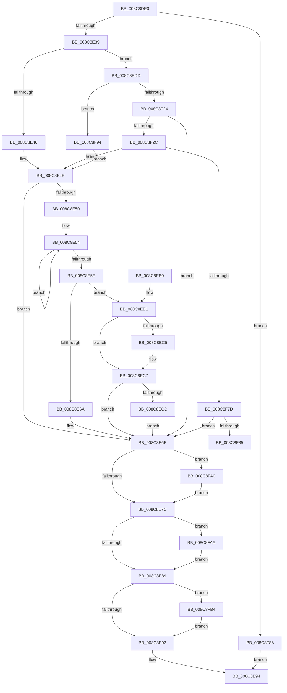

# RtlGetPersistedStateLocation

- RVA: `0x008C8DE0`–`0x008C8FC3` (길이 `483` bytes)
- VA: `0x00000001408C8DE0`
- 실행 섹션: `PAGE`
- PDB 이름 있음: `예`; PDB Function 태그: `예`
- unwind 정보 RVA: `0x00084108`
- 디코드: `126`개 명령, `483/483` bytes 표시
- 미해석 바이트: `0` (있으면 어셈블리에 `.byte`로 보존)

> 이 문서는 커널 이미지의 기계어와 PDB 기호를 분석해 생성했습니다. 4번과 5번은 함수 원형과 자료형을 바이너리 사용 방식에서 추정한 C 해석이며 원본 소스 복구 결과는 아닙니다.

## 1. Dependencies

- 직접 호출 지점: **7**; 고유 호출 대상: **5**
- 직접 호출자로 확인된 함수: **25**
- RIP 상대 이미지 참조: **3**

### Outgoing calls
- `0x008C8ED6` → [memcpy](../../text/6C/memcpy_function_006C6840.md) (function, `0x006C6840`)
- `0x008C8F16` → [ZwOpenKey](../../text/6A/ZwOpenKey_function_006AD310.md) (function, `0x006AD310`)
- `0x008C8F33` → [RtlInitUnicodeString](../../text/42/RtlInitUnicodeString_function_0042A780.md) (function, `0x0042A780`)
- `0x008C8F6B` → [ZwOpenKey](../../text/6A/ZwOpenKey_function_006AD310.md) (function, `0x006AD310`)
- `0x008C8FA0` → [ZwClose](../../text/6A/ZwClose_function_006AD2B0.md) (function, `0x006AD2B0`)
- `0x008C8FAA` → [ZwClose](../../text/6A/ZwClose_function_006AD2B0.md) (function, `0x006AD2B0`)
- `0x008C8FB9` → [ExFreePoolWithTag](../../poolcode/B8/ExFreePoolWithTag_function_00B82870.md) (function, `0x00B82870`)

### Direct callers
- [PopOpenThermalLoggingKey](../../text/4C/PopOpenThermalLoggingKey_function_004CDBFC.md) at `0x004CDC77`
- [PipUpdateDeviceProducts](../../text/5A/PipUpdateDeviceProducts_function_005A46C0.md) at `0x005A47A8`
- [PipUpdateDeviceProducts](../../text/5A/PipUpdateDeviceProducts_function_005A46C0.md) at `0x005A4802`
- [RtlpGetPersistedRegistryLocation](../../text/5E/RtlpGetPersistedRegistryLocation_function_005ED5BC.md) at `0x005ED604`
- [RtlpGetPersistedRegistryLocation](../../text/5E/RtlpGetPersistedRegistryLocation_function_005ED5BC.md) at `0x005ED665`
- [OpenGlobalizationUserSettingsKey_ForMua](../../text/65/OpenGlobalizationUserSettingsKey_ForMua_function_0065D0C8.md) at `0x0065D1E7`
- [PiDrvDbQuerySyncNodesUpdated](../74/PiDrvDbQuerySyncNodesUpdated_function_00741F70.md) at `0x00741FF8`
- [PopOpenPersistedRegistryKey](../75/PopOpenPersistedRegistryKey_function_00754260.md) at `0x007542D3`
- [PopInitHiberPersistedRegValues](../75/PopInitHiberPersistedRegValues_function_0075D974.md) at `0x0075D9AD`
- [PopInitHiberPersistedRegValues](../75/PopInitHiberPersistedRegValues_function_0075D974.md) at `0x0075DA0E`
- [WmipSaveGuidSecurityDescriptor](../7B/WmipSaveGuidSecurityDescriptor_function_007B4A38.md) at `0x007B4AA3`
- [EtwpInitializeAutoLoggers](../7B/EtwpInitializeAutoLoggers_function_007BE694.md) at `0x007BE873`
- [EtwpInitializeAutoLoggers](../7B/EtwpInitializeAutoLoggers_function_007BE694.md) at `0x007BE8C3`
- [SpRegOpenRedirectedKey](../7C/SpRegOpenRedirectedKey_function_007CAB44.md) at `0x007CAB95`
- [SpRegOpenRedirectedKey](../7C/SpRegOpenRedirectedKey_function_007CAB44.md) at `0x007CABF0`
- [ExpUuidLoadSequenceNumber](../7D/ExpUuidLoadSequenceNumber_function_007D0B18.md) at `0x007D0B9C`
- [ExpUuidSaveSequenceNumber](../7D/ExpUuidSaveSequenceNumber_function_007D0C84.md) at `0x007D0D0E`
- [CmpRecordShutdownStopTime](../7E/CmpRecordShutdownStopTime_function_007E551C.md) at `0x007E55A7`
- [WmipGetGuidSecurityDescriptor](WmipGetGuidSecurityDescriptor_function_008C7B4C.md) at `0x008C7C34`
- [PiCreateDriverRedirectedStateKey](../99/PiCreateDriverRedirectedStateKey_function_0099957C.md) at `0x009995EB`
- [IopUpdateSecureDeviceClassState](../9A/IopUpdateSecureDeviceClassState_function_009A2CE8.md) at `0x009A2D92`
- [PiGetStateRootPath](../A6/PiGetStateRootPath_function_00A67A70.md) at `0x00A67AB8`
- [KGetAppModelStateSeparatedRegKeyPath](../A6/KGetAppModelStateSeparatedRegKeyPath_function_00A690C0.md) at `0x00A69109`
- [KGetAppModelStateSeparatedRegKeyPath](../A6/KGetAppModelStateSeparatedRegKeyPath_function_00A690C0.md) at `0x00A69160`
- [ExpRefreshTimeZoneInformation](../A6/ExpRefreshTimeZoneInformation_function_00A6B46C.md) at `0x00A6B6AF`
- [RtlpGetTimeZoneInfoHandle](../A6/RtlpGetTimeZoneInfoHandle_function_00A6BD8C.md) at `0x00A6BE2D`
- [IopGetPersistedStateLocation](../AD/IopGetPersistedStateLocation_function_00AD2EE4.md) at `0x00AD2F46`
- [sub_00B2CD8C](../B2/Unknown_function_00B2CD8C.md) at `0x00B2CDAD`
- [sub_00B3EB30](../B3/Unknown_function_00B3EB30.md) at `0x00B3EB4E`
- [PopInitializePowerButtonHold](../../init/C4/PopInitializePowerButtonHold_function_00C425A8.md) at `0x00C426F1`
- [EtwpInitializeSecurity](../../init/C4/EtwpInitializeSecurity_function_00C4EDF0.md) at `0x00C4EEB8`

### Static image references
- `0x008C8E39` → RVA `0x00E67B09` (`.data`; read)
- `0x008C8EE0` → RVA `0x00B4BFE8` (`PAGE`; read)
- `0x008C8F94` → RVA `0x00E67B09` (`.data`; write)

## 2. Other-region calls and transfers

- 다른 실행 섹션으로 향하는 call: **7**
  - `0x008C8ED6` → [memcpy](../../text/6C/memcpy_function_006C6840.md) (`PAGE` → `.text`)
  - `0x008C8F16` → [ZwOpenKey](../../text/6A/ZwOpenKey_function_006AD310.md) (`PAGE` → `.text`)
  - `0x008C8F33` → [RtlInitUnicodeString](../../text/42/RtlInitUnicodeString_function_0042A780.md) (`PAGE` → `.text`)
  - `0x008C8F6B` → [ZwOpenKey](../../text/6A/ZwOpenKey_function_006AD310.md) (`PAGE` → `.text`)
  - `0x008C8FA0` → [ZwClose](../../text/6A/ZwClose_function_006AD2B0.md) (`PAGE` → `.text`)
  - `0x008C8FAA` → [ZwClose](../../text/6A/ZwClose_function_006AD2B0.md) (`PAGE` → `.text`)
  - `0x008C8FB9` → [ExFreePoolWithTag](../../poolcode/B8/ExFreePoolWithTag_function_00B82870.md) (`PAGE` → `POOLCODE`)
- call이 아닌 외부 분기/꼬리 이동: **1**
  - `0x008C8F85` → [sub_00B1B202](../B1/Unknown_function_00B1B202.md) (`tail-transfer`)

## 3. Assembly (complete function range)

```asm
008C8DE0  48 89 5C 24 08                  mov qword ptr [rsp + 8], rbx
008C8DE5  48 89 74 24 10                  mov qword ptr [rsp + 0x10], rsi
008C8DEA  55                              push rbp
008C8DEB  57                              push rdi
008C8DEC  41 54                           push r12
008C8DEE  41 55                           push r13
008C8DF0  41 56                           push r14
008C8DF2  48 8B EC                        mov rbp, rsp
008C8DF5  48 81 EC 80 00 00 00            sub rsp, 0x80
008C8DFC  45 33 ED                        xor r13d, r13d
008C8DFF  33 C0                           xor eax, eax
008C8E01  48 89 45 F0                     mov qword ptr [rbp - 0x10], rax
008C8E05  0F 57 C0                        xorps xmm0, xmm0
008C8E08  89 45 F8                        mov dword ptr [rbp - 8], eax
008C8E0B  4D 8B F0                        mov r14, r8
008C8E0E  4C 89 6D B0                     mov qword ptr [rbp - 0x50], r13
008C8E12  48 8B F2                        mov rsi, rdx
008C8E15  4C 89 6D B8                     mov qword ptr [rbp - 0x48], r13
008C8E19  4C 8B E1                        mov r12, rcx
008C8E1C  44 89 6D 48                     mov dword ptr [rbp + 0x48], r13d
008C8E20  41 8B FD                        mov edi, r13d
008C8E23  0F 11 45 D0                     movups xmmword ptr [rbp - 0x30], xmm0
008C8E27  0F 11 45 E0                     movups xmmword ptr [rbp - 0x20], xmm0
008C8E2B  0F 11 45 C0                     movups xmmword ptr [rbp - 0x40], xmm0
008C8E2F  41 83 F9 01                     cmp r9d, 1
008C8E33  0F 87 51 01 00 00               ja 0x1408c8f8a
008C8E39  44 38 2D C9 EC 59 00            cmp byte ptr [rip + 0x59ecc9], r13b
008C8E40  0F 84 97 00 00 00               je 0x1408c8edd
008C8E46  BB 34 00 00 C0                  mov ebx, 0xc0000034
008C8E4B  4D 85 F6                        test r14, r14
008C8E4E  74 1F                           je 0x1408c8e6f
008C8E50  48 83 C8 FF                     or rax, 0xffffffffffffffff
008C8E54  48 FF C0                        inc rax
008C8E57  66 45 39 2C 46                  cmp word ptr [r14 + rax*2], r13w
008C8E5C  75 F6                           jne 0x1408c8e54
008C8E5E  FF C0                           inc eax
008C8E60  8D 0C 00                        lea ecx, [rax + rax]
008C8E63  89 4D 48                        mov dword ptr [rbp + 0x48], ecx
008C8E66  3B C8                           cmp ecx, eax
008C8E68  73 47                           jae 0x1408c8eb1
008C8E6A  BB 95 00 00 C0                  mov ebx, 0xc0000095
008C8E6F  48 8B 4D B0                     mov rcx, qword ptr [rbp - 0x50]
008C8E73  48 85 C9                        test rcx, rcx
008C8E76  0F 85 24 01 00 00               jne 0x1408c8fa0
008C8E7C  48 8B 4D B8                     mov rcx, qword ptr [rbp - 0x48]
008C8E80  48 85 C9                        test rcx, rcx
008C8E83  0F 85 21 01 00 00               jne 0x1408c8faa
008C8E89  48 85 FF                        test rdi, rdi
008C8E8C  0F 85 22 01 00 00               jne 0x1408c8fb4
008C8E92  8B C3                           mov eax, ebx
008C8E94  4C 8D 9C 24 80 00 00 00         lea r11, [rsp + 0x80]
008C8E9C  49 8B 5B 30                     mov rbx, qword ptr [r11 + 0x30]
008C8EA0  49 8B 73 38                     mov rsi, qword ptr [r11 + 0x38]
008C8EA4  49 8B E3                        mov rsp, r11
008C8EA7  41 5E                           pop r14
008C8EA9  41 5D                           pop r13
008C8EAB  41 5C                           pop r12
008C8EAD  5F                              pop rdi
008C8EAE  5D                              pop rbp
008C8EAF  C3                              ret
008C8EB0  CC                              int3
008C8EB1  39 4D 58                        cmp dword ptr [rbp + 0x58], ecx
008C8EB4  48 8B 45 60                     mov rax, qword ptr [rbp + 0x60]
008C8EB8  1B DB                           sbb ebx, ebx
008C8EBA  81 E3 05 00 00 80               and ebx, 0x80000005
008C8EC0  48 85 C0                        test rax, rax
008C8EC3  74 02                           je 0x1408c8ec7
008C8EC5  89 08                           mov dword ptr [rax], ecx
008C8EC7  3B 4D 58                        cmp ecx, dword ptr [rbp + 0x58]
008C8ECA  77 A3                           ja 0x1408c8e6f
008C8ECC  49 8B D6                        mov rdx, r14
008C8ECF  44 8B C1                        mov r8d, ecx
008C8ED2  48 8B 4D 50                     mov rcx, qword ptr [rbp + 0x50]
008C8ED6  E8 65 D9 DF FF                  call 0x1406c6840
008C8EDB  EB 92                           jmp 0x1408c8e6f
008C8EDD  49 63 C1                        movsxd rax, r9d
008C8EE0  48 8D 0D 01 31 28 00            lea rcx, [rip + 0x283101]
008C8EE7  48 C1 E0 04                     shl rax, 4
008C8EEB  4C 8D 45 D0                     lea r8, [rbp - 0x30]
008C8EEF  48 03 C1                        add rax, rcx
008C8EF2  C7 45 D0 30 00 00 00            mov dword ptr [rbp - 0x30], 0x30
008C8EF9  48 8D 4D B0                     lea rcx, [rbp - 0x50]
008C8EFD  48 89 45 E0                     mov qword ptr [rbp - 0x20], rax
008C8F01  BA 19 00 02 00                  mov edx, 0x20019
008C8F06  4C 89 6D D8                     mov qword ptr [rbp - 0x28], r13
008C8F0A  C7 45 E8 40 02 00 00            mov dword ptr [rbp - 0x18], 0x240
008C8F11  F3 0F 7F 45 F0                  movdqu xmmword ptr [rbp - 0x10], xmm0
008C8F16  E8 F5 43 DE FF                  call 0x1406ad310
008C8F1B  8B D8                           mov ebx, eax
008C8F1D  3D 34 00 00 C0                  cmp eax, 0xc0000034
008C8F22  74 70                           je 0x1408c8f94
008C8F24  85 C0                           test eax, eax
008C8F26  0F 88 43 FF FF FF               js 0x1408c8e6f
008C8F2C  49 8B D4                        mov rdx, r12
008C8F2F  48 8D 4D C0                     lea rcx, [rbp - 0x40]
008C8F33  E8 48 18 B6 FF                  call 0x14042a780
008C8F38  48 8B 45 B0                     mov rax, qword ptr [rbp - 0x50]
008C8F3C  4C 8D 45 D0                     lea r8, [rbp - 0x30]
008C8F40  48 89 45 D8                     mov qword ptr [rbp - 0x28], rax
008C8F44  48 8D 4D B8                     lea rcx, [rbp - 0x48]
008C8F48  48 8D 45 C0                     lea rax, [rbp - 0x40]
008C8F4C  C7 45 D0 30 00 00 00            mov dword ptr [rbp - 0x30], 0x30
008C8F53  0F 57 C0                        xorps xmm0, xmm0
008C8F56  48 89 45 E0                     mov qword ptr [rbp - 0x20], rax
008C8F5A  BA 19 00 02 00                  mov edx, 0x20019
008C8F5F  C7 45 E8 40 02 00 00            mov dword ptr [rbp - 0x18], 0x240
008C8F66  F3 0F 7F 45 F0                  movdqu xmmword ptr [rbp - 0x10], xmm0
008C8F6B  E8 A0 43 DE FF                  call 0x1406ad310
008C8F70  8B D8                           mov ebx, eax
008C8F72  3D 34 00 00 C0                  cmp eax, 0xc0000034
008C8F77  0F 84 CE FE FF FF               je 0x1408c8e4b
008C8F7D  85 C0                           test eax, eax
008C8F7F  0F 88 EA FE FF FF               js 0x1408c8e6f
008C8F85  E9 78 22 25 00                  jmp 0x140b1b202
008C8F8A  B8 F1 00 00 C0                  mov eax, 0xc00000f1
008C8F8F  E9 00 FF FF FF                  jmp 0x1408c8e94
008C8F94  C6 05 6E EB 59 00 01            mov byte ptr [rip + 0x59eb6e], 1
008C8F9B  E9 AB FE FF FF                  jmp 0x1408c8e4b
008C8FA0  E8 0B 43 DE FF                  call 0x1406ad2b0
008C8FA5  E9 D2 FE FF FF                  jmp 0x1408c8e7c
008C8FAA  E8 01 43 DE FF                  call 0x1406ad2b0
008C8FAF  E9 D5 FE FF FF                  jmp 0x1408c8e89
008C8FB4  33 D2                           xor edx, edx
008C8FB6  48 8B CF                        mov rcx, rdi
008C8FB9  E8 B2 98 2B 00                  call 0x140b82870
008C8FBE  E9 CF FE FF FF                  jmp 0x1408c8e92
```

## 4. C-style interpretation (structured pseudocode)

```c
__int64 __fastcall RtlGetPersistedStateLocation(__int64 a1, __int64 a2, __int64 a3, int a4, __int64 a5, unsigned int a6, __int64 a7)
{
    __int64 result;
    __int64 v_r13;
    __int64 v_rbx;
    __int64 v_rsp;
    unsigned __int64 v_stack_m28;
    unsigned int v_stack_m30;
    unsigned __int64 v_stack_m38;
    unsigned int v_stack_m40;
    unsigned __int64 v_stack_m48;
    unsigned __int64 v_stack_m50;
    unsigned __int64 v_stack_m58;
    unsigned __int64 v_stack_m68;
    unsigned __int64 v_stack_m70;
    unsigned __int64 v_stack_m78;
    unsigned __int64 v_stack_p10;
    unsigned int v_stack_p20;
    unsigned __int64 v_stack_p8;

    v_stack_p8 = v_rbx;
    v_stack_p10 = v_rsi;
    v_rsp = (v_rsp) - (128);
    v_r13 = 0;
    result = 0;
    v_stack_m38 = 0;
    v_stack_m30 = 0;
    v_stack_m78 = 0;
    v_stack_m70 = 0;
    v_stack_p20 = 0;
    v_stack_m58 = v_xmm0;
    v_stack_m48 = v_xmm0;
    v_stack_m68 = v_xmm0;
    if (a4 > 1) goto loc_008C8F8A;
    if ((*(unsigned __int8 *)(v_rip + 5893321)) == 0) goto loc_008C8EDD;
loc_008C8E4B:
    if (a3 == 0) goto loc_008C8E6F;
    result = (result) | (-1);
loc_008C8E54:
    result = (result) + 1;
    if ((*(unsigned __int16 *)(a3 + result * 2)) != 0) goto loc_008C8E54;
    result = (unsigned int)((result) + 1);
    v_stack_p20 = (unsigned int)(result + result * 1);
    if (((unsigned int)(result + result * 1)) >= ((unsigned int)(result))) goto loc_008C8EB1;
loc_008C8E6F:
    if (v_stack_m78 != 0) goto loc_008C8FA0;
loc_008C8E7C:
    if (v_stack_m70 != 0) goto loc_008C8FAA;
loc_008C8E89:
    if (0 != 0) goto loc_008C8FB4;
loc_008C8E92:
loc_008C8E94:
    return (unsigned int)((unsigned int)((unsigned int)(0xC0000095ULL)));
loc_008C8EB1:
    v_rbx = (unsigned int)((*(unsigned __int64 *)(v_stack_m28 + 48)) & (0x80000005ULL));
    if (a7 != 0) {
        *(unsigned int *)(a7) = (unsigned int)(v_stack_m70);
    }
    if (((unsigned int)(v_stack_m70)) > a6) goto loc_008C8E6F;
    result = memcpy(a5, a3, (unsigned int)((unsigned int)(v_stack_m70)), a4);
    goto loc_008C8E6F;
loc_008C8EDD:
    result = ((int)(a4)) << (4);
    result = (result) + (v_rip + 2633985);
    v_stack_m58 = 48;
    v_stack_m48 = result;
    v_stack_m50 = 0;
    v_stack_m40 = 576;
    v_stack_m38 = v_xmm0;
    result = ZwOpenKey(v_stack_m78, (unsigned int)(0x20019ULL), v_stack_m58, a4);
    if (((unsigned int)(result)) == 0xC0000034ULL) goto loc_008C8F94;
    if (sign_flag) goto loc_008C8E6F;
    result = RtlInitUnicodeString(v_stack_m68, a1, v_stack_m58, a4);
    v_stack_m50 = v_stack_m78;
    v_stack_m58 = 48;
    v_stack_m48 = v_stack_m68;
    v_stack_m40 = 576;
    v_stack_m38 = v_xmm0;
    result = ZwOpenKey(v_stack_m70, (unsigned int)(0x20019ULL), v_stack_m58, a4);
    if (((unsigned int)(result)) == 0xC0000034ULL) goto loc_008C8E4B;
    if (sign_flag) goto loc_008C8E6F;
loc_008C8F8A:
    goto loc_008C8E94;
loc_008C8F94:
    *(unsigned __int8 *)(v_rip + 5892974) = 1;
    goto loc_008C8E4B;
loc_008C8FA0:
    result = ZwClose(v_stack_m70, (unsigned int)(0x20019ULL), v_stack_m58, a4);
    goto loc_008C8E7C;
loc_008C8FAA:
    result = ZwClose(v_stack_m70, (unsigned int)(0x20019ULL), v_stack_m58, a4);
    goto loc_008C8E89;
loc_008C8FB4:
    a2 = 0;
    result = ExFreePoolWithTag(0, a2, v_stack_m58, a4);
    goto loc_008C8E92;
}
```

## 5. (Beta) C Style

```c
int64_t RtlGetPersistedStateLocation(int64_t Arg1, int64_t Arg2, int64_t Arg3, int32_t Arg4, int64_t Arg5, uint32_t Arg6, int64_t Arg7)
{
    int64_t result;
    int64_t local_r13;
    int64_t local_rbx;
    int64_t local_rsp;
    uint64_t v_stack_m28;
    uint32_t v_stack_m30;
    uint64_t v_stack_m38;
    uint32_t v_stack_m40;
    uint64_t v_stack_m48;
    uint64_t v_stack_m50;
    uint64_t v_stack_m58;
    uint64_t v_stack_m68;
    uint64_t v_stack_m70;
    uint64_t v_stack_m78;
    uint64_t v_stack_p10;
    uint32_t v_stack_p20;
    uint64_t v_stack_p8;

    v_stack_p8 = local_rbx;
    v_stack_p10 = local_rsi;
    local_rsp = (local_rsp) - (128);
    local_r13 = 0;
    result = 0;
    v_stack_m38 = 0;
    v_stack_m30 = 0;
    v_stack_m78 = 0;
    v_stack_m70 = 0;
    v_stack_p20 = 0;
    v_stack_m58 = v_xmm0;
    v_stack_m48 = v_xmm0;
    v_stack_m68 = v_xmm0;
    if (Arg4 > 1) goto loc_008C8F8A;
    if ((*(uint8_t *)(v_rip + 0x59ECC9)) == 0) goto loc_008C8EDD;
loc_008C8E4B:
    if (Arg3 == 0) goto loc_008C8E6F;
    result = (result) | (-1);
loc_008C8E54:
    result = (result) + 1;
    if ((*(uint16_t *)(Arg3 + result * 2)) != 0) goto loc_008C8E54;
    result = (uint32_t)((result) + 1);
    v_stack_p20 = (uint32_t)(result + result * 1);
    if (((uint32_t)(result + result * 1)) >= ((uint32_t)(result))) goto loc_008C8EB1;
loc_008C8E6F:
    if (v_stack_m78 != 0) goto loc_008C8FA0;
loc_008C8E7C:
    if (v_stack_m70 != 0) goto loc_008C8FAA;
loc_008C8E89:
    if (0 != 0) goto loc_008C8FB4;
loc_008C8E92:
loc_008C8E94:
    return (uint32_t)((uint32_t)((uint32_t)(0xC0000095ULL)));
loc_008C8EB1:
    local_rbx = (uint32_t)((*(uint64_t *)(v_stack_m28 + 0x30)) & (0x80000005ULL));
    if (Arg7 != 0) {
        *(uint32_t *)(Arg7) = (uint32_t)(v_stack_m70);
    }
    if (((uint32_t)(v_stack_m70)) > Arg6) goto loc_008C8E6F;
    result = memcpy(Arg5, Arg3, (uint32_t)((uint32_t)(v_stack_m70)), Arg4);
    goto loc_008C8E6F;
loc_008C8EDD:
    result = ((int32_t)(Arg4)) << (4);
    result = (result) + (v_rip + 2633985);
    v_stack_m58 = 48;
    v_stack_m48 = result;
    v_stack_m50 = 0;
    v_stack_m40 = 576;
    v_stack_m38 = v_xmm0;
    result = ZwOpenKey(v_stack_m78, (uint32_t)(0x20019ULL), v_stack_m58, Arg4);
    if (((uint32_t)(result)) == 0xC0000034ULL) goto loc_008C8F94;
    if (sign_flag) goto loc_008C8E6F;
    result = RtlInitUnicodeString(v_stack_m68, Arg1, v_stack_m58, Arg4);
    v_stack_m50 = v_stack_m78;
    v_stack_m58 = 48;
    v_stack_m48 = v_stack_m68;
    v_stack_m40 = 576;
    v_stack_m38 = v_xmm0;
    result = ZwOpenKey(v_stack_m70, (uint32_t)(0x20019ULL), v_stack_m58, Arg4);
    if (((uint32_t)(result)) == 0xC0000034ULL) goto loc_008C8E4B;
    if (sign_flag) goto loc_008C8E6F;
loc_008C8F8A:
    goto loc_008C8E94;
loc_008C8F94:
    *(uint8_t *)(v_rip + 0x59EB6E) = 1;
    goto loc_008C8E4B;
loc_008C8FA0:
    result = ZwClose(v_stack_m70, (uint32_t)(0x20019ULL), v_stack_m58, Arg4);
    goto loc_008C8E7C;
loc_008C8FAA:
    result = ZwClose(v_stack_m70, (uint32_t)(0x20019ULL), v_stack_m58, Arg4);
    goto loc_008C8E89;
loc_008C8FB4:
    Arg2 = 0;
    result = ExFreePoolWithTag(0, Arg2, v_stack_m58, Arg4);
    goto loc_008C8E92;
}
```

## 6. Execution-region graph

[열기: 2D/3D 그래프와 함수 탐색 컨트롤 패널](../../../control-panel.html?section=page&rva=0x008C8DE0&view=graph)

- 2D 그래프는 위에서 아래로 흐르고, 3D 그래프는 빈 공간을 드래그해 회전합니다. Shift+드래그는 이동, 휠은 확대·축소, 함수 노드 선택은 대상 보고서 이동입니다.

### Static fallback


