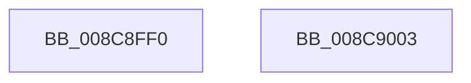

# RtlQueryRegistryValuesEx

- RVA: `0x008C8FF0`–`0x008C9004` (길이 `20` bytes)
- VA: `0x00000001408C8FF0`
- 실행 섹션: `PAGE`
- PDB 이름 있음: `예`; PDB Function 태그: `아니요`
- unwind 정보 RVA: `0x0005D2F4`
- 디코드: `6`개 명령, `20/20` bytes 표시
- 미해석 바이트: `0` (있으면 어셈블리에 `.byte`로 보존)

> 이 문서는 커널 이미지의 기계어와 PDB 기호를 분석해 생성했습니다. 4번과 5번은 함수 원형과 자료형을 바이너리 사용 방식에서 추정한 C 해석이며 원본 소스 복구 결과는 아닙니다.

## 1. Dependencies

- 직접 호출 지점: **1**; 고유 호출 대상: **1**
- 직접 호출자로 확인된 함수: **15**
- RIP 상대 이미지 참조: **0**

### Outgoing calls
- `0x008C8FF9` → [RtlpQueryRegistryValues](RtlpQueryRegistryValues_function_008C9050.md) (function, `0x008C9050`)

### Direct callers
- [RtlCheckPortableOperatingSystem](../../text/4A/RtlCheckPortableOperatingSystem_function_004A0FD0.md) at `0x004A106C`
- [RtlpFindRegTziForCurrentYear](../../text/5E/RtlpFindRegTziForCurrentYear_function_005E7754.md) at `0x005E784F`
- [RtlpFindRegTziForCurrentYear](../../text/5E/RtlpFindRegTziForCurrentYear_function_005E7754.md) at `0x005E78BD`
- [RtlpEtcGetDwordFromRegistry](../../text/5E/RtlpEtcGetDwordFromRegistry_function_005ED458.md) at `0x005ED4B0`
- [CarReadRegistry](../../text/61/CarReadRegistry_function_0061B978.md) at `0x0061BA80`
- [DifRtlQueryRegistryValuesExWrapper](../../text/63/DifRtlQueryRegistryValuesExWrapper_function_0063C290.md) at `0x0063C390`
- [DifRtlQueryRegistryValuesWrapper](../../text/63/DifRtlQueryRegistryValuesWrapper_function_0063C430.md) at `0x0063C530`
- [EtwpGetCurrentSiloMaxLoggers](../../text/64/EtwpGetCurrentSiloMaxLoggers_function_0064E86C.md) at `0x0064E937`
- [EtwpQueryPartitionRegistryInformation](../../text/64/EtwpQueryPartitionRegistryInformation_function_0064ECCC.md) at `0x0064EE50`
- [EtwpQuerySiloRegistrySettings](../../text/64/EtwpQuerySiloRegistrySettings_function_0064EF78.md) at `0x0064F060`
- [sub_006578CC](../../text/65/Unknown_function_006578CC.md) at `0x006579E8`
- [IopInitCrashDumpDuringSysInit](../../init/C2/IopInitCrashDumpDuringSysInit_function_00C2CAE4.md) at `0x00C2CC04`
- [EtwpReadConfigParameters](../../init/C4/EtwpReadConfigParameters_function_00C4E32C.md) at `0x00C4E446`
- [CmIsLastKnownGoodBoot](../../init/C5/CmIsLastKnownGoodBoot_function_00C563E4.md) at `0x00C564D1`
- [VhdAutoAttachVirtualDisks](../../init/C6/VhdAutoAttachVirtualDisks_function_00C6D934.md) at `0x00C6DABE`
- [SmQueryRegistry](../../init/C7/SmQueryRegistry_function_00C768A8.md) at `0x00C7691A`

### Static image references
- 디코드된 RIP-relative 메모리 참조가 없습니다.

## 2. Other-region calls and transfers

- 다른 실행 섹션으로 향하는 call: **0**
- 별도 외부 분기/꼬리 이동을 확인하지 못했습니다.

## 3. Assembly (complete function range)

```asm
008C8FF0  48 83 EC 38                     sub rsp, 0x38
008C8FF4  C6 44 24 28 01                  mov byte ptr [rsp + 0x28], 1
008C8FF9  E8 52 00 00 00                  call 0x1408c9050
008C8FFE  48 83 C4 38                     add rsp, 0x38
008C9002  C3                              ret
008C9003  CC                              int3
```

## 4. C-style interpretation (structured pseudocode)

```c
__int64 __fastcall RtlQueryRegistryValuesEx(void)
{
    __int64 result;
    __int64 v_rsp;
    unsigned __int8 v_stack_m10;

    v_rsp = (v_rsp) - (56);
    v_stack_m10 = 1;
    result = RtlpQueryRegistryValues(a1, a2, a3, a4);
    v_rsp = (v_rsp) + (56);
    return result;
}
```

## 5. (Beta) C Style

```c
void RtlQueryRegistryValuesEx(void)
{
    int64_t result;
    int64_t local_rsp;
    uint8_t v_stack_m10;

    local_rsp = (local_rsp) - (56);
    v_stack_m10 = 1;
    result = RtlpQueryRegistryValues(a1, a2, a3, a4);
    local_rsp = (local_rsp) + (56);
    return result;
}
```

## 6. Execution-region graph

[열기: 2D/3D 그래프와 함수 탐색 컨트롤 패널](../../../control-panel.html?section=page&rva=0x008C8FF0&view=graph)

- 2D 그래프는 위에서 아래로 흐르고, 3D 그래프는 빈 공간을 드래그해 회전합니다. Shift+드래그는 이동, 휠은 확대·축소, 함수 노드 선택은 대상 보고서 이동입니다.

### Static fallback


