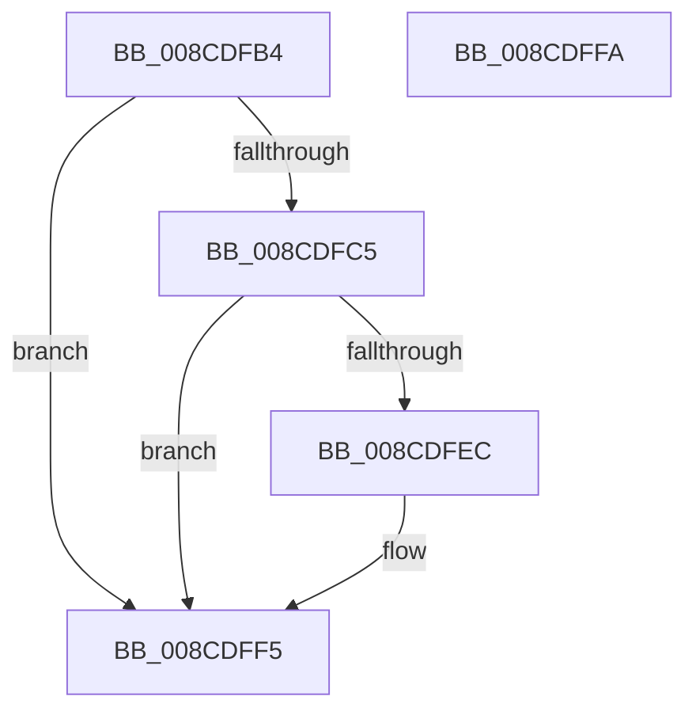

# RtlWow64GetCpuAreaEnabledFeatures

- RVA: `0x008CDFB4`–`0x008CDFFB` (길이 `71` bytes)
- VA: `0x00000001408CDFB4`
- 실행 섹션: `PAGE`
- PDB 이름 있음: `예`; PDB Function 태그: `아니요`
- unwind 정보 RVA: `0x0005C788`
- 디코드: `19`개 명령, `71/71` bytes 표시
- 미해석 바이트: `0` (있으면 어셈블리에 `.byte`로 보존)

> 이 문서는 커널 이미지의 기계어와 PDB 기호를 분석해 생성했습니다. 4번과 5번은 함수 원형과 자료형을 바이너리 사용 방식에서 추정한 C 해석이며 원본 소스 복구 결과는 아닙니다.

## 1. Dependencies

- 직접 호출 지점: **1**; 고유 호출 대상: **1**
- 직접 호출자로 확인된 함수: **5**
- RIP 상대 이미지 참조: **0**

### Outgoing calls
- `0x008CDFDC` → [RtlpRemoveArchDisallowedXStateFeatures](../../text/2F/RtlpRemoveArchDisallowedXStateFeatures_function_002F32FC.md) (function, `0x002F32FC`)

### Direct callers
- [PspWow64SetContextThread](PspWow64SetContextThread_function_008CCC88.md) at `0x008CCD16`
- [PspWow64SetContextThread](PspWow64SetContextThread_function_008CCC88.md) at `0x008CCEBB`
- [PspWow64ReadOrWriteThreadCpuArea](PspWow64ReadOrWriteThreadCpuArea_function_008CD404.md) at `0x008CD6FC`
- [PspWow64SetupCpuArea](PspWow64SetupCpuArea_function_008CDBFC.md) at `0x008CDC3A`
- [PspWow64InitThread](PspWow64InitThread_function_008CDC98.md) at `0x008CDD5F`
- [PspWow64GetContextThread](../A1/PspWow64GetContextThread_function_00A11E90.md) at `0x00A11F14`
- [PspWow64GetContextThread](../A1/PspWow64GetContextThread_function_00A11E90.md) at `0x00A1209E`

### Static image references
- 디코드된 RIP-relative 메모리 참조가 없습니다.

## 2. Other-region calls and transfers

- 다른 실행 섹션으로 향하는 call: **1**
  - `0x008CDFDC` → [RtlpRemoveArchDisallowedXStateFeatures](../../text/2F/RtlpRemoveArchDisallowedXStateFeatures_function_002F32FC.md) (`PAGE` → `.text`)
- 별도 외부 분기/꼬리 이동을 확인하지 못했습니다.

## 3. Assembly (complete function range)

```asm
008CDFB4  48 83 EC 28                     sub rsp, 0x28
008CDFB8  4C 8B C1                        mov r8, rcx
008CDFBB  33 C0                           xor eax, eax
008CDFBD  8B 09                           mov ecx, dword ptr [rcx]
008CDFBF  0F BA E1 10                     bt ecx, 0x10
008CDFC3  73 30                           jae 0x1408cdff5
008CDFC5  48 B8 D8 03 00 00 80 F7 FF FF   movabs rax, 0xfffff780000003d8
008CDFCF  48 8D 54 24 30                  lea rdx, [rsp + 0x30]
008CDFD4  48 8B 00                        mov rax, qword ptr [rax]
008CDFD7  48 89 44 24 30                  mov qword ptr [rsp + 0x30], rax
008CDFDC  E8 1B 53 A2 FF                  call 0x1402f32fc
008CDFE1  48 8B 44 24 30                  mov rax, qword ptr [rsp + 0x30]
008CDFE6  48 83 E0 FC                     and rax, 0xfffffffffffffffc
008CDFEA  74 09                           je 0x1408cdff5
008CDFEC  81 C9 40 00 01 00               or ecx, 0x10040
008CDFF2  41 89 08                        mov dword ptr [r8], ecx
008CDFF5  48 83 C4 28                     add rsp, 0x28
008CDFF9  C3                              ret
008CDFFA  CC                              int3
```

## 4. C-style interpretation (structured pseudocode)

```c
__int64 __fastcall RtlWow64GetCpuAreaEnabledFeatures(__int64 a1)
{
    __int64 result;
    __int64 v_rsp;
    unsigned __int64 v_stack_p8;

    v_rsp = (v_rsp) - (40);
    result = 0;
    if (condition_is_above_or_equal) goto loc_008CDFF5;
    v_stack_p8 = *(unsigned __int64 *)(result);
    result = RtlpRemoveArchDisallowedXStateFeatures((unsigned int)(*(unsigned int *)(a1)), v_stack_p8, a1, a4);
    result = (v_stack_p8) & (-4);
    if (!(condition_is_equal)) {
        a1 = (unsigned int)(((unsigned int)(*(unsigned int *)(a1))) | (0x10040ULL));
        *(unsigned int *)(a1) = (unsigned int)(a1);
    }
    v_rsp = (v_rsp) + (40);
    return result;
}
```

## 5. (Beta) C Style

```c
int64_t RtlWow64GetCpuAreaEnabledFeatures(void *Arg1)
{
    uint8_t *arg1 = (uint8_t *)Arg1;

    int64_t result;
    int64_t local_rsp;
    uint64_t v_stack_p8;

    local_rsp = (local_rsp) - (40);
    result = 0;
    if (condition_is_above_or_equal) goto loc_008CDFF5;
    v_stack_p8 = *(uint64_t *)(result);
    result = RtlpRemoveArchDisallowedXStateFeatures((uint32_t)(*(uint32_t *)(arg1)), v_stack_p8, Arg1, a4);
    result = (v_stack_p8) & (-4);
    if (!(condition_is_equal)) {
        Arg1 = (uint32_t)(((uint32_t)(*(uint32_t *)(arg1))) | (0x10040ULL));
        *(uint32_t *)(arg1) = (uint32_t)(Arg1);
    }
    local_rsp = (local_rsp) + (40);
    return result;
}
```

### 관측된 메모리 오프셋

구조체 형식이 확인되지 않은 접근은 인자 기준의 오프셋으로만 기록했습니다.

| 기준 인자 | 오프셋 표현 | 폭 (bit) | 접근 |
|---|---:|---:|---|
| `Arg1` | `+ 0x0` | `32` | `R` |

## 6. Execution-region graph

[열기: 2D/3D 그래프와 함수 탐색 컨트롤 패널](../../../control-panel.html?section=page&rva=0x008CDFB4&view=graph)

- 2D 그래프는 위에서 아래로 흐르고, 3D 그래프는 빈 공간을 드래그해 회전합니다. Shift+드래그는 이동, 휠은 확대·축소, 함수 노드 선택은 대상 보고서 이동입니다.

### Static fallback


