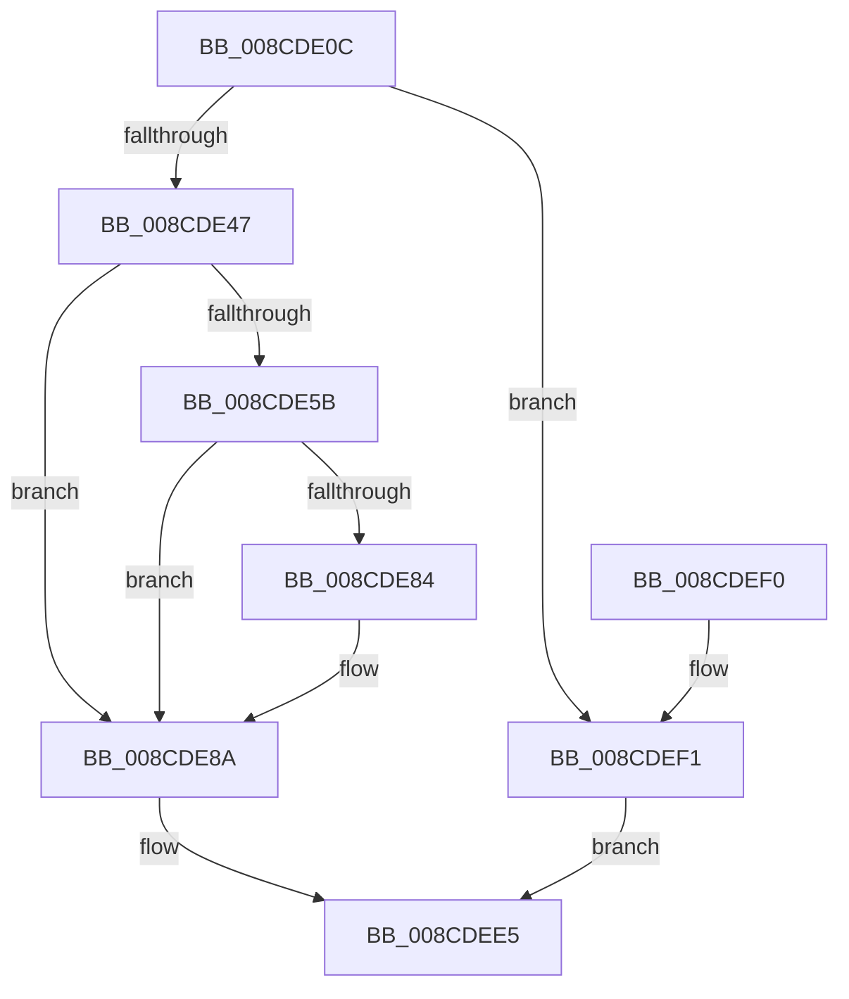

# RtlWow64GetCpuAreaInfo

- RVA: `0x008CDE0C`–`0x008CDEF8` (길이 `236` bytes)
- VA: `0x00000001408CDE0C`
- 실행 섹션: `PAGE`
- PDB 이름 있음: `예`; PDB Function 태그: `아니요`
- unwind 정보 RVA: `0x00084790`
- 디코드: `70`개 명령, `236/236` bytes 표시
- 미해석 바이트: `0` (있으면 어셈블리에 `.byte`로 보존)

> 이 문서는 커널 이미지의 기계어와 PDB 기호를 분석해 생성했습니다. 4번과 5번은 함수 원형과 자료형을 바이너리 사용 방식에서 추정한 C 해석이며 원본 소스 복구 결과는 아닙니다.

## 1. Dependencies

- 직접 호출 지점: **5**; 고유 호출 대상: **5**
- 직접 호출자로 확인된 함수: **2**
- RIP 상대 이미지 참조: **0**

### Outgoing calls
- `0x008CDE38` → [RtlpArchContextFlagFromMachine](RtlpArchContextFlagFromMachine_function_008CDF68.md) (function, `0x008CDF68`)
- `0x008CDE50` → [RtlpGetLegacyContextLength](../../text/4B/RtlpGetLegacyContextLength_function_004B6060.md) (function, `0x004B6060`)
- `0x008CDE74` → [RtlpRemoveArchDisallowedXStateFeatures](../../text/2F/RtlpRemoveArchDisallowedXStateFeatures_function_002F32FC.md) (function, `0x002F32FC`)
- `0x008CDE94` → [RtlGetExtendedContextLength2](../../text/49/RtlGetExtendedContextLength2_function_00493FE0.md) (function, `0x00493FE0`)
- `0x008CDEC6` → [RtlpGetContextFlagsLocation](../../text/46/RtlpGetContextFlagsLocation_function_00462314.md) (function, `0x00462314`)

### Direct callers
- [RtlpWalkFrameChain](../../text/2F/RtlpWalkFrameChain_function_002F3ED0.md) at `0x002F49CA`
- [PspWow64ReadOrWriteThreadCpuArea](PspWow64ReadOrWriteThreadCpuArea_function_008CD404.md) at `0x008CD4D5`

### Static image references
- 디코드된 RIP-relative 메모리 참조가 없습니다.

## 2. Other-region calls and transfers

- 다른 실행 섹션으로 향하는 call: **4**
  - `0x008CDE50` → [RtlpGetLegacyContextLength](../../text/4B/RtlpGetLegacyContextLength_function_004B6060.md) (`PAGE` → `.text`)
  - `0x008CDE74` → [RtlpRemoveArchDisallowedXStateFeatures](../../text/2F/RtlpRemoveArchDisallowedXStateFeatures_function_002F32FC.md) (`PAGE` → `.text`)
  - `0x008CDE94` → [RtlGetExtendedContextLength2](../../text/49/RtlGetExtendedContextLength2_function_00493FE0.md) (`PAGE` → `.text`)
  - `0x008CDEC6` → [RtlpGetContextFlagsLocation](../../text/46/RtlpGetContextFlagsLocation_function_00462314.md) (`PAGE` → `.text`)
- 별도 외부 분기/꼬리 이동을 확인하지 못했습니다.

## 3. Assembly (complete function range)

```asm
008CDE0C  66 89 54 24 10                  mov word ptr [rsp + 0x10], dx
008CDE11  53                              push rbx
008CDE12  55                              push rbp
008CDE13  56                              push rsi
008CDE14  57                              push rdi
008CDE15  41 56                           push r14
008CDE17  48 83 EC 20                     sub rsp, 0x20
008CDE1B  33 FF                           xor edi, edi
008CDE1D  49 89 48 18                     mov qword ptr [r8 + 0x18], rcx
008CDE21  41 BE 4C 01 00 00               mov r14d, 0x14c
008CDE27  89 7C 24 58                     mov dword ptr [rsp + 0x58], edi
008CDE2B  48 8B E9                        mov rbp, rcx
008CDE2E  89 7C 24 50                     mov dword ptr [rsp + 0x50], edi
008CDE32  41 8B CE                        mov ecx, r14d
008CDE35  49 8B F0                        mov rsi, r8
008CDE38  E8 2B 01 00 00                  call 0x1408cdf68
008CDE3D  8B D8                           mov ebx, eax
008CDE3F  85 C0                           test eax, eax
008CDE41  0F 84 AA 00 00 00               je 0x1408cdef1
008CDE47  4C 8D 44 24 58                  lea r8, [rsp + 0x58]
008CDE4C  33 D2                           xor edx, edx
008CDE4E  8B C8                           mov ecx, eax
008CDE50  E8 0B 82 BE FF                  call 0x1404b6060
008CDE55  0F BA E3 10                     bt ebx, 0x10
008CDE59  73 2F                           jae 0x1408cde8a
008CDE5B  48 B8 D8 03 00 00 80 F7 FF FF   movabs rax, 0xfffff780000003d8
008CDE65  48 8D 54 24 60                  lea rdx, [rsp + 0x60]
008CDE6A  8B CB                           mov ecx, ebx
008CDE6C  48 8B 00                        mov rax, qword ptr [rax]
008CDE6F  48 89 44 24 60                  mov qword ptr [rsp + 0x60], rax
008CDE74  E8 83 54 A2 FF                  call 0x1402f32fc
008CDE79  48 8B 7C 24 60                  mov rdi, qword ptr [rsp + 0x60]
008CDE7E  48 83 E7 FC                     and rdi, 0xfffffffffffffffc
008CDE82  74 06                           je 0x1408cde8a
008CDE84  81 CB 40 00 01 00               or ebx, 0x10040
008CDE8A  4C 8B C7                        mov r8, rdi
008CDE8D  48 8D 54 24 50                  lea rdx, [rsp + 0x50]
008CDE92  8B CB                           mov ecx, ebx
008CDE94  E8 47 61 BC FF                  call 0x140493fe0
008CDE99  8B 44 24 58                     mov eax, dword ptr [rsp + 0x58]
008CDE9D  8B D3                           mov edx, ebx
008CDE9F  44 8B 44 24 50                  mov r8d, dword ptr [rsp + 0x50]
008CDEA4  49 83 C0 07                     add r8, 7
008CDEA8  48 8D 48 03                     lea rcx, [rax + 3]
008CDEAC  48 03 CD                        add rcx, rbp
008CDEAF  48 FF C8                        dec rax
008CDEB2  48 F7 D0                        not rax
008CDEB5  48 23 C8                        and rcx, rax
008CDEB8  4C 03 C1                        add r8, rcx
008CDEBB  48 89 0E                        mov qword ptr [rsi], rcx
008CDEBE  49 83 E0 F8                     and r8, 0xfffffffffffffff8
008CDEC2  4C 89 46 08                     mov qword ptr [rsi + 8], r8
008CDEC6  E8 49 44 B9 FF                  call 0x140462314
008CDECB  48 89 46 10                     mov qword ptr [rsi + 0x10], rax
008CDECF  49 8D 40 0B                     lea rax, [r8 + 0xb]
008CDED3  48 83 E0 FC                     and rax, 0xfffffffffffffffc
008CDED7  89 5E 20                        mov dword ptr [rsi + 0x20], ebx
008CDEDA  48 89 46 28                     mov qword ptr [rsi + 0x28], rax
008CDEDE  33 C0                           xor eax, eax
008CDEE0  66 44 89 76 24                  mov word ptr [rsi + 0x24], r14w
008CDEE5  48 83 C4 20                     add rsp, 0x20
008CDEE9  41 5E                           pop r14
008CDEEB  5F                              pop rdi
008CDEEC  5E                              pop rsi
008CDEED  5D                              pop rbp
008CDEEE  5B                              pop rbx
008CDEEF  C3                              ret
008CDEF0  CC                              int3
008CDEF1  B8 0D 00 00 C0                  mov eax, 0xc000000d
008CDEF6  EB ED                           jmp 0x1408cdee5
```

## 4. C-style interpretation (structured pseudocode)

```c
__int64 __fastcall RtlWow64GetCpuAreaInfo(__int64 a1, int a2, __int64 a3)
{
    __int64 result;
    __int64 v_rbx;
    __int64 v_rdi;
    __int64 v_rsp;
    unsigned __int16 v_stack_p10;
    unsigned __int64 v_stack_p18;
    unsigned int v_stack_p8;

    v_stack_p10 = (unsigned __int16)(a2);
    v_rsp = (v_rsp) - (32);
    v_rdi = 0;
    *(unsigned __int64 *)(a3 + 24) = a1;
    v_stack_p10 = 0;
    v_stack_p8 = 0;
    result = RtlpArchContextFlagFromMachine(332, a2, a3, a4);
    if ((unsigned int)(result) == 0) goto loc_008CDEF1;
    a2 = 0;
    result = RtlpGetLegacyContextLength((unsigned int)((unsigned int)(result)), a2, v_stack_p10, a4);
    if (condition_is_above_or_equal) goto loc_008CDE8A;
    v_stack_p18 = *(unsigned __int64 *)(result);
    result = RtlpRemoveArchDisallowedXStateFeatures((unsigned int)((unsigned int)((unsigned int)((unsigned int)(result)))), v_stack_p18, v_stack_p10, a4);
    v_rdi = (v_stack_p18) & (-4);
    v_rbx = (unsigned int)((unsigned int)(result));
    if (!(condition_is_equal)) {
        v_rbx = (unsigned int)(((unsigned int)((unsigned int)(result))) | (0x10040ULL));
    }
    result = RtlGetExtendedContextLength2((unsigned int)((unsigned int)(v_rbx)), v_stack_p8, v_rdi, a4);
    a3 = ((unsigned int)(v_stack_p8)) + (7);
    a1 = ((unsigned int)(v_stack_p10) + 3) + (a1);
    result = ((unsigned int)(v_stack_p10)) - 1;
    result = ~(result);
    a1 = (a1) & (result);
    a3 = (a3) + (a1);
    *(unsigned __int64 *)(a3) = a1;
    a3 = (a3) & (-8);
    *(unsigned __int64 *)(a3 + 8) = a3;
    result = RtlpGetContextFlagsLocation(a1, (unsigned int)((unsigned int)(v_rbx)), a3, a4);
    *(unsigned __int64 *)(a3 + 16) = result;
    result = (a3 + 11) & (-4);
    *(unsigned int *)(a3 + 32) = (unsigned int)(v_rbx);
    *(unsigned __int64 *)(a3 + 40) = result;
    result = 0;
    *(unsigned __int16 *)(a3 + 36) = 332;
loc_008CDEE5:
    v_rsp = (v_rsp) + (32);
    return result;
loc_008CDEF1:
    goto loc_008CDEE5;
}
```

## 5. (Beta) C Style

```c
int64_t RtlWow64GetCpuAreaInfo(int64_t Arg1, int32_t Arg2, void *Arg3)
{
    uint8_t *arg3 = (uint8_t *)Arg3;

    int64_t result;
    int64_t local_rbx;
    int64_t local_rdi;
    int64_t local_rsp;
    uint16_t v_stack_p10;
    uint64_t v_stack_p18;
    uint32_t v_stack_p8;

    v_stack_p10 = (uint16_t)(Arg2);
    local_rsp = (local_rsp) - (32);
    local_rdi = 0;
    *(uint64_t *)(arg3 + 0x18) = Arg1;
    v_stack_p10 = 0;
    v_stack_p8 = 0;
    result = RtlpArchContextFlagFromMachine(332, Arg2, Arg3, a4);
    if ((uint32_t)(result) == 0) goto loc_008CDEF1;
    Arg2 = 0;
    result = RtlpGetLegacyContextLength((uint32_t)((uint32_t)(result)), Arg2, v_stack_p10, a4);
    if (condition_is_above_or_equal) goto loc_008CDE8A;
    v_stack_p18 = *(uint64_t *)(result);
    result = RtlpRemoveArchDisallowedXStateFeatures((uint32_t)((uint32_t)((uint32_t)((uint32_t)(result)))), v_stack_p18, v_stack_p10, a4);
    local_rdi = (v_stack_p18) & (-4);
    local_rbx = (uint32_t)((uint32_t)(result));
    if (!(condition_is_equal)) {
        local_rbx = (uint32_t)(((uint32_t)((uint32_t)(result))) | (0x10040ULL));
    }
    result = RtlGetExtendedContextLength2((uint32_t)((uint32_t)(local_rbx)), v_stack_p8, local_rdi, a4);
    Arg3 = ((uint32_t)(v_stack_p8)) + (7);
    Arg1 = ((uint32_t)(v_stack_p10) + 3) + (Arg1);
    result = ((uint32_t)(v_stack_p10)) - 1;
    result = ~(result);
    Arg1 = (Arg1) & (result);
    Arg3 = (Arg3) + (Arg1);
    *(uint64_t *)(arg3) = Arg1;
    Arg3 = (Arg3) & (-8);
    *(void **)(arg3 + 0x8) = Arg3;
    result = RtlpGetContextFlagsLocation(Arg1, (uint32_t)((uint32_t)(local_rbx)), Arg3, a4);
    *(uint64_t *)(arg3 + 0x10) = result;
    result = (Arg3 + 11) & (-4);
    *(uint32_t *)(arg3 + 0x20) = (uint32_t)(local_rbx);
    *(uint64_t *)(arg3 + 0x28) = result;
    result = 0;
    *(uint16_t *)(arg3 + 0x24) = 332;
loc_008CDEE5:
    local_rsp = (local_rsp) + (32);
    return result;
loc_008CDEF1:
    goto loc_008CDEE5;
}
```

### 관측된 메모리 오프셋

구조체 형식이 확인되지 않은 접근은 인자 기준의 오프셋으로만 기록했습니다.

| 기준 인자 | 오프셋 표현 | 폭 (bit) | 접근 |
|---|---:|---:|---|
| `Arg3` | `+ 0x0` | `64` | `W` |
| `Arg3` | `+ 0x8` | `64` | `W` |
| `Arg3` | `+ 0x10` | `64` | `W` |
| `Arg3` | `+ 0x18` | `64` | `W` |
| `Arg3` | `+ 0x20` | `32` | `W` |
| `Arg3` | `+ 0x24` | `16` | `W` |
| `Arg3` | `+ 0x28` | `64` | `W` |

## 6. Execution-region graph

[열기: 2D/3D 그래프와 함수 탐색 컨트롤 패널](../../../control-panel.html?section=page&rva=0x008CDE0C&view=graph)

- 2D 그래프는 위에서 아래로 흐르고, 3D 그래프는 빈 공간을 드래그해 회전합니다. Shift+드래그는 이동, 휠은 확대·축소, 함수 노드 선택은 대상 보고서 이동입니다.

### Static fallback


