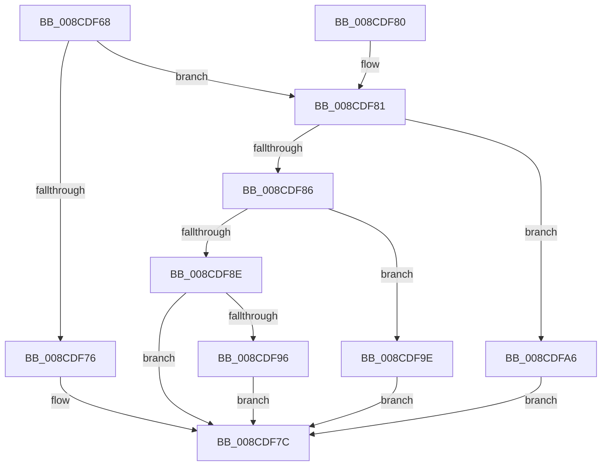

# RtlpArchContextFlagFromMachine

- RVA: `0x008CDF68`–`0x008CDFAE` (길이 `70` bytes)
- VA: `0x00000001408CDF68`
- 실행 섹션: `PAGE`
- PDB 이름 있음: `예`; PDB Function 태그: `아니요`
- unwind 정보 RVA: `0x000DB714`
- 디코드: `20`개 명령, `70/70` bytes 표시
- 미해석 바이트: `0` (있으면 어셈블리에 `.byte`로 보존)

> 이 문서는 커널 이미지의 기계어와 PDB 기호를 분석해 생성했습니다. 4번과 5번은 함수 원형과 자료형을 바이너리 사용 방식에서 추정한 C 해석이며 원본 소스 복구 결과는 아닙니다.

## 1. Dependencies

- 직접 호출 지점: **0**; 고유 호출 대상: **0**
- 직접 호출자로 확인된 함수: **5**
- RIP 상대 이미지 참조: **0**

### Outgoing calls
- 직접 디코드된 call 명령이 없습니다.

### Direct callers
- [RtlGetEnabledExtendedFeatures](../../text/5E/RtlGetEnabledExtendedFeatures_function_005E6C90.md) at `0x005E6CBB`
- [PspWow64SetupCpuArea](PspWow64SetupCpuArea_function_008CDBFC.md) at `0x008CDC1A`
- [PspWow64InitThread](PspWow64InitThread_function_008CDC98.md) at `0x008CDCF1`
- [RtlWow64GetCpuAreaInfo](RtlWow64GetCpuAreaInfo_function_008CDE0C.md) at `0x008CDE38`
- [RtlpWow64SanitizeContextFlags](RtlpWow64SanitizeContextFlags_function_008CDF00.md) at `0x008CDF1A`

### Static image references
- 디코드된 RIP-relative 메모리 참조가 없습니다.

## 2. Other-region calls and transfers

- 다른 실행 섹션으로 향하는 call: **0**
- 별도 외부 분기/꼬리 이동을 확인하지 못했습니다.

## 3. Assembly (complete function range)

```asm
008CDF68  45 33 C0                        xor r8d, r8d
008CDF6B  0F B7 D1                        movzx edx, cx
008CDF6E  81 EA 4C 01 00 00               sub edx, 0x14c
008CDF74  75 0B                           jne 0x1408cdf81
008CDF76  41 B8 00 00 01 00               mov r8d, 0x10000
008CDF7C  41 8B C0                        mov eax, r8d
008CDF7F  C3                              ret
008CDF80  CC                              int3
008CDF81  83 EA 78                        sub edx, 0x78
008CDF84  74 20                           je 0x1408cdfa6
008CDF86  81 EA A0 84 00 00               sub edx, 0x84a0
008CDF8C  74 10                           je 0x1408cdf9e
008CDF8E  81 FA 00 24 00 00               cmp edx, 0x2400
008CDF94  75 E6                           jne 0x1408cdf7c
008CDF96  41 B8 00 00 40 00               mov r8d, 0x400000
008CDF9C  EB DE                           jmp 0x1408cdf7c
008CDF9E  41 B8 00 00 10 00               mov r8d, 0x100000
008CDFA4  EB D6                           jmp 0x1408cdf7c
008CDFA6  41 B8 00 00 20 00               mov r8d, 0x200000
008CDFAC  EB CE                           jmp 0x1408cdf7c
```

## 4. C-style interpretation (structured pseudocode)

```c
__int64 __fastcall RtlpArchContextFlagFromMachine(unsigned __int16 a1, __int64 a2, int a3)
{
    a3 = 0;
    a2 = (unsigned int)((a1) - (332));
    if (condition_is_not_equal) goto loc_008CDF81;
loc_008CDF7C:
    return (unsigned int)((unsigned int)((unsigned int)(0x10000ULL)));
loc_008CDF81:
    a2 = (unsigned int)((a2) - (120));
    if (condition_is_equal) goto loc_008CDFA6;
    a2 = (unsigned int)((a2) - (0x84A0ULL));
    if (condition_is_equal) goto loc_008CDF9E;
    if (((unsigned int)(a2)) != 0x2400ULL) goto loc_008CDF7C;
    goto loc_008CDF7C;
loc_008CDF9E:
    goto loc_008CDF7C;
loc_008CDFA6:
    goto loc_008CDF7C;
}
```

## 5. (Beta) C Style

```c
int64_t RtlpArchContextFlagFromMachine(uint16_t Arg1, int64_t Arg2, int32_t Arg3)
{
    Arg3 = 0;
    Arg2 = (uint32_t)((Arg1) - (332));
    if (condition_is_not_equal) goto loc_008CDF81;
loc_008CDF7C:
    return (uint32_t)((uint32_t)((uint32_t)(0x10000ULL)));
loc_008CDF81:
    Arg2 = (uint32_t)((Arg2) - (120));
    if (condition_is_equal) goto loc_008CDFA6;
    Arg2 = (uint32_t)((Arg2) - (0x84A0ULL));
    if (condition_is_equal) goto loc_008CDF9E;
    if (((uint32_t)(Arg2)) != 0x2400ULL) goto loc_008CDF7C;
    goto loc_008CDF7C;
loc_008CDF9E:
    goto loc_008CDF7C;
loc_008CDFA6:
    goto loc_008CDF7C;
}
```

## 6. Execution-region graph

[열기: 2D/3D 그래프와 함수 탐색 컨트롤 패널](../../../control-panel.html?section=page&rva=0x008CDF68&view=graph)

- 2D 그래프는 위에서 아래로 흐르고, 3D 그래프는 빈 공간을 드래그해 회전합니다. Shift+드래그는 이동, 휠은 확대·축소, 함수 노드 선택은 대상 보고서 이동입니다.

### Static fallback


