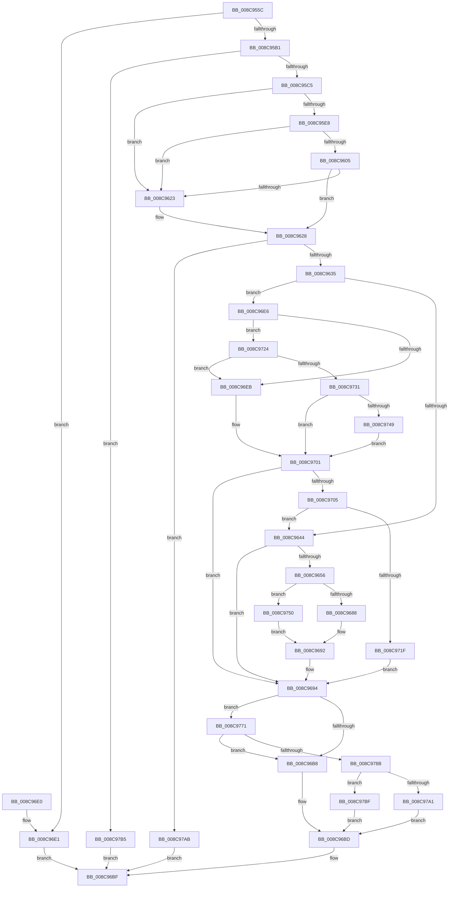

# RtlpGetRegistryHandle

- RVA: `0x008C955C`–`0x008C97C9` (길이 `621` bytes)
- VA: `0x00000001408C955C`
- 실행 섹션: `PAGE`
- PDB 이름 있음: `예`; PDB Function 태그: `아니요`
- unwind 정보 RVA: `0x00084154`
- 디코드: `163`개 명령, `621/621` bytes 표시
- 미해석 바이트: `0` (있으면 어셈블리에 `.byte`로 보존)

> 이 문서는 커널 이미지의 기계어와 PDB 기호를 분석해 생성했습니다. 4번과 5번은 함수 원형과 자료형을 바이너리 사용 방식에서 추정한 C 해석이며 원본 소스 복구 결과는 아닙니다.

## 1. Dependencies

- 직접 호출 지점: **14**; 고유 호출 대상: **9**
- 직접 호출자로 확인된 함수: **10**
- RIP 상대 이미지 참조: **3**

### Outgoing calls
- `0x008C95DB` → [ExpInterlockedPopEntrySList](../../text/6B/ExpInterlockedPopEntrySList_function_006BA570.md) (function, `0x006BA570`)
- `0x008C95F8` → [ExpInterlockedPopEntrySList](../../text/6B/ExpInterlockedPopEntrySList_function_006BA570.md) (function, `0x006BA570`)
- `0x008C9616` → [guard_dispatch_icall](../../text/6B/guard_dispatch_icall_function_006BAAD0.md) (function, `0x006BAAD0`)
- `0x008C964B` → [RtlAppendUnicodeToString](../../text/40/RtlAppendUnicodeToString_function_0040F990.md) (function, `0x0040F990`)
- `0x008C968D` → [ZwOpenKey](../../text/6A/ZwOpenKey_function_006AD310.md) (function, `0x006AD310`)
- `0x008C96B8` → [ExpInterlockedPushEntrySList](../../text/6B/ExpInterlockedPushEntrySList_function_006BA5B0.md) (function, `0x006BA5B0`)
- `0x008C96FA` → [RtlAppendUnicodeToString](../../text/40/RtlAppendUnicodeToString_function_0040F990.md) (function, `0x0040F990`)
- `0x008C9710` → [RtlAppendUnicodeToString](../../text/40/RtlAppendUnicodeToString_function_0040F990.md) (function, `0x0040F990`)
- `0x008C9728` → [RtlFormatCurrentUserKeyPath](../92/RtlFormatCurrentUserKeyPath_function_00927820.md) (function, `0x00927820`)
- `0x008C9739` → [RtlAppendUnicodeStringToString](../../text/40/RtlAppendUnicodeStringToString_function_0040FA50.md) (function, `0x0040FA50`)
- `0x008C9749` → [ExFreePool](../../poolcode/B8/ExFreePool_function_00B82850.md) (function, `0x00B82850`)
- `0x008C9767` → [ZwCreateKey](../../text/6A/ZwCreateKey_function_006AD470.md) (function, `0x006AD470`)
- `0x008C97A1` → [ExFreePool](../../poolcode/B8/ExFreePool_function_00B82850.md) (function, `0x00B82850`)
- `0x008C97BF` → [guard_dispatch_icall](../../text/6B/guard_dispatch_icall_function_006BAAD0.md) (function, `0x006BAAD0`)

### Direct callers
- [RtlCreateRegistryKey](../78/RtlCreateRegistryKey_function_0078F900.md) at `0x0078F916`
- [RtlpGetDynamicTimeZoneInfoHandle](../78/RtlpGetDynamicTimeZoneInfoHandle_function_0078FD78.md) at `0x0078FE02`
- [RtlpUpdateDynamicTimeZones](../79/RtlpUpdateDynamicTimeZones_function_0079019C.md) at `0x00790275`
- [RtlCheckRegistryKey](RtlCheckRegistryKey_function_008C9010.md) at `0x008C9026`
- [RtlpQueryRegistryValues](RtlpQueryRegistryValues_function_008C9050.md) at `0x008C90AF`
- [ExpRefreshTimeZoneInformation](../A6/ExpRefreshTimeZoneInformation_function_00A6B46C.md) at `0x00A6B6CC`
- [RtlpGetTimeZoneInfoHandle](../A6/RtlpGetTimeZoneInfoHandle_function_00A6BD8C.md) at `0x00A6BDD6`
- [RtlpGetTimeZoneInfoHandle](../A6/RtlpGetTimeZoneInfoHandle_function_00A6BD8C.md) at `0x00A6BE51`
- [RtlWriteRegistryValue](../A6/RtlWriteRegistryValue_function_00A6C620.md) at `0x00A6C64B`
- [PerfDiagpSaveActiveDCLLogFileName](../A9/PerfDiagpSaveActiveDCLLogFileName_function_00A9EB80.md) at `0x00A9EC81`
- [RtlDeleteRegistryValue](../AD/RtlDeleteRegistryValue_function_00ADA1B0.md) at `0x00ADA1D4`

### Static image references
- `0x008C96EB` → RVA `0x00B4C490` (`RtlpRegistryPaths`; read)
- `0x008C9705` → RVA `0x00AFC990` (` ?? ::NNGAKEGL::`string'`; read)
- `0x008C9792` → RVA `0x00B82850` (`ExFreePool`; read)

## 2. Other-region calls and transfers

- 다른 실행 섹션으로 향하는 call: **13**
  - `0x008C95DB` → [ExpInterlockedPopEntrySList](../../text/6B/ExpInterlockedPopEntrySList_function_006BA570.md) (`PAGE` → `.text`)
  - `0x008C95F8` → [ExpInterlockedPopEntrySList](../../text/6B/ExpInterlockedPopEntrySList_function_006BA570.md) (`PAGE` → `.text`)
  - `0x008C9616` → [guard_dispatch_icall](../../text/6B/guard_dispatch_icall_function_006BAAD0.md) (`PAGE` → `.text`)
  - `0x008C964B` → [RtlAppendUnicodeToString](../../text/40/RtlAppendUnicodeToString_function_0040F990.md) (`PAGE` → `.text`)
  - `0x008C968D` → [ZwOpenKey](../../text/6A/ZwOpenKey_function_006AD310.md) (`PAGE` → `.text`)
  - `0x008C96B8` → [ExpInterlockedPushEntrySList](../../text/6B/ExpInterlockedPushEntrySList_function_006BA5B0.md) (`PAGE` → `.text`)
  - `0x008C96FA` → [RtlAppendUnicodeToString](../../text/40/RtlAppendUnicodeToString_function_0040F990.md) (`PAGE` → `.text`)
  - `0x008C9710` → [RtlAppendUnicodeToString](../../text/40/RtlAppendUnicodeToString_function_0040F990.md) (`PAGE` → `.text`)
  - `0x008C9739` → [RtlAppendUnicodeStringToString](../../text/40/RtlAppendUnicodeStringToString_function_0040FA50.md) (`PAGE` → `.text`)
  - `0x008C9749` → [ExFreePool](../../poolcode/B8/ExFreePool_function_00B82850.md) (`PAGE` → `POOLCODE`)
  - `0x008C9767` → [ZwCreateKey](../../text/6A/ZwCreateKey_function_006AD470.md) (`PAGE` → `.text`)
  - `0x008C97A1` → [ExFreePool](../../poolcode/B8/ExFreePool_function_00B82850.md) (`PAGE` → `POOLCODE`)
  - `0x008C97BF` → [guard_dispatch_icall](../../text/6B/guard_dispatch_icall_function_006BAAD0.md) (`PAGE` → `.text`)
- 별도 외부 분기/꼬리 이동을 확인하지 못했습니다.

## 3. Assembly (complete function range)

```asm
008C955C  48 8B C4                        mov rax, rsp
008C955F  48 89 58 08                     mov qword ptr [rax + 8], rbx
008C9563  48 89 70 10                     mov qword ptr [rax + 0x10], rsi
008C9567  48 89 78 18                     mov qword ptr [rax + 0x18], rdi
008C956B  55                              push rbp
008C956C  41 54                           push r12
008C956E  41 55                           push r13
008C9570  41 56                           push r14
008C9572  41 57                           push r15
008C9574  48 8D 68 A1                     lea rbp, [rax - 0x5f]
008C9578  48 81 EC 90 00 00 00            sub rsp, 0x90
008C957F  33 C0                           xor eax, eax
008C9581  0F 57 C0                        xorps xmm0, xmm0
008C9584  45 33 ED                        xor r13d, r13d
008C9587  48 89 45 27                     mov qword ptr [rbp + 0x27], rax
008C958B  89 45 2F                        mov dword ptr [rbp + 0x2f], eax
008C958E  4D 8B F1                        mov r14, r9
008C9591  44 89 6D EB                     mov dword ptr [rbp - 0x15], r13d
008C9595  45 8A E0                        mov r12b, r8b
008C9598  4C 8B FA                        mov r15, rdx
008C959B  0F 11 45 07                     movups xmmword ptr [rbp + 7], xmm0
008C959F  0F 11 45 17                     movups xmmword ptr [rbp + 0x17], xmm0
008C95A3  0F 11 45 F7                     movups xmmword ptr [rbp - 9], xmm0
008C95A7  0F BA E1 1E                     bt ecx, 0x1e
008C95AB  0F 82 30 01 00 00               jb 0x1408c96e1
008C95B1  8B D9                           mov ebx, ecx
008C95B3  0F BA F3 1F                     btr ebx, 0x1f
008C95B7  85 C9                           test ecx, ecx
008C95B9  0F 49 D9                        cmovns ebx, ecx
008C95BC  83 FB 06                        cmp ebx, 6
008C95BF  0F 83 F0 01 00 00               jae 0x1408c97b5
008C95C5  65 48 8B 34 25 20 00 00 00      mov rsi, qword ptr gs:[0x20]
008C95CE  48 8B BE 80 08 00 00            mov rdi, qword ptr [rsi + 0x880]
008C95D5  48 8B CF                        mov rcx, rdi
008C95D8  FF 47 14                        inc dword ptr [rdi + 0x14]
008C95DB  E8 90 0F DF FF                  call 0x1406ba570
008C95E0  48 8B C8                        mov rcx, rax
008C95E3  48 85 C0                        test rax, rax
008C95E6  75 3B                           jne 0x1408c9623
008C95E8  FF 47 18                        inc dword ptr [rdi + 0x18]
008C95EB  48 8B BE 88 08 00 00            mov rdi, qword ptr [rsi + 0x888]
008C95F2  48 8B CF                        mov rcx, rdi
008C95F5  FF 47 14                        inc dword ptr [rdi + 0x14]
008C95F8  E8 73 0F DF FF                  call 0x1406ba570
008C95FD  48 8B C8                        mov rcx, rax
008C9600  48 85 C0                        test rax, rax
008C9603  75 1E                           jne 0x1408c9623
008C9605  8B 57 2C                        mov edx, dword ptr [rdi + 0x2c]
008C9608  48 8B 47 30                     mov rax, qword ptr [rdi + 0x30]
008C960C  44 8B 47 28                     mov r8d, dword ptr [rdi + 0x28]
008C9610  8B 4F 24                        mov ecx, dword ptr [rdi + 0x24]
008C9613  FF 47 18                        inc dword ptr [rdi + 0x18]
008C9616  E8 B5 14 DF FF                  call 0x1406baad0
008C961B  48 8B C8                        mov rcx, rax
008C961E  48 85 C0                        test rax, rax
008C9621  74 05                           je 0x1408c9628
008C9623  8B 46 24                        mov eax, dword ptr [rsi + 0x24]
008C9626  89 01                           mov dword ptr [rcx], eax
008C9628  48 89 4D EF                     mov qword ptr [rbp - 0x11], rcx
008C962C  48 85 C9                        test rcx, rcx
008C962F  0F 84 76 01 00 00               je 0x1408c97ab
008C9635  C7 45 E7 00 00 0C 02            mov dword ptr [rbp - 0x19], 0x20c0000
008C963C  85 DB                           test ebx, ebx
008C963E  0F 85 A2 00 00 00               jne 0x1408c96e6
008C9644  49 8B D7                        mov rdx, r15
008C9647  48 8D 4D E7                     lea rcx, [rbp - 0x19]
008C964B  E8 40 63 B4 FF                  call 0x14040f990
008C9650  8B D8                           mov ebx, eax
008C9652  85 C0                           test eax, eax
008C9654  78 3E                           js 0x1408c9694
008C9656  C7 45 07 30 00 00 00            mov dword ptr [rbp + 7], 0x30
008C965D  48 8D 45 E7                     lea rax, [rbp - 0x19]
008C9661  48 89 45 17                     mov qword ptr [rbp + 0x17], rax
008C9665  0F 57 C0                        xorps xmm0, xmm0
008C9668  4C 89 6D 0F                     mov qword ptr [rbp + 0xf], r13
008C966C  4C 8D 45 07                     lea r8, [rbp + 7]
008C9670  C7 45 1F 40 02 00 00            mov dword ptr [rbp + 0x1f], 0x240
008C9677  49 8B CE                        mov rcx, r14
008C967A  F3 0F 7F 45 27                  movdqu xmmword ptr [rbp + 0x27], xmm0
008C967F  45 84 E4                        test r12b, r12b
008C9682  0F 85 C8 00 00 00               jne 0x1408c9750
008C9688  BA 00 00 00 82                  mov edx, 0x82000000
008C968D  E8 7E 3C DE FF                  call 0x1406ad310
008C9692  8B D8                           mov ebx, eax
008C9694  65 4C 8B 04 25 20 00 00 00      mov r8, qword ptr gs:[0x20]
008C969D  48 8B 55 EF                     mov rdx, qword ptr [rbp - 0x11]
008C96A1  49 8B 88 80 08 00 00            mov rcx, qword ptr [r8 + 0x880]
008C96A8  FF 41 1C                        inc dword ptr [rcx + 0x1c]
008C96AB  0F B7 41 10                     movzx eax, word ptr [rcx + 0x10]
008C96AF  66 39 01                        cmp word ptr [rcx], ax
008C96B2  0F 83 B9 00 00 00               jae 0x1408c9771
008C96B8  E8 F3 0E DF FF                  call 0x1406ba5b0
008C96BD  8B C3                           mov eax, ebx
008C96BF  4C 8D 9C 24 90 00 00 00         lea r11, [rsp + 0x90]
008C96C7  49 8B 5B 30                     mov rbx, qword ptr [r11 + 0x30]
008C96CB  49 8B 73 38                     mov rsi, qword ptr [r11 + 0x38]
008C96CF  49 8B 7B 40                     mov rdi, qword ptr [r11 + 0x40]
008C96D3  49 8B E3                        mov rsp, r11
008C96D6  41 5F                           pop r15
008C96D8  41 5E                           pop r14
008C96DA  41 5D                           pop r13
008C96DC  41 5C                           pop r12
008C96DE  5D                              pop rbp
008C96DF  C3                              ret
008C96E0  CC                              int3
008C96E1  4D 89 39                        mov qword ptr [r9], r15
008C96E4  EB D9                           jmp 0x1408c96bf
008C96E6  83 FB 05                        cmp ebx, 5
008C96E9  74 39                           je 0x1408c9724
008C96EB  48 8D 05 9E 2D 28 00            lea rax, [rip + 0x282d9e]
008C96F2  48 8B 14 D8                     mov rdx, qword ptr [rax + rbx*8]
008C96F6  48 8D 4D E7                     lea rcx, [rbp - 0x19]
008C96FA  E8 91 62 B4 FF                  call 0x14040f990
008C96FF  8B D8                           mov ebx, eax
008C9701  85 DB                           test ebx, ebx
008C9703  78 8F                           js 0x1408c9694
008C9705  48 8D 15 84 32 23 00            lea rdx, [rip + 0x233284]
008C970C  48 8D 4D E7                     lea rcx, [rbp - 0x19]
008C9710  E8 7B 62 B4 FF                  call 0x14040f990
008C9715  8B D8                           mov ebx, eax
008C9717  85 C0                           test eax, eax
008C9719  0F 89 25 FF FF FF               jns 0x1408c9644
008C971F  E9 70 FF FF FF                  jmp 0x1408c9694
008C9724  48 8D 4D F7                     lea rcx, [rbp - 9]
008C9728  E8 F3 E0 05 00                  call 0x140927820
008C972D  85 C0                           test eax, eax
008C972F  78 BA                           js 0x1408c96eb
008C9731  48 8D 55 F7                     lea rdx, [rbp - 9]
008C9735  48 8D 4D E7                     lea rcx, [rbp - 0x19]
008C9739  E8 12 63 B4 FF                  call 0x14040fa50
008C973E  48 8B 4D FF                     mov rcx, qword ptr [rbp - 1]
008C9742  8B D8                           mov ebx, eax
008C9744  48 85 C9                        test rcx, rcx
008C9747  74 B8                           je 0x1408c9701
008C9749  E8 02 91 2B 00                  call 0x140b82850
008C974E  EB B1                           jmp 0x1408c9701
008C9750  4C 89 6C 24 30                  mov qword ptr [rsp + 0x30], r13
008C9755  45 33 C9                        xor r9d, r9d
008C9758  44 89 6C 24 28                  mov dword ptr [rsp + 0x28], r13d
008C975D  BA 00 00 00 40                  mov edx, 0x40000000
008C9762  4C 89 6C 24 20                  mov qword ptr [rsp + 0x20], r13
008C9767  E8 04 3D DE FF                  call 0x1406ad470
008C976C  E9 21 FF FF FF                  jmp 0x1408c9692
008C9771  FF 41 20                        inc dword ptr [rcx + 0x20]
008C9774  49 8B 88 88 08 00 00            mov rcx, qword ptr [r8 + 0x888]
008C977B  FF 41 1C                        inc dword ptr [rcx + 0x1c]
008C977E  0F B7 41 10                     movzx eax, word ptr [rcx + 0x10]
008C9782  66 39 01                        cmp word ptr [rcx], ax
008C9785  0F 82 2D FF FF FF               jb 0x1408c96b8
008C978B  FF 41 20                        inc dword ptr [rcx + 0x20]
008C978E  48 8B 41 38                     mov rax, qword ptr [rcx + 0x38]
008C9792  48 8D 0D B7 90 2B 00            lea rcx, [rip + 0x2b90b7]
008C9799  48 3B C1                        cmp rax, rcx
008C979C  48 8B CA                        mov rcx, rdx
008C979F  75 1E                           jne 0x1408c97bf
008C97A1  E8 AA 90 2B 00                  call 0x140b82850
008C97A6  E9 12 FF FF FF                  jmp 0x1408c96bd
008C97AB  B8 17 00 00 C0                  mov eax, 0xc0000017
008C97B0  E9 0A FF FF FF                  jmp 0x1408c96bf
008C97B5  B8 0D 00 00 C0                  mov eax, 0xc000000d
008C97BA  E9 00 FF FF FF                  jmp 0x1408c96bf
008C97BF  E8 0C 13 DF FF                  call 0x1406baad0
008C97C4  E9 F4 FE FF FF                  jmp 0x1408c96bd
```

## 4. C-style interpretation (structured pseudocode)

```c
__int64 __fastcall RtlpGetRegistryHandle(int a1, __int64 a2, unsigned __int8 a3, __int64 a4)
{
    __int64 result;
    __int64 v_r13;
    __int64 v_rbx;
    __int64 v_rsp;
    unsigned __int64 v_stack_m28;
    unsigned __int64 v_stack_m60;
    unsigned int v_stack_m68;
    unsigned __int64 v_stack_m70;

    *(unsigned __int64 *)(v_rsp + 8) = v_rbx;
    *(unsigned __int64 *)(v_rsp + 16) = v_rsi;
    *(unsigned __int64 *)(v_rsp + 24) = v_rdi;
    v_rsp = (v_rsp) - (144);
    result = 0;
    v_r13 = 0;
    *(unsigned __int64 *)(v_rsp - 95 + 39) = 0;
    *(unsigned int *)(v_rsp - 95 + 47) = 0;
    *(unsigned int *)(v_rsp - 95 - 21) = 0;
    *(unsigned __int64 *)(v_rsp - 95 + 7) = v_xmm0;
    *(unsigned __int64 *)(v_rsp - 95 + 23) = v_xmm0;
    *(unsigned __int64 *)(v_rsp - 95 - 9) = v_xmm0;
    if (condition_is_below) goto loc_008C96E1;
    v_rbx = (unsigned int)(a1);
    if (!sign_flag) { v_rbx = a1; }
    if (((unsigned int)(v_rbx)) >= 6) goto loc_008C97B5;
    result = ExpInterlockedPopEntrySList(*(unsigned __int64 *)(*(unsigned __int64 *)(gs_base + (0 + 32)) + 2176), a2, a3, a4);
    if (result != 0) goto loc_008C9623;
    result = ExpInterlockedPopEntrySList(*(unsigned __int64 *)(*(unsigned __int64 *)(gs_base + (0 + 32)) + 2184), a2, a3, a4);
    if (result != 0) goto loc_008C9623;
    result = guard_dispatch_icall((unsigned int)(*(unsigned int *)(*(unsigned __int64 *)(*(unsigned __int64 *)(gs_base + (0 + 32)) + 2184) + 36)), (unsigned int)(*(unsigned int *)(*(unsigned __int64 *)(*(unsigned __int64 *)(gs_base + (0 + 32)) + 2184) + 44)), (unsigned int)(*(unsigned int *)(*(unsigned __int64 *)(*(unsigned __int64 *)(gs_base + (0 + 32)) + 2184) + 40)), a4);
    if (result != 0) {
        result = *(unsigned int *)(*(unsigned __int64 *)(gs_base + (0 + 32)) + 36);
        *(unsigned int *)(result) = (unsigned int)(result);
    }
    *(unsigned __int64 *)(v_rsp - 95 - 17) = result;
    if (result == 0) goto loc_008C97AB;
    *(unsigned int *)(v_rsp - 95 - 25) = 0x20C0000ULL;
    if ((unsigned int)(v_rbx) != 0) goto loc_008C96E6;
loc_008C9644:
    result = RtlAppendUnicodeToString(v_rsp - 95 - 25, a2, (unsigned int)(*(unsigned int *)(*(unsigned __int64 *)(*(unsigned __int64 *)(gs_base + (0 + 32)) + 2184) + 40)), a4);
    if (sign_flag) goto loc_008C9694;
    *(unsigned int *)(v_rsp - 95 + 7) = 48;
    *(unsigned __int64 *)(v_rsp - 95 + 23) = v_rsp - 95 - 25;
    *(unsigned __int64 *)(v_rsp - 95 + 15) = 0;
    *(unsigned int *)(v_rsp - 95 + 31) = 576;
    *(unsigned __int64 *)(v_rsp - 95 + 39) = v_xmm0;
    if (a3 != 0) goto loc_008C9750;
    result = ZwOpenKey(a4, (unsigned int)(0x82000000ULL), v_rsp - 95 + 7, a4);
loc_008C9692:
loc_008C9694:
    if ((*(unsigned __int16 *)(*(unsigned __int64 *)(*(unsigned __int64 *)(gs_base + (0 + 32)) + 2176))) >= ((unsigned __int16)(*(unsigned __int16 *)(*(unsigned __int64 *)(*(unsigned __int64 *)(gs_base + (0 + 32)) + 2176) + 16)))) goto loc_008C9771;
loc_008C96B8:
    result = ExpInterlockedPushEntrySList(*(unsigned __int64 *)(*(unsigned __int64 *)(gs_base + (0 + 32)) + 2176), *(unsigned __int64 *)(v_rsp - 95 - 17), *(unsigned __int64 *)(gs_base + (0 + 32)), a4);
loc_008C96BD:
loc_008C96BF:
    return (unsigned int)((unsigned int)((unsigned int)((unsigned int)(result))));
loc_008C96E1:
    *(unsigned __int64 *)(a4) = a2;
    goto loc_008C96BF;
loc_008C96E6:
    if (((unsigned int)(*(unsigned __int64 *)(v_stack_m28 + 48))) == 5) goto loc_008C9724;
loc_008C96EB:
    result = RtlAppendUnicodeToString(v_rsp - 95 - 25, *(unsigned __int64 *)(v_rip + 2633118 + *(unsigned __int64 *)(v_stack_m28 + 48) * 8), *(unsigned __int64 *)(gs_base + (0 + 32)), a4);
loc_008C9701:
    if (sign_flag) goto loc_008C9694;
    result = RtlAppendUnicodeToString(v_rsp - 95 - 25, v_rip + 2306692, *(unsigned __int64 *)(gs_base + (0 + 32)), a4);
    if (!sign_flag) goto loc_008C9644;
    goto loc_008C9694;
loc_008C9724:
    result = RtlFormatCurrentUserKeyPath(v_rsp - 95 - 9, v_rip + 2306692, *(unsigned __int64 *)(gs_base + (0 + 32)), a4);
    if (sign_flag) goto loc_008C96EB;
    result = RtlAppendUnicodeStringToString(v_rsp - 95 - 25, v_rsp - 95 - 9, *(unsigned __int64 *)(gs_base + (0 + 32)), a4);
    if (*(unsigned __int64 *)(v_rsp - 95 - 1) == 0) goto loc_008C9701;
    result = ExFreePool(*(unsigned __int64 *)(v_rsp - 95 - 1), v_rsp - 95 - 9, *(unsigned __int64 *)(gs_base + (0 + 32)), a4);
    goto loc_008C9701;
loc_008C9750:
    v_stack_m60 = 0;
    a4 = 0;
    v_stack_m68 = 0;
    v_stack_m70 = 0;
    result = ZwCreateKey(*(unsigned __int64 *)(v_rsp - 95 - 1), (unsigned int)(0x40000000ULL), *(unsigned __int64 *)(gs_base + (0 + 32)), a4);
    goto loc_008C9692;
loc_008C9771:
    if ((*(unsigned __int16 *)(*(unsigned __int64 *)(*(unsigned __int64 *)(gs_base + (0 + 32)) + 2184))) < ((unsigned __int16)(*(unsigned __int16 *)(*(unsigned __int64 *)(*(unsigned __int64 *)(gs_base + (0 + 32)) + 2184) + 16)))) goto loc_008C96B8;
    if ((*(unsigned __int64 *)(*(unsigned __int64 *)(*(unsigned __int64 *)(gs_base + (0 + 32)) + 2184) + 56)) != (v_rip + 2855095)) goto loc_008C97BF;
    result = ExFreePool((unsigned int)(0x40000000ULL), (unsigned int)(0x40000000ULL), *(unsigned __int64 *)(gs_base + (0 + 32)), a4);
    goto loc_008C96BD;
loc_008C97AB:
    goto loc_008C96BF;
loc_008C97B5:
    goto loc_008C96BF;
loc_008C97BF:
    result = guard_dispatch_icall((unsigned int)(0x40000000ULL), (unsigned int)(0x40000000ULL), *(unsigned __int64 *)(gs_base + (0 + 32)), a4);
    goto loc_008C96BD;
}
```

## 5. (Beta) C Style

```c
int64_t RtlpGetRegistryHandle(int32_t Arg1, int64_t Arg2, uint8_t Arg3, void *Arg4)
{
    uint8_t *arg4 = (uint8_t *)Arg4;

    int64_t result;
    int64_t local_r13;
    int64_t local_rbx;
    int64_t local_rsp;
    uint64_t v_stack_m28;
    uint64_t v_stack_m60;
    uint32_t v_stack_m68;
    uint64_t v_stack_m70;

    *(uint64_t *)(local_rsp + 0x8) = local_rbx;
    *(uint64_t *)(local_rsp + 0x10) = local_rsi;
    *(uint64_t *)(local_rsp + 0x18) = local_rdi;
    local_rsp = (local_rsp) - (144);
    result = 0;
    local_r13 = 0;
    *(uint64_t *)(local_rsp - 0x5F + 0x27) = 0;
    *(uint32_t *)(local_rsp - 0x5F + 0x2F) = 0;
    *(uint32_t *)(local_rsp - 0x5F - 0x15) = 0;
    *(uint64_t *)(local_rsp - 0x5F + 0x7) = v_xmm0;
    *(uint64_t *)(local_rsp - 0x5F + 0x17) = v_xmm0;
    *(uint64_t *)(local_rsp - 0x5F - 0x9) = v_xmm0;
    if (condition_is_below) goto loc_008C96E1;
    local_rbx = (uint32_t)(Arg1);
    if (!sign_flag) { local_rbx = Arg1; }
    if (((uint32_t)(local_rbx)) >= 6) goto loc_008C97B5;
    result = ExpInterlockedPopEntrySList(*(uint64_t *)(*(uint64_t *)(gs_base + (0 + 0x20)) + 0x880), Arg2, Arg3, Arg4);
    if (result != 0) goto loc_008C9623;
    result = ExpInterlockedPopEntrySList(*(uint64_t *)(*(uint64_t *)(gs_base + (0 + 0x20)) + 0x888), Arg2, Arg3, Arg4);
    if (result != 0) goto loc_008C9623;
    result = guard_dispatch_icall((uint32_t)(*(uint32_t *)(*(uint64_t *)(*(uint64_t *)(gs_base + (0 + 0x20)) + 0x888) + 0x24)), (uint32_t)(*(uint32_t *)(*(uint64_t *)(*(uint64_t *)(gs_base + (0 + 0x20)) + 0x888) + 0x2C)), (uint32_t)(*(uint32_t *)(*(uint64_t *)(*(uint64_t *)(gs_base + (0 + 0x20)) + 0x888) + 0x28)), Arg4);
    if (result != 0) {
        result = *(uint32_t *)(*(uint64_t *)(gs_base + (0 + 0x20)) + 0x24);
        *(uint32_t *)(result) = (uint32_t)(result);
    }
    *(uint64_t *)(local_rsp - 0x5F - 0x11) = result;
    if (result == 0) goto loc_008C97AB;
    *(uint32_t *)(local_rsp - 0x5F - 0x19) = 0x20C0000ULL;
    if ((uint32_t)(local_rbx) != 0) goto loc_008C96E6;
loc_008C9644:
    result = RtlAppendUnicodeToString(local_rsp - 95 - 25, Arg2, (uint32_t)(*(uint32_t *)(*(uint64_t *)(*(uint64_t *)(gs_base + (0 + 0x20)) + 0x888) + 0x28)), Arg4);
    if (sign_flag) goto loc_008C9694;
    *(uint32_t *)(local_rsp - 0x5F + 0x7) = 48;
    *(uint64_t *)(local_rsp - 0x5F + 0x17) = local_rsp - 95 - 25;
    *(uint64_t *)(local_rsp - 0x5F + 0xF) = 0;
    *(uint32_t *)(local_rsp - 0x5F + 0x1F) = 576;
    *(uint64_t *)(local_rsp - 0x5F + 0x27) = v_xmm0;
    if (Arg3 != 0) goto loc_008C9750;
    result = ZwOpenKey(Arg4, (uint32_t)(0x82000000ULL), local_rsp - 95 + 7, Arg4);
loc_008C9692:
loc_008C9694:
    if ((*(uint16_t *)(*(uint64_t *)(*(uint64_t *)(gs_base + (0 + 0x20)) + 0x880))) >= ((uint16_t)(*(uint16_t *)(*(uint64_t *)(*(uint64_t *)(gs_base + (0 + 0x20)) + 0x880) + 0x10)))) goto loc_008C9771;
loc_008C96B8:
    result = ExpInterlockedPushEntrySList(*(uint64_t *)(*(uint64_t *)(gs_base + (0 + 0x20)) + 0x880), *(uint64_t *)(local_rsp - 0x5F - 0x11), *(uint64_t *)(gs_base + (0 + 0x20)), Arg4);
loc_008C96BD:
loc_008C96BF:
    return (uint32_t)((uint32_t)((uint32_t)((uint32_t)(result))));
loc_008C96E1:
    *(uint64_t *)(arg4) = Arg2;
    goto loc_008C96BF;
loc_008C96E6:
    if (((uint32_t)(*(uint64_t *)(v_stack_m28 + 0x30))) == 5) goto loc_008C9724;
loc_008C96EB:
    result = RtlAppendUnicodeToString(local_rsp - 95 - 25, *(uint64_t *)(v_rip + 0x282D9E + *(uint64_t *)(v_stack_m28 + 0x30) * 8), *(uint64_t *)(gs_base + (0 + 0x20)), Arg4);
loc_008C9701:
    if (sign_flag) goto loc_008C9694;
    result = RtlAppendUnicodeToString(local_rsp - 95 - 25, v_rip + 2306692, *(uint64_t *)(gs_base + (0 + 0x20)), Arg4);
    if (!sign_flag) goto loc_008C9644;
    goto loc_008C9694;
loc_008C9724:
    result = RtlFormatCurrentUserKeyPath(local_rsp - 95 - 9, v_rip + 2306692, *(uint64_t *)(gs_base + (0 + 0x20)), Arg4);
    if (sign_flag) goto loc_008C96EB;
    result = RtlAppendUnicodeStringToString(local_rsp - 95 - 25, local_rsp - 95 - 9, *(uint64_t *)(gs_base + (0 + 0x20)), Arg4);
    if (*(uint64_t *)(local_rsp - 0x5F - 0x1) == 0) goto loc_008C9701;
    result = ExFreePool(*(uint64_t *)(local_rsp - 0x5F - 0x1), local_rsp - 95 - 9, *(uint64_t *)(gs_base + (0 + 0x20)), Arg4);
    goto loc_008C9701;
loc_008C9750:
    v_stack_m60 = 0;
    Arg4 = 0;
    v_stack_m68 = 0;
    v_stack_m70 = 0;
    result = ZwCreateKey(*(uint64_t *)(local_rsp - 0x5F - 0x1), (uint32_t)(0x40000000ULL), *(uint64_t *)(gs_base + (0 + 0x20)), Arg4);
    goto loc_008C9692;
loc_008C9771:
    if ((*(uint16_t *)(*(uint64_t *)(*(uint64_t *)(gs_base + (0 + 0x20)) + 0x888))) < ((uint16_t)(*(uint16_t *)(*(uint64_t *)(*(uint64_t *)(gs_base + (0 + 0x20)) + 0x888) + 0x10)))) goto loc_008C96B8;
    if ((*(uint64_t *)(*(uint64_t *)(*(uint64_t *)(gs_base + (0 + 0x20)) + 0x888) + 0x38)) != (v_rip + 2855095)) goto loc_008C97BF;
    result = ExFreePool((uint32_t)(0x40000000ULL), (uint32_t)(0x40000000ULL), *(uint64_t *)(gs_base + (0 + 0x20)), Arg4);
    goto loc_008C96BD;
loc_008C97AB:
    goto loc_008C96BF;
loc_008C97B5:
    goto loc_008C96BF;
loc_008C97BF:
    result = guard_dispatch_icall((uint32_t)(0x40000000ULL), (uint32_t)(0x40000000ULL), *(uint64_t *)(gs_base + (0 + 0x20)), Arg4);
    goto loc_008C96BD;
}
```

### 관측된 메모리 오프셋

구조체 형식이 확인되지 않은 접근은 인자 기준의 오프셋으로만 기록했습니다.

| 기준 인자 | 오프셋 표현 | 폭 (bit) | 접근 |
|---|---:|---:|---|
| `Arg4` | `+ 0x0` | `64` | `W` |

## 6. Execution-region graph

[열기: 2D/3D 그래프와 함수 탐색 컨트롤 패널](../../../control-panel.html?section=page&rva=0x008C955C&view=graph)

- 2D 그래프는 위에서 아래로 흐르고, 3D 그래프는 빈 공간을 드래그해 회전합니다. Shift+드래그는 이동, 휠은 확대·축소, 함수 노드 선택은 대상 보고서 이동입니다.

### Static fallback


