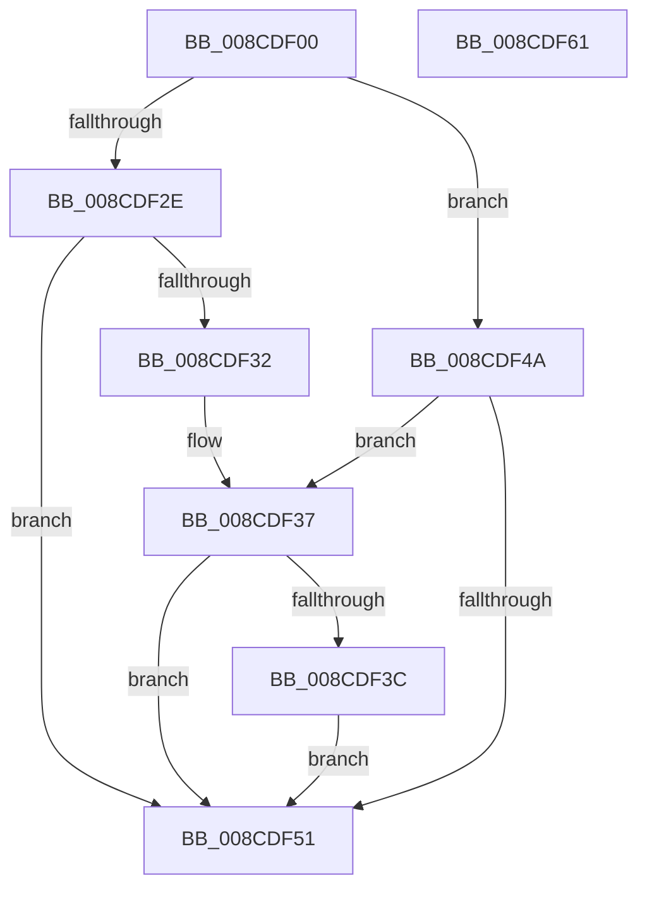

# RtlpWow64SanitizeContextFlags

- RVA: `0x008CDF00`–`0x008CDF62` (길이 `98` bytes)
- VA: `0x00000001408CDF00`
- 실행 섹션: `PAGE`
- PDB 이름 있음: `예`; PDB Function 태그: `아니요`
- unwind 정보 RVA: `0x00060BC4`
- 디코드: `32`개 명령, `98/98` bytes 표시
- 미해석 바이트: `0` (있으면 어셈블리에 `.byte`로 보존)

> 이 문서는 커널 이미지의 기계어와 PDB 기호를 분석해 생성했습니다. 4번과 5번은 함수 원형과 자료형을 바이너리 사용 방식에서 추정한 C 해석이며 원본 소스 복구 결과는 아닙니다.

## 1. Dependencies

- 직접 호출 지점: **2**; 고유 호출 대상: **2**
- 직접 호출자로 확인된 함수: **2**
- RIP 상대 이미지 참조: **0**

### Outgoing calls
- `0x008CDF1A` → [RtlpArchContextFlagFromMachine](RtlpArchContextFlagFromMachine_function_008CDF68.md) (function, `0x008CDF68`)
- `0x008CDF25` → [RtlpValidateContextFlags](../../text/49/RtlpValidateContextFlags_function_0049BF20.md) (function, `0x0049BF20`)

### Direct callers
- [PspWow64SetContextThread](PspWow64SetContextThread_function_008CCC88.md) at `0x008CCD55`
- [PspWow64GetContextThread](../A1/PspWow64GetContextThread_function_00A11E90.md) at `0x00A11F50`

### Static image references
- 디코드된 RIP-relative 메모리 참조가 없습니다.

## 2. Other-region calls and transfers

- 다른 실행 섹션으로 향하는 call: **1**
  - `0x008CDF25` → [RtlpValidateContextFlags](../../text/49/RtlpValidateContextFlags_function_0049BF20.md) (`PAGE` → `.text`)
- 별도 외부 분기/꼬리 이동을 확인하지 못했습니다.

## 3. Assembly (complete function range)

```asm
008CDF00  48 89 5C 24 08                  mov qword ptr [rsp + 8], rbx
008CDF05  48 89 74 24 10                  mov qword ptr [rsp + 0x10], rsi
008CDF0A  57                              push rdi
008CDF0B  48 83 EC 20                     sub rsp, 0x20
008CDF0F  48 8B F9                        mov rdi, rcx
008CDF12  40 8A F2                        mov sil, dl
008CDF15  B9 4C 01 00 00                  mov ecx, 0x14c
008CDF1A  E8 49 00 00 00                  call 0x1408cdf68
008CDF1F  8B 0F                           mov ecx, dword ptr [rdi]
008CDF21  33 D2                           xor edx, edx
008CDF23  8B D8                           mov ebx, eax
008CDF25  E8 F6 DF BC FF                  call 0x14049bf20
008CDF2A  85 C0                           test eax, eax
008CDF2C  78 1C                           js 0x1408cdf4a
008CDF2E  85 1F                           test dword ptr [rdi], ebx
008CDF30  75 1F                           jne 0x1408cdf51
008CDF32  B8 0D 00 00 C0                  mov eax, 0xc000000d
008CDF37  40 84 F6                        test sil, sil
008CDF3A  74 15                           je 0x1408cdf51
008CDF3C  0B 1F                           or ebx, dword ptr [rdi]
008CDF3E  81 E3 7F 00 01 D8               and ebx, 0xd801007f
008CDF44  89 1F                           mov dword ptr [rdi], ebx
008CDF46  33 C0                           xor eax, eax
008CDF48  EB 07                           jmp 0x1408cdf51
008CDF4A  3D 0D 00 00 C0                  cmp eax, 0xc000000d
008CDF4F  74 E6                           je 0x1408cdf37
008CDF51  48 8B 5C 24 30                  mov rbx, qword ptr [rsp + 0x30]
008CDF56  48 8B 74 24 38                  mov rsi, qword ptr [rsp + 0x38]
008CDF5B  48 83 C4 20                     add rsp, 0x20
008CDF5F  5F                              pop rdi
008CDF60  C3                              ret
008CDF61  CC                              int3
```

## 4. C-style interpretation (structured pseudocode)

```c
__int64 __fastcall RtlpWow64SanitizeContextFlags(__int64 a1, int a2)
{
    __int64 result;
    __int64 v_rbx;
    __int64 v_rsp;
    unsigned __int64 v_stack_p10;
    unsigned __int64 v_stack_p8;

    v_stack_p8 = v_rbx;
    v_stack_p10 = v_rsi;
    v_rsp = (v_rsp) - (32);
    result = RtlpArchContextFlagFromMachine(332, a2, a3, a4);
    a2 = 0;
    result = RtlpValidateContextFlags((unsigned int)(*(unsigned int *)(a1)), a2, a3, a4);
    if (sign_flag) goto loc_008CDF4A;
    if (((*(unsigned int *)(a1)) & ((unsigned int)((unsigned int)((unsigned int)(result))))) != 0) goto loc_008CDF51;
loc_008CDF37:
    if ((unsigned __int8)((unsigned __int8)(a2)) == 0) goto loc_008CDF51;
    v_rbx = (unsigned int)(((unsigned int)((unsigned int)(result))) | (*(unsigned int *)(a1)));
    v_rbx = (unsigned int)((v_rbx) & (0xD801007FULL));
    *(unsigned int *)(a1) = (unsigned int)(v_rbx);
    result = 0;
    goto loc_008CDF51;
loc_008CDF4A:
    if (0 == 0xC000000DULL) goto loc_008CDF37;
loc_008CDF51:
    v_rsp = (v_rsp) + (32);
    return result;
}
```

## 5. (Beta) C Style

```c
int64_t RtlpWow64SanitizeContextFlags(void *Arg1, int32_t Arg2)
{
    uint8_t *arg1 = (uint8_t *)Arg1;

    int64_t result;
    int64_t local_rbx;
    int64_t local_rsp;
    uint64_t v_stack_p10;
    uint64_t v_stack_p8;

    v_stack_p8 = local_rbx;
    v_stack_p10 = local_rsi;
    local_rsp = (local_rsp) - (32);
    result = RtlpArchContextFlagFromMachine(332, Arg2, a3, a4);
    Arg2 = 0;
    result = RtlpValidateContextFlags((uint32_t)(*(uint32_t *)(arg1)), Arg2, a3, a4);
    if (sign_flag) goto loc_008CDF4A;
    if (((*(uint32_t *)(arg1)) & ((uint32_t)((uint32_t)((uint32_t)(result))))) != 0) goto loc_008CDF51;
loc_008CDF37:
    if ((uint8_t)((uint8_t)(Arg2)) == 0) goto loc_008CDF51;
    local_rbx = (uint32_t)(((uint32_t)((uint32_t)(result))) | (*(uint32_t *)(arg1)));
    local_rbx = (uint32_t)((local_rbx) & (0xD801007FULL));
    *(uint32_t *)(arg1) = (uint32_t)(local_rbx);
    result = 0;
    goto loc_008CDF51;
loc_008CDF4A:
    if (0 == 0xC000000DULL) goto loc_008CDF37;
loc_008CDF51:
    local_rsp = (local_rsp) + (32);
    return result;
}
```

### 관측된 메모리 오프셋

구조체 형식이 확인되지 않은 접근은 인자 기준의 오프셋으로만 기록했습니다.

| 기준 인자 | 오프셋 표현 | 폭 (bit) | 접근 |
|---|---:|---:|---|
| `Arg1` | `+ 0x0` | `32` | `R` |
| `Arg1` | `+ 0x0` | `32` | `W` |

## 6. Execution-region graph

[열기: 2D/3D 그래프와 함수 탐색 컨트롤 패널](../../../control-panel.html?section=page&rva=0x008CDF00&view=graph)

- 2D 그래프는 위에서 아래로 흐르고, 3D 그래프는 빈 공간을 드래그해 회전합니다. Shift+드래그는 이동, 휠은 확대·축소, 함수 노드 선택은 대상 보고서 이동입니다.

### Static fallback


