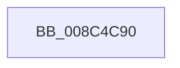

# SeCaptureSubjectContextEx

- RVA: `0x008C4C90`–`0x008C4CA0` (길이 `16` bytes)
- VA: `0x00000001408C4C90`
- 실행 섹션: `PAGE`
- PDB 이름 있음: `예`; PDB Function 태그: `아니요`
- unwind 정보 RVA: `0x00083A7C`
- 디코드: `4`개 명령, `16/16` bytes 표시
- 미해석 바이트: `0` (있으면 어셈블리에 `.byte`로 보존)

> 이 문서는 커널 이미지의 기계어와 PDB 기호를 분석해 생성했습니다. 4번과 5번은 함수 원형과 자료형을 바이너리 사용 방식에서 추정한 C 해석이며 원본 소스 복구 결과는 아닙니다.

## 1. Dependencies

- 직접 호출 지점: **0**; 고유 호출 대상: **0**
- 직접 호출자로 확인된 함수: **19**
- RIP 상대 이미지 참조: **0**

### Outgoing calls
- 직접 디코드된 call 명령이 없습니다.

### Direct callers
- [NtSetInformationFile](../../text/29/NtSetInformationFile_function_0029C5E0.md) at `0x0029CA8F`
- [ExCpuSetResourceManagerAccessCheck](../../text/3A/ExCpuSetResourceManagerAccessCheck_function_003A5444.md) at `0x003A5497`
- [SeComputeMandatoryDeniedAccess](../../text/60/SeComputeMandatoryDeniedAccess_function_006076BC.md) at `0x0060771F`
- [sub_006F2FA4](../../text/6F/Unknown_function_006F2FA4.md) at `0x006F2FC2`
- [CmQueryKey](../85/CmQueryKey_function_00858240.md) at `0x00858606`
- [PspCombineSecurityDomains](../8A/PspCombineSecurityDomains_function_008A18C0.md) at `0x008A1AB7`
- [PspOneDirectionSecurityDomainCombine](../8A/PspOneDirectionSecurityDomainCombine_function_008A23BC.md) at `0x008A24A4`
- [sub_008B4FCE](../8B/Unknown_function_008B4FCE.md) at `0x008B4FE4`
- [ObReferenceObjectByName](ObReferenceObjectByName_function_008C4A00.md) at `0x008C4B08`
- [IopXxxControlFile](../8E/IopXxxControlFile_function_008E9AD0.md) at `0x008EB17F`
- [ExCheckFullProcessInformationAccess](../95/ExCheckFullProcessInformationAccess_function_0095D93C.md) at `0x0095D99A`
- [ObpCaptureBoundaryDescriptor](../9C/ObpCaptureBoundaryDescriptor_function_009C9738.md) at `0x009C984B`
- [ObpVerifyCreatorAccessCheck](../9C/ObpVerifyCreatorAccessCheck_function_009CA524.md) at `0x009CA58C`
- [EtwpIsRegEntryAllowed](../9E/EtwpIsRegEntryAllowed_function_009EB2D0.md) at `0x009EB359`
- [NtSetInformationJobObject](../9F/NtSetInformationJobObject_function_009F84C0.md) at `0x009F8FA5`
- [NtSetInformationJobObject](../9F/NtSetInformationJobObject_function_009F84C0.md) at `0x009F97C7`
- [MiIsUserQueryVmCallerTrusted](../9F/MiIsUserQueryVmCallerTrusted_function_009FE378.md) at `0x009FE422`
- [ExpCheckWakeTimerAccess](../AB/ExpCheckWakeTimerAccess_function_00AB15FC.md) at `0x00AB1637`
- [NtSetInformationProcess](../AE/NtSetInformationProcess_function_00AE5370.md) at `0x00AE7DAF`
- [VfUtilIsLocalSystem](../../pagevrfy/B9/VfUtilIsLocalSystem_function_00B933F4.md) at `0x00B9342B`

### Static image references
- 디코드된 RIP-relative 메모리 참조가 없습니다.

## 2. Other-region calls and transfers

- 다른 실행 섹션으로 향하는 call: **0**
- 별도 외부 분기/꼬리 이동을 확인하지 못했습니다.

## 3. Assembly (complete function range)

```asm
008C4C90  40 57                           push rdi
008C4C92  48 83 EC 20                     sub rsp, 0x20
008C4C96  48 8B 82 D0 01 00 00            mov rax, qword ptr [rdx + 0x1d0]
008C4C9D  49 8B F8                        mov rdi, r8
```

## 4. C-style interpretation (structured pseudocode)

```c
__int64 __fastcall SeCaptureSubjectContextEx(__int64 a1, __int64 a2, __int64 a3)
{
    __int64 v_rsp;

    v_rsp = (v_rsp) - (32);
    return *(unsigned __int64 *)(a2 + 464);
}
```

## 5. (Beta) C Style

```c
int64_t SeCaptureSubjectContextEx(int64_t Arg1, void *Arg2, int64_t Arg3)
{
    uint8_t *arg2 = (uint8_t *)Arg2;

    int64_t local_rsp;

    local_rsp = (local_rsp) - (32);
    return *(uint64_t *)(arg2 + 0x1D0);
}
```

### 관측된 메모리 오프셋

구조체 형식이 확인되지 않은 접근은 인자 기준의 오프셋으로만 기록했습니다.

| 기준 인자 | 오프셋 표현 | 폭 (bit) | 접근 |
|---|---:|---:|---|
| `Arg2` | `+ 0x1D0` | `64` | `R` |

## 6. Execution-region graph

[열기: 2D/3D 그래프와 함수 탐색 컨트롤 패널](../../../control-panel.html?section=page&rva=0x008C4C90&view=graph)

- 2D 그래프는 위에서 아래로 흐르고, 3D 그래프는 빈 공간을 드래그해 회전합니다. Shift+드래그는 이동, 휠은 확대·축소, 함수 노드 선택은 대상 보고서 이동입니다.

### Static fallback


