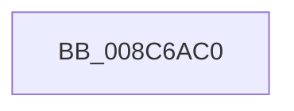

# SeCreateAccessState

- RVA: `0x008C6AC0`–`0x008C6ACF` (길이 `15` bytes)
- VA: `0x00000001408C6AC0`
- 실행 섹션: `PAGE`
- PDB 이름 있음: `예`; PDB Function 태그: `아니요`
- unwind 정보 RVA: `0x00083C08`
- 디코드: `7`개 명령, `15/15` bytes 표시
- 미해석 바이트: `0` (있으면 어셈블리에 `.byte`로 보존)

> 이 문서는 커널 이미지의 기계어와 PDB 기호를 분석해 생성했습니다. 4번과 5번은 함수 원형과 자료형을 바이너리 사용 방식에서 추정한 C 해석이며 원본 소스 복구 결과는 아닙니다.

## 1. Dependencies

- 직접 호출 지점: **0**; 고유 호출 대상: **0**
- 직접 호출자로 확인된 함수: **13**
- RIP 상대 이미지 참조: **0**

### Outgoing calls
- 직접 디코드된 call 명령이 없습니다.

### Direct callers
- [SepCreateTokenEx](../../text/4E/SepCreateTokenEx_function_004E9CD0.md) at `0x004EA87D`
- [PspCheckCpuPartitionCreateAccess](../78/PspCheckCpuPartitionCreateAccess_function_00784130.md) at `0x007841A2`
- [PspReferenceCpuPartitionByHandle](../78/PspReferenceCpuPartitionByHandle_function_007846F4.md) at `0x00784771`
- [CMFCheckAccess](../7D/CMFCheckAccess_function_007D28B4.md) at `0x007D29D6`
- [PsOpenProcess](../89/PsOpenProcess_function_00894A30.md) at `0x00894C97`
- [PsOpenProcess](../89/PsOpenProcess_function_00894A30.md) at `0x00894DB7`
- [ObReferenceObjectByNameEx](../8B/ObReferenceObjectByNameEx_function_008BD524.md) at `0x008BD63F`
- [ObDuplicateObject](ObDuplicateObject_function_008C4FA0.md) at `0x008C5A89`
- [WmipCreateGuidObject](WmipCreateGuidObject_function_008C7930.md) at `0x008C7A14`
- [NtGetNextThread](NtGetNextThread_function_008C7D40.md) at `0x008C7F29`
- [NtGetNextProcess](../91/NtGetNextProcess_function_0091DF50.md) at `0x0091E0F2`
- [PsOpenThread](../9C/PsOpenThread_function_009C5CC0.md) at `0x009C5E6E`
- [SepCopyAnonymousTokenAndSetSilo](../A3/SepCopyAnonymousTokenAndSetSilo_function_00A3A510.md) at `0x00A3A5C0`
- [SeSubProcessToken](../AA/SeSubProcessToken_function_00AAD570.md) at `0x00AADD58`

### Static image references
- 디코드된 RIP-relative 메모리 참조가 없습니다.

## 2. Other-region calls and transfers

- 다른 실행 섹션으로 향하는 call: **0**
- 별도 외부 분기/꼬리 이동을 확인하지 못했습니다.

## 3. Assembly (complete function range)

```asm
008C6AC0  48 8B C4                        mov rax, rsp
008C6AC3  55                              push rbp
008C6AC4  57                              push rdi
008C6AC5  41 54                           push r12
008C6AC7  41 56                           push r14
008C6AC9  41 57                           push r15
008C6ACB  48 83 EC 50                     sub rsp, 0x50
```

## 4. C-style interpretation (structured pseudocode)

```c
__int64 __fastcall SeCreateAccessState(void)
{
    __int64 v_rsp;

    v_rsp = (v_rsp) - (80);
    return v_rsp;
}
```

## 5. (Beta) C Style

```c
void SeCreateAccessState(void)
{
    int64_t local_rsp;

    local_rsp = (local_rsp) - (80);
    return local_rsp;
}
```

## 6. Execution-region graph

[열기: 2D/3D 그래프와 함수 탐색 컨트롤 패널](../../../control-panel.html?section=page&rva=0x008C6AC0&view=graph)

- 2D 그래프는 위에서 아래로 흐르고, 3D 그래프는 빈 공간을 드래그해 회전합니다. Shift+드래그는 이동, 휠은 확대·축소, 함수 노드 선택은 대상 보고서 이동입니다.

### Static fallback


