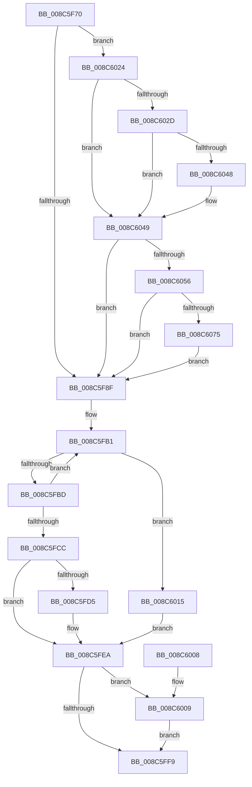

# SeDeleteAccessState

- RVA: `0x008C5F70`–`0x008C607B` (길이 `267` bytes)
- VA: `0x00000001408C5F70`
- 실행 섹션: `PAGE`
- PDB 이름 있음: `예`; PDB Function 태그: `아니요`
- unwind 정보 RVA: `0x00083B88`
- 디코드: `63`개 명령, `267/267` bytes 표시
- 미해석 바이트: `0` (있으면 어셈블리에 `.byte`로 보존)

> 이 문서는 커널 이미지의 기계어와 PDB 기호를 분석해 생성했습니다. 4번과 5번은 함수 원형과 자료형을 바이너리 사용 방식에서 추정한 C 해석이며 원본 소스 복구 결과는 아닙니다.

## 1. Dependencies

- 직접 호출 지점: **4**; 고유 호출 대상: **3**
- 직접 호출자로 확인된 함수: **28**
- RIP 상대 이미지 참조: **3**

### Outgoing calls
- `0x008C5F7D` → [SepDeleteAccessState](../../text/3F/SepDeleteAccessState_function_003FFF20.md) (function, `0x003FFF20`)
- `0x008C5FE5` → [ObpPushStackInfo](../../text/21/ObpPushStackInfo_function_002109E4.md) (function, `0x002109E4`)
- `0x008C600E` → [ObfDereferenceObjectWithTag](../../text/2F/ObfDereferenceObjectWithTag_function_002F78E0.md) (function, `0x002F78E0`)
- `0x008C601D` → [ObfDereferenceObjectWithTag](../../text/2F/ObfDereferenceObjectWithTag_function_002F78E0.md) (function, `0x002F78E0`)

### Direct callers
- [SepCreateTokenEx](../../text/4E/SepCreateTokenEx_function_004E9CD0.md) at `0x004EA8B2`
- [PspCheckCpuPartitionCreateAccess](../78/PspCheckCpuPartitionCreateAccess_function_00784130.md) at `0x0078420A`
- [PspReferenceCpuPartitionByHandle](../78/PspReferenceCpuPartitionByHandle_function_007846F4.md) at `0x007847CC`
- [PsCreateMinimalProcess](../78/PsCreateMinimalProcess_function_00786D14.md) at `0x0078707F`
- [CMFCheckAccess](../7D/CMFCheckAccess_function_007D28B4.md) at `0x007D2AD7`
- [CmpDoAccessCheckOnKCB](../7E/CmpDoAccessCheckOnKCB_function_007EB348.md) at `0x007EB478`
- [CmpDoBuildVirtualStack](../7E/CmpDoBuildVirtualStack_function_007EB4C4.md) at `0x007EB924`
- [CmKeyBodyReplicateToVirtual](../84/CmKeyBodyReplicateToVirtual_function_00843FE4.md) at `0x00844310`
- [PsOpenProcess](../89/PsOpenProcess_function_00894A30.md) at `0x00894D8F`
- [PsOpenProcess](../89/PsOpenProcess_function_00894A30.md) at `0x0089506A`
- [PspCombineSecurityDomains](../8A/PspCombineSecurityDomains_function_008A18C0.md) at `0x008A1A3A`
- [PspCombineSecurityDomains](../8A/PspCombineSecurityDomains_function_008A18C0.md) at `0x008A1A91`
- [PspOneDirectionSecurityDomainCombine](../8A/PspOneDirectionSecurityDomainCombine_function_008A23BC.md) at `0x008A2525`
- [sub_008B4D32](../8B/Unknown_function_008B4D32.md) at `0x008B4DE7`
- [ObInsertObjectEx](../8B/ObInsertObjectEx_function_008B97A0.md) at `0x008B9D53`
- [ObInsertObjectEx](../8B/ObInsertObjectEx_function_008B97A0.md) at `0x008BA079`
- [ObReferenceObjectByNameEx](../8B/ObReferenceObjectByNameEx_function_008BD524.md) at `0x008BD747`
- [ObReferenceObjectByName](ObReferenceObjectByName_function_008C4A00.md) at `0x008C4BE3`
- [ObDuplicateObject](ObDuplicateObject_function_008C4FA0.md) at `0x008C55B0`
- [ObDuplicateObject](ObDuplicateObject_function_008C4FA0.md) at `0x008C59D8`
- [ObDuplicateObject](ObDuplicateObject_function_008C4FA0.md) at `0x008C5D56`
- [WmipCreateGuidObject](WmipCreateGuidObject_function_008C7930.md) at `0x008C7AEC`
- [NtGetNextThread](NtGetNextThread_function_008C7D40.md) at `0x008C7F9A`
- [NtGetNextProcess](../91/NtGetNextProcess_function_0091DF50.md) at `0x0091E15F`
- [CmpCheckKeySecurityDescriptorAccess](../94/CmpCheckKeySecurityDescriptorAccess_function_0094715C.md) at `0x00947290`
- [PspInsertProcess](../94/PspInsertProcess_function_009472CC.md) at `0x00947514`
- [PsOpenThread](../9C/PsOpenThread_function_009C5CC0.md) at `0x009C5F2A`
- [PsOpenThread](../9C/PsOpenThread_function_009C5CC0.md) at `0x009C6005`
- [PspInsertThread](../9F/PspInsertThread_function_009F0314.md) at `0x009F0A50`
- [PspInsertThread](../9F/PspInsertThread_function_009F0314.md) at `0x009F0BC7`
- [PspCreateProcess](../A1/PspCreateProcess_function_00A12758.md) at `0x00A12CCC`
- [SepCopyAnonymousTokenAndSetSilo](../A3/SepCopyAnonymousTokenAndSetSilo_function_00A3A510.md) at `0x00A3A636`
- [SeSubProcessToken](../AA/SeSubProcessToken_function_00AAD570.md) at `0x00AADE1B`
- [CmKeyBodyRemapToVirtual](../AC/CmKeyBodyRemapToVirtual_function_00AC9494.md) at `0x00AC9717`
- [NtCreateUserProcess](../AE/NtCreateUserProcess_function_00AEA680.md) at `0x00AEB694`

### Static image references
- `0x008C5F82` → RVA `0x00FD8010` (`PAGEDATA`; read)
- `0x008C5FCC` → RVA `0x00FC5010` (`ALMOSTRO`; read)
- `0x008C603B` → RVA `0x00E67B90` (`.data`; read)

## 2. Other-region calls and transfers

- 다른 실행 섹션으로 향하는 call: **4**
  - `0x008C5F7D` → [SepDeleteAccessState](../../text/3F/SepDeleteAccessState_function_003FFF20.md) (`PAGE` → `.text`)
  - `0x008C5FE5` → [ObpPushStackInfo](../../text/21/ObpPushStackInfo_function_002109E4.md) (`PAGE` → `.text`)
  - `0x008C600E` → [ObfDereferenceObjectWithTag](../../text/2F/ObfDereferenceObjectWithTag_function_002F78E0.md) (`PAGE` → `.text`)
  - `0x008C601D` → [ObfDereferenceObjectWithTag](../../text/2F/ObfDereferenceObjectWithTag_function_002F78E0.md) (`PAGE` → `.text`)
- 별도 외부 분기/꼬리 이동을 확인하지 못했습니다.

## 3. Assembly (complete function range)

```asm
008C5F70  48 89 5C 24 08                  mov qword ptr [rsp + 8], rbx
008C5F75  57                              push rdi
008C5F76  48 83 EC 20                     sub rsp, 0x20
008C5F7A  48 8B D9                        mov rbx, rcx
008C5F7D  E8 9E 9F B3 FF                  call 0x1403fff20
008C5F82  83 3D 87 20 71 00 00            cmp dword ptr [rip + 0x712087], 0
008C5F89  0F 85 95 00 00 00               jne 0x1408c6024
008C5F8F  65 48 8B 04 25 88 01 00 00      mov rax, qword ptr gs:[0x188]
008C5F98  4C 8B 43 30                     mov r8, qword ptr [rbx + 0x30]
008C5F9C  48 8B 90 B8 00 00 00            mov rdx, qword ptr [rax + 0xb8]
008C5FA3  0F 0D 8A 48 02 00 00            prefetchw byte ptr [rdx + 0x248]
008C5FAA  48 8B 82 48 02 00 00            mov rax, qword ptr [rdx + 0x248]
008C5FB1  48 8B C8                        mov rcx, rax
008C5FB4  49 33 C8                        xor rcx, r8
008C5FB7  48 83 F9 0F                     cmp rcx, 0xf
008C5FBB  73 58                           jae 0x1408c6015
008C5FBD  48 8D 48 01                     lea rcx, [rax + 1]
008C5FC1  F0 48 0F B1 8A 48 02 00 00      lock cmpxchg qword ptr [rdx + 0x248], rcx
008C5FCA  75 E5                           jne 0x1408c5fb1
008C5FCC  83 3D 3D F0 6F 00 00            cmp dword ptr [rip + 0x6ff03d], 0
008C5FD3  74 15                           je 0x1408c5fea
008C5FD5  33 D2                           xor edx, edx
008C5FD7  49 8D 48 D0                     lea rcx, [r8 - 0x30]
008C5FDB  41 B9 53 65 53 75               mov r9d, 0x75536553
008C5FE1  44 8D 42 01                     lea r8d, [rdx + 1]
008C5FE5  E8 FA A9 94 FF                  call 0x1402109e4
008C5FEA  48 8B 4B 20                     mov rcx, qword ptr [rbx + 0x20]
008C5FEE  33 FF                           xor edi, edi
008C5FF0  48 89 7B 30                     mov qword ptr [rbx + 0x30], rdi
008C5FF4  48 85 C9                        test rcx, rcx
008C5FF7  75 10                           jne 0x1408c6009
008C5FF9  48 89 7B 20                     mov qword ptr [rbx + 0x20], rdi
008C5FFD  48 8B 5C 24 30                  mov rbx, qword ptr [rsp + 0x30]
008C6002  48 83 C4 20                     add rsp, 0x20
008C6006  5F                              pop rdi
008C6007  C3                              ret
008C6008  CC                              int3
008C6009  BA 53 65 53 75                  mov edx, 0x75536553
008C600E  E8 CD 18 A3 FF                  call 0x1402f78e0
008C6013  EB E4                           jmp 0x1408c5ff9
008C6015  BA 53 65 53 75                  mov edx, 0x75536553
008C601A  49 8B C8                        mov rcx, r8
008C601D  E8 BE 18 A3 FF                  call 0x1402f78e0
008C6022  EB C6                           jmp 0x1408c5fea
008C6024  48 8B 43 30                     mov rax, qword ptr [rbx + 0x30]
008C6028  48 85 C0                        test rax, rax
008C602B  74 1C                           je 0x1408c6049
008C602D  48 8B 80 78 04 00 00            mov rax, qword ptr [rax + 0x478]
008C6034  F0 FF 88 1C 01 00 00            lock dec dword ptr [rax + 0x11c]
008C603B  48 8B 05 4E 1B 5A 00            mov rax, qword ptr [rip + 0x5a1b4e]
008C6042  48 39 43 30                     cmp qword ptr [rbx + 0x30], rax
008C6046  75 01                           jne 0x1408c6049
008C6048  CC                              int3
008C6049  48 8B 43 20                     mov rax, qword ptr [rbx + 0x20]
008C604D  48 85 C0                        test rax, rax
008C6050  0F 84 39 FF FF FF               je 0x1408c5f8f
008C6056  48 8B 80 78 04 00 00            mov rax, qword ptr [rax + 0x478]
008C605D  F0 FF 88 1C 01 00 00            lock dec dword ptr [rax + 0x11c]
008C6064  48 8B 05 25 1B 5A 00            mov rax, qword ptr [rip + 0x5a1b25]
008C606B  48 39 43 20                     cmp qword ptr [rbx + 0x20], rax
008C606F  0F 85 1A FF FF FF               jne 0x1408c5f8f
008C6075  CC                              int3
008C6076  E9 14 FF FF FF                  jmp 0x1408c5f8f
```

## 4. C-style interpretation (structured pseudocode)

```c
__int64 __fastcall SeDeleteAccessState(__int64 a1)
{
    __int64 result;
    __int64 v_rdi;
    __int64 v_rsp;
    unsigned __int64 v_stack_p8;

    v_stack_p8 = v_rbx;
    v_rsp = (v_rsp) - (32);
    result = SepDeleteAccessState(a1, a2, a3, a4);
    if ((*(unsigned int *)(v_rip + 7413895)) != 0) goto loc_008C6024;
loc_008C5F8F:
loc_008C5FB1:
    a1 = (*(unsigned __int64 *)(*(unsigned __int64 *)(*(unsigned __int64 *)(gs_base + (0 + 392)) + 184) + 584)) ^ (*(unsigned __int64 *)(a1 + 48));
    if (a1 >= 15) goto loc_008C6015;
    if (a1 != 15) goto loc_008C5FB1;
    result = *(unsigned __int64 *)(*(unsigned __int64 *)(*(unsigned __int64 *)(gs_base + (0 + 392)) + 184) + 584);
    if ((*(unsigned int *)(v_rip + 7335997)) != 0) {
        a2 = 0;
        a1 = *(unsigned __int64 *)(a1 + 48) - 48;
        a4 = 0x75536553ULL;
        a3 = a2 + 1;
        result = ObpPushStackInfo(a1, a2, a3, a4);
    }
    v_rdi = 0;
    *(unsigned __int64 *)(a1 + 48) = 0;
    if (*(unsigned __int64 *)(a1 + 32) != 0) goto loc_008C6009;
loc_008C5FF9:
    *(unsigned __int64 *)(a1 + 32) = 0;
    v_rsp = (v_rsp) + (32);
    return result;
loc_008C6009:
    result = ObfDereferenceObjectWithTag(*(unsigned __int64 *)(a1 + 32), (unsigned int)(0x75536553ULL), a3, a4);
    goto loc_008C5FF9;
loc_008C6015:
    result = ObfDereferenceObjectWithTag(a3, (unsigned int)(0x75536553ULL), a3, a4);
    goto loc_008C5FEA;
loc_008C6024:
    if (*(unsigned __int64 *)(v_stack_p8 + 48) == 0) goto loc_008C6049;
    if ((*(unsigned __int64 *)(v_stack_p8 + 48)) == (*(unsigned __int64 *)(v_rip + 5905230))) {
    }
    if (*(unsigned __int64 *)(v_stack_p8 + 32) == 0) goto loc_008C5F8F;
    if ((*(unsigned __int64 *)(v_stack_p8 + 32)) != (*(unsigned __int64 *)(v_rip + 5905189))) goto loc_008C5F8F;
    goto loc_008C5F8F;
}
```

## 5. (Beta) C Style

```c
int64_t SeDeleteAccessState(void *Arg1)
{
    uint8_t *arg1 = (uint8_t *)Arg1;

    int64_t result;
    int64_t local_rdi;
    int64_t local_rsp;
    uint64_t v_stack_p8;

    v_stack_p8 = local_rbx;
    local_rsp = (local_rsp) - (32);
    result = SepDeleteAccessState(Arg1, a2, a3, a4);
    if ((*(uint32_t *)(v_rip + 0x712087)) != 0) goto loc_008C6024;
loc_008C5F8F:
loc_008C5FB1:
    Arg1 = (*(uint64_t *)(*(uint64_t *)(*(uint64_t *)(gs_base + (0 + 0x188)) + 0xB8) + 0x248)) ^ (*(uint64_t *)(arg1 + 0x30));
    if (Arg1 >= 15) goto loc_008C6015;
    if (Arg1 != 15) goto loc_008C5FB1;
    result = *(uint64_t *)(*(uint64_t *)(*(uint64_t *)(gs_base + (0 + 0x188)) + 0xB8) + 0x248);
    if ((*(uint32_t *)(v_rip + 0x6FF03D)) != 0) {
        a2 = 0;
        Arg1 = *(uint64_t *)(arg1 + 0x30) - 48;
        a4 = 0x75536553ULL;
        a3 = a2 + 1;
        result = ObpPushStackInfo(Arg1, a2, a3, a4);
    }
    local_rdi = 0;
    *(uint64_t *)(arg1 + 0x30) = 0;
    if (*(uint64_t *)(arg1 + 0x20) != 0) goto loc_008C6009;
loc_008C5FF9:
    *(uint64_t *)(arg1 + 0x20) = 0;
    local_rsp = (local_rsp) + (32);
    return result;
loc_008C6009:
    result = ObfDereferenceObjectWithTag(*(uint64_t *)(arg1 + 0x20), (uint32_t)(0x75536553ULL), a3, a4);
    goto loc_008C5FF9;
loc_008C6015:
    result = ObfDereferenceObjectWithTag(a3, (uint32_t)(0x75536553ULL), a3, a4);
    goto loc_008C5FEA;
loc_008C6024:
    if (*(uint64_t *)(v_stack_p8 + 0x30) == 0) goto loc_008C6049;
    if ((*(uint64_t *)(v_stack_p8 + 0x30)) == (*(uint64_t *)(v_rip + 0x5A1B4E))) {
    }
    if (*(uint64_t *)(v_stack_p8 + 0x20) == 0) goto loc_008C5F8F;
    if ((*(uint64_t *)(v_stack_p8 + 0x20)) != (*(uint64_t *)(v_rip + 0x5A1B25))) goto loc_008C5F8F;
    goto loc_008C5F8F;
}
```

### 관측된 메모리 오프셋

구조체 형식이 확인되지 않은 접근은 인자 기준의 오프셋으로만 기록했습니다.

| 기준 인자 | 오프셋 표현 | 폭 (bit) | 접근 |
|---|---:|---:|---|
| `Arg1` | `+ 0x20` | `64` | `R` |
| `Arg1` | `+ 0x20` | `64` | `W` |
| `Arg1` | `+ 0x30` | `64` | `R` |
| `Arg1` | `+ 0x30` | `64` | `W` |

## 6. Execution-region graph

[열기: 2D/3D 그래프와 함수 탐색 컨트롤 패널](../../../control-panel.html?section=page&rva=0x008C5F70&view=graph)

- 2D 그래프는 위에서 아래로 흐르고, 3D 그래프는 빈 공간을 드래그해 회전합니다. Shift+드래그는 이동, 휠은 확대·축소, 함수 노드 선택은 대상 보고서 이동입니다.

### Static fallback


