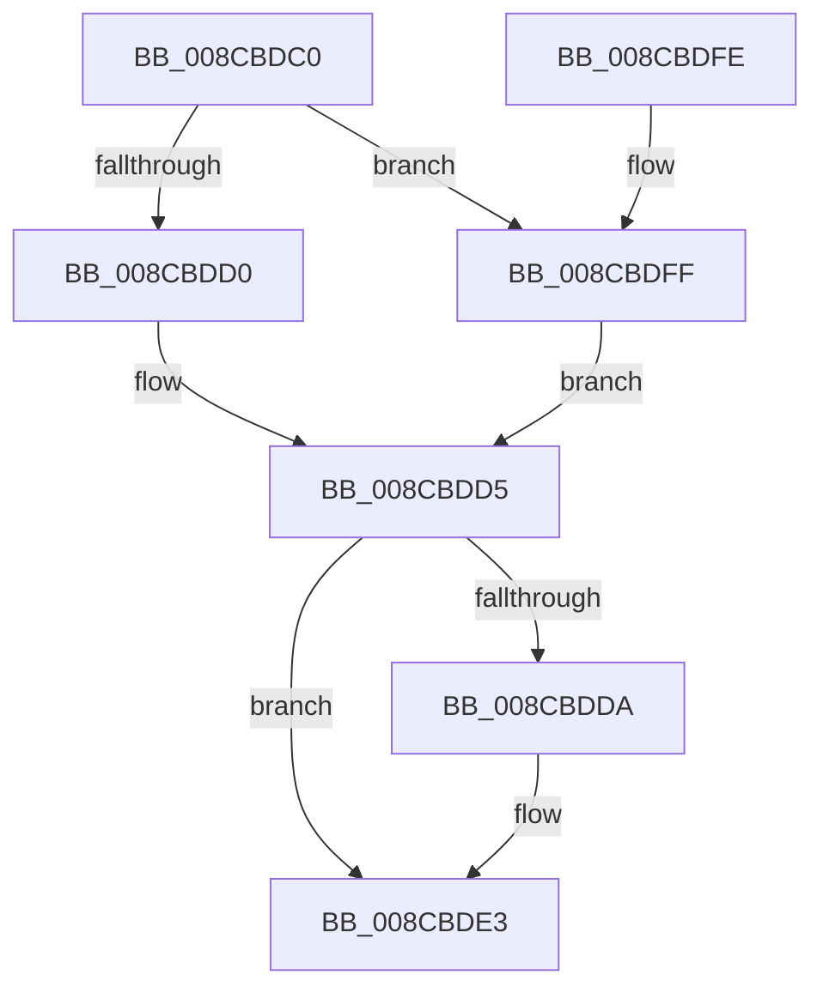

# SeImpersonateClientEx

- RVA: `0x008CBDC0`–`0x008CBE06` (길이 `70` bytes)
- VA: `0x00000001408CBDC0`
- 실행 섹션: `PAGE`
- PDB 이름 있음: `예`; PDB Function 태그: `아니요`
- unwind 정보 RVA: `0x000789BC`
- 디코드: `20`개 명령, `70/70` bytes 표시
- 미해석 바이트: `0` (있으면 어셈블리에 `.byte`로 보존)

> 이 문서는 커널 이미지의 기계어와 PDB 기호를 분석해 생성했습니다. 4번과 5번은 함수 원형과 자료형을 바이너리 사용 방식에서 추정한 C 해석이며 원본 소스 복구 결과는 아닙니다.

## 1. Dependencies

- 직접 호출 지점: **1**; 고유 호출 대상: **1**
- 직접 호출자로 확인된 함수: **2**
- RIP 상대 이미지 참조: **0**

### Outgoing calls
- `0x008CBDF4` → [PsImpersonateClient](PsImpersonateClient_function_008CBE10.md) (function, `0x008CBE10`)

### Direct callers
- [SeImpersonateClient](../7A/SeImpersonateClient_function_007A0700.md) at `0x007A0704`
- [EtwpDelayCreate](../9C/EtwpDelayCreate_function_009C1188.md) at `0x009C1324`

### Static image references
- 디코드된 RIP-relative 메모리 참조가 없습니다.

## 2. Other-region calls and transfers

- 다른 실행 섹션으로 향하는 call: **0**
- 별도 외부 분기/꼬리 이동을 확인하지 못했습니다.

## 3. Assembly (complete function range)

```asm
008CBDC0  48 83 EC 38                     sub rsp, 0x38
008CBDC4  80 79 18 00                     cmp byte ptr [rcx + 0x18], 0
008CBDC8  48 8B C2                        mov rax, rdx
008CBDCB  48 8B D1                        mov rdx, rcx
008CBDCE  75 2F                           jne 0x1408cbdff
008CBDD0  44 0F B6 49 09                  movzx r9d, byte ptr [rcx + 9]
008CBDD5  48 85 C0                        test rax, rax
008CBDD8  75 09                           jne 0x1408cbde3
008CBDDA  65 48 8B 04 25 88 01 00 00      mov rax, qword ptr gs:[0x188]
008CBDE3  8B 49 04                        mov ecx, dword ptr [rcx + 4]
008CBDE6  41 B0 01                        mov r8b, 1
008CBDE9  48 8B 52 10                     mov rdx, qword ptr [rdx + 0x10]
008CBDED  89 4C 24 20                     mov dword ptr [rsp + 0x20], ecx
008CBDF1  48 8B C8                        mov rcx, rax
008CBDF4  E8 17 00 00 00                  call 0x1408cbe10
008CBDF9  48 83 C4 38                     add rsp, 0x38
008CBDFD  C3                              ret
008CBDFE  CC                              int3
008CBDFF  44 0F B6 49 19                  movzx r9d, byte ptr [rcx + 0x19]
008CBE04  EB CF                           jmp 0x1408cbdd5
```

## 4. C-style interpretation (structured pseudocode)

```c
__int64 __fastcall SeImpersonateClientEx(__int64 a1, __int64 a2)
{
    __int64 result;
    __int64 v_rsp;
    unsigned int v_stack_m18;

    v_rsp = (v_rsp) - (56);
    if ((*(unsigned __int8 *)(a1 + 24)) != 0) goto loc_008CBDFF;
loc_008CBDD5:
    result = a2;
    if (a2 == 0) {
        result = *(unsigned __int64 *)(gs_base + (0 + 392));
    }
    v_stack_m18 = (unsigned int)((unsigned int)(*(unsigned int *)(a1 + 4)));
    result = PsImpersonateClient(result, *(unsigned __int64 *)(a1 + 16), 1, *(unsigned __int8 *)(a1 + 9));
    v_rsp = (v_rsp) + (56);
    return result;
loc_008CBDFF:
    goto loc_008CBDD5;
}
```

## 5. (Beta) C Style

```c
int64_t SeImpersonateClientEx(void *Arg1, int64_t Arg2)
{
    uint8_t *arg1 = (uint8_t *)Arg1;

    int64_t result;
    int64_t local_rsp;
    uint32_t v_stack_m18;

    local_rsp = (local_rsp) - (56);
    if ((*(uint8_t *)(arg1 + 0x18)) != 0) goto loc_008CBDFF;
loc_008CBDD5:
    result = Arg2;
    if (Arg2 == 0) {
        result = *(uint64_t *)(gs_base + (0 + 0x188));
    }
    v_stack_m18 = (uint32_t)((uint32_t)(*(uint32_t *)(arg1 + 0x4)));
    result = PsImpersonateClient(result, *(uint64_t *)(arg1 + 0x10), 1, *(uint8_t *)(arg1 + 0x9));
    local_rsp = (local_rsp) + (56);
    return result;
loc_008CBDFF:
    goto loc_008CBDD5;
}
```

### 관측된 메모리 오프셋

구조체 형식이 확인되지 않은 접근은 인자 기준의 오프셋으로만 기록했습니다.

| 기준 인자 | 오프셋 표현 | 폭 (bit) | 접근 |
|---|---:|---:|---|
| `Arg1` | `+ 0x4` | `32` | `R` |
| `Arg1` | `+ 0x9` | `8` | `R` |
| `Arg1` | `+ 0x10` | `64` | `R` |
| `Arg1` | `+ 0x18` | `8` | `R` |
| `Arg1` | `+ 0x19` | `8` | `R` |

## 6. Execution-region graph

[열기: 2D/3D 그래프와 함수 탐색 컨트롤 패널](../../../control-panel.html?section=page&rva=0x008CBDC0&view=graph)

- 2D 그래프는 위에서 아래로 흐르고, 3D 그래프는 빈 공간을 드래그해 회전합니다. Shift+드래그는 이동, 휠은 확대·축소, 함수 노드 선택은 대상 보고서 이동입니다.

### Static fallback


