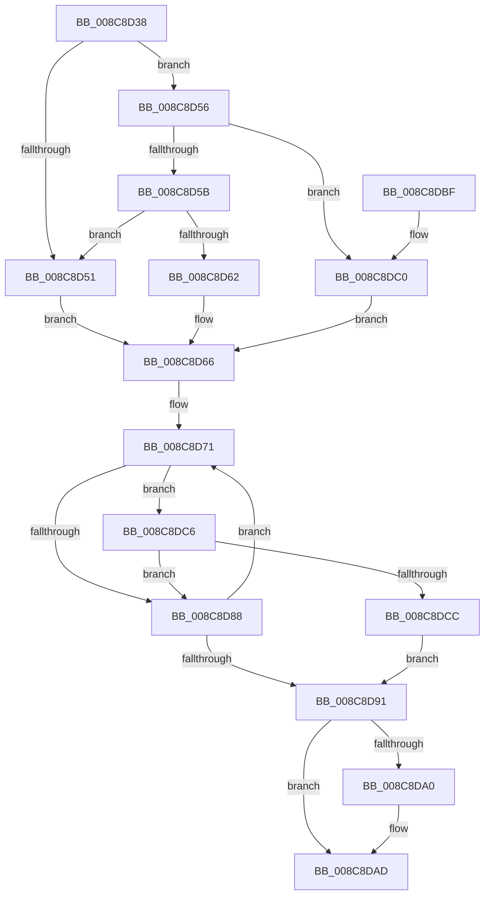

# SeQueryMandatoryLabel

- RVA: `0x008C8D38`–`0x008C8DD2` (길이 `154` bytes)
- VA: `0x00000001408C8D38`
- 실행 섹션: `PAGE`
- PDB 이름 있음: `예`; PDB Function 태그: `아니요`
- unwind 정보 RVA: `0x000840F4`
- 디코드: `49`개 명령, `154/154` bytes 표시
- 미해석 바이트: `0` (있으면 어셈블리에 `.byte`로 보존)

> 이 문서는 커널 이미지의 기계어와 PDB 기호를 분석해 생성했습니다. 4번과 5번은 함수 원형과 자료형을 바이너리 사용 방식에서 추정한 C 해석이며 원본 소스 복구 결과는 아닙니다.

## 1. Dependencies

- 직접 호출 지점: **3**; 고유 호출 대상: **3**
- 직접 호출자로 확인된 함수: **1**
- RIP 상대 이미지 참조: **1**

### Outgoing calls
- `0x008C8D7E` → [RtlFindAceByType](../../text/41/RtlFindAceByType_function_00410AF0.md) (function, `0x00410AF0`)
- `0x008C8D94` → [RtlSubAuthorityCountSid](../../text/46/RtlSubAuthorityCountSid_function_00468F10.md) (function, `0x00468F10`)
- `0x008C8DA6` → [RtlSubAuthoritySid](../../text/45/RtlSubAuthoritySid_function_00456D10.md) (function, `0x00456D10`)

### Direct callers
- [MiAllowImageMap](MiAllowImageMap_function_008C8B10.md) at `0x008C8C70`

### Static image references
- `0x008C8D66` → RVA `0x00E67DB0` (`.data`; read)

## 2. Other-region calls and transfers

- 다른 실행 섹션으로 향하는 call: **3**
  - `0x008C8D7E` → [RtlFindAceByType](../../text/41/RtlFindAceByType_function_00410AF0.md) (`PAGE` → `.text`)
  - `0x008C8D94` → [RtlSubAuthorityCountSid](../../text/46/RtlSubAuthorityCountSid_function_00468F10.md) (`PAGE` → `.text`)
  - `0x008C8DA6` → [RtlSubAuthoritySid](../../text/45/RtlSubAuthoritySid_function_00456D10.md) (`PAGE` → `.text`)
- 별도 외부 분기/꼬리 이동을 확인하지 못했습니다.

## 3. Assembly (complete function range)

```asm
008C8D38  48 89 5C 24 10                  mov qword ptr [rsp + 0x10], rbx
008C8D3D  48 89 74 24 18                  mov qword ptr [rsp + 0x18], rsi
008C8D42  57                              push rdi
008C8D43  48 83 EC 20                     sub rsp, 0x20
008C8D47  0F B7 41 02                     movzx eax, word ptr [rcx + 2]
008C8D4B  33 DB                           xor ebx, ebx
008C8D4D  A8 10                           test al, 0x10
008C8D4F  75 05                           jne 0x1408c8d56
008C8D51  48 8B FB                        mov rdi, rbx
008C8D54  EB 10                           jmp 0x1408c8d66
008C8D56  66 85 C0                        test ax, ax
008C8D59  79 65                           jns 0x1408c8dc0
008C8D5B  8B 41 0C                        mov eax, dword ptr [rcx + 0xc]
008C8D5E  85 C0                           test eax, eax
008C8D60  74 EF                           je 0x1408c8d51
008C8D62  48 8D 3C 01                     lea rdi, [rcx + rax]
008C8D66  48 8B 35 43 F0 59 00            mov rsi, qword ptr [rip + 0x59f043]
008C8D6D  89 5C 24 30                     mov dword ptr [rsp + 0x30], ebx
008C8D71  4C 8D 44 24 30                  lea r8, [rsp + 0x30]
008C8D76  BA 11 00 00 00                  mov edx, 0x11
008C8D7B  48 8B CF                        mov rcx, rdi
008C8D7E  E8 6D 7D B4 FF                  call 0x140410af0
008C8D83  48 85 C0                        test rax, rax
008C8D86  75 3E                           jne 0x1408c8dc6
008C8D88  FF 44 24 30                     inc dword ptr [rsp + 0x30]
008C8D8C  48 85 C0                        test rax, rax
008C8D8F  75 E0                           jne 0x1408c8d71
008C8D91  48 8B CE                        mov rcx, rsi
008C8D94  E8 77 01 BA FF                  call 0x140468f10
008C8D99  0F B6 08                        movzx ecx, byte ptr [rax]
008C8D9C  84 C9                           test cl, cl
008C8D9E  74 0D                           je 0x1408c8dad
008C8DA0  8D 51 FF                        lea edx, [rcx - 1]
008C8DA3  48 8B CE                        mov rcx, rsi
008C8DA6  E8 65 DF B8 FF                  call 0x140456d10
008C8DAB  8B 18                           mov ebx, dword ptr [rax]
008C8DAD  48 8B 74 24 40                  mov rsi, qword ptr [rsp + 0x40]
008C8DB2  8B C3                           mov eax, ebx
008C8DB4  48 8B 5C 24 38                  mov rbx, qword ptr [rsp + 0x38]
008C8DB9  48 83 C4 20                     add rsp, 0x20
008C8DBD  5F                              pop rdi
008C8DBE  C3                              ret
008C8DBF  CC                              int3
008C8DC0  48 8B 79 18                     mov rdi, qword ptr [rcx + 0x18]
008C8DC4  EB A0                           jmp 0x1408c8d66
008C8DC6  F6 40 01 08                     test byte ptr [rax + 1], 8
008C8DCA  75 BC                           jne 0x1408c8d88
008C8DCC  48 8D 70 08                     lea rsi, [rax + 8]
008C8DD0  EB BF                           jmp 0x1408c8d91
```

## 4. C-style interpretation (structured pseudocode)

```c
__int64 __fastcall SeQueryMandatoryLabel(__int64 a1)
{
    __int64 result;
    __int64 v_rbx;
    __int64 v_rsp;
    unsigned __int64 v_stack_p10;
    unsigned __int64 v_stack_p18;
    unsigned int v_stack_p8;

    v_stack_p10 = v_rbx;
    v_stack_p18 = v_rsi;
    v_rsp = (v_rsp) - (32);
    v_rbx = 0;
    if ((((unsigned __int8)(*(unsigned __int16 *)(a1 + 2))) & (16)) != 0) goto loc_008C8D56;
loc_008C8D51:
    goto loc_008C8D66;
loc_008C8D56:
    if (!sign_flag) goto loc_008C8DC0;
    if ((unsigned int)((unsigned int)(*(unsigned int *)(a1 + 12))) == 0) goto loc_008C8D51;
loc_008C8D66:
    v_stack_p8 = 0;
loc_008C8D71:
    result = RtlFindAceByType(a1 + (unsigned int)(*(unsigned int *)(a1 + 12)) * 1, 17, v_stack_p8, a4);
    if (result != 0) goto loc_008C8DC6;
loc_008C8D88:
    if (result != 0) goto loc_008C8D71;
loc_008C8D91:
    result = RtlSubAuthorityCountSid(*(unsigned __int64 *)(v_rip + 5894211), 17, v_stack_p8, a4);
    if ((unsigned __int8)(*(unsigned __int8 *)(result)) != 0) {
        a2 = *(unsigned __int8 *)(result) - 1;
        a1 = *(unsigned __int64 *)(v_rip + 5894211);
        result = RtlSubAuthoritySid(a1, a2, v_stack_p8, a4);
        v_rbx = *(unsigned int *)(result);
    }
    v_rsp = (v_rsp) + (32);
    return (unsigned int)((unsigned int)(v_rbx));
loc_008C8DC0:
    goto loc_008C8D66;
loc_008C8DC6:
    if (((*(unsigned __int8 *)((unsigned int)((unsigned int)(v_rbx)) + 1)) & (8)) != 0) goto loc_008C8D88;
    goto loc_008C8D91;
}
```

## 5. (Beta) C Style

```c
int64_t SeQueryMandatoryLabel(void *Arg1)
{
    uint8_t *arg1 = (uint8_t *)Arg1;

    int64_t result;
    int64_t local_rbx;
    int64_t local_rsp;
    uint64_t v_stack_p10;
    uint64_t v_stack_p18;
    uint32_t v_stack_p8;

    v_stack_p10 = local_rbx;
    v_stack_p18 = local_rsi;
    local_rsp = (local_rsp) - (32);
    local_rbx = 0;
    if ((((uint8_t)(*(uint16_t *)(arg1 + 0x2))) & (16)) != 0) goto loc_008C8D56;
loc_008C8D51:
    goto loc_008C8D66;
loc_008C8D56:
    if (!sign_flag) goto loc_008C8DC0;
    if ((uint32_t)((uint32_t)(*(uint32_t *)(arg1 + 0xC))) == 0) goto loc_008C8D51;
loc_008C8D66:
    v_stack_p8 = 0;
loc_008C8D71:
    result = RtlFindAceByType(Arg1 + (uint32_t)(*(uint32_t *)(arg1 + 0xC)) * 1, 17, v_stack_p8, a4);
    if (result != 0) goto loc_008C8DC6;
loc_008C8D88:
    if (result != 0) goto loc_008C8D71;
loc_008C8D91:
    result = RtlSubAuthorityCountSid(*(uint64_t *)(v_rip + 0x59F043), 17, v_stack_p8, a4);
    if ((uint8_t)(*(uint8_t *)(result)) != 0) {
        a2 = *(uint8_t *)(result) - 1;
        Arg1 = *(uint64_t *)(v_rip + 0x59F043);
        result = RtlSubAuthoritySid(Arg1, a2, v_stack_p8, a4);
        local_rbx = *(uint32_t *)(result);
    }
    local_rsp = (local_rsp) + (32);
    return (uint32_t)((uint32_t)(local_rbx));
loc_008C8DC0:
    goto loc_008C8D66;
loc_008C8DC6:
    if (((*(uint8_t *)((uint32_t)((uint32_t)(local_rbx)) + 0x1)) & (8)) != 0) goto loc_008C8D88;
    goto loc_008C8D91;
}
```

### 관측된 메모리 오프셋

구조체 형식이 확인되지 않은 접근은 인자 기준의 오프셋으로만 기록했습니다.

| 기준 인자 | 오프셋 표현 | 폭 (bit) | 접근 |
|---|---:|---:|---|
| `Arg1` | `+ 0x0 + rax*1` | `64` | `R` |
| `Arg1` | `+ 0x2` | `16` | `R` |
| `Arg1` | `+ 0xC` | `32` | `R` |
| `Arg1` | `+ 0x18` | `64` | `R` |

## 6. Execution-region graph

[열기: 2D/3D 그래프와 함수 탐색 컨트롤 패널](../../../control-panel.html?section=page&rva=0x008C8D38&view=graph)

- 2D 그래프는 위에서 아래로 흐르고, 3D 그래프는 빈 공간을 드래그해 회전합니다. Shift+드래그는 이동, 휠은 확대·축소, 함수 노드 선택은 대상 보고서 이동입니다.

### Static fallback


