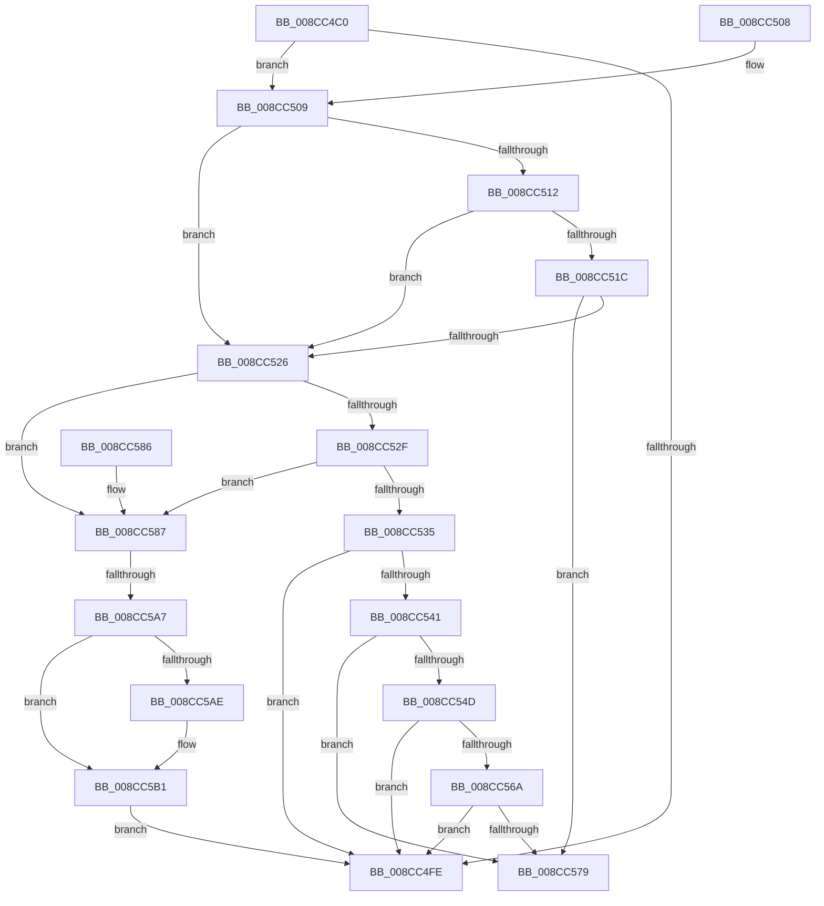

# SeTokenCanImpersonate

- RVA: `0x008CC4C0`–`0x008CC5C2` (길이 `258` bytes)
- VA: `0x00000001408CC4C0`
- 실행 섹션: `PAGE`
- PDB 이름 있음: `예`; PDB Function 태그: `아니요`
- unwind 정보 RVA: `0x00084588`
- 디코드: `75`개 명령, `258/258` bytes 표시
- 미해석 바이트: `0` (있으면 어셈블리에 `.byte`로 보존)

> 이 문서는 커널 이미지의 기계어와 PDB 기호를 분석해 생성했습니다. 4번과 5번은 함수 원형과 자료형을 바이너리 사용 방식에서 추정한 C 해석이며 원본 소스 복구 결과는 아닙니다.

## 1. Dependencies

- 직접 호출 지점: **4**; 고유 호출 대상: **4**
- 직접 호출자로 확인된 함수: **1**
- RIP 상대 이미지 참조: **0**

### Outgoing calls
- `0x008CC509` → [Feature_AgentId2__private_IsEnabledDeviceUsageNoInline](../../text/60/Feature_AgentId2__private_IsEnabledDeviceUsageNoInline_function_006066CC.md) (function, `0x006066CC`)
- `0x008CC561` → [RtlEqualSid](../../text/40/RtlEqualSid_function_00400AD0.md) (function, `0x00400AD0`)
- `0x008CC570` → [RtlIsParentOfChildAppContainer](../70/RtlIsParentOfChildAppContainer_function_007047CC.md) (function, `0x007047CC`)
- `0x008CC59A` → [RtlSidDominatesForTrust](../../text/3E/RtlSidDominatesForTrust_function_003EDFE0.md) (function, `0x003EDFE0`)

### Direct callers
- [PsImpersonateClient](PsImpersonateClient_function_008CBE10.md) at `0x008CBE93`

### Static image references
- 디코드된 RIP-relative 메모리 참조가 없습니다.

## 2. Other-region calls and transfers

- 다른 실행 섹션으로 향하는 call: **3**
  - `0x008CC509` → [Feature_AgentId2__private_IsEnabledDeviceUsageNoInline](../../text/60/Feature_AgentId2__private_IsEnabledDeviceUsageNoInline_function_006066CC.md) (`PAGE` → `.text`)
  - `0x008CC561` → [RtlEqualSid](../../text/40/RtlEqualSid_function_00400AD0.md) (`PAGE` → `.text`)
  - `0x008CC59A` → [RtlSidDominatesForTrust](../../text/3E/RtlSidDominatesForTrust_function_003EDFE0.md) (`PAGE` → `.text`)
- call이 아닌 외부 분기/꼬리 이동: **1**
  - `0x008CC5A1` → [sub_008CC7D4](Unknown_function_008CC7D4.md) (`tail-transfer`)

## 3. Assembly (complete function range)

```asm
008CC4C0  48 8B C4                        mov rax, rsp
008CC4C3  53                              push rbx
008CC4C4  56                              push rsi
008CC4C5  57                              push rdi
008CC4C6  48 83 EC 50                     sub rsp, 0x50
008CC4CA  C6 40 10 00                     mov byte ptr [rax + 0x10], 0
008CC4CE  0F 57 C0                        xorps xmm0, xmm0
008CC4D1  C6 40 08 00                     mov byte ptr [rax + 8], 0
008CC4D5  0F 57 C9                        xorps xmm1, xmm1
008CC4D8  C6 40 18 00                     mov byte ptr [rax + 0x18], 0
008CC4DC  49 8B D9                        mov rbx, r9
008CC4DF  C7 40 20 00 00 00 00            mov dword ptr [rax + 0x20], 0
008CC4E6  48 8B F2                        mov rsi, rdx
008CC4E9  41 C6 01 00                     mov byte ptr [r9], 0
008CC4ED  48 8B F9                        mov rdi, rcx
008CC4F0  0F 11 40 C8                     movups xmmword ptr [rax - 0x38], xmm0
008CC4F4  0F 11 48 B8                     movups xmmword ptr [rax - 0x48], xmm1
008CC4F8  41 83 F8 02                     cmp r8d, 2
008CC4FC  7D 0B                           jge 0x1408cc509
008CC4FE  33 C0                           xor eax, eax
008CC500  48 83 C4 50                     add rsp, 0x50
008CC504  5F                              pop rdi
008CC505  5E                              pop rsi
008CC506  5B                              pop rbx
008CC507  C3                              ret
008CC508  CC                              int3
008CC509  E8 BE A1 D3 FF                  call 0x1406066cc
008CC50E  85 C0                           test eax, eax
008CC510  74 14                           je 0x1408cc526
008CC512  8B 87 90 04 00 00               mov eax, dword ptr [rdi + 0x490]
008CC518  A8 02                           test al, 2
008CC51A  74 0A                           je 0x1408cc526
008CC51C  8B 86 90 04 00 00               mov eax, dword ptr [rsi + 0x490]
008CC522  A8 02                           test al, 2
008CC524  74 53                           je 0x1408cc579
008CC526  81 7E 18 E6 03 00 00            cmp dword ptr [rsi + 0x18], 0x3e6
008CC52D  75 58                           jne 0x1408cc587
008CC52F  83 7E 1C 00                     cmp dword ptr [rsi + 0x1c], 0
008CC533  75 52                           jne 0x1408cc587
008CC535  F7 87 C8 00 00 00 00 40 00 00   test dword ptr [rdi + 0xc8], 0x4000
008CC53F  74 BD                           je 0x1408cc4fe
008CC541  F7 86 C8 00 00 00 00 40 00 00   test dword ptr [rsi + 0xc8], 0x4000
008CC54B  74 2C                           je 0x1408cc579
008CC54D  48 8B 9E 10 03 00 00            mov rbx, qword ptr [rsi + 0x310]
008CC554  48 8B BF 10 03 00 00            mov rdi, qword ptr [rdi + 0x310]
008CC55B  48 8B D3                        mov rdx, rbx
008CC55E  48 8B CF                        mov rcx, rdi
008CC561  E8 6A 45 B3 FF                  call 0x140400ad0
008CC566  84 C0                           test al, al
008CC568  75 94                           jne 0x1408cc4fe
008CC56A  48 8B D3                        mov rdx, rbx
008CC56D  48 8B CF                        mov rcx, rdi
008CC570  E8 57 82 E3 FF                  call 0x1407047cc
008CC575  84 C0                           test al, al
008CC577  75 85                           jne 0x1408cc4fe
008CC579  B8 61 00 00 C0                  mov eax, 0xc0000061
008CC57E  48 83 C4 50                     add rsp, 0x50
008CC582  5F                              pop rdi
008CC583  5E                              pop rsi
008CC584  5B                              pop rbx
008CC585  C3                              ret
008CC586  CC                              int3
008CC587  48 8B 96 50 04 00 00            mov rdx, qword ptr [rsi + 0x450]
008CC58E  4C 8D 44 24 70                  lea r8, [rsp + 0x70]
008CC593  48 8B 8F 50 04 00 00            mov rcx, qword ptr [rdi + 0x450]
008CC59A  E8 41 1A B2 FF                  call 0x1403edfe0
008CC59F  85 C0                           test eax, eax
008CC5A1  0F 88 2D 02 00 00               js 0x1408cc7d4
008CC5A7  80 7C 24 70 00                  cmp byte ptr [rsp + 0x70], 0
008CC5AC  75 03                           jne 0x1408cc5b1
008CC5AE  C6 03 01                        mov byte ptr [rbx], 1
008CC5B1  8B 4F 48                        mov ecx, dword ptr [rdi + 0x48]
008CC5B4  23 4F 40                        and ecx, dword ptr [rdi + 0x40]
008CC5B7  48 0F BA E1 1D                  bt rcx, 0x1d
008CC5BC  0F 82 3C FF FF FF               jb 0x1408cc4fe
```

## 4. C-style interpretation (structured pseudocode)

```c
__int64 __fastcall SeTokenCanImpersonate(__int64 a1, __int64 a2, int a3, __int64 a4)
{
    __int64 result;
    __int64 v_rsp;
    unsigned __int64 v_stack_pD8;

    v_rsp = (v_rsp) - (80);
    *(unsigned __int8 *)(v_rsp + 16) = 0;
    *(unsigned __int8 *)(v_rsp + 8) = 0;
    *(unsigned __int8 *)(v_rsp + 24) = 0;
    *(unsigned int *)(v_rsp + 32) = 0;
    *(unsigned __int8 *)(a4) = 0;
    *(unsigned __int64 *)(v_rsp - 56) = v_xmm0;
    *(unsigned __int64 *)(v_rsp - 72) = v_xmm1;
    if (a3 >= 2) goto loc_008CC509;
loc_008CC4FE:
    result = 0;
    v_rsp = (v_rsp) + (80);
    return result;
loc_008CC509:
    result = Feature_AgentId2__private_IsEnabledDeviceUsageNoInline(a1, a2, a3, a4);
    if ((unsigned int)(result) == 0) goto loc_008CC526;
    if ((((unsigned __int8)((unsigned int)(*(unsigned int *)(a1 + 1168)))) & (2)) == 0) goto loc_008CC526;
    if ((((unsigned __int8)((unsigned int)(*(unsigned int *)(a2 + 1168)))) & (2)) == 0) goto loc_008CC579;
loc_008CC526:
    if ((*(unsigned int *)(a2 + 24)) != 998) goto loc_008CC587;
    if ((*(unsigned int *)(a2 + 28)) != 0) goto loc_008CC587;
    if (((*(unsigned int *)(a1 + 200)) & (0x4000ULL)) == 0) goto loc_008CC4FE;
    if (((*(unsigned int *)(a2 + 200)) & (0x4000ULL)) == 0) goto loc_008CC579;
    result = RtlEqualSid(*(unsigned __int64 *)(a1 + 784), *(unsigned __int64 *)(a2 + 784), a3, a4);
    if ((unsigned __int8)(result) != 0) goto loc_008CC4FE;
    result = RtlIsParentOfChildAppContainer(*(unsigned __int64 *)(a1 + 784), *(unsigned __int64 *)(a2 + 784), a3, a4);
    if ((unsigned __int8)(result) != 0) goto loc_008CC4FE;
loc_008CC579:
    v_rsp = (v_rsp) + (80);
    return (unsigned int)(0xC0000061ULL);
loc_008CC587:
    result = RtlSidDominatesForTrust(*(unsigned __int64 *)(*(unsigned __int64 *)(a1 + 784) + 1104), *(unsigned __int64 *)(a2 + 1104), v_stack_pD8, a4);
    if (v_stack_pD8 == 0) {
        *(unsigned __int8 *)(*(unsigned __int64 *)(a2 + 784)) = 1;
    }
    a1 = (unsigned int)(((unsigned int)(*(unsigned int *)(*(unsigned __int64 *)(a1 + 784) + 72))) & (*(unsigned int *)(*(unsigned __int64 *)(a1 + 784) + 64)));
    if (condition_is_below) goto loc_008CC4FE;
}
```

## 5. (Beta) C Style

```c
int64_t SeTokenCanImpersonate(void *Arg1, void *Arg2, int32_t Arg3, void *Arg4)
{
    uint8_t *arg1 = (uint8_t *)Arg1;
    uint8_t *arg2 = (uint8_t *)Arg2;
    uint8_t *arg4 = (uint8_t *)Arg4;

    int64_t result;
    int64_t local_rsp;
    uint64_t v_stack_pD8;

    local_rsp = (local_rsp) - (80);
    *(uint8_t *)(local_rsp + 0x10) = 0;
    *(uint8_t *)(local_rsp + 0x8) = 0;
    *(uint8_t *)(local_rsp + 0x18) = 0;
    *(uint32_t *)(local_rsp + 0x20) = 0;
    *(uint8_t *)(arg4) = 0;
    *(uint64_t *)(local_rsp - 0x38) = v_xmm0;
    *(uint64_t *)(local_rsp - 0x48) = v_xmm1;
    if (Arg3 >= 2) goto loc_008CC509;
loc_008CC4FE:
    result = 0;
    local_rsp = (local_rsp) + (80);
    return result;
loc_008CC509:
    result = Feature_AgentId2__private_IsEnabledDeviceUsageNoInline(Arg1, Arg2, Arg3, Arg4);
    if ((uint32_t)(result) == 0) goto loc_008CC526;
    if ((((uint8_t)((uint32_t)(*(uint32_t *)(arg1 + 0x490)))) & (2)) == 0) goto loc_008CC526;
    if ((((uint8_t)((uint32_t)(*(uint32_t *)(arg2 + 0x490)))) & (2)) == 0) goto loc_008CC579;
loc_008CC526:
    if ((*(uint32_t *)(arg2 + 0x18)) != 998) goto loc_008CC587;
    if ((*(uint32_t *)(arg2 + 0x1C)) != 0) goto loc_008CC587;
    if (((*(uint32_t *)(arg1 + 0xC8)) & (0x4000ULL)) == 0) goto loc_008CC4FE;
    if (((*(uint32_t *)(arg2 + 0xC8)) & (0x4000ULL)) == 0) goto loc_008CC579;
    result = RtlEqualSid(*(uint64_t *)(arg1 + 0x310), *(uint64_t *)(arg2 + 0x310), Arg3, Arg4);
    if ((uint8_t)(result) != 0) goto loc_008CC4FE;
    result = RtlIsParentOfChildAppContainer(*(uint64_t *)(arg1 + 0x310), *(uint64_t *)(arg2 + 0x310), Arg3, Arg4);
    if ((uint8_t)(result) != 0) goto loc_008CC4FE;
loc_008CC579:
    local_rsp = (local_rsp) + (80);
    return (uint32_t)(0xC0000061ULL);
loc_008CC587:
    result = RtlSidDominatesForTrust(*(uint64_t *)(*(uint64_t *)(arg1 + 0x310) + 0x450), *(uint64_t *)(arg2 + 0x450), v_stack_pD8, Arg4);
    if (v_stack_pD8 == 0) {
        *(uint8_t *)(*(uint64_t *)(arg2 + 0x310)) = 1;
    }
    Arg1 = (uint32_t)(((uint32_t)(*(uint32_t *)(*(uint64_t *)(arg1 + 0x310) + 0x48))) & (*(uint32_t *)(*(uint64_t *)(arg1 + 0x310) + 0x40)));
    if (condition_is_below) goto loc_008CC4FE;
}
```

### 관측된 메모리 오프셋

구조체 형식이 확인되지 않은 접근은 인자 기준의 오프셋으로만 기록했습니다.

| 기준 인자 | 오프셋 표현 | 폭 (bit) | 접근 |
|---|---:|---:|---|
| `Arg1` | `+ 0x40` | `32` | `R` |
| `Arg1` | `+ 0x48` | `32` | `R` |
| `Arg1` | `+ 0xC8` | `32` | `R` |
| `Arg1` | `+ 0x310` | `64` | `R` |
| `Arg1` | `+ 0x450` | `64` | `R` |
| `Arg1` | `+ 0x490` | `32` | `R` |
| `Arg2` | `+ 0x18` | `32` | `R` |
| `Arg2` | `+ 0x1C` | `32` | `R` |
| `Arg2` | `+ 0xC8` | `32` | `R` |
| `Arg2` | `+ 0x310` | `64` | `R` |
| `Arg2` | `+ 0x450` | `64` | `R` |
| `Arg2` | `+ 0x490` | `32` | `R` |
| `Arg4` | `+ 0x0` | `8` | `W` |

## 6. Execution-region graph

[열기: 2D/3D 그래프와 함수 탐색 컨트롤 패널](../../../control-panel.html?section=page&rva=0x008CC4C0&view=graph)

- 2D 그래프는 위에서 아래로 흐르고, 3D 그래프는 빈 공간을 드래그해 회전합니다. Shift+드래그는 이동, 휠은 확대·축소, 함수 노드 선택은 대상 보고서 이동입니다.

### Static fallback


