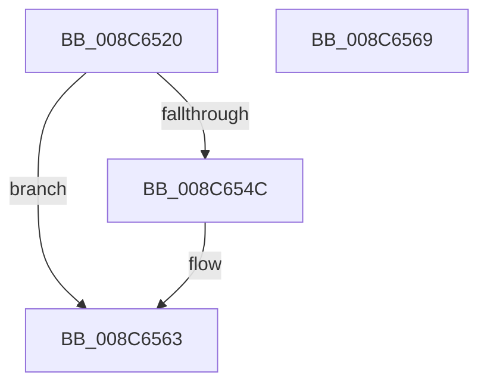

# SeUnlockSubjectContext

- RVA: `0x008C6520`–`0x008C656A` (길이 `74` bytes)
- VA: `0x00000001408C6520`
- 실행 섹션: `PAGE`
- PDB 이름 있음: `예`; PDB Function 태그: `아니요`
- unwind 정보 RVA: `0x0005CF00`
- 디코드: `19`개 명령, `74/74` bytes 표시
- 미해석 바이트: `0` (있으면 어셈블리에 `.byte`로 보존)

> 이 문서는 커널 이미지의 기계어와 PDB 기호를 분석해 생성했습니다. 4번과 5번은 함수 원형과 자료형을 바이너리 사용 방식에서 추정한 C 해석이며 원본 소스 복구 결과는 아닙니다.

## 1. Dependencies

- 직접 호출 지점: **4**; 고유 호출 대상: **2**
- 직접 호출자로 확인된 함수: **17**
- RIP 상대 이미지 참조: **0**

### Outgoing calls
- `0x008C6531` → [ExReleaseResourceLite](../../text/25/ExReleaseResourceLite_function_0025FA10.md) (function, `0x0025FA10`)
- `0x008C653F` → [KeLeaveCriticalRegionThread](../../text/25/KeLeaveCriticalRegionThread_function_0025EFF0.md) (function, `0x0025EFF0`)
- `0x008C6550` → [ExReleaseResourceLite](../../text/25/ExReleaseResourceLite_function_0025FA10.md) (function, `0x0025FA10`)
- `0x008C655E` → [KeLeaveCriticalRegionThread](../../text/25/KeLeaveCriticalRegionThread_function_0025EFF0.md) (function, `0x0025EFF0`)

### Direct callers
- [IopCreateSecurityCheck](../../text/3A/IopCreateSecurityCheck_function_003A5DA0.md) at `0x003A5ECD`
- [SeAccessCheckWithHint](../../text/3A/SeAccessCheckWithHint_function_003A6C30.md) at `0x003A6F93`
- [SeAccessCheckWithHint](../../text/3A/SeAccessCheckWithHint_function_003A6C30.md) at `0x003A713A`
- [SeAccessCheckWithHint](../../text/3A/SeAccessCheckWithHint_function_003A6C30.md) at `0x003A74E0`
- [SeAccessCheckWithHint](../../text/3A/SeAccessCheckWithHint_function_003A6C30.md) at `0x003A76EF`
- [SeAccessCheckWithHint](../../text/3A/SeAccessCheckWithHint_function_003A6C30.md) at `0x003A776A`
- [SepTrustLevelCheck](../../text/3E/SepTrustLevelCheck_function_003ED7E0.md) at `0x003EDA0E`
- [SepCommonAccessCheckEx](../../text/47/SepCommonAccessCheckEx_function_0047602C.md) at `0x0047637A`
- [SepCommonAccessCheckEx](../../text/47/SepCommonAccessCheckEx_function_0047602C.md) at `0x00476451`
- [SepCommonAccessCheckEx](../../text/47/SepCommonAccessCheckEx_function_0047602C.md) at `0x0047651A`
- [SepCommonAccessCheckEx](../../text/47/SepCommonAccessCheckEx_function_0047602C.md) at `0x00476561`
- [SepCommonAccessCheckEx](../../text/47/SepCommonAccessCheckEx_function_0047602C.md) at `0x004765FB`
- [SepCommonAccessCheckEx](../../text/47/SepCommonAccessCheckEx_function_0047602C.md) at `0x004767D1`
- [SepCommonAccessCheckEx](../../text/47/SepCommonAccessCheckEx_function_0047602C.md) at `0x004769D7`
- [SepCommonAccessCheckEx](../../text/47/SepCommonAccessCheckEx_function_0047602C.md) at `0x0047708A`
- [SepCommonAccessCheckEx](../../text/47/SepCommonAccessCheckEx_function_0047602C.md) at `0x004770B3`
- [SepCommonAccessCheckEx](../../text/47/SepCommonAccessCheckEx_function_0047602C.md) at `0x00477302`
- [SepCreateAppContainerToken](../../text/4F/SepCreateAppContainerToken_function_004F43AC.md) at `0x004F4913`
- [SepCreateAppContainerToken](../../text/4F/SepCreateAppContainerToken_function_004F43AC.md) at `0x004F4A19`
- [SeAdjustAntiTamperCreatorAccess](../../text/60/SeAdjustAntiTamperCreatorAccess_function_00607590.md) at `0x0060767A`
- [SepMandatoryAccessCheck](../../text/60/SepMandatoryAccessCheck_function_00608480.md) at `0x00608622`
- [CMFCheckAccess](../7D/CMFCheckAccess_function_007D28B4.md) at `0x007D2AA8`
- [IopParseDevice](../89/IopParseDevice_function_0089E510.md) at `0x0089E86F`
- [IopParseDevice](../89/IopParseDevice_function_0089E510.md) at `0x008A00AD`
- [ObpCheckObjectReference](ObpCheckObjectReference_function_008C6084.md) at `0x008C6176`
- [ObCheckCreateObjectAccess](ObCheckCreateObjectAccess_function_008C6340.md) at `0x008C6424`
- [ObpCheckTraverseAccess](ObpCheckTraverseAccess_function_008C6CE4.md) at `0x008C6DD3`
- [CmpCheckCreateAccess](CmpCheckCreateAccess_function_008C6E8C.md) at `0x008C6F95`
- [ObpVerifyCreatorAccessCheck](../9C/ObpVerifyCreatorAccessCheck_function_009CA524.md) at `0x009CA621`
- [EtwpCoverageUserIsAdmin](../9F/EtwpCoverageUserIsAdmin_function_009FE548.md) at `0x009FE58C`
- [SepAccessCheckAndAuditAlarm](../A1/SepAccessCheckAndAuditAlarm_function_00A1AF4C.md) at `0x00A1BAD1`
- [SepAccessCheckAndAuditAlarm](../A1/SepAccessCheckAndAuditAlarm_function_00A1AF4C.md) at `0x00A1BD8A`
- [SepAccessCheckAndAuditAlarm](../A1/SepAccessCheckAndAuditAlarm_function_00A1AF4C.md) at `0x00A1BF75`
- [SepAccessCheckAndAuditAlarm](../A1/SepAccessCheckAndAuditAlarm_function_00A1AF4C.md) at `0x00A1D54B`
- [NtSetInformationToken](../AF/NtSetInformationToken_function_00AF0530.md) at `0x00AF1C22`

### Static image references
- 디코드된 RIP-relative 메모리 참조가 없습니다.

## 2. Other-region calls and transfers

- 다른 실행 섹션으로 향하는 call: **4**
  - `0x008C6531` → [ExReleaseResourceLite](../../text/25/ExReleaseResourceLite_function_0025FA10.md) (`PAGE` → `.text`)
  - `0x008C653F` → [KeLeaveCriticalRegionThread](../../text/25/KeLeaveCriticalRegionThread_function_0025EFF0.md) (`PAGE` → `.text`)
  - `0x008C6550` → [ExReleaseResourceLite](../../text/25/ExReleaseResourceLite_function_0025FA10.md) (`PAGE` → `.text`)
  - `0x008C655E` → [KeLeaveCriticalRegionThread](../../text/25/KeLeaveCriticalRegionThread_function_0025EFF0.md) (`PAGE` → `.text`)
- 별도 외부 분기/꼬리 이동을 확인하지 못했습니다.

## 3. Assembly (complete function range)

```asm
008C6520  40 53                           push rbx
008C6522  48 83 EC 20                     sub rsp, 0x20
008C6526  48 8B D9                        mov rbx, rcx
008C6529  48 8B 49 10                     mov rcx, qword ptr [rcx + 0x10]
008C652D  48 8B 49 30                     mov rcx, qword ptr [rcx + 0x30]
008C6531  E8 DA 94 99 FF                  call 0x14025fa10
008C6536  65 48 8B 0C 25 88 01 00 00      mov rcx, qword ptr gs:[0x188]
008C653F  E8 AC 8A 99 FF                  call 0x14025eff0
008C6544  48 8B 0B                        mov rcx, qword ptr [rbx]
008C6547  48 85 C9                        test rcx, rcx
008C654A  74 17                           je 0x1408c6563
008C654C  48 8B 49 30                     mov rcx, qword ptr [rcx + 0x30]
008C6550  E8 BB 94 99 FF                  call 0x14025fa10
008C6555  65 48 8B 0C 25 88 01 00 00      mov rcx, qword ptr gs:[0x188]
008C655E  E8 8D 8A 99 FF                  call 0x14025eff0
008C6563  48 83 C4 20                     add rsp, 0x20
008C6567  5B                              pop rbx
008C6568  C3                              ret
008C6569  CC                              int3
```

## 4. C-style interpretation (structured pseudocode)

```c
__int64 __fastcall SeUnlockSubjectContext(__int64 a1)
{
    __int64 result;
    __int64 v_rsp;

    v_rsp = (v_rsp) - (32);
    result = ExReleaseResourceLite(*(unsigned __int64 *)(*(unsigned __int64 *)(a1 + 16) + 48), a2, a3, a4);
    result = KeLeaveCriticalRegionThread(*(unsigned __int64 *)(gs_base + (0 + 392)), a2, a3, a4);
    if (*(unsigned __int64 *)(a1) != 0) {
        a1 = *(unsigned __int64 *)(*(unsigned __int64 *)(a1) + 48);
        result = ExReleaseResourceLite(a1, a2, a3, a4);
        a1 = *(unsigned __int64 *)(gs_base + (0 + 392));
        result = KeLeaveCriticalRegionThread(a1, a2, a3, a4);
    }
    v_rsp = (v_rsp) + (32);
    return result;
}
```

## 5. (Beta) C Style

```c
int64_t SeUnlockSubjectContext(void *Arg1)
{
    uint8_t *arg1 = (uint8_t *)Arg1;

    int64_t result;
    int64_t local_rsp;

    local_rsp = (local_rsp) - (32);
    result = ExReleaseResourceLite(*(uint64_t *)(*(uint64_t *)(arg1 + 0x10) + 0x30), a2, a3, a4);
    result = KeLeaveCriticalRegionThread(*(uint64_t *)(gs_base + (0 + 0x188)), a2, a3, a4);
    if (*(uint64_t *)(arg1) != 0) {
        Arg1 = *(uint64_t *)(*(uint64_t *)(arg1) + 0x30);
        result = ExReleaseResourceLite(Arg1, a2, a3, a4);
        Arg1 = *(uint64_t *)(gs_base + (0 + 0x188));
        result = KeLeaveCriticalRegionThread(Arg1, a2, a3, a4);
    }
    local_rsp = (local_rsp) + (32);
    return result;
}
```

### 관측된 메모리 오프셋

구조체 형식이 확인되지 않은 접근은 인자 기준의 오프셋으로만 기록했습니다.

| 기준 인자 | 오프셋 표현 | 폭 (bit) | 접근 |
|---|---:|---:|---|
| `Arg1` | `+ 0x0` | `64` | `R` |
| `Arg1` | `+ 0x10` | `64` | `R` |

## 6. Execution-region graph

[열기: 2D/3D 그래프와 함수 탐색 컨트롤 패널](../../../control-panel.html?section=page&rva=0x008C6520&view=graph)

- 2D 그래프는 위에서 아래로 흐르고, 3D 그래프는 빈 공간을 드래그해 회전합니다. Shift+드래그는 이동, 휠은 확대·축소, 함수 노드 선택은 대상 보고서 이동입니다.

### Static fallback


