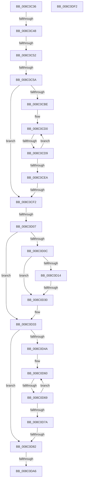

# sub_008C0C36

- RVA: `0x008C0C36`–`0x008C0DF3` (길이 `445` bytes)
- VA: `0x00000001408C0C36`
- 실행 섹션: `PAGE`
- PDB 이름 있음: `아니요`; PDB Function 태그: `아니요`
- unwind 정보 RVA: `0x00083514`
- 디코드: `110`개 명령, `445/445` bytes 표시
- 미해석 바이트: `0` (있으면 어셈블리에 `.byte`로 보존)

> 이 문서는 커널 이미지의 기계어와 PDB 기호를 분석해 생성했습니다. 4번과 5번은 함수 원형과 자료형을 바이너리 사용 방식에서 추정한 C 해석이며 원본 소스 복구 결과는 아닙니다.

## 1. Dependencies

- 직접 호출 지점: **6**; 고유 호출 대상: **6**
- 직접 호출자로 확인된 함수: **0**
- RIP 상대 이미지 참조: **0**

### Outgoing calls
- `0x008C0C64` → [memset](../../text/6C/memset_function_006C6C40.md) (function, `0x006C6C40`)
- `0x008C0CF9` → [EtwpComputeRegEntryEnableInfo](EtwpComputeRegEntryEnableInfo_function_008C0FE0.md) (function, `0x008C0FE0`)
- `0x008C0D21` → [RtlCompareMemory](../../text/6B/RtlCompareMemory_function_006BA670.md) (function, `0x006BA670`)
- `0x008C0D95` → [ExAllocatePool2](../../poolcode/B8/ExAllocatePool2_function_00B820F0.md) (function, `0x00B820F0`)
- `0x008C0DB0` → [memcpy](../../text/6C/memcpy_function_006C6840.md) (function, `0x006C6840`)
- `0x008C0DD4` → [_security_check_cookie](../../text/6A/_security_check_cookie_function_006AC640.md) (function, `0x006AC640`)

### Direct callers
- 이 함수 시작 RVA로 연결되는 직접 call은 확인되지 않았습니다. 간접 호출은 완전히 역산할 수 없습니다.

### Static image references
- 디코드된 RIP-relative 메모리 참조가 없습니다.

## 2. Other-region calls and transfers

- 다른 실행 섹션으로 향하는 call: **5**
  - `0x008C0C64` → [memset](../../text/6C/memset_function_006C6C40.md) (`PAGE` → `.text`)
  - `0x008C0D21` → [RtlCompareMemory](../../text/6B/RtlCompareMemory_function_006BA670.md) (`PAGE` → `.text`)
  - `0x008C0D95` → [ExAllocatePool2](../../poolcode/B8/ExAllocatePool2_function_00B820F0.md) (`PAGE` → `POOLCODE`)
  - `0x008C0DB0` → [memcpy](../../text/6C/memcpy_function_006C6840.md) (`PAGE` → `.text`)
  - `0x008C0DD4` → [_security_check_cookie](../../text/6A/_security_check_cookie_function_006AC640.md) (`PAGE` → `.text`)
- call이 아닌 외부 분기/꼬리 이동: **10**
  - `0x008C0C42` → [sub_008C0E09 + 0x168](Unknown_function_008C0E09.md) (`tail-transfer`)
  - `0x008C0C4C` → [sub_008C0E09 + 0x4C](Unknown_function_008C0E09.md) (`tail-transfer`)
  - `0x008C0C54` → [sub_008C0E09](Unknown_function_008C0E09.md) (`tail-transfer`)
  - `0x008C0CD3` → [sub_008C0E09 + 0x5A](Unknown_function_008C0E09.md) (`tail-transfer`)
  - `0x008C0CEC` → [sub_008C0FAF](Unknown_function_008C0FAF.md) (`tail-transfer`)
  - `0x008C0D01` → [sub_008C0FAF + 0xE](Unknown_function_008C0FAF.md) (`tail-transfer`)
  - `0x008C0D2A` → [sub_008C0E09 + 0x31](Unknown_function_008C0E09.md) (`tail-transfer`)
  - `0x008C0D63` → [sub_008C0E09 + 0x88](Unknown_function_008C0E09.md) (`tail-transfer`)
  - `0x008C0D7C` → [sub_008C0E09 + 0xB2](Unknown_function_008C0E09.md) (`tail-transfer`)
  - `0x008C0DA0` → [sub_008C0E09 + 0x41](Unknown_function_008C0E09.md) (`tail-transfer`)

## 3. Assembly (complete function range)

```asm
008C0C36  48 89 9C 24 C8 00 00 00         mov qword ptr [rsp + 0xc8], rbx
008C0C3E  66 83 E6 08                     and si, 8
008C0C42  0F 85 29 03 00 00               jne 0x1408c0f71
008C0C48  66 41 85 D0                     test r8w, dx
008C0C4C  0F 84 03 02 00 00               je 0x1408c0e55
008C0C52  3C 02                           cmp al, 2
008C0C54  0F 85 AF 01 00 00               jne 0x1408c0e09
008C0C5A  33 D2                           xor edx, edx
008C0C5C  48 8D 4D A7                     lea rcx, [rbp - 0x59]
008C0C60  44 8D 42 78                     lea r8d, [rdx + 0x78]
008C0C64  E8 D7 5F E0 FF                  call 0x1406c6c40
008C0C69  49 8B 1F                        mov rbx, qword ptr [r15]
008C0C6C  41 8B D6                        mov edx, r14d
008C0C6F  48 8B 47 20                     mov rax, qword ptr [rdi + 0x20]
008C0C73  0F 10 03                        movups xmm0, xmmword ptr [rbx]
008C0C76  0F 11 45 A7                     movups xmmword ptr [rbp - 0x59], xmm0
008C0C7A  0F 10 4B 10                     movups xmm1, xmmword ptr [rbx + 0x10]
008C0C7E  0F 11 4D B7                     movups xmmword ptr [rbp - 0x49], xmm1
008C0C82  0F 10 43 20                     movups xmm0, xmmword ptr [rbx + 0x20]
008C0C86  0F 11 45 C7                     movups xmmword ptr [rbp - 0x39], xmm0
008C0C8A  0F 10 4B 30                     movups xmm1, xmmword ptr [rbx + 0x30]
008C0C8E  0F 11 4D D7                     movups xmmword ptr [rbp - 0x29], xmm1
008C0C92  F2 0F 10 43 40                  movsd xmm0, qword ptr [rbx + 0x40]
008C0C97  F2 0F 11 45 E7                  movsd qword ptr [rbp - 0x19], xmm0
008C0C9C  C7 45 AF 01 00 00 00            mov dword ptr [rbp - 0x51], 1
008C0CA3  0F 10 40 28                     movups xmm0, xmmword ptr [rax + 0x28]
008C0CA7  C7 45 AB 78 00 00 00            mov dword ptr [rbp - 0x55], 0x78
008C0CAE  0F 11 45 CF                     movups xmmword ptr [rbp - 0x31], xmm0
008C0CB2  48 8B 88 80 02 00 00            mov rcx, qword ptr [rax + 0x280]
008C0CB9  48 85 C9                        test rcx, rcx
008C0CBC  74 34                           je 0x1408c0cf2
008C0CBE  45 8B CE                        mov r9d, r14d
008C0CC1  4C 8D 51 58                     lea r10, [rcx + 0x58]
008C0CC5  4C 8D 80 80 00 00 00            lea r8, [rax + 0x80]
008C0CCC  0F 1F 40 00                     nop dword ptr [rax]
008C0CD0  45 39 30                        cmp dword ptr [r8], r14d
008C0CD3  0F 85 8A 01 00 00               jne 0x1408c0e63
008C0CD9  41 FF C1                        inc r9d
008C0CDC  49 83 C0 20                     add r8, 0x20
008C0CE0  49 83 C2 68                     add r10, 0x68
008C0CE4  41 83 F9 10                     cmp r9d, 0x10
008C0CE8  72 E6                           jb 0x1408c0cd0
008C0CEA  85 D2                           test edx, edx
008C0CEC  0F 85 BD 02 00 00               jne 0x1408c0faf
008C0CF2  48 8D 55 EF                     lea rdx, [rbp - 0x11]
008C0CF6  48 8B CF                        mov rcx, rdi
008C0CF9  E8 E2 02 00 00                  call 0x1408c0fe0
008C0CFE  66 85 F6                        test si, si
008C0D01  0F 85 B6 02 00 00               jne 0x1408c0fbd
008C0D07  48 85 DB                        test rbx, rbx
008C0D0A  74 27                           je 0x1408c0d33
008C0D0C  8B 45 AB                        mov eax, dword ptr [rbp - 0x55]
008C0D0F  39 43 04                        cmp dword ptr [rbx + 4], eax
008C0D12  75 1C                           jne 0x1408c0d30
008C0D14  41 B8 78 00 00 00               mov r8d, 0x78
008C0D1A  48 8D 55 A7                     lea rdx, [rbp - 0x59]
008C0D1E  48 8B CB                        mov rcx, rbx
008C0D21  E8 4A 99 DF FF                  call 0x1406ba670
008C0D26  48 83 F8 78                     cmp rax, 0x78
008C0D2A  0F 84 0A 01 00 00               je 0x1408c0e3a
008C0D30  4D 89 37                        mov qword ptr [r15], r14
008C0D33  0F B7 77 64                     movzx esi, word ptr [rdi + 0x64]
008C0D37  41 8B DE                        mov ebx, r14d
008C0D3A  48 8B 7F 20                     mov rdi, qword ptr [rdi + 0x20]
008C0D3E  4C 8B 8F 80 02 00 00            mov r9, qword ptr [rdi + 0x280]
008C0D45  4D 85 C9                        test r9, r9
008C0D48  74 38                           je 0x1408c0d82
008C0D4A  45 8B C6                        mov r8d, r14d
008C0D4D  48 8D 97 80 00 00 00            lea rdx, [rdi + 0x80]
008C0D54  49 83 C1 58                     add r9, 0x58
008C0D58  0F 1F 84 00 00 00 00 00         nop dword ptr [rax + rax]
008C0D60  44 39 32                        cmp dword ptr [rdx], r14d
008C0D63  0F 85 28 01 00 00               jne 0x1408c0e91
008C0D69  41 FF C0                        inc r8d
008C0D6C  48 83 C2 20                     add rdx, 0x20
008C0D70  49 83 C1 68                     add r9, 0x68
008C0D74  41 83 F8 10                     cmp r8d, 0x10
008C0D78  72 E6                           jb 0x1408c0d60
008C0D7A  85 DB                           test ebx, ebx
008C0D7C  0F 85 39 01 00 00               jne 0x1408c0ebb
008C0D82  8B 7D AB                        mov edi, dword ptr [rbp - 0x55]
008C0D85  41 B8 45 74 77 44               mov r8d, 0x44777445
008C0D8B  8B D7                           mov edx, edi
008C0D8D  4D 89 37                        mov qword ptr [r15], r14
008C0D90  B9 00 01 00 00                  mov ecx, 0x100
008C0D95  E8 56 13 2C 00                  call 0x140b820f0
008C0D9A  48 8B D8                        mov rbx, rax
008C0D9D  48 85 C0                        test rax, rax
008C0DA0  0F 84 A4 00 00 00               je 0x1408c0e4a
008C0DA6  44 8B C7                        mov r8d, edi
008C0DA9  48 8D 55 A7                     lea rdx, [rbp - 0x59]
008C0DAD  48 8B C8                        mov rcx, rax
008C0DB0  E8 8B 5A E0 FF                  call 0x1406c6840
008C0DB5  C7 43 08 01 00 00 00            mov dword ptr [rbx + 8], 1
008C0DBC  49 89 1F                        mov qword ptr [r15], rbx
008C0DBF  45 85 F6                        test r14d, r14d
008C0DC2  0F 99 C0                        setns al
008C0DC5  48 8B 9C 24 C8 00 00 00         mov rbx, qword ptr [rsp + 0xc8]
008C0DCD  48 8B 4D 1F                     mov rcx, qword ptr [rbp + 0x1f]
008C0DD1  48 33 CC                        xor rcx, rsp
008C0DD4  E8 67 B8 DE FF                  call 0x1406ac640
008C0DD9  4C 8D 9C 24 A0 00 00 00         lea r11, [rsp + 0xa0]
008C0DE1  49 8B 73 30                     mov rsi, qword ptr [r11 + 0x30]
008C0DE5  49 8B 7B 38                     mov rdi, qword ptr [r11 + 0x38]
008C0DE9  49 8B E3                        mov rsp, r11
008C0DEC  41 5F                           pop r15
008C0DEE  41 5E                           pop r14
008C0DF0  5D                              pop rbp
008C0DF1  C3                              ret
008C0DF2  CC                              int3
```

## 4. C-style interpretation (structured pseudocode)

```c
__int64 __fastcall sub_008C0C36(__int64 a1, int a2, unsigned __int16 a3, __int64 a4, __int64 a5, __int64 a6, __int64 a7, __int64 a8, __int64 a9, __int64 a10, __int64 a11, __int64 a12, __int64 a13, __int64 a14, __int64 a15, __int64 a16, __int64 a17, __int64 a18, __int64 a19, __int64 a20, __int64 a21, __int64 a22, __int64 a23, __int64 a24, __int64 a25)
{
    __int64 result;
    __int64 v_r10;
    __int64 v_rsi;
    unsigned __int64 v_stack_pC8;

    v_stack_pC8 = v_rbx;
    v_rsi = (unsigned __int16)((v_rsi) & (8));
    a2 = 0;
    result = memset(v_rbp - 89, a2, a2 + 120, a4);
    *(unsigned __int64 *)(v_rbp - 89) = v_xmm0;
    *(unsigned __int64 *)(v_rbp - 73) = v_xmm1;
    *(unsigned __int64 *)(v_rbp - 57) = v_xmm0;
    *(unsigned __int64 *)(v_rbp - 41) = v_xmm1;
    *(unsigned __int64 *)(v_rbp - 25) = v_xmm0;
    *(unsigned int *)(v_rbp - 81) = 1;
    *(unsigned int *)(v_rbp - 85) = 120;
    *(unsigned __int64 *)(v_rbp - 49) = v_xmm0;
    if (*(unsigned __int64 *)(*(unsigned __int64 *)(v_rdi + 32) + 640) == 0) goto loc_008C0CF2;
loc_008C0CD0:
    a4 = (unsigned int)(((unsigned int)((unsigned int)(v_r14))) + 1);
    a3 = (*(unsigned __int64 *)(v_rdi + 32) + 128) + (32);
    v_r10 = (*(unsigned __int64 *)(*(unsigned __int64 *)(v_rdi + 32) + 640) + 88) + (104);
    if (((unsigned int)(a4)) < 16) goto loc_008C0CD0;
loc_008C0CF2:
    result = EtwpComputeRegEntryEnableInfo(v_rdi, v_rbp - 17, a3, a4);
    if (*(unsigned __int64 *)(v_r15) == 0) goto loc_008C0D33;
    if ((*(unsigned int *)(*(unsigned __int64 *)(v_r15) + 4)) != ((unsigned int)((unsigned int)(*(unsigned int *)(v_rbp - 85))))) goto loc_008C0D30;
    result = RtlCompareMemory(*(unsigned __int64 *)(v_r15), v_rbp - 89, 120, a4);
loc_008C0D30:
    *(unsigned __int64 *)(v_r15) = v_r14;
loc_008C0D33:
    if (*(unsigned __int64 *)(*(unsigned __int64 *)(v_rdi + 32) + 640) == 0) goto loc_008C0D82;
    a4 = (*(unsigned __int64 *)(*(unsigned __int64 *)(v_rdi + 32) + 640)) + (88);
loc_008C0D60:
    a3 = (unsigned int)(((unsigned int)((unsigned int)(v_r14))) + 1);
    a2 = (*(unsigned __int64 *)(v_rdi + 32) + 128) + (32);
    a4 = (a4) + (104);
    if (a3 < 16) goto loc_008C0D60;
loc_008C0D82:
    *(unsigned __int64 *)(v_r15) = v_r14;
    result = ExAllocatePool2(256, (unsigned int)((unsigned int)((unsigned int)(*(unsigned int *)(v_rbp - 85)))), (unsigned int)(0x44777445ULL), a4);
    result = memcpy(result, v_rbp - 89, (unsigned int)((unsigned int)((unsigned int)(*(unsigned int *)(v_rbp - 85)))), a4);
    *(unsigned int *)(result + 8) = 1;
    *(unsigned __int64 *)(v_r15) = result;
    result = (!sign_flag) ? 1 : 0;
    a1 = (*(unsigned __int64 *)(v_rbp + 31)) ^ (v_rsp);
    result = _security_check_cookie(a1, v_rbp - 89, (unsigned int)((unsigned int)((unsigned int)(*(unsigned int *)(v_rbp - 85)))), a4);
    return result;
}
```

## 5. (Beta) C Style

```c
int64_t sub_008C0C36(int64_t Arg1, int32_t Arg2, uint16_t Arg3, int64_t Arg4, uint64_t Arg5, uint64_t Arg6, uint64_t Arg7, uint64_t Arg8, uint64_t Arg9, uint64_t Arg10, uint64_t Arg11, uint64_t Arg12, uint64_t Arg13, uint64_t Arg14, uint64_t Arg15, uint64_t Arg16, uint64_t Arg17, uint64_t Arg18, uint64_t Arg19, int64_t Arg20, uint64_t Arg21, uint64_t Arg22, uint64_t Arg23, uint64_t Arg24, int64_t Arg25)
{
    int64_t result;
    int64_t local_r10;
    int64_t local_rsi;
    uint64_t v_stack_pC8;

    v_stack_pC8 = local_rbx;
    local_rsi = (uint16_t)((local_rsi) & (8));
    Arg2 = 0;
    result = memset(local_rbp - 89, Arg2, Arg2 + 120, Arg4);
    *(uint64_t *)(local_rbp - 0x59) = v_xmm0;
    *(uint64_t *)(local_rbp - 0x49) = v_xmm1;
    *(uint64_t *)(local_rbp - 0x39) = v_xmm0;
    *(uint64_t *)(local_rbp - 0x29) = v_xmm1;
    *(uint64_t *)(local_rbp - 0x19) = v_xmm0;
    *(uint32_t *)(local_rbp - 0x51) = 1;
    *(uint32_t *)(local_rbp - 0x55) = 120;
    *(uint64_t *)(local_rbp - 0x31) = v_xmm0;
    if (*(uint64_t *)(*(uint64_t *)(local_rdi + 0x20) + 0x280) == 0) goto loc_008C0CF2;
loc_008C0CD0:
    Arg4 = (uint32_t)(((uint32_t)((uint32_t)(local_r14))) + 1);
    Arg3 = (*(uint64_t *)(local_rdi + 0x20) + 128) + (32);
    local_r10 = (*(uint64_t *)(*(uint64_t *)(local_rdi + 0x20) + 0x280) + 88) + (104);
    if (((uint32_t)(Arg4)) < 16) goto loc_008C0CD0;
loc_008C0CF2:
    result = EtwpComputeRegEntryEnableInfo(local_rdi, local_rbp - 17, Arg3, Arg4);
    if (*(uint64_t *)(local_r15) == 0) goto loc_008C0D33;
    if ((*(uint32_t *)(*(uint64_t *)(local_r15) + 0x4)) != ((uint32_t)((uint32_t)(*(uint32_t *)(local_rbp - 0x55))))) goto loc_008C0D30;
    result = RtlCompareMemory(*(uint64_t *)(local_r15), local_rbp - 89, 120, Arg4);
loc_008C0D30:
    *(uint64_t *)(local_r15) = local_r14;
loc_008C0D33:
    if (*(uint64_t *)(*(uint64_t *)(local_rdi + 0x20) + 0x280) == 0) goto loc_008C0D82;
    Arg4 = (*(uint64_t *)(*(uint64_t *)(local_rdi + 0x20) + 0x280)) + (88);
loc_008C0D60:
    Arg3 = (uint32_t)(((uint32_t)((uint32_t)(local_r14))) + 1);
    Arg2 = (*(uint64_t *)(local_rdi + 0x20) + 128) + (32);
    Arg4 = (Arg4) + (104);
    if (Arg3 < 16) goto loc_008C0D60;
loc_008C0D82:
    *(uint64_t *)(local_r15) = local_r14;
    result = ExAllocatePool2(256, (uint32_t)((uint32_t)((uint32_t)(*(uint32_t *)(local_rbp - 0x55)))), (uint32_t)(0x44777445ULL), Arg4);
    result = memcpy(result, local_rbp - 89, (uint32_t)((uint32_t)((uint32_t)(*(uint32_t *)(local_rbp - 0x55)))), Arg4);
    *(uint32_t *)(result + 0x8) = 1;
    *(uint64_t *)(local_r15) = result;
    result = (!sign_flag) ? 1 : 0;
    Arg1 = (*(uint64_t *)(local_rbp + 0x1F)) ^ (local_rsp);
    result = _security_check_cookie(Arg1, local_rbp - 89, (uint32_t)((uint32_t)((uint32_t)(*(uint32_t *)(local_rbp - 0x55)))), Arg4);
    return result;
}
```

## 6. Execution-region graph

[열기: 2D/3D 그래프와 함수 탐색 컨트롤 패널](../../../control-panel.html?section=page&rva=0x008C0C36&view=graph)

- 2D 그래프는 위에서 아래로 흐르고, 3D 그래프는 빈 공간을 드래그해 회전합니다. Shift+드래그는 이동, 휠은 확대·축소, 함수 노드 선택은 대상 보고서 이동입니다.

### Static fallback


