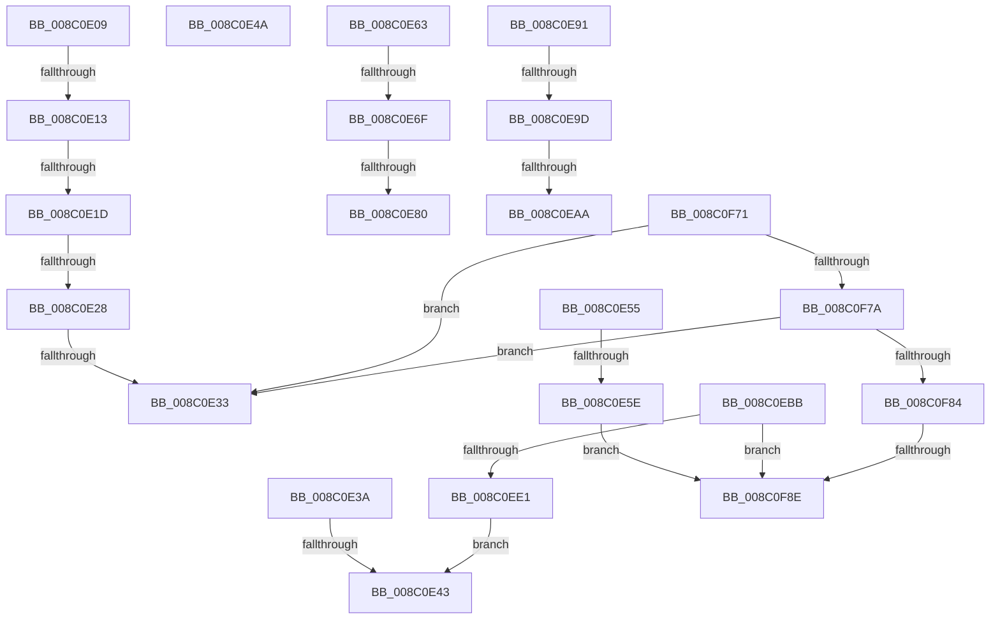

# sub_008C0E09

- RVA: `0x008C0E09`–`0x008C0F95` (길이 `396` bytes)
- VA: `0x00000001408C0E09`
- 실행 섹션: `PAGE`
- PDB 이름 있음: `아니요`; PDB Function 태그: `아니요`
- unwind 정보 RVA: `0x0008353C`
- 디코드: `89`개 명령, `396/396` bytes 표시
- 미해석 바이트: `0` (있으면 어셈블리에 `.byte`로 보존)

> 이 문서는 커널 이미지의 기계어와 PDB 기호를 분석해 생성했습니다. 4번과 5번은 함수 원형과 자료형을 바이너리 사용 방식에서 추정한 C 해석이며 원본 소스 복구 결과는 아닙니다.

## 1. Dependencies

- 직접 호출 지점: **2**; 고유 호출 대상: **2**
- 직접 호출자로 확인된 함수: **0**
- RIP 상대 이미지 참조: **0**

### Outgoing calls
- `0x008C0ED0` → [ExAllocatePool2](../../poolcode/B8/ExAllocatePool2_function_00B820F0.md) (function, `0x00B820F0`)
- `0x008C0F67` → [EtwpCopySchematizedFilters](EtwpCopySchematizedFilters_function_008C380C.md) (function, `0x008C380C`)

### Direct callers
- 이 함수 시작 RVA로 연결되는 직접 call은 확인되지 않았습니다. 간접 호출은 완전히 역산할 수 없습니다.

### Static image references
- 디코드된 RIP-relative 메모리 참조가 없습니다.

## 2. Other-region calls and transfers

- 다른 실행 섹션으로 향하는 call: **1**
  - `0x008C0ED0` → [ExAllocatePool2](../../poolcode/B8/ExAllocatePool2_function_00B820F0.md) (`PAGE` → `POOLCODE`)
- call이 아닌 외부 분기/꼬리 이동: **17**
  - `0x008C0E0D` → [sub_008C0C36 + 0x24](Unknown_function_008C0C36.md) (`tail-transfer`)
  - `0x008C0E17` → [sub_008C0C36 + 0x24](Unknown_function_008C0C36.md) (`tail-transfer`)
  - `0x008C0E22` → [sub_008C0C36 + 0x24](Unknown_function_008C0C36.md) (`tail-transfer`)
  - `0x008C0E2D` → [sub_008C0C36 + 0x24](Unknown_function_008C0C36.md) (`tail-transfer`)
  - `0x008C0E38` → [sub_008C0C36 + 0x18F](Unknown_function_008C0C36.md) (`tail-transfer`)
  - `0x008C0E3D` → [sub_008C0C36 + 0xFD](Unknown_function_008C0C36.md) (`tail-transfer`)
  - `0x008C0E45` → [sub_008C0C36 + 0x18F](Unknown_function_008C0C36.md) (`tail-transfer`)
  - `0x008C0E50` → [sub_008C0C36 + 0x189](Unknown_function_008C0C36.md) (`tail-transfer`)
  - `0x008C0E58` → [sub_008C0C36 + 0x1C](Unknown_function_008C0C36.md) (`tail-transfer`)
  - `0x008C0E69` → [sub_008C0C36 + 0xA3](Unknown_function_008C0C36.md) (`tail-transfer`)
  - `0x008C0E7A` → [sub_008C0C36 + 0xA3](Unknown_function_008C0C36.md) (`tail-transfer`)
  - `0x008C0E8C` → [sub_008C0C36 + 0xA3](Unknown_function_008C0C36.md) (`tail-transfer`)
  - `0x008C0E97` → [sub_008C0C36 + 0x133](Unknown_function_008C0C36.md) (`tail-transfer`)
  - `0x008C0EA4` → [sub_008C0C36 + 0x133](Unknown_function_008C0C36.md) (`tail-transfer`)
  - `0x008C0EB6` → [sub_008C0C36 + 0x133](Unknown_function_008C0C36.md) (`tail-transfer`)
  - `0x008C0F88` → [sub_008C0C36 + 0x24](Unknown_function_008C0C36.md) (`tail-transfer`)
  - `0x008C0F90` → [sub_008C0C36 + 0x18F](Unknown_function_008C0C36.md) (`tail-transfer`)

## 3. Assembly (complete function range)

```asm
008C0E09  66 44 3B C9                     cmp r9w, cx
008C0E0D  0F 85 47 FE FF FF               jne 0x1408c0c5a
008C0E13  66 45 85 D2                     test r10w, r10w
008C0E17  0F 85 3D FE FF FF               jne 0x1408c0c5a
008C0E1D  66 44 39 77 66                  cmp word ptr [rdi + 0x66], r14w
008C0E22  0F 85 32 FE FF FF               jne 0x1408c0c5a
008C0E28  66 44 39 77 6A                  cmp word ptr [rdi + 0x6a], r14w
008C0E2D  0F 85 27 FE FF FF               jne 0x1408c0c5a
008C0E33  4D 89 37                        mov qword ptr [r15], r14
008C0E36  B0 01                           mov al, 1
008C0E38  EB 8B                           jmp 0x1408c0dc5
008C0E3A  4D 39 37                        cmp qword ptr [r15], r14
008C0E3D  0F 84 F0 FE FF FF               je 0x1408c0d33
008C0E43  B0 01                           mov al, 1
008C0E45  E9 7B FF FF FF                  jmp 0x1408c0dc5
008C0E4A  41 BE 17 00 00 C0               mov r14d, 0xc0000017
008C0E50  E9 6A FF FF FF                  jmp 0x1408c0dbf
008C0E55  66 85 CA                        test dx, cx
008C0E58  0F 85 F4 FD FF FF               jne 0x1408c0c52
008C0E5E  E9 2B 01 00 00                  jmp 0x1408c0f8e
008C0E63  4D 8B 1A                        mov r11, qword ptr [r10]
008C0E66  4D 85 DB                        test r11, r11
008C0E69  0F 84 6A FE FF FF               je 0x1408c0cd9
008C0E6F  0F B7 47 64                     movzx eax, word ptr [rdi + 0x64]
008C0E73  41 0F B6 C9                     movzx ecx, r9b
008C0E77  0F A3 C8                        bt eax, ecx
008C0E7A  0F 83 59 FE FF FF               jae 0x1408c0cd9
008C0E80  41 8B 43 10                     mov eax, dword ptr [r11 + 0x10]
008C0E84  83 C0 07                        add eax, 7
008C0E87  83 E0 F8                        and eax, 0xfffffff8
008C0E8A  03 D0                           add edx, eax
008C0E8C  E9 48 FE FF FF                  jmp 0x1408c0cd9
008C0E91  4D 8B 11                        mov r10, qword ptr [r9]
008C0E94  4D 85 D2                        test r10, r10
008C0E97  0F 84 CC FE FF FF               je 0x1408c0d69
008C0E9D  41 0F B6 C8                     movzx ecx, r8b
008C0EA1  0F A3 CE                        bt esi, ecx
008C0EA4  0F 83 BF FE FF FF               jae 0x1408c0d69
008C0EAA  41 8B 42 10                     mov eax, dword ptr [r10 + 0x10]
008C0EAE  83 C0 07                        add eax, 7
008C0EB1  83 E0 F8                        and eax, 0xfffffff8
008C0EB4  03 D8                           add ebx, eax
008C0EB6  E9 AE FE FF FF                  jmp 0x1408c0d69
008C0EBB  44 8D B3 88 00 00 00            lea r14d, [rbx + 0x88]
008C0EC2  B9 00 01 00 00                  mov ecx, 0x100
008C0EC7  41 8B D6                        mov edx, r14d
008C0ECA  41 B8 45 74 77 44               mov r8d, 0x44777445
008C0ED0  E8 1B 12 2C 00                  call 0x140b820f0
008C0ED5  48 8B C8                        mov rcx, rax
008C0ED8  48 85 C0                        test rax, rax
008C0EDB  0F 84 AD 00 00 00               je 0x1408c0f8e
008C0EE1  C7 40 08 01 00 00 00            mov dword ptr [rax + 8], 1
008C0EE8  44 0F B7 C6                     movzx r8d, si
008C0EEC  0F 10 45 A7                     movups xmm0, xmmword ptr [rbp - 0x59]
008C0EF0  48 8B D7                        mov rdx, rdi
008C0EF3  0F 11 00                        movups xmmword ptr [rax], xmm0
008C0EF6  0F 10 4D B7                     movups xmm1, xmmword ptr [rbp - 0x49]
008C0EFA  0F 11 48 10                     movups xmmword ptr [rax + 0x10], xmm1
008C0EFE  0F 10 45 C7                     movups xmm0, xmmword ptr [rbp - 0x39]
008C0F02  0F 11 40 20                     movups xmmword ptr [rax + 0x20], xmm0
008C0F06  0F 10 4D D7                     movups xmm1, xmmword ptr [rbp - 0x29]
008C0F0A  0F 11 48 30                     movups xmmword ptr [rax + 0x30], xmm1
008C0F0E  0F 10 45 E7                     movups xmm0, xmmword ptr [rbp - 0x19]
008C0F12  0F 11 40 40                     movups xmmword ptr [rax + 0x40], xmm0
008C0F16  0F 10 4D F7                     movups xmm1, xmmword ptr [rbp - 9]
008C0F1A  0F 11 48 50                     movups xmmword ptr [rax + 0x50], xmm1
008C0F1E  0F 10 45 07                     movups xmm0, xmmword ptr [rbp + 7]
008C0F22  0F 11 40 60                     movups xmmword ptr [rax + 0x60], xmm0
008C0F26  F2 0F 10 4D 17                  movsd xmm1, qword ptr [rbp + 0x17]
008C0F2B  F2 0F 11 48 70                  movsd qword ptr [rax + 0x70], xmm1
008C0F30  C7 40 74 01 00 00 00            mov dword ptr [rax + 0x74], 1
008C0F37  49 89 07                        mov qword ptr [r15], rax
008C0F3A  C7 40 08 01 00 00 00            mov dword ptr [rax + 8], 1
008C0F41  49 8B 07                        mov rax, qword ptr [r15]
008C0F44  44 89 70 04                     mov dword ptr [rax + 4], r14d
008C0F48  C7 81 84 00 00 00 00 00 00 80   mov dword ptr [rcx + 0x84], 0x80000000
008C0F52  89 99 80 00 00 00               mov dword ptr [rcx + 0x80], ebx
008C0F58  48 C7 41 78 88 00 00 00         mov qword ptr [rcx + 0x78], 0x88
008C0F60  48 81 C1 88 00 00 00            add rcx, 0x88
008C0F67  E8 A0 28 00 00                  call 0x1408c380c
008C0F6C  E9 D2 FE FF FF                  jmp 0x1408c0e43
008C0F71  66 85 C9                        test cx, cx
008C0F74  0F 85 B9 FE FF FF               jne 0x1408c0e33
008C0F7A  83 7D 77 01                     cmp dword ptr [rbp + 0x77], 1
008C0F7E  0F 85 AF FE FF FF               jne 0x1408c0e33
008C0F84  66 45 85 C0                     test r8w, r8w
008C0F88  0F 85 CC FC FF FF               jne 0x1408c0c5a
008C0F8E  32 C0                           xor al, al
008C0F90  E9 30 FE FF FF                  jmp 0x1408c0dc5
```

## 4. C-style interpretation (structured pseudocode)

```c
__int64 __fastcall sub_008C0E09(unsigned __int16 a1, int a2, unsigned __int8 a3, __int64 a4)
{
loc_008C0E33:
    *(unsigned __int64 *)(v_r15) = v_r14;
}
```

## 5. (Beta) C Style

```c
int64_t sub_008C0E09(uint16_t Arg1, int32_t Arg2, uint8_t Arg3, int64_t Arg4)
{
loc_008C0E33:
    *(uint64_t *)(local_r15) = local_r14;
}
```

## 6. Execution-region graph

[열기: 2D/3D 그래프와 함수 탐색 컨트롤 패널](../../../control-panel.html?section=page&rva=0x008C0E09&view=graph)

- 2D 그래프는 위에서 아래로 흐르고, 3D 그래프는 빈 공간을 드래그해 회전합니다. Shift+드래그는 이동, 휠은 확대·축소, 함수 노드 선택은 대상 보고서 이동입니다.

### Static fallback


