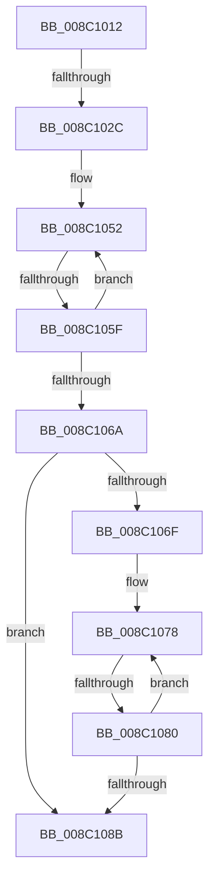

# sub_008C1012

- RVA: `0x008C1012`–`0x008C10A6` (길이 `148` bytes)
- VA: `0x00000001408C1012`
- 실행 섹션: `PAGE`
- PDB 이름 있음: `아니요`; PDB Function 태그: `아니요`
- unwind 정보 RVA: `0x00083588`
- 디코드: `37`개 명령, `148/148` bytes 표시
- 미해석 바이트: `0` (있으면 어셈블리에 `.byte`로 보존)

> 이 문서는 커널 이미지의 기계어와 PDB 기호를 분석해 생성했습니다. 4번과 5번은 함수 원형과 자료형을 바이너리 사용 방식에서 추정한 C 해석이며 원본 소스 복구 결과는 아닙니다.

## 1. Dependencies

- 직접 호출 지점: **0**; 고유 호출 대상: **0**
- 직접 호출자로 확인된 함수: **0**
- RIP 상대 이미지 참조: **0**

### Outgoing calls
- 직접 디코드된 call 명령이 없습니다.

### Direct callers
- 이 함수 시작 RVA로 연결되는 직접 call은 확인되지 않았습니다. 간접 호출은 완전히 역산할 수 없습니다.

### Static image references
- 디코드된 RIP-relative 메모리 참조가 없습니다.

## 2. Other-region calls and transfers

- 다른 실행 섹션으로 향하는 call: **0**
- call이 아닌 외부 분기/꼬리 이동: **4**
  - `0x008C1026` → [sub_008C10B8 + 0x6F](Unknown_function_008C10B8.md) (`tail-transfer`)
  - `0x008C1059` → [sub_008C10B8 + 0x39](Unknown_function_008C10B8.md) (`tail-transfer`)
  - `0x008C107E` → [sub_008C10B8](Unknown_function_008C10B8.md) (`tail-transfer`)
  - `0x008C10A0` → [sub_008C112F](Unknown_function_008C112F.md) (`tail-transfer`)

## 3. Assembly (complete function range)

```asm
008C1012  48 89 5C 24 20                  mov qword ptr [rsp + 0x20], rbx
008C1017  48 8B D9                        mov rbx, rcx
008C101A  48 89 7C 24 28                  mov qword ptr [rsp + 0x28], rdi
008C101F  0F B7 79 66                     movzx edi, word ptr [rcx + 0x66]
008C1023  4D 85 DB                        test r11, r11
008C1026  0F 84 FB 00 00 00               je 0x1408c1127
008C102C  49 8B AB 90 02 00 00            mov rbp, qword ptr [r11 + 0x290]
008C1033  48 89 32                        mov qword ptr [rdx], rsi
008C1036  44 8B C8                        mov r9d, eax
008C1039  48 89 72 08                     mov qword ptr [rdx + 8], rsi
008C103D  49 81 C0 90 00 00 00            add r8, 0x90
008C1044  48 89 72 10                     mov qword ptr [rdx + 0x10], rsi
008C1048  48 C7 42 18 FF FF FF FF         mov qword ptr [rdx + 0x18], 0xffffffffffffffff
008C1050  8B D6                           mov edx, esi
008C1052  0F B6 C2                        movzx eax, dl
008C1055  41 0F A3 C1                     bt r9d, eax
008C1059  0F 82 92 00 00 00               jb 0x1408c10f1
008C105F  FF C2                           inc edx
008C1061  49 83 C0 20                     add r8, 0x20
008C1065  83 FA 10                        cmp edx, 0x10
008C1068  72 E8                           jb 0x1408c1052
008C106A  66 85 FF                        test di, di
008C106D  74 1C                           je 0x1408c108b
008C106F  8B C6                           mov eax, esi
008C1071  4D 8D 83 84 00 00 00            lea r8, [r11 + 0x84]
008C1078  0F B6 C8                        movzx ecx, al
008C107B  0F A3 CF                        bt edi, ecx
008C107E  72 38                           jb 0x1408c10b8
008C1080  FF C0                           inc eax
008C1082  49 83 C0 20                     add r8, 0x20
008C1086  83 F8 10                        cmp eax, 0x10
008C1089  72 ED                           jb 0x1408c1078
008C108B  48 8B 43 20                     mov rax, qword ptr [rbx + 0x20]
008C108F  48 8B 7C 24 28                  mov rdi, qword ptr [rsp + 0x28]
008C1094  48 8B 5C 24 20                  mov rbx, qword ptr [rsp + 0x20]
008C1099  48 39 B0 90 02 00 00            cmp qword ptr [rax + 0x290], rsi
008C10A0  0F 85 89 00 00 00               jne 0x1408c112f
```

## 4. C-style interpretation (structured pseudocode)

```c
__int64 __fastcall sub_008C1012(__int64 a1, __int64 a2, __int64 a3, __int64 a4, __int64 a5)
{
    __int64 result;
    unsigned __int64 v_stack_p20;
    unsigned __int64 v_stack_p28;

    v_stack_p20 = v_rbx;
    v_stack_p28 = v_rdi;
    *(unsigned __int64 *)(a2) = v_rsi;
    *(unsigned __int64 *)(a2 + 8) = v_rsi;
    a3 = (a3) + (144);
    *(unsigned __int64 *)(a2 + 16) = v_rsi;
    *(unsigned __int64 *)(a2 + 24) = -1;
loc_008C1052:
    a2 = (unsigned int)(((unsigned int)((unsigned int)(v_rsi))) + 1);
    a3 = (a3) + (32);
    if (((unsigned int)(a2)) < 16) goto loc_008C1052;
    if ((unsigned __int16)(*(unsigned __int16 *)(a1 + 102)) == 0) goto loc_008C108B;
loc_008C1078:
    result = (unsigned int)(((unsigned int)((unsigned int)(v_rsi))) + 1);
    a3 = (v_r11 + 132) + (32);
    if (((unsigned int)(result)) < 16) goto loc_008C1078;
loc_008C108B:
}
```

## 5. (Beta) C Style

```c
int64_t sub_008C1012(void *Arg1, void *Arg2, int64_t Arg3, int64_t Arg4, int64_t Arg5)
{
    uint8_t *arg1 = (uint8_t *)Arg1;
    uint8_t *arg2 = (uint8_t *)Arg2;

    int64_t result;
    uint64_t v_stack_p20;
    uint64_t v_stack_p28;

    v_stack_p20 = local_rbx;
    v_stack_p28 = local_rdi;
    *(uint64_t *)(arg2) = local_rsi;
    *(uint64_t *)(arg2 + 0x8) = local_rsi;
    Arg3 = (Arg3) + (144);
    *(uint64_t *)(arg2 + 0x10) = local_rsi;
    *(uint64_t *)(arg2 + 0x18) = -1;
loc_008C1052:
    Arg2 = (uint32_t)(((uint32_t)((uint32_t)(local_rsi))) + 1);
    Arg3 = (Arg3) + (32);
    if (((uint32_t)(Arg2)) < 16) goto loc_008C1052;
    if ((uint16_t)(*(uint16_t *)(arg1 + 0x66)) == 0) goto loc_008C108B;
loc_008C1078:
    result = (uint32_t)(((uint32_t)((uint32_t)(local_rsi))) + 1);
    Arg3 = (local_r11 + 132) + (32);
    if (((uint32_t)(result)) < 16) goto loc_008C1078;
loc_008C108B:
}
```

### 관측된 메모리 오프셋

구조체 형식이 확인되지 않은 접근은 인자 기준의 오프셋으로만 기록했습니다.

| 기준 인자 | 오프셋 표현 | 폭 (bit) | 접근 |
|---|---:|---:|---|
| `Arg1` | `+ 0x20` | `64` | `R` |
| `Arg1` | `+ 0x66` | `16` | `R` |
| `Arg2` | `+ 0x0` | `64` | `W` |
| `Arg2` | `+ 0x8` | `64` | `W` |
| `Arg2` | `+ 0x10` | `64` | `W` |
| `Arg2` | `+ 0x18` | `64` | `W` |

## 6. Execution-region graph

[열기: 2D/3D 그래프와 함수 탐색 컨트롤 패널](../../../control-panel.html?section=page&rva=0x008C1012&view=graph)

- 2D 그래프는 위에서 아래로 흐르고, 3D 그래프는 빈 공간을 드래그해 회전합니다. Shift+드래그는 이동, 휠은 확대·축소, 함수 노드 선택은 대상 보고서 이동입니다.

### Static fallback


