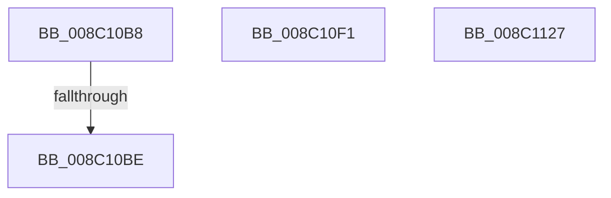

# sub_008C10B8

- RVA: `0x008C10B8`–`0x008C112F` (길이 `119` bytes)
- VA: `0x00000001408C10B8`
- 실행 섹션: `PAGE`
- PDB 이름 있음: `아니요`; PDB Function 태그: `아니요`
- unwind 정보 RVA: `0x000835B4`
- 디코드: `30`개 명령, `119/119` bytes 표시
- 미해석 바이트: `0` (있으면 어셈블리에 `.byte`로 보존)

> 이 문서는 커널 이미지의 기계어와 PDB 기호를 분석해 생성했습니다. 4번과 5번은 함수 원형과 자료형을 바이너리 사용 방식에서 추정한 C 해석이며 원본 소스 복구 결과는 아닙니다.

## 1. Dependencies

- 직접 호출 지점: **0**; 고유 호출 대상: **0**
- 직접 호출자로 확인된 함수: **0**
- RIP 상대 이미지 참조: **0**

### Outgoing calls
- 직접 디코드된 call 명령이 없습니다.

### Direct callers
- 이 함수 시작 RVA로 연결되는 직접 call은 확인되지 않았습니다. 간접 호출은 완전히 역산할 수 없습니다.

### Static image references
- 디코드된 RIP-relative 메모리 참조가 없습니다.

## 2. Other-region calls and transfers

- 다른 실행 섹션으로 향하는 call: **0**
- call이 아닌 외부 분기/꼬리 이동: **4**
  - `0x008C10BC` → [sub_008C1012 + 0x6E](Unknown_function_008C1012.md) (`tail-transfer`)
  - `0x008C10EF` → [sub_008C1012 + 0x6E](Unknown_function_008C1012.md) (`tail-transfer`)
  - `0x008C1122` → [sub_008C1012 + 0x4D](Unknown_function_008C1012.md) (`tail-transfer`)
  - `0x008C112A` → [sub_008C1012 + 0x21](Unknown_function_008C1012.md) (`tail-transfer`)

## 3. Assembly (complete function range)

```asm
008C10B8  41 39 70 FC                     cmp dword ptr [r8 - 4], esi
008C10BC  74 C2                           je 0x1408c1080
008C10BE  41 0F B6 52 04                  movzx edx, byte ptr [r10 + 4]
008C10C3  41 C7 02 01 00 00 00            mov dword ptr [r10], 1
008C10CA  41 0F B6 08                     movzx ecx, byte ptr [r8]
008C10CE  3A D1                           cmp dl, cl
008C10D0  0F 46 D1                        cmovbe edx, ecx
008C10D3  41 88 52 04                     mov byte ptr [r10 + 4], dl
008C10D7  49 8B 48 0C                     mov rcx, qword ptr [r8 + 0xc]
008C10DB  49 09 4A 10                     or qword ptr [r10 + 0x10], rcx
008C10DF  49 8B 48 14                     mov rcx, qword ptr [r8 + 0x14]
008C10E3  49 21 4A 18                     and qword ptr [r10 + 0x18], rcx
008C10E7  41 8B 48 04                     mov ecx, dword ptr [r8 + 4]
008C10EB  41 09 4A 08                     or dword ptr [r10 + 8], ecx
008C10EF  EB 8F                           jmp 0x1408c1080
008C10F1  41 0F B6 4A 04                  movzx ecx, byte ptr [r10 + 4]
008C10F6  41 C7 02 01 00 00 00            mov dword ptr [r10], 1
008C10FD  41 0F B6 40 F4                  movzx eax, byte ptr [r8 - 0xc]
008C1102  3A C8                           cmp cl, al
008C1104  0F 46 C8                        cmovbe ecx, eax
008C1107  41 88 4A 04                     mov byte ptr [r10 + 4], cl
008C110B  49 8B 00                        mov rax, qword ptr [r8]
008C110E  49 09 42 10                     or qword ptr [r10 + 0x10], rax
008C1112  49 8B 40 08                     mov rax, qword ptr [r8 + 8]
008C1116  49 21 42 18                     and qword ptr [r10 + 0x18], rax
008C111A  41 8B 40 F8                     mov eax, dword ptr [r8 - 8]
008C111E  41 09 42 08                     or dword ptr [r10 + 8], eax
008C1122  E9 38 FF FF FF                  jmp 0x1408c105f
008C1127  48 8B EE                        mov rbp, rsi
008C112A  E9 04 FF FF FF                  jmp 0x1408c1033
```

## 4. C-style interpretation (structured pseudocode)

```c
__int64 __fastcall sub_008C10B8(__int64 a1, __int64 a2, __int64 a3)
{
    *(unsigned int *)(v_r10) = 1;
    a2 = *(unsigned __int8 *)(v_r10 + 4);
    if (((unsigned __int8)(*(unsigned __int8 *)(v_r10 + 4))) <= ((unsigned __int8)(*(unsigned __int8 *)(a3)))) { a2 = (unsigned int)(*(unsigned __int8 *)(a3)); }
    *(unsigned __int8 *)(v_r10 + 4) = (unsigned __int8)(a2);
}
```

## 5. (Beta) C Style

```c
int64_t sub_008C10B8(int64_t Arg1, int64_t Arg2, void *Arg3)
{
    uint8_t *arg3 = (uint8_t *)Arg3;

    *(uint32_t *)(local_r10) = 1;
    Arg2 = *(uint8_t *)(local_r10 + 0x4);
    if (((uint8_t)(*(uint8_t *)(local_r10 + 0x4))) <= ((uint8_t)(*(uint8_t *)(arg3)))) { Arg2 = (uint32_t)(*(uint8_t *)(arg3)); }
    *(uint8_t *)(local_r10 + 0x4) = (uint8_t)(Arg2);
}
```

### 관측된 메모리 오프셋

구조체 형식이 확인되지 않은 접근은 인자 기준의 오프셋으로만 기록했습니다.

| 기준 인자 | 오프셋 표현 | 폭 (bit) | 접근 |
|---|---:|---:|---|
| `Arg3` | `- 0x4` | `32` | `R` |
| `Arg3` | `+ 0x0` | `8` | `R` |
| `Arg3` | `+ 0x4` | `32` | `R` |
| `Arg3` | `+ 0xC` | `64` | `R` |
| `Arg3` | `+ 0x14` | `64` | `R` |

## 6. Execution-region graph

[열기: 2D/3D 그래프와 함수 탐색 컨트롤 패널](../../../control-panel.html?section=page&rva=0x008C10B8&view=graph)

- 2D 그래프는 위에서 아래로 흐르고, 3D 그래프는 빈 공간을 드래그해 회전합니다. Shift+드래그는 이동, 휠은 확대·축소, 함수 노드 선택은 대상 보고서 이동입니다.

### Static fallback


