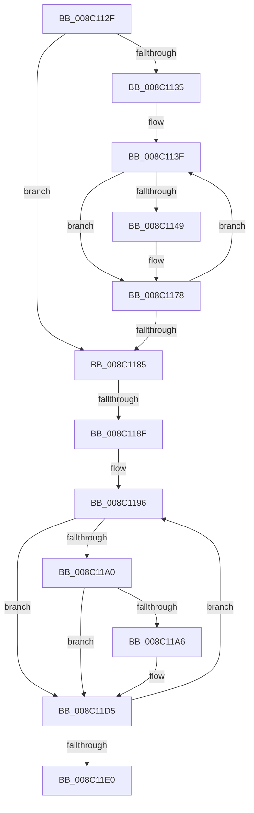

# sub_008C112F

- RVA: `0x008C112F`–`0x008C11E5` (길이 `182` bytes)
- VA: `0x00000001408C112F`
- 실행 섹션: `PAGE`
- PDB 이름 있음: `아니요`; PDB Function 태그: `아니요`
- unwind 정보 RVA: `0x000835CC`
- 디코드: `48`개 명령, `182/182` bytes 표시
- 미해석 바이트: `0` (있으면 어셈블리에 `.byte`로 보존)

> 이 문서는 커널 이미지의 기계어와 PDB 기호를 분석해 생성했습니다. 4번과 5번은 함수 원형과 자료형을 바이너리 사용 방식에서 추정한 C 해석이며 원본 소스 복구 결과는 아닙니다.

## 1. Dependencies

- 직접 호출 지점: **0**; 고유 호출 대상: **0**
- 직접 호출자로 확인된 함수: **0**
- RIP 상대 이미지 참조: **0**

### Outgoing calls
- 직접 디코드된 call 명령이 없습니다.

### Direct callers
- 이 함수 시작 RVA로 연결되는 직접 call은 확인되지 않았습니다. 간접 호출은 완전히 역산할 수 없습니다.

### Static image references
- 디코드된 RIP-relative 메모리 참조가 없습니다.

## 2. Other-region calls and transfers

- 다른 실행 섹션으로 향하는 call: **0**
- call이 아닌 외부 분기/꼬리 이동: **2**
  - `0x008C1189` → [sub_008C10A6](Unknown_function_008C10A6.md) (`tail-transfer`)
  - `0x008C11E0` → [sub_008C10A6](Unknown_function_008C10A6.md) (`tail-transfer`)

## 3. Assembly (complete function range)

```asm
008C112F  66 45 85 F6                     test r14w, r14w
008C1133  74 50                           je 0x1408c1185
008C1135  44 8B C6                        mov r8d, esi
008C1138  49 8D 95 90 00 00 00            lea rdx, [r13 + 0x90]
008C113F  41 0F B6 C0                     movzx eax, r8b
008C1143  41 0F A3 C6                     bt r14d, eax
008C1147  73 2F                           jae 0x1408c1178
008C1149  41 0F B6 4A 04                  movzx ecx, byte ptr [r10 + 4]
008C114E  41 C7 02 01 00 00 00            mov dword ptr [r10], 1
008C1155  0F B6 42 F4                     movzx eax, byte ptr [rdx - 0xc]
008C1159  3A C8                           cmp cl, al
008C115B  0F 46 C8                        cmovbe ecx, eax
008C115E  41 88 4A 04                     mov byte ptr [r10 + 4], cl
008C1162  48 8B 02                        mov rax, qword ptr [rdx]
008C1165  49 09 42 10                     or qword ptr [r10 + 0x10], rax
008C1169  48 8B 42 08                     mov rax, qword ptr [rdx + 8]
008C116D  49 21 42 18                     and qword ptr [r10 + 0x18], rax
008C1171  8B 42 F8                        mov eax, dword ptr [rdx - 8]
008C1174  41 09 42 08                     or dword ptr [r10 + 8], eax
008C1178  41 FF C0                        inc r8d
008C117B  48 83 C2 20                     add rdx, 0x20
008C117F  41 83 F8 10                     cmp r8d, 0x10
008C1183  72 BA                           jb 0x1408c113f
008C1185  66 45 85 FF                     test r15w, r15w
008C1189  0F 84 17 FF FF FF               je 0x1408c10a6
008C118F  48 8D 95 84 00 00 00            lea rdx, [rbp + 0x84]
008C1196  40 0F B6 C6                     movzx eax, sil
008C119A  41 0F A3 C7                     bt r15d, eax
008C119E  73 35                           jae 0x1408c11d5
008C11A0  83 7A FC 00                     cmp dword ptr [rdx - 4], 0
008C11A4  74 2F                           je 0x1408c11d5
008C11A6  41 0F B6 4A 04                  movzx ecx, byte ptr [r10 + 4]
008C11AB  41 C7 02 01 00 00 00            mov dword ptr [r10], 1
008C11B2  0F B6 02                        movzx eax, byte ptr [rdx]
008C11B5  3A C8                           cmp cl, al
008C11B7  0F 46 C8                        cmovbe ecx, eax
008C11BA  41 88 4A 04                     mov byte ptr [r10 + 4], cl
008C11BE  48 8B 42 0C                     mov rax, qword ptr [rdx + 0xc]
008C11C2  49 09 42 10                     or qword ptr [r10 + 0x10], rax
008C11C6  48 8B 42 14                     mov rax, qword ptr [rdx + 0x14]
008C11CA  49 21 42 18                     and qword ptr [r10 + 0x18], rax
008C11CE  8B 42 04                        mov eax, dword ptr [rdx + 4]
008C11D1  41 09 42 08                     or dword ptr [r10 + 8], eax
008C11D5  FF C6                           inc esi
008C11D7  48 83 C2 20                     add rdx, 0x20
008C11DB  83 FE 10                        cmp esi, 0x10
008C11DE  72 B6                           jb 0x1408c1196
008C11E0  E9 C1 FE FF FF                  jmp 0x1408c10a6
```

## 4. C-style interpretation (structured pseudocode)

```c
__int64 __fastcall sub_008C112F(void)
{
    __int64 result;
    __int64 v_rsi;

    if ((unsigned __int16)(v_r14) == 0) goto loc_008C1185;
loc_008C113F:
    result = (unsigned __int8)((unsigned int)((unsigned int)(v_rsi)));
    if (!(condition_is_above_or_equal)) {
        a1 = *(unsigned __int8 *)(v_r10 + 4);
        *(unsigned int *)(v_r10) = 1;
        result = *(unsigned __int8 *)(v_r13 + 144 - 12);
        if (((unsigned __int8)(a1)) <= ((unsigned __int8)(result))) { a1 = (unsigned int)(result); }
        *(unsigned __int8 *)(v_r10 + 4) = (unsigned __int8)(a1);
        result = *(unsigned __int64 *)(v_r13 + 144);
        result = *(unsigned __int64 *)(v_r13 + 144 + 8);
        result = *(unsigned int *)(v_r13 + 144 - 8);
    }
    a3 = (unsigned int)(((unsigned int)((unsigned int)(v_rsi))) + 1);
    a2 = (v_r13 + 144) + (32);
    if (((unsigned int)(a3)) < 16) goto loc_008C113F;
loc_008C1185:
loc_008C1196:
    if (condition_is_above_or_equal) goto loc_008C11D5;
    result = (unsigned __int8)(v_rsi);
    if ((*(unsigned int *)(v_rbp + 132 - 4)) != 0) {
        a1 = *(unsigned __int8 *)(v_r10 + 4);
        *(unsigned int *)(v_r10) = 1;
        result = *(unsigned __int8 *)(v_rbp + 132);
        if (((unsigned __int8)(a1)) <= ((unsigned __int8)(result))) { a1 = (unsigned int)(result); }
        *(unsigned __int8 *)(v_r10 + 4) = (unsigned __int8)(a1);
        result = *(unsigned __int64 *)(v_rbp + 132 + 12);
        result = *(unsigned __int64 *)(v_rbp + 132 + 20);
        result = *(unsigned int *)(v_rbp + 132 + 4);
    }
    v_rsi = (unsigned int)((v_rsi) + 1);
    a2 = (v_rbp + 132) + (32);
    if (((unsigned int)(v_rsi)) < 16) goto loc_008C1196;
}
```

## 5. (Beta) C Style

```c
void sub_008C112F(void)
{
    int64_t result;
    int64_t local_rsi;

    if ((uint16_t)(local_r14) == 0) goto loc_008C1185;
loc_008C113F:
    result = (uint8_t)((uint32_t)((uint32_t)(local_rsi)));
    if (!(condition_is_above_or_equal)) {
        a1 = *(uint8_t *)(local_r10 + 0x4);
        *(uint32_t *)(local_r10) = 1;
        result = *(uint8_t *)(local_r13 + 0x90 - 0xC);
        if (((uint8_t)(a1)) <= ((uint8_t)(result))) { a1 = (uint32_t)(result); }
        *(uint8_t *)(local_r10 + 0x4) = (uint8_t)(a1);
        result = *(uint64_t *)(local_r13 + 0x90);
        result = *(uint64_t *)(local_r13 + 0x90 + 0x8);
        result = *(uint32_t *)(local_r13 + 0x90 - 0x8);
    }
    a3 = (uint32_t)(((uint32_t)((uint32_t)(local_rsi))) + 1);
    a2 = (local_r13 + 144) + (32);
    if (((uint32_t)(a3)) < 16) goto loc_008C113F;
loc_008C1185:
loc_008C1196:
    if (condition_is_above_or_equal) goto loc_008C11D5;
    result = (uint8_t)(local_rsi);
    if ((*(uint32_t *)(local_rbp + 0x84 - 0x4)) != 0) {
        a1 = *(uint8_t *)(local_r10 + 0x4);
        *(uint32_t *)(local_r10) = 1;
        result = *(uint8_t *)(local_rbp + 0x84);
        if (((uint8_t)(a1)) <= ((uint8_t)(result))) { a1 = (uint32_t)(result); }
        *(uint8_t *)(local_r10 + 0x4) = (uint8_t)(a1);
        result = *(uint64_t *)(local_rbp + 0x84 + 0xC);
        result = *(uint64_t *)(local_rbp + 0x84 + 0x14);
        result = *(uint32_t *)(local_rbp + 0x84 + 0x4);
    }
    local_rsi = (uint32_t)((local_rsi) + 1);
    a2 = (local_rbp + 132) + (32);
    if (((uint32_t)(local_rsi)) < 16) goto loc_008C1196;
}
```

## 6. Execution-region graph

[열기: 2D/3D 그래프와 함수 탐색 컨트롤 패널](../../../control-panel.html?section=page&rva=0x008C112F&view=graph)

- 2D 그래프는 위에서 아래로 흐르고, 3D 그래프는 빈 공간을 드래그해 회전합니다. Shift+드래그는 이동, 휠은 확대·축소, 함수 노드 선택은 대상 보고서 이동입니다.

### Static fallback


