# sub_008C2328

- RVA: `0x008C2328`–`0x008C2895` (길이 `1,389` bytes)
- VA: `0x00000001408C2328`
- 실행 섹션: `PAGE`
- PDB 이름 있음: `아니요`; PDB Function 태그: `아니요`
- unwind 정보 RVA: `0x000836F8`
- 디코드: `321`개 명령, `1,389/1,389` bytes 표시
- 미해석 바이트: `0` (있으면 어셈블리에 `.byte`로 보존)

> 이 문서는 커널 이미지의 기계어와 PDB 기호를 분석해 생성했습니다. 4번과 5번은 함수 원형과 자료형을 바이너리 사용 방식에서 추정한 C 해석이며 원본 소스 복구 결과는 아닙니다.

## 1. Dependencies

- 직접 호출 지점: **28**; 고유 호출 대상: **23**
- 직접 호출자로 확인된 함수: **0**
- RIP 상대 이미지 참조: **4**

### Outgoing calls
- `0x008C239B` → [KeAbPreAcquire](../../text/21/KeAbPreAcquire_function_00210230.md) (function, `0x00210230`)
- `0x008C23BC` → [ExfAcquirePushLockSharedEx](../../text/21/ExfAcquirePushLockSharedEx_function_0021044C.md) (function, `0x0021044C`)
- `0x008C23F3` → [EtwpReferenceGuidEntry](EtwpReferenceGuidEntry_function_008C1ED0.md) (function, `0x008C1ED0`)
- `0x008C2414` → [KeAbPostRelease](../../text/2E/KeAbPostRelease_function_002E1600.md) (function, `0x002E1600`)
- `0x008C2422` → [KeLeaveCriticalRegionThread](../../text/25/KeLeaveCriticalRegionThread_function_0025EFF0.md) (function, `0x0025EFF0`)
- `0x008C244F` → [SeCaptureSubjectContext](../86/SeCaptureSubjectContext_function_0086B820.md) (function, `0x0086B820`)
- `0x008C2492` → [SeAccessCheck](../../text/3A/SeAccessCheck_function_003A6BC0.md) (function, `0x003A6BC0`)
- `0x008C249B` → [SeReleaseSubjectContext](../86/SeReleaseSubjectContext_function_0086B710.md) (function, `0x0086B710`)
- `0x008C24DE` → [KeAbPreAcquire](../../text/21/KeAbPreAcquire_function_00210230.md) (function, `0x00210230`)
- `0x008C2503` → [ExfAcquirePushLockExclusiveEx](../../text/20/ExfAcquirePushLockExclusiveEx_function_0020FC90.md) (function, `0x0020FC90`)
- `0x008C25AC` → [ExpInterlockedPopEntrySList](../../text/6B/ExpInterlockedPopEntrySList_function_006BA570.md) (function, `0x006BA570`)
- `0x008C25C9` → [ExpInterlockedPopEntrySList](../../text/6B/ExpInterlockedPopEntrySList_function_006BA570.md) (function, `0x006BA570`)
- `0x008C25E7` → [guard_dispatch_icall](../../text/6B/guard_dispatch_icall_function_006BAAD0.md) (function, `0x006BAAD0`)
- `0x008C261C` → [ObpCaptureObjectCreateInformation](../89/ObpCaptureObjectCreateInformation_function_0089B930.md) (function, `0x0089B930`)
- `0x008C2670` → [ObpAllocateObject](../89/ObpAllocateObject_function_00899FF0.md) (function, `0x00899FF0`)
- `0x008C2689` → [ObpFreeObjectNameBuffer](ObpFreeObjectNameBuffer_function_008C4250.md) (function, `0x008C4250`)
- `0x008C269F` → [ExFreePoolWithTag](../../poolcode/B8/ExFreePoolWithTag_function_00B82870.md) (function, `0x00B82870`)
- `0x008C26CB` → [ExpInterlockedPushEntrySList](../../text/6B/ExpInterlockedPushEntrySList_function_006BA5B0.md) (function, `0x006BA5B0`)
- `0x008C26E1` → [EtwpReferenceGuidEntry](EtwpReferenceGuidEntry_function_008C1ED0.md) (function, `0x008C1ED0`)
- `0x008C271D` → [ObfReferenceObjectWithTag](../../text/21/ObfReferenceObjectWithTag_function_00210710.md) (function, `0x00210710`)
- `0x008C2789` → [EtwpCopySchematizedFilters](EtwpCopySchematizedFilters_function_008C380C.md) (function, `0x008C380C`)
- `0x008C27A7` → [EtwpTrackProviderRegistration](EtwpTrackProviderRegistration_function_008C368C.md) (function, `0x008C368C`)
- `0x008C27BA` → [EtwEventEnabled](../../text/39/EtwEventEnabled_function_00392450.md) (function, `0x00392450`)
- `0x008C27F4` → [EtwWrite](../../text/41/EtwWrite_function_0041C720.md) (function, `0x0041C720`)
- `0x008C2836` → [KeAbPostRelease](../../text/2E/KeAbPostRelease_function_002E1600.md) (function, `0x002E1600`)
- `0x008C2844` → [KeLeaveCriticalRegionThread](../../text/25/KeLeaveCriticalRegionThread_function_0025EFF0.md) (function, `0x0025EFF0`)
- `0x008C2861` → [ObfDereferenceObject](../../text/2F/ObfDereferenceObject_function_002F9350.md) (function, `0x002F9350`)
- `0x008C286E` → [EtwpUnreferenceGuidEntry](EtwpUnreferenceGuidEntry_function_008C3320.md) (function, `0x008C3320`)

### Direct callers
- 이 함수 시작 RVA로 연결되는 직접 call은 확인되지 않았습니다. 간접 호출은 완전히 역산할 수 없습니다.

### Static image references
- `0x008C247C` → RVA `0x00011360` (`.rdata`; read)
- `0x008C2586` → RVA `0x00FC6D30` (`ALMOSTRO`; read)
- `0x008C27AC` → RVA `0x00EFF840` (`.data`; read)
- `0x008C27B3` → RVA `0x00011390` (`.rdata`; read)

## 2. Other-region calls and transfers

- 다른 실행 섹션으로 향하는 call: **18**
  - `0x008C239B` → [KeAbPreAcquire](../../text/21/KeAbPreAcquire_function_00210230.md) (`PAGE` → `.text`)
  - `0x008C23BC` → [ExfAcquirePushLockSharedEx](../../text/21/ExfAcquirePushLockSharedEx_function_0021044C.md) (`PAGE` → `.text`)
  - `0x008C2414` → [KeAbPostRelease](../../text/2E/KeAbPostRelease_function_002E1600.md) (`PAGE` → `.text`)
  - `0x008C2422` → [KeLeaveCriticalRegionThread](../../text/25/KeLeaveCriticalRegionThread_function_0025EFF0.md) (`PAGE` → `.text`)
  - `0x008C2492` → [SeAccessCheck](../../text/3A/SeAccessCheck_function_003A6BC0.md) (`PAGE` → `.text`)
  - `0x008C24DE` → [KeAbPreAcquire](../../text/21/KeAbPreAcquire_function_00210230.md) (`PAGE` → `.text`)
  - `0x008C2503` → [ExfAcquirePushLockExclusiveEx](../../text/20/ExfAcquirePushLockExclusiveEx_function_0020FC90.md) (`PAGE` → `.text`)
  - `0x008C25AC` → [ExpInterlockedPopEntrySList](../../text/6B/ExpInterlockedPopEntrySList_function_006BA570.md) (`PAGE` → `.text`)
  - `0x008C25C9` → [ExpInterlockedPopEntrySList](../../text/6B/ExpInterlockedPopEntrySList_function_006BA570.md) (`PAGE` → `.text`)
  - `0x008C25E7` → [guard_dispatch_icall](../../text/6B/guard_dispatch_icall_function_006BAAD0.md) (`PAGE` → `.text`)
  - `0x008C269F` → [ExFreePoolWithTag](../../poolcode/B8/ExFreePoolWithTag_function_00B82870.md) (`PAGE` → `POOLCODE`)
  - `0x008C26CB` → [ExpInterlockedPushEntrySList](../../text/6B/ExpInterlockedPushEntrySList_function_006BA5B0.md) (`PAGE` → `.text`)
  - `0x008C271D` → [ObfReferenceObjectWithTag](../../text/21/ObfReferenceObjectWithTag_function_00210710.md) (`PAGE` → `.text`)
  - `0x008C27BA` → [EtwEventEnabled](../../text/39/EtwEventEnabled_function_00392450.md) (`PAGE` → `.text`)
  - `0x008C27F4` → [EtwWrite](../../text/41/EtwWrite_function_0041C720.md) (`PAGE` → `.text`)
  - `0x008C2836` → [KeAbPostRelease](../../text/2E/KeAbPostRelease_function_002E1600.md) (`PAGE` → `.text`)
  - `0x008C2844` → [KeLeaveCriticalRegionThread](../../text/25/KeLeaveCriticalRegionThread_function_0025EFF0.md) (`PAGE` → `.text`)
  - `0x008C2861` → [ObfDereferenceObject](../../text/2F/ObfDereferenceObject_function_002F9350.md) (`PAGE` → `.text`)
- call이 아닌 외부 분기/꼬리 이동: **18**
  - `0x008C240B` → [sub_008C28B0 + 0x4F2](Unknown_function_008C28B0.md) (`tail-transfer`)
  - `0x008C242A` → [sub_008C28B0 + 0x50](Unknown_function_008C28B0.md) (`tail-transfer`)
  - `0x008C24BB` → [sub_008C2DC2 + 0x12](Unknown_function_008C2DC2.md) (`tail-transfer`)
  - `0x008C253E` → [sub_008C28B0 + 0x76](Unknown_function_008C28B0.md) (`tail-transfer`)
  - `0x008C2557` → [sub_008C28B0 + 0xBB](Unknown_function_008C28B0.md) (`tail-transfer`)
  - `0x008C25FD` → [sub_008C2DC2](Unknown_function_008C2DC2.md) (`tail-transfer`)
  - `0x008C2625` → [sub_008C28B0 + 0x20](Unknown_function_008C28B0.md) (`tail-transfer`)
  - `0x008C2631` → [sub_008C2DC2 + 0x6E](Unknown_function_008C2DC2.md) (`tail-transfer`)
  - `0x008C263A` → [sub_008C28B0](Unknown_function_008C28B0.md) (`tail-transfer`)
  - `0x008C2679` → [sub_008C28B0 + 0xD2](Unknown_function_008C28B0.md) (`tail-transfer`)
  - `0x008C26C2` → [sub_008C28B0 + 0x46C](Unknown_function_008C28B0.md) (`tail-transfer`)
  - `0x008C26EB` → [sub_008C28B0 + 0x4FF](Unknown_function_008C28B0.md) (`tail-transfer`)
  - `0x008C2742` → [sub_008C28B0 + 0xEF](Unknown_function_008C28B0.md) (`tail-transfer`)
  - `0x008C2751` → [sub_008C28B0 + 0x4AA](Unknown_function_008C28B0.md) (`tail-transfer`)
  - `0x008C27C1` → [sub_008C28B0 + 0x48](Unknown_function_008C28B0.md) (`tail-transfer`)
  - `0x008C2822` → [sub_008C28B0 + 0xC5](Unknown_function_008C28B0.md) (`tail-transfer`)
  - `0x008C282D` → [sub_008C28B0 + 0xC5](Unknown_function_008C28B0.md) (`tail-transfer`)
  - `0x008C2853` → [sub_008C2DC2 + 0xE9](Unknown_function_008C2DC2.md) (`tail-transfer`)

## 3. Assembly (complete function range)

```asm
008C2328  48 89 9C 24 A0 01 00 00         mov qword ptr [rsp + 0x1a0], rbx
008C2330  48 89 B4 24 60 01 00 00         mov qword ptr [rsp + 0x160], rsi
008C2338  B9 01 00 00 00                  mov ecx, 1
008C233D  3B C1                           cmp eax, ecx
008C233F  4C 89 B4 24 58 01 00 00         mov qword ptr [rsp + 0x158], r14
008C2347  8B 47 08                        mov eax, dword ptr [rdi + 8]
008C234A  41 8B D0                        mov edx, r8d
008C234D  0F 47 D1                        cmova edx, ecx
008C2350  4C 89 BC 24 50 01 00 00         mov qword ptr [rsp + 0x150], r15
008C2358  33 47 0C                        xor eax, dword ptr [rdi + 0xc]
008C235B  4D 8B F8                        mov r15, r8
008C235E  33 47 04                        xor eax, dword ptr [rdi + 4]
008C2361  33 07                           xor eax, dword ptr [rdi]
008C2363  83 E0 3F                        and eax, 0x3f
008C2366  8B F2                           mov esi, edx
008C2368  48 6B C8 38                     imul rcx, rax, 0x38
008C236C  65 48 8B 04 25 88 01 00 00      mov rax, qword ptr gs:[0x188]
008C2375  48 81 C1 D0 02 00 00            add rcx, 0x2d0
008C237C  89 54 24 78                     mov dword ptr [rsp + 0x78], edx
008C2380  49 03 CC                        add rcx, r12
008C2383  48 C1 E6 04                     shl rsi, 4
008C2387  48 03 F1                        add rsi, rcx
008C238A  33 D2                           xor edx, edx
008C238C  66 FF 88 E4 01 00 00            dec word ptr [rax + 0x1e4]
008C2393  90                              nop
008C2394  4C 8D 71 30                     lea r14, [rcx + 0x30]
008C2398  49 8B CE                        mov rcx, r14
008C239B  E8 90 DE 94 FF                  call 0x140210230
008C23A0  48 8B D8                        mov rbx, rax
008C23A3  B9 11 00 00 00                  mov ecx, 0x11
008C23A8  33 C0                           xor eax, eax
008C23AA  F0 49 0F B1 0E                  lock cmpxchg qword ptr [r14], rcx
008C23AF  74 10                           je 0x1408c23c1
008C23B1  4D 8B CE                        mov r9, r14
008C23B4  4C 8B C3                        mov r8, rbx
008C23B7  33 D2                           xor edx, edx
008C23B9  49 8B CE                        mov rcx, r14
008C23BC  E8 8B E0 94 FF                  call 0x14021044c
008C23C1  48 85 DB                        test rbx, rbx
008C23C4  74 04                           je 0x1408c23ca
008C23C6  C6 43 0A 01                     mov byte ptr [rbx + 0xa], 1
008C23CA  48 8B 1E                        mov rbx, qword ptr [rsi]
008C23CD  0F 1F 00                        nop dword ptr [rax]
008C23D0  48 3B DE                        cmp rbx, rsi
008C23D3  74 2A                           je 0x1408c23ff
008C23D5  48 8B 07                        mov rax, qword ptr [rdi]
008C23D8  48 2B 43 28                     sub rax, qword ptr [rbx + 0x28]
008C23DC  75 08                           jne 0x1408c23e6
008C23DE  48 8B 47 08                     mov rax, qword ptr [rdi + 8]
008C23E2  48 2B 43 30                     sub rax, qword ptr [rbx + 0x30]
008C23E6  48 85 C0                        test rax, rax
008C23E9  74 05                           je 0x1408c23f0
008C23EB  48 8B 1B                        mov rbx, qword ptr [rbx]
008C23EE  EB E0                           jmp 0x1408c23d0
008C23F0  48 8B CB                        mov rcx, rbx
008C23F3  E8 D8 FA FF FF                  call 0x1408c1ed0
008C23F8  84 C0                           test al, al
008C23FA  74 EF                           je 0x1408c23eb
008C23FC  4C 8B FB                        mov r15, rbx
008C23FF  B8 11 00 00 00                  mov eax, 0x11
008C2404  33 C9                           xor ecx, ecx
008C2406  F0 49 0F B1 0E                  lock cmpxchg qword ptr [r14], rcx
008C240B  0F 85 91 09 00 00               jne 0x1408c2da2
008C2411  49 8B CE                        mov rcx, r14
008C2414  E8 E7 F1 A1 FF                  call 0x1402e1600
008C2419  65 48 8B 0C 25 88 01 00 00      mov rcx, qword ptr gs:[0x188]
008C2422  E8 C9 CB 99 FF                  call 0x14025eff0
008C2427  4D 85 FF                        test r15, r15
008C242A  0F 84 D0 04 00 00               je 0x1408c2900
008C2430  49 8B 5F 48                     mov rbx, qword ptr [r15 + 0x48]
008C2434  48 8D 4D F8                     lea rcx, [rbp - 8]
008C2438  0F 57 C0                        xorps xmm0, xmm0
008C243B  45 33 F6                        xor r14d, r14d
008C243E  44 89 74 24 70                  mov dword ptr [rsp + 0x70], r14d
008C2443  44 89 75 80                     mov dword ptr [rbp - 0x80], r14d
008C2447  0F 11 45 F8                     movups xmmword ptr [rbp - 8], xmm0
008C244B  0F 11 45 08                     movups xmmword ptr [rbp + 8], xmm0
008C244F  E8 CC 93 FA FF                  call 0x14086b820
008C2454  48 8D 44 24 70                  lea rax, [rsp + 0x70]
008C2459  41 B9 00 08 00 00               mov r9d, 0x800
008C245F  48 89 44 24 48                  mov qword ptr [rsp + 0x48], rax
008C2464  48 8D 55 F8                     lea rdx, [rbp - 8]
008C2468  48 8D 45 80                     lea rax, [rbp - 0x80]
008C246C  45 33 C0                        xor r8d, r8d
008C246F  48 89 44 24 40                  mov qword ptr [rsp + 0x40], rax
008C2474  48 8B CB                        mov rcx, rbx
008C2477  C6 44 24 38 01                  mov byte ptr [rsp + 0x38], 1
008C247C  48 8D 05 DD EE 74 FF            lea rax, [rip - 0x8b1123]
008C2483  48 89 44 24 30                  mov qword ptr [rsp + 0x30], rax
008C2488  4C 89 74 24 28                  mov qword ptr [rsp + 0x28], r14
008C248D  44 89 74 24 20                  mov dword ptr [rsp + 0x20], r14d
008C2492  E8 29 47 AE FF                  call 0x1403a6bc0
008C2497  48 8D 4D F8                     lea rcx, [rbp - 8]
008C249B  E8 70 92 FA FF                  call 0x14086b710
008C24A0  8B 44 24 70                     mov eax, dword ptr [rsp + 0x70]
008C24A4  8B D8                           mov ebx, eax
008C24A6  85 C0                           test eax, eax
008C24A8  0F 88 BD 03 00 00               js 0x1408c286b
008C24AE  0F 85 B2 03 00 00               jne 0x1408c2866
008C24B4  4D 39 AF 90 02 00 00            cmp qword ptr [r15 + 0x290], r13
008C24BB  0F 85 13 09 00 00               jne 0x1408c2dd4
008C24C1  65 48 8B 04 25 88 01 00 00      mov rax, qword ptr gs:[0x188]
008C24CA  49 8D 8F 98 02 00 00            lea rcx, [r15 + 0x298]
008C24D1  45 33 C0                        xor r8d, r8d
008C24D4  33 D2                           xor edx, edx
008C24D6  66 FF 88 E4 01 00 00            dec word ptr [rax + 0x1e4]
008C24DD  90                              nop
008C24DE  E8 4D DD 94 FF                  call 0x140210230
008C24E3  F0 49 0F BA AF 98 02 00 00 00   lock bts qword ptr [r15 + 0x298], 0
008C24ED  48 8B F0                        mov rsi, rax
008C24F0  73 16                           jae 0x1408c2508
008C24F2  4D 8D 87 98 02 00 00            lea r8, [r15 + 0x298]
008C24F9  48 8B D0                        mov rdx, rax
008C24FC  49 8D 8F 98 02 00 00            lea rcx, [r15 + 0x298]
008C2503  E8 88 D7 94 FF                  call 0x14020fc90
008C2508  48 85 F6                        test rsi, rsi
008C250B  74 04                           je 0x1408c2511
008C250D  C6 46 0A 01                     mov byte ptr [rsi + 0xa], 1
008C2511  65 48 8B 04 25 88 01 00 00      mov rax, qword ptr gs:[0x188]
008C251A  45 8B C6                        mov r8d, r14d
008C251D  4C 8B 55 A0                     mov r10, qword ptr [rbp - 0x60]
008C2521  49 89 87 A0 02 00 00            mov qword ptr [r15 + 0x2a0], rax
008C2528  B8 A0 00 00 00                  mov eax, 0xa0
008C252D  41 C7 02 A0 00 00 00            mov dword ptr [r10], 0xa0
008C2534  4D 8B 8F 80 02 00 00            mov r9, qword ptr [r15 + 0x280]
008C253B  4D 85 C9                        test r9, r9
008C253E  0F 85 E2 03 00 00               jne 0x1408c2926
008C2544  45 85 C0                        test r8d, r8d
008C2547  74 0A                           je 0x1408c2553
008C2549  41 8D 80 B0 00 00 00            lea eax, [r8 + 0xb0]
008C2550  41 89 02                        mov dword ptr [r10], eax
008C2553  3B 44 24 68                     cmp eax, dword ptr [rsp + 0x68]
008C2557  0F 87 0E 04 00 00               ja 0x1408c296b
008C255D  4C 8B 67 20                     mov r12, qword ptr [rdi + 0x20]
008C2561  33 C9                           xor ecx, ecx
008C2563  4C 89 75 B8                     mov qword ptr [rbp - 0x48], r14
008C2567  0F 57 C0                        xorps xmm0, xmm0
008C256A  65 4C 8B 2C 25 20 00 00 00      mov r13, qword ptr gs:[0x20]
008C2573  48 89 4D 90                     mov qword ptr [rbp - 0x70], rcx
008C2577  4C 89 75 D0                     mov qword ptr [rbp - 0x30], r14
008C257B  4C 89 75 D8                     mov qword ptr [rbp - 0x28], r14
008C257F  49 8B 9D 40 08 00 00            mov rbx, qword ptr [r13 + 0x840]
008C2586  4C 8B 35 A3 47 70 00            mov r14, qword ptr [rip + 0x7047a3]
008C258D  48 8B CB                        mov rcx, rbx
008C2590  48 C7 45 C8 30 00 00 00         mov qword ptr [rbp - 0x38], 0x30
008C2598  48 C7 45 E0 40 00 00 00         mov qword ptr [rbp - 0x20], 0x40
008C25A0  FF 43 14                        inc dword ptr [rbx + 0x14]
008C25A3  F3 0F 7F 45 E8                  movdqu xmmword ptr [rbp - 0x18], xmm0
008C25A8  0F 11 45 A8                     movups xmmword ptr [rbp - 0x58], xmm0
008C25AC  E8 BF 7F DF FF                  call 0x1406ba570
008C25B1  48 8B F0                        mov rsi, rax
008C25B4  48 85 C0                        test rax, rax
008C25B7  75 3B                           jne 0x1408c25f4
008C25B9  FF 43 18                        inc dword ptr [rbx + 0x18]
008C25BC  49 8B 9D 48 08 00 00            mov rbx, qword ptr [r13 + 0x848]
008C25C3  48 8B CB                        mov rcx, rbx
008C25C6  FF 43 14                        inc dword ptr [rbx + 0x14]
008C25C9  E8 A2 7F DF FF                  call 0x1406ba570
008C25CE  48 8B F0                        mov rsi, rax
008C25D1  48 85 C0                        test rax, rax
008C25D4  75 1E                           jne 0x1408c25f4
008C25D6  8B 53 2C                        mov edx, dword ptr [rbx + 0x2c]
008C25D9  48 8B 43 30                     mov rax, qword ptr [rbx + 0x30]
008C25DD  44 8B 43 28                     mov r8d, dword ptr [rbx + 0x28]
008C25E1  8B 4B 24                        mov ecx, dword ptr [rbx + 0x24]
008C25E4  FF 43 18                        inc dword ptr [rbx + 0x18]
008C25E7  E8 E4 84 DF FF                  call 0x1406baad0
008C25EC  48 8B F0                        mov rsi, rax
008C25EF  48 85 C0                        test rax, rax
008C25F2  74 06                           je 0x1408c25fa
008C25F4  41 8B 45 24                     mov eax, dword ptr [r13 + 0x24]
008C25F8  89 06                           mov dword ptr [rsi], eax
008C25FA  48 85 F6                        test rsi, rsi
008C25FD  0F 84 BF 07 00 00               je 0x1408c2dc2
008C2603  45 33 ED                        xor r13d, r13d
008C2606  4C 8D 4D A8                     lea r9, [rbp - 0x58]
008C260A  44 89 6C 24 28                  mov dword ptr [rsp + 0x28], r13d
008C260F  4C 8D 45 C8                     lea r8, [rbp - 0x38]
008C2613  B2 01                           mov dl, 1
008C2615  48 89 74 24 20                  mov qword ptr [rsp + 0x20], rsi
008C261A  33 C9                           xor ecx, ecx
008C261C  E8 0F 93 FD FF                  call 0x14089b930
008C2621  8B D8                           mov ebx, eax
008C2623  85 C0                           test eax, eax
008C2625  0F 88 A5 02 00 00               js 0x1408c28d0
008C262B  8B 0E                           mov ecx, dword ptr [rsi]
008C262D  41 85 4E 48                     test dword ptr [r14 + 0x48], ecx
008C2631  0F 85 F9 07 00 00               jne 0x1408c2e30
008C2637  F6 C1 10                        test cl, 0x10
008C263A  0F 85 70 02 00 00               jne 0x1408c28b0
008C2640  41 8B 46 68                     mov eax, dword ptr [r14 + 0x68]
008C2644  4C 8D 4D A8                     lea r9, [rbp - 0x58]
008C2648  41 8B 4E 6C                     mov ecx, dword ptr [r14 + 0x6c]
008C264C  4D 8B C6                        mov r8, r14
008C264F  89 46 14                        mov dword ptr [rsi + 0x14], eax
008C2652  B2 01                           mov dl, 1
008C2654  48 8D 45 90                     lea rax, [rbp - 0x70]
008C2658  89 4E 18                        mov dword ptr [rsi + 0x18], ecx
008C265B  4C 89 6C 24 30                  mov qword ptr [rsp + 0x30], r13
008C2660  48 8B CE                        mov rcx, rsi
008C2663  48 89 44 24 28                  mov qword ptr [rsp + 0x28], rax
008C2668  C7 44 24 20 78 00 00 00         mov dword ptr [rsp + 0x20], 0x78
008C2670  E8 7B 79 FD FF                  call 0x140899ff0
008C2675  8B D8                           mov ebx, eax
008C2677  85 C0                           test eax, eax
008C2679  0F 89 03 03 00 00               jns 0x1408c2982
008C267F  4C 39 6D B0                     cmp qword ptr [rbp - 0x50], r13
008C2683  74 09                           je 0x1408c268e
008C2685  48 8D 4D A8                     lea rcx, [rbp - 0x58]
008C2689  E8 C2 1B 00 00                  call 0x1408c4250
008C268E  48 8B 4E 20                     mov rcx, qword ptr [rsi + 0x20]
008C2692  48 85 C9                        test rcx, rcx
008C2695  74 11                           je 0x1408c26a8
008C2697  80 7E 10 01                     cmp byte ptr [rsi + 0x10], 1
008C269B  77 07                           ja 0x1408c26a4
008C269D  33 D2                           xor edx, edx
008C269F  E8 CC 01 2C 00                  call 0x140b82870
008C26A4  4C 89 6E 20                     mov qword ptr [rsi + 0x20], r13
008C26A8  65 48 8B 14 25 20 00 00 00      mov rdx, qword ptr gs:[0x20]
008C26B1  48 8B 8A 40 08 00 00            mov rcx, qword ptr [rdx + 0x840]
008C26B8  FF 41 1C                        inc dword ptr [rcx + 0x1c]
008C26BB  0F B7 41 10                     movzx eax, word ptr [rcx + 0x10]
008C26BF  66 39 01                        cmp word ptr [rcx], ax
008C26C2  0F 83 54 06 00 00               jae 0x1408c2d1c
008C26C8  48 8B D6                        mov rdx, rsi
008C26CB  E8 E0 7E DF FF                  call 0x1406ba5b0
008C26D0  4D 8B F5                        mov r14, r13
008C26D3  49 8B F5                        mov rsi, r13
008C26D6  85 DB                           test ebx, ebx
008C26D8  0F 88 1B 01 00 00               js 0x1408c27f9
008C26DE  49 8B CF                        mov rcx, r15
008C26E1  E8 EA F7 FF FF                  call 0x1408c1ed0
008C26E6  83 7C 24 6C 02                  cmp dword ptr [rsp + 0x6c], 2
008C26EB  0F 85 BE 06 00 00               jne 0x1408c2daf
008C26F1  4C 8D 76 62                     lea r14, [rsi + 0x62]
008C26F5  66 F0 41 83 0E 08               lock or word ptr [r14], 8
008C26FB  4C 89 66 58                     mov qword ptr [rsi + 0x58], r12
008C26FF  66 F0 41 83 0E 02               lock or word ptr [r14], 2
008C2705  65 48 8B 04 25 88 01 00 00      mov rax, qword ptr gs:[0x188]
008C270E  BA 45 74 77 52                  mov edx, 0x52777445
008C2713  48 8B 98 B8 00 00 00            mov rbx, qword ptr [rax + 0xb8]
008C271A  48 8B CB                        mov rcx, rbx
008C271D  E8 EE DF 94 FF                  call 0x140210710
008C2722  0F B7 44 24 58                  movzx eax, word ptr [rsp + 0x58]
008C2727  66 89 46 60                     mov word ptr [rsi + 0x60], ax
008C272B  49 8D 47 38                     lea rax, [r15 + 0x38]
008C272F  48 89 5E 50                     mov qword ptr [rsi + 0x50], rbx
008C2733  4C 89 66 58                     mov qword ptr [rsi + 0x58], r12
008C2737  4C 89 7E 20                     mov qword ptr [rsi + 0x20], r15
008C273B  48 8B 08                        mov rcx, qword ptr [rax]
008C273E  48 39 41 08                     cmp qword ptr [rcx + 8], rax
008C2742  0F 84 57 02 00 00               je 0x1408c299f
008C2748  B9 03 00 00 00                  mov ecx, 3
008C274D  CD 29                           int 0x29
008C274F  85 D2                           test edx, edx
008C2751  0F 84 03 06 00 00               je 0x1408c2d5a
008C2757  8D 82 B0 00 00 00               lea eax, [rdx + 0xb0]
008C275D  44 0F B7 C6                     movzx r8d, si
008C2761  41 89 06                        mov dword ptr [r14], eax
008C2764  48 8D 8F B0 00 00 00            lea rcx, [rdi + 0xb0]
008C276B  89 97 A8 00 00 00               mov dword ptr [rdi + 0xa8], edx
008C2771  49 8B D7                        mov rdx, r15
008C2774  C7 87 AC 00 00 00 00 00 00 80   mov dword ptr [rdi + 0xac], 0x80000000
008C277E  48 C7 87 A0 00 00 00 88 00 00 00  mov qword ptr [rdi + 0xa0], 0x88
008C2789  E8 7E 10 00 00                  call 0x1408c380c
008C278E  B9 01 00 00 00                  mov ecx, 1
008C2793  B8 9C 00 00 00                  mov eax, 0x9c
008C2798  48 8B D7                        mov rdx, rdi
008C279B  89 0C 02                        mov dword ptr [rdx + rax], ecx
008C279E  49 8B CD                        mov rcx, r13
008C27A1  41 8B 06                        mov eax, dword ptr [r14]
008C27A4  89 47 2C                        mov dword ptr [rdi + 0x2c], eax
008C27A7  E8 E0 0E 00 00                  call 0x1408c368c
008C27AC  48 8B 0D 8D D0 63 00            mov rcx, qword ptr [rip + 0x63d08d]
008C27B3  48 8D 15 D6 EB 74 FF            lea rdx, [rip - 0x8b142a]
008C27BA  E8 91 FC AC FF                  call 0x140392450
008C27BF  84 C0                           test al, al
008C27C1  0F 84 31 01 00 00               je 0x1408c28f8
008C27C7  48 8B 0D 72 D0 63 00            mov rcx, qword ptr [rip + 0x63d072]
008C27CE  48 8D 45 18                     lea rax, [rbp + 0x18]
008C27D2  45 33 F6                        xor r14d, r14d
008C27D5  48 89 7D 18                     mov qword ptr [rbp + 0x18], rdi
008C27D9  45 33 C0                        xor r8d, r8d
008C27DC  48 C7 45 20 10 00 00 00         mov qword ptr [rbp + 0x20], 0x10
008C27E4  48 8D 15 A5 EB 74 FF            lea rdx, [rip - 0x8b145b]
008C27EB  48 89 44 24 20                  mov qword ptr [rsp + 0x20], rax
008C27F0  45 8D 4E 01                     lea r9d, [r14 + 1]
008C27F4  E8 27 9F B5 FF                  call 0x14041c720
008C27F9  4D 89 B7 A0 02 00 00            mov qword ptr [r15 + 0x2a0], r14
008C2800  49 8D BF 98 02 00 00            lea rdi, [r15 + 0x298]
008C2807  0F 0D 0F                        prefetchw byte ptr [rdi]
008C280A  48 8B 07                        mov rax, qword ptr [rdi]
008C280D  48 8B C8                        mov rcx, rax
008C2810  48 83 E1 F0                     and rcx, 0xfffffffffffffff0
008C2814  48 83 F9 10                     cmp rcx, 0x10
008C2818  48 8D 50 F0                     lea rdx, [rax - 0x10]
008C281C  49 0F 46 D6                     cmovbe rdx, r14
008C2820  A8 02                           test al, 2
008C2822  0F 85 4D 01 00 00               jne 0x1408c2975
008C2828  F0 48 0F B1 17                  lock cmpxchg qword ptr [rdi], rdx
008C282D  0F 85 42 01 00 00               jne 0x1408c2975
008C2833  48 8B CF                        mov rcx, rdi
008C2836  E8 C5 ED A1 FF                  call 0x1402e1600
008C283B  65 48 8B 0C 25 88 01 00 00      mov rcx, qword ptr gs:[0x188]
008C2844  E8 A7 C7 99 FF                  call 0x14025eff0
008C2849  49 8B 87 90 02 00 00            mov rax, qword ptr [r15 + 0x290]
008C2850  48 85 C0                        test rax, rax
008C2853  0F 85 52 06 00 00               jne 0x1408c2eab
008C2859  4D 85 ED                        test r13, r13
008C285C  74 08                           je 0x1408c2866
008C285E  49 8B CD                        mov rcx, r13
008C2861  E8 EA 6A A3 FF                  call 0x1402f9350
008C2866  4D 85 FF                        test r15, r15
008C2869  74 08                           je 0x1408c2873
008C286B  49 8B CF                        mov rcx, r15
008C286E  E8 AD 0A 00 00                  call 0x1408c3320
008C2873  4C 8B B4 24 58 01 00 00         mov r14, qword ptr [rsp + 0x158]
008C287B  8B C3                           mov eax, ebx
008C287D  48 8B 9C 24 A0 01 00 00         mov rbx, qword ptr [rsp + 0x1a0]
008C2885  48 8B B4 24 60 01 00 00         mov rsi, qword ptr [rsp + 0x160]
008C288D  4C 8B BC 24 50 01 00 00         mov r15, qword ptr [rsp + 0x150]
```

## 4. C-style interpretation (structured pseudocode)

```c
__int64 __fastcall sub_008C2328(__int64 a1, __int64 a2, __int64 a3, __int64 a4, __int64 a5, __int64 a6, __int64 a7, __int64 a8, __int64 a9, __int64 a10, unsigned __int16 a11, __int64 a12, unsigned int a13, unsigned int a14, __int64 a15, __int64 a16, __int64 a17, __int64 a18, __int64 a19, __int64 a20, __int64 a21, __int64 a22, __int64 a23, __int64 a24, __int64 a25, __int64 a26, __int64 a27, __int64 a28, __int64 a29, __int64 a30, __int64 a31, __int64 a32, __int64 a33, __int64 a34, __int64 a35, __int64 a36, __int64 a37, __int64 a38, __int64 a39, __int64 a40, __int64 a41, __int64 a42, __int64 a43, __int64 a44, __int64 a45, __int64 a46, __int64 a47, __int64 a48, __int64 a49, __int64 a50, __int64 a51, __int64 a52)
{
    __int64 result;
    __int64 v_r13;
    __int64 v_r14;
    __int64 v_rsi;
    unsigned __int64 v_stack_p150;
    unsigned __int64 v_stack_p158;
    unsigned __int64 v_stack_p160;
    unsigned __int64 v_stack_p1A0;
    unsigned int v_stack_p20;
    unsigned __int64 v_stack_p28;
    unsigned __int64 v_stack_p30;
    unsigned __int8 v_stack_p38;
    unsigned __int64 v_stack_p40;
    unsigned __int64 v_stack_p48;
    unsigned int v_stack_p6C;
    unsigned int v_stack_p70;
    unsigned int v_stack_p78;

    v_stack_p1A0 = v_rbx;
    v_stack_p160 = v_rsi;
    v_stack_p158 = v_r14;
    a2 = (unsigned int)((unsigned int)(a3));
    if (((unsigned int)(result)) > 1) { a2 = 1; }
    v_stack_p150 = v_r15;
    result = (unsigned int)(((unsigned int)(*(unsigned int *)(v_rdi + 8))) ^ (*(unsigned int *)(v_rdi + 12)));
    result = (unsigned int)((result) ^ (*(unsigned int *)(v_rdi + 4)));
    result = (unsigned int)((result) ^ (*(unsigned int *)(v_rdi)));
    result = (unsigned int)((result) & (63));
    a1 = (1) * (result);
    a1 = (a1) + (720);
    v_stack_p78 = (unsigned int)(a2);
    a1 = (a1) + (v_r12);
    v_rsi = ((unsigned int)((unsigned int)(a2))) << (4);
    v_rsi = (v_rsi) + (a1);
    a2 = 0;
    result = KeAbPreAcquire(a1 + 48, a2, a3, a4);
    result = 0;
    if (!(condition_is_equal)) {
        a4 = a1 + 48;
        a3 = 0;
        a2 = 0;
        a1 = a1 + 48;
        result = ExfAcquirePushLockSharedEx(a1, a2, a3, a4);
    }
    if (result != 0) {
        *(unsigned __int8 *)(result + 10) = 1;
    }
loc_008C23D0:
    if ((*(unsigned __int64 *)(v_rsi)) == v_rsi) goto loc_008C23FF;
    result = (*(unsigned __int64 *)(v_rdi)) - (*(unsigned __int64 *)(*(unsigned __int64 *)(v_rsi) + 40));
    if (!(condition_is_not_equal)) {
        result = *(unsigned __int64 *)(v_rdi + 8);
        result = (result) - (*(unsigned __int64 *)(*(unsigned __int64 *)(v_rsi) + 48));
    }
    if (result == 0) goto loc_008C23F0;
loc_008C23EB:
    goto loc_008C23D0;
loc_008C23F0:
    result = EtwpReferenceGuidEntry(*(unsigned __int64 *)(*(unsigned __int64 *)(v_rsi)), a2, a3, a4);
    if ((unsigned __int8)(result) == 0) goto loc_008C23EB;
loc_008C23FF:
    a1 = 0;
    result = KeAbPostRelease(a1 + 48, a2, a3, a4);
    result = KeLeaveCriticalRegionThread(*(unsigned __int64 *)(gs_base + (0 + 392)), a2, a3, a4);
    v_r14 = 0;
    v_stack_p70 = 0;
    *(unsigned int *)(v_rbp - 128) = 0;
    *(unsigned __int64 *)(v_rbp - 8) = v_xmm0;
    *(unsigned __int64 *)(v_rbp + 8) = v_xmm0;
    result = SeCaptureSubjectContext(v_rbp - 8, a2, a3, a4);
    v_stack_p48 = a14;
    a3 = 0;
    v_stack_p40 = v_rbp - 128;
    v_stack_p38 = 1;
    v_stack_p30 = v_rip - 9113891;
    v_stack_p28 = 0;
    v_stack_p20 = 0;
    result = SeAccessCheck(*(unsigned __int64 *)(*(unsigned __int64 *)(*(unsigned __int64 *)(v_rsi)) + 72), v_rbp - 8, a3, (unsigned int)(0x800ULL));
    result = SeReleaseSubjectContext(v_rbp - 8, v_rbp - 8, a3, (unsigned int)(0x800ULL));
    if (sign_flag) goto loc_008C286B;
    if ((unsigned int)((unsigned int)(a14)) != 0) goto loc_008C2866;
    a3 = 0;
    a2 = 0;
    result = KeAbPreAcquire(*(unsigned __int64 *)(*(unsigned __int64 *)(v_rsi)) + 664, a2, a3, (unsigned int)(0x800ULL));
    if (!(condition_is_above_or_equal)) {
        a3 = *(unsigned __int64 *)(*(unsigned __int64 *)(v_rsi)) + 664;
        a2 = result;
        a1 = *(unsigned __int64 *)(*(unsigned __int64 *)(v_rsi)) + 664;
        result = ExfAcquirePushLockExclusiveEx(a1, a2, a3, (unsigned int)(0x800ULL));
    }
    if (result != 0) {
        *(unsigned __int8 *)(result + 10) = 1;
    }
    *(unsigned __int64 *)(*(unsigned __int64 *)(*(unsigned __int64 *)(v_rsi)) + 672) = *(unsigned __int64 *)(gs_base + (0 + 392));
    *(unsigned int *)(*(unsigned __int64 *)(v_rbp - 96)) = 160;
    result = 160;
    if (0 != 0) {
        result = 0 + 176;
        *(unsigned int *)(*(unsigned __int64 *)(v_rbp - 96)) = (unsigned int)(result);
    }
    a1 = 0;
    *(unsigned __int64 *)(v_rbp - 72) = 0;
    *(unsigned __int64 *)(v_rbp - 112) = 0;
    *(unsigned __int64 *)(v_rbp - 48) = 0;
    *(unsigned __int64 *)(v_rbp - 40) = 0;
    *(unsigned __int64 *)(v_rbp - 56) = 48;
    *(unsigned __int64 *)(v_rbp - 32) = 64;
    *(unsigned __int64 *)(v_rbp - 24) = v_xmm0;
    *(unsigned __int64 *)(v_rbp - 88) = v_xmm0;
    result = ExpInterlockedPopEntrySList(*(unsigned __int64 *)(*(unsigned __int64 *)(gs_base + (0 + 32)) + 2112), a2, 0, *(unsigned __int64 *)(*(unsigned __int64 *)(*(unsigned __int64 *)(v_rsi)) + 640));
    if (result != 0) goto loc_008C25F4;
    result = ExpInterlockedPopEntrySList(*(unsigned __int64 *)(*(unsigned __int64 *)(gs_base + (0 + 32)) + 2120), a2, 0, *(unsigned __int64 *)(*(unsigned __int64 *)(*(unsigned __int64 *)(v_rsi)) + 640));
    if (result != 0) goto loc_008C25F4;
    result = guard_dispatch_icall((unsigned int)(*(unsigned int *)(*(unsigned __int64 *)(*(unsigned __int64 *)(gs_base + (0 + 32)) + 2120) + 36)), (unsigned int)(*(unsigned int *)(*(unsigned __int64 *)(*(unsigned __int64 *)(gs_base + (0 + 32)) + 2120) + 44)), (unsigned int)(*(unsigned int *)(*(unsigned __int64 *)(*(unsigned __int64 *)(gs_base + (0 + 32)) + 2120) + 40)), *(unsigned __int64 *)(*(unsigned __int64 *)(*(unsigned __int64 *)(v_rsi)) + 640));
    if (result != 0) {
        result = *(unsigned int *)(*(unsigned __int64 *)(gs_base + (0 + 32)) + 36);
        *(unsigned int *)(result) = (unsigned int)(result);
    }
    v_r13 = 0;
    v_stack_p28 = 0;
    v_stack_p20 = result;
    a1 = 0;
    result = ObpCaptureObjectCreateInformation(a1, 1, v_rbp - 56, v_rbp - 88);
    *(unsigned int *)(result + 20) = (unsigned int)((unsigned int)(*(unsigned int *)(*(unsigned __int64 *)(v_rip + 7358371) + 104)));
    *(unsigned int *)(result + 24) = (unsigned int)((unsigned int)(*(unsigned int *)(*(unsigned __int64 *)(v_rip + 7358371) + 108)));
    v_stack_p30 = 0;
    v_stack_p28 = v_rbp - 112;
    v_stack_p20 = 120;
    result = ObpAllocateObject(result, 1, *(unsigned __int64 *)(v_rip + 7358371), v_rbp - 88);
    if ((*(unsigned __int64 *)(v_rbp - 80)) != 0) {
        a1 = v_rbp - 88;
        result = ObpFreeObjectNameBuffer(a1, 1, *(unsigned __int64 *)(v_rip + 7358371), v_rbp - 88);
    }
    if (*(unsigned __int64 *)(result + 32) == 0) goto loc_008C26A8;
    if ((*(unsigned __int8 *)(result + 16)) <= 1) {
        a2 = 0;
        result = ExFreePoolWithTag(*(unsigned __int64 *)(result + 32), a2, *(unsigned __int64 *)(v_rip + 7358371), v_rbp - 88);
    }
    *(unsigned __int64 *)(result + 32) = 0;
loc_008C26A8:
    result = ExpInterlockedPushEntrySList(*(unsigned __int64 *)(*(unsigned __int64 *)(gs_base + (0 + 32)) + 2112), result, *(unsigned __int64 *)(v_rip + 7358371), v_rbp - 88);
    if (sign_flag) goto loc_008C27F9;
    result = EtwpReferenceGuidEntry(*(unsigned __int64 *)(*(unsigned __int64 *)(v_rsi)), result, *(unsigned __int64 *)(v_rip + 7358371), v_rbp - 88);
    *(unsigned __int64 *)(0 + 88) = *(unsigned __int64 *)(v_rdi + 32);
    result = ObfReferenceObjectWithTag(*(unsigned __int64 *)(*(unsigned __int64 *)(gs_base + (0 + 392)) + 184), (unsigned int)(0x52777445ULL), *(unsigned __int64 *)(v_rip + 7358371), v_rbp - 88);
    *(unsigned __int16 *)(0 + 96) = a11;
    *(unsigned __int64 *)(0 + 80) = *(unsigned __int64 *)(*(unsigned __int64 *)(gs_base + (0 + 392)) + 184);
    *(unsigned __int64 *)(0 + 88) = *(unsigned __int64 *)(v_rdi + 32);
    *(unsigned __int64 *)(0 + 32) = *(unsigned __int64 *)(*(unsigned __int64 *)(v_rsi));
    *(unsigned int *)(0 + 98) = (unsigned int)((unsigned int)(0x52777445ULL) + 176);
    *(unsigned int *)(v_rdi + 168) = (unsigned int)((unsigned int)(0x52777445ULL));
    *(unsigned int *)(v_rdi + 172) = 0x80000000ULL;
    *(unsigned __int64 *)(v_rdi + 160) = 136;
    result = EtwpCopySchematizedFilters(v_rdi + 176, *(unsigned __int64 *)(*(unsigned __int64 *)(v_rsi)), 0, v_rbp - 88);
    *(unsigned int *)(v_rdi + 156 * 1) = 1;
    *(unsigned int *)(v_rdi + 44) = (unsigned int)((unsigned int)(*(unsigned int *)(0 + 98)));
    result = EtwpTrackProviderRegistration(0, v_rdi, 0, v_rbp - 88);
    result = EtwEventEnabled(*(unsigned __int64 *)(v_rip + 6541453), v_rip - 9114666, 0, v_rbp - 88);
    v_r14 = 0;
    *(unsigned __int64 *)(v_rbp + 24) = v_rdi;
    a3 = 0;
    *(unsigned __int64 *)(v_rbp + 32) = 16;
    v_stack_p20 = v_rbp + 24;
    result = EtwWrite(*(unsigned __int64 *)(v_rip + 6541426), v_rip - 9114715, a3, v_r14 + 1);
loc_008C27F9:
    *(unsigned __int64 *)(*(unsigned __int64 *)(*(unsigned __int64 *)(v_rsi)) + 672) = 0;
    a1 = (*(unsigned __int64 *)(*(unsigned __int64 *)(*(unsigned __int64 *)(v_rsi)) + 664)) & (-16);
    a2 = *(unsigned __int64 *)(*(unsigned __int64 *)(*(unsigned __int64 *)(v_rsi)) + 664) - 16;
    if (a1 <= 16) { a2 = 0; }
    result = KeAbPostRelease(*(unsigned __int64 *)(*(unsigned __int64 *)(v_rsi)) + 664, a2, a3, v_r14 + 1);
    result = KeLeaveCriticalRegionThread(*(unsigned __int64 *)(gs_base + (0 + 392)), a2, a3, v_r14 + 1);
    result = *(unsigned __int64 *)(*(unsigned __int64 *)(*(unsigned __int64 *)(v_rsi)) + 656);
    if (0 != 0) {
        a1 = 0;
        result = ObfDereferenceObject(a1, a2, a3, v_r14 + 1);
    }
    if (*(unsigned __int64 *)(*(unsigned __int64 *)(v_rsi)) != 0) {
        a1 = *(unsigned __int64 *)(*(unsigned __int64 *)(v_rsi));
        result = EtwpUnreferenceGuidEntry(a1, a2, a3, v_r14 + 1);
    }
    return (unsigned int)((unsigned int)(*(unsigned __int64 *)(*(unsigned __int64 *)(gs_base + (0 + 392)) + 184)));
}
```

## 5. (Beta) C Style

```c
int64_t sub_008C2328(int64_t Arg1, int64_t Arg2, int64_t Arg3, int64_t Arg4, uint64_t Arg5, uint64_t Arg6, uint64_t Arg7, uint64_t Arg8, uint64_t Arg9, uint64_t Arg10, uint16_t Arg11, uint64_t Arg12, uint32_t Arg13, uint32_t Arg14, uint64_t Arg15, uint64_t Arg16, uint64_t Arg17, uint64_t Arg18, uint64_t Arg19, uint64_t Arg20, uint64_t Arg21, uint64_t Arg22, uint64_t Arg23, uint64_t Arg24, uint64_t Arg25, uint64_t Arg26, uint64_t Arg27, uint64_t Arg28, uint64_t Arg29, uint64_t Arg30, uint64_t Arg31, uint64_t Arg32, uint64_t Arg33, uint64_t Arg34, uint64_t Arg35, uint64_t Arg36, uint64_t Arg37, uint64_t Arg38, uint64_t Arg39, uint64_t Arg40, uint64_t Arg41, int64_t Arg42, int64_t Arg43, int64_t Arg44, uint64_t Arg45, uint64_t Arg46, uint64_t Arg47, uint64_t Arg48, uint64_t Arg49, uint64_t Arg50, uint64_t Arg51, int64_t Arg52)
{
    int64_t result;
    int64_t local_r13;
    int64_t local_r14;
    int64_t local_rsi;
    uint64_t v_stack_p150;
    uint64_t v_stack_p158;
    uint64_t v_stack_p160;
    uint64_t v_stack_p1A0;
    uint32_t v_stack_p20;
    uint64_t v_stack_p28;
    uint64_t v_stack_p30;
    uint8_t v_stack_p38;
    uint64_t v_stack_p40;
    uint64_t v_stack_p48;
    uint32_t v_stack_p6C;
    uint32_t v_stack_p70;
    uint32_t v_stack_p78;

    v_stack_p1A0 = local_rbx;
    v_stack_p160 = local_rsi;
    v_stack_p158 = local_r14;
    Arg2 = (uint32_t)((uint32_t)(Arg3));
    if (((uint32_t)(result)) > 1) { Arg2 = 1; }
    v_stack_p150 = local_r15;
    result = (uint32_t)(((uint32_t)(*(uint32_t *)(local_rdi + 0x8))) ^ (*(uint32_t *)(local_rdi + 0xC)));
    result = (uint32_t)((result) ^ (*(uint32_t *)(local_rdi + 0x4)));
    result = (uint32_t)((result) ^ (*(uint32_t *)(local_rdi)));
    result = (uint32_t)((result) & (63));
    Arg1 = (1) * (result);
    Arg1 = (Arg1) + (720);
    v_stack_p78 = (uint32_t)(Arg2);
    Arg1 = (Arg1) + (local_r12);
    local_rsi = ((uint32_t)((uint32_t)(Arg2))) << (4);
    local_rsi = (local_rsi) + (Arg1);
    Arg2 = 0;
    result = KeAbPreAcquire(Arg1 + 48, Arg2, Arg3, Arg4);
    result = 0;
    if (!(condition_is_equal)) {
        Arg4 = Arg1 + 48;
        Arg3 = 0;
        Arg2 = 0;
        Arg1 = Arg1 + 48;
        result = ExfAcquirePushLockSharedEx(Arg1, Arg2, Arg3, Arg4);
    }
    if (result != 0) {
        *(uint8_t *)(result + 0xA) = 1;
    }
loc_008C23D0:
    if ((*(uint64_t *)(local_rsi)) == local_rsi) goto loc_008C23FF;
    result = (*(uint64_t *)(local_rdi)) - (*(uint64_t *)(*(uint64_t *)(local_rsi) + 0x28));
    if (!(condition_is_not_equal)) {
        result = *(uint64_t *)(local_rdi + 0x8);
        result = (result) - (*(uint64_t *)(*(uint64_t *)(local_rsi) + 0x30));
    }
    if (result == 0) goto loc_008C23F0;
loc_008C23EB:
    goto loc_008C23D0;
loc_008C23F0:
    result = EtwpReferenceGuidEntry(*(uint64_t *)(*(uint64_t *)(local_rsi)), Arg2, Arg3, Arg4);
    if ((uint8_t)(result) == 0) goto loc_008C23EB;
loc_008C23FF:
    Arg1 = 0;
    result = KeAbPostRelease(Arg1 + 48, Arg2, Arg3, Arg4);
    result = KeLeaveCriticalRegionThread(*(uint64_t *)(gs_base + (0 + 0x188)), Arg2, Arg3, Arg4);
    local_r14 = 0;
    v_stack_p70 = 0;
    *(uint32_t *)(local_rbp - 0x80) = 0;
    *(uint64_t *)(local_rbp - 0x8) = v_xmm0;
    *(uint64_t *)(local_rbp + 0x8) = v_xmm0;
    result = SeCaptureSubjectContext(local_rbp - 8, Arg2, Arg3, Arg4);
    v_stack_p48 = Arg14;
    Arg3 = 0;
    v_stack_p40 = local_rbp - 128;
    v_stack_p38 = 1;
    v_stack_p30 = v_rip - 9113891;
    v_stack_p28 = 0;
    v_stack_p20 = 0;
    result = SeAccessCheck(*(uint64_t *)(*(uint64_t *)(*(uint64_t *)(local_rsi)) + 0x48), local_rbp - 8, Arg3, (uint32_t)(0x800ULL));
    result = SeReleaseSubjectContext(local_rbp - 8, local_rbp - 8, Arg3, (uint32_t)(0x800ULL));
    if (sign_flag) goto loc_008C286B;
    if ((uint32_t)((uint32_t)(Arg14)) != 0) goto loc_008C2866;
    Arg3 = 0;
    Arg2 = 0;
    result = KeAbPreAcquire(*(uint64_t *)(*(uint64_t *)(local_rsi)) + 664, Arg2, Arg3, (uint32_t)(0x800ULL));
    if (!(condition_is_above_or_equal)) {
        Arg3 = *(uint64_t *)(*(uint64_t *)(local_rsi)) + 664;
        Arg2 = result;
        Arg1 = *(uint64_t *)(*(uint64_t *)(local_rsi)) + 664;
        result = ExfAcquirePushLockExclusiveEx(Arg1, Arg2, Arg3, (uint32_t)(0x800ULL));
    }
    if (result != 0) {
        *(uint8_t *)(result + 0xA) = 1;
    }
    *(uint64_t *)(*(uint64_t *)(*(uint64_t *)(local_rsi)) + 0x2A0) = *(uint64_t *)(gs_base + (0 + 0x188));
    *(uint32_t *)(*(uint64_t *)(local_rbp - 0x60)) = 160;
    result = 160;
    if (0 != 0) {
        result = 0 + 176;
        *(uint32_t *)(*(uint64_t *)(local_rbp - 0x60)) = (uint32_t)(result);
    }
    Arg1 = 0;
    *(uint64_t *)(local_rbp - 0x48) = 0;
    *(uint64_t *)(local_rbp - 0x70) = 0;
    *(uint64_t *)(local_rbp - 0x30) = 0;
    *(uint64_t *)(local_rbp - 0x28) = 0;
    *(uint64_t *)(local_rbp - 0x38) = 48;
    *(uint64_t *)(local_rbp - 0x20) = 64;
    *(uint64_t *)(local_rbp - 0x18) = v_xmm0;
    *(uint64_t *)(local_rbp - 0x58) = v_xmm0;
    result = ExpInterlockedPopEntrySList(*(uint64_t *)(*(uint64_t *)(gs_base + (0 + 0x20)) + 0x840), Arg2, 0, *(uint64_t *)(*(uint64_t *)(*(uint64_t *)(local_rsi)) + 0x280));
    if (result != 0) goto loc_008C25F4;
    result = ExpInterlockedPopEntrySList(*(uint64_t *)(*(uint64_t *)(gs_base + (0 + 0x20)) + 0x848), Arg2, 0, *(uint64_t *)(*(uint64_t *)(*(uint64_t *)(local_rsi)) + 0x280));
    if (result != 0) goto loc_008C25F4;
    result = guard_dispatch_icall((uint32_t)(*(uint32_t *)(*(uint64_t *)(*(uint64_t *)(gs_base + (0 + 0x20)) + 0x848) + 0x24)), (uint32_t)(*(uint32_t *)(*(uint64_t *)(*(uint64_t *)(gs_base + (0 + 0x20)) + 0x848) + 0x2C)), (uint32_t)(*(uint32_t *)(*(uint64_t *)(*(uint64_t *)(gs_base + (0 + 0x20)) + 0x848) + 0x28)), *(uint64_t *)(*(uint64_t *)(*(uint64_t *)(local_rsi)) + 0x280));
    if (result != 0) {
        result = *(uint32_t *)(*(uint64_t *)(gs_base + (0 + 0x20)) + 0x24);
        *(uint32_t *)(result) = (uint32_t)(result);
    }
    local_r13 = 0;
    v_stack_p28 = 0;
    v_stack_p20 = result;
    Arg1 = 0;
    result = ObpCaptureObjectCreateInformation(Arg1, 1, local_rbp - 56, local_rbp - 88);
    *(uint32_t *)(result + 0x14) = (uint32_t)((uint32_t)(*(uint32_t *)(*(uint64_t *)(v_rip + 0x7047A3) + 0x68)));
    *(uint32_t *)(result + 0x18) = (uint32_t)((uint32_t)(*(uint32_t *)(*(uint64_t *)(v_rip + 0x7047A3) + 0x6C)));
    v_stack_p30 = 0;
    v_stack_p28 = local_rbp - 112;
    v_stack_p20 = 120;
    result = ObpAllocateObject(result, 1, *(uint64_t *)(v_rip + 0x7047A3), local_rbp - 88);
    if ((*(uint64_t *)(local_rbp - 0x50)) != 0) {
        Arg1 = local_rbp - 88;
        result = ObpFreeObjectNameBuffer(Arg1, 1, *(uint64_t *)(v_rip + 0x7047A3), local_rbp - 88);
    }
    if (*(uint64_t *)(result + 0x20) == 0) goto loc_008C26A8;
    if ((*(uint8_t *)(result + 0x10)) <= 1) {
        Arg2 = 0;
        result = ExFreePoolWithTag(*(uint64_t *)(result + 0x20), Arg2, *(uint64_t *)(v_rip + 0x7047A3), local_rbp - 88);
    }
    *(uint64_t *)(result + 0x20) = 0;
loc_008C26A8:
    result = ExpInterlockedPushEntrySList(*(uint64_t *)(*(uint64_t *)(gs_base + (0 + 0x20)) + 0x840), result, *(uint64_t *)(v_rip + 0x7047A3), local_rbp - 88);
    if (sign_flag) goto loc_008C27F9;
    result = EtwpReferenceGuidEntry(*(uint64_t *)(*(uint64_t *)(local_rsi)), result, *(uint64_t *)(v_rip + 0x7047A3), local_rbp - 88);
    *(uint64_t *)(0 + 0x58) = *(uint64_t *)(local_rdi + 0x20);
    result = ObfReferenceObjectWithTag(*(uint64_t *)(*(uint64_t *)(gs_base + (0 + 0x188)) + 0xB8), (uint32_t)(0x52777445ULL), *(uint64_t *)(v_rip + 0x7047A3), local_rbp - 88);
    *(uint16_t *)(0 + 0x60) = Arg11;
    *(uint64_t *)(0 + 0x50) = *(uint64_t *)(*(uint64_t *)(gs_base + (0 + 0x188)) + 0xB8);
    *(uint64_t *)(0 + 0x58) = *(uint64_t *)(local_rdi + 0x20);
    *(uint64_t *)(0 + 0x20) = *(uint64_t *)(*(uint64_t *)(local_rsi));
    *(uint32_t *)(0 + 0x62) = (uint32_t)((uint32_t)(0x52777445ULL) + 176);
    *(uint32_t *)(local_rdi + 0xA8) = (uint32_t)((uint32_t)(0x52777445ULL));
    *(uint32_t *)(local_rdi + 0xAC) = 0x80000000ULL;
    *(uint64_t *)(local_rdi + 0xA0) = 136;
    result = EtwpCopySchematizedFilters(local_rdi + 176, *(uint64_t *)(*(uint64_t *)(local_rsi)), 0, local_rbp - 88);
    *(uint32_t *)(local_rdi + 0x9C * 1) = 1;
    *(uint32_t *)(local_rdi + 0x2C) = (uint32_t)((uint32_t)(*(uint32_t *)(0 + 0x62)));
    result = EtwpTrackProviderRegistration(0, local_rdi, 0, local_rbp - 88);
    result = EtwEventEnabled(*(uint64_t *)(v_rip + 0x63D08D), v_rip - 9114666, 0, local_rbp - 88);
    local_r14 = 0;
    *(uint64_t *)(local_rbp + 0x18) = local_rdi;
    Arg3 = 0;
    *(uint64_t *)(local_rbp + 0x20) = 16;
    v_stack_p20 = local_rbp + 24;
    result = EtwWrite(*(uint64_t *)(v_rip + 0x63D072), v_rip - 9114715, Arg3, local_r14 + 1);
loc_008C27F9:
    *(uint64_t *)(*(uint64_t *)(*(uint64_t *)(local_rsi)) + 0x2A0) = 0;
    Arg1 = (*(uint64_t *)(*(uint64_t *)(*(uint64_t *)(local_rsi)) + 0x298)) & (-16);
    Arg2 = *(uint64_t *)(*(uint64_t *)(*(uint64_t *)(local_rsi)) + 0x298) - 16;
    if (Arg1 <= 16) { Arg2 = 0; }
    result = KeAbPostRelease(*(uint64_t *)(*(uint64_t *)(local_rsi)) + 664, Arg2, Arg3, local_r14 + 1);
    result = KeLeaveCriticalRegionThread(*(uint64_t *)(gs_base + (0 + 0x188)), Arg2, Arg3, local_r14 + 1);
    result = *(uint64_t *)(*(uint64_t *)(*(uint64_t *)(local_rsi)) + 0x290);
    if (0 != 0) {
        Arg1 = 0;
        result = ObfDereferenceObject(Arg1, Arg2, Arg3, local_r14 + 1);
    }
    if (*(uint64_t *)(*(uint64_t *)(local_rsi)) != 0) {
        Arg1 = *(uint64_t *)(*(uint64_t *)(local_rsi));
        result = EtwpUnreferenceGuidEntry(Arg1, Arg2, Arg3, local_r14 + 1);
    }
    return (uint32_t)((uint32_t)(*(uint64_t *)(*(uint64_t *)(gs_base + (0 + 0x188)) + 0xB8)));
}
```

## 6. Execution-region graph

[열기: 2D/3D 그래프와 함수 탐색 컨트롤 패널](../../../control-panel.html?section=page&rva=0x008C2328&view=graph)

- 2D 그래프는 위에서 아래로 흐르고, 3D 그래프는 빈 공간을 드래그해 회전합니다. Shift+드래그는 이동, 휠은 확대·축소, 함수 노드 선택은 대상 보고서 이동입니다.

### Static fallback

```mermaid
flowchart TD
  bb_008C2328[BB_008C2328]
  bb_008C23B1[BB_008C23B1]
  bb_008C23C1[BB_008C23C1]
  bb_008C23C6[BB_008C23C6]
  bb_008C23CA[BB_008C23CA]
  bb_008C23D0[BB_008C23D0]
  bb_008C23D5[BB_008C23D5]
  bb_008C23DE[BB_008C23DE]
  bb_008C23E6[BB_008C23E6]
  bb_008C23EB[BB_008C23EB]
  bb_008C23F0[BB_008C23F0]
  bb_008C23FC[BB_008C23FC]
  bb_008C23FF[BB_008C23FF]
  bb_008C2411[BB_008C2411]
  bb_008C2430[BB_008C2430]
  bb_008C24AE[BB_008C24AE]
  bb_008C24B4[BB_008C24B4]
  bb_008C24C1[BB_008C24C1]
  bb_008C24F2[BB_008C24F2]
  bb_008C2508[BB_008C2508]
  bb_008C250D[BB_008C250D]
  bb_008C2511[BB_008C2511]
  bb_008C2544[BB_008C2544]
  bb_008C2549[BB_008C2549]
  bb_008C2553[BB_008C2553]
  bb_008C255D[BB_008C255D]
  bb_008C25B9[BB_008C25B9]
  bb_008C25D6[BB_008C25D6]
  bb_008C25F4[BB_008C25F4]
  bb_008C25FA[BB_008C25FA]
  bb_008C2603[BB_008C2603]
  bb_008C262B[BB_008C262B]
  bb_008C2637[BB_008C2637]
  bb_008C2640[BB_008C2640]
  bb_008C267F[BB_008C267F]
  bb_008C2685[BB_008C2685]
  bb_008C268E[BB_008C268E]
  bb_008C2697[BB_008C2697]
  bb_008C269D[BB_008C269D]
  bb_008C26A4[BB_008C26A4]
  bb_008C26A8[BB_008C26A8]
  bb_008C26C8[BB_008C26C8]
  bb_008C26DE[BB_008C26DE]
  bb_008C26F1[BB_008C26F1]
  bb_008C2748[BB_008C2748]
  bb_008C2757[BB_008C2757]
  bb_008C27C7[BB_008C27C7]
  bb_008C27F9[BB_008C27F9]
  bb_008C2828[BB_008C2828]
  bb_008C2833[BB_008C2833]
  bb_008C2859[BB_008C2859]
  bb_008C285E[BB_008C285E]
  bb_008C2866[BB_008C2866]
  bb_008C286B[BB_008C286B]
  bb_008C2873[BB_008C2873]
  bb_008C2328 -->|branch| bb_008C23C1
  bb_008C2328 -->|fallthrough| bb_008C23B1
  bb_008C23B1 -->|flow| bb_008C23C1
  bb_008C23C1 -->|branch| bb_008C23CA
  bb_008C23C1 -->|fallthrough| bb_008C23C6
  bb_008C23C6 -->|flow| bb_008C23CA
  bb_008C23CA -->|flow| bb_008C23D0
  bb_008C23D0 -->|branch| bb_008C23FF
  bb_008C23D0 -->|fallthrough| bb_008C23D5
  bb_008C23D5 -->|branch| bb_008C23E6
  bb_008C23D5 -->|fallthrough| bb_008C23DE
  bb_008C23DE -->|flow| bb_008C23E6
  bb_008C23E6 -->|branch| bb_008C23F0
  bb_008C23E6 -->|fallthrough| bb_008C23EB
  bb_008C23EB -->|branch| bb_008C23D0
  bb_008C23F0 -->|branch| bb_008C23EB
  bb_008C23F0 -->|fallthrough| bb_008C23FC
  bb_008C23FC -->|flow| bb_008C23FF
  bb_008C23FF -->|fallthrough| bb_008C2411
  bb_008C2411 -->|fallthrough| bb_008C2430
  bb_008C2430 -->|branch| bb_008C286B
  bb_008C2430 -->|fallthrough| bb_008C24AE
  bb_008C24AE -->|branch| bb_008C2866
  bb_008C24AE -->|fallthrough| bb_008C24B4
  bb_008C24B4 -->|fallthrough| bb_008C24C1
  bb_008C24C1 -->|branch| bb_008C2508
  bb_008C24C1 -->|fallthrough| bb_008C24F2
  bb_008C24F2 -->|flow| bb_008C2508
  bb_008C2508 -->|branch| bb_008C2511
  bb_008C2508 -->|fallthrough| bb_008C250D
  bb_008C250D -->|flow| bb_008C2511
  bb_008C2511 -->|fallthrough| bb_008C2544
  bb_008C2544 -->|branch| bb_008C2553
  bb_008C2544 -->|fallthrough| bb_008C2549
  bb_008C2549 -->|flow| bb_008C2553
  bb_008C2553 -->|fallthrough| bb_008C255D
  bb_008C255D -->|branch| bb_008C25F4
  bb_008C255D -->|fallthrough| bb_008C25B9
  bb_008C25B9 -->|branch| bb_008C25F4
  bb_008C25B9 -->|fallthrough| bb_008C25D6
  bb_008C25D6 -->|branch| bb_008C25FA
  bb_008C25D6 -->|fallthrough| bb_008C25F4
  bb_008C25F4 -->|flow| bb_008C25FA
  bb_008C25FA -->|fallthrough| bb_008C2603
  bb_008C2603 -->|fallthrough| bb_008C262B
  bb_008C262B -->|fallthrough| bb_008C2637
  bb_008C2637 -->|fallthrough| bb_008C2640
  bb_008C2640 -->|fallthrough| bb_008C267F
  bb_008C267F -->|branch| bb_008C268E
  bb_008C267F -->|fallthrough| bb_008C2685
  bb_008C2685 -->|flow| bb_008C268E
  bb_008C268E -->|branch| bb_008C26A8
  bb_008C268E -->|fallthrough| bb_008C2697
  bb_008C2697 -->|branch| bb_008C26A4
  bb_008C2697 -->|fallthrough| bb_008C269D
  bb_008C269D -->|flow| bb_008C26A4
  bb_008C26A4 -->|flow| bb_008C26A8
  bb_008C26A8 -->|fallthrough| bb_008C26C8
  bb_008C26C8 -->|branch| bb_008C27F9
  bb_008C26C8 -->|fallthrough| bb_008C26DE
  bb_008C26DE -->|fallthrough| bb_008C26F1
  bb_008C26F1 -->|fallthrough| bb_008C2748
  bb_008C2748 -->|fallthrough| bb_008C2757
  bb_008C2757 -->|fallthrough| bb_008C27C7
  bb_008C27C7 -->|flow| bb_008C27F9
  bb_008C27F9 -->|fallthrough| bb_008C2828
  bb_008C2828 -->|fallthrough| bb_008C2833
  bb_008C2833 -->|fallthrough| bb_008C2859
  bb_008C2859 -->|branch| bb_008C2866
  bb_008C2859 -->|fallthrough| bb_008C285E
  bb_008C285E -->|flow| bb_008C2866
  bb_008C2866 -->|branch| bb_008C2873
  bb_008C2866 -->|fallthrough| bb_008C286B
  bb_008C286B -->|flow| bb_008C2873
```


