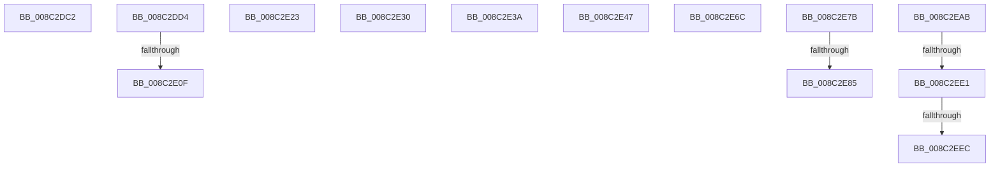

# sub_008C2DC2

- RVA: `0x008C2DC2`–`0x008C2EF1` (길이 `303` bytes)
- VA: `0x00000001408C2DC2`
- 실행 섹션: `PAGE`
- PDB 이름 있음: `아니요`; PDB Function 태그: `아니요`
- unwind 정보 RVA: `0x0008375C`
- 디코드: `69`개 명령, `303/303` bytes 표시
- 미해석 바이트: `0` (있으면 어셈블리에 `.byte`로 보존)

> 이 문서는 커널 이미지의 기계어와 PDB 기호를 분석해 생성했습니다. 4번과 5번은 함수 원형과 자료형을 바이너리 사용 방식에서 추정한 C 해석이며 원본 소스 복구 결과는 아닙니다.

## 1. Dependencies

- 직접 호출 지점: **8**; 고유 호출 대상: **7**
- 직접 호출자로 확인된 함수: **0**
- RIP 상대 이미지 참조: **0**

### Outgoing calls
- `0x008C2DFB` → [KeAbPreAcquire](../../text/21/KeAbPreAcquire_function_00210230.md) (function, `0x00210230`)
- `0x008C2E18` → [ExfAcquirePushLockExclusiveEx](../../text/20/ExfAcquirePushLockExclusiveEx_function_0020FC90.md) (function, `0x0020FC90`)
- `0x008C2E26` → [guard_dispatch_icall](../../text/6B/guard_dispatch_icall_function_006BAAD0.md) (function, `0x006BAAD0`)
- `0x008C2E3D` → [guard_dispatch_icall](../../text/6B/guard_dispatch_icall_function_006BAAD0.md) (function, `0x006BAAD0`)
- `0x008C2E4A` → [ObpRegisterObject](../AC/ObpRegisterObject_function_00ACF3EC.md) (function, `0x00ACF3EC`)
- `0x008C2E62` → [ObpPushStackInfo](../../text/21/ObpPushStackInfo_function_002109E4.md) (function, `0x002109E4`)
- `0x008C2E71` → [EtwpReleaseLoggerContext](../A0/EtwpReleaseLoggerContext_function_00A04160.md) (function, `0x00A04160`)
- `0x008C2EA0` → [EtwpUpdateEnableMask](EtwpUpdateEnableMask_function_008C0948.md) (function, `0x008C0948`)

### Direct callers
- 이 함수 시작 RVA로 연결되는 직접 call은 확인되지 않았습니다. 간접 호출은 완전히 역산할 수 없습니다.

### Static image references
- 디코드된 RIP-relative 메모리 참조가 없습니다.

## 2. Other-region calls and transfers

- 다른 실행 섹션으로 향하는 call: **5**
  - `0x008C2DFB` → [KeAbPreAcquire](../../text/21/KeAbPreAcquire_function_00210230.md) (`PAGE` → `.text`)
  - `0x008C2E18` → [ExfAcquirePushLockExclusiveEx](../../text/20/ExfAcquirePushLockExclusiveEx_function_0020FC90.md) (`PAGE` → `.text`)
  - `0x008C2E26` → [guard_dispatch_icall](../../text/6B/guard_dispatch_icall_function_006BAAD0.md) (`PAGE` → `.text`)
  - `0x008C2E3D` → [guard_dispatch_icall](../../text/6B/guard_dispatch_icall_function_006BAAD0.md) (`PAGE` → `.text`)
  - `0x008C2E62` → [ObpPushStackInfo](../../text/21/ObpPushStackInfo_function_002109E4.md) (`PAGE` → `.text`)
- call이 아닌 외부 분기/꼬리 이동: **13**
  - `0x008C2DCF` → [sub_008C2328 + 0x4D1](Unknown_function_008C2328.md) (`tail-transfer`)
  - `0x008C2E09` → [sub_00B1AF56](../B1/Unknown_function_00B1AF56.md) (`tail-transfer`)
  - `0x008C2E1E` → [sub_00B1AF56](../B1/Unknown_function_00B1AF56.md) (`tail-transfer`)
  - `0x008C2E2B` → [sub_008C28B0 + 0x48](Unknown_function_008C28B0.md) (`tail-transfer`)
  - `0x008C2E35` → [sub_008C2328 + 0x357](Unknown_function_008C2328.md) (`tail-transfer`)
  - `0x008C2E42` → [sub_008C2328 + 0x3A8](Unknown_function_008C2328.md) (`tail-transfer`)
  - `0x008C2E67` → [sub_008C28B0 + 0xE3](Unknown_function_008C28B0.md) (`tail-transfer`)
  - `0x008C2E76` → [sub_008C28B0 + 0x2A6](Unknown_function_008C28B0.md) (`tail-transfer`)
  - `0x008C2E7F` → [sub_00B1AF56 + 0x25](../B1/Unknown_function_00B1AF56.md) (`tail-transfer`)
  - `0x008C2EA6` → [sub_00B1AF56 + 0x25](../B1/Unknown_function_00B1AF56.md) (`tail-transfer`)
  - `0x008C2EDB` → [sub_00B1AF56 + 0x58](../B1/Unknown_function_00B1AF56.md) (`tail-transfer`)
  - `0x008C2EE6` → [sub_00B1AF56 + 0x58](../B1/Unknown_function_00B1AF56.md) (`tail-transfer`)
  - `0x008C2EEC` → [sub_00B1AF56 + 0x60](../B1/Unknown_function_00B1AF56.md) (`tail-transfer`)

## 3. Assembly (complete function range)

```asm
008C2DC2  4C 8B 6C 24 60                  mov r13, qword ptr [rsp + 0x60]
008C2DC7  BB 9A 00 00 C0                  mov ebx, 0xc000009a
008C2DCC  45 33 F6                        xor r14d, r14d
008C2DCF  E9 25 FA FF FF                  jmp 0x1408c27f9
008C2DD4  65 48 8B 04 25 88 01 00 00      mov rax, qword ptr gs:[0x188]
008C2DDD  45 33 C0                        xor r8d, r8d
008C2DE0  33 D2                           xor edx, edx
008C2DE2  66 FF 88 E4 01 00 00            dec word ptr [rax + 0x1e4]
008C2DE9  90                              nop
008C2DEA  49 8B 9F 90 02 00 00            mov rbx, qword ptr [r15 + 0x290]
008C2DF1  48 81 C3 98 02 00 00            add rbx, 0x298
008C2DF8  48 8B CB                        mov rcx, rbx
008C2DFB  E8 30 D4 94 FF                  call 0x140210230
008C2E00  F0 48 0F BA 2B 00               lock bts qword ptr [rbx], 0
008C2E06  48 8B F0                        mov rsi, rax
008C2E09  0F 83 47 81 25 00               jae 0x140b1af56
008C2E0F  4C 8B C3                        mov r8, rbx
008C2E12  48 8B D0                        mov rdx, rax
008C2E15  48 8B CB                        mov rcx, rbx
008C2E18  E8 73 CE 94 FF                  call 0x14020fc90
008C2E1D  90                              nop
008C2E1E  E9 33 81 25 00                  jmp 0x140b1af56
008C2E23  48 8B C2                        mov rax, rdx
008C2E26  E8 A5 7C DF FF                  call 0x1406baad0
008C2E2B  E9 C8 FA FF FF                  jmp 0x1408c28f8
008C2E30  BB 0D 00 00 C0                  mov ebx, 0xc000000d
008C2E35  E9 45 F8 FF FF                  jmp 0x1408c267f
008C2E3A  48 8B C2                        mov rax, rdx
008C2E3D  E8 8E 7C DF FF                  call 0x1406baad0
008C2E42  E9 89 F8 FF FF                  jmp 0x1408c26d0
008C2E47  48 8B CE                        mov rcx, rsi
008C2E4A  E8 9D C5 20 00                  call 0x140acf3ec
008C2E4F  41 B8 01 00 00 00               mov r8d, 1
008C2E55  41 B9 44 66 6C 74               mov r9d, 0x746c6644
008C2E5B  41 0F B6 D0                     movzx edx, r8b
008C2E5F  48 8B CE                        mov rcx, rsi
008C2E62  E8 7D DB 94 FF                  call 0x1402109e4
008C2E67  E9 27 FB FF FF                  jmp 0x1408c2993
008C2E6C  33 D2                           xor edx, edx
008C2E6E  49 8B CD                        mov rcx, r13
008C2E71  E8 EA 12 14 00                  call 0x140a04160
008C2E76  E9 DB FC FF FF                  jmp 0x1408c2b56
008C2E7B  83 79 60 00                     cmp dword ptr [rcx + 0x60], 0
008C2E7F  0F 84 F6 80 25 00               je 0x140b1af7b
008C2E85  41 0F B6 55 62                  movzx edx, byte ptr [r13 + 0x62]
008C2E8A  49 8D 45 68                     lea rax, [r13 + 0x68]
008C2E8E  C0 EA 03                        shr dl, 3
008C2E91  41 B1 01                        mov r9b, 1
008C2E94  80 E2 01                        and dl, 1
008C2E97  48 89 44 24 20                  mov qword ptr [rsp + 0x20], rax
008C2E9C  45 0F B6 C1                     movzx r8d, r9b
008C2EA0  E8 A3 DA FF FF                  call 0x1408c0948
008C2EA5  90                              nop
008C2EA6  E9 D0 80 25 00                  jmp 0x140b1af7b
008C2EAB  4C 89 B0 A0 02 00 00            mov qword ptr [rax + 0x2a0], r14
008C2EB2  49 8B BF 90 02 00 00            mov rdi, qword ptr [r15 + 0x290]
008C2EB9  48 81 C7 98 02 00 00            add rdi, 0x298
008C2EC0  0F 0D 0F                        prefetchw byte ptr [rdi]
008C2EC3  48 8B 07                        mov rax, qword ptr [rdi]
008C2EC6  48 8B C8                        mov rcx, rax
008C2EC9  48 83 E1 F0                     and rcx, 0xfffffffffffffff0
008C2ECD  48 83 F9 10                     cmp rcx, 0x10
008C2ED1  48 8D 50 F0                     lea rdx, [rax - 0x10]
008C2ED5  49 0F 46 D6                     cmovbe rdx, r14
008C2ED9  A8 02                           test al, 2
008C2EDB  0F 85 CD 80 25 00               jne 0x140b1afae
008C2EE1  F0 48 0F B1 17                  lock cmpxchg qword ptr [rdi], rdx
008C2EE6  0F 85 C2 80 25 00               jne 0x140b1afae
008C2EEC  E9 C5 80 25 00                  jmp 0x140b1afb6
```

## 4. C-style interpretation (structured pseudocode)

```c
__int64 __fastcall sub_008C2DC2(__int64 a1, int a2, int a3, __int64 a4, __int64 a5, __int64 a6, __int64 a7, __int64 a8, __int64 a9, __int64 a10, __int64 a11, __int64 a12)
{
    __int64 v_r14;
    unsigned __int64 v_stack_p20;

    v_r14 = 0;
}
```

## 5. (Beta) C Style

```c
int64_t sub_008C2DC2(int64_t Arg1, int32_t Arg2, int32_t Arg3, int64_t Arg4, uint64_t Arg5, uint64_t Arg6, uint64_t Arg7, uint64_t Arg8, uint64_t Arg9, uint64_t Arg10, uint64_t Arg11, int64_t Arg12)
{
    int64_t local_r14;
    uint64_t v_stack_p20;

    local_r14 = 0;
}
```

## 6. Execution-region graph

[열기: 2D/3D 그래프와 함수 탐색 컨트롤 패널](../../../control-panel.html?section=page&rva=0x008C2DC2&view=graph)

- 2D 그래프는 위에서 아래로 흐르고, 3D 그래프는 빈 공간을 드래그해 회전합니다. Shift+드래그는 이동, 휠은 확대·축소, 함수 노드 선택은 대상 보고서 이동입니다.

### Static fallback


