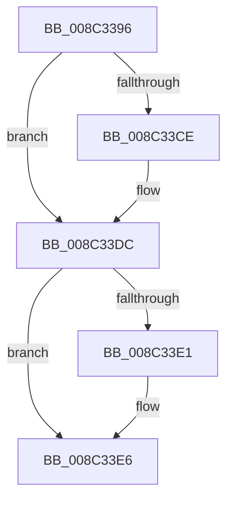

# sub_008C3396

- RVA: `0x008C3396`–`0x008C33F4` (길이 `94` bytes)
- VA: `0x00000001408C3396`
- 실행 섹션: `PAGE`
- PDB 이름 있음: `아니요`; PDB Function 태그: `아니요`
- unwind 정보 RVA: `0x000837F0`
- 디코드: `25`개 명령, `94/94` bytes 표시
- 미해석 바이트: `0` (있으면 어셈블리에 `.byte`로 보존)

> 이 문서는 커널 이미지의 기계어와 PDB 기호를 분석해 생성했습니다. 4번과 5번은 함수 원형과 자료형을 바이너리 사용 방식에서 추정한 C 해석이며 원본 소스 복구 결과는 아닙니다.

## 1. Dependencies

- 직접 호출 지점: **2**; 고유 호출 대상: **2**
- 직접 호출자로 확인된 함수: **0**
- RIP 상대 이미지 참조: **0**

### Outgoing calls
- `0x008C33BD` → [KeAbPreAcquire](../../text/21/KeAbPreAcquire_function_00210230.md) (function, `0x00210230`)
- `0x008C33D7` → [ExfAcquirePushLockExclusiveEx](../../text/20/ExfAcquirePushLockExclusiveEx_function_0020FC90.md) (function, `0x0020FC90`)

### Direct callers
- 이 함수 시작 RVA로 연결되는 직접 call은 확인되지 않았습니다. 간접 호출은 완전히 역산할 수 없습니다.

### Static image references
- 디코드된 RIP-relative 메모리 참조가 없습니다.

## 2. Other-region calls and transfers

- 다른 실행 섹션으로 향하는 call: **2**
  - `0x008C33BD` → [KeAbPreAcquire](../../text/21/KeAbPreAcquire_function_00210230.md) (`PAGE` → `.text`)
  - `0x008C33D7` → [ExfAcquirePushLockExclusiveEx](../../text/20/ExfAcquirePushLockExclusiveEx_function_0020FC90.md) (`PAGE` → `.text`)
- call이 아닌 외부 분기/꼬리 이동: **1**
  - `0x008C33F2` → [sub_008C33F4 + 0x9](Unknown_function_008C33F4.md) (`tail-transfer`)

## 3. Assembly (complete function range)

```asm
008C3396  4C 89 74 24 40                  mov qword ptr [rsp + 0x40], r14
008C339B  41 83 E2 3F                     and r10d, 0x3f
008C339F  49 81 C1 00 03 00 00            add r9, 0x300
008C33A6  49 6B EA 38                     imul rbp, r10, 0x38
008C33AA  66 FF 88 E4 01 00 00            dec word ptr [rax + 0x1e4]
008C33B1  45 33 C0                        xor r8d, r8d
008C33B4  49 03 E9                        add rbp, r9
008C33B7  33 D2                           xor edx, edx
008C33B9  48 8B CD                        mov rcx, rbp
008C33BC  90                              nop
008C33BD  E8 6E CE 94 FF                  call 0x140210230
008C33C2  F0 48 0F BA 6D 00 00            lock bts qword ptr [rbp], 0
008C33C9  4C 8B F0                        mov r14, rax
008C33CC  73 0E                           jae 0x1408c33dc
008C33CE  4C 8B C5                        mov r8, rbp
008C33D1  48 8B D0                        mov rdx, rax
008C33D4  48 8B CD                        mov rcx, rbp
008C33D7  E8 B4 C8 94 FF                  call 0x14020fc90
008C33DC  4D 85 F6                        test r14, r14
008C33DF  74 05                           je 0x1408c33e6
008C33E1  41 C6 46 0A 01                  mov byte ptr [r14 + 0xa], 1
008C33E6  48 8B 0E                        mov rcx, qword ptr [rsi]
008C33E9  4C 8B 74 24 40                  mov r14, qword ptr [rsp + 0x40]
008C33EE  48 39 71 08                     cmp qword ptr [rcx + 8], rsi
008C33F2  75 09                           jne 0x1408c33fd
```

## 4. C-style interpretation (structured pseudocode)

```c
__int64 __fastcall sub_008C3396(__int64 a1, int a2, int a3, __int64 a4, __int64 a5, __int64 a6, __int64 a7, __int64 a8)
{
    __int64 result;
    __int64 v_r10;
    __int64 v_rbp;
    unsigned __int64 v_stack_p40;

    v_stack_p40 = v_r14;
    v_r10 = (unsigned int)((v_r10) & (63));
    a4 = (a4) + (768);
    v_rbp = (v_rbp) * (v_r10);
    a3 = 0;
    v_rbp = (v_rbp) + (a4);
    a2 = 0;
    result = KeAbPreAcquire(v_rbp, a2, a3, a4);
    if (!(condition_is_above_or_equal)) {
        a3 = v_rbp;
        a2 = result;
        a1 = v_rbp;
        result = ExfAcquirePushLockExclusiveEx(a1, a2, a3, a4);
    }
    if (result != 0) {
        *(unsigned __int8 *)(result + 10) = 1;
    }
}
```

## 5. (Beta) C Style

```c
int64_t sub_008C3396(int64_t Arg1, int32_t Arg2, int32_t Arg3, int64_t Arg4, uint64_t Arg5, uint64_t Arg6, uint64_t Arg7, int64_t Arg8)
{
    int64_t result;
    int64_t local_r10;
    int64_t local_rbp;
    uint64_t v_stack_p40;

    v_stack_p40 = local_r14;
    local_r10 = (uint32_t)((local_r10) & (63));
    Arg4 = (Arg4) + (768);
    local_rbp = (local_rbp) * (local_r10);
    Arg3 = 0;
    local_rbp = (local_rbp) + (Arg4);
    Arg2 = 0;
    result = KeAbPreAcquire(local_rbp, Arg2, Arg3, Arg4);
    if (!(condition_is_above_or_equal)) {
        Arg3 = local_rbp;
        Arg2 = result;
        Arg1 = local_rbp;
        result = ExfAcquirePushLockExclusiveEx(Arg1, Arg2, Arg3, Arg4);
    }
    if (result != 0) {
        *(uint8_t *)(result + 0xA) = 1;
    }
}
```

## 6. Execution-region graph

[열기: 2D/3D 그래프와 함수 탐색 컨트롤 패널](../../../control-panel.html?section=page&rva=0x008C3396&view=graph)

- 2D 그래프는 위에서 아래로 흐르고, 3D 그래프는 빈 공간을 드래그해 회전합니다. Shift+드래그는 이동, 휠은 확대·축소, 함수 노드 선택은 대상 보고서 이동입니다.

### Static fallback


